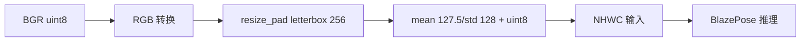
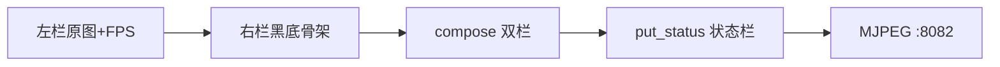
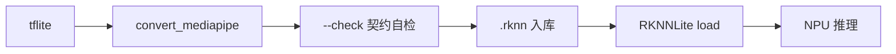
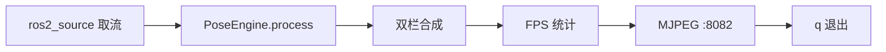

## 实验9：基于骨骼关键点的肢体检测实验（4h）

> ✅ **源码已核实** 本实验源码位于 `ros2_ws/src/xflz_eai_car1/vision/10_pose_landmark/`。**方案 = mediapipe `pose_landmark_full` tflite 转 RKNN（fp16/rk3576），板上 RKNNLite NPU 推理 33 点骨架**（vendor 10_姿态检测 视觉对齐：左=原图+FPS 红字，右=黑底红点绿线骨架）。单模型整图推理（256×256 输入，无独立检测器）。测试 45 项 x86 全绿，模型已转换入库（用户，pose_landmark_full.rknn）。

### 1.1 关联知识点

- 1.1.1 姿态估计原理 > 原理 > 人体姿态估计（Pose Estimation）定位人体关键点（关节/肢体端点），区别于检测的框与分割的掩码；BlazePose 单模型整图输出 33 点 [x,y,z,vis]
- 1.2.1 输入契约与预处理 > 流程 > 整图 letterbox 256×256（resize_pad）→ RGB → **mean 127.5/std 128 + uint8 输入**（rknn 内部归一化，手动 /127.5−1 破坏输入）
- 1.2.2 关键点解码 > 流程 > 33×4 解析（x,y,z,vis）→ 逆映射 `px=(norm×256−pad)/scale` 还原原图坐标；vis<0.5 跳过绘制
- 1.3.1 骨架拓扑绘制 > 概念 > `POSE_CONNECTIONS` 35 边拓扑（头颈/躯干/四肢连接），红点 r6 + 绿线 2px，黑底双栏显示
- 1.3.2 实时姿态可视化 > 流程 > 摄像头取流 → 整图推理 → 33 点解码 → 双栏（原图+FPS | 黑底骨架）→ MJPEG 推流 :8082

### 1.2 实验目标

1. 掌握人体姿态估计的原理与 BlazePose 模型架构（单模型整图 33 点）— 原理理解
2. 实现关键点解码、逆映射与骨架拓扑绘制，完成实时姿态可视化 — 独立完成
3. 理解 BlazePose 的输入归一化契约（mean/std + uint8）与 vendor 方案差异 — 迁移应用

### 1.3 实验环境

| 类别 | 配置 |
|------|------|
| 硬件 | 具身智能实验箱 B2（XFLZ_EAI_B2_PRO，RK3576 SoC，6TOPS NPU，含 HP60C 深度相机） |
| OS | Ubuntu 22.04 + ROS2 Humble（板载 ros2_venv，rknnlite 2.3.2 / rknn-toolkit-lite2） |
| 核心库 | OpenCV、NumPy、rknnlite（RKNNLite）、PyYAML；mjpeg_streamer（不装则内置回退） |
| 模型 | `models/pose_landmark_full.rknn`（fp16，256×256 整图输入，33 关键点 + presence + 分割/world 输出） |
| 主入口 | `python -m pose_landmark_core.camera_demo --config config/pose_config.yaml --ros [--display]` |

### 1.4 实验难度

- 难度: ⭐⭐ 设计性
- 重点: 33 点解码与逆映射 + 35 边骨架拓扑绘制 + 实时可视化
- 难点: mean 127.5/std 128 + uint8 输入契约（手动归一化会破坏输入）；vis 可见度过滤

### 1.5 实验现象

**快速验证流程**：

1. 进入项目目录：`cd ~/ros2_ws/src/xflz_eai_car1/vision/10_pose_landmark`
2. 单图模式：`PYTHONPATH=car1_pose_landmark:$PYTHONPATH python3 -m pose_landmark_core.demo_image --config config/pose_config.yaml --display --save out.jpg`
   - 右栏黑底骨架贴合人体（33 点红点 + 绿线，站姿可辨）
3. 相机实时（板上标准）：
4. 无显示器：浏览器 `http://<板IP>:8082/pose.mjpg`

```bash
cd ~/ros2_ws/src/xflz_eai_car1/vision/10_pose_landmark

# 单张图片推理
PYTHONPATH=car1_pose_landmark:$PYTHONPATH python3 -m pose_landmark_core.demo_image \
  --config 	config/pose_config.yaml --save out.jpg
  
# 视频流推理
source /opt/ros/humble/setup.bash && source ~/ros2_ws/install/setup.bash
ros2 launch ascamera hp60c.launch.py        # 终端 1
PYTHONPATH=car1_pose_landmark:$PYTHONPATH python3 -m pose_landmark_core.camera_demo \
  --config config/pose_config.yaml --ros    # 终端 2
```

**预期效果描述**：

- 单图：右栏黑底骨架贴合人体（33 点红点 + 绿线，站姿可辨），左栏原图 + FPS 红字
- 实时：骨架实时跟随动作，左栏 FPS 红字；MJPEG `:8082/pose.mjpg` 流畅
- 无脸/无人时不崩，状态栏 `Pose: --`

**执行现象**：

- 单图推理命令约 0.3-0.8 秒返回，终端无额外输出（静默成功），当前目录生成 `out.jpg` 双栏图
- 板端实时模式下，终端每帧更新 FPS（红字叠加在左栏），状态栏显示 `FPS: N Pose: OK`；无人体时显示 `Pose: --`
- 浏览器打开 `http://<板IP>:8082/pose.mjpg` 可看到实时骨架流，延迟 < 100ms
- 站立姿态：33 点红点覆盖头（鼻/眼/耳 6 点）、肩/髋（4 点）、肘/腕/膝/踝（12 点），绿线连接 35 条边形成完整骨架
- 部分遮挡场景：被遮挡关节的 vis 降低，对应点和连线被跳过绘制，骨架局部断裂但不崩溃
- pytest 验证：`PYTHONPATH=car1_pose_landmark:$PYTHONPATH python3 -m pytest tests/ -v` 45 项全绿（x86 fake 注入）


### 1.6 实验步骤

#### 整体流程图


---

#### 步骤1：姿态估计与 BlazePose 认知（阶段一：能运行，20min）

> 📌 本步骤对应源码：`pose_landmark_core/pose.py`、`engine.py`

**知识点讲解**：

**姿态估计问题与 BlazePose 方案（1.1.1）**

- **原理**：人体姿态估计（Pose Estimation）定位**人体关键点**——33 个点覆盖头（鼻/眼/耳）、躯干（肩/髋）、四肢（肘/腕/膝/踝），每点含 `[x, y, z, visibility]`（z 为相对深度，vis 为可见度）。BlazePose 采用**单模型整图推理**（256×256，无独立检测器——mediapipe-rknn 参考即此形态），区别于实验8 人脸的双模型级联。33 点骨架是动作识别（实验11）、体感控制、康复评估的基础。vendor 用 mediapipe solutions（板上 aarch64 不可装），本实验用 RKNN BlazePose → RKNNLite NPU。
- **源码对应**：`pose.py`（POSE_CONNECTIONS 35 边拓扑、decode_pose 33×4 解析）；`engine.py`（PoseEngine 单模型引擎，presence<阈值 → 空结果）

**知识储备补充**：

- **姿态估计分类体系**：人体姿态估计按人数分为**单人姿态估计**（Single-Person）和**多人姿态估计**（Multi-Person）。多人方法又分为自顶向下（top-down：先检测人体框，再逐框估姿态）和自底向上（bottom-up：先检测所有关键点，再分组到各人）。BlazePose 属于**单人姿态估计**——整图推理，假设画面中最多一个主体人体（presence 置信度控制）。相比 top-down 方案（如 Faster-RCNN + HRNet 的两阶段），BlazePose 省去检测器，单模型端到端输出 33 点，延迟更低（RKNN fp16 板端实测 < 50ms/帧）。
- **33 点索引约定**：BlazePose 的 33 个关键点遵循 MediaPipe 官方索引——0 鼻、1 左眼内角、2 左眼、3 左眼外角、4 右眼内角、5 右眼、6 右眼外角、7 左耳、8 右耳、9 嘴左、10 嘴右、11 左肩、12 右肩、13 左肘、14 右肘、15 左腕、16 右腕、17 左小指、18 右小指、19 左食指、20 右食指、21 左拇指、22 右拇指、23 左髋、24 右髋、25 左膝、26 右膝、27 左踝、28 右踝、29 左脚跟、30 右脚跟、31 左脚尖、32 右脚尖。每个关键点携带 4 个值 $[x, y, z, \text{vis}]$，其中 $x, y$ 为归一化坐标（0-1），$z$ 为相对深度，$\text{vis}$ 为可见度置信度（0-1）。


- **BlazePose 架构对比**：BlazePose 与实验8 的 BlazeFace 人脸关键点检测有三点核心差异：

  (1) 输入分辨率——256×256（pose）vs 128×128（face）；

  (2) 关键点数量——33 点（全身）vs 468 点（面部细粒度）；

  (3) 模型架构——BlazePose 用单模型整图回归所有关键点（无独立检测器），BlazeFace 用双模型级联（检测器定位人脸 + 关键点回归器）。BlazePose 的单模型设计牺牲了多人支持，但显著降低延迟，适合嵌入式实时场景。

- **参考资源**：MediaPipe 官方文档 Pose Landmark Model；Bazarevsky et al., *BlazePose: On-device Real-time Body Pose Tracking*, CVPRW 2020；MediaPipe GitHub 33-point Pose Landmark。

**配置参数速查表**（`config/pose_config.yaml`，按区块分列）：

| 区块 | 参数 | 类型 | 默认/示例 | 说明 |
|------|------|------|-----------|------|
| `model` | `pose_model` | str | `models/pose_landmark_full.rknn` | pose 模型（fp16/rk3576，256²） |
| `model` | `min_detection_confidence` | float | `0.5` | pose presence 阈值 |
| `backend` | `core_mask` | int | `0` | NPU 核：0=AUTO, 1/2/4 单核, 3/7 多核 |
| `backend` | `verbose` | bool | `false` | RKNNLite 调试输出 |
| `source` | `mode` | str | `image` | image/ros/camera（板上标准=ros） |
| `source` | `rgb_path` | str | `images/pose_demo.jpg` | mode=image 时必填 |
| `source` | `ros.rgb_topic` | str | `/ascamera_hp60c/.../rgb0/image` | 相机话题（严禁 remap） |
| `source` | `ros.timeout` | float | `5.0` | 首帧等待秒数 |
| `display` | `show` | bool | `false` | 本地窗口（SSH 无显示默认关） |
| `display` | `window_name` | str | `Pose Detection` | 窗口名 |
| `server` | `port` | int | `8082` | MJPEG 端口（09=8081 后） |
| `server` | `stream_name` | str | `pose.mjpg` | MJPEG 流名（已含 `.mjpg` 勿再追加） |

> **说明**：`backend.core_mask=0`（板上 2 核 NPU 用 auto 最稳）；`source.mode=ros` 与 ascamera 配合；`stream_name` 已含 `.mjpg` 勿重复。

**操作步骤**：

1. 查看 33 点索引表与 POSE_CONNECTIONS（头颈/躯干/四肢连线），理解骨架语义
2. 单测理解引擎契约：`pytest tests/`（x86 全绿，fake 注入）
3. 思考：33 点姿态与 468 点人脸的关键点检测异同？（单模型 vs 双模型、点密度、z 语义）

**流程图（姿态估计问题）**：


**易错点**：
- ⚠️ 不得跨实验合跑 pytest——共享模块名（config/preprocess 等）

---

#### 步骤2：输入契约与 letterbox（阶段一：能运行，20min）

> 📌 本步骤对应源码：`pose_landmark_core/pose.py` prepare / resize_pad

**知识点讲解**：

**BlazePose 输入契约（1.2.1）**
- **原理**：BlazePose 输入契约与 BlazeFace 不同：**mean 127.5/std 128 + uint8 输入**——rknn 模型内部做归一化（`(x-127.5)/128`），调用方**只做 BGR→RGB 转 uint8 即可，手动 /127.5−1 会破坏输入**（板端实测结论）。`resize_pad` 做 letterbox：等比缩放 + 填充到 256×256（保持宽高比）。这一契约是转换脚本 `convert_mediapipe.py`（对齐 mediapipe-rknn/models/pose_landmark/convert.py）与推理侧必须一致的关键。
- **源码对应**：`pose.py` prepare（RGB uint8 契约）/ resize_pad（letterbox）；`convert_mediapipe.py`（tflite→rknn，127.5/128 契约）

**知识储备补充**：

- **mean/std 归一化与 uint8 契约**：模型转换时配置 `mean=[127.5]`、`std=[128]`，RKNN 推理引擎在 NPU 内部对 uint8 输入执行归一化：
$$
  x_{\text{norm}} = \frac{x - 127.5}{128}, \quad x_{\text{norm}} \in [-1, 1]
  $$
  
调用方只需确保输入为 RGB 格式、uint8 数据类型、shape `(1, 256, 256, 3)` 的 NHWC 张量。**手动除以 127.5 再减 1 会导致双重归一化**——板端实测 presence 从 0.998 暴跌至 0.055，骨架完全不输出。这与实验4 YOLOv8 的"不做归一化、直喂 uint8"是同一类设计思路：量化模型内部已含 scale/zero_point，外部归一化会破坏输入分布。
- **letterbox 策略对比**：本实验的 `resize_pad`（`pose.py` L42-53）采用灰边填充（`np.full((size, size, 3), 114, dtype=np.uint8)`），而实验4 YOLOv8 的 letterbox 默认用黑边填充（`pad_value=0`）。填充颜色不影响推理精度（模型对 padding 区域不敏感），但影响逆映射——灰边 114 是 mediapipe-rknn 参考实现的约定，保持与训练时一致。

- **参考资源**：RKNN Toolkit2 User Guide 归一化配置文档；MediaPipe Pose Landmark 模型规格；mediapipe-rknn GitHub 项目 pose_landmark 转换脚本。

**操作步骤**：

1. 手工验证预处理（合成 BGR 帧，无需真实图片；`prepare`/`resize_pad` 纯 cv2，x86 可跑）：
   ```bash
   # 执行目录：~/ros2_ws/src/xflz_eai_car1/vision/10_pose_landmark
   cd ~/ros2_ws/src/xflz_eai_car1/vision/10_pose_landmark
   
   PYTHONPATH=car1_pose_landmark:$PYTHONPATH python3 -c "
   import numpy as np
   from pose_landmark_core.pose import resize_pad, prepare
   bgr = np.zeros((100, 80, 3), np.uint8)        # 合成 BGR 帧
   padded, scale, pad = resize_pad(bgr)          # letterbox → 256×256 灰边
   inp = prepare(padded)                         # BGR→RGB uint8 NHWC
   print('padded:', padded.shape, padded.dtype, 'scale', round(float(scale),3), 'pad', pad)
   print('输入契约:', inp.shape, inp.dtype, '（uint8 直喂，勿手动 /127.5−1）')
   # 真图：img = cv2.imread('images/pose_demo.jpg')
   "
   # 预期：padded (256,256,3) uint8 scale 2.56 pad (26, 0)；输入契约 (1,256,256,3) uint8
   ```
2. 单测理解 resize_pad 的 scale/pad 计算（`px=(norm×256−pad)/scale` 逆映射依赖）
3. 思考：为什么 fp16 人脸模型要 [0,1] 归一化，而 pose 模型用 127.5/128 + uint8？——模型转换时量化/归一化方式不同

**流程图（输入契约）**：



**易错点**：
- ⚠️ 手动 /127.5−1 归一化 → 输入破坏（板端实测）；必须 uint8 直喂

---

#### 步骤3：33 点解码与逆映射（阶段二：能理解，30min）

> 📌 本步骤对应源码：`pose_landmark_core/pose.py` decode_pose

**知识点讲解**：

**解码与坐标还原（1.2.2）**

- **原理**：模型输出 33 关键点（每点 [x,y,z,vis]，模型坐标系为归一化 [0,1]），`decode_pose`（33×4 解析）把归一化坐标**逆映射回原图**：`px = (norm × 256 − pad) / scale`——即先乘回 256（letterbox 尺寸），减去 pad（填充偏移），除以 scale（缩放比例），得到原始图像像素坐标。`vis`（可见度）是关键点质量指标：`vis < 0.5` 的点（被遮挡/出画）跳过绘制。presence（整帧是否有人的置信度）低于阈值时引擎返回空结果（engine.py），避免无人体时输出垃圾骨架。
- **源码对应**：`pose.py` decode_pose（33×4 解析 + 逆映射公式）；`engine.py`（presence 阈值 → 空结果）

**知识储备补充**：

- **逆映射数学推导**：`resize_pad` 将原图 $(H_0, W_0)$ 等比缩放到 $(H_s, W_s)$，再 pad 到 256×256。设缩放因子 $s = \min(256/W_0, 256/H_0)$，则 $W_s = \lfloor W_0 \cdot s \rfloor$，$H_s = \lfloor H_0 \cdot s \rfloor$，pad 偏移 $pad_x = (256 - W_s) / 2$，$pad_y = (256 - H_s) / 2$。模型输出的归一化坐标 $x_{\text{norm}}, y_{\text{norm}} \in [0, 1]$ 对应 256×256 空间中的像素位置 $x_{256} = x_{\text{norm}} \times 256$，$y_{256} = y_{\text{norm}} \times 256$。逆映射公式为：

  $$
  px = \frac{x_{\text{norm}} \times 256 - pad_x}{s}, \quad py = \frac{y_{\text{norm}} \times 256 - pad_y}{s}
  $$

  其中 $px, py$ 为原图像素坐标。$z$ 坐标的逆映射为 $z' = z / s$（相对深度按相同比例缩放）。源码 `pose.py` decode_pose 中 `lm[:, 0] = (lm[:, 0] - pad_w) / scale` 正是此公式的实现。该逆映射是后续骨架绘制、关节角度计算、动作分类（实验11）的基础。
- **vis 可见度与 presence 语义**：`vis`（visibility）是每个关键点的可见度置信度，取值 $[0, 1]$，由模型对关键点遮挡/出画面情况的判断输出。`vis < 0.5` 表示该点不可靠（被遮挡或超出画面），绘制时跳过该点及其相连的边。`presence`（`outputs[1]`）是整帧是否包含人体的全局置信度，低于 `min_detection_confidence`（默认 0.5）时引擎返回空结果（`PoseResult(landmarks=None)`），避免无人时输出随机噪声骨架。两者配合实现了"无人不崩、遮挡不断"的鲁棒行为。
- **参考资源**：MediaPipe Pose Landmark Model 输出格式文档；BlazePose 论文（Bazarevsky et al., 2020）坐标系说明。

**操作步骤**：

1. 单图运行，打印某帧 33 点的 x/y/vis 值，理解逆映射效果
2. 部分遮挡测试：用手遮挡半边身体，观察 vis<0.5 的点是否被跳过绘制
3. 手工验证逆映射：对已知点手算 `px=(norm×256−pad)/scale`，与输出对比
4. 思考：z 坐标（相对深度）的语义与限制？vis 过滤的意义？

```bash
cd ~/ros2_ws/src/xflz_eai_car1/vision/10_pose_landmark

# 单张图片推理
PYTHONPATH=car1_pose_landmark:$PYTHONPATH python3 -m pose_landmark_core.demo_image \
  --config 	config/pose_config.yaml --save out.jpg
```

**流程图（解码与逆映射）**：


**易错点**：
- ⚠️ 逆映射公式与 resize_pad 的 scale/pad 必须配对使用（引擎已封装）

---

#### 步骤4：骨架拓扑绘制（阶段二：能理解，25min）

> 📌 本步骤对应源码：`pose_landmark_core/engine.py` draw_skeleton、`pose.py` POSE_CONNECTIONS

**知识点讲解**：

**35 边骨架拓扑（1.3.1）**

- **原理**：33 个孤立点要变成"人体骨架"，靠 `POSE_CONNECTIONS` **35 边拓扑**定义连接关系（头颈、躯干、双臂、双腿、手部骨架等）。`draw_skeleton`（engine.py）按拓扑逐边连线：红点 r6（半径 6 像素）+ 绿线 2px，`vis < 0.5` 的点跳过（不画其相连的边）。黑底右栏让骨架对比度最高，vendor 视觉对齐（右=黑底红点绿线骨架）。
- **源码对应**：`pose.py` POSE_CONNECTIONS（35 边）；`engine.py` draw_skeleton（vis 过滤 + 红点绿线绘制）

**知识储备补充**：

- **POSE_CONNECTIONS 拓扑结构**：35 条连接边覆盖五个区域——

  (1) **头部**：鼻→左眼内角→左眼→左眼外角（0-1-2-3），鼻→右眼内角→右眼→右眼外角（0-4-5-6），左眼外角→左耳（3-7），右眼外角→右耳（6-8）；

  (2) **颈部**：左耳→左肩（未直接连接，通过面部链路间接覆盖），左肩→右肩（11-12）；

  (3) **躯干**：左肩→左髋（11-23），右肩→右髋（12-24），左髋→右髋（23-24）；

  (4) **上肢**：左肩→左肘→左腕（11-13-15），左腕→左小指/食指/拇指（15-17/19/21），右臂同理；

  (5) **下肢**：左髋→左膝→左踝（23-25-27），左踝→左脚跟/脚尖（27-29/31），右腿同理。拓扑定义在 `pose.py` L13-19 的 `frozenset` 中，共 35 个元组。


- **骨架绘制的 vis 过滤逻辑**：`draw_skeleton`（`engine.py`）遍历每条边 `(a, b)`，若 `landmarks[a, 3] < VIS_THRESHOLD` 或 `landmarks[b, 3] < VIS_THRESHOLD`（任一端点不可见），则跳过该边的绘制。同时，vis 低于阈值的点本身也不绘制红点。这实现了"遮挡区域骨架局部断裂"的自然行为——用户看到的是"可见部分的骨架"，而非强行连线导致的穿帮。
- **参考资源**：MediaPipe Pose Landmark Connection 拓扑定义（Apache-2.0）；OpenCV `cv2.circle` / `cv2.line` 绘制 API。

**操作步骤**：

1. 单图输出双栏，观察骨架（红点绿线）是否贴合人体姿态
2. 动手改造：改点的半径/颜色、线的粗细，或只绘制上半身拓扑
3. 思考：35 边拓扑如何定义？手部/足部的细粒度连接作用？

```bash
cd ~/ros2_ws/src/xflz_eai_car1/vision/10_pose_landmark

# 单张图片推理
PYTHONPATH=car1_pose_landmark:$PYTHONPATH python3 -m pose_landmark_core.demo_image \
  --config 	config/pose_config.yaml --save out.jpg
```

**流程图（骨架拓扑绘制）**：


**易错点**：
- ⚠️ 连线两端点任一 vis<0.5 即跳过该边（绘制逻辑）

---

#### 步骤5：双栏可视化与推流（阶段三：能改造，25min）

> 📌 本步骤对应源码：`pose_landmark_core/view.py`、`mjpeg_server.py`

**知识点讲解**：

**双栏合成与状态栏（1.3.2）**

- **原理**：`view.py` 双栏合成：左栏原图 + FPS 红字，右栏黑底 33 点骨架，底部状态栏（`FPS: N  Pose: OK/--`）。`mjpeg_server.py` 提供 MJPEG 流 `:8082/pose.mjpg`（09=8081 之后，避免端口冲突）。双栏设计让学习者同时看到"原始画面"与"姿态理解结果"，FPS 红字实时反馈性能。
- **源码对应**：`view.py`（双栏 + 状态栏 + FPS 红字）；`mjpeg_server.py`（:8082 推流）

**知识储备补充**：

- **MJPEG 推流架构**：`mjpeg_server.py` 使用 `mjpeg_streamer` 库（pip 安装），`MjpegServer` 类封装了 HTTP 服务器 + JPEG 编码流。核心接口：`set_frame(bgr)` 接收 BGR numpy 数组，库内部编码为 JPEG 并通过 HTTP chunked transfer 推送到订阅者。流地址格式 `http://<host>:<port>/<stream_name>.mjpg`，本实验使用 `:8082/pose.mjpg`（区别于实验8 的 `:8081/face.mjpg`）。`start()` 方法含端口预检——若端口已被占用（上个 demo 未关），立即报错退出，避免静默 404。
- **状态栏设计**：`put_status`（`view.py`）在双栏底部绘制 24px 高黑条，白字显示 `FPS: N Pose: OK/--`。`Pose: OK` 表示当前帧检测到人体（`result.detected = True`），`Pose: --` 表示无人或 presence 低于阈值。`add_fps` 在左栏左上角叠加红字 `FPS : N`，字体大小 0.9、红色 `(0,0,255)`，与 vendor 视觉风格对齐。
- **参考资源**：mjpeg_streamer PyPI 文档；OpenCV `cv2.putText` API。

**操作步骤**：

1. 单图保存双栏：`PYTHONPATH=car1_pose_landmark:$PYTHONPATH python3 -m pose_landmark_core.demo_image --config config/pose_config.yaml --save out.jpg`
2. 无显示器查看 MJPEG 流（浏览器 :8082/pose.mjpg）
3. 动手改造：在左栏叠加"站立/举手"文字（用肩-肘-腕角度判断），为实验11 铺垫

```bash
cd ~/ros2_ws/src/xflz_eai_car1/vision/10_pose_landmark

# 单张图片推理
PYTHONPATH=car1_pose_landmark:$PYTHONPATH python3 -m pose_landmark_core.demo_image \
  --config 	config/pose_config.yaml --save out.jpg
```

**流程图（双栏可视化）**：



**易错点**：
- ⚠️ 端口 :8082 与其他实验错开（09=8081）；占用时改 config

---

#### 步骤6：RKNNLite 部署（阶段三：能改造，20min）

> 📌 本步骤对应源码：`pose_landmark_core/backend.py`、`convert_mediapipe.py`

**知识点讲解**：

**转换与部署（1.3.2）**
- **原理**：`convert_mediapipe.py` 在 x86 转换环境把 `pose_landmark_full.tflite` 转 RKNN（fp16 默认，`--dtype fp|i8`），`--check` 自检输出契约。板上用 `RKNNLiteBackend`（rknn-toolkit-lite2 2.3.2，core_mask 默认 0=AUTO）NPU 推理。fp16 对姿态回归（连续坐标）精度优于 int8；如需 int8 需校准集。产物 `models/pose_landmark_full.rknn` 已入库。
- **源码对应**：`convert_mediapipe.py`（tflite→rknn + --check）；`backend.py`（RKNNLiteBackend：load / init_runtime(core_mask) / predict）

**知识储备补充**：

- **fp16 vs int8 量化选择**：姿态估计是**回归任务**（输出连续坐标 $x, y, z$），对量化噪声敏感——int8 的量化步长 $\Delta = (x_{\max} - x_{\min}) / 255$ 在关键点密集区域（如面部 6 点）可能引入 > 1px 的坐标误差，而 fp16 保留 10 位尾数，精度损失可忽略。本实验选择 fp16（`--dtype fp` 默认），实测 256×256 输入在 RK3576 NPU 上推理延迟 < 50ms，满足实时要求。若需进一步压缩模型体积或提升推理速度，可考虑 int8 + 校准集（`--dtype i8 --dataset calib.txt`），但需验证关键点精度下降在可接受范围内。
- **RKNNLite core_mask 语义**：`core_mask` 参数控制 NPU 核分配——`0` = NPU_CORE_AUTO（自动选择最优核），`1` = NPU_CORE_0，`2` = NPU_CORE_1，`4` = NPU_CORE_2，`3` = NPU_CORE_0_1（双核并行），`7` = NPU_CORE_0_1_2（三核并行）。RK3576 有 3 个 NPU 核（共 6TOPS），单模型默认用 AUTO 即可；多模型并行时需手动绑定不同核避免竞争。`init_runtime(core_mask=None)` 在 rknnlite 2.3.2 会报 `core mode not supported` 错误——必须显式传整数值。
- **参考资源**：RKNN Toolkit2 User Guide 量化精度对比；RKNN Toolkit Lite2 API 文档 core_mask 参数说明；MediaPipe Pose Landmark tflite 模型规格。

**操作步骤**：

1. 模型契约自检
2. 查看 `config/pose_config.yaml` 的 backend.core_mask（默认 0=AUTO）
3. （可选）x86 转换环境重转 fp16：`PYTHONPATH=car1_pose_landmark:$PYTHONPATH python3 -m pose_landmark_core.convert_mediapipe --all`

```bash
# 执行目录：ros2_ws/src/xflz_eai_car1/vision/10_pose_landmark
# PYTHONPATH 保留原值
cd ~/ros2_ws/src/xflz_eai_car1/vision/10_pose_landmark

# 模型契约自检
PYTHONPATH=car1_pose_landmark:$PYTHONPATH python3 -m pose_landmark_core.convert_mediapipe --check

# fp16
PYTHONPATH=car1_pose_landmark:$PYTHONPATH python3 -m pose_landmark_core.convert_mediapipe --all

# int8 自己准备量化数据集
PYTHONPATH=car1_pose_landmark:$PYTHONPATH python -m pose_landmark_core.convert_mediapipe --dtype i8 --dataset calib.txt
```

**流程图（RKNNLite 部署）**：



**易错点**：
- ⚠️ 转换环境需 tensorflow≤2.14 + ml-dtypes 0.2.0（README 说明）
- ⚠️ 板上必须 RKNNLite；core_mask 按 RK3576 三核配置

---

#### 步骤7：实时摄像头演示（阶段三：能改造，30min）

> 📌 本步骤对应源码：`pose_landmark_core/camera_demo.py`、`pose_landmark_node.py`

**知识点讲解**：

**实时链路（1.3.2）**
- **原理**：`camera_demo.py` 循环：取流（--ros ascamera 话题标准 / --camera N V4L2 回退，NOVATEK 相机强制 YUYV）→ PoseEngine.process → 双栏合成 → FPS 统计 → MJPEG 推流（:8082）→ q 退出。ROS 节点模式可选（colcon 编译后 launch）。**PYTHONPATH 必须保留 $PYTHONPATH**（覆盖丢 Humble 路径 → venv PyPI rclpy → ModuleNotFoundError）。
- **源码对应**：`camera_demo.py`（实时循环 / cap/engine 注入）；`pose_landmark_node.py`（ROS 节点，remove_ros_args 已修）；`ros2_source.py`（ascamera 取流）

**知识储备补充**：

- **实时管线时序分析**：单帧处理包含四个阶段

  (1) 取流：ROS 模式从 `/ascamera_hp60c/camera_publisher/rgb0/image` 话题获取 BGR 帧（延迟取决于相机帧率，HP60C 默认 30fps）；V4L2 模式直接 `cap.read()`；

  (2) 预处理：`resize_pad` letterbox + `prepare` BGR→RGB uint8（< 1ms）；

  (3) NPU 推理：`RKNNLiteBackend.predict` 执行整图推理（256×256 fp16，< 50ms）；

  (4) 后处理：`decode_pose` 逆映射 + `draw_skeleton` 绘制 + `compose` 双栏合成（< 5ms）。总延迟 < 60ms/帧，理论帧率 > 15 FPS。FPS 红字每帧更新，状态栏每帧刷新。

- **ROS 话题取流约束**：`ros2_source.py` 的 `Ros2Camera` 订阅 `/ascamera_hp60c/camera_publisher/rgb0/image`（sensor_msgs/Image），回调中将 ROS Image 消息转为 OpenCV BGR numpy 数组。**话题名严禁 remap**——HP60C 驱动硬编码发布该话题。`--ros` 模式要求先启动 `ros2 launch ascamera hp60c.launch.py`（终端 1），否则回调永不触发，超时后报错退出。`PYTHONPATH=car1_pose_landmark:$PYTHONPATH` 中的 `:$PYTHONPATH` 保留原路径——覆盖会导致 venv 中的 rclpy 不可达，报 `ModuleNotFoundError: No module named 'rclpy'`。

- **参考资源**：ROS2 Topic QoS 文档；V4L2 YUYV/MJPG 格式说明；NOVATEK NT99141 相机 MJPG 兼容性问题。

**操作步骤**：

1. 相机实时（板上标准）：
   ```bash
   # 执行目录：ros2_ws/src/xflz_eai_car1/vision/10_pose_landmark
   cd ~/ros2_ws/src/xflz_eai_car1/vision/10_pose_landmark
   source /opt/ros/humble/setup.bash && source ~/ros2_ws/install/setup.bash
   
   ros2 launch ascamera hp60c.launch.py        # 终端 1
   PYTHONPATH=car1_pose_landmark:$PYTHONPATH python3 -m pose_landmark_core.camera_demo \
     --config config/pose_config.yaml --ros    # 终端 2
   ```
2. 动作测试：站立/举手/下蹲，观察骨架实时跟随
3. 无脸测试：画面无人，观察状态栏 `Pose: --` 且不崩溃
4. 动手改造：计算肩-肘-腕夹角并在状态栏显示，为动作分类（实验11）铺垫

**流程图（实时演示）**：



**易错点**：
- ⚠️ PYTHONPATH 保留 $PYTHONPATH；--ros 需 ascamera 先起、话题严禁 remap
- ⚠️ UVC 回退强制 YUYV（NOVATEK 相机 MJPG 损坏）

---

### 1.7 常见问题

| 问题 | 原因 | 解决方法 |
|------|------|---------|
| 骨架乱飞/无输出 | 手动归一化破坏了输入 | 契约是 mean 127.5/std 128 + uint8，勿 /127.5−1（板端实测） |
| 骨架错位 | 逆映射公式与 letterbox 不配对 | `px=(norm×256−pad)/scale`（resize_pad 同一参数） |
| 遮挡后骨架残缺 | vis<0.5 的点被跳过 | 属正常行为（vis 过滤）；确认遮挡恢复 |
| 无人时输出垃圾骨架 | presence 阈值未生效 | engine.py presence<阈值 → 空结果（已内置） |
| rclpy ModuleNotFoundError | PYTHONPATH 覆盖丢 Humble 路径 | `PYTHONPATH=car1_pose_landmark:$PYTHONPATH` |
| 帧率低 | fp16 未生效 / core_mask 不当 | 确认 fp16 模型；core_mask 0=AUTO |
| pytest 冲突 | 跨实验合跑共享模块名 | 各实验目录单独跑 pytest |
| UVC 雪花 | 相机 MJPG 损坏（NOVATEK） | `--camera N` 强制 YUYV |

### 1.8 扩展实验

**扩展方向 1：动作分类（进阶）**
- 用关键点计算关节角度（肩-肘-腕、髋-膝-踝）与相对位置特征，实现举手/下蹲/站立分类——直接衔接实验11 体感控制

**扩展方向 2：姿态评分（进阶）**
- 与标准姿势模板（如瑜伽体式）对比关键点距离，输出"姿态相似度"评分，实现动作纠正/训练辅助

### 1.9 实验报告要求

**评分标准**：姿态估计原理 15 分 + 输入契约 15 分 + 解码与逆映射 25 分 + 骨架绘制 20 分 + 实时演示 15 分 + 报告 10 分 = 100 分。

**报告必含内容**：
1. BlazePose 单模型整图架构说明（33 点 [x,y,z,vis] + presence）
2. 输入契约验证（uint8 直喂 vs 手动归一化对比——板端实测结论）
3. 33 点解码与逆映射手算验证
4. 双栏结果图（左原图+FPS | 右黑底骨架）与 35 边拓扑说明
5. 遮挡场景的 vis 过滤效果图
6. 回答思考题：为什么 pose 用 127.5/128 而人脸用 [0,1]？z 坐标的语义？vis 过滤的意义？
7. 实验心得与问题记录

---

## 更新日志

| 版本 | 日期 | 变更 |
|------|------|------|
| v1.0 | 2026-08-10 | 初版生成（源码路径 ros2_ws/src/xflz_eai_car1/vision/10_pose_landmark，45 项测试全绿，BlazePose 单模型 33 点 + 127.5/128 uint8 契约 + 35 边骨架 + RKNNLite NPU，模型已入库） |
| v2.0 | 2026-08-19 | 知识点增强：4 个知识储备补充（姿态估计分类体系/33点索引/BlazePose架构对比、mean/std归一化契约/letterbox策略对比、逆映射数学推导/vis与presence语义、POSE_CONNECTIONS拓扑结构/vis过滤逻辑/MJPEG推流架构/fp16 vs int8量化/RKNNLite core_mask语义/实时管线时序/ROS话题约束）、6 个参考资源、2 个公式块（逆映射归一化坐标还原、letterbox缩放因子计算）、执行现象段、源码行号核实 |
| v2.1 | 2026-08-21 | 步骤1 新增「配置参数速查表」：config/pose_config.yaml 全参数（model/backend/source/display/server）；标注 core_mask=0（板上 2 核 auto 最稳）、stream_name 已含 .mjpg 勿追加。表值经 load_config 实测核对 |
