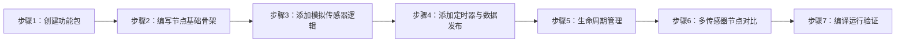
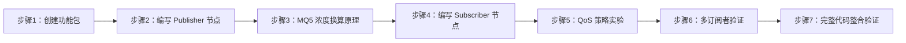

# 机器人ROS2应用与开发 实验指导书（实验3~7）

> 课程代码: EXP003
> 生成范围: exp03 ~ exp07
> 生成日期: 2026-08-10
> 生成者: LabGuideExperimentAgent (v2.0)
> 源码分析状态: 无源码分析报告（基于 course-spec.yaml + 知识图谱 + 硬件平台规格 + ROS2 标准 API 生成）
> 
> [⚠️ 待源码核实] 本批实验代码基于 ROS2 Humble 标准 API 与 B2 实验箱硬件接口设计，部分传感器驱动接口（MQ5 ADC / 指纹 UART）需对照实际源码核实。文档版本保持 v0.x 草稿状态。

---

## 实验3：ROS2工作空间（2h）

### 一、关联知识点

本实验关联以下知识图谱节点：

| 编号 | 知识点名称 | 类型 | 层级路径 |
|------|-----------|------|---------|
| 1.3.1 | 工作空间四层目录结构（src/build/install/log） | 概念 | 第1章 ROS2基础与环境搭建 → 1.3 ROS2工作空间 |
| 1.3.2 | Underlay与Overlay层级叠加机制 | 原理 | 第1章 ROS2基础与环境搭建 → 1.3 ROS2工作空间 |
| 1.3.3 | colcon build编译与source环境加载流程 | 流程 | 第1章 ROS2基础与环境搭建 → 1.3 ROS2工作空间 |

### 二、实验目标

通过本实验的学习，学生能够：

1. **原理理解**：阐述 ROS2 工作空间四层目录结构（src/build/install/log）各自的作用，以及 Underlay（/opt/ros/humble）与 Overlay（用户工作空间）通过 `source setup.bash` 实现层级叠加的机制
2. **流程掌握**：正确执行 `mkdir -p ~/ros2_ws/src` 创建工作空间 → 放入功能包源码到 src → `colcon build` 编译 → `source install/setup.bash` 加载环境 → 验证包可被 `ros2 pkg list` 识别
3. **独立完成**：独立创建一个新的工作空间、编译一个示例功能包，并验证工作空间层级覆盖的正确性
4. **迁移应用**：在后续实验中每次创建新的功能包时，能够正确放置到工作空间的 src 目录下并完成编译和加载

### 三、实验环境

| 类别 | 配置 |
|------|------|
| 硬件平台 | 具身智能实验箱B2 或 具身智能机器人小车C1 |
| 操作系统 | Ubuntu 22.04 |
| ROS2 发行版 | Humble Hawksbill |
| 核心依赖 | `ros-humble-ros-base`、`python3-colcon-common-extensions` |
| 编译工具 | colcon（命令行编译工具） |
| 终端工具 | 系统自带 Terminal（Bash） |

> 说明：本实验为工作空间管理实验，无需编写代码。若系统未安装 colcon，请先执行 `sudo apt install python3-colcon-common-extensions`。

### 四、实验难度

| 维度 | 说明 |
|------|------|
| 难度等级 | ⭐（容易） |
| 实验类型 | 验证性 |
| 建议时长 | 2 学时（90 分钟） |

**重点**：
- 掌握 `mkdir -p ~/ros2_ws/src` 创建工作空间的完整目录结构
- 理解 `colcon build` 编译流程的四步过程（CMake 配置 → 编译 → 安装 → 环境生成）

**难点**：
- 区分 Underlay 与 Overlay 的概念：为什么 `source /opt/ros/humble/setup.bash` 必须在 `source install/setup.bash` 之前执行
- 理解 `install/setup.bash` 中的环境变量如何实现"覆盖"效果——Overlay 中的同名包优先于 Underlay

### 五、实验现象

#### 5.1 快速验证流程

完成本实验后，你应能观察到以下现象：

1. 创建工作空间目录 `~/ros2_ws/src` 后，`tree -L 2 ~/ros2_ws` 显示标准的四层结构（src 已存在，build/install/log 将在编译后生成）
2. 将一个已有的功能包（如 `topic_python_pubsub`）放入 `src/` 目录后，执行 `colcon build`，终端输出编译过程日志，最终显示 `Summary: 1 package finished`
3. 编译完成后，`~/ros2_ws/` 下自动生成 `build/`、`install/`、`log/` 三个新目录
4. `source install/setup.bash` 后，`ros2 pkg list | grep <包名>` 能够找到该功能包
5. 在未 source 工作空间的新终端中，`echo $COLCON_PREFIX_PATH` 不包含该工作空间路径；source 后则包含

#### 5.2 预期效果描述

| 操作 | 预期输出 |
|------|---------|
| `mkdir -p ~/ros2_ws/src` | 创建用户工作空间目录，`ls ~/ros2_ws` 可见 `src/` |
| `colcon build`（在工作空间根目录） | 终端输出各包编译进度，最后 `Summary: N packages finished` |
| `ls ~/ros2_ws/`（编译后） | 可见 `build/`、`install/`、`log/`、`src/` 四个目录 |
| `source install/setup.bash` | 终端无输出（静默加载），但 `echo $COLCON_PREFIX_PATH` 可验证 |
| `ros2 pkg list \| grep <包名>` | 列出刚编译的功能包名称 |

---

### 六、实验步骤

#### 整体流程

```
[1. 检查编译工具] ──► [2. 创建工作空间目录结构] ──► [3. 放入示例功能包到 src]
                                                            │
[6. 清理与总结] ◄── [5. 理解 Underlay/Overlay 层级] ◄── [4. colcon build 编译]
```

---

#### 步骤 1：检查编译工具链（5 分钟）

**知识点讲解**：

**ROS2 编译工具链 —— colcon**
- **是什么**：colcon（**col**lective **con**struction）是 ROS2 的统一编译命令行工具，它是对 CMake 和 Python setuptools 的封装层。colcon 不是一个"编译器"——它本身不编译代码，而是调用每个功能包声明的构建系统（ament_cmake 或 ament_python）去执行实际的编译动作。
- **为什么需要统一的编译工具**：ROS2 功能包可以用 C++（ament_cmake）或 Python（ament_python）编写，也可能混合存在。如果每个包都需要手动 `cmake .. && make` 或 `python setup.py install`，管理工作量将随包数量线性增长。colcon 自动识别每个包的构建类型，批量执行编译并管理包间依赖顺序。
- **怎么用**：在工作空间根目录下执行 `colcon build`。colcon 遍历 `src/` 下的所有功能包，按照拓扑排序（先编译被依赖的包，再编译依赖它们的包）依次构建。

**操作**：

```bash
# 确认 colcon 是否已安装
colcon --help
# 预期：显示 colcon 的帮助信息，包含 build、test、list 等子命令

# 如果提示 command not found，安装 colcon
sudo apt update
sudo apt install python3-colcon-common-extensions -y
```

---
#### 步骤 2：创建工作空间目录结构（10 分钟）

**知识点讲解**：

**ROS2 工作空间四层目录结构（知识点 1.3.1）**
- **是什么**：一个标准的 ROS2 工作空间由四个目录组成：
  - `src/`（source）：存放功能包的**源代码**。这是开发者唯一手动创建和编辑的目录。每个功能包是一个子目录（如 `src/my_package/`），包含 `package.xml` + 构建配置文件 + 源码文件。
  - `build/`（build）：存放编译过程的**中间产物**（如 CMake 缓存、`.o` 目标文件、Python 的 `.egg-info`）。此目录由 `colcon build` 自动生成，开发者不应手动修改。
  - `install/`（install）：存放编译后的**部署产物**（可执行文件、共享库、Python 包、环境脚本 `setup.bash`）。此目录是 ROS2 运行时实际使用的路径。`source install/setup.bash` 就是将此目录加入环境变量。
  - `log/`（log）：存放每次编译的**日志文件**，便于排查编译错误。每次 `colcon build` 都会生成新的日志。
- **为什么设计成四层分离**：这种分离来自 CMake 的"out-of-source build"设计哲学——源码、编译中间件、部署产物三者隔离，使得你可以随时删除 `build/` 和 `install/` 来"清空"编译结果而不丢失源码。在 CI/CD 流水线中，这种分离也便于缓存 `build/` 实现增量编译。

**操作**：

```bash
# 在用户主目录下创建工作空间
mkdir -p ~/ros2_ws/src

# 查看工作空间结构
tree -L 2 ~/ros2_ws
```

**预期输出**：

```
/home/user/ros2_ws/
└── src
```

---

#### 步骤 3：放入示例功能包到 src 目录（10 分钟）

**知识点讲解**：

**功能包 = 最小组织单元**
- **是什么**：在 ROS2 中，代码不是随意放置的——它必须以"功能包"（Package）的形式组织。每个功能包是一个包含 `package.xml`（元信息清单）的独立目录。`colcon build` 只会编译 `src/` 下包含有效 `package.xml` 的子目录。
- **为什么必须遵循此约束**：这保证了 ROS2 的生态系统具有统一的元信息检索机制。`ros2 pkg list`、`ros2 pkg xml` 等命令都依赖 `package.xml` 文件和 `ament_index` 来发现已安装的功能包。

> 提示：本步骤仅为演示工作空间编译概念。完整的功能包创建将在实验4中详细学习。

**操作**：

```bash
# 方式一：使用已有的示例功能包（如果课程资源中提供了）
# 假设有一个 topic_python_pubsub 功能包可供复制
# cp -r /path/to/topic_python_pubsub ~/ros2_ws/src/

# 方式二：使用 ros2 pkg create 快速生成一个测试包（实验4将详细讲解）
cd ~/ros2_ws
ros2 pkg create --build-type ament_python --node-name hello_node my_test_pkg

# 查看 src 目录下的功能包
ls ~/ros2_ws/src/
# 预期: my_test_pkg/

# 确认功能包包含 package.xml
cat ~/ros2_ws/src/my_test_pkg/package.xml | head -5
```

---

#### 步骤 4：使用 colcon build 编译工作空间（25 分钟）

**知识点讲解**：

**colcon build 编译流程（知识点 1.3.3）**
- **是什么**：`colcon build` 在工作空间根目录下执行，它完成以下四个阶段：
  1. **扫描（Discovery）**：遍历 `src/` 下所有包含 `package.xml` 的子目录，读取构建类型（`<build_type>ament_python</build_type>` 或 `<build_type>ament_cmake</build_type>`）。
  2. **拓扑排序（Topological Order）**：分析各包的 `<build_depend>` 依赖关系，确定编译顺序——被依赖的包先编译。
  3. **构建（Build）**：对每个包调用其对应的构建工具——ament_cmake 包执行 CMake 配置+编译，ament_python 包执行 `setup.py install`。
  4. **安装（Install）**：将编译产物部署到 `install/` 目录，并生成 `install/setup.bash` 等环境脚本。
- **为什么不是 `make` 或 `catkin_make`**：ROS1 的 `catkin_make` 实际上是在工作空间内统一调用一次 CMake，它要求所有包使用同一个 CMake 上下文。colcon 与之不同——它为每个包启动**独立的构建进程**，这意味着各包之间真正隔离、可独立增量编译。
- **怎么用**：常用选项包括 `--packages-select <包名>`（仅编译指定包，适合增量开发）、`--symlink-install`（Python 包使用符号链接安装，修改源码无需重新编译）、`--event-handlers console_direct+`（实时输出编译日志）。

**操作**：

```bash
# 进入工作空间根目录
cd ~/ros2_ws

# 执行完整编译
colcon build

# 如果只想编译某一个包（增量编译，速度快）
colcon build --packages-select my_test_pkg

# 对于 Python 包，推荐使用符号链接安装（修改源码后无需重新编译）
colcon build --symlink-install
```

**预期输出**（关键片段）：

```
Starting >>> my_test_pkg
Finished <<< my_test_pkg [2.15s]

Summary: 1 package finished [2.34s]
```

**编译后目录结构验证**：

```bash
# 查看完整的四层目录
tree -L 1 ~/ros2_ws
# 预期:
# ~/ros2_ws/
# ├── build/
# ├── install/
# ├── log/
# └── src/

# 查看 install 目录中的环境脚本
ls ~/ros2_ws/install/
# 预期: 包含 local_setup.bash, setup.bash, setup.sh, setup.zsh 等
```

---

#### 步骤 5：理解 Underlay 与 Overlay 层级关系（20 分钟）

**知识点讲解**：

**Underlay 与 Overlay 层级叠加机制（知识点 1.3.2）**
- **是什么**：ROS2 使用层叠式工作空间模型——多个工作空间的环境可以"叠加"在同一终端会话中。底部的工作空间称为 **Underlay**，上层的称为 **Overlay**。
  - **Underlay**（底层）：系统级安装路径 `/opt/ros/humble/`，包含 ROS2 核心包（rclpy、std_msgs 等），通过 `source /opt/ros/humble/setup.bash` 加载。
  - **Overlay**（上层）：用户自定义工作空间 `~/ros2_ws/install/`，可以包含自定义功能包，甚至可以覆盖 Underlay 中的同名包。通过 `source ~/ros2_ws/install/setup.bash` 加载。
- **为什么需要层级设计**：这解决了"如何在系统核心库不变的情况下开发和测试自定义代码"的问题。Overlay 中的环境变量会"追加"而非"替换" Underlay 的路径，确保你既能使用系统提供的 ROS2 核心功能，又能开发和测试自己的功能包。当你在 Overlay 中开发一个与 Underlay 同名的包时，Overlay 版本优先被 ROS2 发现。
- **加载顺序为什么重要**：必须先 source Underlay 再 source Overlay。如果顺序反了——先 source Overlay 再 source Underlay——Underlay 的 `PATH` 和 `PYTHONPATH` 会覆盖 Overlay 的对应路径，导致你的自定义包"消失"。

**操作**：

```bash
# === 实验 A：验证 Underlay 环境 ===

# 打开一个全新的终端（没有任何 source 操作）
# 检查 ROS2 是否可用
ros2 --help
# 预期：command not found（因为未加载任何环境）

# 只加载 Underlay
source /opt/ros/humble/setup.bash
ros2 pkg list | grep demo_nodes
# 预期：demo_nodes_cpp, demo_nodes_py

# === 实验 B：叠加 Overlay ===

# 继续在当前终端加载 Overlay
source ~/ros2_ws/install/setup.bash

# 查看环境变量变化
echo $COLCON_PREFIX_PATH
# 预期：包含两个路径——/home/user/ros2_ws/install 在最前面，/opt/ros/humble 在后面

# 验证自定义包可被发现
ros2 pkg list | grep my_test_pkg
# 预期：my_test_pkg

# === 实验 C：验证 Overlay 覆盖（高级） ===

# 如果 Overlay 中有与 Underlay 同名的包，Overlay 版本优先
ros2 pkg xml my_test_pkg
# 预期：显示 ~/ros2_ws/install/... 下的 package.xml 内容

# === 实验 D：理解叠加链 ===

# 切换到全新终端
# 只 source Overlay（跳过 Underlay）
source ~/ros2_ws/install/setup.bash
ros2 --help
# 预期：仍然 command not found
# 原因：Overlay 的 setup.bash 只"追加"路径，不提供系统 ROS2 核心可执行文件
# 正确做法：必须先 source Underlay，再 source Overlay
```

**知识点延伸 —— `local_setup.bash` vs `setup.bash`**：
- `setup.bash`：加载当前工作空间 + **递归加载其依赖的所有工作空间**（即包含 Underlay 的路径）
- `local_setup.bash`：**仅**加载当前工作空间的环境，不递归加载依赖工作空间
- 在开发中，你通常使用 `setup.bash`；在 Launch 文件中，ROS2 会自动处理环境的级联

---

#### 步骤 6：实验收尾与总结（5 分钟）

1. 可选：保留 `~/ros2_ws` 供后续实验使用
2. 可选：清理实验工作空间 `rm -rf ~/ros2_ws/build ~/ros2_ws/install ~/ros2_ws/log`（保留 src）

---

### 七、注意事项

| 类别 | 注意事项 |
|------|---------|
| ⚠️ 环境加载顺序 | 必须先 `source /opt/ros/humble/setup.bash`（Underlay），再 `source ~/ros2_ws/install/setup.bash`（Overlay）。顺序反了会导致自定义包不可见 |
| ⚠️ 编译位置 | `colcon build` 必须在工作空间**根目录**（`~/ros2_ws/`）执行，不能在 `src/` 内部执行 |
| ⚠️ 磁盘空间 | 每次 `colcon build` 会在 `build/` 和 `install/` 目录下生成大量文件。如果磁盘空间紧张，可以定期清理 `build/` 和 `install/` 目录（不影响 src 源码） |
| ⚠️ 增量编译 | 修改了某个包的源码后，只需 `colcon build --packages-select <包名>` 即可增量编译，无需全量重新编译 |
| ⚠️ Python 包修改 | 如果使用了 `--symlink-install` 编译 Python 包，修改 `.py` 源码后无需重新编译（符号链接直接指向源码）。但修改 `setup.py` 或 `package.xml` 后仍需重新编译 |
| ⚠️ 多个工作空间 | 如果同时 source 了多个 Overlay 工作空间，包名冲突时**最后 source 的工作空间**优先级最高 |
| ⚠️ 安全 | 本实验为纯软件操作，不涉及硬件操作风险 |

### 八、实验总结

#### 8.1 完成成果

完成本实验后，你应当能够：
- ✅ 独立创建标准的 ROS2 工作空间目录结构（`mkdir -p ~/ros2_ws/src`）
- ✅ 使用 `colcon build` 编译整个工作空间或指定功能包
- ✅ 理解并验证 Underlay（/opt/ros/humble）与 Overlay（~/ros2_ws）的层级叠加机制
- ✅ 使用 `source install/setup.bash` 正确加载自定义工作空间环境

#### 8.2 技能收获

| 技能 | 说明 |
|------|------|
| 工作空间管理 | 掌握 ROS2 工作空间的创建、编译、清理全生命周期操作 |
| 环境管理 | 理解 setup.bash 的叠加机制，能够正确配置开发环境 |
| 编译调试 | 能够使用 `--packages-select` 增量编译和 `--symlink-install` 提高开发效率 |
| 层级思维 | 建立 Underlay/Overlay 的层级概念，为多工作空间并行开发打下基础 |

#### 8.3 常见问题与解答

| 问题 | 原因 | 解决方法 |
|------|------|---------|
| `colcon build` 报 "No packages found" | src/ 下没有包含 package.xml 的功能包 | 确认 `~/ros2_ws/src/` 下存在功能包子目录且包含 package.xml |
| `ros2 pkg list` 找不到自定义包 | 未 source Overlay 的 setup.bash，或 source 顺序错误 | 先 source Underlay，再 source Overlay |
| `colcon build` 报 CMake 错误 | 缺少编译依赖（如某些 dev 库） | 根据错误提示安装对应的 `ros-humble-*-dev` 包 |
| 编译成功但运行时报 import 错误 | Python 包未使用 `--symlink-install` 或未 source 环境 | 重新 source `install/setup.bash` 或在编译时加 `--symlink-install` |
| `source install/setup.bash` 后 ros2 命令仍不可用 | 只 source 了 Overlay 而跳过了 Underlay | Overlay 依赖 Underlay，必须先加载系统 ROS2 环境 |

### 九、实验报告要求

#### 9.1 报告内容

完成实验后，提交一份实验报告，包含以下内容：

1. **实验基本信息**：实验名称、实验日期、实验者姓名、实验平台信息
2. **实验过程记录**：截取步骤 4（colcon build 编译输出）和步骤 5（环境变量验证）的关键截图，标注每个现象的含义
3. **原理分析**（不少于 200 字）：用自己的语言解释 Underlay 与 Overlay 的层级关系，包含以下要点：① 为什么不能跳过 Underlay 直接加载 Overlay？② `COLCON_PREFIX_PATH` 环境变量的作用是什么？③ 如果两个 Overlay 中有同名包，ROS2 如何选择？
4. **思考题**（见下方）

#### 9.2 思考题

**思考题 1**：
假设你在 `~/ros2_ws_a` 和 `~/ros2_ws_b` 两个工作空间中分别开发了同名但不同版本的功能包 `my_sensor_driver`。如果你依次执行 `source ~/ros2_ws_a/install/setup.bash` 和 `source ~/ros2_ws_b/install/setup.bash`，当你运行 `ros2 run my_sensor_driver sensor_node` 时，实际使用的是哪个版本的代码？为什么？如何确认？

**思考题 2**：
在团队协作开发中，多名开发者各自有独立的工作空间。请设计一套基于 Overlay 的工作流程，使得：
- 每个开发者可以在自己的 Overlay 中修改和测试代码
- 底层共享的 Underlay（如 `~/team_common_ws`）包含团队公共库
- 开发者 A 的修改不会影响开发者 B 的环境

#### 9.3 评分标准

| 评分项 | 权重 | 评分标准 |
|-------|------|---------|
| 实验操作完整性 | 30% | 是否按要求完成工作空间创建、编译、环境加载的全流程 |
| 截图与记录 | 15% | 截图是否清晰、完整，标注是否准确 |
| 原理分析 | 25% | 对 Underlay/Overlay 层级关系的理解深度 |
| 思考题 1 | 15% | 对工作空间加载顺序与优先级的理解 |
| 思考题 2 | 15% | 多工作空间协作方案的设计合理性 |

---

## 实验4：ROS2功能包（2h）

### 一、关联知识点

本实验关联以下知识图谱节点：

| 编号 | 知识点名称 | 类型 | 层级路径 |
|------|-----------|------|---------|
| 1.4.1 | 功能包结构（package.xml + CMakeLists.txt/setup.py） | 概念 | 第1章 ROS2基础与环境搭建 → 1.4 ROS2功能包管理 |
| 1.4.2 | ros2 pkg create 创建功能包流程 | 流程 | 第1章 ROS2基础与环境搭建 → 1.4 ROS2功能包管理 |
| 1.4.3 | build_depend 与 exec_depend 依赖声明原理 | 原理 | 第1章 ROS2基础与环境搭建 → 1.4 ROS2功能包管理 |

### 二、实验目标

通过本实验的学习，学生能够：

1. **原理理解**：阐述 package.xml 中各字段的含义（`<name>`、`<version>`、`<build_depend>`、`<exec_depend>`），以及 build_depend（编译时需要）与 exec_depend（运行时需要）的区别
2. **流程掌握**：正确执行 `ros2 pkg create --build-type ament_python --node-name <节点名> <包名>` 创建 Python 功能包，并理解自动生成的文件结构
3. **独立完成**：独立创建一个包含两个节点的 Python 功能包，正确配置 `setup.py`（或 `setup.cfg`）中的 `entry_points` 注册，并成功编译运行
4. **迁移应用**：在后续开发中，能够根据实际需求正确选择构建类型（ament_python vs ament_cmake），并正确声明依赖关系

### 三、实验环境

| 类别 | 配置 |
|------|------|
| 硬件平台 | 具身智能实验箱B2 或 具身智能机器人小车C1 |
| 操作系统 | Ubuntu 22.04 |
| ROS2 发行版 | Humble Hawksbill |
| 核心依赖 | `ros-humble-ros-base`、`python3-colcon-common-extensions` |
| 开发语言 | Python 3.10 |
| 编辑器 | VS Code / Vim / Nano（任选） |

> 说明：本实验需要在实验3创建的工作空间（`~/ros2_ws`）基础上进行。如尚未创建工作空间，请先完成实验3的步骤2。

### 四、实验难度

| 维度 | 说明 |
|------|------|
| 难度等级 | ⭐（容易） |
| 实验类型 | 验证性 |
| 建议时长 | 2 学时（90 分钟） |

**重点**：
- 掌握 `ros2 pkg create` 命令的构建类型选择（`ament_python` vs `ament_cmake`）
- 理解 package.xml 中 `<build_depend>` 与 `<exec_depend>` 的区别

**难点**：
- 正确配置 setup.py 中的 `entry_points` 注册可执行节点
- 理解 `build_depend`（仅编译时需要，如 message_generation）与 `exec_depend`（运行时需要，如依赖的运行时库）在不同场景下的使用

### 五、实验现象

#### 5.1 快速验证流程

完成本实验后，你应能观察到以下现象：

1. `ros2 pkg create --build-type ament_python --node-name talker my_talker_pkg` 在 `src/` 下自动生成完整的功能包骨架（package.xml、setup.py、setup.cfg、`__init__.py`、节点源文件）
2. 编译成功后，`ros2 pkg list | grep my_talker_pkg` 能够找到该功能包
3. `ros2 pkg xml my_talker_pkg` 能够以 XML 格式显示该包的完整元信息
4. `ros2 run my_talker_pkg talker` 能够成功启动节点（输出预设的日志信息）

#### 5.2 预期效果描述

| 操作 | 预期输出 |
|------|---------|
| `ros2 pkg create --build-type ament_python --node-name hello_node my_hello` | Creating package... 成功生成目录结构 |
| `tree ~/ros2_ws/src/my_hello/` | 显示 package.xml、setup.py、setup.cfg、my_hello/\_\_init\_\_.py、my_hello/hello_node.py |
| `colcon build --packages-select my_hello` | Summary: 1 package finished |
| `ros2 pkg xml my_hello` | 完整的 XML 格式元信息（包名、版本、描述、依赖等） |
| `ros2 run my_hello hello_node` | 节点启动成功，输出日志 |

---

### 六、实验步骤

#### 整体流程

```
[1. 使用 ros2 pkg create 创建功能包] ──► [2. 分析 package.xml 字段含义]
              │                                              │
              ▼                                              ▼
[3. 配置 setup.py 注册节点入口] ──► [4. 编译并验证功能包] ──► [5. 多节点功能包扩展]
                                                                          │
                                                                          ▼
                                                          [6. 清理与总结]
```

---

#### 步骤 1：使用 ros2 pkg create 创建功能包（15 分钟）

**知识点讲解**：

**ros2 pkg create —— 功能包脚手架工具（知识点 1.4.2）**
- **是什么**：`ros2 pkg create` 是 ROS2 提供的功能包**脚手架生成工具**。它不仅仅是创建一个目录——它按照 ROS2 的规范，自动生成功能包必需的配置文件（package.xml、setup.py/setup.cfg 或 CMakeLists.txt）和源码骨架，确保你创建的功能包从一开始就是"合规范"的。
- **为什么需要脚手架**：手动创建功能包很容易"缺文件"——忘记 package.xml 中的某个必填字段、setup.py 配置不正确导致节点无法注册、文件权限错误导致无法执行。脚手架工具确保每一次创建都是标准化、零错误的，降低了新手的学习曲线。
- **怎么用**：
  - `--build-type`：指定构建类型。`ament_python` 用于纯 Python 包，`ament_cmake` 用于 C++ 包（或 Python+C++ 混合包）。
  - `--node-name`：自动生成一个带有基本 ROS2 Node 代码的 `.py` 文件。
  - `--dependencies`：自动在 package.xml 中添加初始依赖项。

**操作**：

```bash
# 进入工作空间的 src 目录
cd ~/ros2_ws/src

# 创建一个 Python 功能包
ros2 pkg create --build-type ament_python \
    --node-name hello_node \
    --dependencies rclpy std_msgs \
    my_hello

# 查看自动生成的文件结构
tree ~/ros2_ws/src/my_hello/
```

**预期目录结构**：

```
my_hello/
├── package.xml          # 功能包元信息清单（必填）
├── setup.cfg            # Python 安装配置
├── setup.py             # Python 构建与安装脚本
├── my_hello/            # Python 包目录（与功能包同名）
│   ├── __init__.py      # Python 包标识文件
│   └── hello_node.py    # 自动生成的节点源文件
└── resource/            # 资源文件目录（如 package 标识文件）
    └── my_hello
```

---

#### 步骤 2：分析 package.xml 字段含义（20 分钟）

**知识点讲解**：

**package.xml —— 功能包的"身份证"（知识点 1.4.1）**
- **是什么**：`package.xml` 是一个遵循 REP-149 规范的 XML 格式文件，描述功能包的**元信息**。它是 colcon 发现功能包、ROS2 索引系统（ament_index）注册包的依据，也是依赖解析的入口。
- **为什么每个包都需要它**：没有 `package.xml`，colcon 不会识别该目录为功能包，`ros2 pkg list` 也找不到它。它相当于 Python 的 `setup.py` + `requirements.txt` 的合体——既描述包的身份信息，又声明编译和运行时的依赖关系。
- **关键字段解析**：
  - `<name>`：功能包名称，全局唯一，建议用小写字母和下划线
  - `<version>`：版本号，遵循 SemVer（主.次.修订）
  - `<description>`：功能包的简短描述
  - `<maintainer>`：维护者信息（姓名+邮箱）
  - `<license>`：开源许可证声明
  - `<build_depend>`：**编译依赖**——编译过程中需要的包（如 message_generation 用于生成自定义消息代码）
  - `<exec_depend>`：**运行依赖**——运行时需要的包（如 rclpy，因为节点运行时需要 import rclpy）
  - `<test_depend>`：测试依赖——仅运行测试时需要的包

**build_depend vs exec_depend 的区别（知识点 1.4.3）**：
- **build_depend**（编译时依赖）：仅在 `colcon build` 编译阶段需要。例如，当你使用自定义消息（.msg）或服务（.srv）时，需要 `rosidl_default_generators` 在编译时生成对应的 Python/C++ 消息类代码。编译完成后，生成的代码已包含在 `install/` 目录中。
- **exec_depend**（运行时依赖）：程序运行时需要。例如，你的节点 `import rclpy`，则 rclpy 必须作为 exec_depend 声明。`exec_depend` 通常是 `build_depend` 加上运行时额外需要的库。
- **经验法则**：如果一个包既在编译时被需要，又在运行时被需要，需要在 package.xml 中**同时声明** `<build_depend>` 和 `<exec_depend>`。例如 rclpy——编译时 colcon 需要知道 rclpy 的存在来解析 Python import，运行时节点代码也需要 import rclpy。

**操作**：

```bash
# 查看自动生成的 package.xml
cat ~/ros2_ws/src/my_hello/package.xml
```

**预期内容**：

```xml
<?xml version="1.0"?>
<?xml-model href="http://download.ros.org/schema/package_format3.xsd" 
  schematypens="http://www.w3.org/2001/XMLSchema"?>
<package format="3">
  <name>my_hello</name>
  <version>0.0.0</version>
  <description>功能包描述</description>
  <maintainer email="user@example.com">user</maintainer>
  <license>Apache License 2.0</license>

  <buildtool_depend>ament_python</buildtool_depend>

  <build_depend>rclpy</build_depend>
  <build_depend>std_msgs</build_depend>

  <exec_depend>rclpy</exec_depend>
  <exec_depend>std_msgs</exec_depend>

  <test_depend>ament_copyright</test_depend>
  <test_depend>ament_flake8</test_depend>
  <test_depend>ament_pep257</test_depend>
  <test_depend>python3-pytest</test_depend>

  <export>
    <build_type>ament_python</build_type>
  </export>
</package>
```

**动手修改**：使用编辑器打开 `package.xml`，将 `<description>` 修改为一段有意义的中文描述，将 `<maintainer>` 修改为你自己的信息。例如：

```xml
<description>一个简单的 ROS2 功能包示例，包含 hello_node 节点</description>
<maintainer email="student@example.com">你的姓名</maintainer>
```

---

#### 步骤 3：配置 setup.py 注册节点入口（15 分钟）

**知识点讲解**：

**setup.py 中的 entry_points —— 节点的"注册表"**
- **是什么**：`setup.py` 是 Python 的构建配置文件（遵循 setuptools 规范）。在 ROS2 ament_python 包中，它的关键作用是 `entry_points` 字段——将 Python 函数"注册"为 ROS2 可执行的节点。
- **为什么需要 entry_points**：当你执行 `ros2 run my_hello hello_node` 时，ROS2 不是直接运行 `python hello_node.py`，而是通过查询 `install/` 目录下的注册信息找到 `hello_node` 对应的入口函数（如 `my_hello.hello_node:main`），然后调用它。entry_points 就是这个注册信息的来源。
- **注册格式**：`'<节点名> = <Python包>.<模块>:<函数名>'`
  - `<节点名>`：终端用户使用 `ros2 run` 时的可执行名称
  - `<Python包>.<模块>`：Python 模块的路径（不含 `.py` 后缀）
  - `<函数名>`：模块中被调用的入口函数（通常叫 `main`）

**操作**：

```bash
# 查看自动生成的 setup.py
cat ~/ros2_ws/src/my_hello/setup.py
```

**预期内容**：

```python
from setuptools import setup

package_name = 'my_hello'

setup(
    name=package_name,
    version='0.0.0',
    packages=[package_name],
    data_files=[
        ('share/ament_index/resource_index/packages',
            ['resource/' + package_name]),
        ('share/' + package_name, ['package.xml']),
    ],
    install_requires=['setuptools'],
    zip_safe=True,
    maintainer='user',
    maintainer_email='user@example.com',
    description='功能包描述',
    license='Apache License 2.0',
    tests_require=['pytest'],
    entry_points={
        'console_scripts': [
            'hello_node = my_hello.hello_node:main',
        ],
    },
)
```

**关键字段说明**：
- `packages=[package_name]`：声明需要安装的 Python 包目录
- `data_files`：将资源文件安装到 ROS2 的 ament_index 索引目录
- `entry_points.console_scripts`：**最重要的字段**——注册可执行节点。`'hello_node = my_hello.hello_node:main'` 表示：创建一个名为 `hello_node` 的可执行命令，它实际调用 `my_hello.hello_node` 模块中的 `main()` 函数

---

#### 步骤 4：编译并验证功能包（15 分钟）

**知识点讲解**：

**从源码到可运行的节点 —— 完整的编译链路**
- 创建功能包（`ros2 pkg create`）→ 编写源码（`.py` 文件）→ 配置 entry_points（`setup.py`）→ 编译（`colcon build`）→ 加载环境（`source install/setup.bash`）→ 运行节点（`ros2 run`）。整个链路中的每一步都有其不可替代的作用，跳过任何一步都会导致"节点找不到"或"包不可见"。

**操作**：

```bash
# 回到工作空间根目录
cd ~/ros2_ws

# 编译指定功能包
colcon build --packages-select my_hello

# 加载环境
source install/setup.bash

# 验证功能包可见
ros2 pkg list | grep my_hello
# 预期: my_hello

# 查看功能包的 XML 元信息
ros2 pkg xml my_hello

# 运行自动生成的节点
ros2 run my_hello hello_node
```

**预期输出**（hello_node 启动）：

```
[INFO] [......] [hello_node]: Hello from ROS2!
```

观察 `hello_node.py` 的源码来理解这段日志的来源：

```python
# ~/ros2_ws/src/my_hello/my_hello/hello_node.py
import rclpy
from rclpy.node import Node

class HelloNode(Node):
    def __init__(self):
        super().__init__('hello_node')
        self.get_logger().info('Hello from ROS2!')

def main(args=None):
    rclpy.init(args=args)
    node = HelloNode()
    rclpy.spin(node)
    node.destroy_node()
    rclpy.shutdown()
```

**关键代码解读**：
- `class HelloNode(Node)`：继承 `rclpy.node.Node`，创建自定义节点类
- `super().__init__('hello_node')`：调用父类构造函数，传入节点名称
- `rclpy.spin(node)`：进入事件循环，保持节点运行
- 节点名称（`'hello_node'`）必须与 entry_points 中的注册名一致（这是约定，技术上 node 内部名称可以与可执行名不同）

---

#### 步骤 5：多节点功能包扩展（15 分钟）

**知识点讲解**：

**一个功能包可以包含多个节点**
- **是什么**：一个功能包内可以注册多个可执行节点——只需在 `setup.py` 的 `entry_points` 中添加多条声明。
- **为什么需要多节点功能包**：在 ROS2 开发中，发布者（Publisher）和订阅者（Subscriber）通常成对出现，放在同一个功能包里更便于管理和发布。例如，`topic_python_pubsub` 同时包含 publisher 和 subscriber 两个节点。

**操作**：

```bash
# 进入 Python 包目录
cd ~/ros2_ws/src/my_hello/my_hello/

# 创建第二个节点文件
cat > goodbye_node.py << 'EOF'
import rclpy
from rclpy.node import Node

class GoodbyeNode(Node):
    def __init__(self):
        super().__init__('goodbye_node')
        timer = self.create_timer(2.0, self.timer_callback)
        self.count = 0

    def timer_callback(self):
        self.get_logger().info('Goodbye count: %d' % self.count)
        self.count += 1

def main(args=None):
    rclpy.init(args=args)
    node = GoodbyeNode()
    rclpy.spin(node)
    node.destroy_node()
    rclpy.shutdown()
EOF

# 编辑 setup.py，添加第二个节点的 entry_point
# 在 'console_scripts' 列表中追加一行：
# 'goodbye_node = my_hello.goodbye_node:main',
```

修改 `setup.py` 中的 `entry_points` 部分：

```python
entry_points={
    'console_scripts': [
        'hello_node = my_hello.hello_node:main',
        'goodbye_node = my_hello.goodbye_node:main',  # 新增
    ],
},
```

```bash
# 回到工作空间根目录，重新编译
cd ~/ros2_ws
colcon build --packages-select my_hello
source install/setup.bash

# 运行新节点验证
ros2 run my_hello goodbye_node
# 预期: 每2秒输出 "Goodbye count: N"
```

---

#### 步骤 6：实验收尾与总结（5 分钟）

1. 保留 `~/ros2_ws/src/my_hello/` 功能包供后续实验参考
2. 可选：使用 `ros2 pkg list` 查看系统中所有已安装的功能包，观察命名规律

---

### 七、注意事项

| 类别 | 注意事项 |
|------|---------|
| ⚠️ 包名规范 | 功能包名称应使用小写字母+下划线，不能包含大写字母或连字符。包名在 ROS2 生态中应尽量全局唯一 |
| ⚠️ 构建类型 | Python 包使用 `ament_python`，C++ 包使用 `ament_cmake`。`ament_cmake` 也可用于 Python 包，但 `ament_python` 更简洁——选择时需明确 |
| ⚠️ 依赖声明 | 代码中 `import` 了某个库，就必须在 package.xml 中声明对应的 `<exec_depend>`，否则运行时可能找不到模块 |
| ⚠️ entry_points | `setup.py` 中的 `console_scripts` 名称（如 `hello_node`）将作为 `ros2 run` 的可执行名——修改后需重新编译 |
| ⚠️ 目录结构 | Python 包目录（`my_hello/` 包含 `__init__.py`）必须与功能包目录同名，且 `setup.py` 中的 `packages` 列表必须包含它 |
| ⚠️ 资源文件 | `resource/<包名>` 文件是 ROS2 ament_index 的关键标识——不可删除。如果手动创建包，必须确保此文件存在 |
| ⚠️ 安全 | 本实验为纯软件操作，不涉及硬件风险 |

### 八、实验总结

#### 8.1 完成成果

完成本实验后，你应当能够：
- ✅ 使用 `ros2 pkg create` 创建标准的 Python 功能包骨架
- ✅ 解释 package.xml 中各字段的含义和 build_depend / exec_depend 的区别
- ✅ 在 setup.py 的 entry_points 中正确注册节点入口
- ✅ 创建包含多个节点的功能包并成功编译运行

#### 8.2 技能收获

| 技能 | 说明 |
|------|------|
| 包管理 | 掌握功能包从创建到编译运行的全流程 |
| 依赖理解 | 区分编译依赖（build_depend）与运行依赖（exec_depend）并正确声明 |
| 节点注册 | 理解 entry_points 机制，能够将 Python 模块注册为 ROS2 可执行节点 |
| 代码组织 | 建立"一个功能包可包含多个节点"的代码组织思维 |

#### 8.3 常见问题与解答

| 问题 | 原因 | 解决方法 |
|------|------|---------|
| `ros2 pkg create` 报 command not found | ros-humble-ros-base 未完整安装 | `sudo apt install ros-humble-ros-base` |
| `ros2 run my_hello hello_node` 报 "No executable found" | entry_points 配置错误或未重新编译 | 检查 setup.py 中 `console_scripts` 的格式，重新执行 `colcon build` 并 source 环境 |
| `colcon build` 报 "package.xml not found" | 在非功能包目录中执行了 colcon build | 确认 `~/ros2_ws/src/` 下的每个子目录都是合法的功能包 |
| 运行节点报 "ModuleNotFoundError: No module named 'my_hello'" | setup.py 中的 packages 列表未包含 Python 包目录 | 在 setup.py 中加入 `packages=[package_name]` |
| 修改了源码但运行后仍是旧版本 | 未使用 `--symlink-install` 且未重新编译 | 重新 `colcon build --packages-select <包名>` 并 `source install/setup.bash` |

### 九、实验报告要求

#### 9.1 报告内容

完成实验后，提交一份实验报告，包含以下内容：

1. **实验基本信息**：实验名称、实验日期、实验者姓名、实验平台信息
2. **实验过程记录**：截取步骤 1（tree 目录结构）、步骤 2（package.xml 内容）、步骤 4（运行节点输出）的关键截图
3. **原理分析**（不少于 200 字）：用自己的语言解释以下问题：① package.xml 中 `<build_depend>` 与 `<exec_depend>` 的区别，并各举一个实际例子；② `entry_points` 机制如何让 `ros2 run` 找到正确的 Python 函数
4. **思考题**（见下方）

#### 9.2 思考题

**思考题 1**：
假设你开发了一个名为 `sensor_driver` 的功能包，它使用了自定义消息接口（`.msg` 文件定义在 `custom_interfaces` 包中）。请问在 `sensor_driver` 的 `package.xml` 中，应该如何声明对 `custom_interfaces` 的依赖？是 `<build_depend>`、`<exec_depend>`，还是两者都需要？请说明理由。

**思考题 2**：
如果 `setup.py` 中的 `entry_points` 配置正确，但 `ros2 run my_hello hello_node` 仍然提示 "No executable found"。请列出至少 3 种可能导致该问题的原因及其排查方法。

#### 9.3 评分标准

| 评分项 | 权重 | 评分标准 |
|-------|------|---------|
| 实验操作完整性 | 30% | 是否完成功能包创建、配置修改、编译、运行的全流程 |
| 截图与记录 | 15% | 截图清晰完整，标注准确 |
| 原理分析 | 25% | 对依赖类型和 entry_points 机制的理解深度 |
| 思考题 1 | 15% | 对 build_depend/exec_depend 的区分能力 |
| 思考题 2 | 15% | 对 ROS2 运行机制的综合排查能力 |

---

## 实验5：ROS2节点（2h）

### 一、关联知识点

本实验关联以下知识图谱节点：

| 编号 | 知识点名称 | 类型 | 层级路径 |
|------|-----------|------|---------|
| 2.1.1 | ROS2 节点概念（独立进程 + 通信单元） | 概念 | 第2章 ROS2核心通信机制 → 2.1 ROS2节点编程 |
| 2.1.2 | 节点生命周期（构造-配置-激活-停用-清理） | 原理 | 第2章 ROS2核心通信机制 → 2.1 ROS2节点编程 |
| 2.1.3 | 继承 rclpy.node.Node 创建传感器节点流程 | 流程 | 第2章 ROS2核心通信机制 → 2.1 ROS2节点编程 |

### 二、实验目标

通过本实验的学习，学生能够：

1. **原理理解**：阐述 ROS2 节点的本质——作为一个独立进程，通过继承 `rclpy.node.Node` 获得与 ROS2 图（Graph）通信的能力，并说明节点生命周期状态转换（Constructor → Spin → Destroy）的作用和顺序
2. **流程掌握**：正确编写继承 `Node` 的自定义节点类，在构造函数中初始化传感器硬件（模拟）、创建 Publisher/Subscriber/Service、设置定时器，并通过 `rclpy.spin()` 驱动事件循环
3. **独立完成**：独立创建一个 `GasSensorNode` 类（模拟 MQ5 气体传感器），包含 ADC 采样（模拟）、数据发布和定时回调的完整功能
4. **迁移应用**：能够将同样的节点封装模式应用于其他传感器（MFRC522 读卡器、指纹模块），实现传感器 → ROS2 Node 的统一抽象

### 三、实验环境

| 类别 | 配置 |
|------|------|
| 硬件平台 | 具身智能实验箱B2 或 具身智能机器人小车C1 |
| 操作系统 | Ubuntu 22.04 |
| ROS2 发行版 | Humble Hawksbill |
| 核心依赖 | `ros-humble-ros-base`、`python3-colcon-common-extensions`、`rclpy` |
| 开发语言 | Python 3.10 |
| 模拟传感器 | MQ5 气体传感器（ADC 模拟量采集）、MFRC522 读卡器（SPI）、指纹传感器（UART） |

> 说明：本实验中传感器数据为模拟生成（如在实验箱上连接了实际的 MQ5/MFRC522/指纹传感器，可替换真实驱动代码），重点在于掌握节点封装模式。

### 四、实验难度

| 维度 | 说明 |
|------|------|
| 难度等级 | ⭐⭐（中等） |
| 实验类型 | 设计性 |
| 建议时长 | 2 学时（90 分钟） |

**重点**：
- 掌握 `class MyNode(rclpy.node.Node)` 继承模式，理解构造函数中三步骤：初始化硬件 → 创建通信接口 → 设置定时回调
- 理解 `rclpy.spin()` 的事件循环机制——为什么节点需要 spin

**难点**：
- 正确管理节点生命周期：构造函数中申请的资源（串口、SPI、文件句柄）必须在 `destroy_node()` 或析构函数中释放
- 理解"一个硬件传感器 = 一个 ROS2 Node"的设计原则及其工程意义

### 五、实验现象

#### 5.1 快速验证流程

完成本实验后，你应能观察到以下现象：

1. 启动 `GasSensorNode` 后，`ros2 node list` 能够看到 `/gas_sensor_node` 节点
2. `ros2 topic list` 出现 `/gas_sensor` 话题，类型为 `std_msgs/msg/Float32`
3. `ros2 topic echo /gas_sensor` 持续输出模拟的气体浓度值（ppm），数据周期性更新（如每秒 1 次）
4. `ros2 node info /gas_sensor_node` 显示该节点的 Publisher、Subscriber、Service 等拓扑信息
5. 按 `Ctrl+C` 终止节点后，观察 `destroy_node()` 中的清理日志输出

#### 5.2 预期效果描述

| 操作 | 预期输出 |
|------|---------|
| `ros2 run sensor_nodes gas_sensor` | 节点启动，日志显示 "GasSensorNode 已启动，MQ5 初始化完成" |
| `ros2 node list`（另一终端） | `/gas_sensor_node` |
| `ros2 topic list` | `/gas_sensor`、`/parameter_events`、`/rosout` |
| `ros2 topic info /gas_sensor` | Type: `std_msgs/msg/Float32`，Publisher count: 1 |
| `ros2 topic echo /gas_sensor` | `data: 235.7`、`data: 241.2`、...（模拟浓度值不断变化） |
| `Ctrl+C` 终止节点 | 日志输出 "GasSensorNode 已安全关闭，资源已释放" |

---

### 六、实验步骤

#### 整体流程



---

#### 步骤 1：创建 sensor_nodes 功能包（5 分钟）

**知识点讲解**：

**功能包命名策略**：在本实验中，我们创建一个名为 `sensor_nodes` 的功能包，它将包含三种传感器的节点实现（MQ5 气体传感器、MFRC522 读卡器、指纹传感器）。将相关节点放在同一功能包内，便于共享工具函数和统一维护。

**操作**：

```bash
# 进入工作空间的 src 目录
cd ~/ros2_ws/src

# 创建 sensor_nodes 功能包
ros2 pkg create --build-type ament_python \
    --dependencies rclpy std_msgs \
    sensor_nodes

# 查看生成的目录结构
tree ~/ros2_ws/src/sensor_nodes/
```

---

#### 步骤 2：编写 ROS2 Node 基础骨架（15 分钟）

**知识点讲解**：

**继承 rclpy.node.Node —— 节点的"入场券"（知识点 2.1.1）**
- **是什么**：`rclpy.node.Node` 是 ROS2 Python 客户端库提供的基类。任何一个 Python 类要成为 ROS2 节点，必须直接或间接继承自 `Node`。`Node` 基类在构造时会向 ROS2 底层（rcl + rmw）注册节点信息，使该节点出现在 ROS2 图中。
- **为什么必须继承**：不是所有 Python 程序都能被 `ros2 node list` 看到——只有继承了 `Node` 并调用了 `rclpy.init()` 和 `rclpy.spin()` 的进程，才被 ROS2 图视为"参与者"。这就是 ROS2 的"入场券"机制——你没有继承 Node，就不在图（Graph）中。
- **怎么用**：`class MyNode(Node)`，在构造函数中调用 `super().__init__('node_name')`，节点名称全局唯一（ROS2 会自动重命名冲突节点，如 `node_name_1`）。

**操作**：

在 `~/ros2_ws/src/sensor_nodes/sensor_nodes/` 目录下创建 `gas_sensor_node.py`：

```python
# -*- coding: utf-8 -*-
"""
实验5：ROS2 节点 —— MQ5 气体传感器节点
平台：B2 实验箱 / C1 小车
运行：ros2 run sensor_nodes gas_sensor
"""
import rclpy
from rclpy.node import Node


class GasSensorNode(Node):
    """MQ5 气体传感器 ROS2 节点"""

    def __init__(self):
        # ★ 步骤1：调用父类构造函数，注册节点到 ROS2 图
        super().__init__('gas_sensor_node')
        self.get_logger().info('GasSensorNode 已启动')

    # ★ 生命周期终点：析构时清理
    def __del__(self):
        self.get_logger().info('GasSensorNode 已销毁')


def main(args=None):
    """节点入口函数"""
    rclpy.init(args=args)           # 初始化 ROS2 客户端库
    node = GasSensorNode()          # 创建节点实例
    rclpy.spin(node)                # 进入事件循环，保持节点运行
    node.destroy_node()             # 销毁节点，释放资源
    rclpy.shutdown()                # 关闭 ROS2 客户端库


if __name__ == '__main__':
    main()
```

**代码逐行解读**：
1. `super().__init__('gas_sensor_node')`：向 ROS2 底层注册，节点名称为 `gas_sensor_node`。此时 ROS2 图就能"看到"这个节点了。
2. `rclpy.init(args=args)`：初始化 rclpy 库（解析命令行参数、加载上下文）。
3. `rclpy.spin(node)`：阻塞当前线程，循环处理 ROS2 消息队列中的回调（timer 回调、subscriber 回调等）。没有 spin，节点的定时器和订阅者永远不会被触发。
4. `node.destroy_node()`：通知 ROS2 底层该节点即将退出，清理注册信息和通信资源。
5. `rclpy.shutdown()`：销毁 rclpy 全局上下文。

---

#### 步骤 3：添加模拟传感器逻辑（15 分钟）

**知识点讲解**：

**传感器封装为 Node 的设计模式（知识点 2.1.3）**
- **是什么**：将硬件传感器封装为独立的 ROS2 Node，是 ROS2 开发中的标准设计模式。每个传感器对应一个独立的进程（Node），它负责：① 初始化硬件接口（ADC/SPI/UART 等）；② 周期性地采集传感器原始数据；③ 将处理后的数据通过 Topic 发布给其他节点。
- **为什么这样做**：如果你的机器人有 10 个传感器，每种传感器都是一个独立的 Node，你可以：
  - 独立启动/停止某个传感器（`ros2 run` 或 Launch 文件控制）
  - 用 `ros2 topic echo` 单独调试某个传感器的数据流
  - 在仿真环境中用模拟数据替换真实传感器 Node（接口不变，实现替换）
  - 清晰的责任边界——"激光雷达出问题了"就知道去查激光雷达 Node 的日志
- **怎么用**：构造函数中顺序执行——硬件初始化 → 创建 Publisher → 创建定时器 → 设置参数。

**操作**——扩展 `gas_sensor_node.py`，添加模拟 MQ5 传感器逻辑：

```python
import random  # 仅用于模拟数据，实际应使用 ADC 读取

class GasSensorNode(Node):
    """MQ5 气体传感器 ROS2 节点"""

    def __init__(self):
        super().__init__('gas_sensor_node')

        # === 阶段1：初始化传感器硬件 ===
        self.declare_parameter('adc_channel', 0)        # ADC 通道号
        self.declare_parameter('vref', 3.3)              # 参考电压
        self.declare_parameter('rl', 10.0)               # 负载电阻（kΩ）

        adc_channel = self.get_parameter('adc_channel').value
        self.get_logger().info(
            'MQ5 初始化完成：ADC 通道=%d, Vref=3.3V' % adc_channel
        )
        # 实际硬件中，此处应为：
        # import adc_driver
        # self.adc = adc_driver.ADC(channel=adc_channel)

        # === 阶段2：创建 Publisher 发布气体浓度数据 ===
        from std_msgs.msg import Float32
        self.publisher = self.create_publisher(
            Float32,          # 消息类型：标准浮点数消息
            'gas_sensor',     # 话题名称
            10                # QoS 队列深度（历史缓存 10 条消息）
        )
        self.get_logger().info('Publisher 已创建：话题=/gas_sensor, 类型=Float32')

        # === 阶段3：创建定时器，周期性采样 ===
        sample_period = 1.0   # 采样周期 1 秒
        self.timer = self.create_timer(
            sample_period,
            self.timer_callback  # 定时回调函数
        )
        self.get_logger().info('定时器已创建：采样周期=%.1fs' % sample_period)

    def timer_callback(self):
        """定时器回调：采集传感器数据并发布"""
        # ===== 模拟 MQ5 气体传感器 ADC 读取与浓度换算 =====
        # 实际硬件中的操作流程：
        # 1. 读取 ADC 原始值（0~4095 for 12-bit ADC）
        # 2. 换算为电压值: V_out = (ADC_value / 4095) * Vref
        # 3. 计算传感器电阻: Rs = (Vref - V_out) / V_out * RL
        # 4. 根据灵敏特性曲线计算 ppm 浓度

        # 模拟：生成随机电压值（实际替换为 adc.read()）
        adc_raw = random.uniform(500, 2000)            # 模拟 ADC 原始值
        voltage = adc_raw / 4095.0 * 3.3               # 换算电压
        ppm = random.uniform(200.0, 500.0)             # 简化：随机 ppm（实际需特性曲线计算）

        # 构造 Float32 消息并发布
        msg = Float32()
        msg.data = float(ppm)
        self.publisher.publish(msg)

        self.get_logger().info(
            'MQ5 采样：ADC=%.0f, V=%.2fV, 浓度=%.1f ppm' % (adc_raw, voltage, ppm)
        )

    def __del__(self):
        # ===== 生命周期终点：释放硬件资源 =====
        # 实际硬件中，此处应关闭 ADC 设备文件或释放 GPIO
        self.get_logger().info('GasSensorNode 已安全关闭，资源已释放')
```

**MQ5 传感器原理补充**：
- MQ5 气体传感器是一种半导体气体传感器，对液化气、天然气、煤气等可燃气体敏感
- 工作原理：可燃气体浓度变化 → 传感器内部半导体电阻 Rs 变化 → 分压电路输出电压变化 → ADC 采集电压 → 根据 Rs/R0 比值查灵敏特性曲线 → 换算 ppm 浓度值
- B2 实验箱上 MQ5 通过 ADC 接口连接到 STM32F407 下位机 → 上位机通过串口读取

---

#### 步骤 4：理解节点生命周期（20 分钟）

**知识点讲解**：

**ROS2 节点生命周期（知识点 2.1.2）**
- **是什么**：ROS2 节点经历一条从"创建"到"销毁"的生命路径：
  ```
  构造函数 __init__()    →  运行期 spin()  →  销毁期 destroy_node()
  (初始化硬件/通信接口)      (事件循环)        (释放资源/清理)
  ```
  在 ROS2 的 Managed Node（生命周期节点）中，这个过程被标准化为四个状态：Unconfigured → Inactive → Active → Finalized。本实验使用的是基础 Node（自动处于 Active 状态），Managed Node 将在高级课程中学习。
- **为什么生命周期很重要**：
  1. **资源安全性**：传感器驱动必须在构造函数中初始化（打开设备文件），在析构时释放（关闭设备文件）。如果在析构时忘记关闭串口，下次启动节点会因"端口被占用"而失败。
  2. **调试便利性**：通过日志输出各阶段的状态信息，可以快速定位问题是出在硬件初始化阶段还是数据采集阶段。
  3. **错误恢复**：Managed Node 可以在运行时进行状态回退——从 Active 退到 Inactive（暂停传感器采集），再回到 Active（恢复），而无需重启节点。

**操作**——观察生命周期日志：

启动节点后，观察日志输出的三个阶段：
```
[INFO] [...] [gas_sensor_node]: MQ5 初始化完成：ADC 通道=0, Vref=3.3V     ← 构造阶段
[INFO] [...] [gas_sensor_node]: Publisher 已创建：话题=/gas_sensor           ← 构造阶段
[INFO] [...] [gas_sensor_node]: 定时器已创建：采样周期=1.0s                  ← 构造阶段
[INFO] [...] [gas_sensor_node]: MQ5 采样：ADC=1234, V=0.99V, 浓度=312.5 ppm ← 运行阶段
...
（按 Ctrl+C）
[INFO] [...] [gas_sensor_node]: GasSensorNode 已安全关闭，资源已释放        ← 销毁阶段
```

---

#### 步骤 5：多传感器节点对比 —— 扩展设计（15 分钟）

**知识点讲解**：

**三种传感器 → 三种 Node 的统一封装模式**：
| 传感器 | 硬件接口 | 数据获取方式 | 通信模式 | ROS2 通信接口 |
|--------|---------|-------------|---------|-------------|
| MQ5 气体传感器 | ADC 模拟量 | 周期性采样 | 单向数据流 | `create_publisher()` → Topic |
| MFRC522 读卡器 | SPI 数字接口 | 中断/轮询 | 离散事件 | `create_publisher()` → Topic |
| 指纹传感器 | UART 串口 | 命令-响应 | 同步请求 | `create_service()` → Service |

尽管接口不同、通信模式不同，但它们封装为 ROS2 Node 的**代码骨架完全相同**：
1. 构造函数：初始化硬件 → 创建通信接口 → 设置数据采集机制
2. 运行期：spin() 驱动事件循环
3. 销毁期：释放硬件资源

**创建 rfid_node.py（MFRC522 读卡器节点骨架）**：

```python
# 文件: ~/ros2_ws/src/sensor_nodes/sensor_nodes/rfid_node.py
import rclpy
from rclpy.node import Node
from std_msgs.msg import String


class RfidNode(Node):
    """MFRC522 射频读卡器 ROS2 节点"""

    def __init__(self):
        super().__init__('rfid_node')

        # 声明参数
        self.declare_parameter('spi_bus', 0)
        self.declare_parameter('spi_device', 0)
        self.declare_parameter('poll_interval', 0.5)  # 轮询间隔（秒）

        # 初始化 SPI 硬件（模拟）
        spi_bus = self.get_parameter('spi_bus').value
        self.get_logger().info('MFRC522 SPI 初始化完成：bus=%d' % spi_bus)
        # 实际硬件：
        # import spidev
        # self.spi = spidev.SpiDev()
        # self.spi.open(spi_bus, spi_device)

        # 创建 Publisher
        self.publisher = self.create_publisher(
            String,          # 消息类型：字符串（暂用 String 代替自定义消息）
            'rfid_card',     # 话题名称
            10              # QoS 队列深度
        )

        # 创建定时器轮询读卡器
        poll_interval = self.get_parameter('poll_interval').value
        self.timer = self.create_timer(poll_interval, self.poll_callback)
        self.get_logger().info('MFRC522 轮询定时器已启动：间隔=%.1fs' % poll_interval)

    def poll_callback(self):
        """轮询读卡器，检测是否有卡片"""
        # 模拟 MFRC522 读卡流程（实际需要通过 SPI 发送命令读取 UID）
        import random
        card_detected = random.random() < 0.1  # 10% 概率模拟检测到卡片

        if card_detected:
            card_uid = 'A1B2C3D4'  # 模拟 4 字节 UID
            msg = String()
            msg.data = card_uid
            self.publisher.publish(msg)
            self.get_logger().info('检测到卡片：UID=%s' % card_uid)
        else:
            self.get_logger().debug('未检测到卡片')  # DEBUG 级别日志

    def __del__(self):
        # 释放 SPI 资源
        # self.spi.close()
        self.get_logger().info('RfidNode 已安全关闭')


def main(args=None):
    rclpy.init(args=args)
    node = RfidNode()
    rclpy.spin(node)
    node.destroy_node()
    rclpy.shutdown()
```

**创建 fingerprint_node.py（指纹传感器节点骨架）**：

```python
# 文件: ~/ros2_ws/src/sensor_nodes/sensor_nodes/fingerprint_node.py
import rclpy
from rclpy.node import Node
from std_srvs.srv import Trigger  # 标准 Trigger 服务：无请求参数，返回 success+message


class FingerprintNode(Node):
    """指纹传感器 ROS2 节点"""

    def __init__(self):
        super().__init__('fingerprint_node')

        # 声明参数
        self.declare_parameter('uart_port', '/dev/ttyUSB0')
        self.declare_parameter('baudrate', 57600)

        # 初始化 UART 串口（模拟）
        uart_port = self.get_parameter('uart_port').value
        baudrate = self.get_parameter('baudrate').value
        self.get_logger().info(
            '指纹传感器串口初始化完成：%s @ %d bps' % (uart_port, baudrate)
        )
        # 实际硬件：
        # import serial
        # self.ser = serial.Serial(uart_port, baudrate, timeout=1.0)

        # 创建 Service：指纹录入
        self.enroll_service = self.create_service(
            Trigger,                     # 服务类型（标准 Trigger）
            'fingerprint_enroll',        # 服务名称
            self.enroll_callback         # 回调函数
        )

        # 创建 Service：指纹验证
        self.verify_service = self.create_service(
            Trigger,                     # 服务类型
            'fingerprint_verify',        # 服务名称
            self.verify_callback         # 回调函数
        )
        self.get_logger().info('指纹服务已注册：enroll + verify')

    def enroll_callback(self, request, response):
        """指纹录入回调——同步 RPC"""
        # 实际流程：通过 UART 发送录入指令 → 等待用户按压 → 采集特征 → 存储
        self.get_logger().info('开始指纹录入...')
        # ===== 模拟 UART 通信 =====
        # self.ser.write(b'\xEF\x01...')  # 发送录入指令
        # ack = self.ser.read(12)          # 读取确认包
        # ===== 模拟录入结果 =====
        response.success = True
        response.message = '指纹录入成功，模板 ID=1'
        self.get_logger().info('指纹录入完成')
        return response

    def verify_callback(self, request, response):
        """指纹验证回调——同步 RPC"""
        # 实际流程：发送验证指令 → 采集指纹 → 与模板库比对 → 返回匹配结果
        self.get_logger().info('开始指纹验证...')
        # ===== 模拟比对结果 =====
        response.success = True
        response.message = '指纹匹配成功，用户 ID=1'
        self.get_logger().info('指纹验证通过')
        return response

    def __del__(self):
        # 释放串口资源
        # self.ser.close()
        self.get_logger().info('FingerprintNode 已安全关闭')


def main(args=None):
    rclpy.init(args=args)
    node = FingerprintNode()
    rclpy.spin(node)
    node.destroy_node()
    rclpy.shutdown()
```

---

#### 步骤 6：配置 entry_points 并编译运行（10 分钟）

**操作**：

编辑 `~/ros2_ws/src/sensor_nodes/setup.py`，注册三个节点：

```python
entry_points={
    'console_scripts': [
        'gas_sensor = sensor_nodes.gas_sensor_node:main',
        'rfid_node = sensor_nodes.rfid_node:main',
        'fingerprint_node = sensor_nodes.fingerprint_node:main',
    ],
},
```

```bash
# 编译功能包
cd ~/ros2_ws
colcon build --packages-select sensor_nodes --symlink-install
source install/setup.bash

# 运行 MQ5 气体传感器节点
ros2 run sensor_nodes gas_sensor

# 在另一终端观察：
ros2 node list         # 预期：/gas_sensor_node
ros2 topic list        # 预期：/gas_sensor
ros2 topic echo /gas_sensor  # 预期：周期性输出 data: 312.5 等
```

---

#### 步骤 7：实验收尾与总结（5 分钟）

1. `Ctrl+C` 终止所有运行的节点
2. 使用 `ros2 node list` 确认无残留节点

---

### 七、注意事项

| 类别 | 注意事项 |
|------|---------|
| ⚠️ 节点名称唯一性 | ROS2 图中不允许两个同名节点。如果同名节点启动，第二个节点会被自动重命名（如 `gas_sensor_node_1`）。使用 `ros2 node list` 确认实际名称 |
| ⚠️ 构造函数顺序 | 必须是：`super().__init__()` 在最前面。如果在此之后再调用 `create_publisher` 等方法，节点已在图中注册但通信接口未创建——期间的订阅者会收不到数据 |
| ⚠️ 硬件资源管理 | 构造函数中打开串口/SPI/ADC → `__del__` 或 `destroy_node()` 中关闭。如果忘记关闭，下次启动会报"设备忙" |
| ⚠️ 定时器精度 | `create_timer(period, callback)` 的周期是"尽力而为"的，实际执行间隔受系统负载影响。在 6TOPS NPU 的 RK3576 上，1ms 定时器精度通常足够 |
| ⚠️ 安全 | 本实验中传感器数据为模拟生成。如果在实验箱上连接了真实传感器，注意接线正确性（ADC 通道、SPI 片选、UART 波特率） |
| ⚠️ 进程隔离 | 每个 `ros2 run` 启动一个独立进程。如果你想在一个进程中运行多个节点，可以使用 MultiThreadedExecutor（本节不涉及） |

### 八、实验总结

#### 8.1 完成成果

完成本实验后，你应当能够：
- ✅ 编写继承 `rclpy.node.Node` 的自定义节点类，并在构造函数中创建 Publisher 和 Timer
- ✅ 理解节点生命周期的三个阶段（初始化 → 事件循环 → 销毁）以及每阶段应执行的操作
- ✅ 将 MQ5 气体传感器、MFRC522 读卡器、指纹传感器分别封装为独立的 ROS2 Node
- ✅ 使用 `ros2 topic echo` 和 `ros2 node info` 验证节点通信

#### 8.2 技能收获

| 技能 | 说明 |
|------|------|
| Node 编程 | 掌握 `class MyNode(Node)` 的标准编程模式，包括继承、构造函数、spin |
| 传感器封装 | 理解"一个传感器 = 一个 Node"的设计原则，能够将任意传感器抽象为 ROS2 节点 |
| 生命周期管理 | 正确管理节点在构造和析构阶段的资源申请与释放 |
| 参数化配置 | 使用 `declare_parameter` 和 `get_parameter` 实现传感器参数的可配置化 |

#### 8.3 常见问题与解答

| 问题 | 原因 | 解决方法 |
|------|------|---------|
| `ros2 run sensor_nodes gas_sensor` 报 "No executable found" | entry_points 未注册或未重新编译 | 检查 setup.py 中的 console_scripts，重新 colcon build 并 source |
| 节点启动了但 publisher 没有发布数据 | Timer 未创建或回调函数有异常 | 检查 Timer 的 period 参数是否 >0，在回调函数中加 try/except 捕获异常 |
| `ros2 topic echo` 无输出 | Publisher 话题名称与 echo 的话题不一致 | 检查 create_publisher 中的话题名称，与 ros2 topic list 输出的名称对比 |
| 运行时报 "ImportError: cannot import name 'Node'" | 未正确 source Underlay 环境 | 先执行 `source /opt/ros/humble/setup.bash` |
| 多个节点同时运行时输出混乱 | ROS2 日志系统默认输出到 stdout，多节点日志交错 | 使用 `--ros-args --log-level debug` 按节点过滤日志级别 |

### 九、实验报告要求

#### 9.1 报告内容

完成实验后，提交一份实验报告，包含以下内容：

1. **实验基本信息**：实验名称、实验日期、实验者姓名、实验平台信息
2. **实验过程记录**：截取启动 GasSensorNode 的终端输出、`ros2 node list` 和 `ros2 topic echo /gas_sensor` 的终端截图
3. **原理分析**（不少于 300 字）：解释以下问题：① 为什么 ROS2 要将传感器封装为独立的 Node？这种设计的优缺点是什么？② `rclpy.spin(node)` 到底在做什么？如果没有 spin，Timed Callback 是否还会被触发？
4. **思考题**（见下方）

#### 9.2 思考题

**思考题 1**：
在步骤 5 中，你创建了三个不同传感器的 Node（MQ5/MFRC522/指纹）。它们的代码结构高度相似。请设计一个 Python 基类 `SensorNode(Node)`，将共性逻辑（参数声明、定时器管理、日志输出）提取到基类中，让 MQ5、MFRC522、指纹节点只需关注各自的传感器特定逻辑。给出基类的关键代码。

**思考题 2**：
在当前设计中，每个传感器是一个独立的进程。如果 B2 实验箱上有 5 个传感器，就需要启动 5 个进程。思考以下问题：
- 5 个独立进程 vs 1 个包含 5 个节点的进程（使用 MultiThreadedExecutor），各自的优缺点是什么？
- 在什么场景下应该使用独立进程？在什么场景下应该使用多节点单进程？

#### 9.3 评分标准

| 评分项 | 权重 | 评分标准 |
|-------|------|---------|
| 实验操作完整性 | 30% | 是否成功创建、编译、运行至少一个传感器 Node |
| 代码质量 | 20% | 代码结构（继承、构造函数、回调）是否规范，注释是否清晰 |
| 原理分析 | 25% | 对 Node 概念、生命周期和 spin 机制的理解深度 |
| 思考题 1 | 15% | 基类设计的合理性与可扩展性 |
| 思考题 2 | 10% | 对进程模型与线程模型的理解 |

---

## 实验6：ROS2话题通讯（MQ5气体传感器）（4h）

### 一、关联知识点

本实验关联以下知识图谱节点：

| 编号 | 知识点名称 | 类型 | 层级路径 |
|------|-----------|------|---------|
| 2.2.1 | 话题通信异步发布/订阅一对多模型 | 概念 | 第2章 ROS2核心通信机制 → 2.2 话题通信 |
| 2.2.2 | DDS 全局数据空间与 QoS 传输策略原理 | 原理 | 第2章 ROS2核心通信机制 → 2.2 话题通信 |
| 2.2.3 | create_publisher/create_subscription 编程流程 | 流程 | 第2章 ROS2核心通信机制 → 2.2 话题通信 |
| 2.2.4 | MQ5 传感器 ADC 采集 → Float32 消息发布全链路 | 流程 | 第2章 ROS2核心通信机制 → 2.2 话题通信 |

### 二、实验目标

通过本实验的学习，学生能够：

1. **原理理解**：阐述 ROS2 话题通信的异步发布/订阅模型——Publisher 和 Subscriber 通过话题名称解耦，DDS 自动完成发现、连接建立和消息分发，并说明 QoS 策略（Reliability、Durability、History Depth）的含义
2. **流程掌握**：正确编写 Publisher 节点（`create_publisher` → 构造消息 → `publish`）和 Subscriber 节点（`create_subscription` → 注册回调 → 处理数据）的完整通信链路
3. **独立完成**：独立实现 MQ5 气体传感器数据采集（ADC 模拟量 → 电压换算 → ppm 浓度计算）通过 Float32 消息发布，并编写订阅者节点实时接收显示浓度
4. **迁移应用**：能够将话题通信模型应用于其他持续数据流场景（如激光雷达 scan 数据、IMU 姿态数据、温度传感器数据），替换消息类型和话题名称即可

### 三、实验环境

| 类别 | 配置 |
|------|------|
| 硬件平台 | 具身智能实验箱B2 或 具身智能机器人小车C1 |
| 操作系统 | Ubuntu 22.04 |
| ROS2 发行版 | Humble Hawksbill |
| 核心依赖 | `ros-humble-ros-base`、`rclpy`、`std_msgs` |
| 开发语言 | Python 3.10 |
| 传感器 | MQ5 可燃气体传感器（ADC 模拟量采集接口，通过 STM32F407 下位机读取） |

> 说明：本实验默认使用模拟 MQ5 数据。如果实验箱上已连接 MQ5 传感器，可以将 ADC 读取部分替换为真实的硬件驱动代码。

### 四、实验难度

| 维度 | 说明 |
|------|------|
| 难度等级 | ⭐⭐（中等） |
| 实验类型 | 设计性 |
| 建议时长 | 4 学时（180 分钟） |

**重点**：
- 掌握 Publisher/Subscriber 的标准编程流程：创建 → 注册 → 发布/回调
- 理解 Float32 标准消息的结构和使用方法
- 掌握 MQ5 传感器从 ADC 原始值到 ppm 浓度的换算原理

**难点**：
- 理解 QoS 三种核心策略（Reliability、Durability、History Depth）对通信行为的影响
- MQ5 灵敏特性曲线的非线性和温度补偿对浓度换算精度的影响

### 五、实验现象

#### 5.1 快速验证流程

完成本实验后，你应能观察到以下现象：

1. 启动 `mq5_publisher` 节点后，终端持续输出 ADC 原始值、换算电压和浓度 ppm 数据
2. 在另一终端启动 `mq5_subscriber` 节点，终端同步显示接收到的气体浓度，数值与 Publisher 发布的完全一致
3. `ros2 node list` 同时显示 `/mq5_publisher` 和 `/mq5_subscriber` 两个节点
4. `ros2 topic info /gas_sensor` 显示 Type: `std_msgs/msg/Float32`，Publisher count: 1，Subscription count: 1
5. `ros2 topic hz /gas_sensor` 显示发布频率约 1Hz
6. 使用 `ros2 topic echo /gas_sensor` 作为第三方订阅者，可同时接收数据
7. 关闭 Publisher 后，Subscriber 停止输出（不会报错，只是没有新数据到达）

#### 5.2 预期效果描述

| 操作 | 预期输出 |
|------|---------|
| `ros2 run mq5_demo mq5_publisher` | 每秒输出 `[mq5_publisher]: MQ5 ADC=1234, V=0.99V, 浓度=312.5 ppm` |
| `ros2 run mq5_demo mq5_subscriber`（另一终端） | 每秒输出 `[mq5_subscriber]: 收到气体浓度数据 = 312.5 ppm` |
| `ros2 topic info /gas_sensor` | Type: `std_msgs/msg/Float32`, Publishers: 1, Subscribers: 2（含 echo） |
| `ros2 topic hz /gas_sensor` | average rate: 1.000 Hz |
| `Ctrl+C` 终止 Publisher | Subscriber 终端停止输出（静默等待） |
| 重新启动 Publisher | Subscriber 自动恢复接收（DDS 自动发现 + 重连） |

---

### 六、实验步骤

#### 整体流程



---

#### 步骤 1：创建 mq5_demo 功能包（5 分钟）

**操作**：

```bash
cd ~/ros2_ws/src
ros2 pkg create --build-type ament_python \
    --dependencies rclpy std_msgs \
    mq5_demo
```

---

#### 步骤 2：编写 MQ5 Publisher 节点（30 分钟）

**知识点讲解**：

**话题通信 Publisher 模型（知识点 2.2.1 + 2.2.3）**
- **是什么**：Publisher 是 ROS2 中数据"生产者"的抽象。任何希望向系统提供数据的节点，都需要创建一个 Publisher。Publisher 与话题（Topic）绑定——"我在话题 X 上发布消息类型为 Y 的数据"。
- **为什么是异步的**：Publisher 调用 `publish(msg)` 时，消息被放入 DDS 的内部队列而不等待订阅者处理——这就是"异步"。这意味着即使没有订阅者在线，Publisher 也能正常工作（消息被丢弃）；即使订阅者处理速度慢，Publisher 也不会被阻塞。这种设计保证了数据生产者与消费者之间的速率解耦。
- **怎么用**：
  1. `create_publisher(msg_type, topic_name, qos_profile)` 创建发布者
  2. 构造消息对象并填充数据字段
  3. `publisher.publish(msg)` 发送消息
  4. `Float32` 是 `std_msgs` 包中的标准消息类型，仅包含一个 `float32 data` 字段

**操作**——创建 `~/ros2_ws/src/mq5_demo/mq5_demo/mq5_publisher.py`：

```python
# -*- coding: utf-8 -*-
"""
实验6：ROS2 话题通讯 —— MQ5 气体传感器 Publisher
平台：B2 实验箱 / C1 小车
运行：ros2 run mq5_demo mq5_publisher
依赖：rclpy, std_msgs
"""
import rclpy
import math
import random
from rclpy.node import Node
from std_msgs.msg import Float32


class Mq5Publisher(Node):
    """MQ5 气体传感器数据发布节点

    功能：
    1. 模拟 ADC 采集 MQ5 传感器的电压信号
    2. 根据灵敏特性曲线换算气体浓度（ppm）
    3. 通过 Float32 消息发布到 /gas_sensor 话题
    """

    def __init__(self):
        super().__init__('mq5_publisher')

        # ===== 传感器参数声明 =====
        # declare_parameter 使这些参数可通过 ros2 param 命令动态修改
        self.declare_parameter('sample_period', 1.0)    # 采样周期（秒）
        self.declare_parameter('adc_resolution', 4095)   # ADC 分辨率（12-bit）
        self.declare_parameter('vref', 3.3)              # 参考电压（V）
        self.declare_parameter('rl', 10.0)               # 负载电阻（kΩ）
        self.declare_parameter('r0', 1.0)                # 传感器在洁净空气中的基准电阻（kΩ）
        self.declare_parameter('mq5_alpha', -0.45)       # 灵敏特性曲线斜率（对数坐标）

        # 读取参数值
        self.sample_period = self.get_parameter('sample_period').value
        self.adc_resolution = self.get_parameter('adc_resolution').value
        self.vref = self.get_parameter('vref').value
        self.rl = self.get_parameter('rl').value
        self.r0 = self.get_parameter('r0').value
        self.mq5_alpha = self.get_parameter('mq5_alpha').value

        # ===== 创建 Publisher =====
        # QoS 配置说明：
        # - reliability=RELIABLE: 确保消息可靠送达（vs BEST_EFFORT 尽力而为）
        # - durability=VOLATILE: 新订阅者不会收到历史消息（vs TRANSIENT_LOCAL）
        # - depth=10: 最多缓存 10 条未处理消息
        from rclpy.qos import QoSProfile, ReliabilityPolicy, DurabilityPolicy, HistoryPolicy
        qos = QoSProfile(
            reliability=ReliabilityPolicy.RELIABLE,
            durability=DurabilityPolicy.VOLATILE,
            history=HistoryPolicy.KEEP_LAST,
            depth=10
        )

        self.publisher = self.create_publisher(
            Float32,          # 消息类型：标准 32 位浮点数
            'gas_sensor',     # 话题名称
            qos               # QoS 配置
        )
        self.get_logger().info(
            'MQ5 Publisher 已创建 → 话题: /gas_sensor, 类型: Float32'
        )

        # ===== 创建定时器 =====
        self.timer = self.create_timer(self.sample_period, self.timer_callback)
        self.get_logger().info(
            'MQ5 采样定时器已启动：周期=%.1fs' % self.sample_period
        )

        # 计数器（用于日志）
        self.sample_count = 0

    def read_adc(self):
        """读取 ADC 原始值（模拟）

        实际 B2 实验箱中，MQ5 连接到 STM32F407 的 ADC 通道，
        上位机通过串口读取下位机采集的 ADC 值。

        Returns:
            int: ADC 原始值，范围 [0, 4095]（12-bit）
        """
        # ===== 模拟 ADC 读取 =====
        # 实际代码应替换为：
        #   import adc_module
        #   return adc_module.read_channel(channel=0)
        #
        # 模拟逻辑：基准值 1200（洁净空气）+ 随机波动 + 偶尔的气体浓度峰值
        base = 1200.0
        noise = random.gauss(0, 50)            # 高斯噪声（μ=0, σ=50）
        peak = 0.0
        if random.random() < 0.05:              # 5% 概率出现气体浓度峰值
            peak = random.uniform(500, 1500)     # 峰值幅度

        adc_value = int(max(0, min(4095, base + noise + peak)))
        return adc_value

    def adc_to_ppm(self, adc_value):
        """ADC 原始值换算气体浓度（ppm）

        换算原理（知识点 2.2.4）：
        1. 电压换算: V_out = (ADC_value / ADC_resolution) * Vref
        2. 传感器电阻: Rs = (Vref - V_out) / V_out * RL
           (RL 与传感器串联分压，V_out 是 RL 两端的电压)
        3. 电阻比: ratio = Rs / R0
           (R0 是传感器在洁净空气中的基准电阻)
        4. ppm = 10^((log10(ratio) - log10(a)) / b)
           或简化为 ppm = a * (ratio)^b  (对数坐标下为直线)
           其中 a、b 由灵敏特性曲线标定确定

        Args:
            adc_value: ADC 原始值 [0, 4095]

        Returns:
            float: 气体浓度（ppm）
        """
        # 步骤1：ADC → 电压
        voltage = (adc_value / self.adc_resolution) * self.vref

        # 步骤2：电压 → 传感器电阻
        if voltage <= 0.01:  # 防止除零
            voltage = 0.01
        rs = (self.vref - voltage) / voltage * self.rl  # 单位: kΩ

        # 步骤3：计算电阻比
        ratio = rs / self.r0

        # 步骤4：根据灵敏特性曲线换算 ppm
        # MQ5 特性曲线近似公式（对数坐标下为直线）:
        #   log10(ppm) = alpha * log10(ratio) + log10(C)
        #   → ppm = C * (ratio)^alpha
        # 其中 C 为标定常数（此处简化为 200），alpha 为曲线斜率
        C = 200.0  # 标定常数（ppm，在 ratio=1 时的参考浓度）
        ppm = C * math.pow(ratio, self.mq5_alpha)

        return max(0.0, ppm)

    def timer_callback(self):
        """定时器回调：采集 → 换算 → 发布"""
        # 1. 采集 ADC 原始值
        adc_value = self.read_adc()

        # 2. 换算为电压
        voltage = (adc_value / self.adc_resolution) * self.vref

        # 3. 换算为 ppm 浓度
        ppm = self.adc_to_ppm(adc_value)

        # 4. 构造 Float32 消息并发布
        msg = Float32()
        msg.data = float(ppm)
        self.publisher.publish(msg)

        self.sample_count += 1
        self.get_logger().info(
            '[#%d] MQ5 ADC=%d, V=%.2fV, 浓度=%.1f ppm' %
            (self.sample_count, adc_value, voltage, ppm)
        )

    def __del__(self):
        self.get_logger().info(
            'MQ5 Publisher 已关闭，共发布 %d 条消息' % self.sample_count
        )


def main(args=None):
    rclpy.init(args=args)
    node = Mq5Publisher()
    try:
        rclpy.spin(node)
    except KeyboardInterrupt:
        pass
    finally:
        node.destroy_node()
        rclpy.shutdown()


if __name__ == '__main__':
    main()
```

---

#### 步骤 3：深入理解 MQ5 浓度换算原理（20 分钟）

**知识点讲解**：

**MQ5 气体传感器 ADC → ppm 浓度换算全链路（知识点 2.2.4）**

- **是什么**：MQ5 传感器的核心是一个半导体气敏材料（SnO2 二氧化锡）。在清洁空气中，材料电阻 R0 较高（数十 kΩ）；当可燃气体分子吸附到材料表面时，自由电子增多，电阻 Rs 下降。浓度越高，Rs 越低。通过测量 Rs 的变化，就可以反推出气体浓度。
- **为什么不能直接用 ADC 值作为浓度**：
  1. ADC 值代表**电压**，不是**电阻**——需要先用分压公式算出 Rs
  2. Rs 与浓度的关系是**非线性的**——MQ5 的特性曲线在对数坐标下近似直线，即 `log(ppm) = alpha * log(Rs/R0) + b`
  3. Rs 受**温湿度影响**——实际工程应用中需要温湿度补偿（本实验简化处理）
- **怎么用**：四步换算链路如下：

**换算公式推导**：

设 MQ5 传感器的分压电路为：

```
Vref ──┬── Rs（传感器电阻）
       │
       ├── V_out（ADC 测量点）
       │
       ├── RL（负载电阻）
       │
      GND
```

**步骤 1：ADC 值 → 电压**

```
V_out = (ADC_value / ADC_resolution) × Vref

示例：ADC=1234, resolution=4095, Vref=3.3V
  V_out = (1234 / 4095) × 3.3 = 0.99 V
```

**步骤 2：电压 → 传感器电阻**

```
根据分压原理：
  V_out = Vref × RL / (Rs + RL)

反解出 Rs：
  Rs = (Vref - V_out) / V_out × RL

示例：Vref=3.3V, V_out=0.99V, RL=10kΩ
  Rs = (3.3 - 0.99) / 0.99 × 10 = 23.33 kΩ
```

**步骤 3：计算电阻比**

```
ratio = Rs / R0

R0 的获取方式：
  - 在洁净空气中预热 24-48 小时后测量 Rs，该值即为 R0
  - 或从传感器手册中标称值获取

示例：Rs=23.33kΩ, R0=10kΩ
  ratio = 23.33 / 10 = 2.333
```

**步骤 4：电阻比 → 浓度 ppm（灵敏特性曲线）**

```
MQ5 特性曲线在对数坐标下近似直线：
  log10(ppm) = alpha × log10(Rs/R0) + log10(C)

等价形式：
  ppm = C × (Rs/R0)^alpha

其中：
  - C 为 ratio=1 时的参考浓度（需标定）
  - alpha 为对数坐标下直线的斜率（MQ5 典型值约 -0.45）

示例：ratio=2.333, C=200, alpha=-0.45
  ppm = 200 × 2.333^(-0.45)
      = 200 × 0.688
      ≈ 137.6 ppm
```

> 提示：实际应用中，不同气体（甲烷、液化气等）的特性曲线不同，alpha 和 C 需要针对目标气体单独标定。MQ5 对多种可燃气体敏感，但不能区分气体种类。

---

#### 步骤 4：编写 MQ5 Subscriber 节点（25 分钟）

**知识点讲解**：

**话题通信 Subscriber 模型（知识点 2.2.1 + 2.2.3）**
- **是什么**：Subscriber 是 ROS2 中数据"消费者"的抽象。它向 ROS2 系统声明"我对话题 X 的消息感兴趣"，当消息到达时，DDS 自动触发注册的回调函数。
- **为什么使用回调（Callback）而非轮询**：回调机制是事件驱动的——数据来了就处理，没来就休眠。轮询方式（while True: check_message()）会浪费 CPU 资源并增加延迟。ROS2 的事件循环（spin）在底层使用高效的 I/O 多路复用（epoll），确保回调被及时触发且不浪费 CPU。
- **怎么用**：
  1. `create_subscription(msg_type, topic_name, callback, qos_profile)` 创建订阅者
  2. 在 `callback(msg)` 中处理接收到的消息
  3. 订阅者的回调函数签名必须是 `callback(self, msg)`，其中 `msg` 是消息对象
- **重要特性**：话题通信支持**多对多**——一个话题可以有多个 Publisher 和多个 Subscriber 同时通信，彼此透明。新加入的 Subscriber 不会影响已有的 Publisher-Subscriber 链路。

**操作**——创建 `~/ros2_ws/src/mq5_demo/mq5_demo/mq5_subscriber.py`：

```python
# -*- coding: utf-8 -*-
"""
实验6：ROS2 话题通讯 —— MQ5 气体传感器 Subscriber
平台：B2 实验箱 / C1 小车
运行：ros2 run mq5_demo mq5_subscriber
"""
import rclpy
from rclpy.node import Node
from std_msgs.msg import Float32


class Mq5Subscriber(Node):
    """MQ5 气体浓度数据订阅节点

    功能：
    1. 订阅 /gas_sensor 话题的 Float32 消息
    2. 实时显示接收到的气体浓度（ppm）
    3. 对浓度超标进行告警判断
    """

    # 告警阈值（ppm）——超过此值触发告警
    ALARM_THRESHOLD = 300.0

    def __init__(self):
        super().__init__('mq5_subscriber')

        # 声明参数
        self.declare_parameter('alarm_threshold', self.ALARM_THRESHOLD)
        self.alarm_threshold = self.get_parameter('alarm_threshold').value

        # ===== 创建 Subscriber =====
        # QoS 配置必须与 Publisher 匹配，否则可能无法收到消息
        from rclpy.qos import QoSProfile, ReliabilityPolicy, DurabilityPolicy, HistoryPolicy
        qos = QoSProfile(
            reliability=ReliabilityPolicy.RELIABLE,
            durability=DurabilityPolicy.VOLATILE,
            history=HistoryPolicy.KEEP_LAST,
            depth=10
        )

        self.subscription = self.create_subscription(
            Float32,              # 消息类型（必须与 Publisher 一致）
            'gas_sensor',         # 话题名称（必须与 Publisher 一致）
            self.listener_callback,  # 回调函数
            qos                   # QoS 配置
        )

        # 防止未使用变量警告（订阅对象需保持引用，否则可能被 GC 回收）
        self.subscription

        self.get_logger().info(
            'MQ5 Subscriber 已启动 → 监听话题: /gas_sensor, 告警阈值: %.0f ppm' %
            self.alarm_threshold
        )

        # 统计信息
        self.msg_count = 0
        self.max_ppm = 0.0
        self.min_ppm = float('inf')

    def listener_callback(self, msg):
        """消息回调函数——每当收到新消息时自动调用

        Args:
            msg: Float32 消息对象，通过 msg.data 访问浓度值
        """
        ppm = msg.data
        self.msg_count += 1

        # 更新统计
        if ppm > self.max_ppm:
            self.max_ppm = ppm
        if ppm < self.min_ppm:
            self.min_ppm = ppm

        # 基础日志：显示接收到的浓度
        log_msg = '[#%d] 收到气体浓度: %.1f ppm' % (self.msg_count, ppm)

        # 告警判断
        if ppm >= self.alarm_threshold:
            log_msg += ' ⚠️ 浓度超标！(阈值=%.0f ppm)' % self.alarm_threshold
            # 在实际系统中，此处可以触发声光报警、机械臂紧急停止等安全动作
            # 例如：self.sound_alarm() 或 self.trigger_emergency_stop()

        self.get_logger().info(log_msg)

        # 每 10 条消息打印一次统计
        if self.msg_count % 10 == 0:
            self.get_logger().info(
                '===== 统计(最近10条) ===== 最大值: %.1f, 最小值: %.1f, '
                '最新: %.1f ppm =====' % (self.max_ppm, self.min_ppm, ppm)
            )
            # 重置统计窗口
            self.max_ppm = 0.0
            self.min_ppm = float('inf')

    def __del__(self):
        self.get_logger().info(
            'MQ5 Subscriber 已关闭，共接收 %d 条消息' % self.msg_count
        )


def main(args=None):
    rclpy.init(args=args)
    node = Mq5Subscriber()
    try:
        rclpy.spin(node)
    except KeyboardInterrupt:
        pass
    finally:
        node.destroy_node()
        rclpy.shutdown()


if __name__ == '__main__':
    main()
```

---

#### 步骤 5：QoS 策略深度理解（20 分钟）

**知识点讲解**：

**QoS（Quality of Service）—— 话题通信的质量配置（知识点 2.2.2）**
- **是什么**：QoS 是 DDS 提供的一组策略配置，用于精细控制消息的传输行为。ROS2 封装了 DDS 的 QoS 能力，让开发者用 Python 代码即可配置底层通信策略。
- **为什么需要 QoS**：不同的应用场景对通信的要求截然不同——激光雷达数据（30Hz）丢失几帧影响不大，但紧急停止指令必须 100% 送达。QoS 让你为不同的话题选择不同的可靠性级别。
- **怎么用**：三大核心策略：

| QoS 策略 | 选项 | 含义 | 适用场景 |
|---------|------|------|---------|
| **Reliability**（可靠性） | `RELIABLE` | 保证每条消息送达（底层自动重传丢失的消息） | 控制指令、状态变化 |
| | `BEST_EFFORT` | 尽力而为送达，丢失不重传 | 高频传感器数据（激光雷达、IMU） |
| **Durability**（持久性） | `VOLATILE` | 新订阅者**不会**收到连接前发布的旧消息 | 实时数据流（传感器） |
| | `TRANSIENT_LOCAL` | 新订阅者**会**收到最近 N 条历史消息 | 配置参数、静态地图 |
| **History**（历史缓存） | `KEEP_LAST` + depth=N | 只保留最近 N 条消息，旧消息丢弃 | 大多数场景 |
| | `KEEP_ALL` | 保留所有消息直到被处理 | 关键数据不能丢失的场景 |

**实验：对比不同 QoS 配置的行为差异**：

```bash
# 实验 A：BEST_EFFORT 可靠性 vs RELIABLE
# 修改 Publisher 的 QoS 为 BEST_EFFORT，故意制造网络延迟
# 观察 Subscriber 是否出现丢帧
#
# BEST_EFFORT 模式下，如果 Subscriber 处理速度跟不上 Publisher 发布速度，
# DDS 会丢弃旧消息以保证实时性

# 实验 B：TRANSIENT_LOCAL 持久性
# 1. Publisher QoS 设为 TRANSIENT_LOCAL + KEEP_LAST(depth=5)
# 2. Publisher 发布 10 条消息后停止
# 3. 此时启动 Subscriber（QoS 也设为 TRANSIENT_LOCAL）
# 4. 观察：Subscriber 能收到 Publisher 停止前发布的最后 5 条消息

# 实验 C：ROS_DOMAIN_ID 隔离
# 终端 A: export ROS_DOMAIN_ID=1 && ros2 run mq5_demo mq5_publisher
# 终端 B: export ROS_DOMAIN_ID=2 && ros2 run mq5_demo mq5_subscriber
# 观察：B 无法收到 A 的消息（不同 Domain 被 DDS 隔离）
# 终端 C: export ROS_DOMAIN_ID=1 && ros2 run mq5_demo mq5_subscriber
# 观察：C 可以收到 A 的消息
```

```python
# QoS 配置对比代码（供实验参考）
from rclpy.qos import QoSProfile, ReliabilityPolicy, DurabilityPolicy, HistoryPolicy

# 配置1：传感器数据流（默认推荐）
qos_sensor = QoSProfile(
    reliability=ReliabilityPolicy.BEST_EFFORT,    # 高频数据允许丢帧
    durability=DurabilityPolicy.VOLATILE,          # 不需要历史数据
    history=HistoryPolicy.KEEP_LAST,
    depth=5  # 仅保留最近 5 条
)

# 配置2：控制指令（严格要求）
qos_command = QoSProfile(
    reliability=ReliabilityPolicy.RELIABLE,        # 每条指令必须送达
    durability=DurabilityPolicy.TRANSIENT_LOCAL,   # 新节点也能收到最近指令
    history=HistoryPolicy.KEEP_LAST,
    depth=1  # 只保留最新一条
)

# 配置3：配置参数/静态数据
qos_static = QoSProfile(
    reliability=ReliabilityPolicy.RELIABLE,
    durability=DurabilityPolicy.TRANSIENT_LOCAL,   # 新节点可获取已有数据
    history=HistoryPolicy.KEEP_LAST,
    depth=10
)
```

---

#### 步骤 6：多订阅者验证 —— 话题的一对多特性（15 分钟）

**知识点讲解**：

**话题的一对多通信**
- ROS2 话题天然支持多对多——一个话题上可以有 N 个 Publisher 和 M 个 Subscriber。每对 Publisher-Subscriber 之间建立独立的 DDS 通信通道，互不影响。

**操作**：

```bash
# 终端 A：启动 Publisher
ros2 run mq5_demo mq5_publisher

# 终端 B：启动 Subscriber 1
ros2 run mq5_demo mq5_subscriber

# 终端 C：启动 Subscriber 2（ros2 topic echo 作为匿名订阅者）
ros2 topic echo /gas_sensor

# 终端 D：查看话题拓扑
ros2 topic info /gas_sensor
# 预期：
# Type: std_msgs/msg/Float32
# Publisher count: 1
# Subscription count: 2  (mq5_subscriber + ros2 topic echo)

# 验证：三个终端（Publisher + Subscriber1 + echo）的数据完全同步
```

---

#### 步骤 7：完整代码整合与验证（15 分钟）

**操作**：

编辑 `~/ros2_ws/src/mq5_demo/setup.py`，注册两个节点：

```python
entry_points={
    'console_scripts': [
        'mq5_publisher = mq5_demo.mq5_publisher:main',
        'mq5_subscriber = mq5_demo.mq5_subscriber:main',
    ],
},
```

```bash
# 编译
cd ~/ros2_ws
colcon build --packages-select mq5_demo --symlink-install
source install/setup.bash

# === 完整验证流程 ===

# 步骤1：启动 Publisher
ros2 run mq5_demo mq5_publisher
# 观察：每秒输出 ADC 值和浓度

# 步骤2（新终端）：启动 Subscriber
source ~/ros2_ws/install/setup.bash
ros2 run mq5_demo mq5_subscriber
# 观察：同步显示浓度数据，超过 300ppm 时触发告警

# 步骤3（新终端）：使用 CLI 工具验证
source /opt/ros/humble/setup.bash
source ~/ros2_ws/install/setup.bash

ros2 node list
# 预期：/mq5_publisher, /mq5_subscriber

ros2 topic info /gas_sensor
# 预期：Float32, Publishers: 1, Subscribers: 1

ros2 topic hz /gas_sensor
# 预期：~1.0 Hz

ros2 topic echo /gas_sensor
# 预期：data: 250.3 等（第三方视角的数据）

# 步骤4：动态修改参数
ros2 param set /mq5_publisher sample_period 0.5
# 观察：发布频率变为 2Hz（验证参数动态生效）

# 步骤5：修改告警阈值
ros2 param set /mq5_subscriber alarm_threshold 150.0
# 观察：小于 150ppm 时不再触发告警
```

---

### 七、注意事项

| 类别 | 注意事项 |
|------|---------|
| ⚠️ 消息类型一致性 | Publisher 和 Subscriber 必须使用**完全相同**的消息类型和话题名称。类型不匹配会导致订阅失败（无编译错误，运行时静默失败） |
| ⚠️ QoS 兼容性 | Publisher 和 Subscriber 的 QoS 配置必须兼容。DDS 的 QoS 兼容规则详见 RTPS 规范——通常 `RELIABLE` Publisher 可以匹配 `RELIABLE` 或 `BEST_EFFORT` Subscriber（自动降级） |
| ⚠️ ADC 接入安全 | 如果在 B2 实验箱上连接真实的 MQ5 传感器，确保 ADC 通道接线正确（VCC 5V, GND, AOUT → ADC），接线前务必切断实验箱电源 |
| ⚠️ 预热时间 | 真实的 MQ5 传感器需要 24-48 小时预热（Burn-in）才能获得稳定的 R0 基准值。初次使用时测量值会持续漂移 |
| ⚠️ 温湿度影响 | MQ5 的特性曲线受环境温湿度影响显著。精确测量需要温湿度补偿算法（本实验未实现） |
| ⚠️ 话题命名 | 话题名称以 `/` 开头表示全局命名空间。`gas_sensor` 和 `/gas_sensor` 在 ROS2 中通常等价，但建议统一使用以 `/` 开头的方式 |
| ⚠️ 安全 | MQ5 传感器通电后会产生热量（正常工作温度），避免用手直接接触传感器表面。实验箱通电后，传感器周围的可燃气体浓度极低，不存在爆炸风险 |

### 八、实验总结

#### 8.1 完成成果

完成本实验后，你应当能够：
- ✅ 编写 Publisher 节点（`create_publisher` → 构造消息 → `publish`）发布传感器数据
- ✅ 编写 Subscriber 节点（`create_subscription` → 回调函数 → 处理数据）接收和展示数据
- ✅ 理解 MQ5 传感器 ADC → 电压 → 电阻 → ppm 的四步换算全链路
- ✅ 理解并配置三种核心 QoS 策略（Reliability、Durability、History）
- ✅ 使用 `ros2 topic info/hz/echo` 命令行工具观察话题通信状态
- ✅ 理解话题通信的一对多（多订阅者）特性

#### 8.2 技能收获

| 技能 | 说明 |
|------|------|
| 话题编程 | 掌握 Publisher/Subscriber 的标准代码模式（创建、消息构造、回调） |
| 传感器数据处理 | 理解 ADC 采集 → 物理量换算的完整信号处理链路 |
| QoS 配置 | 能根据场景选择合适的可靠性/持久性/历史策略 |
| 系统调试 | 能用 ros2 topic 命令族和 ros2 param 命令动态调试通信系统 |
| 参数化设计 | 使用 declare_parameter 将关键参数暴露为运行时可配置项 |

#### 8.3 常见问题与解答

| 问题 | 原因 | 解决方法 |
|------|------|---------|
| Publisher 运行但 Subscriber 无输出 | ① 话题名称不匹配 ② 消息类型不匹配 ③ QoS 不兼容 ④ ROS_DOMAIN_ID 不一致 | 用 `ros2 topic info` 确认话题信息，检查 `echo $ROS_DOMAIN_ID` |
| 浓度值始终为 0 | ADC 值异常或除零保护触发 | 检查 ADC 硬件连接，观察 `read_adc()` 返回值 |
| 浓度值跳跃很大 | 模拟数据的随机波动或真实传感器的噪声 | 添加滑动平均滤波器（移动窗口均值） |
| `ros2 topic echo` 只显示部分消息 | QoS 为 BEST_EFFORT + 网络丢包 | 切换到 RELIABLE 或检查网络状况 |
| Subscriber 启动后只收到之后的消息 | Durability 设置为 VOLATILE（默认） | 改为 TRANSIENT_LOCAL 以接收历史消息 |
| Publisher 关闭后 Subscriber 报错 | 正常！Subscriber 不应该报错，只会静默等待 | 如果报错，检查回调函数中是否有依赖 Publisher 存在的逻辑 |

### 九、实验报告要求

#### 9.1 报告内容

完成实验后，提交一份实验报告，包含以下内容：

1. **实验基本信息**：实验名称、实验日期、实验者姓名、实验平台信息
2. **实验过程记录**：截取 Publisher 终端输出、Subscriber 终端输出、`ros2 topic info` 和 `ros2 topic hz` 的终端截图
3. **原理分析**（不少于 400 字）：用自己的语言解释以下三个问题：
   - ① 为什么 Publisher 和 Subscriber 通过话题名称和消息类型即可通信，而无需知道对方的 IP 地址或进程 ID？DDS 在这个过程中做了什么？
   - ② MQ5 传感器从 ADC 原始值到 ppm 浓度之间经历了哪些换算步骤？每一步的物理意义是什么？
   - ③ 如果你收到的浓度数据有大量噪声（毛刺），你会如何处理？
4. **思考题**（见下方）

#### 9.2 思考题

**思考题 1**：
在实验步骤 5 中，你了解了 `TRANSIENT_LOCAL` 持久性策略。请设计一个实验方案，验证"新启动的 Subscriber 能否收到 TRANSIENT_LOCAL Publisher 在启动前发布的历史消息"。需要明确：Publisher 的 QoS 配置、消息发布顺序、Subscriber 的启动时机和 QoS 配置、以及预期的行为。

**思考题 2**：
MQ5 传感器对多种可燃气体都敏感（甲烷、液化气、酒精蒸气等），但无法区分气体种类。假设你正在设计一个智能厨房安全监控系统，需要区分"炒菜时的酒精蒸气"和"燃气泄漏的天然气"。请设计一种方案（可以使用多个不同类型的传感器 + ROS2 话题通信），简要说明你的方案架构。

#### 9.3 评分标准

| 评分项 | 权重 | 评分标准 |
|-------|------|---------|
| 实验操作完整性 | 25% | 是否成功运行 Publisher + Subscriber + CLI 验证 |
| 代码质量 | 20% | 代码结构、注释、错误处理是否规范 |
| 原理分析 | 25% | 对话题通信机制、浓度换算原理、QoS 的理解深度 |
| 思考题 1 | 15% | 对 TRANSIENT_LOCAL QoS 的实验设计合理性 |
| 思考题 2 | 15% | 多传感器融合方案的创新性与可行性 |

---

## 实验7：ROS2服务通讯（指纹传感器）（4h）

### 一、关联知识点

本实验关联以下知识图谱节点：

| 编号 | 知识点名称 | 类型 | 层级路径 |
|------|-----------|------|---------|
| 2.3.1 | 服务通信同步 RPC 一对一请求/响应模型 | 概念 | 第2章 ROS2核心通信机制 → 2.3 服务通信 |
| 2.3.2 | Service Server/Client 注册与同步调用原理 | 原理 | 第2章 ROS2核心通信机制 → 2.3 服务通信 |
| 2.3.3 | 指纹传感器 UART 串口控制与 /fingerprint_verify 服务实现 | 流程 | 第2章 ROS2核心通信机制 → 2.3 服务通信 |

### 二、实验目标

通过本实验的学习，学生能够：

1. **原理理解**：阐述 ROS2 服务通信与话题通信的本质区别——服务是同步 RPC（请求-响应），话题是异步数据流（发布-订阅），并说明何时应使用服务而非话题
2. **流程掌握**：正确编写 Service Server（`create_service` → 注册回调 → 处理请求 → 返回响应）和 Service Client（`create_client` → 等待服务上线 → `call` 发送请求 → 接收响应）的完整流程
3. **独立完成**：独立实现基于 UART 串口的指纹传感器控制——Server 端提供 `fingerprint_enroll`（录入）和 `fingerprint_verify`（验证）两个服务；Client 端同步调用这两个服务
4. **迁移应用**：能够将服务通信模型应用于其他"命令-响应"场景（如机械臂抓取、配置保存、传感器校准、数据库查询）

### 三、实验环境

| 类别 | 配置 |
|------|------|
| 硬件平台 | 具身智能实验箱B2 或 具身智能机器人小车C1 |
| 操作系统 | Ubuntu 22.04 |
| ROS2 发行版 | Humble Hawksbill |
| 核心依赖 | `ros-humble-ros-base`、`rclpy`、`std_srvs`、`pyserial` |
| 开发语言 | Python 3.10 |
| 传感器 | 指纹传感器模块（UART 串口通信，典型波特率 57600 bps） |

> 说明：本实验默认使用模拟指纹传感器数据（通过随机数据模拟采集和比对）。如果实验箱上已连接指纹传感器模块，请确认 UART 端口（如 `/dev/ttyUSB0`）和波特率，并替换模拟逻辑为真实 UART 命令。

### 四、实验难度

| 维度 | 说明 |
|------|------|
| 难度等级 | ⭐⭐（中等） |
| 实验类型 | 设计性 |
| 建议时长 | 4 学时（180 分钟） |

**重点**：
- 掌握 Service Server/Client 的标准编程流程：注册 → 回调 → 返回 / 等待 → 调用 → 接收
- 理解 `.srv` 服务接口定义中 `---` 上下部分（Request/Response）的含义
- 掌握 UART 串口的初始化、读写和资源释放

**难点**：
- 理解服务调用的**同步阻塞**特性——Client 调用后阻塞等待直到 Server 返回响应
- 处理指纹传感器 UART 通信协议的二值指令和响应包解析
- 服务端回调函数的异常处理——确保即使传感器通信失败也能返回有意义的错误信息

### 五、实验现象

#### 5.1 快速验证流程

完成本实验后，你应能观察到以下现象：

1. 启动 `fingerprint_server` 节点后，`ros2 service list` 可以看到 `/fingerprint_enroll` 和 `/fingerprint_verify` 两个服务
2. 使用 `ros2 service call /fingerprint_enroll std_srvs/srv/Trigger {}` 调用录入服务，Server 返回 `success: True, message: '指纹录入成功，模板 ID=1'`
3. 使用 `ros2 service call /fingerprint_verify std_srvs/srv/Trigger {}` 调用验证服务，Server 返回匹配结果
4. 编写 Client 节点，以编程方式调用这两个服务并展示结果
5. 当 Client 发送无效请求时（如传感器故障模拟），Server 能返回带有错误信息的响应而非崩溃

#### 5.2 预期效果描述

| 操作 | 预期输出 |
|------|---------|
| `ros2 run fingerprint_demo fp_server` | 日志显示 "串口初始化完成 + 指纹服务已注册：enroll + verify" |
| `ros2 service list \| grep fingerprint` | `/fingerprint_enroll`、`/fingerprint_verify` |
| `ros2 service type /fingerprint_enroll` | `std_srvs/srv/Trigger` |
| `ros2 service call /fingerprint_enroll std_srvs/srv/Trigger {}` | `success=True, message='指纹录入成功，模板 ID=1'` |
| `ros2 service call /fingerprint_verify std_srvs/srv/Trigger {}` | `success=True, message='指纹匹配成功，用户 ID=1, 置信度=95'` |
| `ros2 run fingerprint_demo fp_client --enroll` | Client 调用 enroll 服务并打印返回结果 |
| `ros2 run fingerprint_demo fp_client --verify` | Client 调用 verify 服务并打印匹配结果 |

---

### 六、实验步骤

#### 整体流程


---

#### 步骤 1：创建 fingerprint_demo 功能包（5 分钟）

**操作**：

```bash
cd ~/ros2_ws/src
ros2 pkg create --build-type ament_python \
    --dependencies rclpy std_srvs \
    fingerprint_demo
```

> 说明：本实验使用 `std_srvs/srv/Trigger` 标准服务类型——它不需要自定义 `.srv` 文件，简化了实验流程。Trigger 服务无请求字段，响应包含 `bool success` 和 `string message`。在实际项目中，可以为指纹传感器定义专用的 `.srv` 接口（如包含用户 ID、指纹模板数据等字段）。

---

#### 步骤 2：编写 Service Server 节点（35 分钟）

**知识点讲解**：

**Service 通信 Server 模型（知识点 2.3.1 + 2.3.2）**
- **是什么**：Service Server 是 ROS2 中"服务提供者"的抽象。它向 ROS2 系统注册一个服务名和一个回调函数。当 Client 调用该服务时，ROS2 将请求转发给 Server 的回调函数，处理完成后将响应返回给 Client。整个过程是**同步阻塞的**——Client 等待 Server 完成处理后才继续执行。
- **为什么需要服务而非话题**：
  - 话题适合"持续数据流"（传感器数据、状态更新），"发了就忘"（fire-and-forget）
  - 服务适合"离散操作"（抓取物体、保存配置、查询数据），"问了必须答"（request-reply）
  - 以指纹传感器为例：指纹录入是一个**有始有终**的操作（发送指令 → 采集指纹 → 存储模板 → 返回结果），使用服务比话题更自然
- **怎么用**：
  1. `create_service(srv_type, srv_name, callback)` 注册服务
  2. `callback(request, response)` 中处理请求并填充 response 对象
  3. 服务接口定义格式（`.srv` 文件）：`---` 以上是 Request 字段，以下部分是 Response 字段

**操作**——创建 `~/ros2_ws/src/fingerprint_demo/fingerprint_demo/fp_server.py`：

```python
# -*- coding: utf-8 -*-
"""
实验7：ROS2 服务通讯 —— 指纹传感器 Service Server
平台：B2 实验箱 / C1 小车
运行：ros2 run fingerprint_demo fp_server
依赖：rclpy, std_srvs, pyserial (用于真实串口通信)
"""
import rclpy
import time
import random
from rclpy.node import Node
from std_srvs.srv import Trigger  # 标准 Trigger 服务：无请求参数


class FingerprintServer(Node):
    """指纹传感器服务端节点

    提供服务：
    - /fingerprint_enroll (Trigger)：录入新指纹
    - /fingerprint_verify (Trigger)：验证指纹

    硬件接口：
    - UART 串口连接指纹传感器模块
    - 典型参数：波特率 57600, 8 数据位, 1 停止位, 无校验

    指纹传感器 UART 通信协议（模拟）：
    - 指令包：固定格式的二进制数据帧（帧头 + 指令码 + 参数 + 校验和）
    - 响应包：确认码 + 数据 + 校验和
    """

    def __init__(self):
        super().__init__('fingerprint_server')

        # ===== 参数声明 =====
        self.declare_parameter('uart_port', '/dev/ttyUSB0')
        self.declare_parameter('baudrate', 57600)
        self.declare_parameter('sensor_timeout', 2.0)      # UART 超时（秒）
        self.declare_parameter('enroll_timeout', 10.0)      # 录入超时（秒）
        self.declare_parameter('simulate_sensor', True)     # 是否模拟传感器

        uart_port = self.get_parameter('uart_port').value
        baudrate = self.get_parameter('baudrate').value
        self.simulate = self.get_parameter('simulate_sensor').value

        # ===== 初始化 UART 串口（模拟） =====
        if self.simulate:
            self.get_logger().info(
                '[模拟模式] 指纹传感器初始化完成：%s @ %d bps' % (uart_port, baudrate)
            )
            self.ser = None  # 模拟模式下不使用真实串口
        else:
            # ==== 真实 UART 初始化代码 ====
            # import serial
            # self.ser = serial.Serial(
            #     port=uart_port,
            #     baudrate=baudrate,
            #     bytesize=serial.EIGHTBITS,
            #     parity=serial.PARITY_NONE,
            #     stopbits=serial.STOPBITS_ONE,
            #     timeout=self.get_parameter('sensor_timeout').value
            # )
            # if not self.ser.is_open:
            #     self.get_logger().error('串口打开失败：%s' % uart_port)
            #     raise RuntimeError('无法打开串口')
            self.get_logger().info(
                '指纹传感器串口初始化完成：%s @ %d bps' % (uart_port, baudrate)
            )

        # 模拟指纹模板库（实际存储在传感器 Flash 中）
        self.template_db = {}  # {template_id: fingerprint_data}

        # ===== 创建服务 =====
        # 服务 1：指纹录入
        self.enroll_service = self.create_service(
            Trigger,                   # 服务类型：标准 Trigger
            'fingerprint_enroll',      # 服务名称
            self.enroll_callback       # 回调函数
        )

        # 服务 2：指纹验证
        self.verify_service = self.create_service(
            Trigger,                   # 服务类型
            'fingerprint_verify',      # 服务名称
            self.verify_callback       # 回调函数
        )

        self.get_logger().info(
            '指纹服务已注册 → enroll: /fingerprint_enroll, verify: /fingerprint_verify'
        )

    # ===== UART 通信层（模拟） =====

    def _send_command(self, cmd_code, params=None):
        """向指纹传感器发送指令（模拟 UART 协议）

        真实的 UART 通信流程：
        1. 构造指令帧：帧头(0xEF01) + 地址(4字节) + 包标识(0x01) + 长度 + 指令码 + 参数 + 校验和
        2. 通过串口发送: self.ser.write(frame_bytes)
        3. 读取响应: ack = self.ser.read(12)

        Args:
            cmd_code: 指令码（如 0x01=录入, 0x02=验证, 0x03=删除模板）
            params: 指令参数

        Returns:
            bytes: 传感器响应数据
        """
        if self.simulate:
            # 模拟延迟（真实传感器通常有数十毫秒的处理时间）
            time.sleep(random.uniform(0.1, 0.5))
            return b'OK'
        else:
            # ===== 真实 UART 通信代码（需根据传感器手册实现） =====
            # frame = self._build_command_frame(cmd_code, params)
            # self.ser.write(frame)
            # response = self.ser.read(12)  # 读取确认包
            # return response
            pass

    def _capture_fingerprint(self):
        """采集指纹图像并生成特征模板（模拟）

        真实流程：
        1. 发送采集指令
        2. 等待用户按压传感器（传感器检测到手指按压 → 自动采集）
        3. 读取图像数据
        4. 提取特征点（特征提取算法在传感器内部完成）
        5. 生成特征模板（通常为 256~512 字节的二进制数据）

        Returns:
            bytes or None: 特征模板数据，采集失败返回 None
        """
        if self.simulate:
            # 模拟 90% 采集成功率
            if random.random() < 0.9:
                # 生成随机的模拟特征模板（实际为传感器内部算法生成的二进制数据）
                template = bytes([random.randint(0, 255) for _ in range(256)])
                return template
            else:
                return None
        else:
            # ===== 真实指纹采集代码 =====
            # 1. 发送采集指令
            # 2. 循环等待手指按压（带超时检测）
            # 3. 读取图像 → 提取特征 → 生成模板
            pass

    def _match_fingerprint(self, captured_template):
        """将采集到的指纹与模板库比对

        真实流程：
        1. 将特征模板上传到传感器或本地算法
        2. 执行 1:N 比对（采集的模板 vs 库中所有模板）
        3. 返回最佳匹配的模板 ID 和置信度

        Args:
            captured_template: 采集到的指纹特征模板

        Returns:
            tuple: (matched_id, confidence) 或 (None, 0) 表示无匹配
        """
        if self.simulate:
            if not self.template_db:
                return None, 0

            # 模拟比对：随机选择匹配结果
            if random.random() < 0.8:  # 80% 匹概成功率
                matched_id = random.choice(list(self.template_db.keys()))
                confidence = random.randint(60, 99)
                return matched_id, confidence
            else:
                return None, random.randint(10, 40)  # 低置信度 = 不匹配
        else:
            # ===== 真实指纹比对代码 =====
            # 1. 将模板上传到传感器缓冲区
            # 2. 发送比对指令
            # 3. 读取比对结果（匹配 ID + 置信度）
            pass

    # ===== 服务回调函数 =====

    def enroll_callback(self, request, response):
        """指纹录入服务回调

        流程：
        1. 发送录入指令到传感器
        2. 等待用户按压并采集指纹
        3. 生成特征模板
        4. 分配模板 ID 并存储
        5. 返回结果给 Client

        Args:
            request: Trigger.Request（空）
            response: Trigger.Response（需填充 success 和 message）

        Returns:
            Trigger.Response
        """
        self.get_logger().info('=== 开始指纹录入流程 ===')

        try:
            # 步骤1：发送录入指令
            self._send_command(0x01)  # 0x01 = 录入指令

            # 步骤2：等待用户按压并采集指纹
            self.get_logger().info('请将手指放在传感器上...')
            template = self._capture_fingerprint()

            if template is None:
                response.success = False
                response.message = '指纹采集失败：未检测到手指或图像质量不足，请重试'
                self.get_logger().warn('指纹采集失败')
                return response

            # 步骤3：分配模板 ID 并存储
            template_id = len(self.template_db) + 1
            self.template_db[template_id] = template

            response.success = True
            response.message = '指纹录入成功，模板 ID=%d（当前模板库共 %d 枚指纹）' % (
                template_id, len(self.template_db)
            )
            self.get_logger().info('指纹录入成功：模板 ID=%d' % template_id)

        except Exception as e:
            response.success = False
            response.message = '指纹录入异常：%s' % str(e)
            self.get_logger().error('录入异常：%s' % str(e))

        return response

    def verify_callback(self, request, response):
        """指纹验证服务回调

        流程：
        1. 发送验证指令到传感器
        2. 采集当前用户的指纹
        3. 与模板库比对
        4. 返回匹配结果

        Args:
            request: Trigger.Request（空）
            response: Trigger.Response（需填充 success 和 message）

        Returns:
            Trigger.Response
        """
        self.get_logger().info('=== 开始指纹验证流程 ===')

        try:
            # 步骤1：发送验证指令
            self._send_command(0x02)  # 0x02 = 验证指令

            # 步骤2：采集指纹
            self.get_logger().info('请将手指放在传感器上...')
            template = self._capture_fingerprint()

            if template is None:
                response.success = False
                response.message = '指纹采集失败：请重新放置手指'
                self.get_logger().warn('指纹采集失败')
                return response

            # 步骤3：比对
            if not self.template_db:
                response.success = False
                response.message = '模板库为空，请先录入指纹'
                self.get_logger().warn('模板库为空')
                return response

            matched_id, confidence = self._match_fingerprint(template)

            if matched_id is not None:
                response.success = True
                response.message = (
                    '指纹匹配成功，用户 ID=%d, 置信度=%d%%' % (matched_id, confidence)
                )
                self.get_logger().info('指纹匹配：用户 ID=%d, 置信度=%d%%' %
                                       (matched_id, confidence))
            else:
                response.success = False
                response.message = (
                    '指纹不匹配（最高置信度=%d%%），请重试' % confidence
                )
                self.get_logger().warn('指纹不匹配')

        except Exception as e:
            response.success = False
            response.message = '指纹验证异常：%s' % str(e)
            self.get_logger().error('验证异常：%s' % str(e))

        return response

    def __del__(self):
        # 释放串口资源
        if hasattr(self, 'ser') and self.ser is not None and not self.simulate:
            # self.ser.close()
            pass
        self.get_logger().info('FingerprintServer 已安全关闭')


def main(args=None):
    rclpy.init(args=args)
    node = FingerprintServer()
    try:
        rclpy.spin(node)
    except KeyboardInterrupt:
        pass
    finally:
        node.destroy_node()
        rclpy.shutdown()


if __name__ == '__main__':
    main()
```

---

#### 步骤 3：深入理解 UART 串口通信原理（20 分钟）

**知识点讲解**：

**UART 串口通信 —— 指纹传感器的通信桥梁（知识点 2.3.3）**
- **是什么**：UART（Universal Asynchronous Receiver/Transmitter，通用异步收发器）是一种**串行、异步、全双工**的通信协议。它用两根线（TX 发送、RX 接收）在设备之间传输数据，不需要时钟线（异步的意思是双方约定好波特率而非共享时钟信号）。
- **为什么指纹传感器使用 UART**：指纹传感器内部有独立的 MCU 和算法——图像采集、特征提取、模板比对都在传感器内部完成。上位机只需要通过 UART 发送简单指令（录入/验证/删除）并读取结果，无需参与计算密集型操作。这种"指令-响应"模式恰好与 ROS2 的 Service 模型吻合。
- **怎么用**（Python pyserial 库）：
  1. `serial.Serial(port, baudrate, timeout)` 打开串口
  2. `ser.write(data)` 发送指令
  3. `ser.read(size)` 读取响应
  4. `ser.close()` 关闭串口

**指纹传感器典型 UART 通信协议帧格式**（以常见指纹模块为例）：

```
指令帧格式：
┌──────┬──────┬──────┬──────┬──────┬──────┬──────┐
│ 帧头  │ 地址  │包标识│ 长度  │ 指令  │ 数据  │校验和 │
│2字节 │4字节 │1字节 │2字节 │1字节 │N字节 │2字节 │
│0xEF01│0xFFFF│ 0x01 │ N+2  │ 0x01 │  -   │  -   │
└──────┴──────┴──────┴──────┴──────┴──────┴──────┘

响应帧格式：
┌──────┬──────┬──────┬──────┬──────┬──────┐
│ 帧头  │ 地址  │包标识│ 长度  │确认码│ 数据  │校验和 │
│2字节 │4字节 │1字节 │2字节 │1字节 │N字节 │2字节 │
└──────┴──────┴──────┴──────┴──────┴──────┘

常用指令码：
- 0x01：采集指纹图像
- 0x02：生成特征模板
- 0x03：存储模板到指纹库
- 0x04：1:1 指纹比对
- 0x05：1:N 搜索指纹库
- 0x06：删除模板

确认码：
- 0x00：指令执行成功
- 0x01：接收包错误（校验和失败）
- 0x02：传感器无手指
- 0x03：录入图像质量差
- 0x04：指纹不匹配
```

**UART 参数说明**：
| 参数 | 典型值 | 说明 |
|------|-------|------|
| 波特率（Baudrate） | 57600 bps | 每秒传输的符号数（每个符号 1 bit） |
| 数据位 | 8 bits | 每个字节的有效数据位数 |
| 停止位 | 1 bit | 表示一个字节传输结束的标志 |
| 校验位 | None | 奇偶校验（指纹传感器通常使用帧尾校验和代替） |
| 超时（Timeout） | 1~2 秒 | `serial.read()` 的最大等待时间 |

---

#### 步骤 4：编写 Service Client 节点（30 分钟）

**知识点讲解**：

**Service Client 的同步阻塞调用模型（知识点 2.3.2）**
- **是什么**：Service Client 是服务的"消费者"。它通过 `create_client(srv_type, srv_name)` 创建客户端代理，然后调用 `client.call(request)` 向 Server 发送请求并**同步等待**响应。
- **为什么是同步阻塞的**：`call()` 会阻塞当前线程，直到 Server 返回响应（或超时）。这意味着在等待指纹录入完成的 10 秒内，Client 节点的其他功能（如其他定时器回调）会被阻塞。对于长耗时服务，更合适的做法是使用异步调用（`call_async()`）或在独立的线程中调用。
- **怎么用**：
  1. `create_client(srv_type, srv_name)` 创建客户端
  2. `client.wait_for_service(timeout_sec)` 等待服务上线（超时时抛出异常）
  3. 构造 Request 对象（Trigger 的 Request 为空）
  4. `future = client.call_async(request)` 异步调用（推荐）或 `result = client.call(request)` 同步调用
  5. 处理 Response 对象

**操作**——创建 `~/ros2_ws/src/fingerprint_demo/fingerprint_demo/fp_client.py`：

```python
# -*- coding: utf-8 -*-
"""
实验7：ROS2 服务通讯 —— 指纹传感器 Service Client
平台：B2 实验箱 / C1 小车
运行：ros2 run fingerprint_demo fp_client [--mode enroll|verify|both]
"""
import rclpy
import sys
from rclpy.node import Node
from std_srvs.srv import Trigger


class FingerprintClient(Node):
    """指纹传感器客户端节点

    功能：
    - 调用 /fingerprint_enroll 服务录入新指纹
    - 调用 /fingerprint_verify 服务验证指纹
    """

    def __init__(self):
        super().__init__('fingerprint_client')

        # ===== 创建 Service Client =====
        # 每个 Client 绑定一个特定的服务名和服务类型

        # Client 1：指纹录入
        self.enroll_client = self.create_client(
            Trigger,                  # 服务类型
            'fingerprint_enroll'      # 服务名称
        )

        # Client 2：指纹验证
        self.verify_client = self.create_client(
            Trigger,                  # 服务类型
            'fingerprint_verify'      # 服务名称
        )

        self.get_logger().info('FingerprintClient 已启动')

    def wait_for_services(self, timeout=5.0):
        """等待必需的 Service 上线

        在 ROS2 分布式系统中，Server 和 Client 可能在不同时刻启动。
        此方法确保在调用服务前 Server 已经可用。

        Args:
            timeout: 等待超时（秒）

        Returns:
            bool: 所有服务是否就绪
        """
        self.get_logger().info('等待指纹服务上线（超时: %.0fs）...' % timeout)

        enroll_ready = self.enroll_client.wait_for_service(timeout)
        verify_ready = self.verify_client.wait_for_service(timeout)

        if not enroll_ready:
            self.get_logger().error('服务 /fingerprint_enroll 未就绪（超时）')
            return False
        if not verify_ready:
            self.get_logger().error('服务 /fingerprint_verify 未就绪（超时）')
            return False

        self.get_logger().info('所有指纹服务已就绪')
        return True

    def call_enroll(self):
        """调用指纹录入服务（异步方式）

        异步调用不会阻塞事件循环，适合在回调函数中使用。
        """
        if not self.enroll_client.service_is_ready():
            self.get_logger().error('录入服务不可用')
            return

        self.get_logger().info('>>> 调用 /fingerprint_enroll ...')

        # 构造请求（Trigger 无请求字段）
        request = Trigger.Request()

        # ⚠️ 异步调用：call_async() 立即返回 Future，不阻塞
        future = self.enroll_client.call_async(request)

        # 注册完成回调——当服务端返回响应时自动调用
        future.add_done_callback(self._enroll_response_callback)

    def _enroll_response_callback(self, future):
        """录入服务的响应回调"""
        try:
            response = future.result()
            if response.success:
                self.get_logger().info('✅ 录入成功：%s' % response.message)
            else:
                self.get_logger().warn('❌ 录入失败：%s' % response.message)
        except Exception as e:
            self.get_logger().error('录入服务调用异常：%s' % str(e))

    def call_verify(self):
        """调用指纹验证服务（同步方式）

        同步调用会阻塞当前线程直到服务端返回或超时。
        适合在 main 函数中依次调用，不适合在回调中使用。
        """
        if not self.verify_client.service_is_ready():
            self.get_logger().error('验证服务不可用')
            return

        self.get_logger().info('>>> 调用 /fingerprint_verify ...')

        # 构造请求
        request = Trigger.Request()

        # ⚠️ 同步调用：阻塞等待直到服务返回
        # 如果服务端需要 10 秒录入指纹，这里也会阻塞 10 秒
        try:
            # 使用 call_async + rclpy.spin_until_future_complete 实现同步等待
            future = self.verify_client.call_async(request)
            rclpy.spin_until_future_complete(self, future, timeout_sec=15.0)

            if future.done():
                response = future.result()
                if response.success:
                    self.get_logger().info('✅ 验证通过：%s' % response.message)
                else:
                    self.get_logger().warn('❌ 验证失败：%s' % response.message)
            else:
                self.get_logger().error('验证服务调用超时（15s）')
        except Exception as e:
            self.get_logger().error('验证服务调用异常：%s' % str(e))


def main(args=None):
    rclpy.init(args=args)

    client = FingerprintClient()

    # 等待服务就绪
    if not client.wait_for_services(timeout=10.0):
        client.get_logger().error(
            '指纹服务未就绪，请先启动 fp_server'
        )
        client.destroy_node()
        rclpy.shutdown()
        return

    # 解析命令行参数
    mode = 'both'
    if len(sys.argv) > 1:
        arg = sys.argv[1].lower()
        if arg in ('enroll', 'verify', 'both'):
            mode = arg
        else:
            client.get_logger().warn(
                "未知参数 '%s'，使用默认模式 'both'" % arg
            )

    # 执行操作
    if mode in ('enroll', 'both'):
        client.get_logger().info('========== 执行指纹录入 ==========')
        client.call_enroll()

    # 给录入一点时间完成
    import time
    time.sleep(2.0)

    if mode in ('verify', 'both'):
        client.get_logger().info('========== 执行指纹验证 ==========')
        client.call_verify()

    # spin 以处理异步回调
    try:
        rclpy.spin(client)
    except KeyboardInterrupt:
        pass
    finally:
        client.destroy_node()
        rclpy.shutdown()


if __name__ == '__main__':
    main()
```

---

#### 步骤 5：服务通信 vs 话题通信 —— 核心对比（15 分钟）

**知识点讲解**：

**话题 vs 服务：两种通信范式的选择依据**

| 对比维度 | 话题（Topic） | 服务（Service） |
|---------|-------------|---------------|
| **通信模式** | 异步发布/订阅 | 同步请求/响应 |
| **参与者关系** | 一对多（1 Publisher → N Subscribers） | 一对一（1 Client → 1 Server） |
| **调用方式** | `publish(msg)` → 立即返回（不等待） | `call(req)` → 阻塞等待（直到返回响应） |
| **数据方向** | 单向（Publisher → Subscriber） | 双向（Client → Server → Client） |
| **典型场景** | 传感器数据流、状态广播、日志输出 | 离散操作：录入/删除/查询/配置 |
| **时间特性** | 持续、高频（Hz~kHz） | 偶发、有始有终 |
| **失败处理** | Subscriber 不在线 → 消息被丢弃（无反馈） | Server 不在线 → Client 收到超时异常 |
| **ROS2 API** | `create_publisher` / `create_subscription` | `create_service` / `create_client` |

**选择决策树**：

```
你需要传输数据吗？
├── 是 → 是持续的数据流吗？
│   ├── 是 → 使用 Topic（例如：MQ5 气体浓度每秒 1 次）
│   └── 否 → 是一次性的操作请求吗？
│       ├── 是 → 使用 Service（例如：录入指纹）
│       └── 否 → 是带进度反馈的长时间任务吗？
│           └── 是 → 使用 Action（例如：刷卡检测持续 30 秒）
└── 否 → 是配置参数吗？
    └── 是 → 使用 Parameter（例如：波特率、采样周期）
```

---

#### 步骤 6：异常处理与健壮性设计（15 分钟）

**知识点讲解**：

**服务端回调中的健壮性设计原则**
- **原则 1：永不崩溃**：服务端回调必须能够处理任何输入，即使传感器故障、UART 通信超时、模板库损坏，也应返回有意义的错误 Response 而非抛出未捕获异常。崩溃的 Server 会导致后续所有 Client 调用失败。
- **原则 2：超时保护**：指纹录入可能需要用户等待 10 秒以上——服务端应在超时后主动返回失败，而非无限等待。
- **原则 3：错误信息可操作**：`response.message` 应告诉调用者"出了什么问题"和"该怎么办"，而非简单的 "Error"。

**操作**——添加超时保护和错误诊断：

```python
# 在 enroll_callback 中添加超时保护（伪代码）
import time

start_time = time.time()
while not finger_detected():
    if time.time() - start_time > enroll_timeout:
        response.success = False
        response.message = '录入超时（%.0fs）：未检测到手指，请确保传感器连接正常' % enroll_timeout
        return response
    time.sleep(0.1)  # 避免忙等待
```

---

#### 步骤 7：完整编译、运行与验证（15 分钟）

**操作**：

编辑 `~/ros2_ws/src/fingerprint_demo/setup.py`：

```python
entry_points={
    'console_scripts': [
        'fp_server = fingerprint_demo.fp_server:main',
        'fp_client = fingerprint_demo.fp_client:main',
    ],
},
```

```bash
# 编译
cd ~/ros2_ws
colcon build --packages-select fingerprint_demo --symlink-install
source install/setup.bash

# === 验证流程 ===

# 终端 A：启动 Server
ros2 run fingerprint_demo fp_server
# 观察日志：
# [模拟模式] 指纹传感器初始化完成：/dev/ttyUSB0 @ 57600 bps
# 指纹服务已注册 → enroll: /fingerprint_enroll, verify: /fingerprint_verify

# 终端 B：使用 CLI 测试录入服务
source ~/ros2_ws/install/setup.bash
ros2 service list | grep fingerprint
# 预期：/fingerprint_enroll, /fingerprint_verify

ros2 service type /fingerprint_enroll
# 预期：std_srvs/srv/Trigger

ros2 interface show std_srvs/srv/Trigger
# 预期：
# ---
# bool success
# string message

# 调用录入服务
ros2 service call /fingerprint_enroll std_srvs/srv/Trigger {}
# 预期输出：
# success: True
# message: '指纹录入成功，模板 ID=1（当前模板库共 1 枚指纹）'

# 再次录入（增加模板库）
ros2 service call /fingerprint_enroll std_srvs/srv/Trigger {}
# 预期：模板 ID=2

# 调用验证服务
ros2 service call /fingerprint_verify std_srvs/srv/Trigger {}
# 预期（模拟模式下随机）：
# success: True, message: '指纹匹配成功，用户 ID=1, 置信度=85%'
# 或
# success: False, message: '指纹不匹配（最高置信度=25%），请重试'

# 终端 C：运行 Client 程序
ros2 run fingerprint_demo fp_client
# 预期：依次调用 enroll 和 verify 并打印结果

# 指定只录入
ros2 run fingerprint_demo fp_client enroll

# 指定只验证
ros2 run fingerprint_demo fp_client verify
```

---

### 七、注意事项

| 类别 | 注意事项 |
|------|---------|
| ⚠️ 串口权限 | Linux 下访问串口设备（如 `/dev/ttyUSB0`）需要用户属于 `dialout` 组。执行 `sudo usermod -a -G dialout $USER` 后重新登录 |
| ⚠️ 串口独占 | 一个串口设备同时只能被一个进程打开。如果有两个 ROS2 节点尝试打开同一串口，第二个会失败 |
| ⚠️ 波特率匹配 | 上位机设置的波特率必须与指纹传感器固件一致。波特率不匹配会导致通信失败（不报错但收到乱码） |
| ⚠️ 服务超时 | 指纹录入可能需要 5~10 秒等待用户按压。Client 端的 `wait_for_service` 超时和 `call` 超时需要分别设置 |
| ⚠️ 同步阻塞风险 | Client 的同步 `call()` 会阻塞事件循环——如果在一个 Timer 回调中调用同步 Service，Timer 会被阻塞直到 Service 返回。推荐使用 `call_async()` + 回调 |
| ⚠️ 传感器安全 | 指纹传感器表面是精密光学/电容元件。按压时避免用力过猛，清洁时用无尘布轻擦 |
| ⚠️ 电击安全 | 指纹传感器通过 UART 连接（低电压 3.3V/5V），不涉及高压。但实验箱整体通电后，避免在通电状态下插拔传感器连接线 |
| ⚠️ 模板库持久化 | 本实验中模板库存储在内存中（重启 Server 后丢失）。实际应用中应将模板库持久化到文件或传感器 Flash |

### 八、实验总结

#### 8.1 完成成果

完成本实验后，你应当能够：
- ✅ 编写 Service Server 节点（`create_service` → 回调处理 → 返回 Response）
- ✅ 编写 Service Client 节点（`create_client` → `wait_for_service` → `call_async` → 处理响应）
- ✅ 理解 UART 串口通信的基本原理和 pyserial 库的使用方法
- ✅ 使用 `ros2 service list/type/call` 命令行工具查询和调用服务
- ✅ 区分话题通信（异步数据流）和服务通信（同步 RPC）的适用场景
- ✅ 在服务端回调中实现超时保护和异常处理

#### 8.2 技能收获

| 技能 | 说明 |
|------|------|
| Service 编程 | 掌握 Server/Client 的完整通信实现，包括同步和异步调用方式 |
| UART 串口通信 | 理解 UART 协议基础，能为外设编写串口驱动程序 |
| 通信范式选择 | 能根据场景正确选择 Topic（数据流）/ Service（操作）/ Action（长时间任务） |
| 异常处理 | 掌握服务端健壮性设计：超时保护、错误信息可操作性、永不崩溃 |
| 服务调试 | 能用 `ros2 service` 命令行工具独立验证服务功能 |

#### 8.3 常见问题与解答

| 问题 | 原因 | 解决方法 |
|------|------|---------|
| `ros2 service call` 报 "Service not available" | Server 未启动或服务名错误 | 先启动 Server，用 `ros2 service list` 确认服务名 |
| Client `call()` 一直阻塞不返回 | Server 回调中死循环或未返回 response | 检查 Server 的回调函数是否正确 return response |
| `wait_for_service` 超时 | Server 启动需要时间，或网络/Domain 不对 | 增大超时时间，检查 `echo $ROS_DOMAIN_ID` |
| 多次调用录入后模板库不变 | 模板库存储在内存中，Server 重启后丢失 | 将模板库序列化到文件（如 JSON/pickle） |
| 串口打开失败 "Permission denied" | 用户不在 `dialout` 组 | `sudo usermod -a -G dialout $USER` 并重新登录 |
| `ros2 service type` 显示 Unknown | 服务类型名称拼写错误 | 检查 `create_service` 中传入的 srv_type 是否正确 |

### 九、实验报告要求

#### 9.1 报告内容

完成实验后，提交一份实验报告，包含以下内容：

1. **实验基本信息**：实验名称、实验日期、实验者姓名、实验平台信息
2. **实验过程记录**：截取 Server 启动日志、`ros2 service list/call` 的终端输出、Client 运行结果的截图
3. **原理分析**（不少于 400 字）：用自己的语言解释以下问题：
   - ① 服务通信与话题通信的核心区别是什么？分别适合什么场景？以指纹传感器和 MQ5 气体传感器为例说明。
   - ② 在 Service Client 中，为什么推荐使用 `call_async()` + 回调而非 `call()` 同步调用？
   - ③ UART 串口通信的波特率是什么含义？如果收发双方的波特率不一致会发生什么？
4. **思考题**（见下方）

#### 9.2 思考题

**思考题 1**：
在当前的指纹验证服务中，Client 发送一个空请求给 Server，Server 返回匹配结果。但实际应用中，Client 可能需要指定"用哪个手指验证"或"指定超时时间"。请设计一个自定义的 `.srv` 接口文件（`FingerprintVerify.srv`），包含合理的 Request 字段和 Response 字段，并说明每个字段的含义和取值范围。

**思考题 2**：
假设你的机器人门禁系统使用指纹传感器做身份认证。认证通过后，需要控制一个舵机开门。请设计一个基于 ROS2 通信的系统架构，包含以下节点：指纹 Server（提供 verify 服务）、门禁控制器节点（订阅 unlock 指令）、日志记录节点（记录所有认证事件）。请画出节点图并标注使用的通信方式（Topic / Service / Action）及其名称。

#### 9.3 评分标准

| 评分项 | 权重 | 评分标准 |
|-------|------|---------|
| 实验操作完整性 | 25% | 是否成功运行 Server + Client + CLI 服务调用 |
| 代码质量 | 20% | 代码结构、异常处理、注释是否规范 |
| 原理分析 | 25% | 对服务通信原理、UART 通信、同步/异步调用的理解深度 |
| 思考题 1 | 15% | 自定义 srv 接口设计的合理性和完整性 |
| 思考题 2 | 15% | 系统架构设计中对 Topic/Service/Action 的合理选择 |

---

## 更新日志

| 版本 | 日期 | 更新内容 | 更新人 |
|------|------|---------|-------|
| v0.1 | 2026-08-10 | 生成实验3（ROS2工作空间）~ 实验7（ROS2服务通讯/指纹传感器） | LabGuideExperimentAgent |
