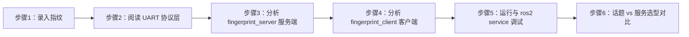

## 实验7：ROS2服务通讯（指纹传感器）（4h）

### 一、关联知识点

本实验关联以下知识图谱节点：

| 编号 | 知识点名称 | 类型 | 层级路径 |
|------|-----------|------|---------|
| 2.3.1 | 服务通信同步 RPC 一对一请求/响应模型 | 概念 | 第2章 ROS2核心通信机制 → 2.3 服务通信 |
| 2.3.2 | 服务端注册服务名与回调、客户端同步 call 的交互原理 | 原理 | 第2章 ROS2核心通信机制 → 2.3 服务通信 |
| 2.3.3 | create_service 注册服务 → UART 控制指纹模块 → 采集/比对 → 返回结果 | 流程 | 第2章 ROS2核心通信机制 → 2.3 服务通信 |

### 二、实验目标

通过本实验的学习，学生能够：

1. **原理理解**：阐述 ROS2 服务通信的同步 RPC 模型——客户端发送 Request 后阻塞等待，服务端在回调中处理并返回 Response，说明其与话题（异步一对多持续流）在调用语义与适用场景上的本质区别
2. **流程掌握**：掌握 `ros_sensor` 包中 `fingerprint_server`（服务端）与 `fingerprint_client`（客户端）两个节点从 `create_service`/`create_client`、`call_async` 到 `spin_until_future_complete` 的完整同步调用链路
3. **独立完成**：独立运行指纹服务端/客户端节点，使用 `ros2 service call` 命令行触发验证并观察响应结果，理解指纹「采图 → 生成特征 → 搜索比对」三步流程
4. **迁移应用**：能够将「UART 传感器 → 服务封装 → 同步 RPC 调用」的模式迁移到其它一次性的查询/指令场景（如继电器控制、单次状态查询），并与话题/动作做出正确选型

### 三、实验环境

| 类别 | 配置 |
|------|------|
| 硬件平台 | 具身智能实验箱B2 或 具身智能机器人小车C1（集成指纹识别模组） |
| 操作系统 | Ubuntu 22.04 + ROS2 Humble |
| 核心依赖 | `rclpy`、`ros_sensor_interfaces`（自定义 srv）、`pyserial` |
| 开发语言 | Python 3.10 |
| 源码位置 | `~/ros2_ws/src/xflz_eai_car1/driver/ros_sensor`（节点包 `ros_sensor`） |
| 传感器接口 | 指纹识别模组，UART 串口（默认 `/dev/ttyS10`，波特率 57600） |

> 说明：指纹模组遵循 `PS_*` 串口协议（产品用户手册 V1.5.1），底层字节级通信封装在 `fingerprint_enroll.py` 的 `Fingerprint` 类中；ROS 服务端只负责调用它完成验证，本身不解析 UART 帧格式。

### 四、实验难度

| 维度 | 说明 |
|------|------|
| 难度等级 | ⭐⭐（中等） |
| 实验类型 | 设计性 |
| 建议时长 | 4 学时（180 分钟） |

**重点**：
- 掌握 Service 服务端/客户端的标准编程流程：`create_service` 注册回调 → `create_client` 创建客户端 → `call_async` 异步请求 → `spin_until_future_complete` 等待响应
- 理解 `.srv` 自定义服务接口「请求（空）/响应（success, user_id, message）」的定义与使用
- 掌握指纹验证「采集图像 → 生成特征 → 搜索指纹库」三步流程及每步的确认码含义

**难点**：
- 同步 RPC 与异步话题、动作在调用模型上的区别与选型
- 指纹模组 `PS_*` 串口协议的确认码（0x00 成功、0x02 无手指等）在重试循环中的应用

### 五、实验现象

#### 5.1 快速验证流程

完成本实验后，你应能观察到以下现象：

1. 终端 A 启动 `fingerprint_server` 后，打印 `指纹服务已启动: port=/dev/ttyS10 baud=57600`
2. 终端 B 启动 `fingerprint_client` 后，先打印 `等待指纹服务 /verify_fingerprint ...`，就绪后打印 `发送指纹验证请求...`
3. 将已录入的手指放到传感器上，客户端打印 `验证成功 user_id=1 匹配成功 score=...`
4. 放一个未录入的手指，客户端打印 `验证失败 user_id=-1 未匹配到指纹`
5. `ros2 service list` 显示 `/verify_fingerprint` 服务
6. 用 `ros2 service call /verify_fingerprint ...` 可绕过客户端直接触发服务并观察响应

#### 5.2 预期效果描述

| 操作 | 预期输出 |
|------|---------|
| `ros2 run ros_sensor fingerprint_server` | `指纹服务已启动: port=/dev/ttyS10 baud=57600` |
| `ros2 run ros_sensor fingerprint_client`（另一终端） | `验证成功 user_id=1 匹配成功 score=123`（已录入手指） |
| `ros2 service list` | 列表包含 `/verify_fingerprint` |
| `ros2 service type /verify_fingerprint` | `ros_sensor_interfaces/srv/VerifyFingerprint` |
| `ros2 service call /verify_fingerprint ros_sensor_interfaces/srv/VerifyFingerprint "{}"` | `success: true, user_id: 1, message: 匹配成功 score=...` |

---

### 六、实验步骤

#### 整体流程



---

#### 步骤 1：录入指纹模板（15 分钟）

**知识点讲解**：

**指纹录入与验证分离（知识点 2.3.3）**
- **是什么**：指纹「录入」和「验证」是两个独立环节——录入把手指特征模板写入模组内部 Flash（持久保存），验证则是把现场采集的特征与库中模板比对。本实验中录入用 `fingerprint_enroll.py` 这个独立的串口脚本完成，ROS 节点只负责「验证」。
- **为什么分离**：录入是一次性、低频、需要人工按两次手指确认的操作，不需要 ROS 参与；而验证是高频、程序化的请求，用 ROS 服务封装便于被其它节点（如门禁、考勤逻辑）复用。
- **怎么用**：运行 `fingerprint_enroll.py enroll -i 1` 把指纹保存到位置 1，然后才能用服务端验证。

**操作步骤**：

```bash
cd ~/ros2_ws/src/xflz_eai_car1/driver/ros_sensor/ros_sensor

# 录入指纹到位置 1（按提示放两次同一手指）
python3 fingerprint_enroll.py enroll -i 1

# 查看当前指纹库模板数量
python3 fingerprint_enroll.py list
```

**易错点**：
- ⚠️ 两次按压不是同一根手指导致 `合并模板失败` → **解决**：重新录入，两次都用同一根手指并保持角度一致。
- ⚠️ 串口占用冲突（服务端正在运行又跑录入脚本）→ **解决**：先停止 `fingerprint_server`，录入完成后再启动。

---

#### 步骤 2：阅读 UART 协议层（25 分钟）

**知识点讲解**：

**PS_* 串口协议与确认码（知识点 2.3.3）**
- **是什么**：指纹模组通过 UART 收发 8 位帧（包头 `0xEF01` + 地址 + 包标识 + 长度 + 指令码 + 参数 + 校验和）。核心指令码见 `fingerprint_enroll.py` L20-28：`CMD_GET_IMAGE=0x01`（采集图像）、`CMD_GEN_CHAR=0x02`（生成特征）、`CMD_REG_MODEL=0x05`（合并特征成模板）、`CMD_STORE_CHAR=0x06`（储存模板）、`CMD_SEARCH=0x04`（搜索指纹库）。
- **为什么**：模组是「一问一答」的主从协议，主机发指令、模组回确认码。确认码约定（`fingerprint_enroll.py` L31-33）：`0x00` 成功、`0x01` 收包有错、`0x02` 无手指——服务端正是靠 `0x02` 判断「手指未按下」来做轮询等待。
- **怎么用**：`Fingerprint` 类（`fingerprint_enroll.py` L45-124）封装了 `get_image()`、`gen_char()`、`reg_model()`、`store_char()`、`search()` 等方法，ROS 服务端直接复用这些方法，无需自己拼帧。

**操作步骤**：

打开 `fingerprint_enroll.py`，阅读 `_build_packet()`（L36-42，帧封装）与 `Fingerprint._send()`（L56-73，收发与校验），理解 8 字节包头 + 确认码 + 参数 + 2 字节校验和的应答结构。

```python
# 来源：fingerprint_enroll.py L19-28（指令码定义）
CMD_GET_IMAGE   = 0x01   # PS_GetImage   采集图像
CMD_GEN_CHAR    = 0x02   # PS_GenChar    生成特征
CMD_REG_MODEL   = 0x05   # PS_RegModel   合并特征生成模板
CMD_STORE_CHAR  = 0x06   # PS_StoreChar  储存模板
CMD_SEARCH      = 0x04   # PS_Search     搜索指纹
```

**易错点**：
- ⚠️ 误把确认码当成「错误码」，以为非零即失败 → **解决**：`0x02` 是「无手指」的正常状态，不是错误。

---

#### 步骤 3：分析 `fingerprint_server` 服务端（35 分钟）

**知识点讲解**：

**服务端编程模型（知识点 2.3.1、2.3.2）**
- **是什么**：`fingerprint_server` 通过 `create_service` 把「`VerifyFingerprint` 类型的回调 `handle_request`」注册到服务名 `verify_fingerprint` 上（源码 `fingerprint_server.py` L24-26）。当客户端发起请求，ROS2 会调用 `handle_request(request, response)`，函数返回的 `response` 即回传给客户端。
- **为什么同步**：服务回调是「收到一次请求、处理、返回一次结果」的单次 RPC，处理期间该调用处于等待状态，适合指纹验证这种「一问一答、结果确定」的场景。
- **怎么用**：`handle_request` 内完成三步（源码 L46-87）：① 循环调用 `get_image()` 等待手指按下（`0x02` 无手指则 `sleep(0.2)` 重试，共 `retries=50` 次）；② `gen_char(1)` 生成特征；③ `search()` 搜索指纹库，成功则返回 `user_id=页码`、`message=f'匹配成功 score={score}'`。

**操作步骤**：

打开 `fingerprint_server.py`，完整阅读 `FingerprintServer` 类（L17-87），重点理解参数声明与回调三步流程。

```python
# 来源：fingerprint_server.py L19-26（节点初始化，节选）
super().__init__('fingerprint_server')
self.declare_parameter('port', os.environ.get('FP_PORT', '/dev/ttyS10'))
self.declare_parameter('baud', int(os.environ.get('FP_BAUD', '57600')))
self.declare_parameter('retries', 50)
self.srv = self.create_service(
    VerifyFingerprint, 'verify_fingerprint', self.handle_request
)
```

```python
# 来源：fingerprint_server.py L46-64（采图轮询，节选）
for _ in range(retries):
    code = fp.get_image()
    if code == 0x00:
        break
    if code == 0x02:          # 无手指，继续等待
        time.sleep(0.2)
        continue
    response.success = False
    response.message = f'采集图像失败(code={code})'
    return response
```

**易错点**：
- ⚠️ 忘记 `declare_parameter` 就 `get_parameter` → **解决**：三个参数 `port/baud/retries` 都必须先声明（L20-22）。
- ⚠️ 服务回调未 `finally: fp.close()` 导致串口泄漏 → **解决**：源码 L84-85 用 `try/finally` 保证串口总是被关闭。

---

#### 步骤 4：分析 `fingerprint_client` 客户端（35 分钟）

**知识点讲解**：

**客户端编程模型（知识点 2.3.2）**
- **是什么**：`fingerprint_client` 通过 `create_client` 创建客户端，`wait_for_service` 等待服务上线，`call_async` 发送请求，`spin_until_future_complete` 阻塞等待响应。
- **为什么用 `spin_until_future_complete`**：`call_async` 是异步的（立即返回一个 Future），需要让 Executor 转动来处理服务端回包，直到 Future 完成。这是 ROS2 客户端「异步发送、同步等待」的标准写法。
- **怎么用**：构造 `VerifyFingerprint.Request()`（本 srv 请求为空），`call_async(req)` 拿到 Future，`spin_until_future_complete(self, future)` 等待，`future.result()` 取到 `response` 后按 `success` 分支打印（源码 `fingerprint_client.py` L23-40）。

**操作步骤**：

打开 `fingerprint_client.py`，完整阅读 `FingerprintClient` 类（L15-40）。

```python
# 来源：fingerprint_client.py L16-31（创建客户端与发送请求，节选）
super().__init__('fingerprint_client')
self.cli = self.create_client(VerifyFingerprint, 'verify_fingerprint')
while not self.cli.wait_for_service(timeout_sec=1.0):
    self.get_logger().info('等待指纹服务 /verify_fingerprint ...')

req = VerifyFingerprint.Request()          # 请求为空
future = self.cli.call_async(req)
rclpy.spin_until_future_complete(self, future)
resp = future.result()
if resp.success:
    self.get_logger().info(f'验证成功 user_id={resp.user_id} {resp.message}')
```

**易错点**：
- ⚠️ 客户端先于服务端启动时 `call_async` 报错 → **解决**：`wait_for_service` 循环会阻塞等待服务上线，务必先启动服务端再启动客户端。
- ⚠️ 忘记检查 `future.result()` 是否为 `None`（服务调用失败）→ **解决**：源码 L28-30 对 `None` 做了防御性判断。

---

#### 步骤 5：运行与 `ros2 service` 调试（40 分钟）

**知识点讲解**：

**服务运行态自省（知识点 2.1.2）**
- **是什么**：`ros2 service` 命令族用于自省运行中的服务——`list` 列出服务、`type` 查看类型、`call` 直接发起一次调用。
- **为什么重要**：无需编写客户端即可验证服务端逻辑，是调试服务通信最快捷的手段；`call` 的参数用 YAML 字符串给出，本 srv 请求为空，故传 `"{}"`。
- **怎么用**：先启动服务端，再在另一终端 `ros2 service call /verify_fingerprint ros_sensor_interfaces/srv/VerifyFingerprint "{}"`。

**操作步骤**：

```bash
# 终端 A：启动服务端
ros2 run ros_sensor fingerprint_server

# 终端 B：启动客户端（按提示放手指）
ros2 run ros_sensor fingerprint_client

# 终端 C：自省与直接调用
ros2 service list
ros2 service type /verify_fingerprint
ros2 service call /verify_fingerprint ros_sensor_interfaces/srv/VerifyFingerprint "{}"
```

**易错点**：
- ⚠️ `ros2 service call` 的请求参数写错（如 `"{data: 1}"`）→ **解决**：`VerifyFingerprint` 请求为空，必须传 `"{}"`。
- ⚠️ 未放手指时调用会等待到超时 → **解决**：调用前先把手指放到传感器上，或观察服务端 50 次轮询（约 10s）后的「超时，未检测到手指」响应。

---

#### 步骤 6：话题 vs 服务选型对比（30 分钟）

**知识点讲解**：

**通信机制选型（知识点 2.2.1、2.3.1）**
- **是什么**：话题是「一对多、持续、异步」的数据流；服务是「一对一、单次、同步」的请求响应。二者在调用语义上互补。
- **为什么指纹验证选服务**：验证是一次性的「请求→结果」交互，天然符合 RPC 语义；若用话题，则要额外定义「请求话题+响应话题」并处理配对，复杂且易错。
- **怎么用**：下表给出三类通信机制的选型对照，是本章（实验6/7/8）的核心结论。

**操作步骤**：

| 维度 | 话题（实验6） | 服务（实验7） | 动作（实验8） |
|------|-------------|-------------|-------------|
| 调用语义 | 持续数据流，一对多 | 单次请求/响应，一对一 | 长耗时目标+反馈+结果 |
| 异步/同步 | 异步 | 同步（客户端阻塞等待） | 异步 |
| 是否可取消 | 否 | 否 | 是 |
| 中间反馈 | 无 | 无 | 有（Feedback） |
| 典型场景 | MQ5 浓度持续发布 | 指纹验证、继电器控制 | 刷卡检测（等待刷卡） |

**易错点**：
- ⚠️ 用话题实现「单次查询」导致配对复杂 → **解决**：一次性请求-响应用服务，持续数据流用话题，长耗时可反馈可取消用动作。

---

### 七、注意事项

| ⚠️ 注意项 | 说明 |
|-----------|------|
| 串口独占 | 录入脚本与服务端不能同时占用同一串口，录入前先停止服务端 |
| 服务就绪 | 客户端依赖服务端在线，先启动服务端再启动客户端 |
| 服务名一致 | 服务端与客户端均使用 `verify_fingerprint`（绝对名 `/verify_fingerprint`），须一致 |
| 参数配置 | `port`/`baud` 可用环境变量 `FP_PORT`/`FP_BAUD` 或 `--ros-args -p` 覆盖 |
| 安全提示 | 指纹模组为光学/半导体传感器，避免用力按压划伤采集窗口；录入时保持手指清洁干燥 |

### 八、实验总结

#### 8.1 完成成果

完成本实验后，你应当能够：
- ✅ 使用 `fingerprint_enroll.py` 完成指纹的录入、查询、删除与清空
- ✅ 编译并运行 `fingerprint_server` / `fingerprint_client` 完成指纹验证
- ✅ 理解指纹「采图 → 生成特征 → 搜索比对」三步流程及 `PS_*` 协议确认码含义
- ✅ 使用 `ros2 service list/type/call` 自省与直接调用服务
- ✅ 根据场景正确选择话题/服务/动作三种通信机制

#### 8.2 技能收获

| 技能 | 说明 |
|------|------|
| 服务编程 | 掌握 Service 服务端/客户端标准代码模式（create_service/create_client/call_async） |
| 串口传感器集成 | 理解 UART 主从协议与确认码驱动的轮询交互 |
| 自定义接口使用 | 使用 `ros_sensor_interfaces/srv/VerifyFingerprint` 自定义服务 |
| 系统调试 | 用 `ros2 service` 命令族无需客户端即可验证服务端 |
| 通信选型 | 掌握话题/服务/动作三类机制的适用场景边界 |

#### 8.3 常见问题与解答

| 问题 | 原因 | 解决方法 |
|------|------|---------|
| 客户端一直「等待指纹服务」 | 服务端未启动或服务名不一致 | 先启动 `fingerprint_server`，确认 `ros2 service list` 含 `/verify_fingerprint` |
| 验证总是失败 user_id=-1 | 手指未录入，或按压位置偏移 | 先 `enroll` 录入，验证时保持相同角度力度 |
| 采图报「无手指」后超时 | 传感器未检测到手指 | 检查手指是否完全覆盖采集窗口，必要时清洁窗口 |
| 打开串口失败 | 串口被占用或权限不足 | 停止占用进程，或加入 dialout 用户组 |
| `ros2 service call` 参数报错 | 请求参数格式错误 | 请求为空，必须传 `"{}"` |

### 九、实验报告要求

#### 9.1 报告内容

完成实验后，提交一份实验报告，包含以下内容：

1. **实验基本信息**：实验名称、实验日期、实验者姓名、实验平台信息
2. **实验过程记录**：截取服务端启动、客户端验证成功、`ros2 service list/type/call` 的终端截图
3. **原理分析**（不少于 400 字）：用自己的语言解释以下三个问题：
   - ① 为什么服务通信是「同步」的？`call_async` 名字里有 async，但客户端却要 `spin_until_future_complete` 阻塞等待，这两者是否矛盾？请说明 Future 与 Executor 的关系。
   - ② 指纹验证为什么用服务而非话题？如果改用话题实现，需要额外设计哪些机制？
   - ③ 服务端 `handle_request` 中为什么用循环 + `sleep(0.2)` 轮询「无手指」而不是阻塞读取？这样设计有何优劣？
4. **思考题**（见下方）

#### 9.2 思考题

**思考题 1**：
指纹模组的 `PS_GetImage`（0x01）在「无手指」时返回确认码 `0x02`。如果服务端把 `0x02` 当作错误立即返回失败，会导致什么问题？结合源码 `fingerprint_server.py` L49-54 说明「区分状态码与错误码」对鲁棒性的意义。

**思考题 2**：
`verify_fingerprint` 服务的请求字段为空，客户端无法指定「要验证到哪个用户」。假设你要设计一个「门禁 + 考勤」系统，需要区分「验证通过即可开门」与「验证通过并确认身份记录考勤」，请问你会如何扩展 `.srv` 接口？请给出扩展后的 srv 定义与使用流程。

#### 9.3 评分标准

| 评分项 | 权重 | 评分标准 |
|-------|------|---------|
| 实验操作完整性 | 25% | 是否成功完成录入 + 服务端/客户端验证 + CLI 调用 |
| 代码理解 | 20% | 能否准确指出 fingerprint_enroll.py / fingerprint_server.py / fingerprint_client.py 关键代码位置 |
| 原理分析 | 25% | 对同步 RPC 模型、串口协议、选型的理解深度 |
| 思考题 1 | 15% | 对状态码/错误码区分与鲁棒性的阐释 |
| 思考题 2 | 15% | 对 srv 接口扩展设计的合理性与完整性 |

---
