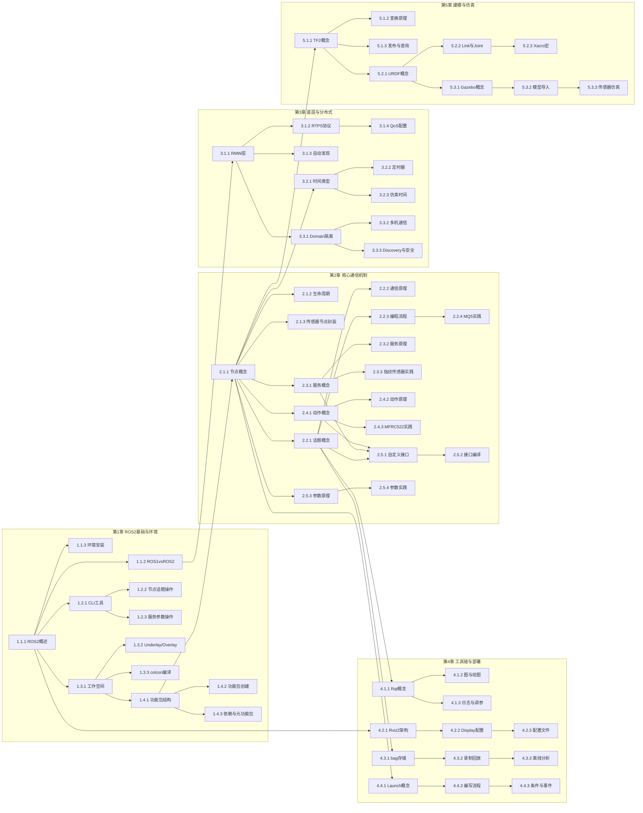

# 机器人ROS2应用与开发 知识图谱

> 课程代码: EXP003
> 总学时: 48h
> 生成日期: 2026-08-10
> 来源: course-spec.yaml (spec-parser-skill@2.0)

---

## 第1章 ROS2基础与环境搭建

> 学时: 10h | 覆盖实验: exp01~exp04, exp18 | 技术栈: ROS2

### 1.1 ROS2概述与架构

#### 知识点 1.1.1
- **类型**: 概念
- **描述**: ROS2是面向机器人开发的开源中间件框架，提供分布式通信、模块化开发和硬件抽象能力
- **难度**: 记忆

#### 知识点 1.1.2
- **类型**: 原理
- **描述**: ROS2采用DDS去中心化架构替代ROS1的Master主从架构，消除单点故障并支持实时通信
- **难度**: 理解
- **前置依赖**: 1.1.1

#### 知识点 1.1.3
- **类型**: 流程
- **描述**: 安装ROS2 Humble发行版→配置环境变量→ros2 run demo_nodes_cpp talker/listener验证节点通信
- **难度**: 应用
- **前置依赖**: 1.1.1

### 1.2 ROS2命令行工具

#### 知识点 1.2.1
- **类型**: 概念
- **描述**: ros2 CLI是ROS2的统一命令行工具集，覆盖节点/话题/服务/参数/接口/bag六大子命令组
- **难度**: 记忆
- **前置依赖**: 1.1.1

#### 知识点 1.2.2
- **类型**: 流程
- **描述**: ros2 node list查看节点→ros2 topic echo/hz/pub监控和操作话题数据→ros2 service call调用服务
- **难度**: 应用
- **前置依赖**: 1.2.1

#### 知识点 1.2.3
- **类型**: 流程
- **描述**: ros2 param list/get/set管理参数→ros2 interface list/show查看接口定义→ros2 bag record录制数据
- **难度**: 应用
- **前置依赖**: 1.2.1

### 1.3 ROS2工作空间

#### 知识点 1.3.1
- **类型**: 概念
- **描述**: 工作空间是ROS2项目的根目录，包含src(源码)/build(编译中间件)/install(部署产物)/log四层结构
- **难度**: 记忆
- **前置依赖**: 1.1.1

#### 知识点 1.3.2
- **类型**: 原理
- **描述**: Underlay(/opt/ros/humble)提供系统级包，Overlay在用户空间叠加，通过source setup.bash实现层级叠加
- **难度**: 理解
- **前置依赖**: 1.3.1

#### 知识点 1.3.3
- **类型**: 流程
- **描述**: mkdir -p src创建工作空间→放入功能包源码→colcon build编译→source install/setup.bash加载环境
- **难度**: 应用
- **前置依赖**: 1.3.1, 1.3.2

### 1.4 ROS2功能包管理

#### 知识点 1.4.1
- **类型**: 概念
- **描述**: 功能包是ROS2最小组织单元，包含package.xml(元信息与依赖)和CMakeLists.txt或setup.py(构建配置)
- **难度**: 记忆
- **前置依赖**: 1.3.1

#### 知识点 1.4.2
- **类型**: 流程
- **描述**: ros2 pkg create --build-type ament_python/ament_cmake创建包→编写源码→配置依赖→colcon编译
- **难度**: 应用
- **前置依赖**: 1.4.1

#### 知识点 1.4.3
- **类型**: 原理
- **描述**: build_depend声明编译依赖，exec_depend声明运行依赖；元功能包不包含代码仅通过exec_depend聚合相关包
- **难度**: 理解
- **前置依赖**: 1.4.1

---

## 第2章 ROS2核心通信机制

> 学时: 18h | 覆盖实验: exp05~exp11 | 技术栈: ROS2

### 2.1 ROS2节点编程

#### 知识点 2.1.1
- **类型**: 概念
- **描述**: 节点是ROS2中执行计算的独立进程单元，通过继承rclpy.node.Node或rclcpp::Node类实现功能封装
- **难度**: 记忆
- **前置依赖**: 1.4.1

#### 知识点 2.1.2
- **类型**: 原理
- **描述**: 节点经历构造→配置→激活→停用→清理的状态转换，spin()驱动事件循环，确保资源有序初始化和释放
- **难度**: 理解
- **前置依赖**: 2.1.1

#### 知识点 2.1.3
- **类型**: 流程
- **描述**: 继承Node→构造函数中初始化传感器硬件(ADC/SPI/UART)→创建Publisher/Subscriber→spin()保持运行
- **难度**: 应用
- **前置依赖**: 2.1.1, 2.1.2

### 2.2 话题通信

#### 知识点 2.2.1
- **类型**: 概念
- **描述**: 话题通信是异步发布/订阅的一对多消息传递模式，Publisher和Subscriber通过话题名称解耦
- **难度**: 记忆
- **前置依赖**: 2.1.1

#### 知识点 2.2.2
- **类型**: 原理
- **描述**: Publisher发布消息到DDS全局数据空间，Subscriber回调异步接收，DDS保证消息按QoS策略传输
- **难度**: 理解
- **前置依赖**: 2.2.1

#### 知识点 2.2.3
- **类型**: 流程
- **描述**: create_publisher声明话题与消息类型→构造消息并赋值→publish发送→create_subscription注册回调→处理数据
- **难度**: 应用
- **前置依赖**: 2.2.1, 2.2.2

#### 知识点 2.2.4
- **类型**: 流程
- **描述**: ADC采集MQ5传感器模拟电压→换算ppm浓度值→封装Float32消息→发布到/gas_sensor话题→订阅端接收显示
- **难度**: 应用
- **前置依赖**: 2.2.3

### 2.3 服务通信

#### 知识点 2.3.1
- **类型**: 概念
- **描述**: 服务通信是同步RPC式一对一请求/响应模式，客户端发送Request后阻塞等待Server返回Response
- **难度**: 记忆
- **前置依赖**: 2.1.1

#### 知识点 2.3.2
- **类型**: 原理
- **描述**: 服务端注册服务名和回调函数，客户端同步call发送请求，服务端处理完后返回结果，使用.srv定义接口
- **难度**: 理解
- **前置依赖**: 2.3.1

#### 知识点 2.3.3
- **类型**: 流程
- **描述**: create_service注册/fingerprint_verify→回调中UART串口控制指纹模块→采集/比对指纹→返回match/int状态
- **难度**: 应用
- **前置依赖**: 2.3.1, 2.3.2

### 2.4 动作通信

#### 知识点 2.4.1
- **类型**: 概念
- **描述**: 动作是异步长耗时任务通信机制，通过Goal→Feedback→Result三通道实现可取消、可反馈的操作交互
- **难度**: 记忆
- **前置依赖**: 2.1.1

#### 知识点 2.4.2
- **类型**: 原理
- **描述**: 客户端发送Goal，服务器异步执行并通过Feedback周期性反馈进度，任务完成后返回Result并可随时被取消
- **难度**: 理解
- **前置依赖**: 2.4.1

#### 知识点 2.4.3
- **类型**: 流程
- **描述**: ActionServer实现goal/feedback/result回调→客户端async_send_goal→服务端SPI读取MFRC522→返回card_uid
- **难度**: 应用
- **前置依赖**: 2.4.1, 2.4.2

### 2.5 通信接口与参数系统

#### 知识点 2.5.1
- **类型**: 概念
- **描述**: 自定义接口(.msg/.srv/.action)允许定义传感器专用的数据结构，编译后生成Python/C++可用的消息类
- **难度**: 记忆
- **前置依赖**: 2.2.1, 2.3.1, 2.4.1

#### 知识点 2.5.2
- **类型**: 流程
- **描述**: 创建接口包→编写.msg定义字段→CMakeLists.txt配置编译→source install后import使用→发布/订阅自定义消息
- **难度**: 应用
- **前置依赖**: 2.5.1

#### 知识点 2.5.3
- **类型**: 原理
- **描述**: 节点declare_parameter声明参数及其默认值，运行时get/set读写，add_on_set_parameters_callback监听动态变更
- **难度**: 理解
- **前置依赖**: 2.1.1

#### 知识点 2.5.4
- **类型**: 流程
- **描述**: declare_parameter声明参数→注册set_parameters_callback→ros2 param set命令行触发→节点响应并更新行为
- **难度**: 应用
- **前置依赖**: 2.5.3

---

## 第3章 ROS2底层机制与分布式通信

> 学时: 6h | 覆盖实验: exp11~exp13 | 技术栈: ROS2, DDS

### 3.1 DDS通信中间件

#### 知识点 3.1.1
- **类型**: 概念
- **描述**: RMW(ROS Middleware)是ROS2的中间件抽象层，使上层API可无缝切换Fast-DDS/CycloneDDS等DDS实现
- **难度**: 记忆
- **前置依赖**: 1.1.2

#### 知识点 3.1.2
- **类型**: 原理
- **描述**: RTPS协议定义Participant→Endpoint→Writer/Reader层次，通过HistoryCache和Heartbeat实现可靠实时通信
- **难度**: 理解
- **前置依赖**: 3.1.1

#### 知识点 3.1.3
- **类型**: 原理
- **描述**: DDS自动发现分SPDP(参与者发现)和SEDP(端点发现)两阶段，使节点无需手动配置即可建立通信链路
- **难度**: 理解
- **前置依赖**: 3.1.1, 3.1.2

#### 知识点 3.1.4
- **类型**: 流程
- **描述**: 配置QoS策略：RELIABLE/BEST_EFFORT(可靠性)、VOLATILE/TRANSIENT_LOCAL(持久性)、KEEP_LAST(历史深度)
- **难度**: 应用
- **前置依赖**: 3.1.2

### 3.2 时间系统

#### 知识点 3.2.1
- **类型**: 概念
- **描述**: ROS2时间类型(builtin_interfaces/Time)以秒+纳秒表示时刻，支持系统时钟(/clock)和仿真时钟双模式
- **难度**: 记忆
- **前置依赖**: 2.1.1

#### 知识点 3.2.2
- **类型**: 流程
- **描述**: get_clock().now()获取当前时间→create_timer(period, callback)创建周期性定时器→定时触发传感器采集
- **难度**: 应用
- **前置依赖**: 3.2.1

#### 知识点 3.2.3
- **类型**: 原理
- **描述**: use_sim_time=true使节点订阅/clock话题，Clock类自动切换至Gazebo发布的仿真时间，保证数据时间戳一致
- **难度**: 理解
- **前置依赖**: 3.2.1

### 3.3 分布式通信

#### 知识点 3.3.1
- **类型**: 概念
- **描述**: ROS_DOMAIN_ID(0-232)隔离不同机器人集群的DDS通信域，同一域内节点通过DDS自动发现实现互联
- **难度**: 记忆
- **前置依赖**: 3.1.1

#### 知识点 3.3.2
- **类型**: 流程
- **描述**: 确保多机同网段→设置相同ROS_DOMAIN_ID→分别启动节点→验证话题list/echo和服务call跨设备互通
- **难度**: 应用
- **前置依赖**: 3.3.1

#### 知识点 3.3.3
- **类型**: 事实
- **描述**: ROS_DISCOVERY_SERVER提供中心化节点发现方案，DDS-Security通过governance和permissions文件实现加密通信
- **难度**: 记忆
- **前置依赖**: 3.3.1

---

## 第4章 ROS2工具链与系统部署

> 学时: 8h | 覆盖实验: exp14~exp17 | 技术栈: ROS2, Launch, Rviz2

### 4.1 Rqt调试工具箱

#### 知识点 4.1.1
- **类型**: 概念
- **描述**: Rqt是基于Qt的ROS2插件化调试工具集，通过可组合面板提供节点可视化、数据绘图和日志查看功能
- **难度**: 记忆
- **前置依赖**: 2.2.1

#### 知识点 4.1.2
- **类型**: 流程
- **描述**: rqt_graph展示节点-话题-服务拓扑→rqt_plot选择话题字段实时绘制曲线→定位通信异常与数据趋势
- **难度**: 应用
- **前置依赖**: 4.1.1

#### 知识点 4.1.3
- **类型**: 流程
- **描述**: rqt_console按DEBUG/INFO/WARN/ERROR级别过滤日志→rqt_reconfigure连接节点动态调整参数→观察效果
- **难度**: 应用
- **前置依赖**: 4.1.1, 2.5.3

### 4.2 Rviz2三维可视化

#### 知识点 4.2.1
- **类型**: 概念
- **描述**: Rviz2是基于OGRE的ROS2 3D可视化工具，通过Display插件体系在固定参考坐标系上叠加多种数据面板
- **难度**: 记忆
- **前置依赖**: 1.1.1

#### 知识点 4.2.2
- **类型**: 流程
- **描述**: 启动Rviz2→设置Fixed Frame→添加RobotModel/TF/LaserScan/Image/Path/Marker面板→配置话题和显示属性
- **难度**: 应用
- **前置依赖**: 4.2.1

#### 知识点 4.2.3
- **类型**: 事实
- **描述**: .rviz配置文件保存Display列表、视角、颜色和参数设置，加载后即时复现调试环境，便于团队共享
- **难度**: 记忆
- **前置依赖**: 4.2.2

### 4.3 数据录制与回放

#### 知识点 4.3.1
- **类型**: 概念
- **描述**: ros2 bag以SQLite3数据库格式序列化存储话题消息，支持话题过滤、压缩编码和时间戳索引
- **难度**: 记忆
- **前置依赖**: 2.2.1

#### 知识点 4.3.2
- **类型**: 流程
- **描述**: ros2 bag record -a全量录制或-t指定话题→ros2 bag info查看元数据→ros2 bag play -r 0.5回放并调速
- **难度**: 应用
- **前置依赖**: 4.3.1

#### 知识点 4.3.3
- **类型**: 流程
- **描述**: 回放bag数据→同步启动Rviz2→添加对应Display面板(LaserScan/Image/Path)→拖动时间轴离线分析场景
- **难度**: 应用
- **前置依赖**: 4.3.2, 4.2.2

### 4.4 Launch启动管理

#### 知识点 4.4.1
- **类型**: 概念
- **描述**: Launch文件以Python/XML/YAML声明多节点启动配置，支持参数传递、条件启动、事件触发和文件嵌套
- **难度**: 记忆
- **前置依赖**: 2.1.1

#### 知识点 4.4.2
- **类型**: 流程
- **描述**: 编写Python LaunchFile：声明Node(package/executable/parameters/remappings)→构建LaunchDescription→ros2 launch执行
- **难度**: 应用
- **前置依赖**: 4.4.1

#### 知识点 4.4.3
- **类型**: 原理
- **描述**: IfCondition根据参数值条件启动节点，OnProcessExit在进程退出后触发后继操作，LaunchArgument实现参数化复用
- **难度**: 理解
- **前置依赖**: 4.4.2

---

## 第5章 机器人建模与仿真

> 学时: 6h | 覆盖实验: exp19~exp21 | 技术栈: TF2, URDF, Xacro, Gazebo

### 5.1 TF2坐标变换

#### 知识点 5.1.1
- **类型**: 概念
- **描述**: TF2以树形结构管理多坐标系父子关系，支持任意两个frame之间的位姿(平移+旋转)查询与变换计算
- **难度**: 记忆
- **前置依赖**: 2.1.1

#### 知识点 5.1.2
- **类型**: 原理
- **描述**: 通过tf2_ros库发布/tf和/tf_static话题，Buffer缓存历史变换，TransformListener订阅更新并回答查询
- **难度**: 理解
- **前置依赖**: 5.1.1

#### 知识点 5.1.3
- **类型**: 流程
- **描述**: StaticTransformBroadcaster发布静态变换→TransformBroadcaster定时发布动态变换→lookup_transform查询相对位姿
- **难度**: 应用
- **前置依赖**: 5.1.1, 5.1.2

### 5.2 URDF机器人建模

#### 知识点 5.2.1
- **类型**: 概念
- **描述**: URDF(统一机器人描述格式)以XML描述机器人结构，包含link(几何/物理属性)和joint(连接/运动约束)
- **难度**: 记忆
- **前置依赖**: 5.1.1

#### 知识点 5.2.2
- **类型**: 流程
- **描述**: 编写link(visual/collision/inertial元素)→定义joint(类型/原点/轴/限位)→组装完整机器人运动学模型
- **难度**: 应用
- **前置依赖**: 5.2.1

#### 知识点 5.2.3
- **类型**: 流程
- **描述**: xacro:macro定义可复用组件→xacro:property参数化尺寸→数学表达式计算→xacro:include引入→生成URDF
- **难度**: 应用
- **前置依赖**: 5.2.2

### 5.3 Gazebo物理仿真

#### 知识点 5.3.1
- **类型**: 概念
- **描述**: Gazebo是集成ODE/Bullet物理引擎和多种传感器模型的开源3D仿真平台，通过ROS2插件实现联合仿真
- **难度**: 记忆
- **前置依赖**: 5.2.1

#### 知识点 5.3.2
- **类型**: 流程
- **描述**: URDF导入Gazebo→添加gazebo_ros2_control插件→配置质量/惯性/碰撞物理参数→启动仿真器验证运动
- **难度**: 应用
- **前置依赖**: 5.3.1

#### 知识点 5.3.3
- **类型**: 流程
- **描述**: 加载虚拟传感器插件(激光雷达/深度相机/IMU)→Gazebo生成仿真数据→自动通过ROS2话题发布到对应topic
- **难度**: 应用
- **前置依赖**: 5.3.2

---

## 知识点统计

| 维度 | 数量 |
|------|------|
| 总章节数 | 5 |
| 总节数 | 19 |
| 总知识点数 | 57 |
| **类型分布** | |
| 概念类 | 18 |
| 原理类 | 13 |
| 流程类 | 22 |
| 事实类 | 4 |
| **难度分布** | |
| 记忆 | 18 |
| 理解 | 13 |
| 应用 | 26 |
| 分析 | 0 |

---

## 实验-知识点映射表

| 实验ID | 实验名称 | 对应知识点 |
|--------|---------|-----------|
| exp01 | ROS2简介 | 1.1.1, 1.1.2, 1.1.3 |
| exp02 | ROS2常用命令工具 | 1.2.1, 1.2.2, 1.2.3 |
| exp03 | ROS2工作空间 | 1.3.1, 1.3.2, 1.3.3 |
| exp04 | ROS2功能包 | 1.4.1, 1.4.2, 1.4.3 |
| exp05 | ROS2节点 | 2.1.1, 2.1.2, 2.1.3 |
| exp06 | ROS2话题通讯(MQ5气体传感器) | 2.2.1, 2.2.2, 2.2.3, 2.2.4 |
| exp07 | ROS2服务通讯(指纹传感器) | 2.3.1, 2.3.2, 2.3.3 |
| exp08 | ROS2动作通讯(MFRC522读卡器) | 2.4.1, 2.4.2, 2.4.3 |
| exp09 | ROS2自定义接口消息(传感器接口包) | 2.5.1, 2.5.2 |
| exp10 | ROS2参数服务案例 | 2.5.3, 2.5.4 |
| exp11 | ROS2时间相关API | 3.2.1, 3.2.2, 3.2.3 |
| exp12 | ROS2 DDS | 3.1.1, 3.1.2, 3.1.3, 3.1.4 |
| exp13 | ROS2分布式通讯 | 3.3.1, 3.3.2, 3.3.3 |
| exp14 | ROS2 Rqt工具箱 | 4.1.1, 4.1.2, 4.1.3 |
| exp15 | ROS2 Rviz2使用 | 4.2.1, 4.2.2, 4.2.3 |
| exp16 | ROS2录制回放工具 | 4.3.1, 4.3.2, 4.3.3 |
| exp17 | ROS2 Launch启动文件配置 | 4.4.1, 4.4.2, 4.4.3 |
| exp18 | ROS2元功能包介绍 | 1.4.3 |
| exp19 | ROS2 TF2坐标变换 | 5.1.1, 5.1.2, 5.1.3 |
| exp20 | ROS2 URDF模型 | 5.2.1, 5.2.2, 5.2.3 |
| exp21 | ROS2 Gazebo仿真平台 | 5.3.1, 5.3.2, 5.3.3 |

---

## 技术栈-知识点映射表

| 技术栈 | 覆盖知识点 |
|-------|-----------|
| ROS2 | 1.1.1~1.4.3, 2.1.1~2.5.4, 3.2.1~3.3.3, 4.1.1~4.4.3 |
| DDS | 1.1.2, 3.1.1, 3.1.2, 3.1.3, 3.1.4, 3.3.1 |
| TF2 | 5.1.1, 5.1.2, 5.1.3 |
| URDF | 5.2.1, 5.2.2, 5.2.3 |
| Xacro | 5.2.3 |
| Gazebo | 5.3.1, 5.3.2, 5.3.3 |
| Rviz2 | 4.2.1, 4.2.2, 4.2.3, 4.3.3 |
| Launch | 4.4.1, 4.4.2, 4.4.3 |

---

## 知识点依赖关系图

---

## 更新日志

| 版本 | 日期 | 更新内容 | 更新人 |
|------|------|---------|-------|
| v0.1 | 2026-08-10 | 基于course-spec.yaml初始生成，覆盖21个实验和8项技术栈 | KnowledgeGraphAgent |
