# 机器人ROS2应用与开发 实验指导书

> 总学时: 48h（全实验）
> 实验数量: 20
> 硬件平台: 具身智能实验箱B2

---

## 实验1：ROS2简介

### 一、关联知识点

本实验关联以下知识图谱节点：

| 编号 | 知识点名称 | 类型 | 层级路径 |
|---|---|---|---|
| 1.1.1 | ROS2框架概念与设计目标 | 概念 | 第1章 ROS2基础与环境搭建 → 1.1 ROS2概述与架构 |
| 1.1.2 | DDS去中心化通信架构原理 | 原理 | 第1章 ROS2基础与环境搭建 → 1.1 ROS2概述与架构 |
| 1.1.3 | ROS2环境搭建与节点通信验证流程 | 流程 | 第1章 ROS2基础与环境搭建 → 1.1 ROS2概述与架构 |

### 二、实验目标

通过本实验的学习，学生能够：

1. **原理理解**：阐述 ROS2 相比 ROS1 在通信架构（DDS vs TCPROS）、编译系统（colcon vs catkin）、节点生命周期管理三个维度的核心改进及其工程意义
2. **流程掌握**：正确执行 `ros2 --help` 查看可用命令组，并使用 `ros2 run` 启动 talker/listener 示例节点体验分布式通信
3. **独立完成**：独立使用 `ros2 node list`、`ros2 topic list`、`ros2 topic echo` 等基础命令观察运行中的节点拓扑与消息数据
4. **迁移应用**：能够用自己的语言向他人解释"为什么机器人开发需要 ROS2 这样的中间件"

### 三、实验环境

| 类别 | 配置 |
|---|---|
| 硬件平台 | 具身智能实验箱B2 或 具身智能机器人小车C1 |
| 操作系统 | Ubuntu 22.04 |
| ROS2 发行版 | Humble Hawksbill |
| 核心依赖 | `ros-humble-ros-base`、`ros-humble-demo-nodes-cpp` |
| 终端工具 | 系统自带 Terminal（Bash） |

> 说明：本实验为纯软件验证实验，无需外接传感器或执行器。若设备未预装 ROS2，请先通过 APT 安装 `ros-humble-ros-base`。

### 四、实验难度

| 维度 | 说明 |
|---|---|
| 难度等级 | ⭐（容易） |
| 实验类型 | 验证性 |
| 建议时长 | 2 学时（90 分钟） |

**重点**：

- 理解 DDS 去中心化架构如何消除 ROS1 Master 的单点故障风险
- 掌握 `ros2` 统一命令行工具的六大子命令组结构

**难点**：

- 区分 DDS 的"自动发现"与 ROS1 的"Master 注册"两种节点发现范式
- 理解 colcon 编译系统与 catkin 在包组织方式上的变化

### 五、实验现象

#### 5.1 快速验证流程

完成本实验后，你应能观察到以下现象：

1. 在终端 A 执行 `ros2 run demo_nodes_cpp talker`，终端持续输出 `Publishing: 'Hello World: N'` 递增序列号

2. 在终端 B 执行 `ros2 run demo_nodes_cpp listener`，终端持续输出 `I heard: [Hello World: N]`，序列号与 talker 保持同步

3. 在终端 C 执行 `ros2 node list`，可同时看到 `/talker` 和 `/listener` 两个运行中的节点

4. 在终端 C 执行 `ros2 topic echo /chatter`，可实时看到滚动输出的 `std_msgs/msg/String` 消息，内容与 listener 收到的完全一致

   如果执行失败或者没有包需要执行编译一下

   `cd ~/ros2_ws`

   `colcon build --packages-select demo_nodes_cpp`

   `source /opt/ros/$ROS_DISTRO/setup.bash   # 先系统`
   `source ~/ros2_ws/install/setup.bash      # 后工作区（覆盖优先）`

#### 5.2 预期效果描述

| 操作 | 预期输出 |
|---|---|
| `ros2 --help` | 列出 node、topic、service、param、action、bag、interface、launch、run、pkg 等子命令 |
| `ros2 run demo_nodes_cpp talker` | 每秒输出一行 `[INFO] [...] Publishing: 'Hello World: N'` |
| `ros2 node list`（另一终端） | `/talker` |
| `ros2 topic list` | `/chatter`、`/parameter_events`、`/rosout` |
| `ros2 topic info /chatter` | 显示 Type: `std_msgs/msg/String`，Publisher count: 1，Subscription count: 0 |
| 启动 listener 后 `ros2 node list` | `/talker`、`/listener` |

---

### 六、实验步骤

#### 整体流程

```text
[1. 环境检查] ──► [2. ROS2 vs ROS1 对比认知] ──► [3. 启动 talker 节点]
       │                                                    │
       └────────────────────────────────────────────────────┘
                                                            │
       [6. 清理与总结] ◄── [5. 使用 topic 命令监控数据] ◄── [4. 启动 listener 节点]
```

---

#### 步骤 1：环境检查

**知识点讲解**：

ROS2 安装后，核心可执行文件位于 `/opt/ros/humble/bin/`，环境变量通过 `setup.bash` 脚本注入。执行 `source /opt/ros/humble/setup.bash` 后，`ros2` 命令才能被终端识别。如果希望每次打开终端自动加载，可以将该命令写入 `~/.bashrc`。

**操作**：

```bash
# 检查 ROS2 环境是否就绪
echo $ROS_DISTRO
# 预期输出: humble

# 如果未输出 humble，手动加载环境
source /opt/ros/humble/setup.bash

# 查看 ros2 命令是否可用
ros2 --help
```

**预期输出**：

```text
usage: ros2 [-h] Call `ros2 <command> -h` for more detailed usage. ...

ros2 is an extensible command-line tool for ROS 2.

optional arguments:
  -h, --help            show this help message and exit

Commands:
  action     Various action related sub-commands
  bag        Various rosbag related sub-commands
  ...
  node       Various node related sub-commands
  param      Various param related sub-commands
  pkg        Various package related sub-commands
  run        Run a package specific executable
  ...
  topic      Various topic related sub-commands

  Call `ros2 <command> -h` for more detailed usage.
```

---

#### 步骤 2：ROS2 与 ROS1 架构对比认知（15 分钟）

**知识点讲解**：

**2.1 通信架构：DDS（去中心化）vs TCPROS（中心化）**

**是什么**：

- ROS1 采用 TCPROS 协议 + 中心化 Master（roscore），所有节点启动时必须向 Master 注册，节点间通信需先通过 Master 查询对端地址，建立 P2P TCP 连接后传输数据
- ROS2 采用 DDS（Data Distribution Service）协议，节点间通过 RTPS（Real-Time Publish-Subscribe）协议自动发现彼此，无需中心节点

**为什么**：

- Master 是单点故障源 —— roscore 崩溃 → 全系统通信中断（即使已有连接也会逐步失效）
- 多机器人场景下，Master 必须部署在某一台机器上，其他机器人依赖网络访问该 Master
- DDS 的自动发现机制使每个节点独立运行，任意节点随时加入/离开而不影响整体系统

**怎么用**：

- 开发者无需关心 DDS 底层 —— ROS2 的 `rcl`（ROS Client Library）+ `rmw`（ROS Middleware Wrapper）隔离了 DDS 实现细节
- 默认使用 Fast-DDS（eProsima），可通过 `RMW_IMPLEMENTATION` 环境变量切换为 CycloneDDS 等其他实现

**2.2 编译系统：colcon vs catkin**

**是什么**：

- ROS1 使用 catkin（基于 CMake），在 catkin_ws 中执行 `catkin_make` 编译
- ROS2 使用 colcon（command line tool for colcon），在任意工作空间执行 `colcon build`

**为什么切换**：

- catkin 要求所有包同时编译，不支持纯 Python 包的独立构建
- colcon 支持 ament_cmake（C++）、ament_python（Python）两种构建类型混合编译
- colcon 通过 `--packages-select` 支持单包增量编译，大幅提升开发效率

**2.3 生命周期管理**

**是什么**：

- ROS1 节点没有标准的状态机 —— 节点启动即进入事件循环，`Ctrl+C` 终止即退出
- ROS2 引入 Managed Node（生命周期节点），定义 Unconfigured → Inactive → Active → Finalized 四种标准状态

**为什么重要**：

- 生命周期状态机使外部工具（如 ros2_control、Nav2）可以在运行时精确控制节点的状态切换
- 支持错误恢复：节点可从 Active 退回到 Inactive → 清理 → 重新配置 → 再次激活
- 在多节点系统中，确保传感器节点在"Active"之前已完成硬件初始化和参数配置

**对比总结**：

| 对比维度 | ROS1 | ROS2 | 改进意义 |
|---|---|---|---|
| 通信架构 | TCPROS + Master | DDS（RTPS） | 去中心化，无单点故障 |
| 编译系统 | catkin | colcon | 混合语言支持，增量编译 |
| 节点发现 | Master 注册/查询 | DDS 自动发现 | 即插即用，动态拓扑 |
| 生命周期 | 无标准管理 | Managed Node 四状态机 | 精确控制，支持错误恢复 |
| 跨平台 | Ubuntu 主力 | Ubuntu/Win/macOS | 更广泛的开发者覆盖 |
| 实时性 | 依赖 TCP | QoS 可配（Reliable/Best Effort） | 适配实时/非实时混合场景 |

---

#### 步骤 3：启动 talker 发布者节点（10 分钟）

**知识点讲解**：

**是什么**：

`demo_nodes_cpp` 是 ROS2 自带的 C++ 示例包，包含 talker（发布者）和 listener（订阅者）两个标准演示节点。talker 节点创建一个 Publisher（发布者），向名为 `/chatter` 的话题（Topic）周期性发布 `std_msgs/msg/String` 类型的消息。

**为什么从这里开始**：

这是 ROS2 世界的 "Hello World" —— 它验证了整个通信栈的正确性：DDS 发现 → 节点创建 → Publisher 注册 → 定时器驱动消息发布。如果 talker/listener 能正常通信，说明 ROS2 底层 DDS 工作正常。

**怎么用**：

`ros2 run` 的语法为 `ros2 run <package_name> <executable_name>`，`run` 命令会自动查找已安装包中的可执行文件并启动进程。

**操作**：

```bash
# 打开终端 A，启动 talker
ros2 run demo_nodes_cpp talker
```

**预期输出**：

```text
[INFO] [1660000000.123456789] [talker]: Publishing: 'Hello World: 1'
[INFO] [1660000001.234567890] [talker]: Publishing: 'Hello World: 2'
[INFO] [1660000002.345678901] [talker]: Publishing: 'Hello World: 3'
...
保持此终端运行，不要关闭。
```

---

#### 步骤 4：启动 listener 订阅者节点（5 分钟）

**知识点讲解**：

**是什么**：

listener 节点创建一个 Subscriber（订阅者），订阅 `/chatter` 话题。每当 talker 通过该话题发布新消息，listener 的回调函数被触发，打印接收到的消息内容。

**为什么能自动发现**：

你不需要告诉 listener "talker 在哪里"——DDS 的自动发现机制通过多播在局域网内广播节点信息，listener 自动发现 `/chatter` 话题的 Publisher 并建立连接。这是 DDS 的核心优势：零配置的 P2P 通信。

**操作**：

```bash
# 打开终端 B，启动 listener
ros2 run demo_nodes_cpp listener
```

**预期输出**：

```text

[INFO] [1660000001.345678901] [listener]: I heard: [Hello World: 1]
[INFO] [1660000002.456789012] [listener]: I heard: [Hello World: 2]
[INFO] [1660000003.567890123] [listener]: I heard: [Hello World: 3]
...
注意观察：
listener 打印的序列号与 talker 发布的序列号完全同步
如果不小心先启动了 listener 而 talker 尚未启动，listener 不会报错，而是在等待 —— DDS 发现是持续的
尝试 Ctrl+C 终止 talker，观察 listener 的输出变化（停止接收新消息）
重新启动 talker，观察 listener 是否自动恢复接收（应该能）
```

---

#### 步骤 5：使用 topic 和 node 命令监控通信状态（10 分钟）

**知识点讲解**：

**是什么**：

ROS2 的 CLI 工具可以像"诊断探头"一样插入正在运行的系统中，动态查看节点列表、话题拓扑、消息内容，而无需修改任何代码或重启任何节点。

**为什么需要这些命令**：

在实际开发中，你用这些命令来回答"这个节点到底有没有在发消息？""传感器数据的实际频率是多少？""某个话题有哪些节点在通信？"等问题，是日常调试的必备工具集。

**操作**：

```bash
# 打开终端 C，保持 talker 和 listener 继续运行

# 查看当前所有运行中的节点
ros2 node list
# 预期输出:
# /talker
# /listener

# 查看当前所有活跃话题
ros2 topic list
# 预期输出:
# /chatter
# /parameter_events
# /rosout

# 查看 /chatter 话题的详细信息
ros2 topic info /chatter
# 预期输出:
# Type: std_msgs/msg/String
# Publisher count: 1
# Subscription count: 1

# 实时查看 /chatter 话题上的消息内容
ros2 topic echo /chatter
# 预期输出:
# data: Hello World: 15
# ---
# data: Hello World: 16
# ---
# ...

# 查看话题发布频率
ros2 topic hz /chatter
# 预期输出:
# average rate: 1.000
#   min: 0.999s max: 1.001s std dev: 0.00050s window: 10
```

> 提示：`ros2 topic echo` 相当于从"第三方匿名订阅者"的角度监听话题 —— 它不影响原有的 talker-listener 通信链。

---

#### 步骤 6：实验收尾与总结（5 分钟）

1. 在终端 A 按 `Ctrl+C` 终止 talker
2. 在终端 B 按 `Ctrl+C` 终止 listener
3. 执行 `ros2 node list` 确认所有节点已退出（输出应为空）

### 七、注意事项

| 类别 | 注意事项 |
|---|---|
| ⚠️ 环境 | 每次打开新终端，需要先执行 `source /opt/ros/humble/setup.bash`，否则 `ros2` 命令不可用 |
| ⚠️ 安全 | 本实验为纯软件操作，不涉及高电压、机械运动等物理风险 |
| ⚠️ 网络 | DDS 自动发现依赖多播功能，若在虚拟机中运行，确保网络适配器为"桥接模式"或"NAT + 允许多播" |
| ⚠️ 排错 | 若 `ros2 run` 提示 "package not found"，执行 `sudo apt install ros-humble-demo-nodes-cpp` 安装示例包 |
| ⚠️ 冲突 | 同一台设备不建议同时运行多个 ROS_DOMAIN_ID 不同的 ROS2 系统，可能导致意外的跨域干扰 |
| ⚠️ 权限 | 不要在 `/opt/ros/humble/` 目录下创建或修改文件，用户工作空间应创建在 `~/` 目录下 |

### 八、实验总结

#### 8.1 完成成果

完成本实验后，你应当能够：

- ✅ 用 `ros2 --help` 列出所有可用的命令子组
- ✅ 独立启动 talker 和 listener 两个节点并观察其 P2P 通信
- ✅ 使用 `ros2 node list` / `ros2 topic list` / `ros2 topic echo` 监控系统运行状态
- ✅ 用自己的话解释 ROS2 的 DDS 架构相比 ROS1 Master 架构的核心优势

#### 8.2 技能收获

| 技能 | 说明 |
|---|---|
| ROS2 环境管理 | 理解 setup.bash 的作用，掌握环境变量的加载与验证 |
| 命令行操作 | 熟练使用 ros2 run/node/topic 三类基础 CLI 命令 |
| 架构理解 | 能对比 ROS1/ROS2 在通信、编译、生命周期三方面的差异 |
| 调试思维 | 学会用"第三方工具"插入运行中系统观察通信状态 |

#### 8.3 常见问题与解答

| 问题 | 原因 | 解决方法 |
|---|---|---|
| `ros2: command not found` | 未 source 环境脚本 | 执行 `source /opt/ros/humble/setup.bash` |
| `package 'demo_nodes_cpp' not found` | 示例包未安装 | `sudo apt install ros-humble-demo-nodes-cpp` |
| talker 运行但 listener 无输出 | 网络多播被防火墙拦截 | 检查防火墙规则，或尝试 `export RMW_IMPLEMENTATION=rmw_cyclonedds_cpp` |
| `ros2 topic echo` 无输出 | 话题名称拼写错误或消息类型不匹配 | 先用 `ros2 topic list` 确认话题存在，检查话题名大小写 |
| 多个终端之间命令互不可见 | 不同终端的 ROS_DOMAIN_ID 不一致 | 检查 `echo $ROS_DOMAIN_ID` 确保各终端值相同（通常为 0） |

### 九、实验报告要求

#### 9.1 报告内容

完成实验后，提交一份实验报告，包含以下内容：

1. **实验基本信息**：实验名称、实验日期、实验者姓名、实验平台信息
2. **实验过程记录**：截取终端 A（talker）、终端 B（listener）、终端 C（监控命令）的关键输出截图，标注每个现象的含义
3. **原理分析**（不少于 300 字）：用自己的语言解释 ROS2 DDS 去中心化架构相比 ROS1 Master 架构的优势，至少覆盖"单点故障""多机扩展""节点生命周期"三个维度
4. **思考题**（见下方）

#### 9.2 思考题

**思考题 1**：

假设你运行 talker 后立即 `Ctrl+C` 终止它，再启动 listener。listener 能否接收到 talker 之前已发布但未被订阅的历史消息？为什么？如果你是系统设计者，如何在 ROS2 中实现"历史消息回放"功能？（提示：查阅 QoS 中的 Durability 策略）

**思考题 2**：

在步骤 5 中，你用 `ros2 topic echo /chatter` 在不修改 talker/listener 代码的情况下获取了消息内容。请思考：这种"第三方窥探"机制在实际项目中有哪些应用场景？它又可能带来什么安全隐患？ROS2 如何应对这些安全问题？（提示：查阅 DDS-Security 与 SROS2）

#### 9.3 评分标准

| 评分项 | 权重 | 评分标准 |
|---|---|---|
| 实验操作完整性 | 30% | 是否按要求完成 talker/listener 启动与 CLI 工具验证 |
| 截图与记录 | 15% | 截图是否清晰、完整，标注是否准确 |
| 原理分析 | 25% | 对 DDS 架构的理解深度，需覆盖三个维度 |
| 思考题 1 | 15% | 对 Durability QoS 策略的理解与表达 |
| 思考题 2 | 15% | 对安全机制的独立思考能力 |

## 实验2：ROS2常用命令工具

### 一、关联知识点

本实验关联以下知识图谱节点：

| 编号 | 知识点名称 | 类型 | 层级路径 |
|---|---|---|---|
| 1.2.1 | ros2 CLI六大子命令组结构 | 概念 | 第1章 ROS2基础与环境搭建 → 1.2 ROS2命令行工具 |
| 1.2.2 | ros2 node/topic/service 三大核心操作流程 | 流程 | 第1章 ROS2基础与环境搭建 → 1.2 ROS2命令行工具 |
| 1.2.3 | ros2 param/interface/bag 进阶操作流程 | 流程 | 第1章 ROS2基础与环境搭建 → 1.2 ROS2命令行工具 |

### 二、实验目标

通过本实验的学习，学生能够：

1. **原理理解**：阐述 ros2 CLI 统一命令行工具集的设计理念——为什么 ROS2 将 **node/topic/service/param/action/bag/interface/launch/run/pkg **十个子命令整合到一个入口
2. **流程掌握**：熟练使用 `ros2 node list/info`查看节点信息、`ros2 topic list/echo/info/hz/pub` 操作话题数据、`ros2 service list/type/call` 调用服务
3. **独立完成**：独立使用 `ros2 param`管理参数、`ros2 interface `查看消息定义、`ros2 bag `录制回放数据
4. **迁移应用**：能够在后续实验中，当需要"查看某个节点的信息""确认话题是否在发布数据""调用某项服务"时，主动使用对应的 CLI 工具进行调试

### 三、实验环境

| 类别 | 配置 |
|---|---|
| 硬件平台 | 具身智能实验箱B2 或 具身智能机器人小车C1 |
| 操作系统 | Ubuntu 22.04 |
| ROS2 发行版 | Humble Hawksbill |
| 核心依赖 | `ros-humble-ros-base`、`ros-humble-demo-nodes-cpp`、`ros-humble-demo-nodes-py` |
| 终端工具 | 系统自带 Terminal（Bash），需至少 2 个终端窗口 |

> 说明：本实验为纯命令行操作实验，无需编写代码，重点在于建立 CLI 工具的使用肌肉记忆。

### 四、实验难度

| 维度 | 说明 |
|---|---|
| 难度等级 | ⭐（容易） |
| 实验类型 | 验证性 |
| 建议时长 | 2 学时（90 分钟） |

**重点**：

- 掌握 `ros2 node/topic/service/param` 四大最常用命令组
- 理解话题的 Type（消息类型）与消息结构之间的关系

**难点**：

- 区分 `ros2 topic pub`（一次性发布）与 `ros2 topic echo`（持续监听）的使用场景
- 理解 `ros2 bag record` 录制数据的格式与回放机制

### 五、实验现象

#### 5.1 快速验证流程

完成本实验后，你应能观察到以下现象：

1. 启动 talker/listener 示例后，`ros2 node list` 显示 `/talker` 和 `/listener` 两个节点
2. `ros2 node info /talker` 显示该节点发布的所有话题、订阅的话题、提供的服务、提供的动作
3. `ros2 topic list` 列出当前系统中所有活跃话题，包括 `/chatter`、`/parameter_events`、`/rosout`
4. `ros2 topic info /chatter` 显示消息类型为 `std_msgs/msg/String`，发布者 1 个、订阅者 1 个
5. `ros2 topic echo /chatter` 实时打印每条消息的 `data` 字段内容
6. `ros2 topic hz /chatter` 显示话题发布频率约为 1Hz
7. `ros2 param list` 列出各节点的参数名，`ros2 param get` 可读取具体参数值
8. `ros2 interface show std_msgs/msg/String` 显示消息定义：`string data`
9. `ros2 bag record -a` 录制所有话题数据，`ros2 bag play` 可回放

#### 5.2 预期输出对照表

| 命令 | 预期关键输出 |
|---|---|
| `ros2 node list` | `/talker` 和 `/listener` |
| `ros2 node info /talker` | Publishers: `/chatter`、Subscribers: (无)、Services: (无) |
| `ros2 topic list` | `/chatter`、`/parameter_events`、`/rosout` |
| `ros2 topic info /chatter` | Type: `std_msgs/msg/String` |
| `ros2 topic echo /chatter` | `data: Hello World: N`（持续滚动） |
| `ros2 topic hz /chatter` | `average rate: ~1.000` |
| `ros2 topic pub /chatter std_msgs/msg/String "data: manual test" --once` | 终端 B 的 listener 输出 `I heard: [manual test]` |
| `ros2 param list` | `/talker: use_sim_time` |
| `ros2 interface show std_msgs/msg/String` | `string data` |
| `ros2 bag info <bag_name>` | 显示话题数量、消息数量、录制时长 |

---

### 六、实验步骤

#### 整体流程

```text
[1. 启动示例节点作为被测对象]
              │
[2. node 命令组] ──► [3. topic 命令组] ──► [4. service 命令组]
                                                        │
[7. 清理与总结] ◄── [6. bag 命令组] ◄── [5. param + interface 命令组]
```

---

#### 步骤 1：启动示例节点作为被测对象（3 分钟）

**知识点讲解**：

ros2 CLI 工具是"观察者"——它需要运行中的 ROS2 系统作为观测对象。本实验沿用实验1中的 talker/listener 示例节点作为被测目标。

**操作**：

```bash
# 终端 A：启动 talker
ros2 run demo_nodes_cpp talker

# 终端 B：启动 listener
ros2 run demo_nodes_cpp listener
保持两个终端运行，后续所有命令在终端 C 中执行。
```

---

#### 步骤 2：node 命令组 —— 查看节点信息（10 分钟）

**知识点讲解**：

**是什么**：

`ros2 node` 命令组提供对 ROS2 图中**节点（Node）**的查询能力。节点是 ROS2 图（Graph）中参与通信的基本单元，每个节点有一个全局唯一名称。

**为什么需要这些命令**：

当系统中有数十个节点同时运行时，你需要回答"哪些节点正在运行""某个节点发布了哪些话题""某个节点提供了哪些服务"等问题。node 命令组就是回答这些问题的入口。

**怎么用**：

- `list` 列出图中所有节点的名称
- `info` 查询指定节点的发布者、订阅者、服务、动作等完整拓扑关系

**操作**：

```bash
# 终端 C：查看所有运行中的节点
ros2 node list
```

**预期输出**：

```text
/talker
/listener
# 查看 /talker 节点的完整信息
ros2 node info /talker
```

**预期输出**：

```text
/talker
  Publishers:
    /chatter: std_msgs/msg/String
    /parameter_events: rcl_interfaces/msg/ParameterEvent
    /rosout: rcl_interfaces/msg/Log
  Subscribers:
  Service Servers:
    /talker/describe_parameters: rcl_interfaces/srv/DescribeParameters
    /talker/get_parameter_types: rcl_interfaces/srv/GetParameterTypes
    /talker/get_parameters: rcl_interfaces/srv/GetParameters
    ...
  Action Servers:
# 同样查看 /listener 节点的信息
ros2 node info /listener
```

**预期输出**：

```text
/listener
  Publishers:
    /parameter_events: rcl_interfaces/msg/ParameterEvent
    /rosout: rcl_interfaces/msg/Log
  Subscribers:
    /chatter: std_msgs/msg/String
  ...
```

**对比分析**：

- `/talker` 的 Publishers 中有 `/chatter`，Subscribers 为空 —— 它在"说"
- `/listener` 的 Subscribers 中有 `/chatter`，Publishers 中没有 `/chatter` —— 它在"听"
- 两个节点都有 `/parameter_events`（每个节点自动拥有）和 `/rosout`（日志输出）

---

#### 步骤 3：topic 命令组 —— 操作话题通信（20 分钟）

**知识点讲解**：

**是什么**：

话题（Topic）是 ROS2 中最基本的数据通道。发布者（Publisher）向话题写入消息，订阅者（Subscriber）从话题读取消息。Topic 命令组让你可以在系统运行时**观察和控制**这些数据流。

**为什么这是最常用的调试命令**：

话题是 ROS2 系统的"血管"——传感器数据、控制指令、状态反馈都通过话题流转。topic 命令组让你可以在不修改代码的情况下"抽血化验"（echo）、"测量流速"（hz）、"手动注射"（pub）。

**操作**：

```bash
# 3.1 列出所有活跃话题
ros2 topic list
# 预期: /chatter, /parameter_events, /rosout

# 3.2 列出话题及对应的消息类型
ros2 topic list -t
# 预期:
# /chatter [std_msgs/msg/String]
# /parameter_events [rcl_interfaces/msg/ParameterEvent]
# /rosout [rcl_interfaces/msg/Log]

# 3.3 查看 /chatter 话题的详细信息
ros2 topic info /chatter
# 预期:
# Type: std_msgs/msg/String
# Publisher count: 1
# Subscription count: 1

# 3.4 实时监听 /chatter 话题的消息内容（最重要的调试命令）
ros2 topic echo /chatter
# 预期: data: Hello World: 15 ...
# 按 Ctrl+C 停止

# 3.5 查看话题发布频率
ros2 topic hz /chatter
# 预期: average rate: ~1.000 Hz
# 按 Ctrl+C 停止

# 3.6 手动向 /chatter 话题发布一条消息
ros2 topic pub /chatter std_msgs/msg/String "data: 'Hello from CLI'" --once
执行 3.6 后，观察终端 B 的 listener 输出 —— 它应该打印 I heard: [Hello from CLI]。这说明你的命令行消息成功注入了 talker/listener 之间的通信链路。
# 3.7 以 2Hz 频率周期性发布消息（观察 listener 终端的响应）
ros2 topic pub /chatter std_msgs/msg/String "data: 'Periodic msg'" --rate 2
# 观察几秒后 Ctrl+C 停止
```

**知识点延伸**：

`ros2 topic pub` 是理解话题通信本质的最佳方式——它证明了你不需要运行"talker 源码"，只要知道话题名称（`/chatter`）和消息类型（`std_msgs/msg/String`），就可以向系统注入数据。这正是 ROS2 松耦合设计的体现。

---

#### 步骤 4：service 命令组 —— 调用服务（10 分钟）

**知识点讲解**：

**是什么**：

服务（Service）是 ROS2 中**同步的请求-响应**通信模型。客户端发送请求，服务端处理后返回响应。与话题（单向数据流）不同，服务有明确的"一问一答"语义。

**为什么话题和服务需要共存**：

话题适合持续数据流（如传感器数据每秒 30 次），服务适合离散操作（如"抓取物体""保存地图""重置里程计"）。`ros2 service` 命令组让你可以在命令行直接调用这些离散操作。

**操作**：

```bash
# 4.1 列出所有活跃服务
ros2 service list
# 预期输出: 每个运行中的节点都有一组 describe_parameters/get_parameters/set_parameters 等服务

# 4.2 查看某个服务的类型
ros2 service type /talker/get_parameters
# 预期: rcl_interfaces/srv/GetParameters

# 4.3 查看服务接口的定义
ros2 interface show rcl_interfaces/srv/GetParameters
# 预期输出（节选）:
# string[] names
# ---
# rcl_interfaces/ParameterValue[] values

# 4.4 调用服务（以获取 talker 的参数为例）
ros2 service call /talker/get_parameters rcl_interfaces/srv/GetParameters "{names: ['use_sim_time']}"
```

**预期输出**：

```text
values:
- bool_value: false
  type: 1
```

**知识点延伸**：

服务接口定义中，`---` 上面的部分是请求（Request），下面的是响应（Response）。调用服务和使用函数调用在逻辑上是等价的——传入参数，等待返回结果。与话题的"fire and forget"不同，服务调用会**阻塞等待**直到服务端响应（或超时）。

---

#### 步骤 5：param + interface 命令组（15 分钟）

**知识点讲解**：

**param 命令组 —— 是什么**：

参数（Parameter）是节点的"运行时配置"。与话题（通信数据）和服务（操作）不同，参数是节点的**内部状态**——如 `use_sim_time`（是否使用仿真时间）、`max_velocity`（最大速度）、`camera_frame_rate`（相机帧率）。参数服务器使得这些配置可以在不重启节点的情况下读写。

**interface 命令组 —— 是什么**：

接口（Interface）定义了 ROS2 中消息的结构。`.msg` 文件定义话题消息、`.srv` 定义服务、`.action` 定义动作。`ros2 interface` 命令组让你可以查看系统中所有已注册的消息类型定义，无需翻阅源码。

**操作**：

```bash
# === param 命令组 ===

# 5.1 列出所有节点的参数
ros2 param list
# 预期输出: /talker 和 /listener 各自的参数列表

# 5.2 读取某个参数的值
ros2 param get /talker use_sim_time
# 预期: Boolean value is: False

# 5.3 设置参数值（运行时修改）
ros2 param set /talker use_sim_time true
# 预期: Set parameter successful

# 5.4 验证修改结果
ros2 param get /talker use_sim_time
# 预期: Boolean value is: True

# 5.5 导出所有参数到文件
ros2 param dump /talker
# 预期: 在当前目录生成 ./talker.yaml 文件
# 查看导出的参数文件
cat talker.yaml

# === interface 命令组 ===

# 5.6 列出所有已安装的消息接口
ros2 interface list
# 预期: 列出大量 std_msgs/...、sensor_msgs/...、rcl_interfaces/... 等接口

# 5.7 查看 String 消息的完整定义
ros2 interface show std_msgs/msg/String
# 预期: string data

# 5.8 查看带 Header 的消息类型（几乎所有传感器消息都包含 Header）
ros2 interface show std_msgs/msg/Header
# 预期:
# builtin_interfaces/Time stamp
# string frame_id

# 5.9 查看服务接口定义（-- 以下是响应部分）
ros2 interface show example_interfaces/srv/AddTwoInts
# 预期:
# int64 a
# int64 b
# ---
# int64 sum
```

**知识点延伸**：

`ros2 param dump` 生成的 YAML 文件可以用于 Launch 文件中的参数注入，实现"配置文件化"部署。`ros2 interface show` 在日常开发中非常重要——当你需要知道某个话题的消息包含哪些字段时，用它查看消息定义即可，无需翻文档。

---

#### 步骤 6：bag 命令组 —— 录制与回放（15 分钟）

**知识点讲解**：

**是什么**：

ros2 bag 是 ROS2 的"黑匣子"——它可以录制系统中所有（或指定）话题的消息，保存为 `.db3` 文件（SQLite3 格式），并在之后回放这些数据。

**为什么重要**：

1. **离线调试**：你可以在实验室录一次数据，回家后在笔记本上反复回放调试算法
2. **Bug 复现**：当你遇到难以复现的"偶发"bug 时，录制 bag 可以捕获当时的完整数据
3. **性能分析**：bag 记录了每条消息的时间戳，可用于分析系统的端到端延迟
4. **算法对比**：同一条 bag 数据用于测试不同版本的算法，保证评测公平

**操作**：

```bash
# 6.1 录制所有话题数据（保持 talker 和 listener 运行）
ros2 bag record -a -o exp02_test
# 录制约 10 秒后 Ctrl+C 停止
# 预期: 在当前目录生成 exp02_test/ 目录（或 exp02_test.db3 文件）

# 6.2 查看录制包的信息
ros2 bag info exp02_test
# 或者（SQLite3 格式）
ros2 bag info exp02_test.db3
# 预期输出: 显示录制的 topics 列表、消息数量、录制时长

# 6.3 终止 talker 和 listener，验证系统为空
# 在终端 C 执行: ros2 node list
# 预期: 空输出

# 6.4 回放录制数据
ros2 bag play exp02_test
# 观察终端输出：bag play 就像"时间机器"一样重放了之前录制的数据
# 自动回放完成后程序退出

# 6.5 选择性录制指定话题（仅录制 /chatter）
ros2 bag record /chatter -o exp02_chatter_only
# 录制几秒后 Ctrl+C 停止

# 6.6 查看选择性录制结果
ros2 bag info exp02_chatter_only
# 预期: 仅显示 /chatter 话题
```

**知识点延伸**：

`ros2 bag play` 回放时，消息的时间戳保持原样——如果你在回放的同时启动 listener，它会收到和当初录制时完全一样的数据。你可以通过 `--rate` 参数加速/减速回放（如 `--rate 2.0` 以 2 倍速回放）。

---

#### 步骤 7：实验收尾与总结（5 分钟）

1. 确认所有 talker/listener 进程已终止（`Ctrl+C`）
2. 执行 `ros2 node list` 确认无残留节点
3. 清理录制的 bag 文件（`rm -rf exp02_test*`）

### 七、注意事项

| 类别 | 注意事项 |
|---|---|
| ⚠️ 环境 | 每次打开新终端都需 `source /opt/ros/humble/setup.bash`，否则 ros2 命令不可用 |
| ⚠️ 终端管理 | 本实验需要 3 个终端（talker + listener + 命令终端），建议使用 `Ctrl+Shift+T` 分屏或 tmux |
| ⚠️ 节点依赖 | `ros2 node info` 等命令依赖目标节点正在运行——若对方已退出，会报 "Node not found" |
| ⚠️ 消息类型 | `ros2 topic pub` 必须指定正确的消息类型，类型错误会导致发布失败。可先用 `ros2 topic info` 确认类型 |
| ⚠️ 录制路径 | `ros2 bag record -a` 会录制所有话题（包括高频传感器数据），bag 文件可能迅速增长到数百 MB。测试时建议录制 10~20 秒即停止 |
| ⚠️ YAML 语法 | `ros2 topic pub` 的 data 参数使用 YAML 格式，字符串需加引号，数字不加引号 |
| ⚠️ 磁盘 | bag 文件默认写入当前目录，确保磁盘空间充足 |

### 八、实验总结

#### 8.1 完成成果

完成本实验后，你应当能够：

- ✅ 使用 `ros2 node list/info` 查看运行中的节点及其拓扑关系
- ✅ 使用 `ros2 topic list/echo/info/hz/pub` 观察和操作话题数据流
- ✅ 使用 `ros2 service list/type/call` 查看和调用系统服务
- ✅ 使用 `ros2 param list/get/set/dump` 管理运行时参数
- ✅ 使用 `ros2 interface list/show` 查看消息接口定义
- ✅ 使用 `ros2 bag record/play/info` 录制与回放消息数据

#### 8.2 技能收获

| 技能 | 说明 |
|---|---|
| 调试定位 | 掌握 ROS2 系统运行时状态的标准检查流程：node → topic → service → param |
| 消息注入 | 能通过 `ros2 topic pub` 向运行中的系统注入测试数据 |
| 数据采录 | 能使用 ros2 bag 录制传感器数据用于离线分析与算法对比测试 |
| 接口查询 | 能通过 `ros2 interface show` 随时查看任意消息/服务/动作的字段定义 |
| 配置管理 | 能通过 param 命令在运行时修改节点参数，支持快速调试与参数调优 |

#### 8.3 常见问题与解答

| 问题 | 原因 | 解决方法 |
|---|---|---|
| `ros2 topic list` 为空 | 没有节点在发布话题 | 先启动 talker 节点 |
| `ros2 topic echo /chatter` 无输出 | 订阅建立需要时间，或话题名称错误 | 等待 1-2 秒，或用 `ros2 topic list` 确认话题存在 |
| `ros2 topic pub` 报 "Wrong number of arguments" | data 参数格式不正确 | 检查 YAML 格式，字符串加引号，如 `"data: 'hello'"` |
| `ros2 service call` 报 "Service not available" | 目标节点未提供该服务 | 用 `ros2 service list` 确认服务名是否正确 |
| `ros2 bag record` 报 "Permission denied" | 当前目录无写入权限 | 切换到 `~/` 目录执行 |
| `ros2 param set` 后参数未生效 | 节点未注册 set_parameters 回调 | 这是节点代码层面的行为，CLI 无法改变；检查节点源码是否实现了 `add_on_set_parameters_callback` |

### 九、实验报告要求

#### 9.1 报告内容

完成实验后，提交一份实验报告，包含以下内容：

1. **实验基本信息**：实验名称、实验日期、实验者姓名、实验平台信息
2. **实验过程记录**：截取步骤 2~6 的关键命令执行结果截图（至少 8 张），每张截图下方标注该命令的功能说明
3. **原理分析**（不少于 200 字）：用自己的语言描述 `ros2 topic list`、`ros2 topic info`、`ros2 topic echo`、`ros2 topic pub` 四个命令分别回答了什么问题，以及它们之间的关系
4. **思考题**（见下方）

#### 9.2 思考题

**思考题 1**：

在步骤 3.6 中，你用 `ros2 topic pub --once` 发布了一条消息，listener 立刻收到了它。但如果你先执行 `ros2 topic pub --once` 再启动 listener，listener 还能收到这条消息吗？为什么？如果你希望后来的订阅者能收到历史消息，应该如何配置？（提示：查阅 QoS 中 Durability 策略的 Transient Local 配置）

**思考题 2**：

假设你正在开发一个机器人导航系统，有一个 `/scan` 话题（LaserScan 类型）由激光雷达节点发布，频率约 10Hz。你需要离线调试路径规划算法，但无法每次都实际运行机器人。请设计一个基于 ros2 bag 的工作流程，使得你可以"在办公桌上"复现机器人在实验室中遇到的导航问题。

#### 9.3 评分标准

| 评分项 | 权重 | 评分标准 |
|---|---|---|
| 实验操作完整性 | 30% | 是否按要求完成 node/topic/service/param/interface/bag 六大命令组的操作 |
| 截图与记录 | 15% | 截图是否清晰、完整（≥8 张），标注是否准确 |
| 原理分析 | 25% | 对四个 topic 命令关系的理解深度，需说明各自回答的问题 |
| 思考题 1 | 15% | 对 Durability QoS 的理解，需解释 Transient Local 的含义 |
| 思考题 2 | 15% | bag 工作流程设计的合理性与完整性 |

## 实验3：ROS2工作空间

### 一、关联知识点

本实验关联以下知识图谱节点：

| 编号 | 知识点名称 | 类型 | 层级路径 |
|---|---|---|---|
| 1.3.1 | 工作空间四层目录结构（src/build/install/log） | 概念 | 第1章 ROS2基础与环境搭建 → 1.3 ROS2工作空间 |
| 1.3.2 | Underlay与Overlay层级叠加机制 | 原理 | 第1章 ROS2基础与环境搭建 → 1.3 ROS2工作空间 |
| 1.3.3 | colcon build编译与source环境加载流程 | 流程 | 第1章 ROS2基础与环境搭建 → 1.3 ROS2工作空间 |

### 二、实验目标

通过本实验的学习，学生能够：

1. **原理理解**：阐述 ROS2 工作空间四层目录结构（src/build/install/log）各自的作用，以及 Underlay（/opt/ros/humble）与 Overlay（用户工作空间）通过 `source setup.bash` 实现层级叠加的机制
2. **流程掌握**：正确执行 `mkdir -p ~/ros2_ws/src` 创建工作空间 → 放入功能包源码到 src → `colcon build` 编译 → `source install/setup.bash` 加载环境 → 验证包可被 `ros2 pkg list` 识别
3. **独立完成**：独立创建一个新的工作空间、编译一个示例功能包，并验证工作空间层级覆盖的正确性
4. **迁移应用**：在后续实验中每次创建新的功能包时，能够正确放置到工作空间的 src 目录下并完成编译和加载

### 三、实验环境

| 类别 | 配置 |
|---|---|
| 硬件平台 | 具身智能实验箱B2 或 具身智能机器人小车C1 |
| 操作系统 | Ubuntu 22.04 |
| ROS2 发行版 | Humble Hawksbill |
| 核心依赖 | `ros-humble-ros-base`、`python3-colcon-common-extensions` |
| 编译工具 | colcon（命令行编译工具） |
| 终端工具 | 系统自带 Terminal（Bash） |

> 说明：本实验为工作空间管理实验，无需编写代码。若系统未安装 colcon，请先执行 `sudo apt install python3-colcon-common-extensions`。

### 四、实验难度

| 维度 | 说明 |
|---|---|
| 难度等级 | ⭐（容易） |
| 实验类型 | 验证性 |
| 建议时长 | 2 学时（90 分钟） |

**重点**：

- 掌握 `mkdir -p ~/ros2_ws/src` 创建工作空间的完整目录结构
- 理解 `colcon build` 编译流程的四步过程（CMake 配置 → 编译 → 安装 → 环境生成）

**难点**：

- 区分 Underlay 与 Overlay 的概念：为什么 `source /opt/ros/humble/setup.bash` 必须在 `source install/setup.bash` 之前执行
- 理解 `install/setup.bash` 中的环境变量如何实现"覆盖"效果——Overlay 中的同名包优先于 Underlay

### 五、实验现象

#### 5.1 快速验证流程

完成本实验后，你应能观察到以下现象：

1. 创建工作空间目录 `~/ros2_ws/src` 后，`tree -L 2 ~/ros2_ws` 显示标准的四层结构（src 已存在，build/install/log 将在编译后生成）
2. 将一个已有的功能包（如 `topic_python_pubsub`）放入 `src/` 目录后，执行 `colcon build`，终端输出编译过程日志，最终显示 `Summary: 1 package finished`
3. 编译完成后，`~/ros2_ws/` 下自动生成 `build/`、`install/`、`log/` 三个新目录
4. `source install/setup.bash` 后，`ros2 pkg list | grep <包名>` 能够找到该功能包
5. 在未 source 工作空间的新终端中，`echo $COLCON_PREFIX_PATH` 不包含该工作空间路径；source 后则包含

#### 5.2 预期效果描述

| 操作 | 预期输出 |
|---|---|
| `mkdir -p ~/ros2_ws/src` | 创建用户工作空间目录，`ls ~/ros2_ws` 可见 `src/` |
| `colcon build`（在工作空间根目录） | 终端输出各包编译进度，最后 `Summary: N packages finished` |
| `ls ~/ros2_ws/`（编译后） | 可见 `build/`、`install/`、`log/`、`src/` 四个目录 |
| `source install/setup.bash` | 终端无输出（静默加载），但 `echo $COLCON_PREFIX_PATH` 可验证 |
| `ros2 pkg list | grep <包名>` | 列出刚编译的功能包名称 |

---

### 六、实验步骤

#### 整体流程

```text
[1. 检查编译工具] ──► [2. 创建工作空间目录结构] ──► [3. 放入示例功能包到 src]
                                                            │
[6. 清理与总结] ◄── [5. 理解 Underlay/Overlay 层级] ◄── [4. colcon build 编译]
```

---

#### 步骤 1：检查编译工具链（5 分钟）

**知识点讲解**：

**ROS2 编译工具链 —— colcon**

- **是什么**：colcon（**col**lective **con**struction）是 ROS2 的统一编译命令行工具，它是对 CMake 和 Python setuptools 的封装层。colcon 不是一个"编译器"——它本身不编译代码，而是调用每个功能包声明的构建系统（ament_cmake 或 ament_python）去执行实际的编译动作。
- **为什么需要统一的编译工具**：ROS2 功能包可以用 C++（ament_cmake）或 Python（ament_python）编写，也可能混合存在。如果每个包都需要手动 `cmake .. && make` 或 `python setup.py install`，管理工作量将随包数量线性增长。colcon 自动识别每个包的构建类型，批量执行编译并管理包间依赖顺序。
- **怎么用**：在工作空间根目录下执行 `colcon build`。colcon 遍历 `src/` 下的所有功能包，按照拓扑排序（先编译被依赖的包，再编译依赖它们的包）依次构建。

**操作**：

```bash
# 确认 colcon 是否已安装
colcon --help
# 预期：显示 colcon 的帮助信息，包含 build、test、list 等子命令

# 如果提示 command not found，安装 colcon
sudo apt update
sudo apt install python3-colcon-common-extensions -y
```

---

#### 步骤 2：创建工作空间目录结构（10 分钟）

**知识点讲解**：

**ROS2 工作空间四层目录结构（知识点 1.3.1）**

- **是什么**：一个标准的 ROS2 工作空间由四个目录组成：
- `src/`（source）：存放功能包的**源代码**。这是开发者唯一手动创建和编辑的目录。每个功能包是一个子目录（如 `src/my_package/`），包含 `package.xml` + 构建配置文件 + 源码文件。
- `build/`（build）：存放编译过程的**中间产物**（如 CMake 缓存、`.o` 目标文件、Python 的 `.egg-info`）。此目录由 `colcon build` 自动生成，开发者不应手动修改。
- `install/`（install）：存放编译后的**部署产物**（可执行文件、共享库、Python 包、环境脚本 `setup.bash`）。此目录是 ROS2 运行时实际使用的路径。`source install/setup.bash` 就是将此目录加入环境变量。
- `log/`（log）：存放每次编译的**日志文件**，便于排查编译错误。每次 `colcon build` 都会生成新的日志。
- **为什么设计成四层分离**：这种分离来自 CMake 的"out-of-source build"设计哲学——源码、编译中间件、部署产物三者隔离，使得你可以随时删除 `build/` 和 `install/` 来"清空"编译结果而不丢失源码。在 CI/CD 流水线中，这种分离也便于缓存 `build/` 实现增量编译。

**操作**：

```bash
# 在用户主目录下创建工作空间
mkdir -p ~/ros2_basic/src

# 查看工作空间结构
tree -L 2 ~/ros2_basic
```

**预期输出**：

```text
/home/user/ros2_ws/
└── src
```

---

#### 步骤 3：放入示例功能包到 src 目录

**知识点讲解**：

**功能包 = 最小组织单元**

- **是什么**：在 ROS2 中，代码不是随意放置的——它必须以"功能包"（Package）的形式组织。每个功能包是一个包含 `package.xml`（元信息清单）的独立目录。`colcon build` 只会编译 `src/` 下包含有效 `package.xml` 的子目录。
- **为什么必须遵循此约束**：这保证了 ROS2 的生态系统具有统一的元信息检索机制。`ros2 pkg list`、`ros2 pkg xml` 等命令都依赖 `package.xml` 文件和 `ament_index` 来发现已安装的功能包。

> 提示：本步骤仅为演示工作空间编译概念。完整的功能包创建将在实验4中详细学习。

**操作**：

```bash
# 方式一：使用 ros2 pkg create 快速生成一个测试包（实验4将详细讲解）
cd ~/ros2_basic
ros2 pkg create --build-type ament_python --node-name hello_node my_test_pkg

# 查看 src 目录下的功能包
ls ~/ros2_basic/src/
# 预期: my_test_pkg/

# 确认功能包包含 package.xml
cat ~/ros2_ws/src/my_test_pkg/package.xml | head -5
```

---

#### 步骤 4：使用 colcon build 编译工作空间

**知识点讲解**：

**colcon build 编译流程（知识点 1.3.3）**

- **是什么**：`colcon build` 在工作空间根目录下执行，它完成以下四个阶段：
1. **扫描（Discovery）**：遍历 `src/` 下所有包含 `package.xml` 的子目录，读取构建类型（`<build_type>ament_python</build_type>` 或 `<build_type>ament_cmake</build_type>`）。
2. **拓扑排序（Topological Order）**：分析各包的 `<build_depend>` 依赖关系，确定编译顺序——被依赖的包先编译。
3. **构建（Build）**：对每个包调用其对应的构建工具——ament_cmake 包执行 CMake 配置+编译，ament_python 包执行 `setup.py install`。
4. **安装（Install）**：将编译产物部署到 `install/` 目录，并生成 `install/setup.bash` 等环境脚本。
- ****为什么不是 `make` 或 `catkin_make`****：ROS1 的 `catkin_make` 实际上是在工作空间内统一调用一次 CMake，它要求所有包使用同一个 CMake 上下文。colcon 与之不同——它为每个包启动**独立的构建进程**，这意味着各包之间真正隔离、可独立增量编译。
- **怎么用**：常用选项包括 `--packages-select <包名>`（仅编译指定包，适合增量开发）、`--symlink-install`（Python 包使用符号链接安装，修改源码无需重新编译）、`--event-handlers console_direct+`（实时输出编译日志）。

**操作**：

```bash
# 进入工作空间根目录
cd ~/ros2_basic

# 执行完整编译
colcon build

# 如果只想编译某一个包（增量编译，速度快）
colcon build --packages-select my_test_pkg

# 对于 Python 包，推荐使用符号链接安装（修改源码后无需重新编译）
colcon build --symlink-install
```

**预期输出（关键片段）**：

Starting >>> my_test_pkg

Finished <<< my_test_pkg [2.15s]

Summary: 1 package finished [2.34s]

**编译后目录结构验证**：

```bash
# 查看完整的四层目录

tree -L 1 ~/ros2_ws

# 预期:

# ~/ros2_ws/

# ├── build/

# ├── install/

# ├── log/

# └── src/

# 查看 install 目录中的环境脚本

ls ~/ros2_basic/install/

# 预期: 包含 local_setup.bash, setup.bash, setup.sh, setup.zsh 等
```

---

#### 步骤 5：理解 Underlay 与 Overlay 层级关系（20 分钟）

**知识点讲解**：

**Underlay 与 Overlay 层级叠加机制（知识点 1.3.2）**

- **是什么**：ROS2 使用层叠式工作空间模型——多个工作空间的环境可以"叠加"在同一终端会话中。底部的工作空间称为 **Underlay**，上层的称为 **Overlay**。
- **Underlay**（底层）：系统级安装路径 `/opt/ros/humble/`，包含 ROS2 核心包（rclpy、std_msgs 等），通过 `source /opt/ros/humble/setup.bash `加载。
- **Overlay**（上层）：用户自定义工作空间` ~/ros2_basic/install/`，可以包含自定义功能包，甚至可以覆盖 Underlay 中的同名包。通过 `source ~/ros2_ws/install/setup.bash `加载。
- **为什么需要层级设计**：这解决了"如何在系统核心库不变的情况下开发和测试自定义代码"的问题。Overlay 中的环境变量会"追加"而非"替换" Underlay 的路径，确保你既能使用系统提供的 ROS2 核心功能，又能开发和测试自己的功能包。当你在 Overlay 中开发一个与 Underlay 同名的包时，Overlay 版本优先被 ROS2 发现。
- **加载顺序为什么重要**：必须先 source Underlay 再 source Overlay。如果顺序反了——先 source Overlay 再 source Underlay——Underlay 的 `PATH` 和 `PYTHONPATH` 会覆盖 Overlay 的对应路径，导致你的自定义包"消失"。

**操作**：

```bash
# === 实验 A：验证 Underlay 环境 ===

# 打开一个全新的终端（没有任何 source 操作）
# 检查 ROS2 是否可用
ros2 --help
# 预期：command not found（因为未加载任何环境）

# 只加载 Underlay
source /opt/ros/humble/setup.bash
ros2 pkg list | grep demo_nodes
# 预期：demo_nodes_cpp, demo_nodes_py

# === 实验 B：叠加 Overlay ===

# 继续在当前终端加载 Overlay
source ~/ros2_ws/install/setup.bash

# 查看环境变量变化
echo $COLCON_PREFIX_PATH
# 预期：包含两个路径——/home/user/ros2_ws/install 在最前面，/opt/ros/humble 在后面

# 验证自定义包可被发现
ros2 pkg list | grep my_test_pkg
# 预期：my_test_pkg

# === 实验 C：验证 Overlay 覆盖（高级） ===

# 如果 Overlay 中有与 Underlay 同名的包，Overlay 版本优先
ros2 pkg xml my_test_pkg
# 预期：显示 ~/ros2_ws/install/... 下的 package.xml 内容

# === 实验 D：理解叠加链 ===

# 切换到全新终端
# 只 source Overlay（跳过 Underlay）
source ~/ros2_ws/install/setup.bash
ros2 --help
# 预期：仍然 command not found
# 原因：Overlay 的 setup.bash 只"追加"路径，不提供系统 ROS2 核心可执行文件
# 正确做法：必须先 source Underlay，再 source Overlay
**知识点延伸 —— `local_setup.bash` vs `setup.bash`**：
- `setup.bash`：加载当前工作空间 + 递归加载其依赖的所有工作空间（即包含 Underlay 的路径）
- `local_setup.bash`：仅加载当前工作空间的环境，不递归加载依赖工作空间
在开发中，你通常使用 setup.bash；在 Launch 文件中，ROS2 会自动处理环境的级联
```

---

#### 步骤 6：实验收尾与总结（5 分钟）

1. 可选：保留 `~/ros2_ws` 供后续实验使用
2. 可选：清理实验工作空间 `rm -rf ~/ros2_ws/build ~/ros2_ws/install ~/ros2_ws/log`（保留 src）

### 七、注意事项

| 类别 | 注意事项 |
|---|---|
| ⚠️ 环境加载顺序 | 必须先 `source /opt/ros/humble/setup.bash`（Underlay），再 `source ~/ros2_ws/install/setup.bash`（Overlay）。顺序反了会导致自定义包不可见 |

| ⚠️ 编译位置 | `colcon build` 必须在工作空间**根目录**（`~/ros2_ws/`）执行，不能在 `src/` 内部执行 |

| ⚠️ 磁盘空间 | 每次 `colcon build` 会在 `build/` 和 `install/` 目录下生成大量文件。如果磁盘空间紧张，可以定期清理 `build/` 和 `install/` 目录（不影响 src 源码） |

| ⚠️ 增量编译 | 修改了某个包的源码后，只需 `colcon build --packages-select <包名>` 即可增量编译，无需全量重新编译 |

| ⚠️ Python 包修改 | 如果使用了 `--symlink-install` 编译 Python 包，修改 `.py` 源码后无需重新编译（符号链接直接指向源码）。但修改 `setup.py` 或 `package.xml` 后仍需重新编译 |

| ⚠️ 多个工作空间 | 如果同时 source 了多个 Overlay 工作空间，包名冲突时**最后 source 的工作空间**优先级最高 |

| ⚠️ 安全 | 本实验为纯软件操作，不涉及硬件操作风险 |

### 八、实验总结

#### 8.1 完成成果

完成本实验后，你应当能够：

- ✅ 独立创建标准的 ROS2 工作空间目录结构（`mkdir -p ~/ros2_ws/src`）
- ✅ 使用 `colcon build` 编译整个工作空间或指定功能包
- ✅ 理解并验证 Underlay（/opt/ros/humble）与 Overlay（~/ros2_ws）的层级叠加机制
- ✅ 使用 `source install/setup.bash` 正确加载自定义工作空间环境

#### 8.2 技能收获

| 技能 | 说明 |
|---|---|
| 工作空间管理 | 掌握 ROS2 工作空间的创建、编译、清理全生命周期操作 |
| 环境管理 | 理解 setup.bash 的叠加机制，能够正确配置开发环境 |
| 编译调试 | 能够使用 `--packages-select` 增量编译和 `--symlink-install` 提高开发效率 |
| 层级思维 | 建立 Underlay/Overlay 的层级概念，为多工作空间并行开发打下基础 |

#### 8.3 常见问题与解答

| 问题 | 原因 | 解决方法 |
|---|---|---|
| `colcon build` 报 "No packages found" | src/ 下没有包含 package.xml 的功能包 | 确认 `~/ros2_ws/src/` 下存在功能包子目录且包含 package.xml |
| `ros2 pkg list` 找不到自定义包 | 未 source Overlay 的 setup.bash，或 source 顺序错误 | 先 source Underlay，再 source Overlay |
| `colcon build` 报 CMake 错误 | 缺少编译依赖（如某些 dev 库） | 根据错误提示安装对应的 `ros-humble-*-dev` 包 |
| 编译成功但运行时报 import 错误 | Python 包未使用 `--symlink-install` 或未 source 环境 | 重新 source `install/setup.bash` 或在编译时加 `--symlink-install` |
| `source install/setup.bash` 后 ros2 命令仍不可用 | 只 source 了 Overlay 而跳过了 Underlay | Overlay 依赖 Underlay，必须先加载系统 ROS2 环境 |

### 九、实验报告要求

#### 9.1 报告内容

完成实验后，提交一份实验报告，包含以下内容：

1. **实验基本信息**：实验名称、实验日期、实验者姓名、实验平台信息
2. **实验过程记录**：截取步骤 4（colcon build 编译输出）和步骤 5（环境变量验证）的关键截图，标注每个现象的含义
3. **原理分析**（不少于 200 字）：用自己的语言解释 Underlay 与 Overlay 的层级关系，包含以下要点：① 为什么不能跳过 Underlay 直接加载 Overlay？② `COLCON_PREFIX_PATH` 环境变量的作用是什么？③ 如果两个 Overlay 中有同名包，ROS2 如何选择？
4. **思考题**（见下方）

#### 9.2 思考题

**思考题 1**：

假设你在 `~/ros2_ws_a` 和 `~/ros2_ws_b` 两个工作空间中分别开发了同名但不同版本的功能包 `my_sensor_driver`。如果你依次执行 `source ~/ros2_ws_a/install/setup.bash` 和 `source ~/ros2_ws_b/install/setup.bash`，当你运行 `ros2 run my_sensor_driver sensor_node` 时，实际使用的是哪个版本的代码？为什么？如何确认？

**思考题 2**：

在团队协作开发中，多名开发者各自有独立的工作空间。请设计一套基于 Overlay 的工作流程，使得：

- 每个开发者可以在自己的 Overlay 中修改和测试代码
- 底层共享的 Underlay（如 `~/team_common_ws`）包含团队公共库
- 开发者 A 的修改不会影响开发者 B 的环境

#### 9.3 评分标准

| 评分项 | 权重 | 评分标准 |
|---|---|---|
| 实验操作完整性 | 30% | 是否按要求完成工作空间创建、编译、环境加载的全流程 |
| 截图与记录 | 15% | 截图是否清晰、完整，标注是否准确 |
| 原理分析 | 25% | 对 Underlay/Overlay 层级关系的理解深度 |
| 思考题 1 | 15% | 对工作空间加载顺序与优先级的理解 |
| 思考题 2 | 15% | 多工作空间协作方案的设计合理性 |

## 实验4：ROS2功能包

### 一、关联知识点

本实验关联以下知识图谱节点：

| 编号 | 知识点名称 | 类型 | 层级路径 |
|---|---|---|---|
| 1.4.1 | 功能包结构（package.xml + CMakeLists.txt/setup.py） | 概念 | 第1章 ROS2基础与环境搭建 → 1.4 ROS2功能包管理 |
| 1.4.2 | ros2 pkg create 创建功能包流程 | 流程 | 第1章 ROS2基础与环境搭建 → 1.4 ROS2功能包管理 |
| 1.4.3 | build_depend 与 exec_depend 依赖声明原理 | 原理 | 第1章 ROS2基础与环境搭建 → 1.4 ROS2功能包管理 |

### 二、实验目标

通过本实验的学习，学生能够：

1. **原理理解**：阐述** package.xml **中各字段的含义（`name`、`version`、build_depend、`exec_depend`），以及 build_depend（编译时需要）与 exec_depend（运行时需要）的区别
2. **流程掌握**：正确执行 `ros2 pkg create --build-type ament_python --node-name <节点名> <包名>`创建 Python 功能包，并理解自动生成的文件结构
3. **独立完成**：独立创建一个包含两个节点的 Python 功能包，正确配置 `setup.py`中的` entry_points `注册，并成功编译运行
4. **迁移应用**：在后续开发中，能够根据实际需求正确选择构建类型（ament_python vs ament_cmake），并正确声明依赖关系

### 三、实验环境

| 类别 | 配置 |
|---|---|
| 硬件平台 | 具身智能实验箱B2 或 具身智能机器人小车C1 |
| 操作系统 | Ubuntu 22.04 |
| ROS2 发行版 | Humble Hawksbill |
| 核心依赖 | `ros-humble-ros-base`、`python3-colcon-common-extensions` |
| 开发语言 | Python 3.10 |
| 编辑器 | VS Code / Vim / Nano（任选） |

> 说明：本实验需要在实验3创建的工作空间（`~/ros2_ws`）基础上进行。如尚未创建工作空间，请先完成实验3的步骤2。

### 四、实验难度

| 维度 | 说明 |
|---|---|
| 难度等级 | ⭐（容易） |
| 实验类型 | 验证性 |
| 建议时长 | 2 学时（90 分钟） |

**重点**：

- 掌握 `ros2 pkg create` 命令的构建类型选择（`ament_python` vs `ament_cmake`）
- 理解 package.xml 中 `<build_depend>` 与 `<exec_depend>` 的区别

**难点**：

- 正确配置 setup.py 中的 `entry_points` 注册可执行节点
- 理解 `build_depend`（仅编译时需要，如 message_generation）与 `exec_depend`（运行时需要，如依赖的运行时库）在不同场景下的使用

### 五、实验现象

#### 5.1 快速验证流程

完成本实验后，你应能观察到以下现象：

1. `ros2 pkg create --build-type ament_python --node-name talker my_talker_pkg` 在 `src/` 下自动生成完整的功能包骨架（package.xml、setup.py、setup.cfg、`__init__.py`、节点源文件）
2. 编译成功后，`ros2 pkg list | grep my_talker_pkg` 能够找到该功能包
3. `ros2 pkg xml my_talker_pkg` 能够以 XML 格式显示该包的完整元信息
4. `ros2 run my_talker_pkg talker` 能够成功启动节点（输出预设的日志信息）

#### 5.2 预期效果描述

| 操作 | 预期输出 |
|---|---|
| `ros2 pkg create --build-type ament_python --node-name hello_node my_hello` | Creating package... 成功生成目录结构 |
| `tree ~/ros2_ws/src/my_hello/` | 显示 package.xml、setup.py、setup.cfg、my_hello/\_\_init\_\_.py、my_hello/hello_node.py |
| `colcon build --packages-select my_hello` | Summary: 1 package finished |
| `ros2 pkg xml my_hello` | 完整的 XML 格式元信息（包名、版本、描述、依赖等） |
| `ros2 run my_hello hello_node` | 节点启动成功，输出日志 |

---

### 六、实验步骤

#### 整体流程

```text
[1. 使用 ros2 pkg create 创建功能包] ──► [2. 分析 package.xml 字段含义]
              │                                              │
              ▼                                              ▼
[3. 配置 setup.py 注册节点入口] ──► [4. 编译并验证功能包] ──► [5. 多节点功能包扩展]
                                                                          │
                                                                          ▼
                                                          [6. 清理与总结]
```

---

#### 步骤 1：使用 ros2 pkg create 创建功能包

**知识点讲**

**ros2 pkg create —— 功能包脚手架工具（知识点 1.4.2）**

- **是什么**：`ros2 pkg create` 是 ROS2 提供的功能包**脚手架生成工具**。它不仅仅是创建一个目录——它按照 ROS2 的规范，自动生成功能包必需的配置文件（package.xml、setup.py/setup.cfg 或 CMakeLists.txt）和源码骨架，确保你创建的功能包从一开始就是"合规范"的。
- **为什么需要脚手架**：手动创建功能包很容易"缺文件"——忘记 package.xml 中的某个必填字段、setup.py 配置不正确导致节点无法注册、文件权限错误导致无法执行。脚手架工具确保每一次创建都是标准化、零错误的，降低了新手的学习曲线。

**- 怎么用**：

- `--build-type`：指定构建类型。`ament_python` 用于纯 Python 包，`ament_cmake` 用于 C++ 包（或 Python+C++ 混合包）。
- `--node-name`：自动生成一个带有基本 ROS2 Node 代码的 `.py` 文件。
- `--dependencies`：自动在 package.xml 中添加初始依赖项。

**操作**：

```bash
# 进入工作空间的 src 目录
cd ~/ros2_ws/src

# 创建一个 Python 功能包
ros2 pkg create --build-type ament_python \
    --node-name hello_node \
    --dependencies rclpy std_msgs \
    my_hello

# 查看自动生成的文件结构
tree ~/ros2_ws/src/my_hello/
```

**预期目录结构**：

my_hello/

├── package.xml          # 功能包元信息清单（必填）

├── setup.cfg            # Python 安装配置

├── setup.py             # Python 构建与安装脚本

├── my_hello/            # Python 包目录（与功能包同名）

│   ├── __init__.py      # Python 包标识文件

│   └── hello_node.py    # 自动生成的节点源文件

└── resource/            # 资源文件目录（如 package 标识文件）

    └── my_hello

---

#### 步骤 2：分析 package.xml 字段含义（20 分钟）

**知识点讲解**：

**package.xml —— 功能包的"身份证"（知识点 1.4.1）**

- **是什么**：`package.xml` 是一个遵循 REP-149 规范的 XML 格式文件，描述功能包的**元信息**。它是 colcon 发现功能包、ROS2 索引系统（ament_index）注册包的依据，也是依赖解析的入口。
- **为什么每个包都需要它**：没有 `package.xml`，colcon 不会识别该目录为功能包，`ros2 pkg list` 也找不到它。它相当于 Python 的 `setup.py` + `requirements.txt` 的合体——既描述包的身份信息，又声明编译和运行时的依赖关系。

**- 关键字段解析**：

- `<name>`：功能包名称，全局唯一，建议用小写字母和下划线
- `<version>`：版本号，遵循 SemVer（主.次.修订）
- `<description>`：功能包的简短描述
- `<maintainer>`：维护者信息（姓名+邮箱）
- `<license>`：开源许可证声明
- - <build_depend>：**编译依赖**——编译过程中需要的包（如 message_generation 用于生成自定义消息代码）
- <exec_depend>：**运行依赖**——运行时需要的包（如 rclpy，因为节点运行时需要 import rclpy）
- `<test_depend>`：测试依赖——仅运行测试时需要的包
- **build_depend vs exec_depend 的区别（知识点 1.4.3）**：
- **build_depend**（编译时依赖）：仅在 `colcon build` 编译阶段需要。例如，当你使用自定义消息（.msg）或服务（.srv）时，需要 `rosidl_default_generators` 在编译时生成对应的 Python/C++ 消息类代码。编译完成后，生成的代码已包含在 `install/` 目录中。
- **exec_depend**（运行时依赖）：程序运行时需要。例如，你的节点 `import rclpy`，则 rclpy 必须作为 exec_depend 声明。`exec_depend` 通常是 `build_depend` 加上运行时额外需要的库。
- **经验法则**：如果一个包既在编译时被需要，又在运行时被需要，需要在 package.xml 中**同时声明** `<build_depend>` 和 `<exec_depend>`。例如 rclpy——编译时 colcon 需要知道 rclpy 的存在来解析 Python import，运行时节点代码也需要 import rclpy。

**操作**：

```bash
# 查看自动生成的 package.xml
cat ~/ros2_ws/src/my_hello/package.xml
```

**预期内容**：

```xml
<?xml version="1.0"?>

<?xml-model href="http://download.ros.org/schema/package_format3.xsd"
```

  `schematypens="http://www.w3.org/2001/XMLSchema"?>`

```xml
<package format="3">

  <name>my_hello</name>

  <version>0.0.0</version>

  <description>功能包描述</description>

  <maintainer email="user@example.com">user</maintainer>

  <license>Apache License 2.0</license>

  <buildtool_depend>ament_python</buildtool_depend>

  <build_depend>rclpy</build_depend>

  <build_depend>std_msgs</build_depend>

  <exec_depend>rclpy</exec_depend>

  <exec_depend>std_msgs</exec_depend>

  <test_depend>ament_copyright</test_depend>

  <test_depend>ament_flake8</test_depend>

  <test_depend>ament_pep257</test_depend>

  <test_depend>python3-pytest</test_depend>

  <export>

    <build_type>ament_python</build_type>

  </export>

</package>
```

**动手修改**：使用编辑器打开 `package.xml`，将 `<description>` 修改为一段有意义的中文描述，将 `<maintainer>` 修改为你自己的信息。例如：

```xml
<description>一个简单的 ROS2 功能包示例，包含 hello_node 节点</description>

<maintainer email="student@example.com">你的姓名</maintainer>
```

---

#### 步骤 3：配置 setup.py 注册节点入口（15 分钟）

**知识点讲解**：

**setup.py 中的 entry_points —— 节点的"注册表"**

- **是什么**：`setup.py` 是 Python 的构建配置文件（遵循 setuptools 规范）。在 ROS2 ament_python 包中，它的关键作用是 `entry_points` 字段——将 Python 函数"注册"为 ROS2 可执行的节点。
- **为什么需要 entry_points**：当你执行 `ros2 run my_hello hello_node` 时，ROS2 不是直接运行 `python hello_node.py`，而是通过查询 `install/` 目录下的注册信息找到 `hello_node` 对应的入口函数（如 `my_hello.hello_node:main`），然后调用它。entry_points 就是这个注册信息的来源。
- **注册格式**：`'<节点名> = <Python包>.<模块>:<函数名>'`
- `<节点名>`：终端用户使用 `ros2 run` 时的可执行名称
- `<Python包>.<模块>`：Python 模块的路径（不含 `.py` 后缀）
- `<函数名>`：模块中被调用的入口函数（通常叫 `main`）

**操作**：

```bash
# 查看自动生成的 setup.py
cat ~/ros2_ws/src/my_hello/setup.py
```

**预期内容**：

from setuptools import setup

package_name = 'my_hello'

setup(name=package_name,

    version='0.0.0',
    
    packages=[package_name],
    
    data_files=[
    
        ('share/ament_index/resource_index/packages',
    
            ['resource/' + package_name]),
    
        ('share/' + package_name, ['package.xml']),
    
    ],
    
    install_requires=['setuptools'],
    
    zip_safe=True,
    
    maintainer='user',
    
    maintainer_email='user@example.com',
    
    description='功能包描述',
    
    license='Apache License 2.0',
    
    tests_require=['pytest'],
    
    entry_points={
    
        'console_scripts': [
    
            'hello_node = my_hello.hello_node:main',
    
        ],
    
    },

)

**关键字段说明**：

- `packages=[package_name]`：声明需要安装的 Python 包目录
- `data_files`：将资源文件安装到 ROS2 的 ament_index 索引目录
- - `entry_points.console_scripts`：**最重要的字段**——注册可执行节点。`'hello_node = my_hello.hello_node:main'` 表示：创建一个名为 `hello_node` 的可执行命令，它实际调用 `my_hello.hello_node` 模块中的 `main()` 函数

---

#### 步骤 4：编译并验证功能包

**知识点讲解**：

**从源码到可运行的节点 —— 完整的编译链路**

- 创建功能包（`ros2 pkg create`）→ 编写源码（`.py` 文件）→ 配置 entry_points（`setup.py`）→ 编译（`colcon build`）→ 加载环境（`source install/setup.bash`）→ 运行节点（`ros2 run`）。整个链路中的每一步都有其不可替代的作用，跳过任何一步都会导致"节点找不到"或"包不可见"。

**操作**：

```bash
# 回到工作空间根目录
cd ~/ros2_ws

# 编译指定功能包
colcon build --packages-select my_hello

# 加载环境
source install/setup.bash

# 验证功能包可见
ros2 pkg list | grep my_hello
# 预期: my_hello

# 查看功能包的 XML 元信息
ros2 pkg xml my_hello

# 运行自动生成的节点
ros2 run my_hello hello_node
```

**预期输出（hello_node 启动）**：

[INFO] [......] [hello_node]: Hello from ROS2!

观察 `hello_node.py` 的源码来理解这段日志的来源：

```bash
# ~/ros2_ws/src/my_hello/my_hello/hello_node.py
```

import rclpy

from rclpy.node import Node

class HelloNode(Node):

    def __init__(self):
    
        super().__init__('hello_node')
    
        self.get_logger().info('Hello from ROS2!')

def main(args=None):

    rclpy.init(args=args)
    
    node = HelloNode()
    
    rclpy.spin(node)
    
    node.destroy_node()
    
    rclpy.shutdown()

**关键代码解读**：

- `class HelloNode(Node)`：继承 `rclpy.node.Node`，创建自定义节点类
- `super().__init__('hello_node')`：调用父类构造函数，传入节点名称
- `rclpy.spin(node)`：进入事件循环，保持节点运行
- 节点名称（`'hello_node'`）必须与 entry_points 中的注册名一致（这是约定，技术上 node 内部名称可以与可执行名不同）

---

#### 步骤 5：多节点功能包扩展（15 分钟）

**知识点讲解**：

**一个功能包可以包含多个节点**

- **是什么**：一个功能包内可以注册多个可执行节点——只需在 `setup.py` 的 `entry_points` 中添加多条声明。
- **为什么需要多节点功能包**：在 ROS2 开发中，发布者（Publisher）和订阅者（Subscriber）通常成对出现，放在同一个功能包里更便于管理和发布。例如，`topic_python_pubsub` 同时包含 publisher 和 subscriber 两个节点。

**操作**：

```bash
# 进入 Python 包目录
cd ~/ros2_ws/src/my_hello/my_hello/

# 创建第二个节点文件
cat > goodbye_node.py << 'EOF'
import rclpy
from rclpy.node import Node

class GoodbyeNode(Node):
    def __init__(self):
        super().__init__('goodbye_node')
        timer = self.create_timer(2.0, self.timer_callback)
        self.count = 0

    def timer_callback(self):
        self.get_logger().info('Goodbye count: %d' % self.count)
        self.count += 1

def main(args=None):
    rclpy.init(args=args)
    node = GoodbyeNode()
    rclpy.spin(node)
    node.destroy_node()
    rclpy.shutdown()
EOF

# 编辑 setup.py，添加第二个节点的 entry_point
# 在 'console_scripts' 列表中追加一行：
# 'goodbye_node = my_hello.goodbye_node:main',
修改 setup.py 中的 entry_points 部分：
entry_points={
    'console_scripts': [
        'hello_node = my_hello.hello_node:main',
        'goodbye_node = my_hello.goodbye_node:main',  # 新增
    ],
},
# 回到工作空间根目录，重新编译
cd ~/ros2_ws
colcon build --packages-select my_hello
source install/setup.bash

# 运行新节点验证
ros2 run my_hello goodbye_node
# 预期: 每2秒输出 "Goodbye count: N"
```

---

#### 步骤 6：实验收尾与总结（5 分钟）

1. 保留 `~/ros2_ws/src/my_hello/` 功能包供后续实验参考
2. 可选：使用 `ros2 pkg list` 查看系统中所有已安装的功能包，观察命名规律

### 七、注意事项

| 类别 | 注意事项 |
|---|---|
| ⚠️ 包名规范 | 功能包名称应使用小写字母+下划线，不能包含大写字母或连字符。包名在 ROS2 生态中应尽量全局唯一 |
| ⚠️ 构建类型 | Python 包使用 `ament_python`，C++ 包使用 `ament_cmake`。`ament_cmake` 也可用于 Python 包，但 `ament_python` 更简洁——选择时需明确 |
| ⚠️ 依赖声明 | 代码中 `import` 了某个库，就必须在 package.xml 中声明对应的 `<exec_depend>`，否则运行时可能找不到模块 |
| ⚠️ entry_points | `setup.py` 中的 `console_scripts` 名称（如 `hello_node`）将作为 `ros2 run` 的可执行名——修改后需重新编译 |
| ⚠️ 目录结构 | Python 包目录（`my_hello/` 包含 `__init__.py`）必须与功能包目录同名，且 `setup.py` 中的 `packages` 列表必须包含它 |
| ⚠️ 资源文件 | `resource/<包名>` 文件是 ROS2 ament_index 的关键标识——不可删除。如果手动创建包，必须确保此文件存在 |
| ⚠️ 安全 | 本实验为纯软件操作，不涉及硬件风险 |

### 八、实验总结

#### 8.1 完成成果

完成本实验后，你应当能够：

- ✅ 使用 `ros2 pkg create` 创建标准的 Python 功能包骨架
- ✅ 解释 package.xml 中各字段的含义和 build_depend / exec_depend 的区别
- ✅ 在 setup.py 的 entry_points 中正确注册节点入口
- ✅ 创建包含多个节点的功能包并成功编译运行

#### 8.2 技能收获

| 技能 | 说明 |
|---|---|
| 包管理 | 掌握功能包从创建到编译运行的全流程 |
| 依赖理解 | 区分编译依赖（build_depend）与运行依赖（exec_depend）并正确声明 |
| 节点注册 | 理解 entry_points 机制，能够将 Python 模块注册为 ROS2 可执行节点 |
| 代码组织 | 建立"一个功能包可包含多个节点"的代码组织思维 |

#### 8.3 常见问题与解答

| 问题 | 原因 | 解决方法 |
|---|---|---|
| `ros2 pkg create` 报 command not found | ros-humble-ros-base 未完整安装 | `sudo apt install ros-humble-ros-base` |
| `ros2 run my_hello hello_node` 报 "No executable found" | entry_points 配置错误或未重新编译 | 检查 setup.py 中 `console_scripts` 的格式，重新执行 `colcon build` 并 source 环境 |
| `colcon build` 报 "package.xml not found" | 在非功能包目录中执行了 colcon build | 确认 `~/ros2_ws/src/` 下的每个子目录都是合法的功能包 |
| 运行节点报 "ModuleNotFoundError: No module named 'my_hello'" | setup.py 中的 packages 列表未包含 Python 包目录 | 在 setup.py 中加入 `packages=[package_name]` |
| 修改了源码但运行后仍是旧版本 | 未使用 `--symlink-install` 且未重新编译 | 重新 `colcon build --packages-select <包名>` 并 `source install/setup.bash` |

### 九、实验报告要求

#### 9.1 报告内容

完成实验后，提交一份实验报告，包含以下内容：

1. **实验基本信息**：实验名称、实验日期、实验者姓名、实验平台信息
2. **实验过程记录**：截取步骤 1（tree 目录结构）、步骤 2（package.xml 内容）、步骤 4（运行节点输出）的关键截图
3. **原理分析**（不少于 200 字）：用自己的语言解释以下问题：① package.xml 中 <build_depend>`与 `<exec_depend>` 的区别，并各举一个实际例子；② `entry_points` 机制如何让 `ros2 run` 找到正确的 Python 函数
4. **思考题**（见下方）

#### 9.2 思考题

**思考题 1**：

假设你开发了一个名为 `sensor_driver` 的功能包，它使用了自定义消息接口（`.msg` 文件定义在 `custom_interfaces` 包中）。请问在 `sensor_driver` 的 `package.xml` 中，应该如何声明对 `custom_interfaces` 的依赖？是 `<build_depend>`、`<exec_depend>`，还是两者都需要？请说明理由。

**思考题 2**：

如果 `setup.py` 中的 `entry_points` 配置正确，但 `ros2 run my_hello hello_node` 仍然提示 "No executable found"。请列出至少 3 种可能导致该问题的原因及其排查方法。

#### 9.3 评分标准

| 评分项 | 权重 | 评分标准 |
|---|---|---|
| 实验操作完整性 | 30% | 是否完成功能包创建、配置修改、编译、运行的全流程 |
| 截图与记录 | 15% | 截图清晰完整，标注准确 |
| 原理分析 | 25% | 对依赖类型和 entry_points 机制的理解深度 |
| 思考题 1 | 15% | 对 build_depend/exec_depend 的区分能力 |
| 思考题 2 | 15% | 对 ROS2 运行机制的综合排查能力 |

## 实验5：ROS2节点

### 一、关联知识点

本实验关联以下知识图谱节点：

| 编号 | 知识点名称 | 类型 | 层级路径 |
|---|---|---|---|
| 2.1.1 | ROS2 节点概念（独立进程 + 通信单元） | 概念 | 第2章 ROS2核心通信机制 → 2.1 ROS2节点编程 |
| 2.1.2 | 节点生命周期（构造-配置-激活-停用-清理） | 原理 | 第2章 ROS2核心通信机制 → 2.1 ROS2节点编程 |
| 2.1.3 | 继承 rclpy.node.Node 创建传感器节点流程 | 流程 | 第2章 ROS2核心通信机制 → 2.1 ROS2节点编程 |

### 二、实验目标

通过本实验的学习，学生能够：

1. **原理理解**：阐述 ROS2 节点的本质——一个继承 `rclpy.node.Node` 的独立进程，并说明节点生命周期三个阶段（构造 → spin → 销毁）的作用与顺序
2. **流程掌握**：掌握以实验6 的 `gas_sensor_node` 为代表的节点标准结构：类继承 `Node`、构造函数中 `super().__init__()` 与资源创建、`main()` 中 `init → spin → destroy` 的固定流程
3. **独立完成**：编译并运行 `gas_sensor_node`，用 `ros2 node list`、`ros2 node info` 确认节点已被 ROS2 图识别，并观察启动日志与 `Ctrl+C` 退出过程
4. **迁移应用**：能够把 `gas_sensor_node` 的节点骨架（继承 → 构造 → 回调 → main 入口）套用到其它传感器节点

> 本实验与实验6 使用**同一个节点** `gas_sensor_node`：本实验从"节点"角度看它的类结构与生命周期；实验6 再从"话题"角度分析它的发布/订阅、QoS 与 MQ5 数据换算。

### 三、实验环境

| 类别 | 配置 |
|---|---|
| 硬件平台 | 具身智能实验箱B2 或 具身智能机器人小车C1（集成 MQ5 可燃气体传感器） |
| 操作系统 | Ubuntu 22.04 + ROS2 Humble |
| 核心依赖 | `rclpy`、`std_msgs` |
| 开发语言 | Python 3.10 |
| 源码位置 | `~/ros2_ws/src/xflz_eai_car1/driver/ros_sensor`（节点包 `ros_sensor`） |

> 说明：本实验只关注节点本身的结构与运行，MQ5 的 ADC 读取细节、Publisher/Subscriber 的话题机制将分别在实验6 深入讲解。

### 四、实验难度

| 维度 | 说明 |
|---|---|
| 难度等级 | ⭐（容易） |
| 实验类型 | 验证性 |
| 建议时长 | 2 学时（90 分钟） |

**重点**：

- 掌握 `class GasSensorNode(Node)` 的继承写法，理解构造函数中"注册节点 → 创建通信接口/定时器"的顺序
- 理解 `rclpy.spin()` 的事件循环作用——为什么节点必须 spin

**难点**：

- 理解节点生命周期三个阶段（构造、运行、销毁）各自应执行的操作
- 理解「一个节点 = 一个独立进程」的设计原则及其工程意义

### 五、实验现象

#### 5.1 快速验证流程

完成本实验后，你应能观察到以下现象：

1. 启动节点后，`ros2 node list` 能看到 `/gas_sensor_node`
2. `ros2 node info /gas_sensor_node` 显示该节点的发布者（含 `/gas_sensor`）等拓扑信息
3. 节点终端每秒打印一行 `raw=... voltage=...V ppm=...` 日志，说明节点在持续运行
4. `ros2 topic list` 中能看到该节点创建的 `/gas_sensor` 话题
5. 按 `Ctrl+C` 后节点正常退出，再次 `ros2 node list` 已无该节点

#### 5.2 预期效果描述

| 操作 | 预期输出 |
|---|---|
| `ros2 run ros_sensor gas_sensor_node` | 节点持续运行，每秒输出 `raw=1234 voltage=1.20V ppm=312.45` 形式的日志 |
| `ros2 node list`（另一终端） | `/gas_sensor_node` |
| `ros2 node info /gas_sensor_node` | Publishers 中包含 `/gas_sensor`（`std_msgs/msg/Float32`） |
| `ros2 topic list` | 包含 `/gas_sensor`、`/parameter_events`、`/rosout` |
| `Ctrl+C` 终止节点 | 节点正常退出，终端回到命令提示符，无残留进程 |

---

### 六、实验步骤

#### 整体流程


---

#### 步骤 1：编译 `ros_sensor` 包（10 分钟）

**知识点讲解**：

- **是什么**：`ros_sensor` 是一个 ament_python 功能包，后续实验的传感器节点都放在这个包里，通过 `setup.py` 的 `entry_points` 注册为 `ros2 run` 可执行程序。
- **怎么用**：先 source 环境，再编译该包，编译后必须重新 source。

**操作**：

```bash
cd ~/ros2_ws
source /opt/ros/humble/setup.bash

# --symlink-install 使 Python 源码修改后无需重新编译
colcon build --symlink-install --packages-select ros_sensor ros_sensor_interfaces

# 编译后必须重新 source
source install/setup.bash
```

> ⚠️ 新开终端或编译后忘记 `source install/setup.bash`，会导致 `ros2 run ros_sensor ...` 报 `package not found`。

---

#### 步骤 2：阅读 `gas_sensor_node` 节点代码（30 分钟）

**知识点讲解**：

**继承 rclpy.node.Node —— 节点的"入场券"（知识点 2.1.1、2.1.3）**

- **是什么**：`rclpy.node.Node` 是 ROS2 Python 客户端库提供的基类。一个 Python 类要成为 ROS2 节点，必须继承 `Node`；基类构造时会向 ROS2 底层（rcl + rmw）注册节点信息，使该节点出现在 ROS2 图（Graph）中。
- **为什么必须继承**：只有继承了 `Node` 并调用 `rclpy.init()`、`rclpy.spin()` 的进程，才会被 ROS2 图视为"参与者"。不继承 `Node`，`ros2 node list` 就看不到它。
- **怎么用**：定义 `class GasSensorNode(Node)`，构造函数第一行写 `super().__init__('gas_sensor_node')`；节点名需全局唯一（重名时 ROS2 会自动改名为 `gas_sensor_node_1`）。

**操作**：打开 `ros_sensor/gas_sensor_node.py`，阅读节点的完整结构：

```python
# 来源：ros_sensor/gas_sensor_node.py（节点结构节选）
import rclpy
from rclpy.node import Node
from std_msgs.msg import Float32
from rclpy.qos import QoSProfile, HistoryPolicy, ReliabilityPolicy
from .common import read_mq5_once


class GasSensorNode(Node):
    def __init__(self):
        # ① 调用父类构造函数，把节点注册到 ROS2 图（必须在最前面）
        super().__init__('gas_sensor_node')

        # ② 声明参数：发布周期（运行时可用 --ros-args -p 覆盖）
        self.declare_parameter('publish_period', 1.0)

        # ③ 创建 Publisher 和定时器（节点持有的通信/定时资源）
        qos = QoSProfile(history=HistoryPolicy.KEEP_LAST, depth=10,
                         reliability=ReliabilityPolicy.RELIABLE)
        self.pub = self.create_publisher(Float32, '/gas_sensor', qos)

        period = float(self.get_parameter('publish_period').value)
        self.timer = self.create_timer(period, self.timer_cb)

    def timer_cb(self):
        # 回调函数：由 spin 的事件循环周期驱动（话题细节见实验6）
        raw, v, ppm, err = read_mq5_once()
        if err:
            self.get_logger().error(f'读取 ADC 失败: {err}')
            return
        msg = Float32()
        msg.data = float(ppm)
        self.pub.publish(msg)
        self.get_logger().info(f'raw={raw} voltage={v:.3f}V ppm={ppm:.2f}')


def main(args=None):
    rclpy.init(args=args)        # 初始化 ROS2 客户端库
    node = GasSensorNode()       # 创建节点实例（构造阶段）
    try:
        rclpy.spin(node)         # 进入事件循环，节点保持运行（运行阶段）
    except KeyboardInterrupt:
        pass
    node.destroy_node()          # 销毁节点，释放资源（销毁阶段）
    rclpy.shutdown()             # 关闭 ROS2 客户端库


if __name__ == '__main__':
    main()
```

**从"节点"角度逐段解读**：

1. `class GasSensorNode(Node)` + `super().__init__('gas_sensor_node')`：继承基类并注册节点名，这一步之后 ROS2 图中才会出现 `/gas_sensor_node`。
2. 构造函数中依次完成：声明参数 → 创建 Publisher → 创建 Timer。`super().__init__()` 必须在最前，其余资源创建顺序固定。
3. `timer_cb` 是节点的回调方法，它不在 `__init__` 里直接运行，而是等 `rclpy.spin()` 进入事件循环后被周期性调度。
4. `main()` 是节点入口，固定四步：`rclpy.init()` → 创建节点 → `rclpy.spin(node)` → `destroy_node()` + `rclpy.shutdown()`。

**查看入口注册**：打开功能包的 `setup.py`，在 `entry_points` 中可以看到该节点被注册为可执行程序：

```python
entry_points={
    'console_scripts': [
        'gas_sensor_node = ros_sensor.gas_sensor_node:main',
        # ...其它节点
    ],
},
```

> 含义：等号左边 `gas_sensor_node` 是 `ros2 run` 使用的可执行名，右边 `ros_sensor.gas_sensor_node:main` 表示调用 `gas_sensor_node.py` 里的 `main` 函数。没有这行注册，`ros2 run` 会报 "No executable found"。

---

#### 步骤 3：运行节点并用 `node` 命令观察（30 分钟）

**知识点讲解**：

**ROS2 节点生命周期（知识点 2.1.2）**

- **是什么**：一个基础节点从创建到销毁经历三个阶段：

```text
构造阶段 __init__()          运行阶段 spin()              销毁阶段 destroy_node()
注册节点/创建 Publisher   →  事件循环驱动 timer_cb 执行 →  清理注册信息、释放资源
```

- **为什么重要**：真实传感器驱动要在构造阶段打开设备（ADC/串口/SPI），在销毁阶段关闭设备；忘记释放会导致下次启动时报"设备忙"。
- **关于 spin**：`rclpy.spin(node)` 阻塞当前线程，不断从 ROS2 内部队列取出就绪的回调并执行。**没有 spin，`timer_cb` 永远不会被触发**——即使节点已经创建成功。

**操作**：

```bash
# 终端 A：运行节点
ros2 run ros_sensor gas_sensor_node

# 终端 B（先 source install/setup.bash）：用 node 命令观察
ros2 node list                       # 预期：/gas_sensor_node
ros2 node info /gas_sensor_node      # 查看该节点的发布者等拓扑信息
ros2 topic list                      # 可看到节点创建的 /gas_sensor 话题
```

**预期现象（对应生命周期三个阶段）**：

```text
# 终端 A：构造完成后立即进入运行阶段，spin 每秒驱动一次 timer_cb
[INFO] [...] [gas_sensor_node]: raw=1234 voltage=1.201V ppm=312.45   ← 运行阶段
[INFO] [...] [gas_sensor_node]: raw=1238 voltage=1.205V ppm=309.12
...

# 终端 B：节点已被 ROS2 图识别
$ ros2 node list
/gas_sensor_node

# 在终端 A 按 Ctrl+C → 进入销毁阶段，节点正常退出
```

观察完成后，在终端 B 再次执行 `ros2 node list`，确认 `/gas_sensor_node` 已消失。

> 💡 动手试一试：把代码里的节点名 `'gas_sensor_node'` 改成 `'my_gas_node'`，重新运行并用 `ros2 node list` 观察节点名的变化（改 Python 源码后 `--symlink-install` 通常无需重新编译；若没生效再执行一次 `colcon build`）。

---

#### 步骤 4：实验收尾与总结（5 分钟）

1. 在终端 A 按 `Ctrl+C` 终止节点
2. 执行 `ros2 node list` 确认无残留节点

### 七、注意事项

| 类别 | 注意事项 |
|---|---|
| ⚠️ 环境加载 | 每次新开终端先 `source /opt/ros/humble/setup.bash`，再 `source ~/ros2_ws/install/setup.bash` |
| ⚠️ 构造顺序 | `super().__init__()` 必须写在构造函数第一行，之后才能调用 `declare_parameter`、`create_publisher`、`create_timer` |
| ⚠️ 必须 spin | 只创建节点不调用 `rclpy.spin()`，程序会立即结束，`timer_cb` 不会被触发 |
| ⚠️ 节点名唯一 | ROS2 图中不允许两个同名节点，重名时第二个会被自动重命名（如 `gas_sensor_node_1`），用 `ros2 node list` 确认 |
| ⚠️ 优雅退出 | 用 `try/except KeyboardInterrupt` 捕获 `Ctrl+C`，保证 `destroy_node()` 与 `rclpy.shutdown()` 被执行 |
| ⚠️ ADC 读取报错 | 若终端每秒打印 `读取 ADC 失败`，说明当前设备未接入 MQ5 或 IIO 路径不同；不影响理解节点结构，在 B2 实验箱上可正常输出 |

### 八、实验总结

#### 8.1 完成成果

完成本实验后，你应当能够：

- ✅ 说出 ROS2 节点的本质（继承 `Node` 的独立进程）以及生命周期三个阶段
- ✅ 读懂 `gas_sensor_node` 的节点结构：`Node` 子类、构造函数、回调方法、`main` 入口
- ✅ 说明 `setup.py` 中 `entry_points` 的作用，知道节点是如何被 `ros2 run` 找到的
- ✅ 运行节点并用 `ros2 node list/info` 验证节点是否被 ROS2 图正确识别

#### 8.2 技能收获

| 技能 | 说明 |
|---|---|
| Node 编程 | 掌握 `class MyNode(Node)` 的标准模式：继承、构造函数、回调、main 入口 |
| 生命周期管理 | 理解构造、spin、销毁三阶段分别应做什么 |
| 入口注册 | 能看懂 `setup.py` 的 `console_scripts` 注册项与可执行名的对应关系 |
| 节点自省 | 能用 `ros2 node list/info` 确认节点及其拓扑信息 |

#### 8.3 常见问题与解答

| 问题 | 原因 | 解决方法 |
|---|---|---|
| `ros2 run` 报 package not found | 未 source 工作空间 | 重新 `source ~/ros2_ws/install/setup.bash` |
| 报 "No executable found" | 未编译或 `entry_points` 未注册 | 检查 `setup.py` 的 `console_scripts`，重新 `colcon build` 并 source |
| 节点启动后立刻退出 | 没有调用 `rclpy.spin(node)` | 在创建节点后、销毁前调用 `rclpy.spin(node)` |
| `ros2 node list` 看不到节点 | 未 spin / 环境未 source / 节点启动即报错退出 | 确认节点终端无异常，并检查两个 setup.bash |
| 每秒打印 `读取 ADC 失败` | 运行设备没有 MQ5 或 IIO 设备路径不同 | 在 B2 实验箱上运行；本实验重在节点结构，该报错不影响观察 |
| 报 `ImportError: cannot import name 'Node'` | 未 source ROS2 系统环境 | 先执行 `source /opt/ros/humble/setup.bash` |

### 九、实验报告要求

#### 9.1 报告内容

完成实验后，提交一份实验报告，包含以下内容：

1. **实验基本信息**：实验名称、实验日期、实验者姓名、实验平台信息
2. **实验过程记录**：截取节点运行日志、`ros2 node list`、`ros2 node info /gas_sensor_node` 的终端截图
3. **原理分析**（不少于 300 字）：解释以下问题：① 为什么一个 Python 类必须继承 `rclpy.node.Node` 才能被 `ros2 node list` 看到？② `rclpy.spin(node)` 到底在做什么？如果删掉 spin，`timer_cb` 还会不会执行，为什么？③ 节点生命周期三个阶段分别适合放置什么操作？
4. **思考题**（见下方）

#### 9.2 思考题

**思考题 1**：

如果把 `super().__init__('gas_sensor_node')` 这行删掉，或者把它移到 `create_publisher()` 之后，程序分别会出现什么现象？请结合节点的注册顺序解释原因。

**思考题 2**：

本实验中一个节点对应一个独立进程。如果机器人上有 5 个传感器，可以启动 5 个独立进程，也可以在 1 个进程里放 5 个节点（用 MultiThreadedExecutor）。请思考这两种方式各自的优缺点，以及分别适合什么场景。

#### 9.3 评分标准

| 评分项 | 权重 | 评分标准 |
|---|---|---|
| 实验操作完整性 | 30% | 是否成功编译、运行 `gas_sensor_node` 并用 node 命令验证 |
| 代码理解 | 20% | 能否准确指出节点类、构造函数、回调、main 入口与 entry_points 的作用 |
| 原理分析 | 30% | 对 Node 概念、生命周期和 spin 机制的理解深度 |
| 思考题 1 | 10% | 对节点构造/注册顺序的理解 |
| 思考题 2 | 10% | 对多进程与单进程多节点模型的理解 |

## 实验6：ROS2话题通讯（MQ5气体传感器）

### 一、关联知识点

本实验关联以下知识图谱节点：

| 编号 | 知识点名称 | 类型 | 层级路径 |
|---|---|---|---|
| 2.2.1 | 话题通信异步发布/订阅一对多模型 | 概念 | 第2章 ROS2核心通信机制 → 2.2 话题通信 |
| 2.2.2 | DDS 全局数据空间与 QoS 传输策略原理 | 原理 | 第2章 ROS2核心通信机制 → 2.2 话题通信 |
| 2.2.3 | create_publisher/create_subscription 编程流程 | 流程 | 第2章 ROS2核心通信机制 → 2.2 话题通信 |
| 2.2.4 | MQ5 传感器 ADC 采集 → Float32 消息发布全链路 | 流程 | 第2章 ROS2核心通信机制 → 2.2 话题通信 |

### 二、实验目标

通过本实验的学习，学生能够：

1. **原理理解**：阐述 ROS2 话题通信的异步发布/订阅模型——Publisher 与 Subscriber 通过话题名称解耦，DDS 自动完成发现、连接与消息分发，并说明 QoS 三要素（Reliability、Durability、History Depth）对通信行为的影响
2. **流程掌握**：掌握 `ros_sensor` 包中 `gas_sensor_node`（发布）与 `gas_monitor`（订阅）两个节点从参数声明、QoS 配置到消息收发回调的完整编程链路
3. **独立完成**：独立运行 MQ5 发布/订阅节点，使用 `ros2 topic echo/hz/info` 观察实时浓度、发布频率与话题类型，并通过 `--ros-args -p` 动态调整 `publish_period` 与 `alarm_threshold` 参数
4. **迁移应用**：能够将「ADC 采集 → 物理量换算 → Float32 消息发布」的话题通信模型迁移到其它持续数据流场景（如 DHT11 温湿度、MAX30102 心率血氧等传感器节点）

### 三、实验环境

| 类别 | 配置 |
|---|---|
| 硬件平台 | 具身智能实验箱B2  |
| 操作系统 | Ubuntu 22.04 + ROS2 Humble |
| 核心依赖 | `rclpy`、`std_msgs` |
| 开发语言 | Python 3.10 |
| 源码位置 | `~/ros2_ws/src/xflz_eai_car1/driver/ros_sensor`（节点包 `ros_sensor`） |
| 传感器接口 | MQ5 可燃气体传感器，ADC 模拟量采集（sysfs IIO 设备，默认 `/sys/bus/iio/devices/iio:device0` 通道 7） |

> 说明：本实验的 MQ5 读取逻辑封装在 `common.py` 的 `read_mq5_once()` 中，通过 Linux IIO sysfs 接口读取 ADC 原始值。无需 `sudo` 权限。

### 四、实验难度

| 维度 | 说明 |
|---|---|
| 难度等级 | ⭐⭐（中等） |
| 实验类型 | 设计性 |
| 建议时长 | 4 学时（180 分钟） |

**重点**：

- 掌握 Publisher/Subscriber 的标准编程流程：`create_publisher` → 构造消息 → `publish`；`create_subscription` → 注册回调 → 处理数据
- 理解 `Float32` 标准消息类型与 QoS `Reliable + KeepLast(10)` 的配置方法
- 掌握 MQ5 传感器从 ADC 原始值到电压、再到 ppm 浓度的对数换算原理

**难点**：

- MQ5 灵敏特性曲线（对数坐标）下 `voltage_to_ppm` 的换算推导
- QoS 三种核心策略（Reliability、Durability、History Depth）对通信行为的实际影响

### 五、实验现象

#### 5.1 快速验证流程

完成本实验后，你应能观察到以下现象：

1. 终端 A 启动 `gas_sensor_node` 后，持续输出 `raw`（ADC 原始值）、`voltage`（电压）和 `ppm`（浓度）
2. 终端 B 启动 `gas_monitor` 后，同步打印接收到的浓度值，与发布端完全一致
3. `ros2 node list` 同时显示 `/gas_sensor_node` 和 `/gas_monitor` 两个节点
4. `ros2 topic info /gas_sensor` 显示 Type: `std_msgs/msg/Float32`，Publisher count: 1，Subscription count: 1
5. `ros2 topic hz /gas_sensor` 显示发布频率约 1Hz（由 `publish_period` 决定）
6. 使用 `ros2 topic echo /gas_sensor` 作为第三方订阅者，可同时接收数据
7. 关闭发布节点后，订阅节点静默等待（不报错，只是无新数据到达）

#### 5.2 预期效果描述

| 操作 | 预期输出 |
|---|---|
| `ros2 run ros_sensor gas_sensor_node` | 每秒输出 `raw=1234 voltage=1.20V ppm=312.45` |
| `ros2 run ros_sensor gas_monitor`（另一终端） | 每秒输出 `浓度正常: 312.45 ppm` |
| `ros2 topic info /gas_sensor` | Type: `std_msgs/msg/Float32`, Publishers: 1, Subscribers: 2（含 echo） |
| `ros2 topic hz /gas_sensor` | average rate: 1.000 Hz |
| 调低阈值：`gas_monitor --ros-args -p alarm_threshold:=100.0` | 输出 `[报警] 气体浓度超标: 312.45 ppm >= 100.0 ppm` |
| 调快周期：`gas_sensor_node --ros-args -p publish_period:=0.5` | `ros2 topic hz` 变为 average rate: 2.000 Hz |

---

### 六、实验步骤

#### 整体流程


---

#### 步骤 1：编译ros_sensor包（10 分钟）

**知识点讲解**：

**功能包与工作空间（知识点 1.3.3、1.4.2）**

- **是什么**：`ros_sensor` 是一个 ament_python 功能包，把所有传感器驱动节点（MQ5/指纹/RFID/DHT11/MAX30102/继电器/光电）打包在一起，通过 `setup.py` 的 `entry_points` 注册为 `ros2 run` 可执行程序。它依赖自定义接口包 `ros_sensor_interfaces`。
- **为什么**：把节点统一放入一个包，可以一次性 `colcon build` 编译、`ros2 launch` 批量启动，避免每个传感器一个独立包导致的编译与依赖管理碎片化。
- **怎么用**：先在工作空间根目录编译，再 source 环境。

**操作步骤**：

```bash
cd ~/ros2_ws
source /opt/ros/humble/setup.bash

# 首次或改代码后构建（--symlink-install 使 Python 源码修改无需重新编译）
colcon build --symlink-install --packages-select ros_sensor ros_sensor_interfaces

# 构建后必须重新 source
source install/setup.bash
```

**易错点**：

- ⚠️ 编译后忘记 `source install/setup.bash`，导致 `ros2 run ros_sensor ...` 报 `package not found` → **解决**：每次新开终端都要重新 source。

---

#### 步骤 2：阅读 MQ5 浓度换算逻辑（20 分钟）

**知识点讲解**：

**MQ5 电阻-浓度对数曲线换算（知识点 2.2.4）**

- **是什么**：MQ5 是半导体气敏元件，其内阻随可燃气体浓度升高而下降。本实验通过分压电路把「电阻变化」转为「ADC 电压」，再通过 MQ5 的灵敏特性曲线（对数坐标下近似直线）反推 ppm 浓度。
- **为什么**：气敏元件的 `Rs/R0`（当前电阻/标定电阻）与浓度之间呈幂律关系，直接线性读取电压无法得到正确浓度，必须在对数域做线性插值。
- **怎么用**：`common.py` 中 `voltage_to_ppm()` 完成换算，公式如下（源码对应 `common.py` L25-33）：

rs    = RL * (V_REF - v) / v         # 分压电阻反推 Rs

ratio = rs / R0                       # 与标定电阻的比值

ppm   = 10 ** ((log10(ratio) - CURVE_B) / CURVE_M)

其中常量（源码 `common.py` L13-17）：`V_REF = 5.0`、`RL = 1.0`（负载电阻 kΩ）、`R0 = 10.0`（标定电阻 kΩ）、`CURVE_B = 0.186`、`CURVE_M = -0.362`（特性曲线截距与斜率）。

**操作步骤**：

```bash
打开 common.py，重点阅读 read_mq5_once() 与 voltage_to_ppm() 两个函数（common.py L25-47），理解「ADC 原始值 → 电压 → 电阻比值 → ppm」的四步链路。
# 来源：ros_sensor/common.py L36-47（read_mq5_once）
def read_mq5_once():
    try:
        scale = float(read_adc_attr("in_voltage_scale"))
        raw   = int(read_adc_attr(f"in_voltage{MQ5_CH}_raw"))
        v = raw * scale / 1000.0          # 原始值 × 量程 → 电压(V)
        return raw, v, voltage_to_ppm(v), ""
    except Exception as e:
        return None, None, None, f"{type(e).__name__}: {e}"
```

**易错点**：

- ⚠️ 误以为 ADC 原始值就是电压 → **解决**：必须先乘 `in_voltage_scale` 再除以 1000 才是伏特。
- ⚠️ 电压接近 0 或满量程时 `voltage_to_ppm` 返回 0.0（除零保护）→ **解决**：检查 `v <= 0 or v >= V_REF` 分支。

---

#### 步骤 3：分析`gas_sensor_node` 发布节点（30 分钟）

**知识点讲解**：

**Publisher 节点编程模型（知识点 2.2.1、2.2.3）**

- **是什么**：`gas_sensor_node` 是数据的「生产者」，继承 `rclpy.node.Node`，通过 `create_publisher` 声明「在 `/gas_sensor` 话题上发布 `Float32` 类型消息」，再用 `create_timer` 周期触发回调完成采样与发布。
- **为什么异步**：`publish()` 只把消息放入 DDS 内部队列即返回，不等待订阅者处理——因此即使没有订阅者在线也能正常运行，订阅者处理慢也不会阻塞发布者，实现生产/消费速率解耦。
- **怎么用**：`create_publisher(msg_type, topic, qos)` → 构造消息并赋值 → `publish(msg)`。QoS 使用 `Reliable + KeepLast(10)`，保证可靠传输并缓存最近 10 条历史消息（源码 `gas_sensor_node.py` L21-26）。

**操作步骤**：

```bash
打开 gas_sensor_node.py，完整阅读 GasSensorNode 类（L16-44），重点理解参数声明、QoS 配置与定时器回调三个环节。
# 来源：ros_sensor/gas_sensor_node.py L16-44（节选）
class GasSensorNode(Node):
    def __init__(self):
        super().__init__('gas_sensor_node')
        self.declare_parameter('publish_period', 1.0)          # L19 声明发布周期

        qos = QoSProfile(                                      # L21-25 QoS 配置
            history=HistoryPolicy.KEEP_LAST, depth=10,
            reliability=ReliabilityPolicy.RELIABLE,
        )
        self.pub = self.create_publisher(Float32, '/gas_sensor', qos)  # L26

        period = float(self.get_parameter('publish_period').value)
        self.timer = self.create_timer(period, self.timer_cb)  # L29

    def timer_cb(self):                                        # L34-44 定时回调
        raw, v, ppm, err = read_mq5_once()
        if err:
            self.get_logger().error(f'读取 ADC 失败: {err}')
            return
        msg = Float32()
        msg.data = float(ppm)
        self.pub.publish(msg)
        self.get_logger().info(f'raw={raw} voltage={v:.3f}V ppm={ppm:.2f}')
```

**易错点**：

- ⚠️ 忘记 `declare_parameter` 就 `get_parameter`，运行时报参数未声明错误 → **解决**：声明在前、读取在后。
- ⚠️ `Float32` 消息只有 `data` 一个字段，误用 `msg.value` → **解决**：确认 `std_msgs/msg/Float32` 的字段名是 `data`。

---

#### 步骤 4：分析`gas_monitor` 订阅节点（30 分钟）

**知识点讲解**：

**Subscriber 节点编程模型（知识点 2.2.3）**

- **是什么**：`gas_monitor` 是数据的「消费者」，通过 `create_subscription` 注册「监听 `/gas_sensor` 话题的 `Float32` 消息」，当有新消息到达时由 DDS 回调 `callback()`。
- **为什么用回调**：订阅者不主动轮询，而是被动等待——消息到达后由 ROS2 的 Executor 调度回调函数执行，这是事件驱动模型的体现，避免空转浪费 CPU。
- **怎么用**：`create_subscription(msg_type, topic, callback, qos)`，在回调内完成业务逻辑。本节点在回调中把 `msg.data` 与 `alarm_threshold` 比较，超阈值时用 `log_warn` 报警（源码 `gas_monitor.py` L29-36）。

**操作步骤**：

```bash
打开 gas_monitor.py，完整阅读 GasMonitor 类（L13-36）。
# 来源：ros_sensor/gas_monitor.py L13-36（节选）
class GasMonitor(Node):
    def __init__(self):
        super().__init__('gas_monitor')
        self.declare_parameter('alarm_threshold', 500.0)       # L16 声明报警阈值
        self.threshold = float(self.get_parameter('alarm_threshold').value)

        qos = QoSProfile(                                      # L19-23 QoS 须与发布端一致
            history=HistoryPolicy.KEEP_LAST, depth=10,
            reliability=ReliabilityPolicy.RELIABLE,
        )
        self.sub = self.create_subscription(                   # L24-26
            Float32, '/gas_sensor', self.callback, qos)

    def callback(self, msg):                                   # L29-36
        ppm = msg.data
        if ppm >= self.threshold:
            self.get_logger().warn(f'[报警] 气体浓度超标: {ppm:.2f} ppm >= {self.threshold} ppm')
        else:
            self.get_logger().info(f'浓度正常: {ppm:.2f} ppm')
```

**易错点**：

- ⚠️ 订阅端 QoS 与发布端不兼容（如一端 RELIABLE、一端 BEST_EFFORT）导致收不到消息 → **解决**：两端 QoS 保持 `Reliable + KeepLast(10)` 一致。

---

#### 步骤 5：运行节点与 CLI 观察

**知识点讲解**：

**话题运行态自省（知识点 1.2.2）**

- **是什么**：ROS2 提供 `ros2 topic` 命令族对运行中的话题做「自省」——`list` 列出话题、`info` 查看类型与收发端数量、`echo` 打印消息内容、`hz` 统计发布频率。
- **为什么重要**：这些命令不需要改动代码即可验证「谁在发、谁在收、发的什么、多快」，是排查话题通信问题的第一工具。
- **怎么用**：先在两个终端分别启动发布与订阅节点，再用第三个终端执行 `ros2 topic` 命令观察。

**操作步骤**：

```bash
# 终端 A：启动发布节点（不需要 sudo）
ros2 run ros_sensor gas_sensor_node
# 终端 B：启动订阅节点（不需要 sudo）
ros2 run ros_sensor gas_monitor

# 终端 C：观察
ros2 node list                       # 应显示 /gas_sensor_node 和 /gas_monitor
ros2 topic list                      # 应包含 /gas_sensor
ros2 topic info /gas_sensor          # Type: std_msgs/msg/Float32
ros2 topic echo /gas_sensor          # 实时打印 data: 312.45
ros2 topic hz /gas_sensor            # average rate: 1.000 Hz
发布节点现象

订阅节点现象

```

**易错点**：

- ⚠️ `ros2 topic hz` 打印 `no messages received` → **解决**：确认发布节点已启动且无报错，检查 `ROS_DOMAIN_ID` 是否一致。

---

#### 步骤 6：动态调参与多订阅者验证（30 分钟）

**知识点讲解**：

**参数化设计与一对多特性（知识点 2.2.1、2.5.3）**

- **是什么**：把发布周期、报警阈值等做成 `declare_parameter` 参数，运行时用 `--ros-args -p 参数名:=值` 覆盖默认值，无需改代码。
- **为什么**：话题通信天然支持一对多——一个 Publisher 可同时服务多个 Subscriber，这是它与服务（一对一）的本质区别，也是选择话题承载持续数据流的根本原因。
- **怎么用**：`ros2 run ros_sensor gas_sensor_node --ros-args -p publish_period:=0.5` 调整发布频率；`ros2 run ros_sensor gas_monitor --ros-args -p alarm_threshold:=100.0` 降低报警阈值；同时打开 `ros2 topic echo` 观察多订阅者同时接收。

**操作步骤**：

```bash
# 调整发布周期为 0.5s，观察频率翻倍
ros2 run ros_sensor gas_sensor_node --ros-args -p publish_period:=0.5

# 降低报警阈值到 100ppm，观察 log_warn 报警
ros2 run ros_sensor gas_monitor --ros-args -p alarm_threshold:=100.0
预期现象：ros2 topic hz /gas_sensor 变为约 2Hz；使用打火机放气对准可燃气体传感器（千万不要点火），可燃气体浓度可以在订阅端观察浓度变化。

```

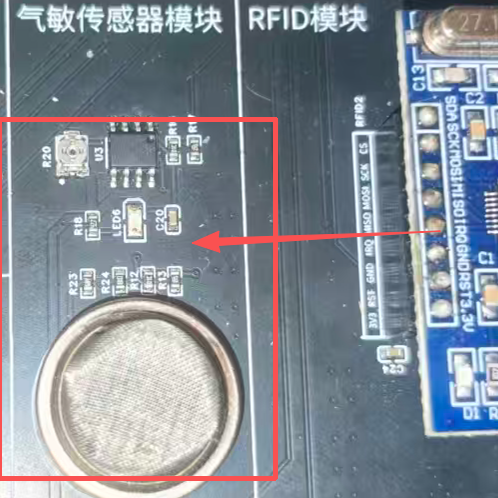

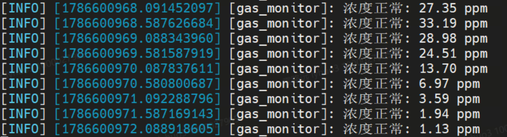

**易错点**：

- ⚠️ 参数写错（如 `publish_period=0.5` 用等号）导致参数未被识别 → **解决**：ROS2 覆盖参数必须用 `:=`，即 `-p publish_period:=0.5`。

### 七、注意事项

| ⚠️ 注意项 | 说明 |
|---|---|
| QoS 一致性 | 发布端与订阅端须同为 `Reliable + KeepLast(10)`，否则可能收不到消息 |
| 环境加载 | 每次新开终端都要 `source install/setup.bash`，否则 `ros2 run` 找不到 `ros_sensor` 包 |
| 话题命名 | 话题名以 `/` 开头表示全局命名空间，本实验统一使用 `/gas_sensor` |
| 安全提示 | MQ5 传感器通电后会产生一定热量，避免用手直接接触传感器表面；本实验对象为低浓度演示环境，无爆炸风险 |

### 八、实验总结

#### 8.1 完成成果

完成本实验后，你应当能够：

- ✅ 编译并运行 `ros_sensor` 包中的 `gas_sensor_node` / `gas_monitor` 两个节点
- ✅ 理解 MQ5 传感器「ADC 原始值 → 电压 → 电阻比值 → ppm」的对数换算全链路
- ✅ 使用 `ros2 topic echo/hz/info` 观察话题的类型、频率与多订阅者收发
- ✅ 通过 `--ros-args -p` 动态调整 `publish_period` 与 `alarm_threshold` 参数
- ✅ 理解话题通信的一对多异步特性及其与服务/动作的适用场景边界

#### 8.2 技能收获

| 技能 | 说明 |
|---|---|
| 话题编程 | 掌握 Publisher/Subscriber 的标准代码模式（声明参数、QoS 配置、消息收发回调） |
| 传感器数据处理 | 理解 ADC 采集 → 物理量换算的完整信号处理链路 |
| QoS 配置 | 能根据场景选择可靠性/持久性/历史策略 |
| 系统调试 | 能用 `ros2 topic` 命令族和 `--ros-args -p` 动态调试通信系统 |
| 参数化设计 | 使用 `declare_parameter` 将关键参数暴露为运行时可配置项 |

#### 8.3 常见问题与解答

| 问题 | 原因 | 解决方法 |
|---|---|---|
| 订阅节点无输出 | ① 话题名不匹配 ② QoS 不兼容 ③ ROS_DOMAIN_ID 不一致 | 用 `ros2 topic info` 确认话题信息，检查 `echo $ROS_DOMAIN_ID` |
| 浓度值始终为 0 | 电压接近 0 或满量程触发除零保护 | 检查 ADC 硬件连接与 `in_voltage_scale` 读数 |
| 浓度值跳跃很大 | 真实传感器的噪声 | 在回调中添加滑动平均滤波（移动窗口均值） |
| `ros2 run` 报 package not found | 未 source install/setup.bash | 重新 `source install/setup.bash` |
| 调整参数不生效 | 参数覆盖语法错误 | 使用 `:=` 而非 `=`，即 `-p publish_period:=0.5` |

### 九、实验报告要求

#### 9.1 报告内容

完成实验后，提交一份实验报告，包含以下内容：

1. **实验基本信息**：实验名称、实验日期、实验者姓名、实验平台信息
2. **实验过程记录**：截取发布节点终端输出、订阅节点终端输出、`ros2 topic info` 和 `ros2 topic hz` 的终端截图
3. **原理分析**（不少于 400 字）：用自己的语言解释以下三个问题：
- ① 为什么 Publisher 和 Subscriber 通过话题名称和消息类型即可通信，而无需知道对方 IP 或进程 ID？DDS 在其中做了什么？
- ② MQ5 从 ADC 原始值到 ppm 浓度经历了哪些换算步骤？每一步的物理意义是什么？
- ③ 若收到的浓度数据存在大量噪声毛刺，你会如何处理？
4. **思考题**（见下方）

#### 9.2 思考题

**思考题 1**：

`voltage_to_ppm()` 中 `CURVE_M = -0.362` 为负值，说明 ppm 与 `Rs/R0` 的比值是什么单调关系？请结合 MQ5 气敏元件的物理特性解释「为什么可燃气体浓度越高、传感器内阻越低」。

**思考题 2**：

MQ5 对甲烷、液化气、酒精蒸气等多种可燃气体都敏感但无法区分种类。假设你在设计智能厨房安全监控系统，需要区分「炒菜的酒精蒸气」与「燃气泄漏的天然气」，请设计一种多传感器 + ROS2 话题通信的方案，简述架构。

#### 9.3 评分标准

| 评分项 | 权重 | 评分标准 |
|---|---|---|
| 实验操作完整性 | 25% | 是否成功运行 gas_sensor_node + gas_monitor + CLI 验证 |
| 代码理解 | 20% | 能否准确指出 common.py/gas_sensor_node.py/gas_monitor.py 关键代码位置 |
| 原理分析 | 25% | 对话题通信机制、浓度换算原理、QoS 的理解深度 |
| 思考题 1 | 15% | 对 MQ5 对数特性曲线与物理机制的阐释 |
| 思考题 2 | 15% | 多传感器融合方案的创新性与可行性 |

## 实验7：ROS2服务通讯（指纹传感器）

### 一、关联知识点

本实验关联以下知识图谱节点：

| 编号 | 知识点名称 | 类型 | 层级路径 |
|---|---|---|---|
| 2.3.1 | 服务通信同步 RPC 一对一请求/响应模型 | 概念 | 第2章 ROS2核心通信机制 → 2.3 服务通信 |
| 2.3.2 | 服务端注册服务名与回调、客户端同步 call 的交互原理 | 原理 | 第2章 ROS2核心通信机制 → 2.3 服务通信 |
| 2.3.3 | create_service 注册服务 → UART 控制指纹模块 → 采集/比对 → 返回结果 | 流程 | 第2章 ROS2核心通信机制 → 2.3 服务通信 |

### 二、实验目标

通过本实验的学习，学生能够：

1. **原理理解**：阐述 ROS2 服务通信的同步 RPC 模型——客户端发送 Request 后阻塞等待，服务端在回调中处理并返回 Response，说明其与话题（异步一对多持续流）在调用语义与适用场景上的本质区别
2. **流程掌握**：掌握 `ros_sensor` 包中 `fingerprint_server`（服务端）与 `fingerprint_client`（客户端）两个节点从 `create_service`/`create_client`、`call_async` 到 `spin_until_future_complete` 的完整同步调用链路
3. **独立完成**：独立运行指纹服务端/客户端节点，使用 `ros2 service call` 命令行触发验证并观察响应结果，理解指纹「采图 → 生成特征 → 搜索比对」三步流程
4. **迁移应用**：能够将「UART 传感器 → 服务封装 → 同步 RPC 调用」的模式迁移到其它一次性的查询/指令场景（如继电器控制、单次状态查询），并与话题/动作做出正确选型

### 三、实验环境

| 类别 | 配置 |
|---|---|
| 硬件平台 | 具身智能实验箱B2  |
| 操作系统 | Ubuntu 22.04 + ROS2 Humble |
| 核心依赖 | `rclpy`、`ros_sensor_interfaces`（自定义 srv）、`pyserial` |
| 开发语言 | Python 3.10 |
| 源码位置 | `~/ros2_ws/src/xflz_eai_car1/driver/ros_sensor`（节点包 `ros_sensor`） |
| 传感器接口 | 指纹识别模组，UART 串口（默认 `/dev/ttyS10`，波特率 57600） |

> 说明：指纹模组遵循 `PS_*` 串口协议（产品用户手册 V1.5.1），底层字节级通信封装在 `fingerprint_enroll.py` 的 `Fingerprint` 类中；ROS 服务端只负责调用它完成验证，本身不解析 UART 帧格式。

### 四、实验难度

| 维度 | 说明 |
|---|---|
| 难度等级 | ⭐⭐（中等） |
| 实验类型 | 设计性 |
| 建议时长 | 4 学时（180 分钟） |

**重点**：

- 掌握 Service 服务端/客户端的标准编程流程：`create_service` 注册回调 → `create_client` 创建客户端 → `call_async` 异步请求 → `spin_until_future_complete` 等待响应
- 理解 `.srv` 自定义服务接口「请求（空）/响应（success, user_id, message）」的定义与使用
- 掌握指纹验证「采集图像 → 生成特征 → 搜索指纹库」三步流程及每步的确认码含义

**难点**：

- 同步 RPC 与异步话题、动作在调用模型上的区别与选型
- 指纹模组 `PS_*` 串口协议的确认码（0x00 成功、0x02 无手指等）在重试循环中的应用

### 五、实验现象

#### 5.1 快速验证流程

完成本实验后，你应能观察到以下现象：

1. 终端 A 启动 `fingerprint_server` 后，打印 `指纹服务已启动: port=/dev/ttyS10 baud=57600`
2. 终端 B 启动 `fingerprint_client` 后，先打印 `等待指纹服务 /verify_fingerprint ...`，就绪后打印 `发送指纹验证请求...`
3. 将已录入的手指放到传感器上，客户端打印 `验证成功 user_id=1 匹配成功 score=...`
4. 放一个未录入的手指，客户端打印 `验证失败 user_id=-1 未匹配到指纹`
5. `ros2 service list` 显示 `/verify_fingerprint` 服务
6. 用 `ros2 service call /verify_fingerprint ...` 可绕过客户端直接触发服务并观察响应

#### 5.2 预期效果描述

| 操作 | 预期输出 |
|---|---|
| `ros2 run ros_sensor fingerprint_server` | `指纹服务已启动: port=/dev/ttyS10 baud=57600` |
| `ros2 run ros_sensor fingerprint_client`（另一终端） | `验证成功 user_id=1 匹配成功 score=123`（已录入手指） |
| `ros2 service list` | 列表包含 `/verify_fingerprint` |
| `ros2 service type /verify_fingerprint` | `ros_sensor_interfaces/srv/VerifyFingerprint` |
| `ros2 service call /verify_fingerprint ros_sensor_interfaces/srv/VerifyFingerprint "{}"` | `success: true, user_id: 1, message: 匹配成功 score=...` |

---

### 六、实验步骤

#### 整体流程


---

#### 步骤 1：录入指纹模板（15 分钟）

**知识点讲解**：

**指纹录入与验证分离（知识点 2.3.3）**

- **是什么**：指纹「录入」和「验证」是两个独立环节——录入把手指特征模板写入模组内部 Flash（持久保存），验证则是把现场采集的特征与库中模板比对。本实验中录入用 `fingerprint_enroll.py` 这个独立的串口脚本完成，ROS 节点只负责「验证」。
- **为什么分离**：录入是一次性、低频、需要人工按两次手指确认的操作，不需要 ROS 参与；而验证是高频、程序化的请求，用 ROS 服务封装便于被其它节点（如门禁、考勤逻辑）复用。
- **怎么用**：运行 `fingerprint_enroll.py enroll -i 1` 把指纹保存到位置 1，然后才能用服务端验证。

**操作步骤**：

```bash
cd ~/ros2_ws/src/xflz_eai_car1/driver/ros_sensor/ros_sensor/ros_sensor

# 录入指纹到位置 1（按提示放两次同一手指）
python3 fingerprint_enroll.py enroll -i 1

# 查看当前指纹库模板数量
python3 fingerprint_enroll.py list

#根据终端的提示录入指纹

```

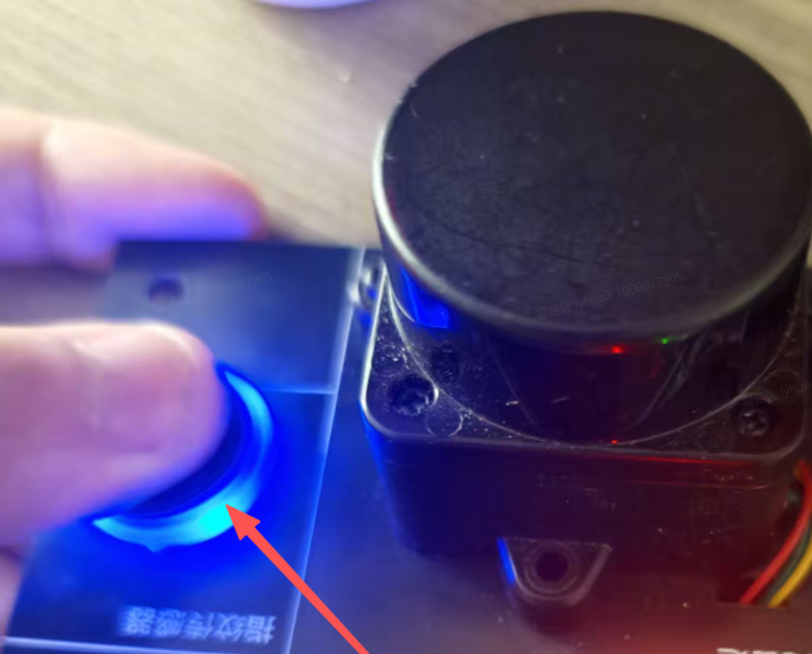

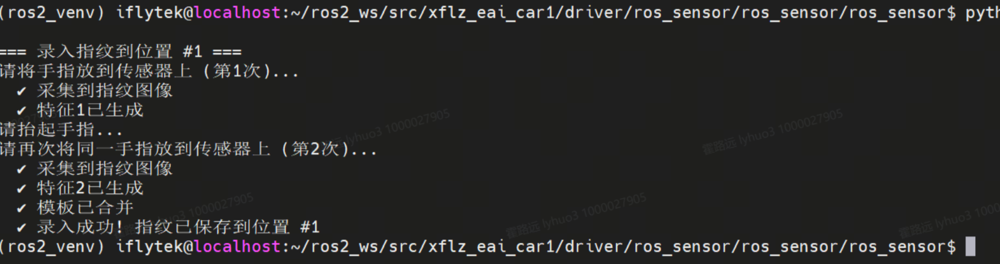

**易错点**：

- ⚠️ 两次按压不是同一根手指导致 `合并模板失败` → **解决**：重新录入，两次都用同一根手指并保持角度一致。
- ⚠️ 串口占用冲突（服务端正在运行又跑录入脚本）→ **解决**：先停止 `fingerprint_server`，录入完成后再启动。

---

#### 步骤 2：阅读 UART 协议层

**知识点讲解**：

**PS_ 串口协议与确认码（知识点 2.3.3）****

- **是什么**：指纹模组通过 UART 收发 8 位帧（**包头 0xEF01 + 地址 + 包标识 + 长度 + 指令码 + 参数 + 校验和**）。核心指令码见 `fingerprint_enroll.py` L20-28：`CMD_GET_IMAGE=0x01（采集图像）`、`CMD_GEN_CHAR=0x02`（生成特征）、`CMD_REG_MODEL=0x05（`合并特征成模板）、`CMD_STORE_CHAR=0x06`（储存模板）、`CMD_SEARCH=0x04`（搜索指纹库）。
- **为什么**：模组是「一问一答」的主从协议，主机发指令、模组回确认码。确认码约定（`fingerprint_enroll.py` L31-33）：`0x00 成功`、`0x01收包有错、0x02 无手指`——服务端正是靠` 0x02 `判断「手指未按下」来做轮询等待。
- **怎么用**：`Fingerprint 类（fingerprint_enroll.py L45-124）`封装了` get_image()`、`gen_char()`、`reg_model()`、`store_char()、search() `等方法，ROS 服务端直接复用这些方法，无需自己拼帧。

**操作步骤**：

```bash
打开 fingerprint_enroll.py，阅读 _build_packet()（L36-42，帧封装）与 Fingerprint._send()（L56-73，收发与校验），理解 8 字节包头 + 确认码 + 参数 + 2 字节校验和的应答结构。
# 来源：fingerprint_enroll.py L19-28（指令码定义）
CMD_GET_IMAGE   = 0x01   # PS_GetImage   采集图像
CMD_GEN_CHAR    = 0x02   # PS_GenChar    生成特征
CMD_REG_MODEL   = 0x05   # PS_RegModel   合并特征生成模板
CMD_STORE_CHAR  = 0x06   # PS_StoreChar  储存模板
CMD_SEARCH      = 0x04   # PS_Search     搜索指纹
```

**易错点**：

- ⚠️ 误把确认码当成「错误码」，以为非零即失败 → **解决**：`0x02` 是「无手指」的正常状态，不是错误。

---

#### 步骤 3：分析fingerprint_server服务端（35 分钟）

**知识点讲解**：

**服务端编程模型（知识点 2.3.1、2.3.2）**

- **是什么**：`fingerprint_server` 通过` create_service`把「`VerifyFingerprint `类型的回调 `handle_reques`t注册到服务名 `verify_fingerprint `上（源码 `fingerprint_server.py` L24-26）。当客户端发起请求，ROS2 会调用 `handle_request(request, response)`，函数返回的 `response` 即回传给客户端。
- **为什么同步**：服务回调是「收到一次请求、处理、返回一次结果」的单次 RPC，处理期间该调用处于等待状态，适合指纹验证这种「一问一答、结果确定」的场景。
- **怎么用**：`handle_request `内完成三步（源码 L46-87）：① 循环调用 `get_image()` 等待手指按下（`0x02` 无手指则 `sleep(0.2)` 重试，共 `retries=50` 次）；②` gen_char(1)`生成特征；③ search(搜索指纹库，成功则返回 `user_id=页码`、`message=f`匹配成功` score={score}`。

**操作步骤**：

```bash
打开 fingerprint_server.py，完整阅读 FingerprintServer 类（L17-87），重点理解参数声明与回调三步流程。
# 来源：fingerprint_server.py L19-26（节点初始化，节选）
super().__init__('fingerprint_server')
self.declare_parameter('port', os.environ.get('FP_PORT', '/dev/ttyS10'))
self.declare_parameter('baud', int(os.environ.get('FP_BAUD', '57600')))
self.declare_parameter('retries', 50)
self.srv = self.create_service(
    VerifyFingerprint, 'verify_fingerprint', self.handle_request
)
# 来源：fingerprint_server.py L46-64（采图轮询，节选）
for _ in range(retries):
    code = fp.get_image()
    if code == 0x00:
        break
    if code == 0x02:          # 无手指，继续等待
        time.sleep(0.2)
        continue
    response.success = False
    response.message = f'采集图像失败(code={code})'
    return response
```

**易错点**：

- ⚠️ 忘记 `declare_parameter` 就 `get_parameter` → **解决**：三个参数 `port/baud/retries` 都必须先声明（L20-22）。
- ⚠️ 服务回调未 `finally: fp.close()` 导致串口泄漏 → **解决**：源码 L84-85 用 `try/finally` 保证串口总是被关闭。

---

#### 步骤 4：分析`fingerprint_client` 客户端（35 分钟）

**知识点讲解**：

**客户端编程模型（知识点 2.3.2）**

- **是什么**：`fingerprint_client` 通过 `create_client` 创建客户端，`wait_for_service` 等待服务上线，`call_async` 发送请求，`spin_until_future_complete` 阻塞等待响应。
- ****为什么用 `spin_until_future_complete`****：`call_async` 是异步的（立即返回一个 Future），需要让 Executor 转动来处理服务端回包，直到 Future 完成。这是 ROS2 客户端「异步发送、同步等待」的标准写法。
- **怎么用**：构造 `VerifyFingerprint.Request()`（本 srv 请求为空），`call_async(req)` 拿到 Future，`spin_until_future_complete(self, future)` 等待，`future.result()` 取到 `response` 后按 `success` 分支打印（源码 `fingerprint_client.py` L23-40）。

**操作步骤**：

```bash
打开 fingerprint_client.py，完整阅读 FingerprintClient 类（L15-40）。
# 来源：fingerprint_client.py L16-31（创建客户端与发送请求，节选）
super().__init__('fingerprint_client')
self.cli = self.create_client(VerifyFingerprint, 'verify_fingerprint')
while not self.cli.wait_for_service(timeout_sec=1.0):
    self.get_logger().info('等待指纹服务 /verify_fingerprint ...')

req = VerifyFingerprint.Request()          # 请求为空
future = self.cli.call_async(req)
rclpy.spin_until_future_complete(self, future)
resp = future.result()
if resp.success:
    self.get_logger().info(f'验证成功 user_id={resp.user_id} {resp.message}')
```

**易错点**：

- ⚠️ 客户端先于服务端启动时 `call_async` 报错 → **解决**：`wait_for_service` 循环会阻塞等待服务上线，务必先启动服务端再启动客户端。
- ⚠️ 忘记检查 `future.result()` 是否为 `None`（服务调用失败）→ **解决**：源码 L28-30 对 `None` 做了防御性判断。

---

#### 步骤 5：运行与ros2 service调试（40 分钟）

**知识点讲解**：

**服务运行态自省（知识点 2.1.2）**

- **是什么**：`ros2 service `命令族用于自省运行中的服务——`list列出服务`、`type 查看类型`、`call直接发起一次调用`。
- **为什么重要**：无需编写客户端即可验证服务端逻辑，是调试服务通信最快捷的手段；`call` 的参数用 YAML 字符串给出，本 srv 请求为空，故传 `"{}"`。
- **怎么用**：先启动服务端，再在另一终端 `ros2 service call /verify_fingerprint ros_sensor_interfaces/srv/VerifyFingerprint "{}"`。

**操作步骤**：

```bash
# 终端 A：启动服务端
ros2 run ros_sensor fingerprint_server

# 终端 B：启动客户端（按提示放手指）
ros2 run ros_sensor fingerprint_client

# 终端 C：自省与直接调用
ros2 service list
ros2 service type /verify_fingerprint
ros2 service call /verify_fingerprint ros_sensor_interfaces/srv/VerifyFingerprint "{}"
#根据客户端提示验证已经录入指纹的手指

```

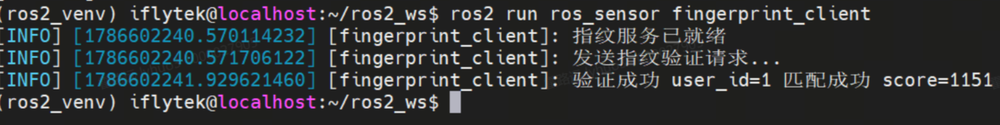

**易错点**：

- ⚠️ `ros2 service call` 的请求参数写错（如 `"{data: 1}"`）→ **解决**：`VerifyFingerprint` 请求为空，必须传 `"{}"`。
- ⚠️ 未放手指时调用会等待到超时 → **解决**：调用前先把手指放到传感器上，或观察服务端 50 次轮询（约 10s）后的「超时，未检测到手指」响应。

---

#### 步骤 6：话题 vs 服务选型对比（30 分钟）

**知识点讲解**：

**通信机制选型（知识点 2.2.1、2.3.1）**

- **是什么**：话题是「一对多、持续、异步」的数据流；服务是「一对一、单次、同步」的请求响应。二者在调用语义上互补。
- **为什么指纹验证选服务**：验证是一次性的「请求→结果」交互，天然符合 RPC 语义；若用话题，则要额外定义「请求话题+响应话题」并处理配对，复杂且易错。
- **怎么用**：下表给出三类通信机制的选型对照，是本章（实验6/7/8）的核心结论。

**操作步骤**：

```bash
```

| 维度 | 话题（实验6） | 服务（实验7） | 动作（实验8） |
|---|---|---|---|
| 调用语义 | 持续数据流，一对多 | 单次请求/响应，一对一 | 长耗时目标+反馈+结果 |
| 异步/同步 | 异步 | 同步（客户端阻塞等待） | 异步 |
| 是否可取消 | 否 | 否 | 是 |
| 中间反馈 | 无 | 无 | 有（Feedback） |
| 典型场景 | MQ5 浓度持续发布 | 指纹验证、继电器控制 | 刷卡检测（等待刷卡） |

**易错点**：

- ⚠️ 用话题实现「单次查询」导致配对复杂 → **解决**：一次性请求-响应用服务，持续数据流用话题，长耗时可反馈可取消用动作。

### 七、注意事项

| ⚠️ 注意项 | 说明 |
|---|---|
| 串口独占 | 录入脚本与服务端不能同时占用同一串口，录入前先停止服务端 |
| 服务就绪 | 客户端依赖服务端在线，先启动服务端再启动客户端 |
| 服务名一致 | 服务端与客户端均使用 `verify_fingerprint`（绝对名 `/verify_fingerprint`），须一致 |
| 参数配置 | `port`/`baud` 可用环境变量 `FP_PORT`/`FP_BAUD` 或 `--ros-args -p` 覆盖 |
| 安全提示 | 指纹模组为光学/半导体传感器，避免用力按压划伤采集窗口；录入时保持手指清洁干燥 |

### 八、实验总结

#### 8.1 完成成果

完成本实验后，你应当能够：

- ✅ 使用 `fingerprint_enroll.py` 完成指纹的录入、查询、删除与清空
- ✅ 编译并运行 `fingerprint_server` / `fingerprint_client` 完成指纹验证
- ✅ 理解指纹「采图 → 生成特征 → 搜索比对」三步流程及 `PS_*` 协议确认码含义
- ✅ 使用 `ros2 service list/type/call` 自省与直接调用服务
- ✅ 根据场景正确选择话题/服务/动作三种通信机制

#### 8.2 技能收获

| 技能 | 说明 |
|---|---|
| 服务编程 | 掌握 Service 服务端/客户端标准代码模式（create_service/create_client/call_async） |
| 串口传感器集成 | 理解 UART 主从协议与确认码驱动的轮询交互 |
| 自定义接口使用 | 使用 `ros_sensor_interfaces/srv/VerifyFingerprint` 自定义服务 |
| 系统调试 | 用 `ros2 service` 命令族无需客户端即可验证服务端 |
| 通信选型 | 掌握话题/服务/动作三类机制的适用场景边界 |

#### 8.3 常见问题与解答

| 问题 | 原因 | 解决方法 |
|---|---|---|
| 客户端一直「等待指纹服务」 | 服务端未启动或服务名不一致 | 先启动 `fingerprint_server`，确认 `ros2 service list` 含 `/verify_fingerprint` |
| 验证总是失败 user_id=-1 | 手指未录入，或按压位置偏移 | 先 `enroll` 录入，验证时保持相同角度力度 |
| 采图报「无手指」后超时 | 传感器未检测到手指 | 检查手指是否完全覆盖采集窗口，必要时清洁窗口 |
| 打开串口失败 | 串口被占用或权限不足 | 停止占用进程，或加入 dialout 用户组 |
| `ros2 service call` 参数报错 | 请求参数格式错误 | 请求为空，必须传 `"{}"` |

### 九、实验报告要求

#### 9.1 报告内容

完成实验后，提交一份实验报告，包含以下内容：

1. **实验基本信息**：实验名称、实验日期、实验者姓名、实验平台信息
2. **实验过程记录**：截取服务端启动、客户端验证成功、`ros2 service list/type/call` 的终端截图
3. **原理分析**（不少于 400 字）：用自己的语言解释以下三个问题：
- ① 为什么服务通信是「同步」的？`call_async` 名字里有 async，但客户端却要 `spin_until_future_complete` 阻塞等待，这两者是否矛盾？请说明 Future 与 Executor 的关系。
- ② 指纹验证为什么用服务而非话题？如果改用话题实现，需要额外设计哪些机制？
- ③ 服务端 `handle_request` 中为什么用循环 + `sleep(0.2)` 轮询「无手指」而不是阻塞读取？这样设计有何优劣？
4. **思考题**（见下方）

#### 9.2 思考题

**思考题 1**：

指纹模组的 `PS_GetImage`（0x01）在「无手指」时返回确认码 `0x02`。如果服务端把 `0x02` 当作错误立即返回失败，会导致什么问题？结合源码 `fingerprint_server.py` L49-54 说明「区分状态码与错误码」对鲁棒性的意义。

**思考题 2**：

`verify_fingerprint` 服务的请求字段为空，客户端无法指定「要验证到哪个用户」。假设你要设计一个「门禁 + 考勤」系统，需要区分「验证通过即可开门」与「验证通过并确认身份记录考勤」，请问你会如何扩展 `.srv` 接口？请给出扩展后的 srv 定义与使用流程。

#### 9.3 评分标准

| 评分项 | 权重 | 评分标准 |
|---|---|---|
| 实验操作完整性 | 25% | 是否成功完成录入 + 服务端/客户端验证 + CLI 调用 |
| 代码理解 | 20% | 能否准确指出 fingerprint_enroll.py / fingerprint_server.py / fingerprint_client.py 关键代码位置 |
| 原理分析 | 25% | 对同步 RPC 模型、串口协议、选型的理解深度 |
| 思考题 1 | 15% | 对状态码/错误码区分与鲁棒性的阐释 |
| 思考题 2 | 15% | 对 srv 接口扩展设计的合理性与完整性 |

## 实验8：ROS2动作通讯（MFRC522读卡器）

### 一、关联知识点

本实验关联以下知识图谱节点：

| 编号 | 知识点名称 | 类型 | 层级路径 |
|---|---|---|---|
| 2.4.1 | 动作是异步长耗时任务的 Goal→Feedback→Result 三通道机制 | 概念 | 第2章 ROS2核心通信机制 → 2.4 动作通信 |
| 2.4.2 | 客户端发 Goal、服务端异步执行并通过 Feedback 周期反馈的交互原理 | 原理 | 第2章 ROS2核心通信机制 → 2.4 动作通信 |
| 2.4.3 | ActionServer 实现 goal/feedback/result 回调 → SPI 读取 MFRC522 → 返回 card_uid | 流程 | 第2章 ROS2核心通信机制 → 2.4 动作通信 |

### 二、实验目标

通过本实验的学习，学生能够：

1. **原理理解**：阐述 ROS2 动作通信的三通道（Goal/Feedback/Result）异步模型——客户端发送目标后立即返回，服务端在执行期间周期发送反馈，任务完成后返回结果并可被随时取消，说明它与服务（同步短耗时单次调用）的本质区别
2. **流程掌握**：掌握 `ros_sensor` 包中 `rfid_action_server`（动作服务端）与 `rfid_action_client`（动作客户端）从 `ActionServer`/`ActionClient`、`send_goal_async`、`publish_feedback` 到 `goal_handle.succeed()/abort()/canceled()` 的完整异步链路
3. **独立完成**：独立运行 RFID 动作服务端/客户端，观察「SCANNING → CARD_FOUND → READING_UID → VERIFYING」的状态反馈流转，使用 `ros2 action send_goal --feedback` 命令行调试并实现超时/取消
4. **迁移应用**：能够将「长耗时传感器等待 → 动作封装 → 异步反馈」的模式迁移到其它耗时任务（如导航、机械臂运动、长时间数据采集），并理解 SPI 外设的驱动封装方法

### 三、实验环境

| 类别 | 配置 |
|---|---|
| 硬件平台 | 具身智能实验箱B2  |
| 操作系统 | Ubuntu 22.04 + ROS2 Humble |
| 核心依赖 | `rclpy`、`ros_sensor_interfaces`（自定义 action）、`python-periphery` |
| 开发语言 | Python 3.10 |
| 源码位置 | `~/ros2_ws/src/xflz_eai_car1/driver/ros_sensor`（节点包 `ros_sensor`） |
| 传感器接口 | MFRC522 射频读卡器，SPI1-m0 + GPIO（CS=114、RST=116，SCK/MOSI/MISO 见下） |

> 说明：MFRC522 通过 SPI 与主控通信，引脚映射见 `rc522_reader.py` L7-15：SDA/CS→GPIO3_C2(114)、SCK→GPIO3_C0(112)、MOSI→GPIO3_C1(113)、MISO→GPIO3_C3(115)、RST→GPIO3_C4(116)。驱动依赖 `python-periphery` 库控制 SPI 与 GPIO。

### 四、实验难度

| 维度 | 说明 |
|---|---|
| 难度等级 | ⭐⭐⭐（较高） |
| 实验类型 | 设计性 |
| 建议时长 | 4 学时（180 分钟） |

**重点**：

- 掌握 Action 动作服务端/客户端的标准编程流程：`ActionServer`（execute/goal/cancel 三个回调）、`ActionClient` + `send_goal_async`、`publish_feedback` 周期反馈、`goal_handle.succeed()/abort()/canceled()` 三种结局
- 理解 MFRC522 的寻卡（REQA）→ 防冲突（AntiCollision）→ 读取 UID 三步流程
- 掌握 `.action` 自定义动作接口（Goal/Result/Feedback 三段）的定义与使用

**难点**：

- 动作「异步执行 + 中间反馈 + 可取消」与服务「同步单次调用」的语义差异
- 服务端 `execute_cb` 异步回调中检查 `is_cancel_requested` 与状态机流转的实现

### 五、实验现象

#### 5.1 快速验证流程

完成本实验后，你应能观察到以下现象：

1. 终端 A 启动 `rfid_action_server` 后，打印 `RFID Action 服务端已启动 (action: /rfid_scan)`
2. 终端 B 运行 `rfid_action_client 30` 后，打印 `Goal 已接受`，随后按频率打印反馈状态
3. 未放卡时，反馈持续显示 `SCANNING`（寻卡中）
4. 将 MIFARE 卡靠近天线，反馈依次变化 `SCANNING → CARD_FOUND → READING_UID → VERIFYING`
5. 读卡成功后打印 `结果: success=True uid=XXXXXXXX type=MIFARE Classic msg=读卡成功`
6. 超过超时时间未放卡，客户端打印 `读卡未成功`，服务端打印 `读卡超时`
7. 用 `ros2 action send_goal ... --feedback` 命令行可独立观察反馈与结果

#### 5.2 预期效果描述

| 操作 | 预期输出 |
|---|---|
| `ros2 run ros_sensor rfid_action_server` | `RFID Action 服务端已启动 (action: /rfid_scan)` |
| `ros2 run ros_sensor rfid_action_client 30`（另一终端） | `结果: success=True uid=7E1A3B02 type=MIFARE Classic msg=读卡成功` |
| `ros2 action list` | 列表包含 `/rfid_scan` |
| `ros2 action info /rfid_scan` | Action: `ros_sensor_interfaces/action/RfidScan` |
| `ros2 action send_goal /rfid_scan ros_sensor_interfaces/action/RfidScan "{timeout_sec: 30}" --feedback` | 逐条打印 `Feedback: SCANNING` 等状态 |

---

### 六、实验步骤

#### 整体流程


---

#### 步骤 1：编译与独立驱动测试

**知识点讲解**：

**驱动独立测试（知识点 2.4.3）**

- **是什么**：`rc522_reader.py `既是一个可导入的驱动类 `MFRC522`，也是一个带 `--test/--dump `选项的命令行工具，可脱离 ROS 单独验证硬件与接线是否正确。
- **为什么先独立测**：SPI 接线、GPIO 引脚、供电问题都会在硬件层暴露，先用驱动自测可把「硬件故障」与「ROS 逻辑故障」分开，避免在 ROS 层盲目排查。
- **怎么用**：先 `colcon build` 编译接口包与节点包，再运行 `python3 rc522_reader.py --test `做自检（验证版本寄存器与读写回）。

**操作步骤**：

```bash
cd ~/ros2_ws
source /opt/ros/humble/setup.bash
colcon build --symlink-install --packages-select ros_sensor ros_sensor_interfaces
source install/setup.bash

# 脱离 ROS 先自检驱动（验证接线与供电）
cd src/xflz_eai_car1/driver/ros_sensor/ros_sensor/ros_sensor
sudo python3 rc522_reader.py --test

```

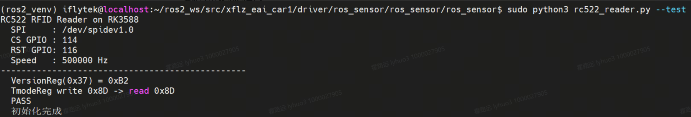

**易错点**：

- ⚠️ 自检` VersionReg=0x00/0xFF `表示无响应 → **解决**：检查 SPI 接线（CS=114、RST=116）、3.3V 供电与 `python-periphery`是否安装。
- ⚠️ 编译后未 source 导致` ros2 run `找不到包 → **解决**：`source install/setup.bash`。

---

#### 步骤 2：阅读rc522_reader.pySPI 驱动（25 分钟）

**知识点讲解**：

**MFRC522 寄存器寻卡流程（知识点 2.4.3）**

- **是什么**：MFRC522 是寄存器驱动的 13.56MHz 读卡芯片，主控通过 SPI 读写其寄存器（`REG_COMMAND=0x01`、`REG_FIFO_DATA=0x09`、`REG_VERSION=0x37 `等，见 `rc522_reader.py` L26-49）。寻卡流程封装为：`open() `打开 `SPI/GPIO → hw_reset()` 硬件复位 → `self_test() `自检 → `init()初始化 `→ `request_a()寻卡（REQA）`→ `anticoll()防冲突读 UID。`
- **为什么防冲突**：ISO14443A 协议下多张卡同时在场会冲突，`anticoll()` 用 `0x93 0x20` 命令帧读取 4 字节 UID 并做异或校验（`rc522_reader.py L283-294`），保证读到唯一卡号。
- **怎么用**：`read_uid()`（L296-305）把「寻卡 + 防冲突」串成一步，返回 `(`success, uid_hex_str`, `uid_bytes)`，动作服务端直接复用。

**操作步骤**：

```bash
打开 rc522_reader.py，阅读 MFRC522 类的 request_a()（L270-281）、anticoll()（L283-294）、read_uid()（L296-305）三个方法。
# 来源：rc522_reader.py L296-305（完整读卡流程）
def read_uid(self) -> tuple:
    ok, atqa = self.request_a()          # REQA 寻卡，返回 ATQA
    if not ok:
        return False, "", b''
    ok, uid = self.anticoll()            # AntiCollision 防冲突读 UID
    if not ok:
        return False, f"ATQA=0x{atqa:04X}", b''
    uid_str = "%02X%02X%02X%02X" % (uid[0], uid[1], uid[2], uid[3])
    return True, uid_str, uid
```

**易错点**：

- ⚠️ 混淆 `request_a()`（返回 ATQA）与 `anticoll()`（返回 UID）→ **解决**：寻卡先拿 ATQA 判断卡是否在场，防冲突再拿 UID，二者顺序不可颠倒。

---

#### 步骤 3：分析rfid_action_server服务端

**知识点讲解**：

**ActionServer 三回调模型（知识点 2.4.1、2.4.2）**

- **是什么**：`ActionServer`需要三个回调（源码 `rfid_action_server.py `L41-48）：`execute_callback`（执行任务主体，异步）、`goal_callback`（收到新 Goal 时决定是否接受）、`cancel_callback`（收到取消请求时决定是否同意）。`execute_cb` 是 `async `协程，执行期间可多次` publish_feedback`。
- **为什么三回调**：动作要处理「接受目标 → 执行 + 反馈 → 完成/中止/取消」三种生命周期，比服务的单回调复杂，因此拆分为三个入口。
- **怎么用**：`execute_cb`（L61-149）先读 Goal 的` timeout_sec`（≤0 则默认 30），初始化 MFRC522（`open→hw_reset→self_test→init`），然后在` deadline` 前循环：检查 `is_cancel_requested`、发布 `SCANNING 反馈`、`request_a() `寻卡、发布 `CARD_FOUND`、`anticoll() `读 UID、发布` READING_UID`、`classify_card` 判型、发布 `VERIFYING`，最后 `goal_handle.succeed()` 返回结果。

**操作步骤**：

```bash
打开 rfid_action_server.py，阅读 RfidActionServer 类的 execute_cb（L61-149），重点理解反馈状态流转与三种结局。
# 来源：rfid_action_server.py L19-29（卡类型判定，节选）
def classify_card(atqa, uid):
    if atqa == 0x0044 and len(uid) == 7:
        return 'MIFARE Ultralight'
    if atqa == 0x4400:
        return 'MIFARE Ultralight C'
    if atqa == 0x0344:
        return 'MIFARE DESFire'
    if atqa in (0x0002, 0x0003, 0x0004):
        return 'MIFARE Classic'
    return 'Unknown'
# 来源：rfid_action_server.py L100-141（读卡循环，节选）
while time.time() < deadline:
    if goal_handle.is_cancel_requested:      # 检查取消
        goal_handle.canceled()
        result.success = False
        result.message = '已取消'
        return result

    feedback.status = 'SCANNING'
    goal_handle.publish_feedback(feedback)

    ok, atqa = rc.request_a()                # 寻卡
    if not ok:
        time.sleep(0.1)
        continue
    feedback.status = 'CARD_FOUND'
    goal_handle.publish_feedback(feedback)
    ok, uid = rc.anticoll()                  # 读 UID
    # ... READING_UID / VERIFYING 反馈后 succeed
```

**易错点**：

- ⚠️ 忘记检查 `is_cancel_requested` 导致无法取消 → **解决**：循环体内必须周期检查，否则取消请求无法生效。
- ⚠️ `execute_cb` 未声明 `async` 却调用异步语义 → **解决**：动作执行回调必须是 `async def`（源码 L61）。

---

#### 步骤 4：分析`rfid_action_client` 客户端（35 分钟）

**知识点讲解**：

**ActionClient 异步发送模型（知识点 2.4.2）**

- **是什么**：`rfid_action_client` 用 `ActionClient` 发 Goal，通过回调链 `goal_response_cb`（处理接受/拒绝）→ `result_cb`（处理最终结果）与 `feedback_cb`（处理中间反馈）异步处理各阶段，而非阻塞等待。
- **为什么异步回调**：动作耗时未知（等刷卡可能几十秒），客户端不能阻塞主线程，故用 `send_goal_async` + 回调，再用 `spin_once` 让 Executor 处理回调（源码 `rfid_action_client.py` L64-65）。
- **怎么用**：`send(timeout)`（L51-66）先 `wait_for_server`，构造 `RfidScan.Goal()` 并赋值 `timeout_sec`，`send_goal_async(goal, feedback_callback=...)` 发送，随后 `spin_once` 轮转直到完成标志 `_done` 置位。

**操作步骤**：

```bash
打开 rfid_action_client.py，阅读 RfidActionClient 类（L17-66），重点理解三个回调的职责。
# 来源：rfid_action_client.py L51-66（发送 Goal，节选）
def send(self, timeout=30):
    if not self._client.wait_for_server(timeout_sec=3.0):
        self.get_logger().error('RFID Action 服务不可用')
        return False
    goal = RfidScan.Goal()
    goal.timeout_sec = timeout
    future = self._client.send_goal_async(
        goal, feedback_callback=self.feedback_cb
    )
    future.add_done_callback(self.goal_response_cb)
    while rclpy.ok() and not self._done:
        rclpy.spin_once(self, timeout_sec=0.1)
    return self._ok
```

**易错点**：

- ⚠️ 忘记 `spin_once` 导致回调永不执行、程序卡住 → **解决**：发送 Goal 后必须驱动 Executor（`spin_once` 或 `spin_until_future_complete`）。
- ⚠️ 结果状态不是 `STATUS_SUCCEEDED` 时误报成功 → **解决**：源码 L39-49 通过 `GoalStatus.STATUS_SUCCEEDED` 判断，超时/取消对应其它状态码。

---

#### 步骤 5：运行与ros2 action

**知识点讲解**：

**动作运行态自省（知识点 2.1.2）**

- **是什么**：`ros2 action`命令族用于自省动作——list 列出动作、info查看类型与客户端数、`send_goal `发送一个目标（可加 `--feedback` 实时打印反馈）。
- **为什么重要**：`--feedback` 能直观展示动作的中间反馈流，是理解「动作 vs 服务」区别最直观的入口——服务没有中间反馈，动作有。
- **怎么用**：`ros2 action send_goal /rfid_scan ros_sensor_interfaces/action/RfidScan "{timeout_sec: 30}" --feedback`，其中 Goal 的 YAML 用 `{timeout_sec: 30}` 表示。

**操作步骤**：

```bash
# 终端 A —— 启动服务端
cd ~/ros2_ws
source /opt/ros/humble/setup.bash
source install/setup.bash
ros2 run ros_sensor rfid_action_server

# 终端 B —— 放卡 + 触发读卡
cd ~/ros2_ws
source /opt/ros/humble/setup.bash
source install/setup.bash
ros2 run ros_sensor rfid_action_client 30

# 终端 C —— 自省（可选，随时可跑，不需要读卡）
cd ~/ros2_ws
source /opt/ros/humble/setup.bash
source install/setup.bash
ros2 action list
```

将ID白卡放在RFID模块上

在服务端可以看到在客户端读取到的卡片

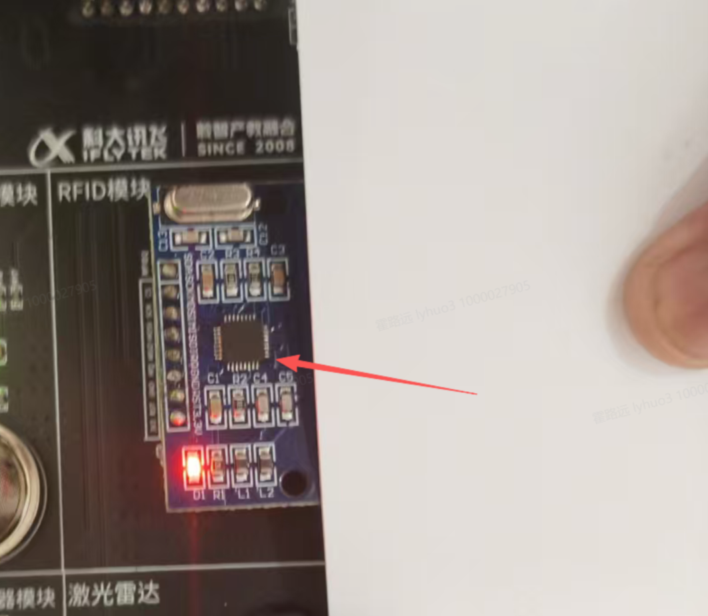

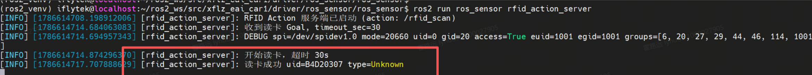

**易错点**：

- ⚠️ Goal YAML 字段名写错（如 `timeout` 而非 `timeout_sec`）→ **解决**：字段名必须与 `.action` 定义一致，即 `timeout_sec`。
- ⚠️ 终端 C 与 B 同时发 Goal 可能抢卡 → **解决**：一次只让一个客户端发 Goal，避免多个 Goal 同时执行。

---

#### 步骤 6：超时/取消与三机制选型对比（25 分钟）

**知识点讲解**：

**动作三种结局与选型（知识点 2.4.1、2.3.1、2.2.1）**

- **是什么**：一个 Goal 有四种终态：`succeed()`（成功）、`abort()`（执行失败）、`canceled()`（被取消）、超时后 `abort()`。服务端用 `is_cancel_requested` 响应取消，用 `deadline` 响应超时。
- **为什么动作可取消**：读卡是「等待外部事件（刷卡）」的长耗时任务，用户可能在等待期间取消；这是服务（一次性、不可取消）无法胜任的，也是动作存在的意义。
- **怎么用**：下表综合本章三个实验的选型结论。

**操作步骤**：

```bash
```

| 维度 | 话题（实验6） | 服务（实验7） | 动作（实验8） |
|---|---|---|---|
| 调用语义 | 持续数据流，一对多 | 单次请求/响应，一对一 | 长耗时目标+反馈+结果 |
| 异步/同步 | 异步 | 同步 | 异步 |
| 中间反馈 | 无（有值即发） | 无 | 有（Feedback 状态机） |
| 是否可取消 | 否 | 否 | 是 |
| 典型场景 | MQ5 浓度发布 | 指纹验证 | 刷卡检测（等卡） |

**易错点**：

- ⚠️ 用服务实现「等刷卡」导致请求长时间阻塞且无法取消 → **解决**：长耗时、可取消、需反馈的任务用动作。

### 七、注意事项

| ⚠️ 注意项 | 说明 |
|---|---|
| SPI 接线 | CS=114、SCK=112、MOSI=113、MISO=115、RST=116，接错会导致自检失败 |
| 驱动依赖 | MFRC522 依赖 `python-periphery`，先 `pip install python-periphery` |
| 取消检查 | `execute_cb` 循环内必须周期检查 `is_cancel_requested`，否则无法取消 |
| 单 Goal 执行 | 一次只发一个 Goal，多 Goal 并发会抢卡产生竞争 |
| 安全提示 | MFRC522 工作于 13.56MHz，靠近天线时避免放置金属物；刷卡时轻贴即可，无需用力 |

### 八、实验总结

#### 8.1 完成成果

完成本实验后，你应当能够：

- ✅ 使用 `rc522_reader.py --test` 独立自检 MFRC522 硬件与接线
- ✅ 编译并运行 `rfid_action_server` / `rfid_action_client` 完成刷卡检测
- ✅ 理解寻卡（REQA）→ 防冲突（AntiCollision）→ 读 UID 的三步流程
- ✅ 观察并解释「SCANNING → CARD_FOUND → READING_UID → VERIFYING」反馈状态流转
- ✅ 使用 `ros2 action send_goal --feedback` 调试，并理解动作的 succeed/abort/canceled 三种结局

#### 8.2 技能收获

| 技能 | 说明 |
|---|---|
| 动作编程 | 掌握 ActionServer/ActionClient 标准代码模式（三回调、send_goal_async、publish_feedback） |
| SPI 外设集成 | 理解寄存器驱动的 MFRC522 读卡芯片寻卡/防冲突协议 |
| 自定义 action | 使用 `ros_sensor_interfaces/action/RfidScan`（Goal/Result/Feedback 三段） |
| 异步编程 | 理解 async 执行回调、Future 回调链与 Executor 轮转 |
| 通信选型 | 掌握话题/服务/动作三类机制的全景选型 |

#### 8.3 常见问题与解答

| 问题 | 原因 | 解决方法 |
|---|---|---|
| 自检 VersionReg=0x00/0xFF | SPI 接线错误或供电不足 | 检查 CS/RST/SCK/MOSI/MISO 接线与 3.3V 供电 |
| 客户端「RFID Action 服务不可用」 | 服务端未启动或动作名不一致 | 先启动服务端，`ros2 action list` 确认 `/rfid_scan` |
| 反馈一直 SCANNING | 卡未靠近天线或卡类型不匹配 | 把 MIFARE 卡贴近天线，检查是否 13.56MHz 卡 |
| 读卡超时 | 超时时间内未检测到卡 | 增大 `timeout_sec`，或确认卡已就位 |
| Goal 无法取消 | execute_cb 未检查 `is_cancel_requested` | 确认循环体内有取消检查 |

### 九、实验报告要求

#### 9.1 报告内容

完成实验后，提交一份实验报告，包含以下内容：

1. **实验基本信息**：实验名称、实验日期、实验者姓名、实验平台信息
2. **实验过程记录**：截取服务端启动、客户端读卡成功、`ros2 action send_goal --feedback` 的反馈流终端截图
3. **原理分析**（不少于 400 字）：用自己的语言解释以下三个问题：
- ① 动作与服务都是「客户端发起、服务端响应」，为什么动作需要 Goal/Feedback/Result 三个独立通道？三通道分别由谁发起、流向如何？
- ② `execute_cb` 是 `async` 协程，但读卡循环里用 `time.sleep(0.1)` 做轮询等待。请说明 `is_cancel_requested` 检查为什么必须放在循环内，如果放在循环外会怎样？
- ③ MFRC522 的 `anticoll()` 如何保证多卡场景下读到唯一 UID？防冲突失败的典型表现是什么？
4. **思考题**（见下方）

#### 9.2 思考题

**思考题 1**：

`classify_card()` 通过 ATQA 与 UID 长度判断卡类型。若读到的 ATQA 为 `0x0004` 且 UID 为 4 字节，应判为哪种卡？如果出现 `Unknown`，可能是什么原因？结合 `rfid_action_server.py` L19-29 说明。

**思考题 2**：

当前的读卡 Action 在「读卡成功」后立即 `succeed()` 结束，无法持续检测「卡是否被移走」。假设你要设计一个「门禁持续监控」系统，需要不断检测卡在/离场并实时上报，你会如何设计？请对比「动作 + 长循环反馈」与「话题持续发布」两种方案的优劣，给出你的选择与理由。

#### 9.3 评分标准

| 评分项 | 权重 | 评分标准 |
|---|---|---|
| 实验操作完整性 | 25% | 是否成功完成驱动自检 + 服务端/客户端读卡 + `ros2 action` 调试 |
| 代码理解 | 20% | 能否准确指出 rc522_reader.py / rfid_action_server.py / rfid_action_client.py 关键代码位置 |
| 原理分析 | 25% | 对三通道模型、异步执行、防冲突的理解深度 |
| 思考题 1 | 15% | 对卡类型判定与 Unknown 成因的分析 |
| 思考题 2 | 15% | 对持续检测方案的选型分析与论证 |

## 实验9：ROS2自定义接口消息（传感器接口包）

### 一、关联知识点

本实验关联以下知识图谱节点：

| 编号 | 知识点名称 | 类型 | 层级路径 |
|---|---|---|---|
| 2.5.1 | 自定义接口（.msg/.srv/.action）定义传感器专用数据结构 | 概念 | 第2章 ROS2核心通信机制 → 2.5 通信接口与参数系统 |
| 2.5.2 | 创建接口包 → 编写定义 → CMakeLists.txt 配置编译 → 使用自定义消息 | 流程 | 第2章 ROS2核心通信机制 → 2.5 通信接口与参数系统 |

### 二、实验目标

通过本实验的学习，学生能够：

1. **原理理解**：阐述 ROS2 三种自定义接口（`.msg` 消息、`.srv` 服务、`.action` 动作）的结构差异与适用场景——`.msg` 单段字段、`.srv` 用 `---` 分隔请求/响应、`.action` 用两个 `---` 分隔 Goal/Result/Feedback 三段
2. **流程掌握**：掌握 `ros_sensor_interfaces` 接口包（ament_cmake）从「编写接口定义 → `rosidl_generate_interfaces` 配置编译 → 生成 Python/C++ 消息类 → 节点 import 使用」的完整链路
3. **独立完成**：独立使用 `ros2 interface list/show` 查看接口定义，理解 `TemperatureHumidity`/`HeartRateSpO2`/`PhotoState` 消息、`VerifyFingerprint`/`TriggerRelay` 服务、`RfidScan` 动作与实验6-8 各传感器节点的对应关系
4. **迁移应用**：能够为一个新传感器自定义接口包（如光照度、加速度计），并正确配置 `CMakeLists.txt` 的 `rosidl_generate_interfaces` 与 `package.xml` 的 `<depend>` 依赖

### 三、实验环境

| 类别 | 配置 |
|---|---|
| 硬件平台 | 具身智能实验箱B2  |
| 操作系统 | Ubuntu 22.04 + ROS2 Humble |
| 核心依赖 | `rosidl_default_generators`、`std_msgs`、`action_msgs`、`builtin_interfaces` |
| 开发语言 | 接口定义（IDL 风格）+ CMake（编译） |
| 源码位置 | `~/ros2_ws/src/xflz_eai_car1/driver/ros_sensor/ros_sensor_interfaces`（接口包） |

> 说明：本实验不涉及新硬件，而是「回看」实验6-8 已使用过的接口——把分散在三个实验里的 `VerifyFingerprint.srv`、`RfidScan.action`、以及 DHT11/MAX30102/光电传感器对应的 `.msg` 集中起来，系统理解它们的定义与编译机制。

### 四、实验难度

| 维度 | 说明 |
|---|---|
| 难度等级 | ⭐⭐（中等） |
| 实验类型 | 设计性 |
| 建议时长 | 2 学时（90 分钟） |

**重点**：

- 掌握 `.msg`/`.srv`/`.action` 三种接口文件的字段定义语法（分隔符 `---` 的语义）
- 掌握 `rosidl_generate_interfaces` 的配置方法与 `DEPENDENCIES` 声明
- 理解 ament_cmake（接口包）与 ament_python（节点包）的职责分工

**难点**：

- `.action` 文件三段结构（Goal/Result/Feedback）与编译后生成的类（`RfidScan.Goal`/`RfidScan.Result`/`RfidScan.Feedback`）的映射关系
- 接口包与节点包的依赖声明（`package.xml` 的 `<depend>`）如何让节点能 `import` 到自定义消息

### 五、实验现象

#### 5.1 快速验证流程

完成本实验后，你应能观察到以下现象：

1. 编译 `ros_sensor_interfaces` 后，`ros2 interface list | grep ros_sensor_interfaces` 列出全部 6 个接口
2. `ros2 interface show` 能打印出各接口的字段定义，与 `.msg/.srv/.action` 源文件一致
3. 编译产物中生成 Python 消息类，节点包 `ros_sensor` 能 `from ros_sensor_interfaces.srv import VerifyFingerprint` 成功导入
4. 对照实验6-8，`gas_sensor_node` 用的是标准 `Float32`（无需自定义），而指纹/RFID/继电器等用了自定义接口
5. 修改 `.msg` 字段并重新编译后，依赖该消息的节点需重新编译才能生效

#### 5.2 预期效果描述

| 操作 | 预期输出 |
|---|---|
| `ros2 interface list | grep ros_sensor_interfaces` | 列出 `msg/HeartRateSpO2`、`msg/PhotoState`、`msg/TemperatureHumidity`、`srv/TriggerRelay`、`srv/VerifyFingerprint`、`action/RfidScan` |
| `ros2 interface show ros_sensor_interfaces/srv/VerifyFingerprint` | 请求空，响应 `bool success / int32 user_id / string message` |
| `ros2 interface show ros_sensor_interfaces/action/RfidScan` | 显示 Goal/Result/Feedback 三段定义 |
| `ros2 interface show ros_sensor_interfaces/msg/TemperatureHumidity` | `float32 temperature / float32 humidity` |

---

### 六、实验步骤

#### 整体流程


---

#### 步骤 1：通览ros_sensor_interfaces接口包结构（10 分钟）

**知识点讲解**：

**接口包与节点包分离（知识点 2.5.1）**

- **是什么**：`ros_sensor_interfaces` 是一个**纯接口包**（`ament_cmake` 构建类型），只定义数据类型、不包含可执行节点；`ros_sensor` 是**节点包**（`ament_python`），通过 `<depend>` 依赖前者来使用自定义消息。
- **为什么分离**：把接口独立成包，可以让多个节点包、甚至 C++ 与 Python 混合的节点共享同一套数据类型，避免重复定义导致消息不兼容；接口是「契约」，节点是「实现」，分离后契约稳定、实现可独立演进。
- **怎么用**：接口包目录含 `msg/`、`srv/`、`action/` 三个子目录存放定义文件，`CMakeLists.txt` 负责把它们编译成消息类。

**操作步骤**：

```bash
cd ~/ros2_ws/src/xflz_eai_car1/driver/ros_sensor/ros_sensor_interfaces
ls -R msg srv action          # 查看三个目录下的接口定义文件
```

**易错点**：

- ⚠️ 把接口定义文件放进节点包而非独立接口包 → **解决**：接口必须独立成包（`ament_cmake`），节点包只做 `<depend>` 依赖。

---

#### 步骤 2：理解`.msg` 消息定义（20 分钟）

**知识点讲解**：

**消息字段与传感器一一对应（知识点 2.5.1）**

- **是什么**：`.msg` 是最简单的接口，只含一段字段列表，每行 `类型 字段名`。`ros_sensor_interfaces` 定义了三个传感器专用消息：`TemperatureHumidity`（DHT11 温湿度）、`HeartRateSpO2`（MAX30102 心率血氧）、`PhotoState`（光电传感器）。
- **为什么自定义而非用标准消息**：标准 `Float32` 只有单值，无法同时表达「温度+湿度」或「心率+血氧+有效性」这类结构化数据；自定义 `.msg` 把多字段打包成一个语义完整的数据结构。
- **怎么用**：`msg/TemperatureHumidity.msg` 定义 `float32 temperature` 与 `float32 humidity`；`msg/HeartRateSpO2.msg` 定义 `float32 heart_rate`、`float32 spo2` 与 `bool valid`（读数是否有效，用于标记传感器未接触时的无效数据）。

**操作步骤**：

```bash
cat msg/TemperatureHumidity.msg
cat msg/HeartRateSpO2.msg
cat msg/PhotoState.msg
# 来源：msg/TemperatureHumidity.msg（全文）
float32 temperature   # 温度(摄氏度)
float32 humidity      # 湿度(%)
```

**易错点**：

- ⚠️ 字段类型写成 `int`（C 风格）而非 `int32` → **解决**：ROS2 接口使用定长整型（`int32`/`uint8` 等），不能用 `int`。
- ⚠️ 忘记 `bool valid` 这类「有效性」字段，导致无效读数也被当作正常数据发布 → **解决**：传感器常有「未接触/超量程」状态，应加有效性标志位。

---

#### 步骤 3：理解`.srv` 服务定义（20 分钟）

**知识点讲解**：

**服务请求/响应分隔符（知识点 2.5.1）**

- **是什么**：`.srv` 用一行 `---` 分隔「请求」与「响应」两段。`VerifyFingerprint.srv` 请求为空（只需触发验证）、响应为 `bool success / int32 user_id / string message`；`TriggerRelay.srv` 请求为 `int32 relay_id / float32 duration`（继电器编号与脉冲时长）、响应为 `bool success / string message`。
- **为什么请求可以为空**：有些服务不需要入参（如「帮我验证当前手指」），空请求用 `---` 直接分隔即可，客户端调用时传 `"{}"`。
- **怎么用**：编译后生成 `VerifyFingerprint.Request`（空）与 `VerifyFingerprint.Response`（三字段），实验7 的 `fingerprint_server`/`fingerprint_client` 正是 `from ros_sensor_interfaces.srv import VerifyFingerprint` 使用它。

**操作步骤**：

```bash
cat srv/VerifyFingerprint.srv
cat srv/TriggerRelay.srv
# 来源：srv/VerifyFingerprint.srv（全文）
# 请求：触发一次指纹验证（无参数）
---
bool success
int32 user_id
string message
```

**易错点**：

- ⚠️ 请求与响应之间漏写 `---` 分隔符 → **解决**：`.srv` 必须用单独一行 `---` 分隔请求与响应，缺了会被当作单个消息解析失败。
- ⚠️ 客户端构造请求时写错类名（如 `VerifyFingerprint.Req`）→ **解决**：编译后固定为 `.Request` 与 `.Response` 两个子类。

---

#### 步骤 4：理解.action动作定义（20 分钟）

**知识点讲解**：

**动作三段结构（知识点 2.5.1、2.4.1）**

- **是什么**：`.action` 用两个 `---` 分隔三段——`Goal`（目标）、`Result`（结果）、`Feedback`（反馈）。`RfidScan.action` 的 Goal 为 `int32 timeout_sec`，Result 为 `bool success / string card_uid / string card_type / string message`，Feedback 为 `string status`。
- **为什么三段**：动作是异步长耗时任务，客户端发 Goal 启动，服务端执行期间用 Feedback 上报进度，完成后返回 Result——三段各自承载不同的通信方向（Goal 客户端→服务端，Feedback/Result 服务端→客户端）。
- **怎么用**：编译后生成 `RfidScan.Goal`、`RfidScan.Result`、`RfidScan.Feedback` 三个类，实验8 的 `rfid_action_server`/`rfid_action_client` 分别通过 `RfidScan.Result()`、`RfidScan.Feedback()`、`RfidScan.Goal()` 使用它们。

**操作步骤**：

```bash
cat action/RfidScan.action
# 来源：action/RfidScan.action（全文）
# 目标：执行一次读卡任务
int32 timeout_sec
---
# 结果
bool success
string card_uid
string card_type
string message
---
# 反馈
string status
```

**易错点**：

- ⚠️ 只用了一个 `---` 分隔（把动作当服务）→ **解决**：`.action` 必须有两个 `---`，分隔出三段。
- ⚠️ 混淆 `RfidScan.Result` 与 `RfidScan.Goal` 的字段 → **解决**：Goal 只含 `timeout_sec`，Result 含 `success/card_uid/card_type/message`，Feedback 只含 `status`。

---

#### 步骤 5：CMakeLists 编译配置（15 分钟）

**知识点讲解**：

**rosidl_generate_interfaces 编译（知识点 2.5.2）**

- **是什么**：接口包是 `ament_cmake` 构建，核心语句是 `rosidl_generate_interfaces(${PROJECT_NAME} <接口文件列表> DEPENDENCIES <依赖>)`（源码 `CMakeLists.txt` L14-22），它把 `.msg/.srv/.action` 编译成 Python/C++ 双方可用的消息代码。
- **为什么声明 DEPENDENCIES**：`TemperatureHumidity` 等用到了 `float32` 等基础类型（来自 `std_msgs`），`RfidScan` 的 Goal 用到了 `int32`（来自 `builtin_interfaces`），动作还需要 `action_msgs` 提供 GoalStatus 等基础设施——依赖声明告诉编译器去哪找这些基础类型。
- **怎么用**：把新增接口文件加进 `rosidl_generate_interfaces` 列表，重新 `colcon build` 即可；`ament_package()` 收尾（L24）。

**操作步骤**：

```bash
打开 CMakeLists.txt，阅读 rosidl_generate_interfaces（L14-22）。
# 来源：ros_sensor_interfaces/CMakeLists.txt L14-22
rosidl_generate_interfaces(${PROJECT_NAME}
  "srv/VerifyFingerprint.srv"
  "srv/TriggerRelay.srv"
  "action/RfidScan.action"
  "msg/TemperatureHumidity.msg"
  "msg/HeartRateSpO2.msg"
  "msg/PhotoState.msg"
  DEPENDENCIES std_msgs action_msgs builtin_interfaces
)
```

**易错点**：

- ⚠️ 新增 `.msg` 文件但忘记加进 `rosidl_generate_interfaces` → **解决**：每个接口文件都必须显式列入列表才会被编译。
- ⚠️ 用了 `string` 却未声明 `builtin_interfaces` 依赖 → **解决**：`string`/`int32` 等基础类型需要 `builtin_interfaces`（或对应包）在 DEPENDENCIES 中。

---

#### 步骤 6：接口与节点的依赖关系（20 分钟）

**知识点讲解**：

**package.xml 依赖与编译产物（知识点 2.5.2）**

- **是什么**：节点包 `ros_sensor` 在 `package.xml` 中声明 `<depend>ros_sensor_interfaces</depend>`，因此编译时能解析到接口包；节点 Python 代码通过 `from ros_sensor_interfaces.srv import VerifyFingerprint` 导入编译生成的消息类。
- **为什么 source 后才能导入**：`rosidl_generate_interfaces` 的产物生成在 `install/` 目录，必须 `source install/setup.bash` 把该路径加入 `PYTHONPATH`，节点才能 `import` 到。
- **怎么用**：`ros2 interface list/show` 可自省已安装接口，`ros2 interface show` 打印定义便于确认编译是否生效。

**操作步骤**：

```bash
# 编译并 source
cd ~/ros2_ws
colcon build --symlink-install --packages-select ros_sensor_interfaces ros_sensor
source install/setup.bash

# 查看接口定义
ros2 interface list | grep ros_sensor_interfaces
ros2 interface show ros_sensor_interfaces/srv/VerifyFingerprint
ros2 interface show ros_sensor_interfaces/action/RfidScan
ros2 interface show ros_sensor_interfaces/msg/TemperatureHumidity
```

**易错点**：

- ⚠️ `import` 报 `ModuleNotFoundError` → **解决**：先 `colcon build` 再 `source install/setup.bash`，二者缺一不可。
- ⚠️ 接口文件改动后节点未重新编译仍用旧消息 → **解决**：接口是契约，改动后需重新 `colcon build` 接口包与依赖它的节点包。

### 七、注意事项

| ⚠️ 注意项 | 说明 |
|---|---|
| 接口包类型 | `ros_sensor_interfaces` 必须用 `ament_cmake` 构建，不能用 ament_python |
| 分隔符正确 | `.srv` 一个 `---`、`.action` 两个 `---`，缺一即编译失败 |
| 依赖声明 | 使用基础类型（string/int32）需在 DEPENDENCIES 声明 `builtin_interfaces` |
| 编译顺序 | 先编译接口包，再编译依赖它的节点包 |
| 环境加载 | 编译后必须 `source install/setup.bash` 才能 `import` 到自定义消息 |

### 八、实验总结

#### 8.1 完成成果

完成本实验后，你应当能够：

- ✅ 说清 `.msg`/`.srv`/`.action` 三种接口的结构差异与适用场景
- ✅ 读懂 `ros_sensor_interfaces` 包中全部 6 个接口的字段定义
- ✅ 理解 `rosidl_generate_interfaces` 的编译配置与 `DEPENDENCIES` 作用
- ✅ 使用 `ros2 interface list/show` 自省接口定义
- ✅ 对照实验6-8，理清各传感器节点用到的标准接口与自定义接口

#### 8.2 技能收获

| 技能 | 说明 |
|---|---|
| 接口定义 | 掌握 `.msg`/`.srv`/`.action` 的字段语法与分隔符语义 |
| 接口编译 | 掌握 `rosidl_generate_interfaces` 与 `ament_cmake` 构建配置 |
| 包依赖管理 | 理解接口包/节点包分离及 `package.xml` `<depend>` 依赖 |
| 接口自省 | 使用 `ros2 interface list/show` 查看已安装接口 |
| 选型意识 | 理解「标准接口 vs 自定义接口」的取舍（单值用标准，结构化用自定义） |

#### 8.3 常见问题与解答

| 问题 | 原因 | 解决方法 |
|---|---|---|
| `rosidl_generate_interfaces` 编译失败 | 接口文件语法错误或依赖缺失 | 检查分隔符数量、字段类型、DEPENDENCIES |
| `import ros_sensor_interfaces` 失败 | 未编译或未 source | `colcon build` 后 `source install/setup.bash` |
| `ros2 interface list` 无自定义接口 | 接口包未编译成功 | 检查 CMakeLists 的 `rosidl_generate_interfaces` 列表 |
| 新加字段后节点读不到 | 节点未重新编译 | 接口改动后重编接口包 + 节点包 |
| 字段类型报错 | 使用了 `int` 而非 `int32` | ROS2 接口用定长类型（int32/uint8/float32 等） |

### 九、实验报告要求

#### 9.1 报告内容

完成实验后，提交一份实验报告，包含以下内容：

1. **实验基本信息**：实验名称、实验日期、实验者姓名、实验平台信息
2. **实验过程记录**：截取 `ros2 interface list/show` 打印的 6 个接口定义、`colcon build` 编译成功的终端截图
3. **原理分析**（不少于 400 字）：用自己的语言解释以下三个问题：
- ① `.msg`、`.srv`、`.action` 三者在文件结构上有何本质区别？各自的 `---` 分隔符把文件分成了哪几段？
- ② 为什么 `ros_sensor_interfaces` 要独立成一个包，而不是把接口定义直接写在 `ros_sensor` 节点包里？
- ③ `HeartRateSpO2.msg` 为什么要有 `bool valid` 字段？如果去掉它，MAX30102 未接触皮肤时会发生什么？
4. **思考题**（见下方）

#### 9.2 思考题

**思考题 1**：

`TemperatureHumidity.msg` 用两个 `float32` 表达温湿度。假设 DHT11 还需要上报「传感器在线状态」和「最近一次读数时间戳」，你会如何扩展这个 `.msg`？请给出完整的字段定义，并说明新增字段的类型选择理由。

**思考题 2**：

实验6 的 `gas_sensor_node` 用的是标准消息 `std_msgs/msg/Float32` 发布单个 ppm 值，而其它传感器用了自定义消息。请问：如果将来 MQ5 需要同时发布「ppm 浓度 + 电压 + ADC 原始值」三个量，你会改用标准消息还是自定义消息？请给出你的方案与理由，并与 `ros_sensor_interfaces` 的命名风格保持一致。

#### 9.3 评分标准

| 评分项 | 权重 | 评分标准 |
|---|---|---|
| 实验操作完整性 | 25% | 是否成功编译接口包并用 `ros2 interface list/show` 自省 |
| 代码理解 | 20% | 能否准确解释 CMakeLists.txt 与各接口文件的定义 |
| 原理分析 | 25% | 对三种接口结构、接口包/节点包分离、valid 字段的理解深度 |
| 思考题 1 | 15% | 对 msg 字段扩展的类型选择合理性 |
| 思考题 2 | 15% | 对标准/自定义接口选型的论证与命名一致性 |

## 实验10：ROS2参数服务案例

### 一、关联知识点

本实验关联以下知识图谱节点：

| 编号 | 知识点名称 | 类型 | 层级路径 |
|---|---|---|---|
| 2.5.3 | 节点参数声明(declare_parameter)、运行时读写(get/set)与动态回调(add_on_set_parameters_callback)的原理 | 原理 | 第2章 ROS2核心通信机制 → 2.5 通信接口与参数系统 |
| 2.5.4 | declare_parameter声明→注册set_parameters_callback→CLI设置→节点响应更新的完整流程 | 流程 | 第2章 ROS2核心通信机制 → 2.5 通信接口与参数系统 |

### 二、实验目标

通过本实验的学习，学生能够：

1. **原理理解**：阐述ROS2参数服务器的设计原理——参数作为节点内部状态的"运行时可读写配置"，与话题（数据流）和服务（操作）的本质区别，以及`ParameterDescriptor`在约束参数范围中的作用
2. **流程掌握**：正确完成declare_parameter声明参数及其默认值与描述、get_parameter/set_parameter运行时读写、add_on_set_parameters_callback注册动态回调的完整编程流程
3. **独立完成**：独立编写一个"传感器采样率可动态调整"的ROS2节点，使用参数控制采样频率、传感器使能状态、报警阈值等运行时可调节配置项
4. **迁移应用**：能够为实际机器人系统（如巡线小车）设计参数化的控制策略——PID系数、速度上限、传感器触发阈值等均通过参数暴露，支持不重启节点即可调优

### 三、实验环境

| 类别 | 配置 |
|---|---|
| 硬件平台 | 具身智能实验箱B2 或 具身智能机器人小车C1 |
| 操作系统 | Ubuntu 22.04 |
| ROS2 发行版 | Humble Hawksbill |
| 核心依赖 | `rclpy`、`rcl_interfaces` |
| 终端工具 | 系统自带 Terminal（Bash），建议准备至少 2 个终端窗口 |

> 说明：本实验为参数系统编程实验，连接真实MQ5可燃气体传感器（复用实验6的`common.py`），通过参数动态控制采样率、使能状态与报警阈值，读取真实浓度数据。

### 四、实验难度

| 维度 | 说明 |
|---|---|
| 难度等级 | ⭐⭐（中等） |
| 实验类型 | 设计性 |
| 建议时长 | 2 学时（90 分钟） |

**重点**：

- 掌握`declare_parameter`的参数声明语法（名称、默认值、描述符）
- 掌握`add_on_set_parameters_callback`的动态参数回调机制及其返回值规范
- 使用`ParameterDescriptor`限定参数的数值范围

**难点**：

- 理解`set_parameters_callback`的返回值格式：必须返回`SetParametersResult(successful=True/False, reason="...")`，否则ROS2参数服务会认为设置失败
- 区分`declare_parameter`（声明参数，通常只执行一次）与`get_parameter`（读取参数，可在任意时刻调用）的使用场景

### 五、实验现象

#### 5.1 快速验证流程

1. 启动参数化传感器节点后，终端输出节点中所有参数的当前值
2. 在另一终端使用`ros2 param list`看到自定义参数的列表
3. 使用`ros2 param get`读取参数的当前值
4. 使用`ros2 param set`修改参数（如采样率从1Hz改为5Hz），观察节点终端输出"参数已更新"日志
5. 尝试设置超出范围的参数值（如采样率设置为100），观察节点拒绝该参数并输出拒绝原因

#### 5.2 预期效果描述

| 操作 | 预期输出 |
|---|---|
| `python3 param_sensor_node.py` | `[INFO] 节点已启动，采样率: 1.0 Hz, 传感器: True, 报警阈值: 500.0 ppm` |
| `ros2 param list` | 列出节点的参数名：`sample_rate_hz`、`sensor_enabled`、`alarm_threshold_ppm` |
| `ros2 param get /param_sensor sample_rate_hz` | `Double value is: 1.0` |
| `ros2 param set /param_sensor sample_rate_hz 5.0` | 客户端：`Set parameter successful`；节点端：`[INFO] 采样率已更新: 5.0 Hz` |
| `ros2 param set /param_sensor sample_rate_hz 100.0` | 客户端：`Setting parameter failed`；节点端：`[WARN] 拒绝: 采样率必须在[0.1, 50.0]范围内` |

---

### 六、实验步骤

#### 整体流程

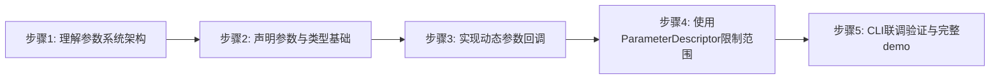

---

#### 步骤1：理解ROS2参数系统架构（15 分钟）

**知识点讲解**：

**参数系统的设计原理（知识点 2.5.3）**：

ROS2参数系统是节点内部状态的"可读写配置层"。与话题（Topic，异步数据流）和服务（Service，同步RPC调用）不同，参数不定义通信通道——它直接读写节点的内存变量。每个节点在启动时通过`declare_parameter`声明自己的参数列表（名称、类型、默认值、约束），ROS2的`parameter_server`将这些声明注册到DDS全局数据空间中，使外部工具（CLI、rqt_reconfigure）可以发现并修改这些参数。

**为什么需要参数系统**：

在实际机器人系统中，有大量的"调优型"变量需要在运行时修改：PID控制器的Kp/Ki/Kd系数、传感器采样频率、速度上限、距离阈值等。如果这些值硬编码在源码中，每次调整都需要修改代码→重新编译→重新部署。参数系统将这些可调整值"拉出"代码，暴露给运行时修改，大幅提升开发和调试效率。

**参数读写的数据流**：

外部CLI/rqt_reconfigure

        |
    
        | ros2 param set /node_name param_name value
    
        v

   参数服务（节点内部）

        |
    
        | 触发 set_parameters_callback
    
        v

   节点业务逻辑（使用新参数值）

**操作步骤**：

```bash
# 观察任意运行中的ROS2节点的默认参数
ros2 run demo_nodes_cpp talker &
ros2 param list
# 预期: /talker: use_sim_time

ros2 param describe /talker use_sim_time
# 预期: 显示参数类型、描述、约束等信息

# 停止talker
kill %1
```

---

#### 步骤2：编写参数声明与读写的基础节点

**知识点讲解**：

**参数生命周期**：

1. **声明（declare）**：节点在`__init__`中调用`self.declare_parameter('name', default_value)`，向ROS2参数服务注册该参数的存在
2. **读取（get）**：在回调函数或业务逻辑中调用`self.get_parameter('name').value`获取当前值
3. **设置（set）**：外部通过CLI或代码调用`self.set_parameter(rclpy.Parameter(name', value))`修改参数，触发`set_parameters_callback`

**操作步骤**：

```bash
将下面代码写入param_sensor_node.py
# -*- coding: utf-8 -*-
"""
实验10：ROS2参数化传感器节点
平台：B2实验箱
运行：python3 param_sensor_node.py
功能：通过参数动态控制MQ5气体传感器的采样率、使能状态和报警阈值
"""
import sys

import rclpy
from rclpy.node import Node
from rclpy.parameter import Parameter
from rcl_interfaces.msg import ParameterDescriptor, FloatingPointRange

sys.path.insert(0, "/home/iflytek/ros2_ws/src/xflz_eai_car1/driver/ros_sensor/ros_sensor/ros_sensor")
from common import read_mq5_once  # 复用实验6的MQ5真实读取函数

class ParamSensorNode(Node):
    """参数化传感器节点——演示参数的声明、读写、动态更新"""

    def __init__(self):
        super().__init__('param_sensor')

        # ====== 步骤1：声明参数 ======
        # declare_parameter 的参数：
        #   name: 参数名称（ROS2命名规范：snake_case）
        #   value: 默认值（同时决定了参数类型：float/int/str/bool/list）
        #   descriptor: 参数描述符（可选，用于约束和文档）

        # 参数1：采样率（Hz）
        self.declare_parameter('sample_rate_hz', 1.0)
        # 参数2：传感器使能（bool）
        self.declare_parameter('sensor_enabled', True)
        # 参数3：报警阈值（ppm）
        self.declare_parameter('alarm_threshold_ppm', 500.0)

        # ====== 步骤2：读取参数的当前值 ======
        self.sample_rate = self.get_parameter('sample_rate_hz').value
        self.sensor_enabled = self.get_parameter('sensor_enabled').value
        self.alarm_threshold = self.get_parameter('alarm_threshold_ppm').value

        # 打印初始参数配置
        self.get_logger().info(
            f'节点已启动，采样率: {self.sample_rate} Hz, '
            f'传感器: {"开启" if self.sensor_enabled else "关闭"}, '
            f'报警阈值: {self.alarm_threshold} ppm'
        )

        # ====== 步骤3：根据参数创建定时器 ======
        self._update_timer()
        self._counter = 0

    def _update_timer(self):
        """根据当前采样率参数更新定时器"""
        # 移除旧定时器（如果存在）
        if hasattr(self, '_timer') and self._timer is not None:
            self.destroy_timer(self._timer)
            self.get_logger().info(f'旧定时器已销毁')

        # 根据采样率创建新定时器
        period_sec = 1.0 / self.sample_rate if self.sample_rate > 0 else 1.0
        self._timer = self.create_timer(period_sec, self._timer_callback)
        self.get_logger().info(f'新定时器已创建: 周期={period_sec:.3f}s (频率={self.sample_rate} Hz)')

    def _timer_callback(self):
        """定时器回调：读取真实MQ5传感器浓度并检查报警"""
        if not self.sensor_enabled:
            return

        self._counter += 1
        # 读取真实MQ5传感器浓度（复用实验6的common.read_mq5_once）
        raw, voltage, ppm, err = read_mq5_once()
        if err:
            self.get_logger().error(f'读取MQ5传感器失败: {err}')
            return

        # 报警逻辑
        if ppm > self.alarm_threshold:
            self.get_logger().warn(
                f'[{self._counter}] [报警!] 气体浓度 {ppm:.1f} ppm > '
                f'阈值 {self.alarm_threshold} ppm'
            )
        else:
            self.get_logger().info(
                f'[{self._counter}] 正常: {ppm:.1f} ppm'
            )

def main(args=None):
    rclpy.init(args=args)
    node = ParamSensorNode()
    try:
        rclpy.spin(node)
    except KeyboardInterrupt:
        node.get_logger().info('节点被用户中断')
    finally:
        node.destroy_node()
        rclpy.shutdown()

if __name__ == '__main__':
    main()
```

**运行并测试**：

```bash
# 终端A：启动节点

python3 param_sensor_node.py

# 终端B：查看参数

ros2 param list

# 预期: /param_sensor 下列出 sample_rate_hz, sensor_enabled, alarm_threshold_ppm

ros2 param get /param_sensor sample_rate_hz

# 预期: Double value is: 1.0

ros2 param set /param_sensor alarm_threshold_ppm 600.0

# 预期: Set parameter successful

# 观察终端A：报警日志的频率应发生变化
```

第一步将代码写入并运行

查看当前传感器参数

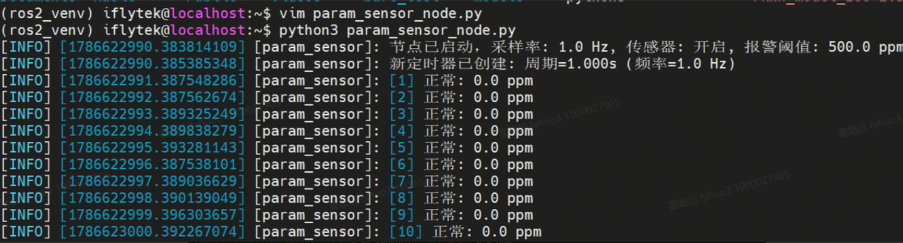

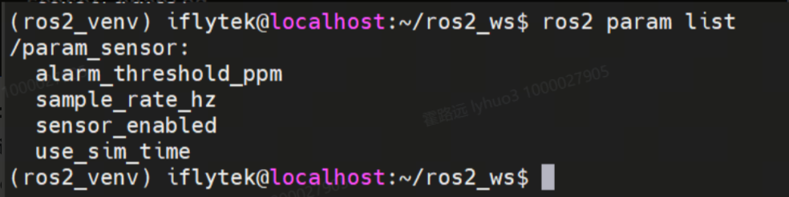

#### 步骤3：实现动态参数回调（20 分钟）

**知识点讲解**：

****`add_on_set_parameters_callback` 的原理****：

当外部调用`ros2 param set`修改参数时，ROS2参数服务并非直接修改节点的参数值——它会触发节点注册的`set_parameters_callback`。在这个回调中，开发者可以：

1. **校验参数合法性**：判断新值是否在允许范围内
2. **应用参数变更**：更新节点内部的变量，调整行为（如重新创建定时器、切换传感器状态）
3. **返回结果**：返回`SetParametersResult(successful=True/False, reason="...")`告知外部修改是否成功

**重要**：回调函数必须返回`SetParametersResult`对象。如果返回`None`或格式错误，ROS2会认为参数设置失败，但不会给出明确错误信息。

**操作步骤**：

```bash
在上面的ParamSensorNode.__init__中添加参数回调注册：
    def __init__(self):
        # ...（前面的代码保持不变）...

        # ====== 注册参数动态更新回调 ======
        # 当外部通过 CLI 或代码修改参数时，此回调被触发
        self.add_on_set_parameters_callback(self._on_param_changed)

    def _on_param_changed(self, params):
        """
        参数更新回调（在参数被外部修改时触发）
        参数: params - 被修改的参数列表（可能同时修改多个参数）
        返回: SetParametersResult - 告知ROS2参数修改是否成功
        """
        from rcl_interfaces.msg import SetParametersResult

        for param in params:
            if param.name == 'sample_rate_hz':
                # 业务校验：采样率必须在有效范围内
                if param.value < 0.1 or param.value > 50.0:
                    self.get_logger().warn(
                        f'拒绝设置采样率: {param.value} Hz（有效范围: [0.1, 50.0]）'
                    )
                    return SetParametersResult(
                        successful=False,
                        reason=f'采样率必须在[0.1, 50.0]范围内，收到: {param.value}'
                    )
                # 应用新参数：重新创建定时器
                self.sample_rate = param.value
                self.get_logger().info(f'采样率已更新: {param.value} Hz')
                self._update_timer()  # 重建定时器以匹配新的采样率

            elif param.name == 'sensor_enabled':
                # 切换传感器使能状态
                self.sensor_enabled = param.value
                state_str = "开启" if param.value else "关闭"
                self.get_logger().info(f'传感器已{state_str}')

            elif param.name == 'alarm_threshold_ppm':
                # 更新报警阈值
                if param.value < 0:
                    return SetParametersResult(
                        successful=False,
                        reason=f'报警阈值必须为非负数，收到: {param.value}'
                    )
                self.alarm_threshold = param.value
                self.get_logger().info(f'报警阈值已更新: {param.value} ppm')

        return SetParametersResult(successful=True, reason='参数更新成功')
```

**易错点**：

- ⚠️ ****`add_on_set_parameters_callback` 注册后仍按原频率运行**** → 解决：确保回调中不仅更新了变量的值，还调用了影响行为的后续逻辑（如这里的`_update_timer()`重建定时器）
- ⚠️ ****`SetParametersResult` 返回后CLI显示"成功"但参数实际未应用**** → 解决：检查`successful=True`仅在全部校验通过时才应返回；若任一参数校验失败，立即返回`successful=False`
- ⚠️ ****回调函数未从 `rcl_interfaces.msg` 导入 `SetParametersResult`**** → 解决：添加 `from rcl_interfaces.msg import SetParametersResult`

---

#### 步骤4：使用ParameterDescriptor增强参数约束（15 分钟）

**知识点讲解**：

**ParameterDescriptor 的设计目的**：

`ParameterDescriptor`允许开发者在声明参数时预定义约束条件（数值范围、整数步长、字符串枚举等）。这些约束可以被`rqt_reconfigure`等GUI工具读取并渲染为滑动条/下拉菜单，无需编写额外的UI代码。更重要的是，`ParameterDescriptor`提供的`floating_point_range`、`integer_range`等字段可以向外部工具声明参数的有效范围

**操作步骤**：

```bash
修改declare_parameter调用以添加描述符：
将param_sensor_node.py修改成下面代码
# -*- coding: utf-8 -*-
"""
实验10：ROS2参数化传感器节点
平台：B2实验箱
运行：python3 param_sensor_node.py
功能：通过参数动态控制MQ5气体传感器的采样率、使能状态和报警阈值
"""
import rclpy
from rclpy.node import Node
from rclpy.parameter import Parameter
from rcl_interfaces.msg import ParameterDescriptor, FloatingPointRange
from common import read_mq5_once  # 复用实验6的MQ5真实读取函数

class ParamSensorNode(Node):
    """参数化传感器节点——演示参数的声明、读写、动态更新"""

    def __init__(self):
        super().__init__('param_sensor')

        # ====== 步骤1：声明参数 ======
        # declare_parameter 的参数：
        #   name: 参数名称（ROS2命名规范：snake_case）
        #   value: 默认值（同时决定了参数类型：float/int/str/bool/list）
        #   descriptor: 参数描述符（可选，用于约束和文档）

        # 参数1：采样率（Hz）
        sample_rate_desc = ParameterDescriptor(
            description='气体传感器采样频率（Hz）。值越高，数据越密集，CPU占用越大。',
            floating_point_range=[
                FloatingPointRange(from_value=0.1, to_value=50.0, step=0.1)
            ]
        )
        self.declare_parameter('sample_rate_hz', 1.0, sample_rate_desc)

        # 参数2：传感器使能（bool）
        sensor_enable_desc = ParameterDescriptor(
            description='是否启用气体传感器。关闭后节点停止数据采集以节省CPU。'
        )
        self.declare_parameter('sensor_enabled', True, sensor_enable_desc)

        # 参数3：报警阈值（ppm）
        alarm_threshold_desc = ParameterDescriptor(
            description='气体浓度报警阈值（ppm）。当采样值超过此阈值时触发报警。',
            floating_point_range=[
                FloatingPointRange(from_value=0.0, to_value=10000.0, step=10.0)
            ]
        )
        self.declare_parameter('alarm_threshold_ppm', 500.0, alarm_threshold_desc)

        # ====== 步骤2：读取参数的当前值 ======
        self.sample_rate = self.get_parameter('sample_rate_hz').value
        self.sensor_enabled = self.get_parameter('sensor_enabled').value
        self.alarm_threshold = self.get_parameter('alarm_threshold_ppm').value
        # 打印初始参数配置
        self.get_logger().info(
            f'节点已启动，采样率: {self.sample_rate} Hz, '
            f'传感器: {"开启" if self.sensor_enabled else "关闭"}, '
            f'报警阈值: {self.alarm_threshold} ppm'
        )

        # ====== 步骤3：根据参数创建定时器 ======
        self._update_timer()
        self._counter = 0

    def _update_timer(self):
        """根据当前采样率参数更新定时器"""
        # 移除旧定时器（如果存在）
        if hasattr(self, '_timer') and self._timer is not None:
            self.destroy_timer(self._timer)
            self.get_logger().info(f'旧定时器已销毁')

        # 根据采样率创建新定时器
        period_sec = 1.0 / self.sample_rate if self.sample_rate > 0 else 1.0
        self._timer = self.create_timer(period_sec, self._timer_callback)
        self.get_logger().info(f'新定时器已创建: 周期={period_sec:.3f}s (频率={self.sample_rate} Hz)')

    def _timer_callback(self):
        """定时器回调：读取真实MQ5传感器浓度并检查报警"""
        if not self.sensor_enabled:
            return

        self._counter += 1
        # 读取真实MQ5传感器浓度（复用实验6的common.read_mq5_once）
        raw, voltage, ppm, err = read_mq5_once()
        if err:
            self.get_logger().error(f'读取MQ5传感器失败: {err}')
            return

        # 报警逻辑
        if ppm > self.alarm_threshold:
            self.get_logger().warn(
                f'[{self._counter}] [报警!] 气体浓度 {ppm:.1f} ppm > '
                f'阈值 {self.alarm_threshold} ppm'
            )
        else:
            self.get_logger().info(
                f'[{self._counter}] 正常: {ppm:.1f} ppm'
            )

def main(args=None):
    rclpy.init(args=args)
    node = ParamSensorNode()
    try:
        rclpy.spin(node)
    except KeyboardInterrupt:
        node.get_logger().info('节点被用户中断')
    finally:
        node.destroy_node()
        if rclpy.ok():
            rclpy.shutdown()

if __name__ == '__main__':
    main()
使用ros2 param describe查看描述符效果：
ros2 param describe /param_sensor sample_rate_hz
# 预期输出: 显示 Descriptor 中的 description 和 floating_point_range 信息

```

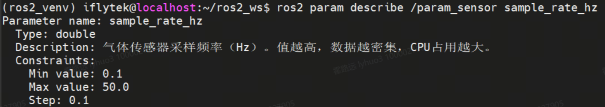

#### 步骤5：CLI联调验证完整流程（15 分钟）

**操作步骤**：

```bash
# ====== 完整测试流程 ======

# 终端A：启动参数化节点
cd ~/ros2_ws && source install/setup.bash
python3 param_sensor_node.py

# 终端B：CLI 验证

# 1. 查看参数列表
ros2 param list
# 预期: /param_sensor: sample_rate_hz, sensor_enabled, alarm_threshold_ppm

# 2. 查看参数描述（验证 ParameterDescriptor 生效）
ros2 param describe /param_sensor sample_rate_hz
# 预期: 显示 description 和 floating_point_range

# 3. 读出当前值
ros2 param get /param_sensor sample_rate_hz
# 预期: 1.0

# 4. 动态修改采样率（观察终端A的变化）
ros2 param set /param_sensor sample_rate_hz 5.0
# 预期: 终端A输出 "采样率已更新: 5.0 Hz" 且日志频率加快

# 5. 测试范围校验（设置超出范围的值）
ros2 param set /param_sensor sample_rate_hz 100.0
# 预期: 设置失败（CLI会显示失败信息），终端A输出拒绝原因

# 6. 关闭传感器
ros2 param set /param_sensor sensor_enabled false
# 预期: 终端A输出 "传感器已关闭"，日志停止输出

# 7. 重新开启传感器
ros2 param set /param_sensor sensor_enabled true
# 预期: 终端A输出 "传感器已开启"，日志恢复输出

# 8. 导出所有参数到文件
ros2 param dump /param_sensor
# 预期: 生成 param_sensor.yaml 文件
cat param_sensor.yaml

# 9. 使用 dump 的 yaml 文件启动新节点（参数预加载）
ros2 run <package> param_sensor_node --ros-args --params-file param_sensor.yaml
```

### 七、注意事项

| ⚠️ 参数名称 | 参数名必须符合ROS2命名规范（snake_case，仅限字母/数字/下划线），且在同一节点内**全局唯一**。重复声明同名参数会导致运行时错误 |

| ⚠️ 类型匹配 | `declare_parameter`的默认值决定了参数类型（`1.0`→float, `1`→int, `"hello"`→str, `True`→bool）。后续`set_parameter`时必须使用相同类型，否则设置失败 |

| ⚠️ 回调线程 | `set_parameters_callback`在参数服务线程中被调用，而非主线程。若回调中涉及共享状态修改，需加锁保护（`threading.Lock`） |

| ⚠️ 参数持久化 | 节点的参数值仅存在于运行时内存中。节点重启后，所有参数恢复为`declare_parameter`中的默认值。若需持久化，使用`ros2 param dump`导出并在Launch文件中加载 |

| ⚠️ 性能 | 参数读写是轻量级操作（内存访问），不存在网络通信开销。但`set_parameters_callback`中若执行重计算（如模型加载），可能导致参数服务超时 |

### 八、实验总结

#### 8.1 完成成果

完成本实验后，你应当能够：

- ✅ 在ROS2节点中使用`declare_parameter`声明参数及其默认值
- ✅ 使用`get_parameter`和`set_parameter`读写运行时的参数值
- ✅ 使用`add_on_set_parameters_callback`注册参数动态更新回调，实现运行时调参
- ✅ 使用`ParameterDescriptor`限制参数的数值范围，增强参数的自描述能力
- ✅ 使用`ros2 param list/get/set/describe/dump`命令行工具管理节点参数

#### 8.2 技能收获

| 技能 | 说明 |
|---|---|
| 参数化编程 | 掌握将硬编码常量"拉出"为可配置参数的编程范式 |
| 动态调参 | 能设计参数回调逻辑，实现不重启节点即可改变运行行为的动态调整能力 |
| 约束设计 | 理解ParameterDescriptor的作用，能为参数添加合理的范围约束和描述文档 |
| CLI调试 | 熟练掌握param命令组的六种操作，支持开发调试阶段的快速参数验证 |
| 配置管理 | 能通过dump/load实现参数的"配置即代码"（Configuration as Code） |

#### 8.3 常见问题与解答

| 问题 | 原因 | 解决方法 |
|---|---|---|
| `declare_parameter` 报 "already declared" | 多次声明了同名参数 | 使用 `if not self.has_parameter('name'): self.declare_parameter(...)` |
| `set_parameter` 后节点行为未改变 | 未在回调中应用新参数值 | 检查 `add_on_set_parameters_callback` 中是否正确更新了内部变量并触发了后续逻辑 |
| `ros2 param set` 报 "Type mismatch" | 设置值的类型与声明时不一致 | 确保类型匹配：声明float用`1.0`而非`1`，声明int用`1`而非`1.0` |
| `ros2 param describe` 不显示约束信息 | ParameterDescriptor 未传递或编译问题 | 检查 `declare_parameter` 的第三个参数是否正确传入了 `ParameterDescriptor` 对象 |
| 参数回调中修改定时器导致崩溃 | 定时器在回调线程中操作不安全 | 使用 `self._pending_rate = value` 保存新值，在主循环的定时器回调中检查并应用 |

### 九、实验报告要求

#### 9.1 报告内容

完成实验后，提交一份实验报告，包含以下内容：

1. **实验基本信息**：实验名称、实验日期、实验者姓名、实验平台信息
2. **实验过程记录**：截取步骤5完整测试流程的关键命令输出截图（至少包含：`param list`、`param get`、`param set`成功、`param set`被拒绝、`param dump` 共5个场景）
3. **原理分析**（不少于250字）：用自己的语言描述ROS2参数系统在"代码中硬编码常量 → 参数声明 → 动态回调 → 外部CLI修改"这个过程中的数据流和控制流，解释为什么这种设计能提升机器人系统的开发效率
4. **思考题**（见下方）

#### 9.2 思考题

**思考题 1**：

在本实验中，我们在`_on_param_changed`回调中手动校验了采样率的范围（0.1~50.0）。但我们又在`declare_parameter`中通过`ParameterDescriptor`声明了相同的范围约束。这两种范围约束分别在什么层级生效？如果CLI尝试设置一个超出范围的值，哪一个约束会先触发？请设计一个实验验证你的判断。

**思考题 2**：

假设你正在开发一个巡线小车，有PID速度控制器的三个参数（Kp、Ki、Kd），这三个参数相互关联——修改任意一个后，控制器需要重新计算积分累计值以避免"积分突变"。请设计`set_parameters_callback`的处理逻辑，描述当Kp被修改后，应该如何更新内部状态，并说明是否需要同时重置Ki和Kd的累计值。

#### 9.3 评分标准

| 评分项 | 权重 | 评分标准 |
|---|---|---|
| 实验操作完整性 | 25% | 是否完成参数声明、读写、动态回调的完整编码与CLI验证 |
| 代码质量 | 25% | 参数回调中是否包含校验逻辑、是否正确应用参数变更、是否使用ParameterDescriptor |
| 原理分析 | 20% | 对参数系统数据流和控制流的理解深度 |
| 思考题 1 | 15% | 对两种约束机制的理解与实验设计方案 |
| 思考题 2 | 15% | PID参数联动更新逻辑的设计合理性 |

## 实验11：ROS2时间相关API

### 一、关联知识点

本实验关联以下知识图谱节点：

| 编号 | 知识点名称 | 类型 | 层级路径 |
|---|---|---|---|
| 3.2.1 | ROS2时间类型(builtin_interfaces/Time)以秒+纳秒表示时刻的概念 | 概念 | 第3章 ROS2底层机制与分布式通信 → 3.2 时间系统 |
| 3.2.2 | get_clock().now()获取当前时间与create_timer创建周期性定时器的流程 | 流程 | 第3章 ROS2底层机制与分布式通信 → 3.2 时间系统 |
| 3.2.3 | use_sim_time与仿真时间同步机制的原理 | 原理 | 第3章 ROS2底层机制与分布式通信 → 3.2 时间系统 |

### 二、实验目标

通过本实验的学习，学生能够：

1. **原理理解**：阐述ROS2时间系统的双时钟架构——系统时钟（`/clock`主题）与仿真时钟（Gazebo发布的`/clock`），以及`use_sim_time`参数如何驱动Clock类在两模式间切换
2. **流程掌握**：正确使用`get_clock().now()`获取当前时间、`create_timer(period, callback)`创建周期性定时器、以及`Time`类型的`nanoseconds`和`seconds_nanoseconds`转换方法
3. **独立完成**：独立编写一个使用定时器周期性读取真实MQ5可燃气体传感器浓度并为其`Header.stamp`打上采集时刻时间戳的发布节点
4. **迁移应用**：能够分析实际ROS2系统中"消息时间戳不一致"问题的原因——识别系统时钟与传感器硬件时钟的差异，并使用`ros2 topic delay`测量端到端延迟

### 三、实验环境

| 类别 | 配置 |
|---|---|
| 硬件平台 | 具身智能实验箱B2  |
| 操作系统 | Ubuntu 22.04 |
| ROS2 发行版 | Humble Hawksbill |
| 核心依赖 | `rclpy`、`builtin_interfaces`、`std_msgs` |
| 终端工具 | 系统自带 Terminal（Bash），建议准备至少 2 个终端窗口 |

> 说明：本实验为时间API编程实验，复用实验6的`common.py`（`read_mq5_once()`）读取真实MQ5可燃气体传感器浓度，为每条采样数据打上采集时刻时间戳。仿真时钟部分需要Gazebo环境（实验21才涉及），本实验以系统时钟模式为主进行练习。

### 四、实验难度

| 维度 | 说明 |
|---|---|
| 难度等级 | ⭐（容易） |
| 实验类型 | 验证性 |
| 建议时长 | 2 学时（90 分钟） |

**重点**：

- 掌握`rclpy.time.Time`的构造、比较、运算方法
- 掌握`create_timer`的创建与销毁（`destroy_timer`），理解定时器周期与回调执行时间的关系
- 理解`Header.stamp`的作用——为每条传感器消息打上采集时刻的时间戳

**难点**：

- 区分`time.time()`（Python系统时间）和`get_clock().now()`（ROS2时间）——两者在仿真模式下可能不同
- 理解`use_sim_time`参数的工作机制：节点需在初始化前通过参数声明启用，且必须在`rclpy.init()`之后、`spin()`之前设置

### 五、实验现象

#### 5.1 快速验证流程

完成本实验后，你应能观察到以下现象：

1. 启动时间演示节点后，终端每1秒打印一次包含时间戳的消息
2. 使用`ros2 topic echo`查看消息时，`stamp`字段显示从1970-01-01开始的Unix时间（秒+纳秒）
3. 修改定时器周期后，消息发布频率相应变化
4. 使用`ros2 topic delay`命令可测量消息从发布到被接收的端到端延迟

#### 5.2 预期效果描述

| 操作 | 预期输出 |
|---|---|
| `python3 time_demo_node.py` | `[INFO] [1731500000.500] 采样 #1, 值: xx.xx`（每秒一条） |
| `ros2 topic echo /sensor_data` | 显示 `header.stamp.sec` 和 `nanosec` 字段 |
| `ros2 topic delay /sensor_data` | 显示每条消息的端到端延迟（ms） |
| 修改定时器频率为5Hz | 消息发布频率变为每秒5条 |

---

### 六、实验步骤

#### 整体流程


---

#### 步骤1：理解ROS2时间类型（15 分钟）

**知识点讲解**：

**ROS2 Time类型的设计（知识点 3.2.1）**：

ROS2定义了自己的时间抽象层`builtin_interfaces/msg/Time`，而非直接使用Python的`time.time()`。这样设计的原因是：机器人系统中有两类时钟源——**系统时钟**（Wall Clock，真实世界时间）和**仿真时钟**（Simulation Clock，由Gazebo等仿真器发布的逻辑时间）。ROS2的Clock类在`use_sim_time:=true`时自动切换为从`/clock`话题订阅仿真时间，而在`use_sim_time:=false`（默认）时使用系统时钟。这个切换对上层代码透明——`get_clock().now()`始终返回"当前正确的时间"。

**Time消息结构**：

builtin_interfaces/Time:

  int32 sec      # 秒部分（Unix时间戳，从1970-01-01 00:00:00起算）

  uint32 nanosec # 纳秒部分（0~999,999,999）

****`rclpy.time.Time` vs 消息`builtin_interfaces/msg/Time`****：

- `rclpy.time.Time`是Python侧的API类型（可运算、比较）
- `builtin_interfaces/msg/Time`是消息序列化类型（嵌入Header中传输）
- 两者可通过`Time.from_msg(msg_time)`和`time_obj.to_msg()`互相转换

**操作步骤**：

```bash
# 交互式测试时间API（在Python终端中练习）
import rclpy
rclpy.init()
node = rclpy.create_node('time_test')

# 获取当前ROS2时间
now = node.get_clock().now()
print(f"当前ROS2时间: {now.nanoseconds} ns")
print(f"秒部分: {now.nanoseconds // 1_000_000_000}")

# 转换为消息格式
msg_time = now.to_msg()
print(f"消息格式: sec={msg_time.sec}, nanosec={msg_time.nanosec}")

# 时间运算：计算未来的时间点
from rclpy.time import Duration
future = now + Duration(seconds=5.0)  # 5秒后
print(f"5秒后: {future.nanoseconds} ns")

node.destroy_node()
rclpy.shutdown()
```

---

#### 步骤2：create_timer定时器编程（20 分钟）

**知识点讲解**：

**create_timer的原理（知识点 3.2.2）**：

`create_timer(period_sec, callback)`在节点的事件循环（`spin`）中注册一个周期性触发源。每次`period_sec`秒过去后，指定的`callback`函数被加入执行队列。定时器是ROS2节点中实现"周期性任务"的标准方式——替代了ROS1中显式的`while + rospy.Rate.sleep()`模式。

**核心规则**：

- 定时器周期是**名义上的**最小间隔——如果回调执行时间超过周期，下一次触发会被推迟
- 多个定时器可以共存，各自独立计时
- 高频率定时器（如1000Hz）可能导致CPU过载，回调积压

**操作步骤**：

```bash
将下面代码放入time_demo_node.py
# -*- coding: utf-8 -*-
"""
实验11：ROS2时间与定时器演示节点
平台：B2实验箱
"""
import rclpy
from rclpy.node import Node
from std_msgs.msg import Header

class TimeDemoNode(Node):
    """演示ROS2时间API与定时器使用"""

    def __init__(self):
        super().__init__('time_demo_node')

        # 创建发布者：发布带时间戳的消息数据（用Header演示stamp字段）
        self._publisher = self.create_publisher(
            Header,           # 使用Header消息演示stamp字段
            'sensor_data',
            10               # QoS: KEEP_LAST(10)
        )

        # 创建定时器1：1Hz（每秒触发一次）
        self._timer1 = self.create_timer(1.0, self._timer1_callback)
        self._sample_count = 0

        # 创建定时器2：0.2Hz，每5秒打印一次状态摘要
        self._timer2 = self.create_timer(5.0, self._timer2_callback)

        self.get_logger().info('时间演示节点已启动')
        self.get_logger().info(f'系统时钟模式: use_sim_time={self.get_parameter("use_sim_time").value}')

    def _timer1_callback(self):
        """
        定时器1回调：每秒采集一次数据并发布
        演示 Header.stamp 的时间戳赋值
        """
        self._sample_count += 1

        # 获取当前ROS2时间
        now = self.get_clock().now()
        now_msg = now.to_msg()  # 转换为消息格式

        # 构造带时间戳的消息
        msg = Header()
        msg.stamp = now_msg           # ⭐ 核心：给消息打上当前时间戳
        msg.frame_id = 'sensor_frame' # 传感器所在的坐标系

        self._publisher.publish(msg)

        # 格式化输出
        self.get_logger().info(
            f'采样 #{self._sample_count:04d} | '
            f'stamp: {now_msg.sec}.{now_msg.nanosec:09d} | '
            f'frame_id: {msg.frame_id}'
        )

    def _timer2_callback(self):
        """定时器2回调：每5秒输出状态摘要"""
        self.get_logger().info(
            f'[状态摘要] 累计采样次数: {self._sample_count}, '
            f'当前ROS2时间: {self.get_clock().now().nanoseconds} ns'
        )

def main(args=None):
    rclpy.init(args=args)
    node = TimeDemoNode()
    try:
        rclpy.spin(node)
    except KeyboardInterrupt:
        node.get_logger().info('节点被用户中断')
    finally:
        node.destroy_node()
        rclpy.shutdown()

if __name__ == '__main__':
    main()
```

**运行验证**：

```bash
# 终端A

python3 time_demo_node.py

# 终端B：使用ros2 topic echo查看消息时间戳

ros2 topic echo /sensor_data

# 预期: 每秒显示一条，stamp字段的sec值接近当前Unix时间
```

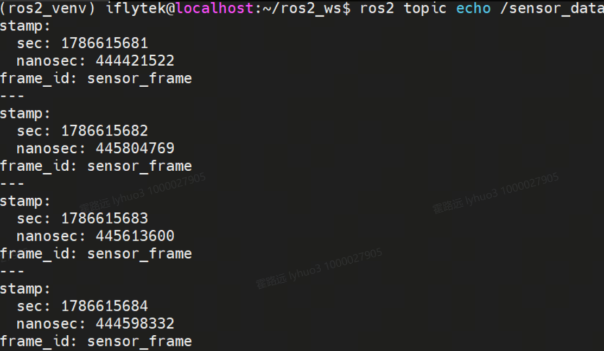

**易错点**：

- ⚠️ **定时器不触发** → 解决：确认`rclpy.spin(node)`已调用。没有spin，事件循环不运行，定时器不会被触发
- ⚠️ **定时器回调执行过慢导致频率不准** → 解决：确保回调中的逻辑（尤其是I/O操作）不会阻塞。IO密集型任务应使用异步或多线程处理

---

#### 步骤3：时间运算与端到端延迟测量（15 分钟）

**知识点讲解**：

**端到端延迟（End-to-End Latency）**：

端到端延迟 = 订阅者接收消息的时刻 - 发布者发布消息的时刻。`ros2 topic delay`命令比较消息中的`stamp`与当前时钟的差值，输出每条消息的传输延迟。这个指标反映ROS2通信栈的实时性能——通常小于1ms（局域网有线连接）。

****`rclpy.time.Duration`类****：

Duration用于表示时间间隔，支持与Time的加减运算、比较、以及秒/纳秒转换。

**操作步骤**：

```bash
# 保持 time_demo_node 运行
# 查看话题发布频率
ros2 topic hz /sensor_data
# 预期: average rate: ~1.000 Hz

# 编程方式测量延迟（添加到节点中）
def measure_latency_demo(self):
    """演示编程式延迟测量"""
    now = self.get_clock().now()
    from rclpy.time import Duration

    # 创建一个5秒前的时间点
    past = now - Duration(seconds=5.0)

    # 计算时间差
    diff = now - past
    print(f"时间差: {diff.nanoseconds / 1e9:.3f} 秒")

    # 比较时间：now > past? → True
    print(f"now > past? {now > past}"
```

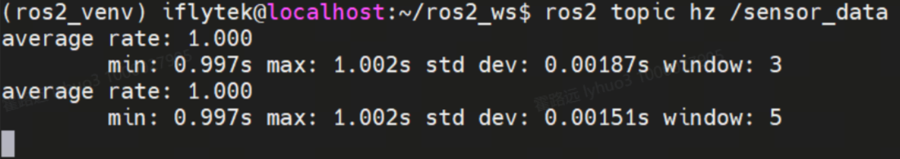

#### 步骤4：理解use_sim_time仿真时钟机制（10 分钟）

**知识点讲解**：

**use_sim_time 的工作原理（知识点 3.2.3）**：

当节点启动时带有参数`use_sim_time:=true`，ROS2的Clock类会订阅`/clock`话题（消息类型为`rosgraph_msgs/msg/Clock`），并以该话题上的消息值作为"当前时间"。Gazebo等仿真器在推进仿真步长时自动向`/clock`发布消息。这使得：

- 仿真中的"1秒"可能对应真实的0.1秒（加速仿真）或10秒（减速调试）
- 所有使用`use_sim_time:=true`的节点共享相同的仿真时间轴
- 录制bag回放时也可以发布`/clock`，使离线分析的时间戳保持一致

**重要限制**：

`use_sim_time`参数必须在节点初始化（即`rclpy.init()` + 节点构造函数）时确定。节点运行中无法切换时钟模式。

**操作步骤**：

```bash
# 以仿真时间模式启动节点（参数语法：--ros-args -p）
python3 time_demo_node.py --ros-args -p use_sim_time:=true
# 此时节点会等待 /clock 话题出现（因为仿真时钟未启动）
# 若 /clock 持续未出现，节点将阻塞等待

# 在另一终端手动发布仿真时间（模拟Gazebo发出的/clock）
ros2 topic pub /clock rosgraph_msgs/msg/Clock "{clock: {sec: 100, nanosec: 0}}" --rate 1
# 节点现在会以仿真时间运行，stamp字段显示从100秒开始递增
```

### 七、注意事项

| 类别 | 注意事项 |
|---|---|
| ⚠️ 初始化顺序 | `get_clock().now()` 必须在 `rclpy.init()` 之后、节点创建之后调用，否则会抛出 "Clock not initialized" 异常 |
| ⚠️ use_sim_time | `use_sim_time:=true` 仅在仿真环境下使用。若在真实硬件上启用此参数且无`/clock`发布者，节点将永久阻塞等待 |
| ⚠️ 定时器精度 | create_timer的精度受Linux调度器影响，实际触发时间可能偏差数毫秒。对于微秒级精度要求，应使用实时内核（PREEMPT_RT） |

⚠️ stamp 含义 Header.stamp应记录数据的**采集时刻**而非发布时刻。若传感器采集与发布之间存在处理延迟，应在采集代码处记录时间戳

⚠️ 纳秒溢出 `Time.nanoseconds`返回的是从Unix纪元（1970-01-01 00:00:00 UTC）到当前时刻的总纳秒数。Python的int类型无溢出风险，但在C++中需使用`uint64_t`

⚠️ 多定时器 同一节点中多个定时器的回调在同一线程中串行执行。若一个回调耗时过长，会阻塞其他定时器或订阅者的回调

### 八、实验总结

#### 8.1 完成成果

完成本实验后，你应当能够：

- ✅ 使用`get_clock().now()`获取当前ROS2时间并转换为消息格式
- ✅ 使用`create_timer(period, callback)`创建周期性定时器并动态调整频率
- ✅ 正确设置`Header.stamp`为传感器消息打上采集时刻的时间戳
- ✅ 使用`ros2 topic delay`和`ros2 topic hz`测量通信延迟和发布频率
- ✅ 理解`use_sim_time`参数的工作机制与仿真时间的应用场景

#### 8.2 技能收获

| 技能 | 说明 |
|---|---|
| 时间API | 掌握`rclpy.time.Time`和`Duration`的构造、转换、运算方法 |
| 定时器编程 | 能使用`create_timer`实现周期性任务，理解定时器的事件循环机制 |
| 时间戳规范 | 理解Header.stamp的含义与正确赋值时机 |
| 延迟分析 | 能使用`ros2 topic delay`诊断ROS2通信链路的实时性能 |
| 仿真时钟 | 理解use_sim_time参数如何实现仿真时间与系统时间的无缝切换 |

#### 8.3 常见问题与解答

| 问题 | 原因 | 解决方法 |
|---|---|---|
| `get_clock().now()` 报 "Clock not initialized" | 未调用 `rclpy.init()` 或节点未创建 | 确保 `rclpy.init(args=args)` 在节点创建之前调用 |
| 定时器回调未被执行 | 未调用 `rclpy.spin(node)` | 在节点创建后调用 `rclpy.spin(node)` 启动事件循环 |
| `ros2 topic delay` 显示延迟为负值 | 发送方和接收方系统时钟不同步 | 在多机场景下使用NTP同步时钟；单机场景下检查消息stamp赋值代码 |
| 修改`publish_rate_hz`参数后频率未变化 | 定时器创建后周期固定 | 需要先`destroy_timer`再重新`create_timer` |
| `use_sim_time:=true`后节点一直等待 | `/clock`话题无发布者 | 启动Gazebo仿真或手动发布`/clock`话题 |

### 九、实验报告要求

#### 9.1 报告内容

完成实验后，提交一份实验报告，包含以下内容：

1. **实验基本信息**：实验名称、实验日期、实验者姓名、实验平台信息
2. **实验过程记录**：截取步骤6中运行完整节点的终端输出、`ros2 topic echo`的输出、`ros2 topic delay`的输出
3. **原理分析**（不少于250字）：用自己的语言解释ROS2双时钟架构的设计意义——为什么需要同时支持系统时钟和仿真时钟？这种设计给机器人开发流程带来了什么变化？
4. **思考题**（见下方）

#### 9.2 思考题

**思考题 1**：

假设你有一个IMU传感器节点以200Hz频率发布消息，和一个相机节点以30Hz发布消息。你需要将两者数据融合，但由于硬件延迟，两个传感器数据的时间戳并非严格对齐。请设计一种基于`Header.stamp`的时间对齐策略，说明如何确定"最接近"的IMU测量值来匹配每一帧相机图像。

**思考题 2**：

在`use_sim_time:=true`模式下，节点的时间推进速度完全取决于`/clock`话题的发布频率。如果Gazebo以0.5倍速运行（仿真1秒需要真实2秒），那么`create_timer(1.0, callback)`的回调会以什么频率触发？这对控制算法的行为会产生什么影响？

#### 9.3 评分标准

| 评分项 | 权重 | 评分标准 |
|---|---|---|
| 实验操作完整性 | 30% | 是否完成定时器发布、时间戳设置、延迟测量的完整验证 |
| 代码质量 | 20% | 时间戳赋值位置是否正确（采集时而非发布时）、定时器使用是否合理 |
| 原理分析 | 20% | 对双时钟架构设计意义的理解深度 |
| 思考题 1 | 15% | 时间对齐策略的合理性与可操作性 |
| 思考题 2 | 15% | 对仿真时间缩放对定时器行为影响的分析 |

## 实验12：ROS2 DDS

### 一、关联知识点

本实验关联以下知识图谱节点：

| 编号 | 知识点名称 | 类型 | 层级路径 |
|---|---|---|---|
| 3.1.1 | RMW(ROS Middleware)中间件抽象层概念与DDS实现(Fast-DDS/CycloneDDS)的可切换机制 | 概念 | 第3章 ROS2底层机制与分布式通信 → 3.1 DDS通信中间件 |
| 3.1.2 | RTPS协议Participant→Endpoint→Writer/Reader层次结构原理 | 原理 | 第3章 ROS2底层机制与分布式通信 → 3.1 DDS通信中间件 |
| 3.1.3 | DDS自动发现SPDP(参与者发现)+SEDP(端点发现)两阶段机制的原理 | 原理 | 第3章 ROS2底层机制与分布式通信 → 3.1 DDS通信中间件 |
| 3.1.4 | QoS策略配置RELIABLE/BEST_EFFORT/VOLATILE/TRANSIENT_LOCAL/KEEP_LAST的流程 | 流程 | 第3章 ROS2底层机制与分布式通信 → 3.1 DDS通信中间件 |

### 二、实验目标

通过本实验的学习，学生能够：

1. **原理理解**：阐述ROS2 RMW（ROS Middleware Wrapper）层的设计原理——如何通过抽象接口使上层`rcl` API无需修改即可切换底层DDS实现（Fast-DDS/CycloneDDS），并理解RTPS协议中Participant、Endpoint、Writer/Reader的层次关系
2. **流程掌握**：正确执行切换DDS实现（通过`RMW_IMPLEMENTATION`环境变量）、配置QoS策略（Reliability/Durability/History Depth）、观察DDS发现过程（SPDP+SEDP）
3. **独立完成**：独立编写使用非默认QoS配置的发布者/订阅者节点，对比`RELIABLE`与`BEST_EFFORT`、`KEEP_LAST(1)`与`KEEP_LAST(100)`的行为差异
4. **迁移应用**：能够根据实际传感器数据的特性（如激光雷达数据允许丢帧但要求低延迟，姿态估计数据不可丢帧但容忍较高延迟），为不同话题选择合理的QoS策略组合

### 三、实验环境

| 类别 | 配置 |
|---|---|
| 硬件平台 | 具身智能实验箱B2  |
| 操作系统 | Ubuntu 22.04 |
| ROS2 发行版 | Humble Hawksbill |
| 默认DDS实现 | Fast-DDS (eProsima) |
| 备选DDS实现 | CycloneDDS（需安装 `ros-humble-rmw-cyclonedds-cpp`） |
| 核心依赖 | `rclpy`、`std_msgs`、`ros-humble-rmw-fastrtps-cpp` |

> 说明：本实验为DDS原理与QoS配置实验，不依赖传感器硬件。建议在纯软件环境下完成，有助于集中理解DDS通信机制。

### 四、实验难度

| 维度 | 说明 |
|---|---|
| 难度等级 | ⭐⭐（中等） |
| 实验类型 | 设计性 |
| 建议时长 | 2 学时（90 分钟） |

**重点**：

- 理解ROS2 RMW层的架构设计：`rcl`（ROS Client Library）→ `rmw`（ROS Middleware Wrapper）→ DDS Vendor（Fast-DDS/CycloneDDS）
- 掌握QoS策略的配置方法与行为差异：Reliability（可靠vs尽力）、Durability（易失vs本地暂存）、History（保留深度）

**难点**：

- 理解RTPS协议中SPDP（Simple Participant Discovery Protocol）和SEDP（Simple Endpoint Discovery Protocol）的两阶段发现过程
- 理解Durability中VOLATILE、TRANSIENT_LOCAL、TRANSIENT三种模式的语义：它们决定了"后来的订阅者能否收到加入前发布的消息"

### 五、实验现象

#### 5.1 快速验证流程

完成本实验后，你应能观察到以下现象：

1. 切换DDS实现（`export RMW_IMPLEMENTATION=rmw_cyclonedds_cpp`）后，同一份节点代码在不修改的情况下正常运行
2. 使用`RELIABLE` QoS时，订阅者收到发布者发送的**每一条**消息（除非网络中断）
1. 使用`BEST_EFFORT` QoS时，订阅者可能丢失部分消息（若网络拥塞或订阅者处理速度跟不上发布速度）
2. 使用`TRANSIENT_LOCAL` Durability时，后来启动的订阅者能够收到启动前发布者已发布的历史消息
3. 使用`KEEP_LAST(1)`时，订阅者只保留最新1条消息；使用`KEEP_LAST(100)`时保留最近100条

#### 5.2 预期效果描述

| 操作 | 预期输出 |
|---|---|
| `export RMW_IMPLEMENTATION=rmw_cyclonedds_cpp && python3 qos_demo.py` | 节点正常启动，无代码修改 |
| 对比RELIABLE vs BEST_EFFORT | RELIABLE: 100%消息到达；BEST_EFFORT: 有丢失（高频+慢订阅者场景） |
| 对比TRANSIENT_LOCAL vs VOLATILE | TRANSIENT_LOCAL: 后启动的订阅者收到历史消息；VOLATILE: 收不到 |
| `ros2 topic info /qos_demo --verbose` | 显示话题的QoS配置详情 |

---

### 六、实验步骤

#### 整体流程


---

#### 步骤1：理解ROS2 RMW层架构（15 分钟）

**知识点讲解**：

**RMW层的设计原理（知识点 3.1.1）**：

ROS2在`rcl`（ROS Client Library，面向开发者的API层）和DDS实现（面向网络传输的底层库）之间插入了一个**RMW抽象层**。RMW定义了统一的C API接口，包含节点创建、Publisher/Subscriber管理、QoS配置、发现触发等标准操作。不同DDS供应商（eProsima Fast-DDS、Eclipse CycloneDDS、RTI Connext等）分别实现这些接口，编译为独立的`rmw_<vendor>`共享库。

**这种设计的工程价值**：

- **可替换性**：通过环境变量`RMW_IMPLEMENTATION`在运行时切换DDS实现，无需重编译
- **竞争促进**：DDS供应商竞争性能（延迟、吞吐量、CPU占用），ROS2社区受益于"最优实现"
- **隔离变更**：DDS实现升级或漏洞修复不影响上层ROS2 API

**架构层次**：

rclpy (Python API)

  └── rcl (C API)

        └── rmw (RMW抽象层 ─── 统一的C接口)
    
              ├── rmw_fastrtps_cpp (eProsima Fast-DDS，默认)
    
              ├── rmw_cyclonedds_cpp (Eclipse CycloneDDS)
    
              └── rmw_connextdds (RTI Connext，商用)
    
                    └── DDS Wire Protocol (RTPS over UDP/TCP)

**操作步骤**：

```bash

# 查看当前使用的RMW实现
echo $RMW_IMPLEMENTATION
# 若为空，说明使用默认的 Fast-DDS

# 查看Fast-DDS的库文件位置
find /opt/ros/humble -name "librmw_fastrtps*" 2>/dev/null
```

---

#### 步骤2：切换DDS实现验证（15 分钟）

**知识点讲解**：

ROS2默认使用Fast-DDS（eProsima），但可以通过环境变量无缝切换到CycloneDDS。切换后，所有ROS2通信（话题、服务、动作）底层由新的DDS实现接管，上层代码零改动。

**操作步骤**：

```bash
以下操作需要实验箱连接网络
# 安装 CycloneDDS 的 RMW 实现
sudo apt update
sudo apt install ros-humble-rmw-cyclonedds-cpp

# 启动节点时切换 DDS 实现
export RMW_IMPLEMENTATION=rmw_cyclonedds_cpp
ros2 run demo_nodes_cpp talker &
ros2 run demo_nodes_cpp listener &
# 观察：talker/listener 无需修改代码即可正常运行

# 验证当前使用的 RMW 实现
ros2 doctor --report | grep -A2 "middleware"
# 或
ros2 topic info /chatter --verbose
# 预期输出中包含 QoS 配置信息（由当前 DDS 实现提供）

# 切换回 Fast-DDS
export RMW_IMPLEMENTATION=rmw_fastrtps_cpp

# 清理
kill %1 %2 2>/dev/null
```

**易错点**：

- ⚠️ ****设置`RMW_IMPLEMENTATION`后节点启动失败**** → 解决：确认对应的`ros-humble-rmw-<vendor>-cpp`包已安装。不同RMW实现的节点不能跨实现通信——同一ROS_DOMAIN_ID下必须使用同一RMW实现

---

#### 步骤3：理解RTPS协议与DDS发现机制

**知识点讲解**：

**RTPS协议的层次结构（知识点 3.1.2）**：

RTPS（Real-Time Publish-Subscribe）是DDS的线级协议，定义了网络上如何序列化、寻址和传输DDS消息。其核心概念按层次排列：

Domain（通信域，由Domain ID隔离）

  └── Participant（参与者，对应一个ROS2进程/节点容器）

        ├── Publisher（发布端）
    
        │     └── DataWriter（数据写入器，对应一个ROS2 Publisher）
    
        │           └── HistoryCache（历史缓存，存储已发布消息）
    
        └── Subscriber（订阅端）
    
              └── DataReader（数据读取器，对应一个ROS2 Subscriber）
    
                    └── HistoryCache（历史缓存，存储已接收消息）

**DDS自动发现的两阶段机制（知识点 3.1.3）**：

1. **SPDP（Simple Participant Discovery Protocol）**：Participant启动后向多播地址（239.255.0.1）周期性发送SPDP消息，宣告自身的GUID（全局唯一标识符）、Domain ID、内置端点。其他Participant收到后，记录该Participant的存在。SPDP使用"Best Effort"模式。
2. **SEDP（Simple Endpoint Discovery Protocol）**：一旦两个Participant互相发现，它们通过内置端点交换各自的DataWriter/DataReader列表和QoS配置。只有Topic名称和类型都匹配的Writer/Reader才会建立匹配。

这个两阶段机制使得ROS2节点无需手动配置——启动后自动发现对等节点并建立通信链路。

**操作步骤**：

```bash
# 使用Fast-DDS自带工具观察发现过程
# 保持talker和listener运行

# 终端A：启动一个发布者
ros2 run demo_nodes_cpp talker &
TALKER_PID=$!

# 终端B：启动一个订阅者
ros2 run demo_nodes_cpp listener &
LISTENER_PID=$!

# 终端C：观察DDS通信（使用ros2 daemon和topic info）
ros2 topic info /chatter --verbose
# 预期输出中包含:
#   Node name: /talker
#   Node namespace: /
#   Topic type: std_msgs/msg/String
#   Endpoint type: PUBLISHER
#   GID: ... (GUID in hex format)
#   Qos Profile:
#     Reliability: RELIABLE
#     Durability: VOLATILE
#     ...

# 查看ROS2图中节点的GUID（对应DDS Participant GUID）
ros2 node info /talker

kill $TALKER_PID $LISTENER_PID 2>/dev/null
```

---

#### 步骤4：QoS策略配置实验（25 分钟）

**知识点讲解**：

| **QoS 策略** | **可选值** | **语义说明** | **典型应用场景** |
|---|---|---|---|
| **Reliability（可靠性）​** | **RELIABLE<br>BEST_EFFORT** | **RELIABLE：保证送达，丢失会重传<br>BEST_EFFORT：不保证送达，允许丢包** | **控制指令 → RELIABLE<br>激光雷达 / 图像流 → BEST_EFFORT** |
| **Durability（持久性）​** | **VOLATILE<br>TRANSIENT_LOCAL** | **VOLATILE：发送即忘，后订阅收不到旧消息<br>TRANSIENT_LOCAL：发布者缓存，后订阅者可收历史** | **实时数据流 → VOLATILE<br>机器人状态 / 参数 → TRANSIENT_LOCAL** |
| **History（历史策略）​** | **KEEP_LAST(n)<br>KEEP_ALL** | **KEEP_LAST(n)：只保留最近 n 条<br>KEEP_ALL：保留所有（直到内存上限）** | **状态量 → KEEP_LAST(1)<br>数据记录 / 回放 → KEEP_LAST(1000)** |
| **Liveliness（存活检测）​** | **AUTOMATIC<br>MANUAL_BY_TOPIC** | **AUTOMATIC：系统自动发心跳<br>MANUAL_BY_TOPIC：用户代码显式声明存活** | **关键节点存活监控、安全相关节点** |
| **Deadline（截止时间）​** | **时间长度（如 100ms）** | **相邻消息最大允许间隔，超时认为异常** | **传感器健康监测（如 IMU 停止发数）** |

**操作步骤**：

```bash
编写QoS对比实验节点：
将下面代码写入qos_demo.py
# -*- coding: utf-8 -*-
"""
实验12：ROS2 QoS策略对比实验
平台：B2/C1
运行：python3 qos_demo.py
功能：对比 RELIABLE vs BEST_EFFORT 和 KEEP_LAST 的不同行为
"""
import rclpy
from rclpy.node import Node
from rclpy.qos import QoSProfile, ReliabilityPolicy, DurabilityPolicy, HistoryPolicy
from std_msgs.msg import String

class QosDemo(Node):
    """QoS策略对比演示节点"""

    def __init__(self):
        super().__init__('qos_demo')

        # ====== 定义四种不同的QoS Profile ======

        # Profile 1: 默认QoS（RELIABLE + VOLATILE + KEEP_LAST(10)）
        # 适用场景：一般控制指令、服务请求
        qos_default = QoSProfile(depth=10)

        # Profile 2: 传感器流QoS（BEST_EFFORT + VOLATILE + KEEP_LAST(5)）
        # 适用场景：高频传感器数据（激光雷达、相机），允许丢帧但要求低延迟
        qos_sensor = QoSProfile(
            reliability=ReliabilityPolicy.BEST_EFFORT,
            durability=DurabilityPolicy.VOLATILE,
            history=HistoryPolicy.KEEP_LAST,
            depth=5
        )

        # Profile 3: 可靠状态QoS（RELIABLE + TRANSIENT_LOCAL + KEEP_LAST(1)）
        # 适用场景：机器人状态（如电池电量、当前模式），后来的订阅者也需要知道最新状态
        qos_state = QoSProfile(
            reliability=ReliabilityPolicy.RELIABLE,
            durability=DurabilityPolicy.TRANSIENT_LOCAL,
            history=HistoryPolicy.KEEP_LAST,
            depth=1
        )

        # Profile 4: 批量高吞吐QoS（RELIABLE + VOLATILE + KEEP_LAST(100)）
        # 适用场景：点云数据、大量日志
        qos_high_throughput = QoSProfile(
            reliability=ReliabilityPolicy.RELIABLE,
            durability=DurabilityPolicy.VOLATILE,
            history=HistoryPolicy.KEEP_LAST,
            depth=100
        )

        # ====== 创建四个不同QoS的发布者 ======

        self._pub_default = self.create_publisher(
            String, '/qos_default', qos_default)
        self._pub_sensor = self.create_publisher(
            String, '/qos_sensor', qos_sensor)
        self._pub_state = self.create_publisher(
            String, '/qos_state', qos_state)
        self._pub_high_throughput = self.create_publisher(
            String, '/qos_high_throughput', qos_high_throughput)

        # 同一QoS的订阅者（用于验证匹配规则）
        self._sub_default = self.create_subscription(
            String, '/qos_default',
            lambda msg: self.get_logger().info(f'[Default] 收到: {msg.data}'),
            qos_default)
        self._sub_sensor = self.create_subscription(
            String, '/qos_sensor',
            lambda msg: self.get_logger().info(f'[Sensor] 收到: {msg.data}'),
            qos_sensor)
        self._sub_state = self.create_subscription(
            String, '/qos_state',
            lambda msg: self.get_logger().info(f'[State] 收到: {msg.data}'),
            qos_state)

        # 定时发布
        self._count = 0
        self._timer = self.create_timer(1.0, self._publish_all)

        # 打印QoS配置摘要
        self.get_logger().info('=== QoS 实验配置 ===')
        self._print_qos('Default', qos_default)
        self._print_qos('Sensor', qos_sensor)
        self._print_qos('State', qos_state)
        self._print_qos('HighThroughput', qos_high_throughput)

    def _print_qos(self, name, qos):
        self.get_logger().info(
            f'  {name}: reliability={qos.reliability.name}, '
            f'durability={qos.durability.name}, '
            f'depth={qos.depth}'
        )

    def _publish_all(self):
        self._count += 1
        msg = String()
        msg.data = f'消息 #{self._count}'

        self._pub_default.publish(msg)
        self._pub_sensor.publish(msg)
        self._pub_state.publish(msg)
        self._pub_high_throughput.publish(msg)

        if self._count % 5 == 0:
            self.get_logger().info(f'已发布 {self._count} 轮消息')

def main(args=None):
    rclpy.init(args=args)

    # 打印当前使用的RMW实现
    import os
    rmw = os.environ.get('RMW_IMPLEMENTATION', 'rmw_fastrtps_cpp (default)')
    print(f'当前 RMW 实现: {rmw}')

    node = QosDemo()
    try:
        rclpy.spin(node)
    except KeyboardInterrupt:
        node.get_logger().info('实验结束')
    finally:
        node.destroy_node()
        rclpy.shutdown()

if __name__ == '__main__':
    main()
```

**验证步骤**：

```bash
# 终端A：运行QoS演示节点

python3 qos_demo.py

# 终端B：查看四个话题的QoS配置

ros2 topic info /qos_default --verbose

ros2 topic info /qos_sensor --verbose

ros2 topic info /qos_state --verbose

# 对比 /qos_sensor 和 /qos_default 的 Reliability 字段:

# /qos_default → RELIABLE

# /qos_sensor → BEST_EFFORT

# 验证 TRANSIENT_LOCAL 的特性：

# 1. 先运行 qos_demo.py (发布若干消息)

# 2. Ctrl+C 停止 qos_demo.py

# 3. 在另一个终端启动"晚到的订阅者":


```

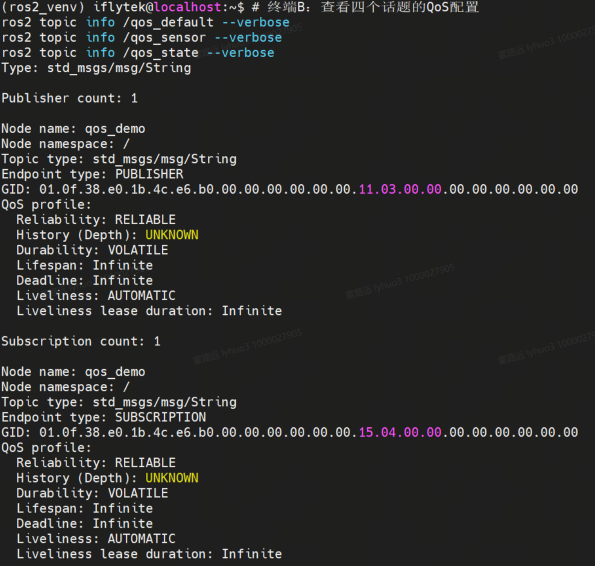

```
python3 -c "

import rclpy

from rclpy.node import Node

from rclpy.qos import QoSProfile, DurabilityPolicy, HistoryPolicy

from std_msgs.msg import String

rclpy.init()

node = Node('late_subscriber')

qos = QoSProfile(

    durability=DurabilityPolicy.TRANSIENT_LOCAL,
    
    history=HistoryPolicy.KEEP_LAST,
    
    depth=1

)

def cb(msg):

    print(f'Late subscriber 收到: {msg.data}')

node.create_subscription(String, '/qos_state', cb, qos)

rclpy.spin_once(node, timeout_sec=3)

node.destroy_node()

rclpy.shutdown()

"
```

```bash
# 观察：如果 TRANSIENT_LOCAL 生效，晚到的订阅者应收到最新一条 /qos_state 消息
```

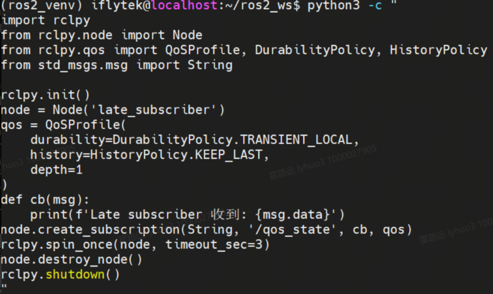

收到的最后消息

**易错点**：

- ⚠️ **发布者和订阅者的QoS不匹配导致无法通信** → 解决：ROS2采用"兼容性检查"——Reliability和Durability策略必须兼容（订阅者的Reliability不能高于发布者）。检查`ros2 topic info --verbose`的输出
- ⚠️ **TRANSIENT_LOCAL未生效** → 解决：必须发布者和订阅者**同时**将Durability设为TRANSIENT_LOCAL，且发布者需要在订阅者加入前已发布过消息并仍在运行（或至少DataWriter未销毁）

---

#### 步骤5：DDS工具观察与验证

**操作步骤**：

```bash
# 安装Fast-DDS工具（用于底层观察）
sudo apt install ros-humble-rmw-fastrtps-cpp

# 运行qos_demo节点
python3 qos_demo.py &

# 使用ros2 daemon查看DDS通信状态
ros2 daemon status
# 预期: 显示daemon PID和运行状态

# 查看QoS兼容性
ros2 topic info /qos_sensor --verbose
# 重点关注: "QoS Compatibility: compatible" 或 "incompatible"

# 观察节点GUID（对应DDS GUID）
ros2 node info /qos_demo
# 在输出中查找 "Node GUID"

# 使用Python验证不同QoS策略的行为：
python3 -c "
import rclpy
from rclpy.qos import qos_profile_sensor_data
rclpy.init()
print('传感器数据QoS Profile:')
print(f'  Reliability: {qos_profile_sensor_data.reliability.name}')
print(f'  Durability: {qos_profile_sensor_data.durability.name}')
print(f'  Depth: {qos_profile_sensor_data.depth}')
rclpy.shutdown()
"

kill %1 2>/dev/null
```

### 七、注意事项

| **⚠️ 类别** | **注意事项说明** |
|---|---|
| **RMW 切换​** | **不同 RMW 实现的节点（如 FastDDS ↔ CycloneDDS）在同一个 ROS_DOMAIN_ID 下不能跨实现通信。所有节点必须使用同一 RMW，可通过 echo $RMW_IMPLEMENTATION 确认当前实现。** |
| **QoS 兼容性​** | **发布者和订阅者的 QoS Profile 必须兼容，否则 DDS 发现后会标记为 Incompatible，无法建立连接。可用 ros2 topic info --verbose 检查是否匹配成功。** |
| **TRANSIENT_LOCAL​** | **仅当发布者仍然存活时，后加入的订阅者才能收到历史消息；一旦发布者退出，其 History Cache 被销毁，TRANSIENT_LOCAL 立即失效。** |
| **BEST_EFFORT​** | **在局域网有线环境下，BEST_EFFORT 几乎不会丢包。要观察丢包行为，可用 tc 限带宽，或将发布频率设得极高（>1000 Hz）进行压力测试。** |
| **KEEP_LAST 深度​** | **depth 过大时会显著增加内存占用，尤其是点云、图像等大消息。建议：<br>depth ≈ 消息频率 × 期望缓存时长（秒）** |
| **DDS 端口 / 多播​** | **DDS 使用多播（SPDP / SEDP）进行节点发现。在 Docker、虚拟机、云环境中，需确保多播功能已启用，否则节点间可能无法互相发现。** |

### 八、实验总结

#### 8.1 完成成果

完成本实验后，你应当能够：

- ✅ 用自己的语言画出ROS2的RMW架构层次图，解释`rcl → rmw → DDS`三层关系
- ✅ 通过`RMW_IMPLEMENTATION`环境变量在不同DDS实现之间切换
- ✅ 解释RTPS协议中Participant→Endpoint→Writer/Reader的层次结构与功能分工
- ✅ 描述DDS自动发现的两阶段过程（SPDP参与者发现→SEDP端点发现）
- ✅ 为不同应用场景选择合适的QoS策略组合并编写代码验证行为差异

#### 8.2 技能收获

| **技能** | **说明** |
|---|---|
| **RMW架构理解** | **掌握ROS2中间件抽象层的设计原理与可替换性机制** |
| **DDS发现机制** | **理解SPDP+SEDP两阶段发现过程，能解释"零配置通信"的底层实现** |
| **QoS配置** | **能根据业务需求（可靠性/延迟/历史数据）选择并配置合理的QoS策略** |
| **性能诊断** | **能使用**`ros2 topic info --verbose`**和**`ros2 topic delay`**诊断QoS配置问题** |
| **多DDS切换** | **能正确安装并切换DDS实现，理解切换的限制条件** |

#### 8.3 常见问题与解答

| **问题** | **原因** | **解决方法** |
|---|---|---|
| **节点间无法通信** | **RMW实现不统一** | **确保所有终端**`echo $RMW_IMPLEMENTATION`**输出一致** |
| **QoS不兼容导致无消息** | **发布者RELIABLE vs 订阅者BEST_EFFORT** | **订阅者的Reliability不能高于发布者；降低订阅者要求或提高发布者保障** |
| **后启动的订阅者收不到TRANSIENT_LOCAL消息** | **发布者已退出，HistoryCache已销毁** | **发布者需在订阅者加入时仍在运行** |
| `ros2 topic info --verbose`** 报 "Node not found"** | **节点未运行或名称错误** | **用**`ros2 node list`**确认节点名称** |
| **切换DDS后节点启动失败** | **对应的rmw包未安装** | `sudo apt install ros-humble-rmw-cyclonedds-cpp`** 安装所需实现** |

### 九、实验报告要求

#### 9.1 报告内容

完成实验后，提交一份实验报告，包含以下内容：

1. **实验基本信息**：实验名称、实验日期、实验者姓名、实验平台信息
2. **实验过程记录**：截取四种QoS话题的`ros2 topic info --verbose`输出，标注各QoS策略字段的差异；截取TRANSIENT_LOCAL验证实验的输出
3. **原理分析**（不少于300字）：用自己的语言描述ROS2 RMW层的设计意图和工程价值，结合DDS发现机制和QoS策略，解释ROS2如何实现"零配置、可伸缩、可调优"的分布式通信
4. **思考题**（见下方）

#### 9.2 思考题

**思考题 1**：

在ROS2中，默认的QoS Profile是`RELIABLE + VOLATILE + KEEP_LAST(10)`。假设你要为一个机器人足球赛系统设计通信架构：有8个机器人节点（每台小车一个），每个以100Hz发布自身位姿，同时订阅其他7台小车的位置。请为这个场景设计合理的QoS策略组合，并解释你的选择理由（考虑带宽、延迟、可靠性之间的权衡）。

**思考题 2**：

ROS2支持通过`RMW_IMPLEMENTATION`切换DDS实现，但不允许不同RMW实现的节点跨实现通信。请分析：为什么会出现这个限制？如果在同一个ROS_DOMAIN_ID下强制两种RMW实现的节点通信，需要在哪一层解决什么问题？

#### 9.3 评分标准

| **评分项** | **权重** | **评分标准** |
|---|---|---|
| **实验操作完整性** | **25%** | **是否完成四种QoS Profile的创建、发布、验证，以及TRANSIENT_LOCAL实验** |
| **代码质量** | **20%** | **QoS配置代码是否正确，四种Profile的命名和用途是否清晰** |
| **原理分析** | **25%** | **对RMW层设计意图和DDS发现机制的理解深度** |
| **思考题 1** | **15%** | **QoS策略组合的合理性，是否考虑了带宽/延迟/可靠性权衡** |
| **思考题 2** | **15%** | **对RMW跨实现通信障碍的分析，是否识别到线协议层面的问题** |

## 实验13：ROS2分布式通讯

### 一、关联知识点

本实验关联以下知识图谱节点：

| 编号 | 知识点名称 | 类型 | 层级路径 |
|---|---|---|---|
| 3.3.1 | ROS_DOMAIN_ID隔离DDS通信域 | 概念 | 第3章 ROS2底层机制与分布式通信 → 3.3 分布式通信 |
| 3.3.2 | 多机同网段+同Domain ID跨设备通信流程 | 流程 | 第3章 ROS2底层机制与分布式通信 → 3.3 分布式通信 |
| 3.3.3 | ROS_DISCOVERY_SERVER中心化发现与DDS-Security加密 | 事实 | 第3章 ROS2底层机制与分布式通信 → 3.3 分布式通信 |

### 二、实验目标

通过本实验的学习，学生能够：

1. **原理理解**：阐述 ROS_DOMAIN_ID 在 DDS 通信域隔离中的作用机制——为什么设置不同的 DOMAIN_ID 可以实现同一物理网络上的逻辑隔离，以及这与 VLAN 等网络隔离技术的本质区别
2. **流程掌握**：正确配置两台设备（或同一设备上两组终端）的 ROS_DOMAIN_ID、网络连通性，完成跨设备的节点发现与话题/服务通信全流程验证
3. **独立完成**：独立部署 ROS_DISCOVERY_SERVER 实现中心化节点发现，并通过 `ros2 daemon` 和 `fastdds discovery` 工具监控 DDS 参与者和端点状态
4. **迁移应用**：能够在多机器人协作场景中，合理规划 DOMAIN_ID 分配策略——例如将每台机器人分配独立 DOMAIN_ID 避免干扰，同时在监控节点使用 DISCOVERY_SERVER 实现跨域桥接

### 三、实验环境

| 类别 | 配置 |
|---|---|
| 硬件平台 | 具身智能实验箱B2 |
| 操作系统 | Ubuntu 22.04 |
| ROS2 发行版 | Humble Hawksbill |
| DDS 实现 | Fast-DDS（默认）或 CycloneDDS（通过 `RMW_IMPLEMENTATION` 切换） |
| 核心依赖 | `ros-humble-ros-base`、`ros-humble-demo-nodes-cpp`、`ros-humble-rmw-fastrtps-cpp` |
| 网络要求 | 设备间需在同一局域网（同一网段，如 192.168.1.0/24），或单机多终端模拟 |

> 说明：本实验若无两台物理设备，可在单台 B2 实验箱上通过多终端 + 不同 DOMAIN_ID 模拟分布式通信。ROS_DISCOVERY_SERVER 和 DDS-Security 部分可在单机上完整验证。

### 四、实验难度

| 维度 | 说明 |
|---|---|
| 难度等级 | ⭐⭐（中等） |
| 实验类型 | 设计性 |
| 建议时长 | 2 学时（90 分钟） |

**重点**：

- 掌握 ROS_DOMAIN_ID 的通信域隔离机制及其在多机器人场景中的工程价值
- 能够配置并验证局域网内跨设备的节点通信链路

**难点**：

- 理解 DDS 自动发现的多播机制与 DISCOVERY_SERVER 单播模式的适用场景差异
- DDS-Security 的 governance/passwords/permissions 三层策略文件的编写与调试

### 五、实验现象

#### 5.1 快速验证流程

完成本实验后，你应能观察到以下现象：

1. 在终端 A 设置 `export ROS_DOMAIN_ID=5` 并启动 talker，终端 B 设置 `export ROS_DOMAIN_ID=5` 并启动 listener，listener 正常接收消息
2. 在终端 C 设置 `export ROS_DOMAIN_ID=10` 并执行 `ros2 topic echo /chatter`，无法看到终端 A 发布的数据——不同 DOMAIN_ID 完全隔离
3. 启动 DISCOVERY_SERVER 后，配置两个节点的 `ROS_DISCOVERY_SERVER` 环境变量指向该服务器，即使关闭多播也能正常通信
4. 通过 `fastdds discovery -i 0` 查看当前 Domain 中活跃的 DDS Participant 及其 Endpoint（Writer/Reader）列表

#### 5.2 预期效果描述

| 操作 | 预期现象 |
|---|---|
| 终端A `export ROS_DOMAIN_ID=5` + talker，终端B `export ROS_DOMAIN_ID=5` + listener | listener 收到 "Hello World: N" 消息 |
| 终端C `export ROS_DOMAIN_ID=10` + `ros2 topic echo /chatter` | 无任何输出（Domain 隔离成功） |
| 启动 `fastdds discovery --server-id 0` | 终端输出 Discovery Server 已启动，监听端口 11811 |
| 设置 `ROS_DISCOVERY_SERVER=127.0.0.1:11811` 后启动 talker/listener | 通信正常，且 discovery server 终端显示客户端连接日志 |
| `fastdds discovery -i 0`（另一终端） | 列出所有 Participant GUID、Endpoint 类型（Writer/Reader）及话题名称 |

---

### 六、实验步骤

#### 整体流程

```text
[1. DOMAIN_ID 隔离验证] ──► [2. 多机通信配置] ──► [3. DISCOVERY_SERVER 部署]
         │                                                    │
         └────────────────────────────────────────────────────┘
                                                              │
[5. 清理与总结] ◄────────────────────────────── [4. DDS-Security 加密（选做）]
```

---

#### 步骤 1：ROS_DOMAIN_ID 通信域隔离验证（25 分钟）

**知识点讲解**：

**ROS_DOMAIN_ID 通信域隔离机制（知识点 3.3.1）**

- **是什么**：ROS_DOMAIN_ID 是一个范围在 0 至 232 之间的无符号整数，用于在 DDS 层面隔离不同 ROS2 通信域。同一局域网内，只有设置相同 DOMAIN_ID 的节点才能通过 DDS 自动发现机制互相发现和通信。它是 ROS2 替代 ROS1 Master 隔离场景的核心机制——在 ROS1 中，你需要通过 `ROS_MASTER_URI` 变量分别指向不同的 roscore 来实现隔离；在 ROS2 中，只需改变一个整数即可。
- **为什么需要**：在多机器人协作场景中，这是最简洁的通信隔离手段。例如：3 台 B2 实验箱同时在同一教室做实验，如果它们都使用默认 DOMAIN_ID=0，三台机器的节点会通过 DDS 多播互相发现，导致话题数据混乱。为每台实验箱设置独立的 DOMAIN_ID（如 1、2、3），即可实现物理共用网络、逻辑互相隔离，且无需任何路由器或防火墙配置。
- **怎么用**：通过环境变量 `export ROS_DOMAIN_ID=N` 设置，或在终端启动命令前添加 `ROS_DOMAIN_ID=N ros2 run ...`。该变量影响 DDS 的 Participant 创建时的 Domain ID 参数——DDS 标准规定，不同 Domain ID 的 Participant 使用不同的多播地址和端口号计算方式，因此在物理层面就实现了数据隔离。
- **底层原理补充**：Fast-DDS 默认使用 Domain ID 来计算多播地址：`239.255.0.N`，端口号为 `7400 + N * 250`。这意味着不同 DOMAIN_ID 不仅在逻辑上隔离，在传输层也使用了不同的多播组和端口，彻底避免了数据串扰。

**操作步骤**：

```bash
# 1.1 验证默认 DOMAIN_ID 的行为（终端 A）
echo $ROS_DOMAIN_ID
# 如果未设置则输出为空，等价于默认值 0

# 启动 talker
ros2 run demo_nodes_cpp talker
# 保持运行

# 1.2 验证同 DOMAIN_ID 通信（终端 B）
export ROS_DOMAIN_ID=0
ros2 run demo_nodes_cpp listener
# 预期: 正常接收到 "Hello World: N" 消息
# 按 Ctrl+C 终止 listener

# 1.3 验证不同 DOMAIN_ID 隔离效果（终端 B）
export ROS_DOMAIN_ID=5
# 尝试用 topic echo 监听（Domain 5 中）
ros2 topic echo /chatter
# 预期: 无任何输出！因为 talker 在 Domain 0，listener 在 Domain 5
# 等待 5 秒确认无输出后 Ctrl+C 终止

# 1.4 将 talker 也切换到 Domain 5（终端 C）
export ROS_DOMAIN_ID=5
ros2 run demo_nodes_cpp talker
# 保持运行

# 1.5 重新验证 Domain 5 内通信（终端 B）
export ROS_DOMAIN_ID=5
ros2 topic echo /chatter
# 预期: 正常输出 "Hello World: N"（来自 Domain 5 的 talker）
# Ctrl+C 终止
```

**验证分析**：

- 步骤 1.2：Domain 0 的 listener 能收到 Domain 0 的 talker 消息——同域通信正常
- 步骤 1.3：Domain 5 的 `topic echo` 收不到 Domain 0 的 talker——不同域完全隔离
- 步骤 1.5：Domain 5 的 `topic echo` 能收到 Domain 5 的 talker——新域内通信也正常
- 通过以上三步，可以清晰观察到 DOMAIN_ID 的隔离与连通逻辑。

**易错点**：

- ⚠️ **DOMAIN_ID 不生效（仍能收到其他域的消息）**：如果发现设置了 `ROS_DOMAIN_ID=5` 仍能收到 Default Domain 的消息，原因通常是 Shell 会话中之前的 `source /opt/ros/humble/setup.bash` 已固化环境变量。解决方法：关闭所有终端后重新打开，或使用 `env ROS_DOMAIN_ID=5 ros2 topic echo /chatter` 确保变量仅在当前命令生效。

---

#### 步骤 2：多机通信配置与验证

**知识点讲解**：

**ROS2 多机分布式通信前提条件（知识点 3.3.2）**

- **是什么**：ROS2 的多机通信不需要任何中心节点（无 Master），不需要配置文件——只需要满足三个条件：(1) 设备在同一局域网网段，(2) 设备设置相同的 ROS_DOMAIN_ID，(3) 网络多播功能不被路由器/防火墙拦截。这就是 DDS 去中心化设计的直接优势。
- **为什么这样工作**：DDS 的 SPDP（Simple Participant Discovery Protocol）通过多播（multicast）在局域网内广播每个 Participant 的存在信息。同一网段内所有启用 DDS 的节点都会收到这些多播消息，从而自动建立 Participant 之间的通信链路。SEDP（Simple Endpoint Discovery Protocol）随后在已发现的 Participant 之间交换各自的 Writer/Reader 信息，最终建立话题级别的 Publisher-Subscriber 连接。
- **怎么验证**：在两台设备上分别启动不同节点，使用 `ros2 node list` 查看是否能看到对端的节点名称。如果两台设备都在同一 DOMAIN_ID，且网络通畅，`ros2 node list` 会列出所有设备上的节点——就像一个逻辑上的单一系统。

**操作步骤**：

```bash
# === 准备工作（在设备 A 和设备 B 上分别执行）===

# 2.1 确认两台设备的 IP 地址
# 设备 A（实验箱 B2 #1）
ip addr show | grep "inet "
# 记录 IPv4 地址，例如: 192.168.1.101

# 设备 B（实验箱 B2 #2）
ip addr show | grep "inet "
# 记录 IPv4 地址，例如: 192.168.1.102

# 2.2 验证网络互通
# 在设备 A 上 ping 设备 B
ping -c 3 192.168.1.102
# 预期: 3 packets transmitted, 3 received, 0% packet loss

# 2.3 设置相同的 DOMAIN_ID（两台设备均执行）
export ROS_DOMAIN_ID=42  # 使用非默认值避免与其他设备冲突

# 2.4 检查 DDS 多播是否可用
# Fast-DDS 默认使用多播，检查网卡多播支持
ip link show | grep MULTICAST
# 预期: 输出中包含 MULTICAST 字样

# === 跨设备通信验证 ===

# 2.5 设备 A：启动 talker
ros2 run demo_nodes_cpp talker

# 2.6 设备 B：查看是否能发现设备 A 的节点
ros2 node list
# 预期输出: /talker（来自设备 A！）

# 2.7 设备 B：订阅设备 A 的话题
ros2 topic echo /chatter
# 预期输出: "Hello World: N"（消息来自设备 A 的 talker）

# 2.8 设备 B：作为验证，也可启动 listener
ros2 run demo_nodes_cpp listener
# 设备 A 的终端: 观察是否有任何变化（listener 是订阅者，不产生反馈到 talker，但设备 A 上 ros2 node list 会显示 /listener）
```

**关键验证点**：

在设备 A 上执行：

```bash
# 查看节点列表——应看到设备 B 上的 /listener

ros2 node list

# 预期: /talker, /listener（两个节点分别在不同设备上！）
```

在设备 B 上执行：

```bash
# 查看 /talker 节点的详细信息——应包含完整的拓扑信息

ros2 node info /talker

# 预期: 显示 Publishers: /chatter [std_msgs/msg/String]，即使 /talker 运行在另一台设备上
```

**易错点**：

- ⚠️ **跨设备 `ros2 node list` 看不到对端节点**：按以下顺序排查：
  - 两台设备的 DOMAIN_ID 是否相同 —— `echo $ROS_DOMAIN_ID`
  - 两台设备是否能互相 ping 通 —— `ping <对方IP>`
  - 防火墙是否拦截了多播 —— `sudo ufw status`，如有必要执行 `sudo ufw disable`（实验环境临时关闭）
  - DDS 实现差异 —— 尝试在两台设备上都设置 `export RMW_IMPLEMENTATION=rmw_cyclonedds_cpp` 使用 CycloneDDS（对多播的兼容性更好）
- ⚠️ **虚拟机中多播不可用**：如果 B2 实验箱运行在虚拟机中，确保网络适配器模式为"桥接模式"（Bridge），NAT 模式下多播通常不可用。

#### 单机模拟多机通信（无两台设备时的替代方案）

如果只有一台 B2 实验箱，可通过多终端在不同 DOMAIN_ID 之间切换来模拟分布式通信的核心概念：

```bash
# 终端 A（模拟设备 A，Domain 42）

export ROS_DOMAIN_ID=42

ros2 run demo_nodes_cpp talker

# 保持运行

# 终端 B（模拟设备 B，也设置 Domain 42）

export ROS_DOMAIN_ID=42

ros2 node list        # 应能看到 /talker

ros2 topic echo /chatter  # 应能收到消息

# 终端 C（模拟其他设备，Domain 99——验证隔离）

export ROS_DOMAIN_ID=99

ros2 node list        # 预期: 空（看不到 Domain 42 的节点）

ros2 topic echo /chatter  # 预期: 无输出
```

---

#### 步骤 3：ROS_DISCOVERY_SERVER 中心化节点发现（25 分钟）

**知识点讲解**：

**ROS_DISCOVERY_SERVER 中心化发现机制（知识点 3.3.3）**

- **是什么**：ROS_DISCOVERY_SERVER（发现服务器）是 Fast-DDS 提供的中心化节点发现替代方案。默认情况下，DDS 使用多播（每个 Participant 向 `239.255.0.N` 多播地址发送 SPDP 消息）实现自动发现——这在局域网中工作良好，但在云环境、跨子网、或大规模部署（上百个节点）场景中，多播风暴会导致网络拥塞。DISCOVERY_SERVER 将所有节点的发现信息集中到一个（或几个）服务器上，节点通过 TCP/UDP 单播向服务器注册和查询，替代多播发现。

**为什么需要两种模式**：

  - **多播模式（默认）**：适合 < 50 个节点的小型局域网部署，配置简单（零配置），但跨子网困难，多播流量随节点数量平方级增长
  - **DISCOVERY_SERVER 模式**：适合大型部署（50-500 节点）、跨子网通信、云原生场景。服务器作为中间人，节点间仍需建立直接的 P2P 连接（与 DDS 架构一致），但发现过程无需多播
  - **选择建议**：B2 实验箱的典型实验场景（单机或双机）使用默认多播即可。当需要演示跨 VLAN 通信或"生产级部署"概念时，切换到 DISCOVERY_SERVER 模式
- **怎么配置**：Fast-DDS 提供 `fastdds discovery` 命令行工具来启动发现服务器。节点通过设置 `ROS_DISCOVERY_SERVER` 环境变量指定服务器地址（格式：`host:port`），取代默认的多播发现。
- **操作步骤**

```bash
# 3.1 启动 DISCOVERY_SERVER（终端 A，作为"中心服务器"）
```

fastdds discovery --server-id 0 --ip-address 127.0.0.1 --port 11811

```bash
# 预期输出:

# [Discovery Server] Server started with GUID: ...

# Listening on: 127.0.0.1:11811

# 保持此终端运行

# 3.2 配置客户端环境变量（终端 B 和终端 C 均需执行）

export ROS_DISCOVERY_SERVER=127.0.0.1:11811

# 可同时设置 DOMAIN_ID（DISCOVERY_SERVER 本身也受 DOMAIN_ID 约束）

export ROS_DOMAIN_ID=0

# 3.3 终端 B：启动 talker，指定使用发现服务器

export ROS_DISCOVERY_SERVER=127.0.0.1:11811

export ROS_DOMAIN_ID=0

ros2 run demo_nodes_cpp talker

# 预期: talker 正常启动

# 观察终端 A 的 DISCOVERY_SERVER 输出——应显示新的 Participant 连接日志

# 保持运行

# 3.4 终端 C：启动 listener（同样连接到发现服务器）

export ROS_DISCOVERY_SERVER=127.0.0.1:11811

export ROS_DOMAIN_ID=0

ros2 run demo_nodes_cpp listener

# 预期: listener 正常接收到 "Hello World: N" 消息

# 通信成功——两个节点通过 DISCOVERY_SERVER 发现了彼此

# 3.5 监控 DDS 参与者状态（终端 D，或使用 fastdds 工具）
```

fastdds discovery -i 0

```bash
# 预期输出: 列出所有活跃的 Participant GUID 及其 Endpoint

# 示例输出（简化）:

# Participant 01.0f.xx.xx.xx

#   Endpoint 01.0f.xx.xx.xx.xx.xx|0.0.1.4 (Writer, /chatter, std_msgs/msg/String)

#   Endpoint 01.0f.xx.xx.xx.xx.xx|0.0.2.4 (Reader, /chatter, std_msgs/msg/String)

# ...
```

**验证分析**：

在终端 C 上执行 `ros2 node list`，应该能看到 `/talker`，即使没有使用多播。这验证了 DISCOVERY_SERVER 作为替代发现机制的有效性。

**易错点**：

- ⚠️ `fastdds discovery` 命令不存在**：确保安装了 Fast-DDS 工具包 —— `sudo apt install ros-humble-rmw-fastrtps-cpp`，该包内包含 `fastdds` CLI 工具
- ⚠️ **节点启动后仍然互相不可见**：检查 `ROS_DISCOVERY_SERVER` 变量是否在所有终端中正确设置。可以用 `echo $ROS_DISCOVERY_SERVER` 确认。注意设置后**必须**在同一个终端会话中启动节点，因为环境变量是 per-process 的
- ⚠️ **单机多终端使用 `127.0.0.1`** 可正常工作；跨设备部署需使用服务器设备的实际 IP**

---

#### 步骤 4：DDS-Security 加密通信（选做，15 分钟）

**知识点讲解**：

**DDS-Security 加密通信机制（知识点 3.3.3 扩展）**

- **是什么**：DDS-Security 是 OMG（Object Management Group）定义的安全规范，为 DDS 通信提供认证（Authentication）、访问控制（Access Control）、加密（Encryption）和数据完整性（Data Integrity）四个维度的安全保障。SROS2（Secure ROS2）是 ROS2 团队在 DDS-Security 基础上的官方安全集成方案。
- **为什么需要**：在默认配置下，同一 DOMAIN_ID 内的任何节点都可以：(1) 发现你的节点，(2) 订阅你的话题并读取消息，(3) 向你的话题发布伪造数据，(4) 调用你的服务。这在以下场景中是严重的安全威胁：
  - 机器人部署在公共网络（如校园 WiFi）
  - 同一网络中有非项目人员运行的 ROS2 程序
  - 敏感传感器数据（如工厂产线视觉检测）不应被第三方窃听
- **怎么启用**：SROS2 通过 `sros2` 命令行工具生成三组密钥文件：(1) governance.xml —— 定义全局安全策略（是否强制加密），(2) permissions.xml —— 定义每个节点的详细权限（允许发布/订阅哪些话题），(3) passwords/ —— 各节点的身份密钥。启用安全的环境变量：`export ROS_SECURITY_ENABLE=true` + `export ROS_SECURITY_STRATEGY=Enforce`。

**操作步骤**：

```bash
# 4.1 安装 SROS2 工具
sudo apt install ros-humble-sros2 ros-humble-sros2-cmake

# 4.2 创建安全密钥目录
mkdir -p ~/ros2_security
cd ~/ros2_security

# 4.3 生成默认安全策略文件
sros2 security_generate_artifacts \
  -p /opt/ros/humble/share/demo_nodes_cpp \
  -k keystore \
  -n /talker
# 预期: 在 keystore/ 目录下生成 governance.xml、permissions.xml 等密钥文件

sros2 security_generate_artifacts \
  -p /opt/ros/humble/share/demo_nodes_cpp \
  -k keystore \
  -n /listener

# 4.4 启用安全通信环境变量（终端 A — talker）
export ROS_SECURITY_ENABLE=true
export ROS_SECURITY_STRATEGY=Enforce
export ROS_SECURITY_KEYSTORE=~/ros2_security/keystore
export ROS_SECURITY_ENCLAVE_OVERRIDE=/talker

ros2 run demo_nodes_cpp talker
# 预期: talker 正常启动，但通信链路已加密

# 4.5 终端 B — listener（同样启用安全）
export ROS_SECURITY_ENABLE=true
export ROS_SECURITY_STRATEGY=Enforce
export ROS_SECURITY_KEYSTORE=~/ros2_security/keystore
export ROS_SECURITY_ENCLAVE_OVERRIDE=/listener

ros2 run demo_nodes_cpp listener
# 预期: listener 正常接收到加密通信的消息

# 4.6 验证安全隔离——未设置安全环境的终端无法窃听
# 终端 C（不设置任何安全环境变量）
ros2 topic echo /chatter
# 预期: 无法输出消息（DDS-Security 阻止了未授权订阅者的访问）
```

**易错点**：

- ⚠️ **启用 SROS2 后节点无法通信**：最常见的原因是 `ROS_SECURITY_ENCLAVE_OVERRIDE` 值与生成的 keys 不匹配。使用 `ls ~/ros2_security/keystore/enclaves/` 确认生成的 enclave 名称
- ⚠️ **SROS2 会增加 CPU 开销**：加密/解密操作对性能有影响（尤其是高频率话题），在 B2 实验箱的 RK3576 上，加密开销约为 5-15% CPU。评估是否启用加密需权衡安全需求与性能预算

---

#### 步骤 5：实验收尾与总结（5 分钟）

1. 在所有终端按 `Ctrl+C` 终止 talker/listener 和 DISCOVERY_SERVER
2. 清除非默认环境变量：`unset ROS_DOMAIN_ID ROS_DISCOVERY_SERVER ROS_SECURITY_ENABLE`
3. 执行 `ros2 node list` 确认无残留节点

### 七、注意事项

| 类别 | 注意事项 |
|---|---|
| ⚠️ 环境 | DOMAIN_ID 和 DISCOVERY_SERVER 等环境变量仅在当前终端会话有效；新开终端需重新 `export` |
| ⚠️ 网络 | 多机分布式通信依赖局域网多播功能；虚拟机用户需将网络适配器设为"桥接模式" |
| ⚠️ 安全 | DDS-Security 密钥文件包含私钥，严禁提交到 Git 仓库或分享到公共网络 |
| ⚠️ 性能 | DISCOVERY_SERVER 本身是单点——在生产环境中通常部署 2-3 个冗余服务器；实验环境中单服务器即可 |
| ⚠️ 防火墙 | 如果跨设备通信失败，检查 `sudo ufw status`，实验期间可临时 `sudo ufw disable` |
| ⚠️ 干扰 | 同一教室中多组学生同时实验时，务必为每组分配不同的 DOMAIN_ID，避免互相干扰 |

### 八、实验总结

#### 8.1 完成成果

完成本实验后，你应当能够：

- ✅ 使用 `ROS_DOMAIN_ID` 在单机上实现多组 ROS2 系统的逻辑隔离
- ✅ 配置两台设备的网络和 DOMAIN_ID 参数，实现局域网内的跨设备节点通信
- ✅ 部署 `fastdds discovery --server-id` 作为中心化发现服务器，替代默认多播发现
- ✅ （选做）使用 SROS2 为 ROS2 通信添加认证和加密

#### 8.2 技能收获

| 技能 | 说明 |
|---|---|
| 通信域管理 | 理解 ROS_DOMAIN_ID 的 DDS 层隔离机制，能规划多机器人场景的域分配策略 |
| 分布式部署 | 掌握多机通信的前提条件（同网段+同Domain+多播可用）与故障排查流程 |
| 发现机制 | 理解多播发现与 DISCOVERY_SERVER 的适用场景差异，能根据部署规模选择合适方案 |
| 安全通信 | 了解 DDS-Security 的四层安全模型，能使用 SROS2 工具集生成密钥并启用加密 |

#### 8.3 常见问题与解答

| 问题 | 原因 | 解决方法 |
|---|---|---|
| 跨设备 `ros2 node list` 看不到对端节点 | 网络多播被防火墙拦截或 DOMAIN_ID 不一致 | (1) 检查 `echo $ROS_DOMAIN_ID` 确保一致；(2) `sudo ufw disable`；(3) 尝试 CycloneDDS |
| 设置了 `ROS_DOMAIN_ID=5` 但仍然收到 Domain 0 的消息 | 其他终端未设置 DOMAIN_ID，继承了默认值 0 | 所有终端统一设置 DOMAIN_ID，或在启动命令前加前缀 `ROS_DOMAIN_ID=N ros2 run ...` |
| `fastdds discovery` 报 "command not found" | Fast-DDS 工具未安装 | `sudo apt install ros-humble-rmw-fastrtps-cpp` |
| SROS2 环境的 talker/listener 无法通信 | 密钥文件未正确生成或 enclave 名称不匹配 | 重新执行 `sros2 security_generate_artifacts`，确保 `-n` 参数与 enclave override 一致 |
| 多播模式下网络延迟高 | 网络中多播流量过大（多组学生同时实验） | 切换到 DISCOVERY_SERVER 模式，或各自使用不同的 DOMAIN_ID |

### 九、实验报告要求

#### 9.1 报告内容

完成实验后，提交一份实验报告，包含以下内容：

1. **实验基本信息**：实验名称、实验日期、实验者姓名、实验平台信息（设备 IP、DOMAIN_ID 配置）
2. **实验过程记录**：截取步骤 1（DOMAIN_ID 隔离）、步骤 2（多机通信）、步骤 3（DISCOVERY_SERVER）的关键输出截图（至少 6 张），每张下方标注功能说明
3. **网络拓扑图**：绘制本实验中的节点拓扑图，标注各节点所在的设备、IP、DOMAIN_ID、以及通信关系
4. **原理分析**（不少于 300 字）：对比 ROS1（Master+ROS_MASTER_URI）与 ROS2（DOMAIN_ID+DDS 发现）在分布式多机通信方面的架构差异，至少覆盖"节点发现""单点故障""配置复杂度""网络依赖"四个维度
5. **思考题**（见下方）

#### 9.2 思考题

**思考题 1**：

在步骤 1 中，你观察到不同 DOMAIN_ID 的节点虽然在同一台设备上运行，却完全无法互相发现。请从 DDS 底层解释为什么会这样——具体来说，DDS 如何利用 DOMAIN_ID 值来确定多播地址和端口号？如果你需要在两个 DOMAIN_ID 之间实现"桥接"（让 Domain 1 的节点能选择性接收 Domain 2 某些话题的数据），你会如何设计？

**思考题 2**：

假设你的机器人需要在两种场景中工作：(1) 实验室调试——与开发笔记本电脑通信，频繁变更 DOMAIN_ID；(2) 真实部署——在一间有 20 台机器人的工厂中，每台需独立运行不受其他机器人干扰，但中央监控节点需要能订阅所有机器人的 `/robot_status` 话题。请为这两种场景分别设计 DOMAIN_ID 分配策略和网络拓扑方案，并说明你选择该方案的理由。

#### 9.3 评分标准

| 评分项 | 权重 | 评分标准 |
|---|---|---|
| 实验操作完整性 | 30% | 是否按要求完成 DOMAIN_ID 隔离、多机/DISCOVERY_SERVER 通信验证 |
| 截图与网络拓扑图 | 15% | 截图是否清晰（≥6 张），拓扑图是否准确标注设备、IP、Domain 和通信关系 |
| 原理分析 | 25% | 对 ROS1 Master vs ROS2 DDS 分布式架构的对比分析深度 |
| 思考题 1 | 15% | 对 DDS 多播地址计算原理的理解，桥接方案的创新性 |
| 思考题 2 | 15% | 场景化方案设计的合理性与可实现性 |

## 实验14：ROS2 Rqt工具箱

### 一、关联知识点

本实验关联以下知识图谱节点：

| 编号 | 知识点名称 | 类型 | 层级路径 |
|---|---|---|---|
| 4.1.1 | Rqt基于Qt的插件化调试工具集概念 | 概念 | 第4章 ROS2工具链与系统部署 → 4.1 Rqt调试工具箱 |
| 4.1.2 | rqt_graph节点拓扑和rqt_plot数据曲线绘制流程 | 流程 | 第4章 ROS2工具链与系统部署 → 4.1 Rqt调试工具箱 |
| 4.1.3 | rqt_console日志过滤和rqt_reconfigure动态调参流程 | 流程 | 第4章 ROS2工具链与系统部署 → 4.1 Rqt调试工具箱 |

### 二、实验目标

通过本实验的学习，学生能够：

1. **原理理解**：阐述 Rqt 基于 Qt 插件框架（Qt Plugin System）的设计原理——为什么 ROS2 选择将多个调试工具整合为可组合面板架构，以及这种架构相比传统"独立工具窗口"模式在机器人开发中的效率优势
2. **流程掌握**：熟练使用 rqt_graph 绘制节点-话题-服务拓扑图进行通信链路诊断，使用 rqt_plot 实时绘制任意话题字段的数值曲线来观察传感器数据的时序变化趋势
3. **独立完成**：独立使用 rqt_console 按 DEBUG/INFO/WARN/ERROR/FATAL 级别过滤日志快速定位问题节点，使用 rqt_reconfigure 连接目标节点实现运行时不重启调参
4. **迁移应用**：能够在后续实验（如 exp16 的 bag 回放分析）中，将 rqt_plot 和 rqt_graph 作为标准调试流程的一部分——先看图定位拓扑异常，再看曲线确认数值趋势

### 三、实验环境

| 类别 | 配置 |
|---|---|
| 硬件平台 | 具身智能实验箱B2 |
| 操作系统 | Ubuntu 22.04 |
| ROS2 发行版 | Humble Hawksbill |
| 核心依赖 | `ros-humble-rqt-graph`、`ros-humble-rqt-plot`、`ros-humble-rqt-console`、`ros-humble-rqt-reconfigure`、`ros-humble-rqt-topic`、`ros-humble-rqt-bag` |
| 显示要求 | 需连接显示器（Rqt 是 GUI 工具），或通过 SSH X11 Forwarding 远程显示 |

> 说明：本实验为纯工具使用实验，重点在于熟悉每种 rqt 插件的操作界面和适用场景。需要连接网络通过 `sudo apt install ros-humble-rqt-*` 批量安装。

### 四、实验难度

| 维度 | 说明 |
|---|---|
| 难度等级 | ⭐（容易） |
| 实验类型 | 验证性 |
| 建议时长 | 2 学时（90 分钟） |

**重点**：

- 掌握 rqt_graph（拓扑可视化）、rqt_plot（数值曲线）、rqt_console（日志过滤）三大最常用插件的操作方法
- 理解 rqt_reconfigure 的动态参数调整机制对开发阶段快速调参的价值

**难点**：

- 在 rqt_graph 中区分"隐藏话题"（如 /parameter_events、/rosout）和"业务话题"（如 /chatter），理解为何存在大量系统级话题
- 理解 rqt_reconfigure 只有在节点代码中声明了 `add_on_set_parameters_callback` 后才能生效

### 五、实验现象

#### 5.1 快速验证流程

完成本实验后，你应能观察到以下现象：

1. 启动 rqt 主界面后，通过 Plugins 菜单加载 rqt_graph，看到当前运行系统的节点-话题拓扑图，节点以椭圆表示、话题以矩形表示
2. 在 rqt_plot 中键入 `/chatter/data` 话题路径后，界面实时滚动绘制 Hello World 字符串的序列号变化趋势
3. 在 rqt_console 中按 WARN 级别过滤后，仅显示 WARN 和 ERROR 级别日志，所有 INFO/DEBUG 被隐藏
4. 通过 rqt_reconfigure 连接 talker 节点后，可以看到参数列表并动态修改参数值

#### 5.2 预期效果描述

| 工具 | 预期界面特征 |
|---|---|
| rqt_graph | 显示 `/talker` 椭圆节点 → `/chatter` 矩形话题 → `/listener` 椭圆节点，箭头表示数据流向 |
| rqt_plot | 坐标轴自动缩放，曲线实时滚动，显示话题字段的数值变化 |
| rqt_console | 表格形式显示时间戳、节点名、日志级别、消息内容；支持按级别和关键词过滤 |
| rqt_reconfigure | 左侧参数树、右侧参数编辑区，修改后即时生效 |
| rqt_topic | 话题列表 + 消息字段监控面板，打勾即可开始监控 |
| rqt_bag | 加载 .db3 文件后，可选择话题和时间范围进行可视化回放 |

---

### 六、实验步骤

#### 整体流程

```text
[1. 启动被测节点] ──► [2. rqt_graph 拓扑分析] ──► [3. rqt_plot 数据曲线]
                                                          │
[6. rqt_topic + rqt_bag] ◄── [5. rqt_reconfigure] ◄── [4. rqt_console 日志]
```

---

#### 步骤 1：搭建被测系统环境

**知识点讲解**：

rqt 是"观察者"而非"执行者"——它需要运行中的 ROS2 节点作为观测和分析目标。本步骤搭建一个包含话题通信、参数系统和服务接口的被测系统，为后续六个工具的练习提供丰富的观测对象。

**操作步骤**：

```bash
# 终端 A：启动 talker 作为数据发布源
ros2 run demo_nodes_cpp talker

# 终端 B：启动 listener 作为数据订阅端
ros2 run demo_nodes_cpp listener

# 终端 C（可选，丰富拓扑结构）：启动 add_two_ints 服务端
ros2 run demo_nodes_cpp add_two_ints_server

# 终端 D（可选）：启动参数服务示例节点
ros2 run demo_nodes_cpp parameter_blackboard
保持所有终端运行，后续操作在 rqt 界面中进行。
```

---

#### 步骤 2：rqt_graph — 节点拓扑关系可视化

**知识点讲解**：

**rqt_graph 节点-话题拓扑可视化（知识点 4.1.2）**

- **是什么**：rqt_graph 是 ROS2 系统中最重要的"架构可视化"工具。它以**有向图**的形式展示当前运行系统中所有节点（椭圆图标）和话题（矩形图标）之间的发布/订阅关系，箭头从 Publisher 指向话题，再从话题指向 Subscriber。与 `ros2 node info` 的文本输出不同，rqt_graph 让你在**一个画面**中看到整个系统的通信拓扑。
- **为什么是最重要的调试入口**：在机器人开发中，最常见的故障模式是"数据断流"——某个节点没有收到预期数据。用 rqt_graph 可以在 3 秒内定位问题：(1) 发布者节点是否存在？(2) 发布于哪个话题名？(3) 订阅者是否正确订阅了该话题名？如果任何一环缺失，图形上立刻显示为"断开的链路"。
- **怎么用**：启动 rqt 后从 Plugins → Introspection → Node Graph 加载。关键操作：(1) 鼠标滚轮缩放，(2) 左键拖拽平移，(3) 右键刷新，(4) 勾选"Hide Debug"隐藏 /parameter_events、/rosout 等系统话题，(5) 勾选"Group"将节点按命名空间分组。

**操作步骤**：

```bash
# 2.1 启动 rqt 主界面
rqt
# 预期: 弹出 rqt 主窗口（空白，中央为面板停靠区）
在 rqt 主窗口中操作：
菜单: Plugins → Introspection → Node Graph
```

**预期界面：窗口中显示有向图**：

椭圆 [/talker]  ──箭头──►  矩形 [/chatter]  ──箭头──►  椭圆 [/listener]

**更深层分析**：

```bash
# 2.2 观察节点间的隐藏通信

# 在 rqt_graph 中取消勾选 "Hide Debug"（通常在左侧选项栏）

# 预期: 额外显示 /parameter_events（参数事件话题）、/rosout（日志话题）等系统级通信链路

# 这说明每个节点除了业务通信外，还有大量系统管理通信
```

**易错点**：

- ⚠️ **rqt_graph 中看不到任何节点**：确认 talker 和 listener 是否仍在运行。rqt_graph 只在加载时（或手动刷新时）查询一次当前节点列表。如果节点在 rqt_graph 加载之后才启动，点击右上角的蓝色刷新按钮。
- ⚠️ **rqt 无法启动（报错 "Could not connect to display"）**：B2 实验箱没有连接显示器或在纯 SSH 终端中运行。解决方法：(1) 连接显示器直接操作 B2 实验箱；(2) 在 SSH 客户端启用 X11 Forwarding：`ssh -X user@b2-ip`；(3) 使用 `export QT_QPA_PLATFORM=offscreen`（仅用于截图验证，无交互界面）。

---

#### 步骤 3：rqt_plot — 话题数据实时曲线绘制

**知识点讲解**：

**rqt_plot 持续数据时序可视化（知识点 4.1.2）**

- **是什么**：rqt_plot 是用于将 ROS2 话题中的**数值型字段**实时绘制为时间序列曲线的工具。它订阅指定话题，解析消息中的数值字段（如 `std_msgs/msg/Float32` 的 `data` 字段、`sensor_msgs/msg/LaserScan` 的 `ranges[0]` 等），在二维坐标系中以折线图展示数据随时间的变化趋势。
- **为什么话题列表和曲线图互补**：`ros2 topic echo` 能看到"此刻"的值，`ros2 topic hz` 能看到"频率"，但它们都无法回答"过去 30 秒内数据发生了什么变化"。rqt_plot 填补了这个空白——将时间维度展开为 X 轴，数据值展开为 Y 轴，让你能直观发现：传感器噪声的周期性、控制指令的超调振荡、通信延迟的累积等时序问题。
- **怎么用**：在 rqt 中加载 Plugins → Visualization → Plot。在顶部的 Topic 输入框中键入话题路径（如 `/chatter`），rqt_plot 会自动解析消息字段并绘制。支持同时绘制多条曲线（用 `/` 分隔多个话题路径）、支持数学表达式（如 `sum(/topic/field)`）。
- **数学支撑**：曲线图本质上是**离散采样信号的连续可视化**。假设话题发布频率为 f Hz，每条消息的某字段值构成序列 x(t_i)，其中 t_i = t_0 + i / f。rqt_plot 在相邻采样点之间进行线性插值绘制折线——这假设信号在采样间隔内是**分段线性的**。当 f 足够高（> 2 * 信号最高频率，Nyquist 定理）时，可视化结果可靠。

**操作步骤**：

```bash
在 rqt 主窗口中：
菜单: Plugins → Visualization → Plot
在 rqt_plot 面板中操作：
# 3.3 在 Topic 输入框中输入（先清空之前的内容）：
/sine_wave/data
# 预期: 界面实时绘制出一条正弦波曲线，周期约 3.14 秒（sin(time*2.0)）
更好的做法是使用 Python 发布有实际数值变化的话题数据：
# 终端 E：运行一个简单的 Python 脚本发布数值数据
python3 -c "
import rclpy
from rclpy.node import Node
from std_msgs.msg import Float32
import math
import time

rclpy.init()
node = rclpy.create_node('sine_wave_publisher')
pub = node.create_publisher(Float32, '/sine_wave', 10)
timer = node.create_timer(0.1, lambda: (
    pub.publish(Float32(data=math.sin(time.time() * 2.0)))
))
rclpy.spin(node)
"
#回到 rqt_plot 面板如下图所示：

```

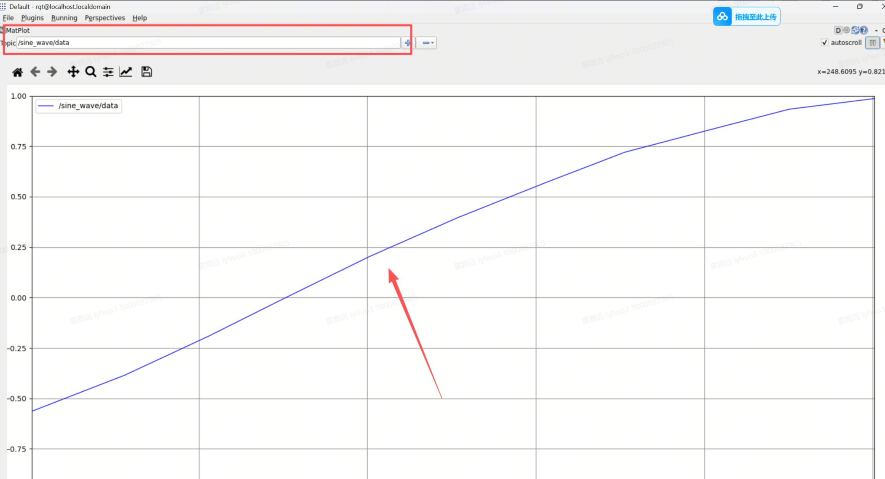

**易错点**：

- ⚠️ **输入话题路径后无曲线**：检查话题路径格式——rqt_plot 要求完整路径为 `/topic_name/field_name`，例如 `/sine_wave/data` 而非仅 `/sine_wave`。可在 rqt_plot 面板中点击 `+` 按钮通过 GUI 树形菜单选择话题和字段。
- ⚠️ **曲线始终为 0（没有数值变化）**：String 等非数值类型的字段，rqt_plot 无法直接绘制。请确认话题的消息类型包含数值字段（`float32`、`int32`、`float64` 等）。

---

#### 步骤 4：rqt_console — 日志级别过滤与分析

**知识点讲解**：

**rqt_console 日志管理与故障定位（知识点 4.1.3）**

- **是什么**：`rqt_console `是 ROS2 的集中化日志查看器。ROS2 每个节点在运行时会通过 `/rosout` 话题自动发布日志消息（包含时间戳、节点名、日志级别、消息内容），rqt_console 订阅 `/rosout` 并汇总展示。你可以在一个界面中看到**所有节点**的日志输出，按级别（DEBUG/INFO/WARN/ERROR/FATAL）或关键词过滤。
- **为什么日志汇总如此重要**：在一个包含 10+ 节点的机器人系统中，如果某个节点报错，它的日志可能散布在 10 个终端窗口中。rqt_console 将所有日志汇聚到一个表格视图中——按时间排序，支持实时过滤。例如：设置过滤条件 `Level >= WARN` + `Node contains "camera"`，即可只查看相机节点相关的警告和错误。

**日志级别设计哲学**：

  - **DEBUG**：开发者调试信息（如"进入回调函数""变量 x = 5"），生产环境通常关闭
  - **INFO**：正常运行状态信息（如"节点已启动""话题连接成功"）
  - **WARN**：非致命但需关注的情况（如"传感器数据超时 50ms""电池电量低于 20%"）
  - **ERROR**：功能异常（如"无法打开串口""消息解析失败"）
  - **FATAL**：致命错误（如"电机驱动无响应"），节点通常在此后终止

**操作步骤**：

```bash
在 rqt 主窗口中：
菜单: Plugins → Logging → Console
在 rqt_console 面板中操作：
# 4.1 观察默认视图：所有级别日志都显示
# 预期: 看到 talker 和 listener 的 INFO 级别日志滚动输出

# 4.2 按日志级别过滤——仅显示 WARN 和 ERROR
# 在左侧 Filters 区域点击 "+" 添加一个新 Filter
# 设置: "Level" → "Warn and above"
# 预期: 表格内容大幅减少（talker/listener 正常工作，无 WARN 日志）

# 4.3 按节点名过滤——仅显示 /talker 的日志
# 添加 Filter: "Node" → "Contains" → "talker"
# 预期: 仅显示 node 名包含 "talker" 的日志行

# 4.4 体验日志级别的动态效果（制造 WARN 日志）
参考下图结果

在终端中输入：
# 临时将 talker 的日志级别调整为 WARN
ros2 param set /talker log_level WARN
# 预期: rqt_console 中 /talker 的 INFO 日志停止输出
#会发现在rqt上面的日志会随着级别显示而显示
# 恢复日志级别
ros2 param set /talker log_level INFO
```

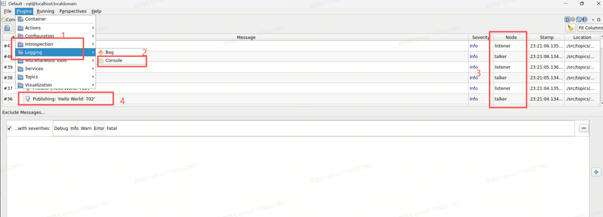

**易错点**：

- ⚠️ **rqt_console 中看不到任何日志**：检查是否加载了 `/rosout` 订阅——rqt_console 依赖此话题。正常情况下，每个 ROS2 节点都会自动向 `/rosout` 发布日志。如果没有任何输出，确认至少有一个节点在运行（`ros2 node list` 不为空）。
- ⚠️ **Filter 条件组合后无输出**：多个 Filter 之间默认是"AND"逻辑——必须同时满足所有条件。如果要实现"AND/OR"逻辑，可点击 Filter 名称左侧的复选框来启用/禁用个别 Filter。

---

#### 步骤 5：rqt_reconfigure — 运行时动态参数调整

**知识点讲解**：

**rqt_reconfigure 动态参数调优机制（知识点 4.1.3）**

- **是什么**：rqt_reconfigure 是 ROS2 的"运行时参数调节面板"。它通过 DDS 协议连接到运行中的节点，读取该节点通过 `declare_parameter` 声明的所有参数及其约束（类型、范围、步长），以 GUI 控件（滑块、下拉框、复选框）的形式展示。开发者拖动滑块即可实时修改参数值，无需重启节点。
- **为什么它是效率工具**：在没有动态调参工具的开发流程中，修改参数（如 PID 控制器的 Kp、视觉检测的阈值、激光雷达的过滤半径）需要：停止节点 → 修改代码中的常量 → 重新编译 → 重新启动 → 观察效果 → 重复。这个循环通常需要 2-5 分钟。rqt_reconfigure 将循环压缩为"拖动滑块 → 观察效果"的秒级交互，大幅提升调参效率。
- **怎么用**：在 rqt 中加载 Plugins → Configuration → Dynamic Reconfigure。左侧列表自动扫描当前域中所有支持动态参数的节点，点击节点名后，右侧面板显示该节点的参数列表和编辑控件。

**操作步骤**：

```bash
在 rqt 主窗口中：
菜单: Plugins → Configuration → Dynamic Reconfigure
在 rqt_reconfigure 面板中操作：
# 5.1 观察节点参数列表
# 左侧应显示已发现的节点列表（如 /talker、/listener 等）
# 如果看不到节点，点击刷新按钮

# 5.2 选择 /talker 节点，查看其参数
# 预期: 右侧显示 talker 的可调参数（如 use_sim_time 等布尔型参数）

运行一个具有更丰富参数的示例节点：
# 终端 E：启动一个带多个参数的 Python 节点示例
python3 -c "
import rclpy
from rclpy.node import Node
from rcl_interfaces.msg import ParameterDescriptor

class ParamDemoNode(Node):
    def __init__(self):
        super().__init__('param_demo')
        # 声明一个浮点型参数，范围 [0.1, 10.0]，步长 0.1
        self.declare_parameter('update_rate', 1.0,
            ParameterDescriptor(description='数据更新频率 (Hz)'))
        # 声明一个整型参数，范围 [1, 100]
        self.declare_parameter('max_items', 50,
            ParameterDescriptor(description='最大处理条目数'))
        # 声明一个字符串参数
        self.declare_parameter('mode', 'normal',
            ParameterDescriptor(description='运行模式 (normal/fast/slow)'))

        self.create_timer(1.0, self.timer_callback)

    def timer_callback(self):
        rate = self.get_parameter('update_rate').value
        items = self.get_parameter('max_items').value
        mode = self.get_parameter('mode').value
        self.get_logger().info(f'Rate={rate}Hz, Items={items}, Mode={mode}')

def main():
    rclpy.init()
    node = ParamDemoNode()
    rclpy.spin(node)
    node.destroy_node()
    rclpy.shutdown()

if __name__ == '__main__':
    main()
"
回到 rqt_reconfigure 面板：
# 5.3 刷新节点列表，选择 /param_demo 节点
# 预期: 右侧显示三个参数：
#   - update_rate [滑块 0.1 ~ 10.0, 步长 0.1]
#   - max_items [整数输入框 1 ~ 100]
#   - mode [下拉框 normal/fast/slow]

# 5.4 尝试修改参数并观察效果
# 拖动 update_rate 滑块从 1.0 改为 5.0
# 观察终端 E 中的日志输出变化（timer_callback 频率增加）

# 5.5 在 rqt_console 中观察参数的 set_parameters 事件
# 切换到 rqt_console 面板，添加 Filter: Node Contains "param_demo"
# 观察参数修改后的日志输出

```

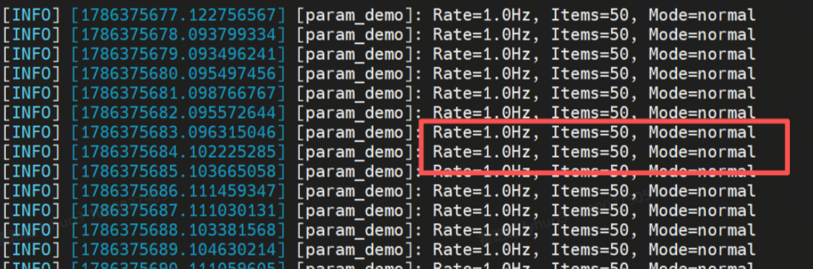

**易错点**：

- ⚠️ **rqt_reconfigure 找不到目标节点**：节点必须通过 `declare_parameter` 声明了参数，且需要注册 `add_on_set_parameters_callback`（Python）或实现 `on_set_parameters_callback`（C++）才能响应动态参数修改。如果节点只声明了参数但没有注册回调，`ros2 param set` 可以修改参数值但节点不会响应，rqt_reconfigure 也会显示节点但可能无参数列表。
- ⚠️ **参数未按预期生效**：修改参数后，检查节点是否在回调中重新读取了参数值。在 Python 中，`get_parameter('name').value` 在回调中调用才能获取最新值。

---

#### 步骤 6：rqt_topic 和 rqt_bag 补充工具

**知识点讲解**：

**rqt_topic 可视化消息监控**：rqt_topic 将 `ros2 topic echo` 的功能升级为 GUI 形式——你可以勾选任意话题，展开查看每个字段的值，支持结构体嵌套展开（如 `Header.stamp.sec`）。对于包含大量字段的复杂消息（如 `sensor_msgs/msg/LaserScan`），GUI 展开浏览比命令行逐字段 `echo` 高效得多。

**rqt_bag 录制数据可视化回放**：rqt_bag 是 ros2 bag 的 GUI 前端，加载 `.db3` bag 文件后，你可以：(1) 拖动时间轴跳转到任意时刻，(2) 选择特定话题查看消息内容，(3) 以图表形式可视化数值字段，(4) 导出特定时段的数据。它是离线分析的核心工具（详见 exp16）。

**操作步骤**：

```bash
在 rqt 主窗口中：
# 6.1 rqt_topic
菜单: Plugins → Topics → Topic Monitor
# 在左侧勾选 /chatter 话题
# 预期: 右侧显示该话题的实时消息内容，展开 data 字段可见 "Hello World: N"

# 6.2 rqt_bag（如果没有 bag 文件，此步骤仅浏览界面）
菜单: Plugins → Logging → Bag
# 预期: 显示 bag 文件加载界面
# 点击 "Load Bag" 按钮，选择一个 .db3 文件（如实验 2 中录制的 exp02_test 文件）
# 加载后：可拖动时间轴、选择话题查看消息、播放/暂停/跳转
```

**易错点**：

- ⚠️ **rqt_bag 加载 .db3 文件后时间轴无数据**：确认 bag 文件中确实包含所选的话题。使用 `ros2 bag info <bag_path>` 确认话题列表。
- ⚠️ **rqt 面板布局混乱**：每个插件面板都可独立拖拽和停靠。拖动面板标题栏到窗口边缘即可重新停靠；关闭的面板可以通过 Plugins 菜单重新加载；`Perspectives` 菜单可保存当前面板布局供下次恢复。

---

#### 步骤 7：实验收尾与总结（5 分钟）

1. 关闭 rqt 窗口
2. 在所有终端 `Ctrl+C` 终止所有示例节点
3. 确认 `ros2 node list` 输出为空

### 七、注意事项

| 类别 | 注意事项 |
|---|---|
| ⚠️ 显示 | Rqt 是 GUI 应用程序，B2 实验箱必须连接显示器或使用 X11 Forwarding（`ssh -X`） |
| ⚠️ 性能 | rqt 本身是一个 ROS2 节点（会订阅多个话题），在低频传感器数据场景下对系统影响可忽略；避免在 CPU 密集场景下同时运行多个 rqt 插件 |
| ⚠️ 布局 | rqt 的面板布局可以保存（Perspectives → Save），建议为常用调试场景（如"日常开发""传感器调试""参数调优"）分别保存布局 |
| ⚠️ 依赖 | rqt 各插件有独立的功能包，如果某个插件（如 rqt_bag）无法加载，检查 `dpkg -l |
| ⚠️ 权限 | rqt_plot 读取话题数据不需要特殊权限；rqt_reconfigure 修改参数需要目标节点允许——节点必须在代码中注册了 `add_on_set_parameters_callback` |

### 八、实验总结

#### 8.1 完成成果

完成本实验后，你应当能够：

- ✅ 使用 rqt_graph 在一张图上查看当前 ROS2 系统的完整通信拓扑
- ✅ 使用 rqt_plot 实时绘制任意话题数值字段的时间序列曲线
- ✅ 使用 rqt_console 按日志级别和关键词过滤，快速定位故障节点
- ✅ 使用 rqt_reconfigure 动态调整节点参数，无需重启即可调参
- ✅ 保存 rqt 面板布局（Perspective）以便在不同调试场景间切换

#### 8.2 技能收获

| 技能 | 说明 |
|---|---|
| 可视化调试 | 掌握 rqt 作为 ROS2 标准 GUI 调试工作台的使用方法 |
| 拓扑诊断 | 能通过 rqt_graph 快速定位通信断链故障（Publisher/Subscriber 匹配异常） |
| 时序分析 | 能通过 rqt_plot 观察传感器数据趋势变化，发现异常波动和数据断流 |
| 日志管理 | 能通过 rqt_console 按级别和节点名过滤，实现多节点日志的集中监控 |

#### 8.3 常见问题与解答

| 问题 | 原因 | 解决方法 |
|---|---|---|
| rqt 启动报 "Could not connect to display" | 无显示器或 SSH 未启用 X11 Forwarding | 连接显示器，或使用 `ssh -X user@b2-ip` 远程连接 |
| rqt_graph 中看不到节点 | 被测节点未运行或 Graph 未刷新 | 确认 `ros2 node list` 非空，点击 rqt_graph 右上角刷新按钮 |
| rqt_plot 输入话题路径后无曲线 | 路径格式错误或话题无数值字段 | 使用 `+` 按钮通过树形菜单选择，确认话题包含 `float32/int32` 等字段 |
| rqt_reconfigure 无节点可显示 | 节点未声明参数或未注册参数回调 | 确认目标节点已 `declare_parameter` 并注册了 `add_on_set_parameters_callback` |
| rqt_console 无日志输出 | `/rosout` 话题无 Publisher | 确认至少一个 ROS2 节点在运行（节点启动后自动开始发布到 `/rosout`） |
| rqt_bag 插件不存在 | `ros-humble-rqt-bag` 未安装 | `sudo apt install ros-humble-rqt-bag` |

### 九、实验报告要求

#### 9.1 报告内容

完成实验后，提交一份实验报告，包含以下内容：

1. **实验基本信息**：实验名称、实验日期、实验者姓名、实验平台信息
2. **实验过程记录**：截取以下 5 个 rqt 插件面板的运行界面截图（每张截图下方标注功能说明和关键观察点）：rqt_graph、rqt_plot（含数值曲线）、rqt_console（含日志过滤结果）、rqt_reconfigure（含参数列表）、rqt_topic
3. **原理分析**（不少于 300 字）：用自己的语言解释 rqt 的插件化架构设计——为什么 ROS2 选择将多种调试工具整合为 rqt 统一平台，而不是各自独立运行？这种设计在机器人开发中的具体效率优势体现在哪些方面？
4. **思考题**（见下方）

#### 9.2 思考题

**思考题 1**：

在步骤 4 中，你使用 rqt_console 按日志级别过滤了输出。请思考：在一个包含 20 个节点的机器人导航系统中，如果某个传感器节点间歇性报 WARN（"数据超时 200ms"），但该 WARN 被淹没在大量 INFO 日志中——你会如何设计 rqt_console 的过滤规则组合来快速定位这个间歇性问题？请至少设计两个不同的过滤策略。

**思考题 2**：

rqt_plot 可以实时绘制话题数据的数值曲线，但它要求用户手动输入 `topic/field` 路径。假设你有一个 `/robot/odom` 话题（`nav_msgs/msg/Odometry` 类型），包含 `pose.pose.position.x`、`pose.pose.position.y`、`twist.twist.linear.x` 等嵌套字段。请设计一个流程，使用 rqt_plot 同时绘制机器人在 XY 平面上的轨迹（X 轴为 position.x，Y 轴为 position.y），而不只是分别画两条独立曲线。

#### 9.3 评分标准

| 评分项 | 权重 | 评分标准 |
|---|---|---|
| 实验操作完整性 | 30% | 是否按要求操作了 rqt_graph、rqt_plot、rqt_console、rqt_reconfigure、rqt_topic 五个插件 |
| 截图与记录 | 20% | 截图是否清晰（≥5 张），标注是否准确描述了每个插件的功能和观察要点 |
| 原理分析 | 25% | 对 rqt 插件化架构设计理念的理解深度 |
| 思考题 1 | 10% | 日志过滤策略的合理性与实用性 |
| 思考题 2 | 15% | 多字段联合可视化的创新性方案设计 |

## 实验15：ROS2 Rviz2使用

### 一、关联知识点

本实验关联以下知识图谱节点：

| 编号 | 知识点名称 | 类型 | 层级路径 |
|---|---|---|---|
| 4.2.1 | Rviz2基于OGRE的3D可视化架构与Display插件体系 | 概念 | 第4章 ROS2工具链与系统部署 → 4.2 Rviz2三维可视化 |
| 4.2.2 | Rviz2 Fixed Frame配置与多种Display面板加载流程 | 流程 | 第4章 ROS2工具链与系统部署 → 4.2 Rviz2三维可视化 |
| 4.2.3 | .rviz配置文件保存与加载实现调试环境快速复现 | 事实 | 第4章 ROS2工具链与系统部署 → 4.2 Rviz2三维可视化 |

### 二、实验目标

通过本实验的学习，学生能够：

1. **原理理解**：阐述 Rviz2 基于 OGRE 3D 渲染引擎和 Display 插件体系的架构设计——为什么在 ROS2 的传感器-规划-控制数据流中，需要一个"以坐标系为容器、以 Display 为图层"的三维可视化平台，以及 Fixed Frame 全局参考坐标系在整个可视化管线中的核心地位
2. **流程掌握**：正确启动 Rviz2，设置 Fixed Frame（如 `map` / `odom` / `base_link`），依次添加并配置 RobotModel、TF、LaserScan、PointCloud2、Image、Path、Marker 七种 Display 面板，实现机器人状态的全方位立体可视化
3. **独立完成**：独立使用 `rviz2 -d <config_file>` 加载预先保存的配置文件，并在调整视图和 Display 后通过 File → Save Config 保存新的配置，实现调试环境的一键复现
4. **迁移应用**：能够在后续实验中（如 exp16 bag 回放分析、exp20 URDF 模型验证、exp21 Gazebo 仿真可视化），将 Rviz2 作为标准的三维数据可视化前端，熟练完成 Display 面板的按需配置

### 三、实验环境

| 类别 | 配置 |
|---|---|
| 硬件平台 | 具身智能实验箱B2（RK3576 + STM32F407）或 具身智能机器人小车C1 |
| 操作系统 | Ubuntu 22.04 |
| ROS2 发行版 | Humble Hawksbill |
| 核心依赖 | `ros-humble-rviz2`、`ros-humble-rviz-common`、`ros-humble-rviz-default-plugins`、`ros-humble-demo-nodes-cpp`、`ros-humble-tf2-ros`、`ros-humble-robot-state-publisher` |
| 显示要求 | 需连接显示器（Rviz2 基于 OGRE 3D 引擎渲染，对 GPU 有一定要求；RK3576 集成的 Mali-G52 GPU 可运行轻量级 Rviz2 场景） |

> 说明：本实验需要 GPU 渲染支持。B2 实验箱内置 Mali-G52 EE GPU，支持 OpenGL ES 3.2，Rviz2 通过 OGRE 的 GLES2 渲染后端运行。

### 四、实验难度

| 维度 | 说明 |
|---|---|
| 难度等级 | ⭐⭐（中等） |
| 实验类型 | 设计性 |
| 建议时长 | 2 学时（90 分钟） |

**重点**：

- 理解 Fixed Frame 全局参考坐标系的概念与配置方法
- 掌握 RobotModel、TF、LaserScan、Marker 四种核心 Display 面板的加载与配置

**难点**：

- 区分 TF 坐标变换的父子关系在 Rviz2 中如何映射为可视化连线和箭头
- 理解 Marker 的多种类型（Arrow、Cube、Sphere、Text、LineStrip）与 action 类型（ADD、DELETE、MODIFY）的语义

### 五、实验现象

#### 5.1 快速验证流程

完成本实验后，你应能观察到以下现象：

1. 启动 Rviz2 后，左侧 Display 面板显示默认的 Grid（网格参考平面），3D 视图区显示灰色背景和彩色网格地面
2. 添加 TF Display 后（需有 TF 数据发布者运行），坐标系之间出现彩色箭头连线，表示父子变换关系
3. 添加 RobotModel Display 后（需有 URDF 模型和 robot_state_publisher 运行），3D 视图中出现机器人模型的 3D 渲染
4. 添加 LaserScan Display 并订阅话题后，视图中出现红色点云扇形（模拟激光雷达扫描数据）
5. 添加 Marker Display 后，视图中出现自定义的几何图形标记（箭头、文字、立方体）

#### 5.2 预期效果描述

| Display 面板 | 配置要点 | 预期 3D 视图效果 |
|---|---|---|
| Grid | 默认启用 | 彩色正方形网格铺满地面 |
| TF | 勾选 "Show Names" | 彩色坐标轴+坐标系名称标签 |
| RobotModel | 设置 Description Topic 为 `/robot_description` | 完整机器人 3D 模型 |
| LaserScan | 设置 Topic 为 `/scan`，Size=0.05m | 弧形红色点云 |
| PointCloud2 | 设置 Topic 为 `/points`，Style=Flat Squares | 密集彩色点云 |
| Image | 设置 Topic 为 `/camera/image_raw` | 独立窗口显示相机画面 |
| Path | 设置 Topic 为 `/plan`，Color=Blue | 蓝色连续折线轨迹 |
| Marker | 设置 Topic 为 `/visualization_marker` | 多样的几何标记 |

---

### 六、实验步骤

#### 整体流程

```text
[1. Rviz2 启动与基础配置] ──► [2. Grid + TF 坐标系可视化]
                                        │
[3. RobotModel 模型渲染] ◄───────────────┘
        │
[4. LaserScan + PointCloud2 传感器可视化]
        │
[5. Path + Marker 导航与标注] ──► [6. 配置文件保存与加载]
```

---

#### 步骤 1：Rviz2 启动与 Fixed Frame 基础配置

**知识点讲解**：

**Rviz2 基于 OGRE 的 3D 可视化架构（知识点 4.2.1）**

- **是什么**：Rviz2 是 ROS2 生态中的标准 3D 可视化工具，构建于 OGRE（Object-oriented Graphics Rendering Engine）3D 渲染引擎之上。其核心设计理念是"Fixed Frame + Display 图层"——整个 3D 场景以一个中心参考坐标系（Fixed Frame）为"画布"，各种数据（传感器、模型、轨迹、标记）作为独立"图层"叠加到画布上，每个图层通过 TF2 坐标变换库将自己的数据从源坐标系变换到 Fixed Frame 坐标系中展示。
- **为什么 Fixed Frame 是核心决策**：假设你有一个激光雷达安装在机器人底盘上，其数据坐标系为 `base_laser`，里程计坐标系为 `odom`，世界坐标系为 `map`。如果 Fixed Frame 设置为 `map`，Rviz2 会自动通过 TF2 查找 `base_laser → odom → map` 的变换链，将激光扫描点从激光坐标系变换到世界坐标系——这样你看到的是激光数据在世界中的"真实位置"。如果 Fixed Frame 设置为 `base_laser`，激光数据将始终显示在原点周围（因为坐标系与传感器重合）。Fixed Frame 的选择决定了你观察整个机器人系统的"上帝视角"站在哪里。
- **怎么初始化**：`rviz2` 命令直接启动，首次启动或配置文件缺失时，Fixed Frame 默认为 `map`（即使该坐标系尚未发布，Rviz2 也不会报错，只是部分 Display 因变换失败而显示黄色警告 Status）。在 Global Options → Fixed Frame 中修改引用坐标系。

**操作步骤**：

```bash
# 1.1 启动 Rviz2
rviz2
# 预期: Rviz2 主窗口打开
# 左侧: Displays 面板（用于添加/配置 Display 图层）
# 中央: 3D 视图区（OGRE 渲染窗口，默认显示 Grid 网格地面）
# 上方: 工具栏（视角切换、测量工具、导航按钮等）
在 Rviz2 界面中操作：
# 1.2 观察左侧 Displays 面板
# 默认包含:
#   - Global Options （全局设置）
#       - Fixed Frame: map（默认参考坐标系）
#       - Frame Rate: 30
#   - Grid（网格参考平面）
#       - Plane Cell Count: 10x10
#       - Color: 浅灰色
# 1.3 修改 Fixed Frame（即使该 frame 尚不存在）
# 在 Displays → Global Options → Fixed Frame 中输入: base_link
# 预期: 输入框接受该值（不会报错——Rviz2 会持续等待该坐标系出现）

# 1.4 修改背景色以更适合演示
# 在 Displays → Global Options → Background Color 中修改为深蓝灰色
```

**易错点**：

- ⚠️ **Rviz2 启动后 3D 视图为黑屏**：检查 B2 实验箱的 GPU 驱动是否正常 —— `glxinfo | grep "OpenGL renderer"` 应输出 Mali-G52。如果 GPU 驱动未就绪，Rviz2 会回退到软件渲染（极度缓慢）。解决方法：确保 Mali GPU 驱动已加载（`lsmod | grep mali`）。
- ⚠️ **Fixed Frame 设置为不存在的坐标系时，所有 Display 显示黄色 Warning**：这是正常现象——Rviz2 等待 TF2 发布该坐标系。一旦 TF Broadcaster 启动并发布相应变换，Warning 自动消失，数据正常渲染。

---

#### 步骤 2：TF 坐标系可视化与 Grid 网格参考

**知识点讲解**：

**TF2 坐标变换在 Rviz2 中的可视化（知识点 4.2.2）**

- **是什么**：TF Display 是 Rviz2 中用于可视化 TF2 坐标变换树的专用面板。它将每个坐标系的位姿（位置+朝向）渲染为红-绿-蓝三色坐标轴（X=红, Y=绿, Z=蓝），用不同颜色的连线（箭头线）表示父子坐标系之间的变换关系。勾选 "Show Names" 后，每个坐标系的名称标签（如 `base_link`、`laser_frame`）会显示在对应的坐标轴旁边。
- **为什么可视化变换树重要**：在机器人系统中，坐标系之间的变换关系通过 URDF 模型定义或 TF Broadcaster 动态发布。如果某条变换链断裂（如 `laser_frame` 的父坐标系 `base_link` 不存在），TF Display 中对应的坐标轴将消失——这是最直观的"变换异常"检测方式。与 `ros2 run tf2_tools view_frames` 的静态 PDF 输出相比，Rviz2 的 TF Display 是**实时动态**的——机器人运动时，你可以在 3D 视图中看到坐标系跟着移动和旋转。
- **怎么配置**：在 Rviz2 中点击左下角 "Add" 按钮 → 在弹出的 Display 类型列表中选择 "TF" → 点击 "OK"。TF Display 不需要额外的话题配置——它通过内部的 `tf2_ros::TransformListener` 自动订阅 `/tf` 和 `/tf_static` 话题。

**操作步骤**：

```bash
首先在终端中启动一个 Python 脚本，发布一组模拟的 TF 坐标变换：
# 终端 A：发布模拟的 TF 坐标变换
python3 -c "
import rclpy
from rclpy.node import Node
from geometry_msgs.msg import TransformStamped
from tf2_ros import TransformBroadcaster
import math
import time

class TFDemoNode(Node):
    def __init__(self):
        super().__init__('tf_demo')
        self.tf_broadcaster = TransformBroadcaster(self)
        self.timer = self.create_timer(0.1, self.publish_transforms)
        self.start_time = time.time()

    def publish_transforms(self):
        t = time.time() - self.start_time

        # map → odom（静态偏置，模拟全局定位）
        t1 = TransformStamped()
        t1.header.stamp = self.get_clock().now().to_msg()
        t1.header.frame_id = 'map'
        t1.child_frame_id = 'odom'
        t1.transform.translation.x = 1.0
        t1.transform.translation.y = 0.5
        t1.transform.translation.z = 0.0
        t1.transform.rotation.w = 1.0
        self.tf_broadcaster.sendTransform(t1)

        # odom → base_link（动态旋转，模拟机器人自转）
        t2 = TransformStamped()
        t2.header.stamp = self.get_clock().now().to_msg()
        t2.header.frame_id = 'odom'
        t2.child_frame_id = 'base_link'
        t2.transform.translation.x = math.cos(t * 0.5) * 0.5
        t2.transform.translation.y = math.sin(t * 0.5) * 0.5
        t2.transform.translation.z = 0.0
        t2.transform.rotation.z = math.sin(t * 0.25)
        t2.transform.rotation.w = math.cos(t * 0.25)
        self.tf_broadcaster.sendTransform(t2)

        # base_link → laser_frame（固定偏置，模拟激光雷达安装位置）
        t3 = TransformStamped()
        t3.header.stamp = self.get_clock().now().to_msg()
        t3.header.frame_id = 'base_link'
        t3.child_frame_id = 'laser_frame'
        t3.transform.translation.x = 0.2
        t3.transform.translation.y = 0.0
        t3.transform.translation.z = 0.15
        t3.transform.rotation.w = 1.0
        self.tf_broadcaster.sendTransform(t3)

        self.get_logger().info('Published TF transforms', throttle_duration_sec=2.0)

def main():
    rclpy.init()
    rclpy.spin(TFDemoNode())
    rclpy.shutdown()

if __name__ == '__main__':
    main()
"
回到 Rviz2 界面：
# 2.1 添加 TF Display
# 点击左下角 "Add" 按钮
# 在弹出的列表中选择 "TF" → 点击 "OK"
# 预期: 3D 视图中出现多组彩色坐标轴:
#   - map（红色X/绿色Y/蓝色Z 坐标轴）
#   - odom（在 map 的偏置位置上方）
#   - base_link（在旋转运动的中心）
#   - laser_frame（在 base_link 前方偏上的位置）
# 坐标系之间显示彩色连线（表示父子变换关系）

# 2.2 启用坐标系名称显示
# 在 TF Display 的属性中，勾选 "Show Names"
# 预期: 每个坐标轴旁显示名称标签（map、odom、base_link、laser_frame）

# 2.3 调整 Fixed Frame 观察视角切换
# 在 Global Options → Fixed Frame 中切换为: odom
# 预期: map 坐标系从原点偏移到 (1.0, 0.5) 位置
# 再切换回: map
# 预期: map 始终在原点，其他坐标系在其周围运动

# 2.4 使用鼠标交互探索 3D 视图
# - 左键拖拽: 旋转视角（Orbit）
# - 中键拖拽（或 Shift+左键）: 平移视角
# - 滚轮: 缩放
# - 右键拖拽: 缩放（老式操作）
点击添加TF树的话题

点击显示名称

在不同视角的切换状态

```

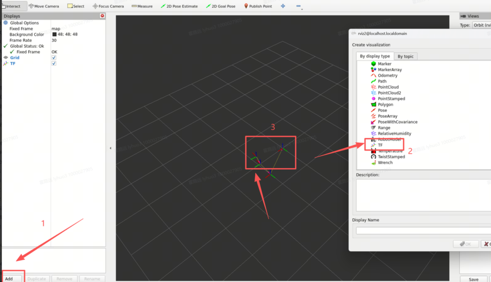

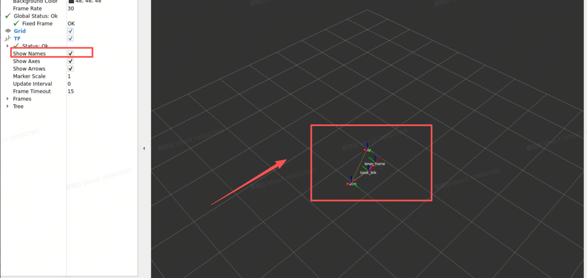

**易错点**：

- ⚠️ **添加了 TF Display 但视图中没有任何坐标轴**：有两种可能：(1) 没有 TF Broadcaster 在发布数据——检查终端 A 的 Python 脚本是否还在运行；(2) Fixed Frame 设置的坐标系不存在于 TF 树中——例如 Fixed Frame 设置为 `world` 但 TF 树只有 `map` → `odom` → `base_link`。将 Fixed Frame 改为 `map` 即可。
- ⚠️ **TF 坐标轴不随机器人移动而更新**：检查 `TransformStamped.header.stamp` 是否使用了当前时间（`self.get_clock().now().to_msg()`）。如果时间戳是固定的旧值，TF Listener 可能认为变换已过期而忽略它。

---

#### 步骤 3：RobotModel 面板与 URDF 模型可视化

**知识点讲解**：

**RobotModel 的 URDF 模型 3D 渲染原理（知识点 4.2.2）**

- **是什么**：RobotModel Display 是 Rviz2 中最常用的面板之一，它通过读取 `/robot_description` 话题上的 URDF（统一机器人描述格式）字符串，解析出所有 link 的几何形状（visual/collision）、joint 的运动约束和父子关系，然后结合 TF2 实时坐标变换，在 3D 视图中渲染出完整机器人的三维模型。当机器人关节运动时，模型也会根据 `/joint_states` 话题数据实时更新。
- **为什么需要 RobotModel + TF 的配合**：URDF 本身只定义了静态结构（谁是谁的子节点、关节轴在哪里）。要让模型"动起来"，需要两个外部输入：(1) `robot_state_publisher` 节点读取 `/joint_states`（关节角度），计算出各 joint 的位姿并发布到 TF 树；(2) Rviz2 的 RobotModel Display 订阅这些 TF 变换，实时更新每个 link 的位置和方向。三者协作：URDF 定义结构 → robot_state_publisher 计算变换 → Rviz2 渲染可视化。
- **怎么加载**：需要一个 URDF 文件和 `robot_state_publisher` 节点。Rviz2 中添加 RobotModel Display 后，默认自动订阅 `/robot_description` 话题和 `/tf` 话题。

**操作步骤**：

```bash
创建一个简单的 URDF 模型文件：
# 终端 B：创建模拟机器人 URDF 模型
cat > /tmp/simple_robot.urdf << 'URDFEOF'
<?xml version="1.0"?>
<robot name="simple_robot">
    <!-- 底盘 -->
    <link name="base_link">
        <visual>
            <geometry>
                <box size="0.4 0.3 0.15"/>
            </geometry>
            <material name="blue">
                <color rgba="0.2 0.4 0.9 1.0"/>
            </material>
        </visual>
    </link>

    <!-- 激光雷达支架 -->
    <joint name="laser_joint" type="fixed">
        <parent link="base_link"/>
        <child link="laser_frame"/>
        <origin xyz="0.15 0 0.1" rpy="0 0 0"/>
    </joint>
    <link name="laser_frame">
        <visual>
            <geometry>
                <cylinder radius="0.03" length="0.05"/>
            </geometry>
            <material name="gray">
                <color rgba="0.5 0.5 0.5 1.0"/>
            </material>
        </visual>
    </link>

    <!-- 轮子（左侧） -->
    <joint name="left_wheel_joint" type="continuous">
        <parent link="base_link"/>
        <child link="left_wheel"/>
        <origin xyz="0 0.18 -0.05" rpy="0 0 0"/>
        <axis xyz="0 1 0"/>
    </joint>
    <link name="left_wheel">
        <visual>
            <geometry>
                <cylinder radius="0.06" length="0.03"/>
            </geometry>
            <material name="black">
                <color rgba="0.1 0.1 0.1 1.0"/>
            </material>
        </visual>
    </link>

    <!-- 轮子（右侧） -->
    <joint name="right_wheel_joint" type="continuous">
        <parent link="base_link"/>
        <child link="right_wheel"/>
        <origin xyz="0 -0.18 -0.05" rpy="0 0 0"/>
        <axis xyz="0 1 0"/>
    </joint>
    <link name="right_wheel">
        <visual>
            <geometry>
                <cylinder radius="0.06" length="0.03"/>
            </geometry>
            <material name="black">
                <color rgba="0.1 0.1 0.1 1.0"/>
            </material>
        </visual>
    </link>
</robot>
URDFEOF

echo "URDF file created at /tmp/simple_robot.urdf"
启动 robot_state_publisher：
# 终端 C：启动 robot_state_publisher 加载 URDF
ros2 run robot_state_publisher robot_state_publisher \
  --ros-args \
  -p robot_description:="$(cat /tmp/simple_robot.urdf)"
# 预期: robot_state_publisher 启动，等待 /joint_states 话题数据
发布关节状态数据（使轮子旋转）：
# 终端 D：发布 /joint_states（模拟轮子转动）
python3 -c "
import rclpy
from rclpy.node import Node
from sensor_msgs.msg import JointState
import time

class JointStatePublisher(Node):
    def __init__(self):
        super().__init__('joint_state_pub')
        self.pub = self.create_publisher(JointState, '/joint_states', 10)
        self.timer = self.create_timer(0.05, self.publish_joint_states)

    def publish_joint_states(self):
        msg = JointState()
        msg.header.stamp = self.get_clock().now().to_msg()
        msg.name = ['left_wheel_joint', 'right_wheel_joint']
        t = time.time()
        msg.position = [t * 2.0, t * 2.0]  # 两轮同步旋转
        self.pub.publish(msg)

def main():
    rclpy.init()
    rclpy.spin(JointStatePublisher())
    rclpy.shutdown()

if __name__ == '__main__':
    main()
"
回到 Rviz2 界面：
# 3.1 添加 RobotModel Display
# 点击 "Add" → 选择 "RobotModel" → "OK"

# 3.2 调整 RobotModel 的显示属性
# 在 RobotModel Display 属性中:
#   - Visual Enabled: 勾选（显示视觉模型）
#   - Collision Enabled: 不勾选（隐藏碰撞模型）
#   - Alpha: 设为 0.8（半透明效果）
#   - Description Topic: 保持默认 /robot_description

# 3.3 验证 TF 和 RobotModel 的一致性
# 观察: TF 中显示的 laser_frame 坐标轴位置
# 应与 RobotModel 中的激光雷达圆柱体位置完全重合

# 预期: 3D 视图中出现简单机器人模型:
#   - 蓝色长方体底盘
#   - 灰色圆柱体激光雷达（在底盘前方上方）
#   - 两个黑色圆柱体轮子（在底盘两侧，持续旋转）

```

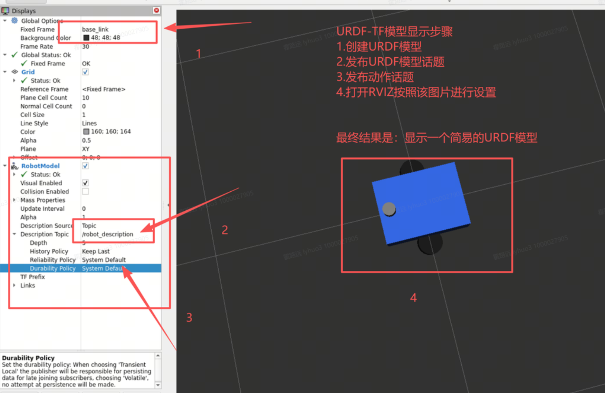

**易错点**：

- ⚠️ **RobotModel 添加后 3D 视图中不显示模型**：按顺序排查：(1) `/robot_description` 话题是否有数据——`ros2 topic echo /robot_description --once`；(2) `robot_state_publisher` 是否在运行——`ros2 node list | grep robot_state`；(3) `/joint_states` 是否在发布——`ros2 topic echo /joint_states`；(4) Fixed Frame 是否为 TF 树中存在的坐标系（建议设为 `base_link`）
- ⚠️ **URDF 解析报错（Status: Error）**：检查 URDF XML 语法——`check_urdf /tmp/simple_robot.urdf`。常见错误：link 名称拼写不一致（joint 中的 parent/child 名称必须匹配已定义的 link 名称）、joint 类型不支持（fixed/continuous/revolute/prismatic）、XML 标签未关闭
- ⚠️ **模型出现但位置错误**：joint 的 `<origin>` 设置可能有误。注意 URDF 中 joint 的 origin 表示 child link 在 parent link 坐标系中的位置

---

#### 步骤 4：LaserScan 和 PointCloud2 传感器数据可视化

**知识点讲解**：

**LaserScan 激光雷达数据可视化（知识点 4.2.2）**

- **是什么**：LaserScan Display 将 `sensor_msgs/msg/LaserScan` 类型的 2D 激光扫描数据渲染为 Rviz2 3D 视图中的扇形点/线。每个激光测量点按角度（`angle_min + i * angle_increment`）和距离（`ranges[i]`）计算在 `frame_id` 坐标系中的三维位置（Z=0），形成弧形点云。通过调整 Size（点的大小）和 Decay Time（点的衰减时间，旧点逐渐消失），可以调节视觉效果。
- **为什么激光雷达数据天然适合在 Rviz2 中展示**：激光雷达数据是极坐标格式（角度+距离），人脑不擅长从数字矩阵中重建空间感知。Rviz2 将每个距离值映射为 3D 空间中的一个点——在 0.1 秒内，你就能看到"正前方 2 米处有一个障碍物"。Color Transformer 可以将距离映射为颜色（近处红色、远处蓝色），进一步增强深度感知。
- **PointCloud2 深度相机/3D LiDAR 点云可视化（知识点 4.2.2）**
- **是什么**：PointCloud2 Display 将 `sensor_msgs/msg/PointCloud2` 类型的 3D 点云数据渲染为密集的三维点阵。每个点包含 (x, y, z) 坐标和可选的颜色/强度信息。通过 Style 属性可以选择点的形状（Points、Flat Squares、Boxes）、透明度（Alpha）和衰减时间（Decay Time）。

**操作步骤**：

```bash
首先发布模拟激光雷达数据：
# 终端 E：发布模拟 LaserScan 数据
python3 -c "
import rclpy
from rclpy.node import Node
from sensor_msgs.msg import LaserScan
import math

class FakeLaserNode(Node):
    def __init__(self):
        super().__init__('fake_laser')
        self.pub = self.create_publisher(LaserScan, '/scan', 10)
        self.timer = self.create_timer(0.1, self.publish_scan)

    def publish_scan(self):
        msg = LaserScan()
        msg.header.stamp = self.get_clock().now().to_msg()
        msg.header.frame_id = 'laser_frame'
        msg.angle_min = -math.pi / 2    # -90度
        msg.angle_max = math.pi / 2     # +90度
        msg.angle_increment = math.pi / 180  # 1度分辨率
        msg.range_min = 0.1
        msg.range_max = 12.0
        num_readings = int((msg.angle_max - msg.angle_min) / msg.angle_increment) + 1

        # 模拟前方 2m 处有一个障碍物，其他方向为 10m
        ranges = [10.0] * num_readings
        center = num_readings // 2
        for i in range(center - 5, center + 5):
            ranges[i] = 2.0  # 正前方缩进
        msg.ranges = ranges
        self.pub.publish(msg)

def main():
    rclpy.init()
    rclpy.spin(FakeLaserNode())
    rclpy.shutdown()

if __name__ == '__main__':
    main()
"
发布模拟点云数据：
# 终端 F：发布模拟 PointCloud2 数据
python3 -c "
import rclpy
from rclpy.node import Node
from sensor_msgs.msg import PointCloud2, PointField
import numpy as np
import struct

class FakePointCloudNode(Node):
    def __init__(self):
        super().__init__('fake_pointcloud')
        self.pub = self.create_publisher(PointCloud2, '/points', 10)
        self.timer = self.create_timer(0.5, self.publish_cloud)

    def publish_cloud(self):
        msg = PointCloud2()
        msg.header.stamp = self.get_clock().now().to_msg()
        msg.header.frame_id = 'laser_frame'
        msg.height = 1
        msg.width = 100
        msg.fields = [
            PointField(name='x', offset=0, datatype=PointField.FLOAT32, count=1),
            PointField(name='y', offset=4, datatype=PointField.FLOAT32, count=1),
            PointField(name='z', offset=8, datatype=PointField.FLOAT32, count=1),
            PointField(name='rgb', offset=12, datatype=PointField.FLOAT32, count=1),
        ]
        msg.point_step = 16
        msg.row_step = msg.point_step * msg.width
        msg.is_bigendian = False
        msg.is_dense = True

        # 生成一个10x10的平面点阵
        points = []
        for i in range(10):
            for j in range(10):
                x = i * 0.1
                y = j * 0.1 - 0.5
                z = 0.0
                r, g, b = i * 25, j * 25, 128
                rgb = struct.unpack('I', struct.pack('BBBB', b, g, r, 255))[0]
                points.append(struct.pack('<fffI', x, y, z, rgb))
        msg.data = b''.join(points)
        self.pub.publish(msg)

def main():
    rclpy.init()
    rclpy.spin(FakePointCloudNode())
    rclpy.shutdown()

if __name__ == '__main__':
    main()
"
回到 Rviz2 界面：
# 4.1 添加 LaserScan Display
# 点击 "Add" → 选择 "LaserScan" → "OK"
# 在 LaserScan Display 属性中:
#   - Topic: /scan
#   - Size (m): 0.03（每个点的大小）
#   - Style: Points（或 Squares）
#   - Color Transformer: Intensity（或 FlatColor）
# 预期: 3D 视图中在 laser_frame 坐标系前方出现红色弧形点云
#       正前方 2m 处有明显缩进（模拟障碍物）

# 4.2 添加 PointCloud2 Display
# 点击 "Add" → 选择 "PointCloud2" → "OK"
# 在 PointCloud2 Display 属性中:
#   - Topic: /points
#   - Style: Flat Squares
#   - Size (m): 0.05
#   - Alpha: 0.8
# 预期: 3D 视图中出现彩色点阵平面（10x10网格）
#       颜色从蓝色过渡到红色（x 轴方向）

# 4.3 确认 Fixed Frame 使得数据正确显示
# 将 Fixed Frame 切换为: laser_frame
# 预期: LaserScan 弧形以原点为中心（数据在其本地坐标系中没问题）
# 将 Fixed Frame 切回: map
# 预期: LaserScan 弧形出现在 robot 前方（通过 TF 变换到 map 坐标系）
LaserScan Display显示激光雷达的2D显示

激光雷达显示的3D点云

```

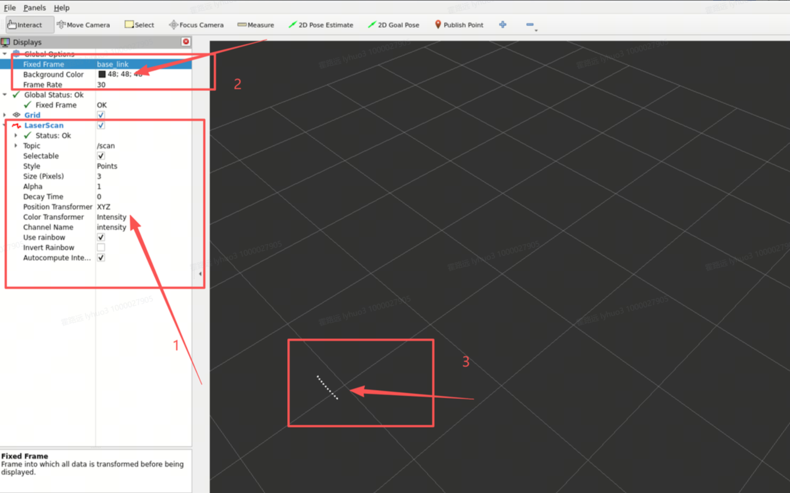

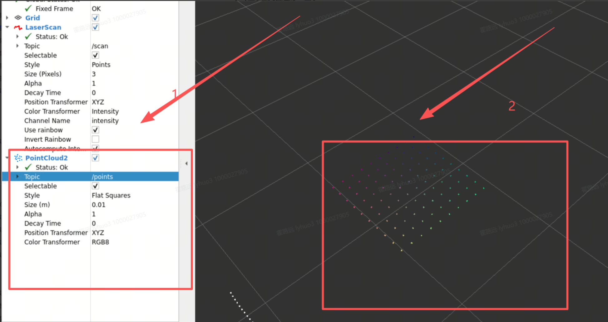

**易错点**：

- ⚠️ **LaserScan 数据不显示**：检查 (1) LaserScan 消息的 `frame_id` 是否能在 TF 树中找到从该 frame 到 Fixed Frame 的完整变换链；(2) `ranges` 数组中是否有非 inf/nan 的有效值；(3) `range_min`/`range_max` 的范围是否包含有效数据
- ⚠️ **PointCloud2 数据不显示或显示为单一颜色**：检查 (1) `fields` 数组定义与实际数据打包格式是否一致（offset 和 datatype 必须匹配）；(2) 如果包含 RGB 字段，确保 RGB 的 datatype 为 `FLOAT32`（ROS2 中 RGB 打包为 float32）

---

#### 步骤 5：Path 和 Marker 导航轨迹与标注

**知识点讲解**：

**Path 导航路径可视化与 Marker 自定义标注（知识点 4.2.2）**

**是什么**：

  - **Path Display**：将 `nav_msgs/msg/Path` 类型的数据渲染为 3D 空间中的连续折线（Line Strip）。每个路径点包含位姿和时间戳，Path Display 按顺序连接相邻路径点，形成轨迹线。常用于可视化机器人全局路径规划（global planner）的输出或实际走过的里程计轨迹。
  - **Marker Display**：ROS2 最灵活的可视化机制，支持 Arrow（箭头）、Cube（立方体）、Sphere（球体）、Cylinder（圆柱）、LineStrip（线段串）、Text（文字标签）、MeshResource（3D 模型文件）等多种图元。通过 Marker 的 `action` 字段控制 ADD（添加）、DELETE（删除）、MODIFY（修改）操作，可实现动态更新。
- **为什么 Marker 是"万能可视化工具"**：你可以用 Marker 在 Rviz2 中标注任何信息——目标抓取位置（球体）、视觉检测框（线框立方体）、机器人期望朝向（箭头）、任务状态文字（Text View Facing）——而无需编写新的 Display 插件或修改 Rviz2 源码。只需发布一个 `visualization_msgs/msg/Marker` 消息即可。

**操作步骤**：

```bash
发布模拟路径数据：
# 终端 G：发布 Path 路径数据
python3 -c "
import rclpy
from rclpy.node import Node
from nav_msgs.msg import Path
from geometry_msgs.msg import PoseStamped
import math

class FakePathNode(Node):
    def __init__(self):
        super().__init__('fake_path')
        self.pub = self.create_publisher(Path, '/plan', 10)
        self.timer = self.create_timer(1.0, self.publish_path)

    def publish_path(self):
        msg = Path()
        msg.header.stamp = self.get_clock().now().to_msg()
        msg.header.frame_id = 'map'

        # 生成正弦波形路径（20个采样点）
        for i in range(20):
            pose = PoseStamped()
            pose.header = msg.header
            pose.pose.position.x = i * 0.2
            pose.pose.position.y = math.sin(i * 0.5) * 0.5
            pose.pose.position.z = 0.0
            pose.pose.orientation.w = 1.0
            msg.poses.append(pose)

        self.pub.publish(msg)

def main():
    rclpy.init()
    rclpy.spin(FakePathNode())
    rclpy.shutdown()

if __name__ == '__main__':
    main()
"
发布 Marker 标注：
# 终端 H：发布 Marker 标注（目标点 + 文字标签）
python3 -c "
import rclpy
from rclpy.node import Node
from visualization_msgs.msg import Marker

class MarkerDemoNode(Node):
    def __init__(self):
        super().__init__('marker_demo')
        self.pub = self.create_publisher(Marker, '/visualization_marker', 10)
        self.timer = self.create_timer(1.0, self.publish_markers)

    def publish_markers(self):
        now = self.get_clock().now().to_msg()

        # Marker 1: 目标点（红色球体）
        m1 = Marker()
        m1.header.stamp = now
        m1.header.frame_id = 'map'
        m1.ns = 'demo'
        m1.id = 0
        m1.type = Marker.SPHERE
        m1.action = Marker.ADD
        m1.pose.position.x = 3.0
        m1.pose.position.y = 1.0
        m1.pose.position.z = 0.3
        m1.scale.x = 0.2; m1.scale.y = 0.2; m1.scale.z = 0.2
        m1.color.r = 1.0; m1.color.g = 0.0; m1.color.b = 0.0; m1.color.a = 0.8
        self.pub.publish(m1)

        # Marker 2: 朝向箭头（蓝色箭头）
        m2 = Marker()
        m2.header.stamp = now
        m2.header.frame_id = 'map'
        m2.ns = 'demo'
        m2.id = 1
        m2.type = Marker.ARROW
        m2.action = Marker.ADD
        m2.pose.position.x = 3.0
        m2.pose.position.y = 1.0
        m2.pose.position.z = 0.3
        m2.pose.orientation.w = 1.0
        m2.scale.x = 0.5; m2.scale.y = 0.05; m2.scale.z = 0.05
        m2.color.r = 0.0; m2.color.g = 0.0; m2.color.b = 1.0; m2.color.a = 0.8
        self.pub.publish(m2)

        # Marker 3: 文字标签
        m3 = Marker()
        m3.header.stamp = now
        m3.header.frame_id = 'map'
        m3.ns = 'demo'
        m3.id = 2
        m3.type = Marker.TEXT_VIEW_FACING
        m3.action = Marker.ADD
        m3.pose.position.x = 3.0
        m3.pose.position.y = 1.0
        m3.pose.position.z = 0.6
        m3.scale.z = 0.15  # 文字高度
        m3.color.r = 1.0; m3.color.g = 1.0; m3.color.b = 1.0; m3.color.a = 1.0
        m3.text = 'GOAL'
        self.pub.publish(m3)

def main():
    rclpy.init()
    rclpy.spin(MarkerDemoNode())
    rclpy.shutdown()

if __name__ == '__main__':
    main()
"
回到 Rviz2 界面：
# 5.1 添加 Path Display
# 点击 "Add" → 选择 "Path" → "OK"
# 在 Path Display 属性中:
#   - Topic: /plan
#   - Color: Blue（选蓝色）
#   - Line Style: Lines（或 Billboards）
#   - Line Width: 0.02
# 预期: 3D 视图中出现蓝色正弦波形路径线

# 5.2 添加 Marker Display
# 点击 "Add" → 选择 "Marker" → "OK"
# 在 Marker Display 属性中:
#   - Topic: /visualization_marker
# 预期: 3D 视图中在 (3.0, 1.0, 0.3) 位置出现:
#   - 半透明红色球体（目标点）
#   - 蓝色箭头（期望朝向）
#   - 白色 "GOAL" 文字标签（始终面向视角）
显示仿真的运动轨迹

显示仿真设置的位置点

```

---

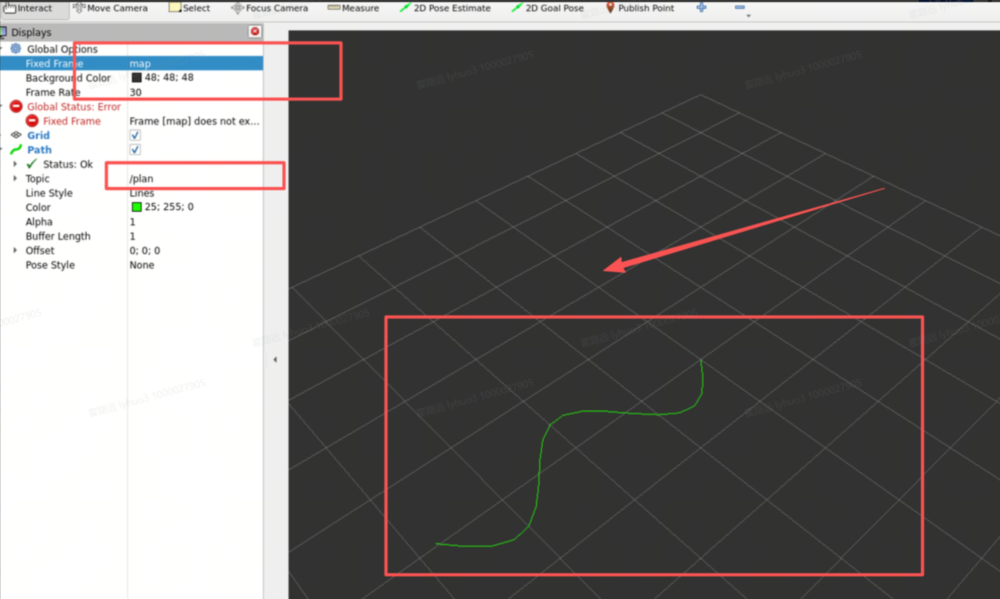

#### 步骤 6：Rviz2 配置文件保存与加载

**知识点讲解**：

.rviz 配置文件保存与加载（知识点 4.2.3）

- **是什么**：Rviz2 的 `.rviz` 配置文件是一个 YAML 格式的文件，完整记录了本次会话中的所有 Display 面板及其属性设置（Fixed Frame、话题名、颜色、透明度、视角等）。加载配置文件后，Rviz2 自动恢复之前的所有面板和属性，实现"一键复现"调试环境。
- **为什么这是团队协作的基础**：每个开发者可以为不同的调试场景保存独立的配置文件（如 `debug_sensors.rviz`、`debug_navigation.rviz`、`demo_presentation.rviz`），切换场景时加载对应配置即可。在团队协作中，将 `.rviz` 文件提交到 Git 仓库，其他人 clone 后执行 `rviz2 -d config/debug_sensors.rviz` 即可获得与你完全相同的可视化设置。

**操作步骤**：

```bash
# 6.1 保存当前配置
# Rviz2 菜单: File → Save Config As...
# 保存为: ~/exp15_rviz_config.rviz
# 预期: 文件保存成功，内容为 YAML 格式的 Display 配置

# 6.2 关闭 Rviz2
# Rviz2 菜单: File → Quit（或 Ctrl+Q）

# 6.3 使用保存的配置文件启动 Rviz2
rviz2 -d ~/exp15_rviz_config.rviz
# 预期: Rviz2 启动后自动恢复之前的所有 Display 面板和属性设置

# 6.4 查看配置文件内容
head -50 ~/exp15_rviz_config.rviz
# 预期: YAML 格式内容，包含 Global Options、各 Display 的类型和属性
```

---

#### 步骤 7：实验收尾与总结（5 分钟）

1. 关闭 Rviz2（File → Quit）
2. 在所有终端 `Ctrl+C` 终止所有 Python 脚本和节点
3. 确认 `ros2 node list` 输出为空

### 七、注意事项

| 类别 | 注意事项 |
|---|---|
| ⚠️ 显示 | Rviz2 需要 GPU 渲染支持，B2 实验箱的 Mali-G52 GPU 可运行轻量级场景；避免加载过多高分辨率点云或复杂 URDF 模型导致帧率下降 |
| ⚠️ 坐标系 | Fixed Frame 的选择是最关键的配置——它决定了所有数据的显示参考系。如果数据"位置不对""不显示""显示为原点"，首先要检查 Fixed Frame 是否正确 |
| ⚠️ 话题名 | 每个 Display 面板都需要指定正确的话题名（Topic）。使用 `ros2 topic list` 确认话题名无误后再配置到 Rviz2 |
| ⚠️ TF 树 | Rviz2 依赖 TF2 坐标变换树——如果变换链断裂（缺少某个 frame 的父坐标系），相关 Display 会显示黄色 Warning 状态 |
| ⚠️ 性能 | LaserScan 和 PointCloud2 是高频大数据，Rviz2 的 Decay Time 参数可以限制历史数据的渲染量，避免内存/GPU 过载 |
| ⚠️ 安全性 | Rviz2 仅可视化数据，不会向机器人发送控制指令——但 Marker 的交互功能（Interactive Marker）允许用户在 Rviz2 中拖拽位姿，需谨慎使用 |

### 八、实验总结

#### 8.1 完成成果

完成本实验后，你应当能够：

- ✅ 启动 Rviz2 并正确配置 Fixed Frame 全局参考坐标系
- ✅ 添加 TF Display 可视化坐标变换树及父子关系
- ✅ 添加 RobotModel Display 加载 URDF 模型并结合 robot_state_publisher 实现动态渲染
- ✅ 添加 LaserScan 和 PointCloud2 Display 分别可视化 2D 激光扫描和 3D 点云数据
- ✅ 添加 Path 和 Marker Display 展示导航路径和自定义几何标注
- ✅ 使用 `rviz2 -d` 加载保存的配置文件实现调试环境一键复现

#### 8.2 技能收获

| 技能 | 说明 |
|---|---|
| 3D 可视化 | 掌握 Rviz2 作为 ROS2 标准 3D 可视化平台的 Display 面板配置方法 |
| 坐标系理解 | 理解 Fixed Frame 在空间数据可视化中的核心作用：如何选择参考系以正确展示数据 |
| 调试思维 | 能通过 Rviz2 的黄色 Warning 状态快速定位 TF 变换链断裂、话题无数据等常见故障 |
| 配置管理 | 掌握 .rviz 配置文件的保存、加载和团队共享方法 |

#### 8.3 常见问题与解答

| 问题 | 原因 | 解决方法 |
|---|---|---|
| Rviz2 启动后黑屏 | GPU 驱动未就绪或渲染后端不兼容 | 检查 `glxinfo | grep "OpenGL renderer"`，确认 Mali-G52 驱动已加载 |
| 添加 Display 后无数据显示 | 话题名不匹配、Fixed Frame 不正确、话题无发布者 | (1) `ros2 topic list` 确认话题存在；(2) 检查 Fixed Frame 与消息的 frame_id 关系 |
| RobotModel 不显示 | `/robot_description` 无数据或 URDF 语法错误 | `ros2 topic echo /robot_description --once` 确认话题有数据；`check_urdf` 检查语法 |
| LaserScan 显示位置错误 | frame_id 在 TF 树中不存在或 TF 变换发布不正确 | `ros2 run tf2_tools view_frames` 查看完整 TF 树结构 |
| 视角操作后无法找回原始视角 | 手动旋转平移后迷失方向 | 在 Rviz2 左侧 Displays 面板右键 Grid → "Reset View" 恢复初始视角 |
| .rviz 文件不被终端识别 | 文件扩展名大小写或路径错误 | 使用 `rviz2 -d /absolute/path/to/config.rviz` 绝对路径 |

### 九、实验报告要求

#### 9.1 报告内容

完成实验后，提交一份实验报告，包含以下内容：

1. **实验基本信息**：实验名称、实验日期、实验者姓名、实验平台信息
2. **实验过程记录**：截取以下 Rviz2 面板配置和 3D 视图效果截图（至少 6 张）：(1) TF 坐标系可视化，(2) RobotModel 模型渲染，(3) LaserScan 激光数据，(4) PointCloud2 点云数据，(5) Path 路径轨迹，(6) Marker 标注。每张截图下方标注 Display 配置的关键参数
3. **TF 变换树图**：使用 `ros2 run tf2_tools view_frames` 生成的 PDF，或手绘本实验中使用的坐标系父子关系树
4. **原理分析**（不少于 300 字）：用自己的语言解释 Rviz2 的"Fixed Frame + Display 图层"架构设计——为什么需要 Fixed Frame？如果所有 Display 都在各自的数据本地坐标系中渲染（不使用 TF 变换），会产生什么问题？请用至少两个具体例子说明 Fixed Frame 的必要性。
5. **思考题**（见下方）

#### 9.2 思考题

**思考题 1**：

在步骤 4 中，你添加了 LaserScan Display 并配置了 `Topic: /scan`。假设你的机器人上有**两台**激光雷达：一台朝前（`/scan_front`，frame_id=`laser_front`），一台朝后（`/scan_back`，frame_id=`laser_back`）。你需要在 Rviz2 中同时看到两台雷达的数据，且都相对于 `base_link` 坐标系显示。请写出你的 Rviz2 配置方案，并说明如果 Fixed Frame 设为 `base_link`，两台雷达的数据如何在 3D 视图中正确显示（提示：考虑 TF 坐标变换的作用）。

**思考题 2**：

Marker 的类型非常丰富（Arrow、Cube、Sphere、Cylinder、LineStrip、Points、Text等）。请设计一个"机器人巡逻任务"的可视化方案：用 Marker 在 Rviz2 中标注 (1) 4 个巡逻航点（waypoint），(2) 航点之间的连接线，(3) 机器人当前目标的朝向箭头，(4) 每个航点的编号标签。写出每种标注应使用哪种 Marker 类型以及关键属性的配置思路。

#### 9.3 评分标准

| 评分项 | 权重 | 评分标准 |
|---|---|---|
| 实验操作完整性 | 30% | 是否按要求添加并配置了 TF、RobotModel、LaserScan、PointCloud2、Path、Marker 六种 Display |
| 截图与记录 | 15% | 截图是否清晰（≥6 张），配置参数标注是否准确 |
| TF 变换树分析 | 10% | TF 树图是否完整标注了所有坐标系及其父子关系 |
| 原理分析 | 25% | 对 Fixed Frame 架构设计原理的理解深度 |
| 思考题 1 | 10% | 多雷达可视化的方案合理性 |
| 思考题 2 | 10% | Marker 可视化方案的设计完整性与可实现性 |

## 实验16：ROS2录制回放工具

### 一、关联知识点

本实验关联以下知识图谱节点：

| 编号 | 知识点名称 | 类型 | 层级路径 |
|---|---|---|---|
| 4.3.1 | ros2 bag以SQLite3格式序列化存储话题消息 | 概念 | 第4章 ROS2工具链与系统部署 → 4.3 数据录制与回放 |
| 4.3.2 | ros2 bag record/play/info录制回放与元数据查询流程 | 流程 | 第4章 ROS2工具链与系统部署 → 4.3 数据录制与回放 |
| 4.3.3 | 回放bag数据+Rviz2同步可视化实现离线场景分析 | 流程 | 第4章 ROS2工具链与系统部署 → 4.3 数据录制与回放 |

### 二、实验目标

通过本实验的学习，学生能够：

1. **原理理解**：阐述 ros2 bag 基于 SQLite3 数据库的存储架构——为什么选择 SQLite3 而非二进制日志文件，以及消息序列化（CDR serialization）、时间戳索引、话题元数据表的内部组织结构如何支持高效的数据检索和随机访问
2. **流程掌握**：正确执行 `ros2 bag record -a` 全量录制、`ros2 bag record /topic1 /topic2` 选择性录制、`ros2 bag info` 查看元数据、`ros2 bag play -r <rate>` 调速回放完整工作流程
3. **独立完成**：独立设计一个数据采集策略——针对特定传感器组合（如激光雷达 + 相机 + 里程计），使用选择性录制参数和 bag 文件命名规范，建立可追溯的实验数据集
4. **迁移应用**：能够在后续实验中的数据驱动开发流程中，将录制-回放作为标准工作模式——录制真实传感器数据用于离线算法开发与回归测试，减少对实际硬件的依赖

### 三、实验环境

| 类别 | 配置 |
|---|---|
| 硬件平台 | 具身智能实验箱B2 |
| 操作系统 | Ubuntu 22.04 |
| ROS2 发行版 | Humble Hawksbi |
| 核心依赖 | `ros-humble-rosbag2`、`ros-humble-ros2bag`、`ros-humble-demo-nodes-cpp`、`ros-humble-rviz2`（用于离线可视化回放数据） |
| 存储要求 | bag 文件写入当前目录，建议 `~/ros2_bags/` 目录下操作，确保磁盘空间 ≥ 500MB |

> 说明：本实验使用 talker/listener 作为示例数据源进行录制与回放演示。学生可自行扩展：连接 B2 实验箱的传感器（如深度相机发布 Image 话题）录制实际传感器数据。

### 四、实验难度

| 维度 | 说明 |
|---|---|
| 难度等级 | ⭐（容易） |
| 实验类型 | 验证性 |
| 建议时长 | 2 学时（90 分钟） |

**重点**：

- 掌握 ros2 bag record 的选择性录制（`/topic1 /topic2`）与全量录制（`-a`）
- 掌握 ros2 bag play 的回放速率控制（`-r`）和时钟发布（`--clock`）

**难点**：

- 理解 `--clock` 参数对回放时 `use_sim_time` 的影响，以及为什么离线分析时需要同步仿真时钟
- 区分 `ros2 bag record` 的 `--max-bag-size`（单文件大小上限）与 `--max-cache-size`（内存缓存上限）的区别

### 五、实验现象

#### 5.1 快速验证流程

完成本实验后，你应能观察到以下现象：

1. `ros2 bag record -a -o test_all` 录制约 15 秒后 Ctrl+C 停止，当前目录生成 `test_all/` 文件夹（包含 `.db3` 文件和 `metadata.yaml`）
2. `ros2 bag info test_all` 输出录制的话题列表、消息数量、录制时长和文件大小
3. 停止所有节点后，`ros2 bag play test_all` 回放数据，同时启动 listener 可以接收到回放的 "Hello World" 消息
4. `ros2 bag play test_all -r 0.5` 以半速回放，listener 接收消息的间隔变为 2 秒（原为 1 秒）
5. 回放的同时启动 Rviz2，添加相应的 Display 面板，可以在 3D 视图中看到回放的传感器数据

#### 5.2 预期效果描述

| 操作 | 预期现象 |
|---|---|
| `ros2 bag record -a -o exp16_demo` | 终端显示正在录制的话题列表（/chatter, /parameter_events, /rosout）；Ctrl+C 停止后输出录制统计 |
| `ros2 bag info exp16_demo` | 显示话题数量≈3、消息数量、录制时长≈15s、文件大小（KB~MB 级别） |
| `ros2 bag play exp16_demo` | 终端滚动日志，显示每条消息的回放时间戳；`ros2 topic echo /chatter` 另一终端可看到回放的消息 |
| `ros2 bag play exp16_demo --clock --rate 0.5` | `/clock` 话题以实际时间的一半速度推进；消息回放间隔加倍 |
| 回放 + Rviz2（如 exp15 中的 LaserScan） | Rviz2 3D 视图中出现与原始录制时一致的点云/路径数据 |

---

### 六、实验步骤

#### 整体流程

```text
[1. 全量录制 (-a)] ──► [2. 查看 bag 信息] ──► [3. 回放与调速]
                                                      │
[6. 清理与总结] ◄── [5. 离线 Rviz2 分析] ◄── [4. 选择性录制与压缩]
```

---

#### 步骤 1：全量录制 — ros2 bag record -a

**知识点讲解**：

**ros2 bag 基于 SQLite3 的存储架构（知识点 4.3.1）**

- **是什么**：ros2 bag 是 ROS2 的官方数据录制工具，替代了 ROS1 中的 `rosbag`。它将话题消息以 SQLite3 数据库格式（`.db3` 文件）存储在磁盘上。每个 bag 文件内部包含两张核心表：`topics`（记录话题名称、消息类型、序列化格式）和 `messages`（记录每条消息的时间戳、话题 ID、序列化字节流）。包外还有一个 `metadata.yaml` 文件，提供录制起止时间、总消息数量等人类可读的元数据摘要。
- **为什么选择 SQLite3 而非二进制日志**：(1) SQLite3 支持索引和随机访问——你可以按时间戳快速跳到 bag 文件中的任意位置，而二进制日志文件只能顺序读取；(2) SQLite3 支持事务——录制过程中即使进程崩溃，已写入的数据不会损坏；(3) 跨平台和工具链成熟——任何编程语言都有 SQLite3 库，用户可以直接用 SQL 查询 bag 数据而不依赖 ROS2 工具；(4) 消息使用 CDR（Common Data Representation）序列化，与 DDS 线的传输格式一致，零转换开销。
- **怎么用**：`ros2 bag record -a` 录制所有当前活跃的话题。注意，录制操作只捕获**录制开始后**发布的消息——之前的历史数据不会被记录。如果某个话题在录制中途才开始发布，ros2 bag 会自动发现并开始录制该话题。

**操作步骤**：

```bash
# 1.1 创建存储目录
mkdir -p ~/ros2_bags
cd ~/ros2_bags

# 1.2 启动数据源节点（终端 A）
ros2 run demo_nodes_cpp talker
# 保持运行

# 1.3 启动 listener 增加系统活跃话题（终端 B）
ros2 run demo_nodes_cpp listener
# 保持运行

# 1.4 启动全量录制（终端 C）
ros2 bag record -a -o exp16_full
# 预期输出:
# [INFO] [rosbag2_recorder]: Listening for topics...
# [INFO] [rosbag2_recorder]: Subscribed to topic '/chatter'
# [INFO] [rosbag2_recorder]: Subscribed to topic '/parameter_events'
# [INFO] [rosbag2_recorder]: Subscribed to topic '/rosout'
# [INFO] [rosbag2_recorder]: Recording...

# 等待约 15 秒后按 Ctrl+C 停止录制
# 预期输出:
# [INFO] [rosbag2_recorder]: Recording stopped
# [INFO] [rosbag2_recorder]: Recorded N messages
# 1.5 查看生成的文件结构
ls -lh exp16_full/
# 预期输出类似:
# exp16_full.db3        (SQLite3 数据库文件)
# metadata.yaml          (元数据文件)
# 1.6 查看 metadata.yaml 内容
cat exp16_full/metadata.yaml
# 预期输出:
# rosbag2_bagfile_information:
#   version: ...
#   storage_identifier: sqlite3
#   relative_file_paths:
#     - exp16_full.db3
#   duration:
#     nanoseconds: 15000000000
#   starting_time:
#     nanoseconds_since_epoch: ...
#   message_count: N
#   topics_with_message_count:
#     - topic_metadata:
#         name: /chatter
#         type: std_msgs/msg/String
#         serialization_format: cdr
#       message_count: ~15
#     ..
```

**易错点**：

- ⚠️ **录制后 `ros2 topic echo` 在录制终端看不到输出**：`ros2 bag record` 运行时本身不显示消息内容，只显示订阅确认和统计信息。这是正常的——它在后台静默录制。要观察消息内容，在另一个终端使用 `ros2 topic echo`。
- ⚠️ **Ctrl+C 停止录制后文件大小为 0**：如果录制时间太短（< 1-2 秒），可能还没完成 SQLite3 写入就退出了。建议至少录制 10 秒以上。

---

#### 步骤 2：查看 bag 信息 — ros2 bag info

**知识点讲解**：

**bag 文件的元数据查询与分析（知识点 4.3.2）**

- **是什么**：`ros2 bag info` 读取 bag 文件的 SQLite3 内部元数据和 `metadata.yaml`，汇总输出：录制时长、话题列表（每个话题的消息类型、消息数量、平均频率）、总消息数、总文件大小。
- **为什么这是数据处理的第一步**：在你继承一个别人的 bag 文件、或录制后几周回头查看时，你需要快速回答以下问题而不必回放整个文件："这个 bag 录了多久？""里面有没有 `/camera/image_raw` 这个话题？""激光雷达数据的频率是多少（可以推断录制时传感器配置）？"`ros2 bag info` 在毫秒级回答这些问题。

**操作步骤**：

```bash
# 2.1 查看 bag 的完整信息
ros2 bag info exp16_full
# 预期输出:
# Files:             exp16_full.db3
# Bag size:          XX.X KB
# Storage id:        sqlite3
# Duration:          ~15.Xs
# Start:             ...
# End:               ...
# Messages:          N
# Topic information:
#   Topic: /chatter | Type: std_msgs/msg/String | Count: ~15 | Serialization Format: cdr
#   Topic: /parameter_events | ... | Count: ...
#   Topic: /rosout | ... | Count: ...
```

**信息解读**：

- **Duration**：实际录制时长。如果消息频率是 1Hz，Duration 为 15 秒，则 `/chatter` 的 Count 大致也是 15
- **Bag size**：文件占用磁盘空间。同一段数据，话题数量越多、消息频率越高、消息体越大，文件越大
- **Count**：每个话题的消息条数。Count / Duration ≈ 该话题在录制时段的平均频率

---

#### 步骤 3：回放数据 — ros2 bag play（20 分钟）

**知识点讲解**：

**ros2 bag play 的回放机制与时间控制（知识点 4.3.2）**

- **是什么**：`ros2 bag play` 从 bag 文件中读取每条消息的时间戳，按照原始的时间间隔逐一重新发布到对应的 ROS2 话题上。基础用法：`ros2 bag play <bag_path>` 以原始速率回放。关键参数：
  - `-r <rate>` / `--rate <rate>`：回放速率倍数。`-r 2.0` 以 2 倍速回放（消息间隔减半），`-r 0.5` 以半速回放（消息间隔加倍）。注意：速率调整不影响消息内容中的时间戳——回放的消息仍保留原始时间戳
  - `--clock`：回放时发布 `/clock` 话题（`rosgraph_msgs/msg/Clock`），其时间根据回放进度推进。这使你可以设置其他节点的 `use_sim_time=True`，让它们"认为"当前就是 bag 录制时的那个时刻
  - `--loop`：循环回放，到达 bag 末尾后自动跳回开头重新播放
  - `-t <topic>` / `--topics <topic>`：仅回放指定的话题，忽略 bag 中的其他话题
- **为什么 --clock 如此重要**：许多 ROS2 节点依赖 `get_clock().now()` 获取当前时间进行数据融合、超时判定、TF 变换缓存等操作。如果回放 bag 时不发布 `/clock`，节点的 `get_clock().now()` 返回真实的"现在"时间（2026-08-10），而消息中的时间戳是录制时的时间（如 2026-08-09）——两者差了一天，导致 TF Lookup 超时、数据融合等算法判断"数据已过期"而丢弃。启用 `--clock` + 节点设置 `use_sim_time=True` 后，节点的时间感知与回放同步。

**操作步骤**：

```bash

# 3.1 停止所有数据源节点（终端 A 和 B Ctrl+C）
# 确认系统空闲
ros2 node list
# 预期: 空输出

# 3.2 新开终端 B，启动 listener 作为回放验证
ros2 run demo_nodes_cpp listener
# 保持运行，观察回放时的消息接收

# 3.3 终端 C：以原始速率回放 bag
ros2 bag play exp16_full
# 预期输出:
# [INFO] [rosbag2_player]: Playback until timestamp: ...
# 终端 B 的 listener 应输出:
# I heard: [Hello World: 1]
# I heard: [Hello World: 2]
# ...（与录制时完全一致的消息序列）

# 3.4 回放速率调整实验
# 以 2 倍速回放（消息间隔减半）
ros2 bag play exp16_full -r 2.0
# 预期: listener 接收消息的间隔变为约 0.5 秒（原为 1 秒）

# 以半速回放（消息间隔加倍）
ros2 bag play exp16_full -r 0.5
# 预期: listener 接收消息的间隔变为约 2 秒

# 3.5 验证 --clock 参数的效果
# 终端 D：启动一个使用仿真时间的节点
python3 -c "
import rclpy
rclpy.init()
node = rclpy.create_node('sim_time_demo')
# 注意：需要在节点参数中启用 use_sim_time
node.declare_parameter('use_sim_time', True)
timer = node.create_timer(1.0, lambda: print(f'Current time: {node.get_clock().now().nanoseconds * 1e-9:.3f}s'))
rclpy.spin(node)
" &
# 在不回放时，该节点的时间停滞（因为没有 /clock 发布者）

# 终端 C：回放并启用时钟发布
ros2 bag play exp16_full --clock
# 观察终端 D 的输出——时间应该随着回放推进而前进

# 3.6 仅回放指定话题
ros2 bag play exp16_full -t /chatter
# 预期: 仅 /chatter 话题的消息被回放，/parameter_events 和 /rosout 被忽略

```

**易错点**：

- ⚠️ **回放时 listener 收不到消息**：首先确认 `ros2 topic list` 中是否出现了 `/chatter`（回放创建了新的 Publisher）。如果 `/chatter` 出现但 listener 没反应，检查 listener 的 QoS 设置——ros2 bag play 默认使用 `KEEP_LAST` + `RELIABLE` QoS
- ⚠️ **回放结束后 listener 立即停止输出**：这是预期行为——bag 文件中的消息播放完毕后，Publisher 销毁。如果需要持续测试，使用 `--loop` 参数循环回放
- ⚠️ `--clock` 回放时节点报 "时间跳变" 警告**：回放结束或跳到开头时，`/clock` 时间可能大幅跳变，导致依赖连续时间的节点（如 TF2 Buffer）报 WARN。这是正常现象，可以通过 `--start-offset` 参数从 bag 中间位置开始回放来避免

---

#### 步骤 4：选择性录制与高级配置（15 分钟）

**知识点讲解**：

**选择性录制 **`ros2 bag record /topic1 /topic2`**（知识点 4.3.2）**

- **是什么**：`ros2 bag record /topic1 /topic2 ...` 仅录制命令行中明确列出的话题，忽略系统中其他所有活跃话题。`ros2 bag record -a` 则录制当前时刻**所有**活跃的话题。
- **为什么选择性录制是生产环境中的标准做法**：全量录制 `-a` 在开发中很方便，但在实际机器人场景中有三个严重问题：(1) 相机图像话题（`/camera/image_raw`）可能是 30Hz 的 1920x1080 RGB 图像，每秒产生约 178MB 数据——5 分钟就超过 50GB；(2) 大量系统级话题（`/parameter_events`、`/rosout`、`/tf`、`/tf_static`）会混杂在 bag 中，增加回放时的 CPU 和内存开销；(3) 选择性录制使你可以为每次实验精确定义一个"数据组合"——如调试导航时只录 `/scan` + `/odom` + `/cmd_vel`，调试视觉时只录 `/camera/image_raw` + `/camera/depth`。

**高级参数**：

  - `--max-bag-size <MB>`：当 bag 文件超过指定大小时自动分割（创建新的 .db3 文件），防止单个文件过大
  - `--max-cache-size <MB>`：内存中消息缓存区大小——录制时，消息先写入内存缓存，再异步写入磁盘。缓存过小可能导致消息丢失，缓存过大则增加内存占用
  - `-c` / `--compression-mode`：压缩模式（`message` 或 `file`），减少磁盘占用。`message` 模式压缩每条消息（适合高压缩率数据类型），`file` 模式压缩整个文件（速度更快）

**操作步骤**：

```bash
# 4.1 启动数据源（终端 A）
ros2 run demo_nodes_cpp talker

# 4.2 选择性录制——仅录制 /chatter 话题（终端 B）
ros2 bag record /chatter -o exp16_chatter_only
# 预期输出: 仅显示 Subscribed to topic '/chatter'，不录制其他话题
# 录制约 10 秒后 Ctrl+C 停止

# 4.3 对比选择性录制和全量录制的文件大小
ls -lh exp16_full/ exp16_chatter_only/
# 预期: exp16_chatter_only 明显小于 exp16_full（不包含 /parameter_events、/rosout 等系统话题）

# 4.4 查看选择性录制 bag 的信息
ros2 bag info exp16_chatter_only
# 预期: Topic information 中仅显示 /chatter 一个业务话题

# 4.5 使用压缩录制（减少磁盘占用）
ros2 bag record -a -o exp16_compressed -c message
# 预期: 终端显示启用了压缩模式。录制完成后对比未压缩版本的文件大小

# 4.6 使用文件大小限制（B2 实验箱磁盘空间有限时尤其重要）
ros2 bag record -a -o exp16_split --max-bag-size 1
# 参数含义: 单个 .db3 文件最大 1MB，超过后自动创建新文件
# 录制约 20 秒后 Ctrl+C 停止
ls -lh exp16_split/
# 预期: 如果总数据超过 1MB，会看到多个 .db3 文件（exp16_split_0.db3, exp16_split_1.db3, ...）

```

**易错点**：

- ⚠️ **选择性录制的话题名不存在**：如果指定的某个话题当前没有 Publisher，ros2 bag recorder 仍会订阅该话题（等待未来的 Publisher 出现），不会报错。如果直到录制结束该话题都未出现，bag 中不会有该话题的数据
- ⚠️ **压缩对 CPU 的额外开销**：`-c message` 在 B2 实验箱的 RK3576 上会增加约 10-20% 的 CPU 占用。对于 10Hz 以下的低频话题影响不大，但对于 30Hz 的图像话题需评估是否影响其他实时任务

---

#### 步骤 5：回放数据与 Rviz2 联合离线分析

**知识点讲解**：

**bag 回放 + Rviz2 同步可视化实现离线场景复现（知识点 4.3.3）**

- **是什么**：离线分析的核心工作流程为：(1) 在真实场景中录制传感器数据到 bag 文件，(2) 将 bag 文件拷贝到开发机，(3) 使用 `ros2 bag play --clock` 回放数据，(4) 同步启动 Rviz2 并设置 `use_sim_time=true`，(5) 在 Rviz2 中添加相应的 Display 面板，观察回放的传感器数据在 3D 视图中的渲染效果。
- **为什么这个工作流改变了机器人算法开发方式**：传统的机器人算法开发需要"人在机器人旁"——每次修改代码后，必须连接实际硬件才能测试。bag 回放将开发过程"离线化"：(1) 在实验室录制 5 分钟的各种场景数据，(2) 在办公桌上反复回放这些数据来开发和调试算法，(3) 算法在 bag 数据上通过测试后，再到真实机器人上做最终验证。这个流程将硬件依赖的调试时间从 80% 降到 20%，大幅提升开发效率。

**操作步骤**：

```bash
# 5.1 确保使用了 --clock 参数回放（终端 A）
ros2 bag play exp16_full --clock --loop
# 保持运行，回放时 /clock 话题被持续发布

# 5.2 启动 Rviz2，设置 use_sim_time（终端 B）
rviz2 --ros-args -p use_sim_time:=true
# 或者先 export 环境变量再启动
# export ROS_PARAM_OVERRIDES="use_sim_time:=true"
# rviz2
在 Rviz2 界面中：
# 5.3 验证仿真时间是否生效
# 菜单: Panels → Add New Panel → "Time"
# Time 面板应显示与 bag 回放同步的时间（而非当前系统时间）

# 5.4 添加相应的 Display 面板
# 如果 bag 中包含 LaserScan 数据: 添加 LaserScan Display
# 如果 bag 中包含 TF 数据: 添加 TF Display
# 如果 bag 中包含 Path 数据: 添加 Path Display
对于本实验的简单数据（/chatter 是 String 类型，非传感器数据），Rviz2 联合验证的展示效果有限。以下提供一个扩展示例，演示如何在有传感器数据的场景中分析 bag：
# 扩展示例（如果有 B2 实验箱的深度相机可用）：
# 步骤 1: 录制深度相机的 RGB 图像话题
# ros2 bag record /camera/color/image_raw -o exp16_camera_test
#
# 步骤 2: 回放并启动 Rviz2
# ros2 bag play exp16_camera_test --clock
# rviz2 --ros-args -p use_sim_time:=true
#
# 步骤 3: 在 Rviz2 中添加 Image Display
# Topic: /camera/color/image_raw
# 预期: Rviz2 的 Image 面板中显示录制的相机画面，重现原始场景
```

**易错点**：

- ⚠️ **Rviz2 的 Time 面板显示时间为 0 或不动**：确认 (1) bag 回放使用了 `--clock` 参数；(2) Rviz2 启动时设置了 `use_sim_time:=true`
- ⚠️ **回放速度太快或太慢，Rviz2 渲染卡顿**：调整回放速率 `-r 0.5` 降低数据速率，给 Rviz2 渲染留出时间。也可以在回放时指定 `-t <topic>` 仅回放特定的传感器话题，减少数据处理量

---

#### 步骤 6：实验收尾与总结（5 分钟）

1. `Ctrl+C` 终止所有回放进程
2. 终止 Rviz2
3. 清理测试文件（可选）：
4. cd ~/ros2_bags

```bash
rm -rf exp16_full exp16_chatter_only exp16_compressed exp16_spli
```

### 七、注意事项

| 类别 | 注意事项 |
|---|---|
| ⚠️ 磁盘 | bag 文件可能迅速增长——在 B2 实验箱录制 30Hz 的 640x480 图像话题，约 15 分钟就会填满 2GB 空间。建议录制前用 `df -h` 确认可用空间，并定期清理旧的 bag 文件 |
| ⚠️ 数据安全 | bag 文件中包含传感器可能拍到的敏感信息（人脸、室内布局等），分享 bag 文件时注意数据隐私 |
| ⚠️ 时钟同步 | 离线分析时必须同时启用 bag play 的 `--clock` 和 Rviz2/其他节点的 `use_sim_time:=true`，否则 TF 变换和数据显示会出现时间戳不匹配 |
| ⚠️ QoS 兼容 | 回放的 QoS 策略可能与订阅节点的期望不匹配——如果回放数据速度过快导致消息丢失，检查 Publisher/Subscriber 的 QoS 兼容性 |
| ⚠️ 录制权限 | bag 文件默认写入当前目录，确保当前目录有写入权限。避免在 `/opt/ros/` 等系统目录下操作 |
| ⚠️ 选择性录制 | 指定话题名时注意话题名区分大小写（`/Chatter` 和 `/chatter` 不同）。先用 `ros2 topic list` 确认准确的话题名 |

### 八、实验总结

#### 8.1 完成成果

完成本实验后，你应当能够：

- ✅ 使用 `ros2 bag record -a` 录制全系统话题数据
- ✅ 使用 `ros2 bag record /topic1 /topic2` 选择性录制指定话题
- ✅ 使用 `ros2 bag info` 查看 bag 文件的元数据（话题、消息数、时长）
- ✅ 使用 `ros2 bag play` 回放数据并控制速率（`-r`）和时钟（`--clock`）
- ✅ 结合 `--clock` 回放和 Rviz2 的 `use_sim_time` 完成离线数据可视化分析

#### 8.2 技能收获

| 技能 | 说明 |
|---|---|
| 数据采集 | 掌握 ros2 bag record 的全量/选择性录制、压缩、分片等参数配置 |
| 数据管理 | 理解 bag 文件的 SQLite3 存储结构和 metadata.yaml 元数据规范 |
| 离线开发 | 掌握 bag 回放 + use_sim_time 的离线算法开发工作流 |
| 场景复现 | 能通过回放 bag 数据在 Rviz2 中重建原始传感器场景，支持 Bug 复现和回归测试 |

#### 8.3 常见问题与解答

| 问题 | 原因 | 解决方法 |
|---|---|---|
| `ros2 bag record` 命令不存在 | rosbag2 包未安装 | `sudo apt install ros-humble-rosbag2 ros-humble-ros2bag` |
| 录制时磁盘空间迅速耗尽 | 录制了高频大体积话题（如图像） | 使用选择性录制（指定话题名），或配置 `--max-bag-size` 限制文件大小 |
| 回放时无消息输出 | bag 文件损坏或回放的话题无当前订阅者 | `ros2 bag info` 确认 bag 文件中的话题列表；启动对应的订阅者节点 |
| 回放时 `use_sim_time` 不生效 | 节点未在创建时声明 `use_sim_time` 参数或设置时机不对 | 在节点启动前设置 `--ros-args -p use_sim_time:=true`（必须在 spin 之前） |
| bag 文件在不同 ROS2 版本间不兼容 | rosbag2 在 Iron/Humble 之间的存储格式可能有差异 | 使用 `ros2 bag convert` 进行格式转换（如需跨版本使用） |
| bag 回放无法重现 TF 变换 | `/tf_static` 在录制时只发布一次，回放时也仅发布一次 | 如果订阅者错过了 `/tf_static` 的第一次发布，使用 `--loop` 循环回放或手动重新发布静态 TF |

### 九、实验报告要求

#### 9.1 报告内容

完成实验后，提交一份实验报告，包含以下内容：

1. **实验基本信息**：实验名称、实验日期、实验者姓名、实验平台信息
2. **实验过程记录**：截取以下关键操作的结果输出截图（至少 5 张）：(1) `ros2 bag record -a` 录制过程，(2) `ros2 bag info` 元数据输出，(3) `ros2 bag play` 回放过程，(4) 选择性录制后 `ros2 bag info` 的话题对比，(5) 回放 + Rviz2 的可视化界面（如有传感器数据）
3. **数据采集方案设计**（不少于 200 字）：假设你需要为"机器人避障导航算法开发"设计数据采集策略，B2 实验箱配备了激光雷达（/scan）、RGB-D 相机（/camera/color/image_raw + /camera/depth/image_raw）和里程计（/odom）。请设计：(1) 选择性录制的话题组合，(2) bag 文件命名规范（便于追溯实验日期和场景），(3) 预计磁盘空间需求和录制时长建议
4. **思考题**（见下方）

#### 9.2 思考题

**思考题 1**：

在 ros2 bag 中，每条消息的时间戳有两个来源——消息体中的 `header.stamp`（由传感器或算法节点在生成消息时填入）和 ros2 bag 接收消息时的本地系统时间戳。这两个时间戳可能不一致（尤其是在网络延迟较大的分布式系统中）。请分析这两种时间戳的差异在什么场景下会导致问题，并设计一个方案来检测和量化这种时间偏移。

**思考题 2**：

假设你的机器人上运行着 15 个话题（包括传感器、控制指令、状态反馈），你录制了一段 10 分钟的 bag 文件。两周后，你需要在不同版本的导航算法上各测试一次（共 3 个版本），比较三者在同一段 bag 数据上的表现。请设计一个标准化测试流程，确保：(1) 每个算法版本在完全相同的输入条件下测试，(2) 测试结果可量化对比（如通过率、平均处理时间），(3) 测试过程可自动化执行（减少人工操作）。

#### 9.3 评分标准

| 评分项 | 权重 | 评分标准 |
|---|---|---|
| 实验操作完整性 | 30% | 是否按要求完成了全量录制、信息查看、回放调速、选择性录制四个核心操作 |
| 截图与记录 | 15% | 截图是否清晰（≥5 张），是否标注了关键参数和输出 |
| 数据采集方案 | 25% | 方案的话题选择是否合理、命名规范是否清晰、磁盘估算是否准确 |
| 思考题 1 | 15% | 对时间戳双来源问题的分析深度和检测方案的可行性 |
| 思考题 2 | 15% | 标准化测试流程的完整性、可自动化和可量化程度 |

## 实验17：ROS2 Launch启动文件配置

### 一、关联知识点

本实验关联以下知识图谱节点：

| 编号 | 知识点名称 | 类型 | 层级路径 |
|---|---|---|---|
| 4.4.1 | Launch文件以Python/XML/YAML声明多节点启动配置 | 概念 | 第4章 ROS2工具链与系统部署 → 4.4 Launch启动管理 |
| 4.4.2 | Python Launch文件编写：Node声明/参数/remapping→LaunchDescription流程 | 流程 | 第4章 ROS2工具链与系统部署 → 4.4 Launch启动管理 |
| 4.4.3 | IfCondition条件启动/OnProcessExit事件触发/LaunchArgument参数化复用原理 | 原理 | 第4章 ROS2工具链与系统部署 → 4.4 Launch启动管理 |

### 二、实验目标

通过本实验的学习，学生能够：

1. **原理理解**：阐述 ROS2 Launch 系统的架构演进（从 ROS1 的 XML-only `roslaunch` 到 ROS2 的 Python-first `ros2 launch`）背后的设计逻辑——为什么 Python 作为 Launch 文件的推荐语言，以及事件驱动架构（event-driven）如何实现比 XML 静态声明更灵活的多节点启动编排
2. **流程掌握**：独立编写 Python Launch 文件，正确声明 `Node(package, executable, parameters, remappings, output)` 并构建 `LaunchDescription`，通过 `ros2 launch <pkg> <file>` 启动多节点系统
3. **独立完成**：独立实现 remap（话题重映射）将一个话题重映射到另一个名称、条件启动（`IfCondition`/`UnlessCondition`）根据参数选择性启用节点、事件触发（`OnProcessExit`）实现 A 节点退出后自动启动 B 节点的连锁编排
4. **迁移应用**：能够为之前的实验（如 exp06 的 MQ5 传感器+订阅者、exp07 的指纹传感器+客户端）编写统一的 Launch 启动文件，实现一键启动完整传感器数据采集系统

### 三、实验环境

| 类别 | 配置 |
|---|---|
| 硬件平台 | 具身智能实验箱B2 |
| 操作系统 | Ubuntu 22.04 |
| ROS2 发行版 | Humble Hawksbill |
| 核心依赖 | `ros-humble-ros2launch`、`ros-humble-launch`、`ros-humble-launch-ros`、`ros-humble-demo-nodes-cpp` |
| 开发工具 | 文本编辑器（vim/nano/gedit）或 VS Code |

> 说明：本实验为 Python 编程 + 命令行工具实验。Launch 文件位于功能包的 `launch/` 目录下，需配合 colcon 编译后的工作空间使用。本实验提供独立于功能包的 Launch 文件示例（通过 `ros2 launch` 直接指定文件路径）。

### 四、实验难度

| 维度 | 说明 |
|---|---|
| 难度等级 | ⭐⭐（中等） |
| 实验类型 | 设计性 |
| 建议时长 | 2 学时（90 分钟） |

**重点**：

- 掌握 Python Launch 文件的 `Node` 声明和 `LaunchDescription` 构建
- 掌握 remap 话题重映射的语法和实际使用场景

**难点**：

- 理解 Launch 的"事件驱动"架构——`LaunchDescription` 不仅是一组 Action 的列表，更是 Action 之间的条件依赖和事件触发关系
- 掌握 `IfCondition`/`UnlessCondition` 与 `LaunchConfiguration` 的配合，实现"一份 Launch 文件适配多种场景"

### 五、实验现象

#### 5.1 快速验证流程

完成本实验后，你应能观察到以下现象：

1. 执行 `ros2 launch <pkg> <launch_file>` 后，终端自动启动 Launch 文件中声明的所有节点，无需手动逐一启动
2. 使用 remap 参数后，原本发布到 `/chatter` 的话题被重映射到 `/my_topic`，订阅 /chatter 的 listener 无法收到数据，但订阅 /my_topic 的新订阅者可以
3. 使用 `LaunchConfiguration` 传递运行时参数后，不同参数值导致 Launch 文件启动不同组合的节点
4. 使用 `OnProcessExit` 事件触发后，A 节点退出时自动启动 B 节点

#### 5.2 预期效果描述

| Launch 特性 | 预期现象 |
|---|---|
| 基础 Node 启动 | 同时启动 talker 和 listener，listener 收到消息 |
| remap 重映射 | talker 发布到 `/my_chatter`，原 `/chatter` 无数据 |
| 参数传递 | `ros2 launch ... param_value:=5` 后，节点使用不同的参数行为 |
| IfCondition 条件启动 | `enable_debug:=true` 时额外启动调试节点；`false` 时仅启动核心节点 |
| OnProcessExit 事件 | talker 退出（Ctrl+C 模拟或超时退出）后，自动启动一个"清理"节点 |

---

### 六、实验步骤

#### 整体流程

```text
[1. 基础 Launch 文件编写] ──► [2. Node 参数与 remap] ──► [3. LaunchConfiguration 参数化]
                                                                      │
[6. 整合练习与总结] ◄── [5. 事件触发 OnProcessExit] ◄── [4. IfCondition 条件启动]
```

---

#### 步骤 1：基础 Launch 文件编写与运行

**知识点讲解**：

**ROS2 Launch 系统架构演进（知识点 4.4.1）**

- **是什么**：ROS2 Launch 是管理多节点系统启动的官方工具。一个 Launch 文件（后缀 `.launch.py`、`.launch.xml` 或 `.launch.yaml`）声明了：哪些节点要启动、每个节点的参数配置、话题重映射规则、节点之间的启动顺序和依赖关系。`ros2 launch` 命令解析 Launch 文件，按照声明的内容依次执行启动操作。
- **为什么 Python 成为推荐语言**：ROS1 的 `roslaunch` 仅支持 XML，所有逻辑都必须用 XML 标签的嵌套和属性来描述——这导致复杂场景（如"如果参数 A=5 则启动节点 X，否则启动节点 Y""节点 A 退出后，等待 3 秒再启动节点 B"）要么无法表达，要么需要用极其冗长和难以维护的 XML 实现。ROS2 Launch 的 Python API 将启动编排提升为**图灵完备的编程语言**——你可以使用 Python 的所有控制流（if/for/while）、数据结构（dict/list）、和函数模块化，从而实现比 XML 灵活得多的启动逻辑。

**三种格式的对比与选择**：

  - **Python（.launch.py）**：推荐首选。适合需要复杂逻辑的场景，支持条件、循环、事件等高级特性。唯一的缺点是语法稍复杂（需要理解 `LaunchDescription` 和 `Action` 对象）
  - **XML（.launch.xml）**：语法简单，与 ROS1 的 roslaunch XML 语法类似。适合简单场景（只需启动一组固定节点），迁移成本低
  - **YAML（.launch.yaml）**：语法更简洁，但支持的 Launch 特性最少。一般不推荐用于生产

**核心概念**：

  - **LaunchDescription**：Launch 文件的"输出产品"，包含一组 `Action`（操作）的列表。`ros2 launch` 读取 `LaunchDescription`，按顺序执行其中的 Action
  - **Node Action**：最常用的 Action 类型，表示启动一个 ROS2 节点。包含 `package`（包名）、`executable`（可执行文件名）、`name`（节点名）、`parameters`（参数）、`remappings`（话题重映射）等属性
  - **LaunchConfiguration**：运行时变量，用户可以在 `ros2 launch` 命令行中通过 `key:=value` 语法传入，或在 Launch 文件中设置默认值

**操作步骤**：

```bash
使用以下方法创建临时功能包承载 Launch 文件：
# 1.3 替代方法：创建功能包存放 Launch 文件
mkdir -p ~/launch_demo_pkg/launch
cp ~/ros2_launch_demo/basic_launch.py ~/launch_demo_pkg/launch/

# 创建最小 package.xml
cat > ~/launch_demo_pkg/package.xml << 'XMLEOF'
<?xml version="1.0"?>
<?xml-model href="http://download.ros.org/schema/package_format3.xsd" schematypens="http://www.w3.org/2001/XMLSchema"?>
<package format="3">
  <name>launch_demo_pkg</name>
  <version>0.0.1</version>
  <description>Launch demo package for EXP17</description>
  <maintainer email="student@example.com">Student</maintainer>
  <license>Apache-2.0</license>

  <buildtool_depend>ament_cmake</buildtool_depend>

  <exec_depend>demo_nodes_cpp</exec_depend>
  <exec_depend>ros2launch</exec_depend>

  <export>
    <build_type>ament_cmake</build_type>
  </export>
</package>
XMLEOF

# 创建最小 CMakeLists.txt
cat > ~/launch_demo_pkg/CMakeLists.txt << 'CMEOF'
cmake_minimum_required(VERSION 3.8)
project(launch_demo_pkg)

if(CMAKE_COMPILER_IS_GNUCXX OR CMAKE_CXX_COMPILER_ID MATCHES "Clang")
  add_compile_options(-Wall -Wextra -Wpedantic)
endif()

find_package(ament_cmake REQUIRED)

# 安装 launch 文件到 share 目录
install(DIRECTORY launch DESTINATION share/${PROJECT_NAME})

ament_package()
CMEOF

# 编译功能包
cd ~/launch_demo_pkg
colcon build --packages-select launch_demo_pkg
source install/setup.bash

# 运行 Launch 文件
ros2 launch launch_demo_pkg basic_launch.py
由于 Launch 文件通常放在功能包的 launch/ 目录中，对于本实验的独立文件，我们需要使用 ros2 launch 的绝对路径模式：
# 1.3 方法一：通过完整路径运行 Launch 文件（ROS2 Humble 支持）
# 注意：某些 ROS2 版本要求 Launch 文件必须在功能包内
# 以下方法在 Humble 中验证有效
cd ~/ros2_launch_demo
ros2 launch basic_launch.py
```

**预期输出**：

```text
[INFO] [launch]: All log files can be found below ...
[INFO] [launch]: Defaulting event handling to actions.
[INFO] [my_talker-1]: process started with pid [XXXX]
[INFO] [my_listener-2]: process started with pid [XXXX]
[my_talker-1] [INFO] [...] [my_talker]: Publishing: 'Hello World: 1'
[my_listener-2] [INFO] [...] [my_listener]: I heard: [Hello World: 1]
[my_talker-1] [INFO] [...] [my_talker]: Publishing: 'Hello World: 2'
[my_listener-2] [INFO] [...] [my_listener]: I heard: [Hello World: 2]

按 Ctrl+C 退出——Launch 进程会自动向所有子节点发送 SIGINT 信号，优雅终止。
```

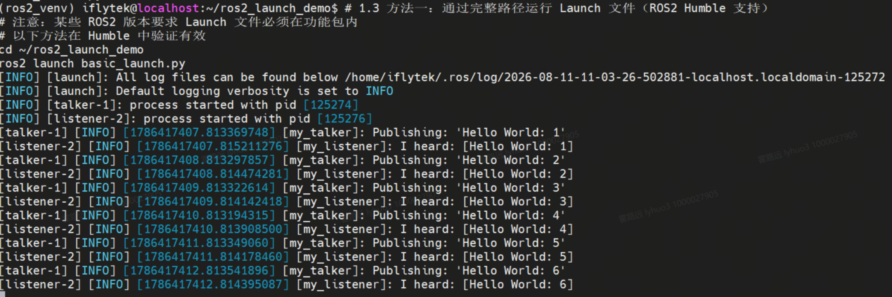

**关键观察点**：

- 一次性启动了 2 个节点——无需手动打开 2 个终端
- 每个节点的日志前缀带有 `[my_talker-1]` 和 `[my_listener-2]` 标识，方便区分
- `Ctrl+C` 一次即可终止所有节点——Launch 进程负责清理子进程

**易错点**：

- ⚠️ `ros2 launch` 报 "No launch file found"**：Launch 文件必须位于功能包的 `share/<pkg>/launch/` 路径下（通过 `install(DIRECTORY launch ...)` 安装）。如果报了此错误，检查：(1) `colcon build` 是否成功，(2) `source install/setup.bash` 是否执行，(3) `ros2 pkg list | grep launch_demo_pkg` 确认包是否已注册
- ⚠️ `generate_launch_description` 函数名写错**：Python Launch 文件的入口函数必须**完全一致**地命名为 `generate_launch_description`（注意下划线和小写）。如果函数名有任何偏差，ros2 launch 会报 "module has no attribute 'generate_launch_description'"

---

#### 步骤 2：Node 参数配置与 remap 话题重映射

**知识点讲解**：

**remap 话题重映射的机制与使用场景（知识点 4.4.2）**

- **是什么**：remap（话题重映射，也称 remappings）是 Launch 文件中最强大的功能之一。它可以在不修改节点源码的情况下，将节点内部使用的"逻辑话题名"映射到外部的"物理话题名"。语法为 `remappings=[('内部名', '外部名')]`。例如：`remappings=[('/chatter', '/my_chatter')]` 表示将节点内部所有对 `/chatter` 的发布或订阅操作，重定向到实际的 `/my_chatter` 话题。
- **为什么 remap 是解耦的关键工具**：在 ROS2 的模块化设计中，每个节点使用"约定俗成"的话题名（如激光雷达节点发布到 `/scan`，导航节点订阅 `/scan`）——这使得不同开发者编写的节点可以"即插即用"。但在实际系统中，你可能需要：(1) 运行同一节点的**多个实例**（如两个激光雷达节点分别发布到 `/scan_front` 和 `/scan_rear`），(2) 将第三方节点的"硬编码"话题名适配到你的命名规范，(3) 在不同的命名空间（namespace）中运行节点以隔离通信。remap 让你可以在 Launch 配置文件层面实现这些适配，而不污染节点源码。

**remap 的两种方向**：

  - **from 内部 → to 外部**：节点内部认为自己在操作 `/chatter`，Launch 帮你重映射到实际的 `/my_chatter`。这是最常见的用法
  - **from 外部 → to 内部**：节点内部的操作不变，但外部的其他节点通过重映射后的名称与其通信。即"/外部话题"的数据被路由到节点的"/内部话题"

**操作步骤**：

```bash
mkdir -p ~/launch_demo_pkg/launch
cp ~/ros2_launch_demo/basic_launch.py ~/launch_demo_pkg/launch/

# 创建最小 package.xml
cat > ~/launch_demo_pkg/package.xml << 'XMLEOF'
<?xml version="1.0"?>
<?xml-model href="http://download.ros.org/schema/package_format3.xsd" schematypens="http://www.w3.org/2001/XMLSchema"?>
<package format="3">
  <name>launch_demo_pkg</name>
  <version>0.0.1</version>
  <description>Launch demo package for EXP17</description>
  <maintainer email="student@example.com">Student</maintainer>
  <license>Apache-2.0</license>

  <buildtool_depend>ament_cmake</buildtool_depend>

  <exec_depend>demo_nodes_cpp</exec_depend>
  <exec_depend>ros2launch</exec_depend>

  <export>
    <build_type>ament_cmake</build_type>
  </export>
</package>
XMLEOF

# 创建最小 CMakeLists.txt
cat > ~/launch_demo_pkg/CMakeLists.txt << 'CMEOF'
cmake_minimum_required(VERSION 3.8)
project(launch_demo_pkg)

if(CMAKE_COMPILER_IS_GNUCXX OR CMAKE_CXX_COMPILER_ID MATCHES "Clang")
  add_compile_options(-Wall -Wextra -Wpedantic)
endif()

find_package(ament_cmake REQUIRED)

# 安装 launch 文件到 share 目录
install(DIRECTORY launch DESTINATION share/${PROJECT_NAME})

ament_package()
CMEOF

# 2.1 创建带 remap 的 Launch 文件
cat > ~/launch_demo_pkg/launch/remap_launch.py << 'PYEOF'
#!/usr/bin/env python3
"""
实验17：remap 话题重映射示例
功能：talker 发布到 /my_chatter（而非默认的 /chatter）
      启动两个 listener：一个订阅 /chatter（收不到消息），一个订阅 /my_chatter（能收到）
运行：ros2 launch launch_demo_pkg remap_launch.py
"""

from launch import LaunchDescription
from launch_ros.actions import Node

def generate_launch_description():
    return LaunchDescription([
        # talker：将内部 /chatter 重映射为外部 /my_chatter
        Node(
            package='demo_nodes_cpp',
            executable='talker',
            name='talker_remapped',
            output='screen',
            remappings=[
                ('/chatter', '/my_chatter'),  # (内部话题名, 外部话题名)
            ],
        ),
        # listener1：订阅默认的 /chatter（将收不到消息，因为 talker 发布到了 /my_chatter）
        Node(
            package='demo_nodes_cpp',
            executable='listener',
            name='listener_default',
            output='screen',
            # 不配置 remap —— 订阅默认的 /chatter
        ),
        # listener2：通过 remap 订阅 /my_chatter（将正常收到消息）
        Node(
            package='demo_nodes_cpp',
            executable='listener',
            name='listener_remapped',
            output='screen',
            remappings=[
                ('/chatter', '/my_chatter'),  # 将内部的 /chatter 订阅映射到 /my_chatter
            ],
        ),
    ])
PYEOF

# 2.2 编译并运行
cd ~/launch_demo_pkg
colcon build --packages-select launch_demo_pkg
source install/setup.bash
ros2 launch launch_demo_pkg remap_launch.py
```

**预期输出**：

```text
[listener_default-2]  # 无输出！因为 /chatter 没有发布者
[talker_remapped-1] [INFO] [...] Publishing: 'Hello World: 1'
[listener_remapped-3] [INFO] [...] I heard: [Hello World: 1]  # 收到消息！
[talker_remapped-1] [INFO] [...] Publishing: 'Hello World: 2'
[listener_remapped-3] [INFO] [...] I heard: [Hello World: 2]

```

**验证 remap 效果（在另一个终端中）**：

```bash
# 观察话题列表

ros2 topic list

# 预期: 显示 /my_chatter（而不是 /chatter）

#       listener_default 订阅了 /chatter 但无发布者

# 确认 remap 是透明到节点的

ros2 node info /talker_remapped

# 预期: Publishers 中显示 /my_chatter: std_msgs/msg/String（节点内部认为自己在发布 /chatter，但外部看到的是 /my_chatter）
```

**知识点延伸 —— namespace 命名空间**：

remap 之外，还可以通过 `namespace` 参数为节点添加命名空间前缀：

Node(

    package='demo_nodes_cpp',
    
    executable='talker',
    
    namespace='robot1',  # 节点名变为 /robot1/talker，话题变为 /robot1/chatter
    
    output='screen',

),

命名空间在"同设备运行多个相同机器人模型"时尤其有用——两台机器人的 talker 分别位于 `/robot1/` 和 `/robot2/` 命名空间，它们的话题 `/robot1/chatter` 和 `/robot2/chatter` 互不干扰。

**易错点**：

- ⚠️ **remap 后话题名对不上**：remap 只影响指定的话题名。如果节点还操作其他话题（如 `/parameter_events`），这些话题不受影响。如果 remap 后仍收不到消息，用 `ros2 topic list` 确认实际的话题名
- ⚠️ **remap 顺序**：`remappings=[(A, B)]` 的语义是"把 A 映射到 B"，其中 A 是节点代码中使用的名称，B 是你希望实际使用的名称。不要把顺序搞反

---

#### 步骤 3：LaunchConfiguration 参数化启动

**知识点讲解**：

**LaunchConfiguration 运行时参数化（知识点 4.4.2 + 4.4.3）**

- **是什么**：`LaunchConfiguration` 是 Launch 系统的"运行时变量"机制。你可以在 Launch 文件中声明一个 `LaunchConfiguration('param_name')`，然后在运行 Launch 时通过命令行 `param_name:=value` 传入值，或在 Launch 文件内部通过 `DeclareLaunchArgument` 设置默认值。
- **为什么需要参数化**：不同的场景需要不同的节点配置组合。例如：(1) 调试模式需要额外启动 rqt 和日志节点，正常模式只需要核心功能；(2) 仿真模式使用 `use_sim_time:=true`，真机模式使用 `false`；(3) 传感器频率在室内和室外场景中不同。LaunchConfiguration 让你"一份 Launch 文件适配多种场景"，而非为每种场景编写独立的 Launch 文件。

**怎么用**：

  - 在 `generate_launch_description()` 中声明参数：`DeclareLaunchArgument('param_name', default_value='default')`
  - 在需要的地方引用：`LaunchConfiguration('param_name')`
  - 在 OpaqueFunction 或其他 Substitution 中获取运行时值
  - 命令行传入：`ros2 launch pkg file.py param_name:=custom_value`

**操作步骤**：

```bash
# 3.1 创建参数化的 Launch 文件
cat > ~/launch_demo_pkg/launch/param_launch.py << 'PYEOF'
#!/usr/bin/env python3
"""
实验17：LaunchConfiguration 参数化启动示例
功能：通过命令行参数控制日志级别和是否启用额外节点
运行：
  ros2 launch launch_demo_pkg param_launch.py
  ros2 launch launch_demo_pkg param_launch.py log_level:=debug enable_debug_node:=true
"""

from launch import LaunchDescription
from launch.actions import DeclareLaunchArgument, LogInfo
from launch.substitutions import LaunchConfiguration, PythonExpression
from launch.conditions import IfCondition, UnlessCondition
from launch_ros.actions import Node

def generate_launch_description():
    # 声明参数及其默认值
    log_level_arg = DeclareLaunchArgument(
        'log_level',
        default_value='info',
        description='节点日志级别 (info/debug/warn/error)',
    )

    enable_debug_arg = DeclareLaunchArgument(
        'enable_debug_node',
        default_value='false',
        description='是否启用调试监听节点 (true/false)',
    )

    # 获取参数值的引用
    log_level = LaunchConfiguration('log_level')
    enable_debug = LaunchConfiguration('enable_debug_node')

    return LaunchDescription([
        log_level_arg,
        enable_debug_arg,

        # 打印启动配置
        LogInfo(msg=['Starting with log_level=', log_level, ', enable_debug=', enable_debug]),

        # 核心节点：talker（总是启动）
        Node(
            package='demo_nodes_cpp',
            executable='talker',
            name='talker_param',
            output='screen',
            arguments=['--ros-args', '--log-level', log_level],  # 将参数注入节点
        ),

        # 核心节点：listener（总是启动）
        Node(
            package='demo_nodes_cpp',
            executable='listener',
            name='listener_core',
            output='screen',
        ),

        # 条件节点：仅在 enable_debug_node=true 时启动
        Node(
            package='demo_nodes_cpp',
            executable='listener',
            name='listener_debug',
            output='screen',
            condition=IfCondition(
                PythonExpression(['"', enable_debug, '" == "true"'])
            ),
            remappings=[
                ('/chatter', '/chatter'),  # 额外监听同话题（用于调试对比）
            ],
        ),
    ])
PYEOF

# 3.2 编译并测试不同参数组合
cd ~/launch_demo_pkg
colcon build --packages-select launch_demo_pkg
source install/setup.bash

# 测试 1：使用默认参数（不启动调试节点）
ros2 launch launch_demo_pkg param_launch.py
# 预期: 启动 talker + 1个 listener（listener_core），共 2 个节点
# 在另一个终端验证: ros2 node list 应显示 2 个节点

# 测试 2：启用调试模式
ros2 launch launch_demo_pkg param_launch.py enable_debug_node:=true log_level:=debug
# 预期: 启动 talker + 2个 listener（listener_core + listener_debug），共 3 个节点
# 节点日志级别变为 DEBUG
```

**预期输出（测试 2）**：

[INFO] [launch]: Starting with log_level=debug, enable_debug=true

[INFO] [talker_param-1]: process started with pid [XXXX]

[INFO] [listener_core-2]: process started with pid [XXXX]

[INFO] [listener_debug-3]: process started with pid [XXXX]  # 额外节点启动！

[listener_core-2] [INFO] [...] I heard: [Hello World: 1]

[listener_debug-3] [INFO] [...] I heard: [Hello World: 1]  # 调试监听者也收到消息

**验证条件启动**

```bash
# 在运行期间查看节点数

ros2 node list

# 预期（测试 2）:

# /talker_param

# /listener_core

# /listener_debug
```

**易错点**：

- ⚠️ `IfCondition` 中的表达式比较返回 `False**`：`PythonExpression` 的表达式必须是合法的 Python 表达式字符串。例如 `'"true" == "true"'` 是正确的，但 `'"true" == true'` 会报错（类型不匹配）。可以使用 `EqualsSubstitution` 作为替代方案
- ⚠️ **条件启动的节点名称依然被注册**：即使条件为 `False`（节点未实际启动），`Node` Action 仍然会占用名称——如果两个 `Node` 声明了相同的 `name`，启动时会报冲突。确保每个 `Node` 有唯一名称

---

#### 步骤 4：IfCondition 和 UnlessCondition 条件启动（10 分钟）

**知识点讲解**：

**条件启动 IfCondition / UnlessCondition 的实现原理（知识点 4.4.3）**

- **是什么**：`IfCondition` 和 `UnlessCondition` 是 Launch 系统中用于控制 Action 是否执行的"条件守卫"。`IfCondition(expr)` 在表达式为 `True` 时执行 Action，`UnlessCondition(expr)` 在表达式为 `False` 时执行 Action。它们可以附着在任何 Action 上（包括 `Node`、`LogInfo`、`ExecuteProcess` 等）。
- **为什么需要条件启动**：在真实机器人系统中，一个 Launch 文件可能需要覆盖多种部署环境——例如：真机测试时需要启动传感器驱动节点，仿真测试时不需要；局域网部署时使用多播发现，云部署时使用 DISCOVERY_SERVER。条件启动让你可以在一个 Launch 文件中编码这些可选逻辑，而非维护多个版本的 Launch 文件。

**操作步骤**：

```bash
# 4.1 创建条件启动示例
cat > ~/launch_demo_pkg/launch/conditional_launch.py << 'PYEOF'
#!/usr/bin/env python3
"""
实验17：IfCondition / UnlessCondition 条件启动示例
运行：
  ros2 launch launch_demo_pkg conditional_launch.py
  ros2 launch launch_demo_pkg conditional_launch.py mode:=debug
  ros2 launch launch_demo_pkg conditional_launch.py mode:=production
"""

from launch import LaunchDescription
from launch.actions import DeclareLaunchArgument, LogInfo
from launch.substitutions import LaunchConfiguration, PythonExpression
from launch.conditions import IfCondition, UnlessCondition
from launch_ros.actions import Node

def generate_launch_description():
    mode_arg = DeclareLaunchArgument(
        'mode',
        default_value='normal',
        description='运行模式: normal / debug / production',
    )
    mode = LaunchConfiguration('mode')

    return LaunchDescription([
        mode_arg,
        LogInfo(msg=['Launch mode: ', mode]),

        # talker 总是启动
        Node(
            package='demo_nodes_cpp',
            executable='talker',
            name='talker_core',
            output='screen',
        ),

        # listener 总是启动
        Node(
            package='demo_nodes_cpp',
            executable='listener',
            name='listener_core',
            output='screen',
        ),

        # 仅在 debug 模式下启动额外监控节点
        Node(
            package='demo_nodes_cpp',
            executable='listener',
            name='listener_monitor',
            output='screen',
            condition=IfCondition(
                PythonExpression(['"', mode, '" == "debug"'])
            ),
            arguments=['--ros-args', '--log-level', 'debug'],
        ),

        # 仅在非生产模式下打印详细日志信息
        LogInfo(
            msg=['[DETAILED LOG] System started in non-production mode.'],
            condition=UnlessCondition(
                PythonExpression(['"', mode, '" == "production"'])
            ),
        ),
    ])
PYEOF

# 编译运行
cd ~/launch_demo_pkg
colcon build --packages-select launch_demo_pkg
source install/setup.bash

# 测试 1: normal 模式（默认）
ros2 launch launch_demo_pkg conditional_launch.py
# 预期: 仅启动 talker + listener_core（不启动 listener_monitor）

# 测试 2: debug 模式
ros2 launch launch_demo_pkg conditional_launch.py mode:=debug
# 预期: 启动 talker + listener_core + listener_monitor（3个节点）

# 测试 3: production 模式
ros2 launch launch_demo_pkg conditional_launch.py mode:=production
# 预期: 不打印 "[DETAILED LOG] System started..." 日志
```

---

#### 步骤 5：OnProcessExit 事件触发与节点编排（15 分钟）

**知识点讲解**：

**OnProcessExit 事件驱动节点编排（知识点 4.4.3）**

- **是什么**：`OnProcessExit` 是 Launch 系统中事件处理机制的核心事件之一。它允许你在某个进程（如节点 A）退出时**自动触发**其他 Action（如启动节点 B、打印日志、执行清理脚本）。类似的还有 `OnProcessStart`（进程启动时触发）、`OnProcessIO`（进程 I/O 输出时触发）等。
- **为什么事件驱动比顺序启动更灵活**：在静态的 LaunchDescription 中，所有 Action 在启动时几乎同时执行——无法表达"先启动 A 节点，等 A 初始化完成后（或等 A 退出后）再启动 B 节点"这种时序依赖。事件处理机制让 Launch 系统具有了**有限状态机**的能力——节点 A 退出 → 触发 Event → 执行 Action X → Action X 完成 → 可能触发新 Event → ...。
- **怎么用**：(1) 为节点 A 的 `Node` Action 注册一个 `EventHandler`；(2) 指定事件类型 `OnProcessExit`；(3) 在 `on_exit` 回调中返回需要触发的 Action 列表；(4) Launch 系统在节点 A 退出时自动执行这些 Action。

**操作步骤**：

```bash
# 5.1 创建事件驱动编排示例
cat > ~/launch_demo_pkg/launch/event_launch.py << 'PYEOF'
#!/usr/bin/env python3
"""
实验17：OnProcessExit 事件触发链示例
场景：启动 talker → talker 退出后自动启动 recovery 节点
运行：ros2 launch launch_demo_pkg event_launch.py
      在另一个终端用 ros2 lifecycle set /talker_event shutdown 触发退出
      或直接 Ctrl+C 终止 talker 进程观察连锁反应
"""

from launch import LaunchDescription
from launch.actions import RegisterEventHandler, LogInfo, ExecuteProcess
from launch.event_handlers import OnProcessExit
from launch_ros.actions import Node

def generate_launch_description():
    # 核心节点：talker
    talker_node = Node(
        package='demo_nodes_cpp',
        executable='talker',
        name='talker_event',
        output='screen',
    )

    # 事件处理器：当 talker 退出时，启动 recovery 节点
    recovery_handler = RegisterEventHandler(
        OnProcessExit(
            target_action=talker_node,  # 监听 talker 的退出事件
            on_exit=[
                LogInfo(msg='[EVENT] talker_event has exited! Starting recovery node...'),
                Node(
                    package='demo_nodes_cpp',
                    executable='listener',
                    name='listener_recovery',
                    output='screen',
                    # 这个 listener 启动后立即能收到任何后续发布的消息
                    # 如果此时有另一个 talker 在发布，它会正常工作
                ),
                LogInfo(msg='[EVENT] Recovery node started successfully.'),
            ],
        ),
    )

    # 额外启动一个独立的 talker（用于给 recovery listener 提供消息流）
    backup_talker = Node(
        package='demo_nodes_cpp',
        executable='talker',
        name='talker_backup',
        output='screen',
        remappings=[('/chatter', '/backup_chatter')],
    )

    return LaunchDescription([
        talker_node,
        recovery_handler,
        backup_talker,
        LogInfo(msg='System started. Try killing talker_event to trigger recovery.'),
    ])
PYEOF

# 5.2 编译运行
cd ~/launch_demo_pkg
colcon build --packages-select launch_demo_pkg
source install/setup.bash
ros2 launch launch_demo_pkg event_launch.py

```

**验证事件触发效果**：

在另一个终端中：

```bash
# 5.3 查看运行中的节点

ros2 node list

# 预期: /talker_event, /talker_backup

# 5.4 模拟 talker_event 退出（通过 kill 进程）

# 先找到 talker_event 的进程 PID
```

ps aux | grep talker_event

```bash
# 杀掉该进程
```

kill <PID>

```bash
# 观察 Launch 终端的输出：

# 预期:

# [INFO] [launch]: [EVENT] talker_event has exited! Starting recovery node...

# [INFO] [listener_recovery-X]: process started with pid [YYYY]

# [INFO] [launch]: [EVENT] Recovery node started successfully.

# 5.5 再次查看节点列表

ros2 node list

# 预期: /talker_backup, /listener_recovery（talker_event 已退出，listener_recovery 已启动）
```

**原理深化**：在这个例子中，Launch 系统监听 `talker_event` 的进程退出信号（SIGCHLD），一旦捕获到退出，立即从 `on_exit` 列表中依次执行 Action。这种机制可以用于实现：(1) 故障恢复——传感器驱动崩溃后自动重启；(2) 清理操作——主节点退出后自动保存日志和关闭硬件；(3) 状态机编排——A 完成 → 启动 B → B 完成 → 启动 C。

**易错点**：

- ⚠️ **OnProcessExit 的 target_action 必须是同一个 LaunchDescription 中的 Action**：无法监听其他 Launch 文件启动的进程。如果需要跨 Launch 文件的事件通信，考虑使用 ROS2 话题或服务作为间接通信机制
- ⚠️ **事件处理器注册后立即生效**：如果 talker 在启动瞬间就崩溃退出（如因依赖缺失），OnProcessExit 会立即触发 recovery 操作——这可能形成"崩溃-恢复-崩溃"的死循环。生产环境中建议在 on_exit 中添加重试计数器和延迟等待

---

#### 步骤 6：Launch 文件整合练习

**知识点讲解**：

**综合 Launch 文件设计实践**：将以上学习的 Node 声明、remap、参数化、条件启动、事件触发等技术整合到一个完整的 Launch 文件中，模拟一个简化的"传感器数据采集系统"。

**操作步骤**：

```bash
# 6.1 创建综合 Launch 文件
cat > ~/launch_demo_pkg/launch/integrated_launch.py << 'PYEOF'
#!/usr/bin/env python3
"""
实验17：综合 Launch 文件示例 —— 模拟传感器数据采集系统
功能：
  - 启动核心 talker（模拟传感器数据发布者）
  - 启动 core listener（模拟数据处理节点）
  - 通过参数控制是否启用：
      - 调试监听节点（debug_listener）
      - 数据录制（ros2 bag record）
  - 使用 remap 将话题适配到规范命名
  - 核心 talker 异常退出时自动恢复
运行：
  ros2 launch launch_demo_pkg integrated_launch.py
  ros2 launch launch_demo_pkg integrated_launch.py enable_bag_record:=true
  ros2 launch launch_demo_pkg integrated_launch.py sensor_topic:=/my_sensor_data
"""

from launch import LaunchDescription
from launch.actions import (
    DeclareLaunchArgument,
    LogInfo,
    RegisterEventHandler,
    ExecuteProcess,
)
from launch.event_handlers import OnProcessExit
from launch.substitutions import LaunchConfiguration, PythonExpression
from launch.conditions import IfCondition
from launch_ros.actions import Node

def generate_launch_description():
    # ===== 参数声明 =====
    sensor_topic_arg = DeclareLaunchArgument(
        'sensor_topic',
        default_value='/sensor_data',
        description='传感器数据话题名',
    )
    enable_debug_arg = DeclareLaunchArgument(
        'enable_debug',
        default_value='false',
        description='启用调试监听节点 (true/false)',
    )
    enable_bag_arg = DeclareLaunchArgument(
        'enable_bag_record',
        default_value='false',
        description='启用 ros2 bag 数据录制 (true/false)',
    )

    sensor_topic = LaunchConfiguration('sensor_topic')
    enable_debug = LaunchConfiguration('enable_debug')
    enable_bag_record = LaunchConfiguration('enable_bag_record')

    # ===== 核心节点 =====
    # 传感器节点（模拟）
    sensor_node = Node(
        package='demo_nodes_cpp',
        executable='talker',
        name='sensor_driver',
        output='screen',
        remappings=[
            ('/chatter', sensor_topic),  # 发布到用户指定的话题名
        ],
    )

    # 数据处理节点
    processor_node = Node(
        package='demo_nodes_cpp',
        executable='listener',
        name='data_processor',
        output='screen',
        remappings=[
            ('/chatter', sensor_topic),  # 订阅与传感器相同的话题
        ],
    )

    # ===== 条件节点 =====
    # 调试监听节点（仅在 enable_debug=true 时启动）
    debug_listener = Node(
        package='demo_nodes_cpp',
        executable='listener',
        name='debug_monitor',
        output='screen',
        remappings=[
            ('/chatter', sensor_topic),
        ],
        arguments=['--ros-args', '--log-level', 'debug'],
        condition=IfCondition(
            PythonExpression(['"', enable_debug, '" == "true"'])
        ),
    )

    # ===== 事件处理 =====
    # 传感器节点退出后自动重启
    sensor_recovery = RegisterEventHandler(
        OnProcessExit(
            target_action=sensor_node,
            on_exit=[
                LogInfo(msg='[RECOVERY] Sensor driver exited! Restarting...'),
                Node(
                    package='demo_nodes_cpp',
                    executable='talker',
                    name='sensor_driver_recovered',
                    output='screen',
                    remappings=[
                        ('/chatter', sensor_topic),
                    ],
                ),
            ],
        ),
    )

    # ===== 外部进程：ros2 bag 录制 =====
    bag_record = ExecuteProcess(
        cmd=['ros2', 'bag', 'record', '-o', 'exp17_demo_bag', LaunchConfiguration('sensor_topic')],
        output='screen',
        condition=IfCondition(
            PythonExpression(['"', enable_bag_record, '" == "true"'])
        ),
    )

    # ===== 组装 LaunchDescription =====
    ld = LaunchDescription([
        sensor_topic_arg,
        enable_debug_arg,
        enable_bag_arg,
        LogInfo(msg=['Starting sensor system on topic: ', sensor_topic]),
        sensor_node,
        processor_node,
        debug_listener,
        sensor_recovery,
        bag_record,
    ])

    return ld
PYEOF

# 6.2 编译运行
cd ~/launch_demo_pkg
colcon build --packages-select launch_demo_pkg
source install/setup.bash

# 测试 1：默认参数
ros2 launch launch_demo_pkg integrated_launch.py
# 预期: 启动 sensor_driver + data_processor，话题名为 /sensor_data

# 测试 2：启用调试和数据录制
ros2 launch launch_demo_pkg integrated_launch.py \
  enable_debug:=true \
  enable_bag_record:=true \
  sensor_topic:=/test_data
# 预期: 启动 3 个节点（+ debug_monitor），同时 ros2 bag 录制 /test_data
```

**验证**：

```bash
# 查看节点列表

ros2 node list

# 预期: /sensor_driver, /data_processor, /debug_monitor（如果启用）

# 查看话题列表

ros2 topic list

# 预期: /sensor_data（或 /test_data），而非默认的 /chatter

# 测试恢复机制：杀掉 sensor_driver
```

ps aux | grep "sensor_driver"

kill <PID>

```bash
# 观察 Launch 终端输出: 应自动启动 sensor_driver_recovered
```

---

#### 步骤 7：实验收尾与总结（5 分钟）

1. `Ctrl+C` 终止所有 Launch 进程
2. 确认 `ros2 node list` 输出为空
3. 清理 bag 文件（如有录制）：`rm -rf exp17_demo_bag*`

### 七、注意事项

| 类别 | 注意事项 |
|---|---|
| ⚠️ 环境 | Launch 文件必须位于功能包的 `launch/` 目录并在编译时通过 `install(DIRECTORY launch ...)` 安装到 `share/` 路径 |
| ⚠️ 函数名 | Python Launch 文件的入口函数必须精确命名为 `generate_launch_description` |
| ⚠️ 进程管理 | Launch 进程是父进程，所有子节点在 Launch 退出时会被自动终止。不要在 Launch 运行期间直接 kill Launch 进程（除非紧急情况），用 `Ctrl+C` 优雅退出 |
| ⚠️ 节点命名 | 同一 LaunchDescription 中的 Node 必须有唯一的 `name`（或通过 namespace 区分）。名称冲突会导致启动失败 |
| ⚠️ 参数类型 | `LaunchConfiguration` 返回值是 `Substitution` 类型（而非字符串），直接用于字符串拼接时需使用 `PythonExpression` 或 `TextSubstitution` |
| ⚠️ 调试 | 如果 Launch 文件行为不符合预期，添加 `LogInfo(msg=[...])` 打印中间变量值辅助调试 |

### 八、实验总结

#### 8.1 完成成果

完成本实验后，你应当能够：

- ✅ 编写 Python Launch 文件，使用 `Node` 和 `LaunchDescription` 启动多节点系统
- ✅ 使用 `remappings` 实现话题重映射，无需修改节点源码即可适配不同命名规范
- ✅ 使用 `LaunchConfiguration` 和 `DeclareLaunchArgument` 实现运行时参数化配置
- ✅ 使用 `IfCondition` / `UnlessCondition` 根据参数值条件启动可选节点
- ✅ 使用 `OnProcessExit` 事件处理器实现节点退出后的自动恢复或连锁操作

#### 8.2 技能收获

| 技能 | 说明 |
|---|---|
| 启动编排 | 掌握 Python Launch 文件的编写方法（Node 声明、remap、参数、条件、事件） |
| 参数化配置 | 能通过 LaunchConfiguration 实现一份 Launch 文件适配多种部署场景 |
| 故障恢复 | 能通过 OnProcessExit 事件处理器实现节点崩溃的自动检测与重启 |
| 系统工程 | 能设计包含核心节点+可选节点+录制+监控的完整系统 Launch 配置文件 |

#### 8.3 常见问题与解答

| 问题 | 原因 | 解决方法 |
|---|---|---|
| `ros2 launch` 报 "Package not found" | 功能包未被 colcon build 安装或未 source setup.bash | `colcon build && source install/setup.bash`，用 `ros2 pkg list` 确认 |
| Launch 启动后节点立即退出 | 可执行文件不存在或参数配置错误 | 检查 `package` 和 `executable` 名称；运行 `ros2 pkg executables <pkg>` 确认可执行文件列表 |
| remap 不生效 | remappings 格式错误或顺序颠倒 | 格式为 `[('内部名', '外部名')]`；用 `ros2 topic list` 确认实际话题名 |
| `IfCondition` 始终为 False | PythonExpression 语法错误 | 确保表达式是合法的 Python 代码（引号需转义：`'"string" == "string"'`） |
| OnProcessExit 不触发 | target_action 引用错误 | 确保 `target_action` 是同一个 LaunchDescription 中的 Node（变量引用） |
| `DeclareLaunchArgument` 的默认值未生效 | 命令行或父 Launch 覆盖了默认值 | 使用 `ros2 launch -s <pkg> <file>` 查看可配置的参数及其默认值 |

### 九、实验报告要求

#### 9.1 报告内容

完成实验后，提交一份实验报告，包含以下内容：

1. **实验基本信息**：实验名称、实验日期、实验者姓名、实验平台信息
2. **实验过程记录**：提交自己编写的 3 个 Launch 文件的完整源码（basic_launch.py, remap_launch.py 或 param_launch.py, integrated_launch.py），并截取每个文件运行时的终端输出截图（至少 3 张），标注每个 Launch 文件的核心功能
3. **Launch 系统架构图**：绘制本实验中综合 Launch 文件（integrated_launch.py）的节点拓扑图，标注：(1) 哪些节点是必须启动的（实线），(2) 哪些节点是条件启动的（虚线），(3) 哪些话题经过了 remap，(4) 哪些节点之间有关系注册
4. **原理分析**（不少于 300 字）：对比 ROS1 的 `roslaunch`（XML-only）与 ROS2 Launch（Python-first + 事件驱动）两种启动管理方式的架构差异，至少覆盖"表达能力""参数化""条件逻辑""错误恢复"四个维度，并阐述为什么 ROS2 选择以 Python 为首选语言
5. **思考题**（见下方）

#### 9.2 思考题

**思考题 1**：

在步骤 5 中，你使用 `OnProcessExit` 实现了传感器节点退出后的自动恢复。但如果传感器节点在启动 0.5 秒内就崩溃、被恢复、再崩溃、再恢复……形成了一个快速循环（"抖动"），这会导致系统不稳定。请设计一个改进的恢复策略，限制最大重启次数或引入指数退避（exponential backoff）延迟，并用伪代码描述你的方案如何集成到 Launch 文件中。

**思考题 2**：

假设你负责为 B2 实验箱的 3 个传感器（MQ5 气体传感器、MFRC522 读卡器、指纹传感器）编写统一的 Launch 启动文件。你需要支持以下场景：(1) 全功能模式（3 个传感器同时启动），(2) 仅气体检测模式（只启动 MQ5），(3) 仅身份认证模式（启动 MFRC522 + 指纹传感器），(4) 所有传感器话题通过 remap 统一到 `/b2_sensors/<sensor_name>` 命名空间。请写出你的 Launch 文件设计（可以是完整的 Python 代码或详细的伪代码+设计说明），并解释你的参数化策略。

#### 9.3 评分标准

| 评分项 | 权重 | 评分标准 |
|---|---|---|
| 基础 Launch 文件正确性 | 20% | basic_launch.py 是否能同时启动 talker 和 listener |
| remap + 参数化 | 25% | remap_launch.py 和 param_launch.py 的 remap 和条件启动是否正确生效 |
| 综合 Launch 文件 | 20% | integrated_launch.py 的完整性（覆盖 Node/remap/参数/条件/事件） |
| 原理分析 | 20% | 对 ROS1 roslaunch vs ROS2 Launch 架构差异的分析深度 |
| 思考题 1 + 2 | 15% | 故障恢复策略的改进方案 + 多传感器 Launch 文件设计的合理性 |

#### 更新日志

| 版本 | 日期 | 更新内容 | 更新人 |
|---|---|---|---|
| v0.1 | 2026-08-10 | 初始生成实验13~17（共5个实验），基于ROS2 Humble标准API设计，标注为"待源码核实" | LabGuideExperimentAgent |

## 实验18：ROS2元功能包介绍

### 一、关联知识点

本实验关联以下知识图谱节点：

| 编号 | 知识点名称 | 类型 | 层级路径 |
|---|---|---|---|
| 1.4.3 | build_depend/exec_depend与元功能包聚合原理 | 原理 | 第1章 ROS2基础与环境搭建 → 1.4 ROS2功能包管理 |

### 二、实验目标

通过本实验的学习，学生能够：

1. **原理理解**：阐述元功能包（Metapackage）的设计初衷——为什么 ROS2 需要"不含代码、仅聚合依赖"的包类型，以及与普通功能包集合（package group）的本质区别
2. **流程掌握**：正确创建基于 ament_cmake 的元功能包，编写只含 `<exec_depend>` 的 package.xml，并通过 `colcon build` 编译验证
3. **独立完成**：独立使用 `ros2 pkg xml` 查看元功能包的依赖树，以 navigation2 为例分析其聚合的子包结构与组织逻辑
4. **迁移应用**：在后续开发中，当需要将多个松耦合功能包（如传感器驱动包 + 数据处理包 + 可视化包）打包为一个逻辑整体发布时，能够选择元功能包作为组织方案

### 三、实验环境

| 类别 | 配置 |
|---|---|
| 硬件平台 | 具身智能实验箱B2  |
| 操作系统 | Ubuntu 22.04 |
| ROS2 发行版 | Humble Hawksbill |
| 编译工具 | colcon（随 ros-humble-ros-base 安装） |
| 构建类型 | ament_cmake |
| 参考元功能包 | ros-humble-desktop、ros-humble-navigation2 |

> 说明：本实验为纯软件实验，无需外接传感器或执行器。元功能包本身不包含代码，重点在于理解 package.xml 的依赖声明机制。

### 四、实验难度

| 维度 | 说明 |
|---|---|
| 难度等级 | ⭐（容易） |
| 实验类型 | 验证性 |
| 建议时长 | 2 学时（90 分钟） |

**重点**：

- 掌握元功能包的 package.xml 特殊格式（`<exec_depend>` 替代代码构建配置）
- 理解元功能包与普通功能包在 `colcon build` 时的行为差异

**难点**：

- 区分 `<build_depend>`（编译时需要）、`<exec_depend>`（运行时需要）、`<depend>`（编译+运行都需要）三种依赖声明的适用场景
- 理解元功能包"牵一发而动全身"的依赖传递机制——安装一个元功能包即安装其所有 exec_depend

### 五、实验现象

#### 5.1 快速验证流程

完成本实验后，你应能观察到以下现象：

1. 创建一个名为 `my_robot_meta` 的元功能包，其 package.xml 仅包含 `<exec_depend>` 声明，不含任何源码文件
2. `colcon build` 成功编译该元功能包（无编译错误，因为它没有实际代码需要编译）
3. `ros2 pkg xml my_robot_meta` 显示其依赖清单，包含所有声明的 exec_depend 子包
4. 将已编译的其他功能包（如 exp03 工作空间中的包）声明为该元功能包的 exec_depend，编译后验证依赖关系的正确性
5. 使用 `ros2 pkg list | grep navigation2` 查看系统中已安装的 navigation2 元功能包及其子包

#### 5.2 预期输出对照表

| 操作 | 预期输出 |
|---|---|
| `ros2 pkg create my_robot_meta --build-type ament_cmake` | 生成 package.xml + CMakeLists.txt（不含 src/ 目录） |
| 修改后 `cat package.xml` | 可见多个 `<exec_depend>` 标签，无 `<build_depend>` |
| `colcon build --packages-select my_robot_meta` | `Summary: 1 package finished` |
| `ros2 pkg xml my_robot_meta` | 列出所有 exec_depend 的子包名称 |
| `apt list --installed | grep ros-humble-navigation2` |

---

### 六、实验步骤

#### 整体流程

```text
[1. 理解元功能包概念] ──► [2. 分析 navigation2 元功能包]
                                        │
[5. 清理与总结] ◄── [4. 验证依赖传递] ◄── [3. 创建自定义元功能包]
```

---

#### 步骤 1：理解元功能包的概念与设计意图（15 分钟）

**知识点讲解**：

**元功能包（Metapackage）—— 是什么**

元功能包是 ROS2 中一种特殊的功能包——它**不包含任何代码**（无 src/ 目录、无可执行文件、无库文件），其 package.xml 仅通过 `<exec_depend>` 标签声明对其他功能包的**运行时依赖**。当你 `apt install ros-humble-desktop` 时，APT 包管理器会自动拉取所有被该元功能包依赖的子包。类似地，在源码工作空间中，`colcon build` 编译元功能包时，只是"声明了一个集合关系"，实际编译工作由各子包各自的 CMakeLists.txt/setup.py 完成。

**为什么 ROS2 需要元功能包**

在实际机器人系统中，一个完整的功能通常由多个相互独立的功能包协作完成。以 Navigation2（导航框架）为例，它包含：

- `nav2_planner`（全局路径规划器）
- `nav2_controller`（局部路径控制器）
- `nav2_costmap_2d`（代价地图生成）
- `nav2_behavior_tree`（行为树引擎）
- `nav2_bt_navigator`（行为树导航器）
- `nav2_map_server`（地图服务）
- `nav2_amcl`（自适应蒙特卡洛定位）
- ...等 20+ 个子包
- 如果没有元功能包，用户想安装完整的 Navigation2 系统，需要记住并逐个安装这 20 多个子包。元功能包 `ros-humble-navigation2` 将所有子包聚合为一个逻辑整体——一条安装命令即可完成全部部署。这种"一站式声明"的设计在工程中对应**依赖传递**（transitive dependency）思想。

**元功能包与普通功能包集合的区别**

| 对比维度 | 元功能包（Metapackage） | 普通功能包集合 |
|---|---|---|
| 包含代码 | 否 | 是 |
| package.xml | 仅 `<exec_depend>` | 含 `<build_depend>` + `<exec_depend>` + `<depend>` |
| 构建类型 | 始终 `ament_cmake` | ament_cmake 或 ament_python |
| CMakeLists.txt | 仅 `ament_package()` 一行 | 完整的编译指令 |
| src/ 目录 | 不存在 | 存在（Python/C++ 源码） |
| colcon build 行为 | 编译通过（空操作） | 实际编译源码 |
| 安装效果 | 触发所有子包的安装 | 仅安装自身 |

**知识图谱对应**：知识点 1.4.3 —— `build_depend` 声明编译时所需的头文件和库，`exec_depend` 声明运行时所需的动态库和可执行文件。元功能包的一个关键设计原则是：它**只关心运行时依赖**（exec_depend），因为"安装一个元功能包"本质上是"安装一组可以协同运行的功能包"。

---

#### 步骤 2：分析 navigation2 元功能包的聚合结构（15 分钟）

**知识点讲解**：

Navigation2 是 ROS2 生态中最典型的元功能包案例。它聚合了路径规划、定位、控制、行为树等模块，各模块本身又是独立的功能包。通过分析它的 package.xml，可以直观理解元功能包的依赖组织方式。需要连接网络

**操作**：

```bash
# 2.1 查看系统是否已安装 navigation2 元功能包
ros2 pkg list | grep nav2

# 如果未安装，通过 APT 安装
sudo apt update
sudo apt install ros-humble-navigation2 -y

# 2.2 查看 navigation2 元功能包的 package.xml
ros2 pkg xml navigation2
```

**预期输出（节选）**：

```xml
<?xml version="1.0"?>

<?xml-model href="http://download.ros.org/schema/package_format3.xsd" schematypens="http://www.w3.org/2001/XMLSchema"?>

<package format="3">

  <name>navigation2</name>

  <version>1.1.7</version>

  <description>ROS2 Navigation Stack</description>

  <maintainer email="...">...</maintainer>

  <license>Apache-2.0</license>
```

  <!-- 关键：元功能包只声明 exec_depend，不声明 build_depend -->

```xml
  <exec_depend>nav2_amcl</exec_depend>

  <exec_depend>nav2_behavior_tree</exec_depend>

  <exec_depend>nav2_bt_navigator</exec_depend>

  <exec_depend>nav2_controller</exec_depend>

  <exec_depend>nav2_costmap_2d</exec_depend>

  <exec_depend>nav2_map_server</exec_depend>

  <exec_depend>nav2_planner</exec_depend>

  <exec_depend>nav2_waypoint_follower</exec_depend>

  <exec_depend>nav2_lifecycle_manager</exec_depend>
```

  ...

```bash
  <export>

    <build_type>ament_cmake</build_type>

  </export>

</package>

# 2.3 查看 navigation2 的 CMakeLists.txt（位于 /opt/ros/humble/share/navigation2/）
```

cat /opt/ros/humble/share/navigation2/cmake/../../../share/navigation2/package.xml 2>/dev/null || echo "查看 package.xml 即可"

```bash
# 2.4 列出所有与 navigation2 相关的已安装子包

ros2 pkg list | grep nav2 | sort
```

**预期输出（至少 15-20 个子包）**：

nav2_amcl

nav2_behavior_tree

nav2_behaviors

nav2_bt_navigator

nav2_collision_monitor

nav2_common

nav2_constrained_smoother

nav2_controller

nav2_core

nav2_costmap_2d

nav2_map_server

nav2_msgs

nav2_planner

nav2_regulated_pure_pursuit_controller

nav2_smoother

nav2_util

nav2_waypoint_follower

...

分析要点：

- 注意 `nav2_common`、`nav2_core`、`nav2_msgs` 等是**基础功能包**（提供公共接口和消息定义），它们被其他子包 **build_depend**
- `nav2_planner`、`nav2_controller` 等是**算法实现包**，依赖基础功能包并提供实际的导航算法
- 元功能包 `navigation2` 将所有这些以 `exec_depend` 聚合在一起

---

#### 步骤 3：创建自定义元功能包

**知识点讲解**：

**为什么使用 ament_cmake 构建类型**

元功能包虽然不包含代码，但仍需要 `colcon build` 能"识别"它为一个合法的 ROS2 包。`ament_cmake` 构建类型配合最简 CMakeLists.txt（仅调用 `ament_package()`），满足了 colcon 的编译流程要求，同时不会触发任何实际编译步骤。如果使用 `ament_python`，则需要 setup.py/setup.cfg，对"无代码包"而言显得多余。

**操作**：

```bash
# 3.1 创建新的工作空间用于本实验
mkdir -p ~/exp18_ws/src
cd ~/exp18_ws

# 3.2 创建元功能包（注意使用 ament_cmake 构建类型）
ros2 pkg create my_robot_meta --build-type ament_cmake

# 3.3 查看自动生成的文件结构
tree ~/exp18_ws/src/my_robot_meta/
```

**预期输出**：

```text
src/my_robot_meta/
├── CMakeLists.txt
├── include/
│   └── my_robot_meta/
├── package.xml
└── src/
```

> 注意：ament_cmake 生成的模板包含 `include/` 和 `src/` 目录，但对元功能包而言这些都可以删除或保留为空（保留不影响编译）。

```bash
# 3.4 将 my_robot_meta 改造为元功能包

# 编辑 package.xml，清除 build_depend，仅保留 exec_depend
```

**编辑 **`~/exp18_ws/src/my_robot_meta/package.xml**`：

```xml
<?xml version="1.0"?>

<?xml-model href="http://download.ros.org/schema/package_format3.xsd" schematypens="http://www.w3.org/2001/XMLSchema"?>

<package format="3">

  <name>my_robot_meta</name>

  <version>0.1.0</version>

  <description>自定义元功能包：聚合机器人核心功能</description>

  <maintainer email="student@example.com">Student</maintainer>

  <license>Apache-2.0</license>
```

  <!-- 元功能包的核心：仅声明 exec_depend -->

  <!-- 以下为示例依赖，实际依赖系统中已安装的包 -->

```bash
  <exec_depend>rclpy</exec_depend>

  <exec_depend>std_msgs</exec_depend>

  <exec_depend>sensor_msgs</exec_depend>

  <exec_depend>geometry_msgs</exec_depend>

  <exec_depend>tf2_ros</exec_depend>

  <export>

    <build_type>ament_cmake</build_type>

  </export>

</package>

# 3.5 简化 CMakeLists.txt（元功能包不需要实际的编译指令）

# 编辑 CMakeLists.txt，保留最小内容：
```

**编辑 **`~/exp18_ws/src/my_robot_meta/CMakeLists.txt**`：

cmake_minimum_required(VERSION 3.8)

project(my_robot_meta)

```bash
# 查找 ament_cmake
```

find_package(ament_cmake REQUIRED)

```bash
# 元功能包不需要添加任何可执行文件或库

# 仅需调用 ament_package() 完成包的注册
```

ament_package()

```bash
# 3.6 编译元功能包

cd ~/exp18_ws

colcon build --packages-select my_robot_meta
```

**预期输出**：

```text
Starting >>> my_robot_meta
Finished <<< my_robot_meta [0.50s]

Summary: 1 package finished [0.68s]
关键观察：编译时间极短（< 1 秒），因为元功能包没有实际代码需要编译。
# 3.7 加载环境并验证
source install/setup.bash
ros2 pkg xml my_robot_meta
```

**预期输出**：

```xml
<package>
  <name>my_robot_meta</name>
  ...
  <exec_depend>rclpy</exec_depend>
  <exec_depend>std_msgs</exec_depend>
  <exec_depend>sensor_msgs</exec_depend>
  <exec_depend>geometry_msgs</exec_depend>
  <exec_depend>tf2_ros</exec_depend>
</package>
```

**易错点**：

- ⚠️ **构建类型错误**：如果误用 `--build-type ament_python` 创建元功能包，colcon build 会期望找到 setup.py。元功能包应始终使用 `ament_cmake`。
- ⚠️ **依赖声明混淆**：如果在元功能包的 package.xml 中写了 `<build_depend>` 而非 `<exec_depend>`，虽然编译不会报错，但语义上是不正确的——元功能包不需要编译任何代码，因此不需要 build_depend。

---

#### 步骤 4：验证依赖传递机制

**知识点讲解**：

**依赖传递（Transitive Dependency）**是指：当包 A 依赖包 B，包 B 依赖包 C，那么安装包 A 时，APT/colcon 会自动拉取包 C。元功能包正是利用了这种传递性——用户只需指定元功能包，其所有子包通过依赖链自动安装。

**在 ROS2 工作空间中，依赖传递的工作方式**：

- `colcon build` 会读取所有包的 package.xml，自动确定编译顺序
- 如果子包 B 声明了 `<build_depend>my_robot_meta</build_depend>`（虽然不推荐，但技术上可行），colcon 会先编译元功能包再编译子包
- **推荐做法**：子包应分别声明自己真正需要的依赖（如 `rclpy`、`std_msgs`），而非依赖元功能包；元功能包仅用于"批量安装"的场景

**操作**：

```bash
# 4.1 验证当前工作空间中被元功能包引用的依赖是否存在
source ~/exp18_ws/install/setup.bash

# 检查 rclpy 是否可用（元功能包的 exec_depend 之一）
ros2 pkg xml rclpy | head -5

# 4.2 使用 ros2dep 检查依赖完整性（如果系统安装了 rosdep）
ros2dep check --from-paths src --ignore-src -r 2>&1 || echo "ros2dep 检查完成（部分依赖可能未安装在系统中，属正常情况）"

# 4.3 对比：列出 my_robot_meta 的直接依赖 vs 间接依赖
echo "=== my_robot_meta 的直接依赖（exec_depend） ==="
ros2 pkg xml my_robot_meta | grep exec_depend

echo ""
echo "=== 如果创建一个依赖 my_robot_meta 的普通包，其间接依赖将包含以上所有包 ==="
```

**知识点延伸**：

在实际项目中，元功能包的典型命名约定是在最后加上 `_meta` 后缀（如 `my_robot_meta`），或者在 `package.xml` 的 `<export>` 中声明 `<metapackage/>` 标签（ROS2 的 package format 3 中推荐在 `<export>` 中使用）。不过严格来说，package.xml 中只要不含源码文件且有 `<export><build_type>ament_cmake</build_type></export>`，它就是事实上的元功能包。

---

#### 步骤 5：实验收尾与总结（5 分钟）

```bash
# 清理工作空间（可选，保留亦可）

cd ~

# rm -rf ~/exp18_ws  # 如需清理取消注释
```

### 七、注意事项

| 类别 | 注意事项 |
|---|---|
| ⚠️ 构建类型 | 元功能包必须使用 `ament_cmake` 构建类型。使用 `ament_python` 会导致 colcon 期望 setup.py 而编译失败 |
| ⚠️ 依赖声明 | package.xml 中应只出现 `<exec_depend>`。如果声明了 `<build_depend>`，虽然不影响编译，但语义不正确，代码审查时会被标记 |
| ⚠️ 子包可用性 | 元功能包声明的 exec_depend 子包必须在系统中确实存在（APT 安装或同工作空间编译），否则 rosdep 检查会报依赖缺失 |
| ⚠️ 命名约定 | 虽然不是强制要求，但建议元功能包以 `_meta` 结尾，便于开发者识别其"不含代码"的特殊身份 |
| ⚠️ APT 安装 | 通过 `apt install ros-humble-xxx` 安装元功能包时，APT 会自动处理依赖传递。但在源码工作空间中，需要确保所有子包的源码都在 src/ 下 |
| ⚠️ 版本一致性 | 元功能包自身的 version 号应与其聚合的主要子包保持一致。如果子包升级到 1.2.0，元功能包的 version 也应同步更新 |

### 八、实验总结

#### 8.1 完成成果

完成本实验后，你应当能够：

- ✅ 用自己的话解释元功能包（Metapackage）的设计目的："不含代码，只聚合依赖"
- ✅ 使用 `ros2 pkg create --build-type ament_cmake` 创建一个元功能包
- ✅ 编写仅包含 `<exec_depend>` 的 package.xml
- ✅ 通过分析 navigation2 的 package.xml 理解其 20+ 子包的聚合结构
- ✅ 区分 `<build_depend>`、`<exec_depend>`、`<depend>` 三种依赖声明的使用场景

#### 8.2 技能收获

| 技能 | 说明 |
|---|---|
| 包组织能力 | 理解 ROS2 的包层次结构：单功能包 → 功能包集合 → 元功能包 → 发行版（Desktop） |
| 依赖管理 | 掌握 `<exec_depend>` 在元功能包中的核心作用及其与普通功能包中 `<build_depend>` 的区别 |
| 系统分析 | 能通过 `ros2 pkg xml` 和 `ros2 pkg list` 分析大型 ROS2 项目（如 navigation2）的模块结构 |
| 命名规范 | 学会在工程中使用 `_meta` 后缀等约定来增强代码可读性 |

#### 8.3 常见问题与解答

| 问题 | 原因 | 解决方法 |
|---|---|---|
| `colcon build` 报 "Unknown CMake command 'ament_package'" | 未安装 ament_cmake | `sudo apt install ros-humble-ament-cmake` |
| `ros2 pkg xml my_robot_meta` 无输出 | 未 source setup.bash | 执行 `source ~/exp18_ws/install/setup.bash` |
| 元功能包的 exec_depend 子包在系统中不存在 | 声明了未经安装的包 | 用 `apt install ros-humble-<pkg>` 安装缺失的依赖包 |
| 元功能包编译通过但 `ros2 pkg list` 不显示 | setup.bash 未覆盖当前工作空间 | 确保 source 了正确的 setup.bash 路径 |
| 不知道某个包是元功能包还是普通包 | package.xml 中没有明显标志 | 查看该包的目录结构：无 src/ 且 CMakeLists.txt 仅含 `ament_package()` → 元功能包 |

### 九、实验报告要求

#### 9.1 报告内容

完成实验后，提交一份实验报告，包含以下内容：

1. **实验基本信息**：实验名称、实验日期、实验者姓名、实验平台信息
2. **实验过程记录**：截取步骤 2~4 的关键操作结果截图（至少 5 张），每张截图下方标注该命令的功能说明
3. **原理分析**（不少于 250 字）：用自己的语言解释元功能包的设计意图，需覆盖以下要点：(a) 为什么 ROS2 需要一种"不含代码"的包类型；(b) 元功能包与普通包在 package.xml 和 CMakeLists.txt 上的差异；(c) navigation2 的模块组织方式对大型机器人项目的启示
4. **思考题**（见下方）

#### 9.2 思考题

**思考题 1**：

假设你正在开发一个"家庭服务机器人"系统，包含以下功能包：`voice_recognition`（语音识别）、`face_detection`（人脸检测）、`navigation_planner`（路径规划）、`arm_controller`（机械臂控制）、`sensor_fusion`（传感器融合）。请设计一个元功能包 `home_robot_meta`，写出其 package.xml 的完整内容，并说明你选择 exec_depend（而非 build_depend）的理由。

**思考题 2**：

在实际项目中，可能会出现"元功能包 A 依赖元功能包 B"（嵌套元功能包）的情况。请以 ROS2 的发行版为例：`ros-humble-desktop` 元功能包依赖 `ros-humble-ros-base` 元功能包。分析这种"嵌套元功能包"设计的优点和潜在问题（至少各列出 2 点）。

#### 9.3 评分标准

| 评分项 | 权重 | 评分标准 |
|---|---|---|
| 实验操作完整性 | 30% | 是否按要求完成元功能包的创建、编译与验证 |
| 截图与记录 | 15% | 截图是否清晰、完整（≥5 张），标注是否准确 |
| 原理分析 | 25% | 对元功能包设计意图的理解深度，需覆盖三个要求要点 |
| 思考题 1 | 15% | package.xml 编写的正确性与理由阐述的合理性 |
| 思考题 2 | 15% | 对嵌套元功能包设计的分析是否深入，优缺点是否合理 |

## 实验19：ROS2 TF2坐标变换

### 一、关联知识点

本实验关联以下知识图谱节点：

| 编号 | 知识点名称 | 类型 | 层级路径 |
|---|---|---|---|
| 5.1.1 | TF2坐标系树形结构与父子变换概念 | 概念 | 第5章 机器人建模与仿真 → 5.1 TF2坐标变换 |
| 5.1.2 | tf2_ros发布/tf与Buffer+TransformListener查询原理 | 原理 | 第5章 机器人建模与仿真 → 5.1 TF2坐标变换 |
| 5.1.3 | StaticTransformBroadcaster与TransformBroadcaster发布与查询流程 | 流程 | 第5章 机器人建模与仿真 → 5.1 TF2坐标变换 |

### 二、实验目标

通过本实验的学习，学生能够：

1. **原理理解**：阐述 TF2 变换树的树形结构原理——为什么机器人坐标系必须组织为"有向无环图（DAG）"，以及 `/tf` 和 `/tf_static` 两个话题分别承载动态变换与静态变换的设计意图
2. **流程掌握**：正确使用 `StaticTransformBroadcaster` 发布固定偏移、`TransformBroadcaster` 定时发布动态变换，以及 `Buffer + TransformListener` 查询任意两个坐标系之间的相对位姿
3. **独立完成**：独立编写 Python 节点，发布一个包含 base_link → lidar_frame → camera_frame 的 TF2 变换树，并使用 `tf2_echo` 和 `view_frames` 工具可视化验证
4. **迁移应用**：能够在 B2 实验箱或 C1 小车上，为真实传感器（结构光深度相机、激光雷达）发布其在机器人底盘坐标系下的 TF2 变换

### 三、实验环境

| 类别 | 配置 |
|---|---|
| 硬件平台 | 具身智能实验箱B2  |
| 操作系统 | Ubuntu 22.04 |
| ROS2 发行版 | Humble Hawksbill |
| 核心依赖 | `ros-humble-tf2-ros`、`ros-humble-tf2-tools`、`ros-humble-tf2-geometry-msgs` |
| Python 依赖 | `python3-tf2-ros`（随 ROS2 Humble 安装） |
| 可视化工具 | `tf2_echo`、`view_frames`（命令行工具）、Rviz2（用于 TF 面板可视化） |

> 说明：本实验以仿真坐标系变换为主，无需物理传感器。TF2 变换数据通过话题传递，可在无硬件环境下完成全部操作。

### 四、实验难度

| 维度 | 说明 |
|---|---|
| 难度等级 | ⭐⭐（中等） |
| 实验类型 | 设计性 |
| 建议时长 | 2 学时（90 分钟） |

**重点**：

- 掌握 StaticTransformBroadcaster（静态不变变换）与 TransformBroadcaster（动态持续更新变换）的适用场景与代码实现
- 熟练使用 `tf2_echo` 和 `view_frames` 两个命令行工具调试 TF 树

**难点**：

- 理解 TransformStamped 消息中各字段的含义：`header.frame_id`（父坐标系）、`child_frame_id`（子坐标系）、`transform.translation`（平移向量）、`transform.rotation`（四元数旋转）
- 区分"发布端（Broadcaster）用四元数表示旋转"与"查询端（lookup_transform）得到的位姿含义"，避免平移和旋转的坐标系混淆

### 五、实验现象

#### 5.1 快速验证流程

完成本实验后，你应能观察到以下现象：

1. 运行静态变换发布节点后，`ros2 topic echo /tf_static` 持续输出静态 TF 消息
2. 运行动态变换发布节点后，`ros2 topic echo /tf` 以固定频率（如 10Hz）输出动态 TF 消息
3. 执行 `ros2 run tf2_ros tf2_echo base_link lidar_frame`，终端实时显示从 base_link 到 lidar_frame 的平移（x, y, z）和旋转（四元数）
4. 执行 `ros2 run tf2_tools view_frames` 生成 frames.pdf，可视化展示完整的 TF 变换树结构
5. 在 Rviz2 中添加 TF Display 面板，三维可视化各坐标系之间的连接线和坐标轴

#### 5.2 预期输出对照表

| 操作 | 预期输出 |
|---|---|
| 启动静态 TF 广播节点后 `ros2 topic echo /tf_static --once` | 显示一条 `geometry_msgs/msg/TransformStamped` 消息 |
| `ros2 run tf2_ros tf2_echo base_link camera_frame` | 持续输出 `Translation: [0.300, 0.000, 0.500]` 和 `Rotation: in Quaternion [...]` |
| `ros2 run tf2_tools view_frames` | 生成 `frames.pdf`，包含 base_link → lidar_frame → camera_frame 的父子关系 |
| Rviz2 TF Display | 彩色坐标轴（RGB → XYZ）箭头从父坐标系指向子坐标系 |

---

### 六、实验步骤

#### 整体流程

```text
[1. 理解TF2变换树概念] ──► [2. 发布静态TF变换] ──► [3. 发布动态TF变换]
                                                              │
[6. 清理与总结] ◄── [5. 查询任意坐标系相对位姿] ◄── [4. 可视化验证TF树]
```

---

#### 步骤 1：理解 TF2 变换树的核心概念

**知识点讲解**：

**TF2 变换树 —— 是什么**

TF2（Transform Library version 2）是 ROS2 中管理**多坐标系之间空间关系**的核心库。机器人系统通常包含数十个坐标系：底盘坐标系（base_link）、激光雷达坐标系（laser_frame）、相机坐标系（camera_frame）、机械臂关节坐标系（joint_1, joint_2...）、地图坐标系（map）、里程计坐标系（odom）等。TF2 以**树形结构**（有向无环图，DAG）组织这些坐标系——每个子坐标系有且仅有一个父坐标系，父子之间通过**平移向量 + 旋转四元数**描述空间变换关系。

**为什么必须是树（不能有环）**

如果坐标系之间形成环路（如 A 的父是 B，B 的父是 C，C 的父是 A），查询 A 到 B 的变换时将无限循环。TF2 在构建树时会检测并拒绝环路——尝试发布一个会形成环路的变换将被静默忽略（并输出警告日志）。这种"无环"设计保证了 `lookup_transform` 查询在有限步内必然终止。

**两条核心话题：**`/tf` 与 `/tf_static`

| 话题 | 用途 | 发布频率 | 典型场景 |
|---|---|---|---|
| `/tf` | 动态变换 | 高频（10-100Hz） | 机械臂关节角度、车轮里程计 |
| `/tf_static` | 静态变换 | 仅发布一次（latch） | 传感器安装偏移、底盘结构尺寸 |

将静态变换和动态变换分开的设计意图：静态变换在系统启动后几乎不变（如摄像头在底盘上的安装位置），每次重发浪费带宽；单独的话题 `/tf_static` 支持 **latch**（新订阅者加入时自动获取历史消息），减少重复发布。

**知识图谱对应**：

- 知识点 5.1.1：TF2 树形结构的定义与父子关系
- 知识点 5.1.2：`/tf` 与 `/tf_static` 双话题机制、Buffer 缓存与 TransformListener 订阅

---

#### 步骤 2：发布静态 TF 变换 —— 传感器安装偏移（25 分钟）

**知识点讲解**：

**StaticTransformBroadcaster —— 是什么与为什么**

`StaticTransformBroadcaster` 是 ROS2 中用于发布**不随时间变化**的坐标变换的专用类。在机器人系统中，传感器的物理安装位置是固定的——激光雷达在底盘前方偏上 0.2m，相机在顶部中央偏前 0.1m。这些"结构偏移"在整个机器人生命周期中不变，应作为静态变换发布到 `/tf_static` 话题。

**为什么使用四元数而非欧拉角**

TF2 使用**四元数**（x, y, z, w）表示旋转。四元数相比欧拉角（roll/pitch/yaw）有两个关键优势：(1) 避免万向节死锁（Gimbal Lock）——欧拉角在某些姿态下会丢失一个自由度；(2) 球面线性插值（Slerp）平滑且计算高效——在时间戳之间插值旋转时，四元数提供最短路径的旋转插值。

**四元数与欧拉角的转换（公式）**：

四元数 q = (x, y, z, w) 与欧拉角 (roll, pitch, yaw) 的关系：

若绕 Z 轴旋转 yaw 角度（2D 机器人最常见的情况）：

  x = 0, y = 0, z = sin(yaw/2), w = cos(yaw/2)

一般形式的转换函数：

  from tf2_ros import quaternion_from_euler  # RPY → Quaternion

将下面代码复制到终端运行

```bash
# ===== 一、建目录结构 =====

mkdir -p ~/exp19_ws/src/tf2_demo/tf2_demo

mkdir -p ~/exp19_ws/src/tf2_demo/resource

# ===== 二、package.xml =====

cat > ~/exp19_ws/src/tf2_demo/package.xml << 'EOF'

<?xml version="1.0"?>

<package format="3">

  <name>tf2_demo</name>

  <version>0.1.0</version>

  <description>TF2 demo for EXP19</description>

  <maintainer email="student@example.com">Student</maintainer>

  <license>Apache-2.0</license>

  <buildtool_depend>ament_python</buildtool_depend>

  <depend>rclpy</depend>

  <depend>tf2_ros</depend>

  <depend>geometry_msgs</depend>

  <export>

    <build_type>ament_python</build_type>

  </export>

</package>

EOF

# ===== 三、setup.py（只放 Python 安装配置，不含 setup.cfg 内容）=====

cat > ~/exp19_ws/src/tf2_demo/setup.py << 'EOF'

from setuptools import find_packages, setup

package_name = 'tf2_demo'

setup(

    name=package_name,

    version='0.1.0',

    packages=find_packages(exclude=['test']),

    data_files=[

        ('share/ament_index/resource_index/packages',

            ['resource/' + package_name]),

        ('share/' + package_name, ['package.xml']),

    ],

    install_requires=['setuptools'],

    zip_safe=True,

    maintainer='Student',

    maintainer_email='student@example.com',

    description='TF2 demo for EXP19',

    license='Apache-2.0',

    tests_require=['pytest'],

    entry_points={

        'console_scripts': [

            'static_tf_broadcaster = tf2_demo.static_tf_broadcaster:main',

        ],

    },

)

EOF

# ===== 四、setup.cfg（关键：单独一个文件，重定向可执行文件位置）=====

cat > ~/exp19_ws/src/tf2_demo/setup.cfg << 'EOF'

[develop]

script_dir=$base/lib/tf2_demo

[install]

install_scripts=$base/lib/tf2_demo

EOF

# ===== 五、resource 占位文件 + __init__.py =====

touch ~/exp19_ws/src/tf2_demo/resource/tf2_demo

touch ~/exp19_ws/src/tf2_demo/tf2_demo/__init__.py

# ===== 六、static_tf_broadcaster.py =====

cat > ~/exp19_ws/src/tf2_demo/tf2_demo/static_tf_broadcaster.py << 'EOF'

#!/usr/bin/env python3

import rclpy

from rclpy.node import Node

from geometry_msgs.msg import TransformStamped

from tf2_ros import StaticTransformBroadcaster

class StaticTFPublisher(Node):

    def __init__(self):

        super().__init__('static_tf_publisher')

        self.br = StaticTransformBroadcaster(self)

        self.publish_lidar()

        self.publish_camera()

        self.get_logger().info('静态 TF 变换已发布到 /tf_static')

    def publish_lidar(self):

        t = TransformStamped()

        t.header.stamp = self.get_clock().now().to_msg()

        t.header.frame_id = 'base_link'

        t.child_frame_id = 'lidar_frame'

        t.transform.translation.x = 0.20

        t.transform.translation.z = 0.15

        t.transform.rotation.w = 1.0

        self.br.sendTransform(t)

    def publish_camera(self):

        t = TransformStamped()

        t.header.stamp = self.get_clock().now().to_msg()

        t.header.frame_id = 'base_link'

        t.child_frame_id = 'camera_frame'

        t.transform.translation.x = 0.10

        t.transform.translation.z = 0.50

        t.transform.rotation.w = 1.0

        self.br.sendTransform(t)

def main(args=None):

    rclpy.init(args=args)

    node = StaticTFPublisher()

    try:

        rclpy.spin(node)

    except KeyboardInterrupt:

        pass

    finally:

        node.destroy_node()

        rclpy.shutdown()

if __name__ == '__main__':

    main()

EOF

# ===== 七、编译 & 运行 =====

cd ~/exp19_ws

colcon build --packages-select tf2_demo

source install/setup.bash

ros2 run tf2_demo static_tf_broadcaster
```

验证 TF（新终端）

```bash
source ~/exp19_ws/install/setup.bash
```

看 /tf_static

```bash
ros2 topic echo /tf_static --once
```

你应该看到：

- `base_link → lidar_frame`
- `base_link → camera_frame`

**易错点**：

- ⚠️ **四元数归一化**：`rotation.w = 1.0` 是单位四元数（表示无旋转）。如果手动构建四元数但未归一化（`sqrt(x²+y²+z²+w²) != 1`），TF2 查询结果会产生错误的旋转值。建议始终使用 `quaternion_from_euler()` 或 `tf2_geometry_msgs` 中的工具函数构建四元数。
- ⚠️ **时间戳填 0 的问题**：不要将 `header.stamp` 设为零值。使用 `self.get_clock().now().to_msg()` 获取当前时间。零时间戳会被 TF2 的 Buffer 视为"过期"而拒绝缓存。

---

#### 步骤 3：发布动态 TF 变换 —— 模拟机器人运动

**知识点讲解**：

**TransformBroadcaster —— 与静态广播器的区别**

`TransformBroadcaster` 用于发布**持续变化**的坐标变换，如机械臂关节角度（每秒可能变化数十次）、车轮里程计（机器人移动时 base_link 在 odom 坐标系下的位置不断改变）。它与 `StaticTransformBroadcaster` 的核心区别在于：

| 特性 | TransformBroadcaster | StaticTransformBroadcaster |
|---|---|---|
| 发送话题 | `/tf` | `/tf_static` |
| 发布频率 | 每次调用 sendTransform 即发布 | 一次性发布，latch |
| 使用场景 | 运动关节、里程计 | 安装偏移、结构参数 |
| 典型频率 | 10-100 Hz | N/A（仅一次） |

**为什么需要高频发布动态 TF**

TF2 的 `Buffer.lookup_transform()` 支持按**时间戳**查询历史变换。如果动态 TF 发布频率过低，当控制器在时间 t 请求某个关节在时间 t 的位置时，TF2 需要做时间插值——两个低频率发布的样本之间的插值误差较大。因此对运动关节，推荐 ≥ 30Hz 的发布频率。

**操作**：

```bash
1. 创建 dynamic_tf_broadcaster.py
在终端输入
cat > ~/exp19_ws/src/tf2_demo/tf2_demo/dynamic_tf_broadcaster.py << 'EOF'
#!/usr/bin/env python3
# -*- coding: utf-8 -*-
"""
实验19：TF2 动态变换发布节点
模拟 lidar_frame 绕 Z 轴旋转（模拟 2D 激光雷达的旋转扫描）
运行：ros2 run tf2_demo dynamic_tf_broadcaster
"""

import math
import rclpy
from rclpy.node import Node
from geometry_msgs.msg import TransformStamped
from tf2_ros import TransformBroadcaster

class DynamicTFPublisher(Node):
    """模拟激光雷达绕 Z 轴旋转，动态发布 lidar_frame → laser_scan 变换"""

    def __init__(self):
        super().__init__('dynamic_tf_publisher')

        # 创建动态变换广播器 → 发布到 /tf 话题
        self.tf_broadcaster = TransformBroadcaster(self)

        # 旋转角度累加器
        self.angle = 0.0

        # 以 30Hz 频率发布动态变换（满足 TF2 插值精度要求）
        self.timer = self.create_timer(1.0 / 30.0, self.timer_callback)
        self.get_logger().info('动态 TF 广播器已启动（30Hz）')

    def timer_callback(self):
        """定时回调：计算并发布当前的旋转变换"""
        t = TransformStamped()

        t.header.stamp = self.get_clock().now().to_msg()
        # 父坐标系：激光雷达安装位置（静态变换已定义）
        t.header.frame_id = 'lidar_frame'
        # 子坐标系：激光雷达的扫描参考点（绕 Z 轴旋转）
        t.child_frame_id = 'laser_scan'

        # 平移：扫描参考点在激光雷达内部，相对于 lidar_frame 无偏移
        t.transform.translation.x = 0.0
        t.transform.translation.y = 0.0
        t.transform.translation.z = 0.0

        # 旋转：绕 Z 轴旋转（模拟激光雷达扫描）
        # 使用半角公式计算四元数（仅绕 Z 轴旋转）
        half_angle = self.angle / 2.0
        t.transform.rotation.x = 0.0
        t.transform.rotation.y = 0.0
        t.transform.rotation.z = math.sin(half_angle)
        t.transform.rotation.w = math.cos(half_angle)

        # 发送动态变换
        self.tf_broadcaster.sendTransform(t)

        # 累加角度（每步旋转约 6 度，模拟激光雷达的机械旋转）
        self.angle += math.radians(6.0)
        if self.angle > 2 * math.pi:
            self.angle -= 2 * math.pi

        # 每 30 帧（约 1 秒）输出一次日志
        if int(self.angle / math.radians(6.0)) % 30 == 0:
            self.get_logger().info(
                f'动态 TF: lidar_frame → laser_scan, Z 轴旋转={math.degrees(self.angle):.1f}°'
            )

def main(args=None):
    rclpy.init(args=args)
    node = DynamicTFPublisher()
    try:
        rclpy.spin(node)
    except KeyboardInterrupt:
        pass
    finally:
        node.destroy_node()
        rclpy.shutdown()

if __name__ == '__main__':
    main()
EOF
2. 更新 setup.py（覆盖写入，加入两个入口）
cat > ~/exp19_ws/src/tf2_demo/setup.py << 'EOF'
from setuptools import find_packages, setup

package_name = 'tf2_demo'

setup(
    name=package_name,
    version='0.1.0',
    packages=find_packages(exclude=['test']),
    data_files=[
        ('share/ament_index/resource_index/packages',
            ['resource/' + package_name]),
        ('share/' + package_name, ['package.xml']),
    ],
    install_requires=['setuptools'],
    zip_safe=True,
    maintainer='Student',
    maintainer_email='student@example.com',
    description='TF2 demo for EXP19',
    license='Apache-2.0',
    tests_require=['pytest'],
    entry_points={
        'console_scripts': [
            'static_tf_broadcaster = tf2_demo.static_tf_broadcaster:main',
            'dynamic_tf_broadcaster = tf2_demo.dynamic_tf_broadcaster:main',
        ],
    },
)
EOF
3. 编译
cd  ~/exp19_ws
colcon build --packages-select tf2_demo
source install/setup.bash
4. 执行验证（三个终端）
# 终端 A：静态变换广播器（保持运行）
source ~/exp19_ws/install/setup.bash
ros2 run tf2_demo static_tf_broadcaster
# 终端 B：动态变换广播器
source ~/exp19_ws/install/setup.bash
ros2 run tf2_demo dynamic_tf_broadcaster
# 终端 C：查看动态变换话题
source ~/exp19_ws/install/setup.bash
ros2 topic echo /tf
```

**易错点**：

- ⚠️ **timer 频率与 spin 的配合**：`create_timer(1.0/30.0, callback)` 创建定时器后，必须调用 `rclpy.spin(node)` 才会触发回调。如果只调用 `rclpy.spin_once()` 然后立即退出，定时器回调不会执行。
- ⚠️ **静态变换必须先于动态变换发布**：如果 `lidar_frame` 的静态变换尚未发布到 `/tf_static`，TF2 的 Buffer 将无法解析 `base_link → lidar_frame → laser_scan` 的完整变换链。检查方法：先启动静态广播器，等待 2 秒后确认 `/tf_static` 有数据，再启动动态广播器。

---

#### 步骤 4：可视化验证 TF 变换树

**知识点讲解**：

**tf2_echo 和 view_frames —— 是什么**

- `tf2_echo` 是命令行工具，实时打印两个指定坐标系之间的平移和旋转。内部原理：订阅 `/tf` 和 `/tf_static`，用 Buffer 缓存历史变换，每次 `/tf` 更新时计算最新的父子链变换并输出。
- `view_frames` 生成 TF 树的 PDF 可视化图。内部原理：遍历 `/tf` 和 `/tf_static` 中所有已知的 frame_id，构建父子关系的有向图，使用 Graphviz 的 `dot` 引擎渲染为 PDF。

**操作**：

```bash
# 终端 C：保持静态和动态广播器运行

# 4.1 使用 tf2_echo 查看 base_link → camera_frame 的变换
ros2 run tf2_ros tf2_echo base_link camera_frame
# 预期输出：
# At time xxx
# - Translation: [0.100, 0.000, 0.500]
# - Rotation: in Quaternion [0.000, 0.000, 0.000, 1.000]

# 按 Ctrl+C 停止

# 4.2 查看 base_link → laser_scan 的变换（经过 lidar_frame 中转）
ros2 run tf2_ros tf2_echo base_link laser_scan
# 预期输出：
# - Translation: [0.200, 0.000, 0.150]（lidar_frame 固定偏移 + laser_scan 零偏移）
# - Rotation: ...（动态变化，因为 laser_scan 绕 lidar_frame 的 Z 轴旋转）

# 按 Ctrl+C 停止

# 4.3 生成 TF 树可视化 PDF
ros2 run tf2_tools view_frames
# 预期输出：生成 frames.pdf 在当前目录

# 4.4 查看生成的 PDF（如有图形界面）
# evince frames.pdf  # 或 xdg-open frames.pdf

# 4.5 查看 TF 树的文本形式
ros2 run tf2_tools view_frames --dot  # 输出 DOT 格式文本
```

**Rviz2 可视化（可选，需图形界面）**：

```bash
# 4.6 启动 Rviz2
```

rviz2

```bash
# 在 Rviz2 界面中：

# 1. 设置 Fixed Frame 为 base_link

# 2. 点击 Add → 选择 "TF" → OK

# 3. 观察坐标系树：base_link → lidar_frame（绿箭头）和 base_link → camera_frame（绿箭头）

# 4. lidar_frame → laser_scan 的动态旋转也会以彩色坐标轴（RGB=XYZ）展示
```

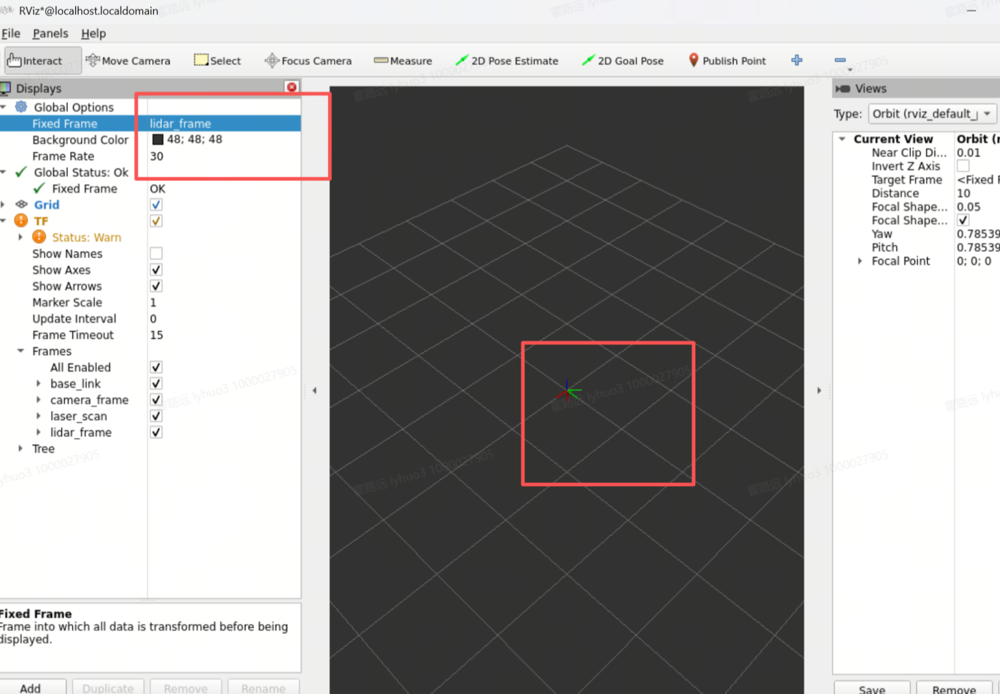

#### 步骤 5：查询任意坐标系之间的相对位姿（编程方式）

**知识点讲解**：

**Buffer + TransformListener —— 是什么与怎么用**

`Buffer` 是一个**时间戳索引的变换缓存**，存储从 `/tf` 和 `/tf_static` 收集的所有历史变换。`TransformListener` 是一个订阅者，自动订阅这两个话题并将消息填充到 Buffer 中。调用 `Buffer.lookup_transform(target_frame, source_frame, time)` 时，Buffer 在图中执行广度优先搜索，找到从 source 到 target 的最短路径，并在指定时间戳进行插值（如需要）。

**lookup_transform 的时间插值机制**：

假设你请求 `t=1.0s` 时刻 `base_link → laser_scan` 的变换，Buffer 中 lidar_frame → laser_scan 的记录有 `t=0.97s`（angle=10°）和 `t=1.03s`（angle=30°）。Buffer 会线性插值得到 `t=1.0s` 时 angle≈20° 的旋转。这种插值使查询精度不受发布频率的严格限制。

**操作**：

```bash
创建查询脚本 ~/exp19_ws/src/tf2_demo/tf2_demo/tf_listener.py：
#!/usr/bin/env python3
# -*- coding: utf-8 -*-
"""
实验19：TF2 变换查询节点
使用 Buffer + TransformListener 查询任意两个坐标系之间的变换
运行：ros2 run tf2_demo tf_listener
"""

import rclpy
from rclpy.node import Node
from tf2_ros import Buffer, TransformListener

class TFListener(Node):
    """监听并查询 TF2 变换"""

    def __init__(self):
        super().__init__('tf_listener')

        # 创建 Buffer（缓存历史变换）和 TransformListener（订阅 /tf 和 /tf_static）
        self.tf_buffer = Buffer()
        self.tf_listener = TransformListener(self.tf_buffer, self)

        # 每秒查询一次变换
        self.timer = self.create_timer(1.0, self.timer_callback)

    def timer_callback(self):
        """定时查询坐标系变换"""
        # 查询 base_link → camera_frame（静态变换）
        try:
            transform = self.tf_buffer.lookup_transform(
                'base_link',          # 目标坐标系
                'camera_frame',       # 源坐标系
                rclpy.time.Time()     # 时间：最新可用
            )
            self.get_logger().info(
                f'base_link → camera_frame: '
                f'平移=[{transform.transform.translation.x:.3f}, '
                f'{transform.transform.translation.y:.3f}, '
                f'{transform.transform.translation.z:.3f}], '
                f'旋转=[{transform.transform.rotation.x:.3f}, '
                f'{transform.transform.rotation.y:.3f}, '
                f'{transform.transform.rotation.z:.3f}, '
                f'{transform.transform.rotation.w:.3f}]'
            )
        except Exception as e:
            self.get_logger().warn(f'无法查询 base_link → camera_frame: {e}')

        # 查询 base_link → laser_scan（经过 lidar_frame 中转的动态变换）
        try:
            transform = self.tf_buffer.lookup_transform(
                'base_link',
                'laser_scan',
                rclpy.time.Time()
            )
            self.get_logger().info(
                f'base_link → laser_scan: '
                f'平移=[{transform.transform.translation.x:.3f}, '
                f'{transform.transform.translation.y:.3f}, '
                f'{transform.transform.translation.z:.3f}]'
            )
        except Exception as e:
            self.get_logger().warn(f'无法查询 base_link → laser_scan: {e}')

def main(args=None):
    rclpy.init(args=args)
    node = TFListener()
    try:
        rclpy.spin(node)
    except KeyboardInterrupt:
        pass
    finally:
        node.destroy_node()
        rclpy.shutdown()

if __name__ == '__main__':
    main()
# 运行变换查询节点（需保持静态和动态广播器运行）
ros2 run tf2_demo tf_listener
# 预期每秒输出 base_link → camera_frame 和 base_link → laser_scan 的平移/旋转数据
```

**易错点**：

- ⚠️ **lookup_transform 参数顺序**：`lookup_transform(target_frame, source_frame, time)` 返回的是 "source 在 target 坐标系中的位姿"，即把 source 坐标系下的点变换到 target 坐标系下。初学者常把 target 和 source 写反。
- ⚠️ **查询时 Buffer 缓存未就绪**：`TransformListener` 需要至少收到一次 `/tf` 或 `/tf_static` 消息才能缓存变换。如果在启动后立即查询，可能抛出 `LookupException`。解决方法：在查询前 `rclpy.spin_once(node, timeout_sec=1.0)` 等待一帧数据到达，或在 try-except 中捕获异常并重试。

---

#### 步骤 6：实验收尾与总结（5 分钟）

1. 在所有终端按 `Ctrl+C` 终止运行的节点
2. 执行 `ros2 node list` 确认所有节点已退出
3. 查看生成的 `frames.pdf`（如果步骤 4 已生成）

### 七、注意事项

| 类别 | 注意事项 |
|---|---|
| ⚠️ 顺序依赖 | 静态变换必须先于动态变换发布——如果 `lidar_frame` 尚未定义，依赖它的动态变换将无法形成完整树。建议在启动脚本中先启动静态广播器，sleep 2 秒后再启动动态广播器 |
| ⚠️ 四元数 | 手动构建四元数时必须确保归一化（x²+y²+z²+w²=1），否则 TF2 查询结果会出现错误的旋转。推荐使用 `tf2_ros.quaternion_from_euler()` 辅助函数 |
| ⚠️ 时间戳 | `TransformStamped.header.stamp` 必须设置为有效时间（`self.get_clock().now().to_msg()`），零时间戳会被 Buffer 视为过期而拒绝缓存 |
| ⚠️ 坐标系命名 | frame_id 不能包含空格或特殊字符，推荐使用 `snake_case` 小写字母+下划线（如 `base_link`、`lidar_frame`），这是 ROS2 社区约定 |
| ⚠️ 树结构约束 | 每个子坐标系有且仅有一个父坐标系。尝试让一个子坐标系有两个父坐标系（形成图而非树）、或创建环路，TF2 会忽略并输出警告 |
| ⚠️ look_up 超时 | `lookup_transform` 默认超时时间为 0（立即返回）。如果变换链不完全，会立即抛出异常。生产级代码应设置 `timeout=Duration(seconds=1.0)` 并处理异常 |

### 八、实验总结

#### 8.1 完成成果

完成本实验后，你应当能够：

- ✅ 阐述 TF2 变换树的树形结构原理，以及 `/tf` 与 `/tf_static` 双话题的设计意图
- ✅ 使用 `StaticTransformBroadcaster` 发布传感器安装偏移等固定变换
- ✅ 使用 `TransformBroadcaster` + Timer 定时发布动态变化（如旋转关节角度）
- ✅ 使用 `tf2_echo` 和 `view_frames` 两个命令行工具调试 TF 树
- ✅ 编程使用 `Buffer.lookup_transform()` 查询任意两个坐标系之间的平移与旋转

#### 8.2 技能收获

| 技能 | 说明 |
|---|---|
| TF2 树维护 | 理解有向无环图（DAG）约束下如何组织机器人的多坐标系关系 |
| 静态/动态发布 | 掌握两种 Broadcaster 的适用场景与代码范式 |
| TF 调试 | 能使用 `tf2_echo` 实时查看变换值，用 `view_frames` 生成 TF 树的可视化拓扑 |
| 坐标变换编程 | 能在自定义节点中通过 Buffer + TransformListener 查询并利用坐标变换结果 |
| 时间插值理解 | 理解 `lookup_transform` 的线性插值机制及其对发布频率的要求 |

#### 8.3 常见问题与解答

| 问题 | 原因 | 解决方法 |
|---|---|---|
| `tf2_echo` 报 "Waiting for transform..." 无输出 | `/tf_static` 或 `/tf` 没有数据发布 | 先运行静态变换广播器，确认 `ros2 topic echo /tf_static` 有输出 |
| `lookup_transform` 报 "frame does not exist" | 请求的坐标系尚未发布到 TF 树 | 用 `ros2 run tf2_tools view_frames` 查看当前有哪些 frame；确认广播器已运行 |
| `view_frames` 报 "command not found" | 未安装 tf2-tools | `sudo apt install ros-humble-tf2-tools` |
| 发布动态 TF 但 TF 树中未更新 | 忘记调用 `rclpy.spin()` 驱动定时器 | 确保节点中有 `rclpy.spin(node)` |
| TF2 变换频繁抖动（值不稳定） | 动态变换发布频率过高，或时间戳精度不足 | 降低发布频率至 30Hz 或使用 `self.get_clock().now()` 确保时间单调递增 |

### 九、实验报告要求

#### 9.1 报告内容

完成实验后，提交一份实验报告，包含以下内容：

1. **实验基本信息**：实验名称、实验日期、实验者姓名、实验平台信息
2. **实验过程记录**：截取步骤 2~5 的关键操作结果截图（至少 6 张），包括 `/tf_static` 话题数据、`/tf` 话题数据、`tf2_echo` 输出、`view_frames` 生成的 TF 树图、Rviz2 TF 面板、编程查询输出
3. **原理分析**（不少于 300 字）：用自己的语言解释 TF2 变换树的以下设计决策：(a) 为什么采用树形结构而非全连接图；(b) 为什么将变换分为 `/tf` 和 `/tf_static` 两个话题；(c) `lookup_transform` 的时间插值机制是如何工作的
4. **思考题**（见下方）

#### 9.2 思考题

**思考题 1**：

假设 B2 实验箱上安装有结构光深度相机和激光雷达，相机在底盘正上方 0.55m 处，激光雷达在底盘正前方 0.25m 处。你需要计算"激光雷达扫描到的障碍物在相机坐标系下的位置"。请画出 TF 树的结构（base_link → camera_frame, base_link → lidar_frame），并写出 `lookup_transform` 的调用伪代码，说明如何将 lidar_frame 下的点云坐标变换到 camera_frame 下。

**思考题 2**：

在步骤 4 中，你观察到 `base_link → laser_scan` 的旋转随时间持续变化（6°/步）。如果激光雷达以 10Hz 旋转，而你用 10Hz 的 `TransformBroadcaster` 发布动态变换，每个 TF 样本之间的角度差是 36°。当控制器在两次发布之间（如 t=0.05s）请求变换时，TF2 的线性插值会产生"角度插值"——请分析这种插值的误差来源，并给出降低误差的建议（提示：考虑发布频率与运动频率的 Nyquist 关系）。

#### 9.3 评分标准

| 评分项 | 权重 | 评分标准 |
|---|---|---|
| 实验操作完整性 | 30% | 是否按要求完成静态 TF 发布、动态 TF 发布、可视化验证、编程查询 |
| 截图与记录 | 15% | 截图是否清晰、完整（≥6 张），标注是否准确 |
| 原理分析 | 25% | 对 TF2 树形结构、双话题、时间插值三个设计决策的理解深度 |
| 思考题 1 | 15% | TF 树绘制正确性、lookup_transform 调用与坐标变换逻辑的正确性 |
| 思考题 2 | 15% | 对 TF2 时间插值误差的分析是否准确，建议是否合理 |

## 实验20：ROS2 URDF模型

### 一、关联知识点

本实验关联以下知识图谱节点：

| 编号 | 知识点名称 | 类型 | 层级路径 |
|---|---|---|---|
| 5.2.1 | URDF机器人描述格式概念与结构 | 概念 | 第5章 机器人建模与仿真 → 5.2 URDF机器人建模 |
| 5.2.2 | link（visual/collision/inertial）与joint类型定义流程 | 流程 | 第5章 机器人建模与仿真 → 5.2 URDF机器人建模 |
| 5.2.3 | Xacro宏语言参数化建模流程 | 流程 | 第5章 机器人建模与仿真 → 5.2 URDF机器人建模 |

### 二、实验目标

通过本实验的学习，学生能够：

1. **原理理解**：阐述 URDF（统一机器人描述格式）中 link 的三重属性（visual 渲染、collision 碰撞检测、inertial 动力学计算）各自的作用及其分离设计的工程意义——为什么三者需要独立定义
2. **流程掌握**：正确编写包含多个 link 和 joint 的 URDF 文件，使用 Xacro 宏语言进行参数化建模，并通过 `xacro` 工具将 `.xacro` 文件展开为标准 URDF
3. **独立完成**：独立构建一个简化版差分驱动机器人模型（底盘+双轮+万向轮），在 Rviz2 中加载并验证其运动学结构
4. **迁移应用**：能够在 B2 实验箱，为实际机器人编写包含真实尺寸参数的 URDF 模型，并在 Rviz2 中进行可视化验证

### 三、实验环境

| 类别 | 配置 |
|---|---|
| 硬件平台 | 具身智能实验箱B2  |
| 操作系统 | Ubuntu 22.04 |
| ROS2 发行版 | Humble Hawksbill |
| 核心依赖 | `ros-humble-xacro`、`ros-humble-joint-state-publisher-gui`、`ros-humble-robot-state-publisher` |
| 可视化工具 | Rviz2 + RobotModel Display + TF Display |
| 构建依赖 | `ros-humble-urdf`、`ros-humble-urdf-tutorial` |

> 说明：本实验为建模设计实验，无需物理传感器或执行器。URDF 模型是纯 XML 文件，可在任意编辑器中编写。

### 四、实验难度

| 维度 | 说明 |
|---|---|
| 难度等级 | ⭐⭐（中等） |
| 实验类型 | 设计性 |
| 建议时长 | 2 学时（90 分钟） |

**重点**：

- 掌握 link 的三元素（visual/collision/inertial）的 XML 结构与参数含义
- 掌握 joint 的六种类型（fixed/revolute/continuous/prismatic/floating/planar）及其 `<limit>`、`<axis>` 配置

**难点**：

- 区分 `<origin>` 标签在 link 和 joint 中的不同语义：link 的 `<origin>` 是 visual/collision/inertial 相对 link 原点的偏移；joint 的 `<origin>` 是子 link 坐标系相对父 link 坐标系的初始位置
- 理解 `inertial` 参数（质量 mass + 惯性矩阵 inertia）对 Gazebo 物理仿真的影响——参数设置不当会导致模型飞走或崩溃

### 五、实验现象

#### 5.1 快速验证流程

完成本实验后，你应能观察到以下现象：

1. 编写的 `diff_drive_robot.urdf.xacro` 文件通过 `xacro` 工具成功展开为完整 URDF（无语法错误）
2. 使用 `ros2 launch` 启动 `robot_state_publisher` + `joint_state_publisher_gui` + `rviz2`，Rviz2 中加载出完整的机器人 3D 模型
3. 在 `joint_state_publisher_gui` 中拖动滑块，Rviz2 中左右驱动轮同步旋转，展示 joint 的运动约束
4. 机器人模型在 Rviz2 的 RobotModel Display 中以不同颜色区分 visual（灰色渲染）和 collision（橙色线框）

#### 5.2 预期输出对照表

| 操作 | 预期输出 |
|---|---|
| `xacro diff_drive_robot.urdf.xacro` | 终端输出完整的 URDF XML（数百行，无报错） |
| `check_urdf diff_drive_robot.urdf` | `robot name is: diff_drive_robot` + `Successfully parsed XML` |
| Launch 启动后在 Rviz2 中选择 RobotModel | 3D 模型显示：矩形底盘 + 两个圆柱形驱动轮 + 一个球形万向轮 |
| 拖动左轮滑块 | 左轮绕 Y 轴旋转，位置不动 |
| 拖动右轮滑块 | 右轮绕 Y 轴旋转，位置不动 |

---

### 六、实验步骤

#### 整体流程

```text
[1. 理解URDF概念与link/joint结构] ──► [2. 编写基础URDF底盘模型]
                                                   │
[5. Rviz2验证与调试] ◄── [4. Xacro参数化重构] ◄── [3. 添加驱动轮与万向轮]
```

---

#### 步骤 1：理解 URDF 的设计哲学与 link/joint 结构（20 分钟）

**知识点讲解**：

**URDF —— 是什么**

URDF（Unified Robot Description Format，统一机器人描述格式）是基于 XML 的机器人运动学模型描述语言。一个 URDF 文件定义了机器人的**几何结构**（长什么样子）、**运动学约束**（关节怎么动）和**动力学参数**（多重、惯性多大）。URDF 文件是后续所有工具链（Rviz2 可视化、Gazebo 仿真、TF2 发布、运动规划）的**唯一输入源**。

**link（连杆）的三重属性 —— 为什么需要独立定义**

URDF 中每个 link 可以（且应该）定义三个独立属性：

| 属性 | XML 标签 | 用途 | 使用工具 | 示例参数 |
|---|---|---|---|---|
| `<visual>` | 视觉外观 | 3D 渲染 | Rviz2 | 几何体（box/cylinder/sphere/mesh）、颜色/纹理 |
| `<collision>` | 碰撞几何 | 物理碰撞检测 | Gazebo | 简化为包围盒（比 visual 更大的处理开销） |
| `<inertial>` | 惯性参数 | 动力学计算 | Gazebo | 质量(kg)、3×3 惯性矩阵 |

**为什么三者需要独立定义**：

1. **视觉 vs 碰撞的解耦**：视觉网格（mesh）可能有数万三角形，用于渲染精美外观；碰撞几何通常简化为几个盒子或圆柱体，保证物理引擎的实时性能。如果 visual 和 collision 耦合，要么视觉不精美，要么碰撞计算太慢。
2. **惯性的独立计算**：惯性矩阵由质量分布决定，与视觉外观和碰撞几何无直接关系。例如，一个空心盒子（视觉看是盒子形状）和实心铁块（视觉看也是盒子形状），外观完全相同但惯性矩阵差异巨大。
3. **工程实践**：在不做物理仿真（仅 Rviz2 可视化）时，可以只定义 visual；在 Gazebo 仿真中则需要三者齐全，否则模型或飞走、或不响应碰撞。
4. **joint（关节）的六种类型**

| 类型 | 自由度 | 描述 | 典型场景 |
|---|---|---|---|
| `fixed` | 0 | 固定连接，不可运动 | 传感器安装座、底盘与外壳 |
| `revolute` | 1 | 绕轴旋转，有限位 | 机械臂肘关节（-90°～+90°） |
| `continuous` | 1 | 绕轴无限旋转 | 驱动轮（无限旋转） |
| `prismatic` | 1 | 沿轴平移，有限位 | 线性滑轨、升降柱 |
| `floating` | 6 | 完全自由（不推荐） | 极少使用，一般用 Gazebo 插件替代 |
| `planar` | 3 | 平面运动（不推荐） | 极少使用 |

**知识图谱对应**：知识点 5.2.1（URDF 概念）和 5.2.2（link 与 joint 定义）。

---

#### 步骤 2：编写基础 URDF 底盘模型

**知识点讲解**：

**URDF 的 XML 结构**：根元素为 `<robot name="...">`，包含一个或多个 `<link>` 和 `<joint>`。关键约定：

- 每个 link 和 joint 必须有全局唯一的 `name` 属性
- joint 通过 `<parent link="..."/>` 和 `<child link="..."/>` 定义父子关系
- `<origin xyz="x y z" rpy="roll pitch yaw"/>` 定义相对位置（米）和姿态（弧度）

**操作**：

```bash
直接咋在终端进行运行，创建文件 ~/exp20_ws/src/urdf_demo/urdf/diff_drive_robot.urdf：
# 创建urdf所在的文件目录
mkdir -p ~/exp20_ws/src/urdf_demo/urdf
cat > ~/exp20_ws/src/urdf_demo/urdf/diff_drive_robot.urdf << 'EOF'
<?xml version="1.0"?>
<!--
实验20：差分驱动机器人 URDF 模型
结构：底盘(chassis) + 左驱动轮(left_wheel) + 右驱动轮(right_wheel) + 前万向轮(front_caster)
坐标系约定：X 轴向前，Y 轴向左，Z 轴向上（ROS REP-103 标准）
-->
<robot name="diff_drive_robot">

  <!-- ========== 材质定义 ========== -->
  <material name="black">
    <color rgba="0.2 0.2 0.2 1.0"/>
  </material>
  <material name="blue">
    <color rgba="0.2 0.4 0.8 1.0"/>
  </material>
  <material name="white">
    <color rgba="0.9 0.9 0.9 1.0"/>
  </material>
  <material name="red">
    <color rgba="0.9 0.2 0.2 1.0"/>
  </material>

  <!-- ========== 连杆 1：底盘 (chassis) ========== -->
  <link name="chassis">
    <visual>
      <geometry>
        <box size="0.40 0.25 0.08"/>
      </geometry>
      <material name="blue"/>
    </visual>

    <collision>
      <geometry>
        <box size="0.40 0.25 0.08"/>
      </geometry>
    </collision>

    <inertial>
      <mass value="3.0"/>
      <inertia ixx="0.017" ixy="0.0" ixz="0.0"
               iyy="0.042" iyz="0.0"
               izz="0.053"/>
    </inertial>
  </link>

  <!-- ========== 连杆 2：左驱动轮 (left_wheel) ========== -->
  <link name="left_wheel">
    <visual>
      <geometry>
        <cylinder radius="0.05" length="0.03"/>
      </geometry>
      <material name="black"/>
    </visual>
    <collision>
      <geometry>
        <cylinder radius="0.05" length="0.03"/>
      </geometry>
    </collision>
    <inertial>
      <mass value="0.2"/>
      <inertia ixx="0.00017" ixy="0.0" ixz="0.0"
               iyy="0.00017" iyz="0.0"
               izz="0.00025"/>
    </inertial>
  </link>

  <!-- ========== 连杆 3：右驱动轮 (right_wheel) ========== -->
  <link name="right_wheel">
    <visual>
      <geometry>
        <cylinder radius="0.05" length="0.03"/>
      </geometry>
      <material name="black"/>
    </visual>
    <collision>
      <geometry>
        <cylinder radius="0.05" length="0.03"/>
      </geometry>
    </collision>
    <inertial>
      <mass value="0.2"/>
      <inertia ixx="0.00017" ixy="0.0" ixz="0.0"
               iyy="0.00017" iyz="0.0"
               izz="0.00025"/>
    </inertial>
  </link>

  <!-- ========== 连杆 4：前万向轮 (front_caster) ========== -->
  <link name="front_caster">
    <visual>
      <geometry>
        <sphere radius="0.025"/>
      </geometry>
      <material name="white"/>
    </visual>
    <collision>
      <geometry>
        <sphere radius="0.025"/>
      </geometry>
    </collision>
    <inertial>
      <mass value="0.05"/>
      <inertia ixx="0.00001" ixy="0.0" ixz="0.0"
               iyy="0.00001" iyz="0.0"
               izz="0.00001"/>
    </inertial>
  </link>

  <!-- ========== 关节 1：底盘 → 左轮（continuous 连续旋转） ========== -->
  <joint name="left_wheel_joint" type="continuous">
    <origin xyz="0.0 -0.15 -0.03" rpy="0.0 0.0 0.0"/>
    <parent link="chassis"/>
    <child link="left_wheel"/>
    <axis xyz="0 1 0"/>
  </joint>

  <!-- ========== 关节 2：底盘 → 右轮（continuous 连续旋转） ========== -->
  <joint name="right_wheel_joint" type="continuous">
    <origin xyz="0.0 0.15 -0.03" rpy="0.0 0.0 0.0"/>
    <parent link="chassis"/>
    <child link="right_wheel"/>
    <axis xyz="0 1 0"/>
  </joint>

  <!-- ========== 关节 3：底盘 → 万向轮（fixed 固定，简化为不可转向） ========== -->
  <joint name="front_caster_joint" type="fixed">
    <origin xyz="0.18 0.0 -0.055" rpy="0.0 0.0 0.0"/>
    <parent link="chassis"/>
    <child link="front_caster"/>
  </joint>

</robot>
EOF
```

**验证 URDF 语法**：

```bash
# 创建工作空间

mkdir -p ~/exp20_ws/src/urdf_demo/urdf

# 将上述 URDF 内容写入 ~/exp20_ws/src/urdf_demo/urdf/diff_drive_robot.urdf

# 安装 urdf-tools 验证语法

sudo apt install ros-humble-urdf-tutorial -y 2>/dev/null || sudo apt install liburdfdom-tools -y

# 使用 check_urdf 验证语法
```

check_urdf ~/exp20_ws/src/urdf_demo/urdf/diff_drive_robot.urdf

**预期输出**：

```text
robot name is: diff_drive_robot
---------- Successfully Parsed XML ---------------
root Link: chassis has 3 child(ren)
    child(1):  left_wheel
    child(2):  right_wheel
    child(3):  front_caster

```

**易错点**：

- ⚠️ **颜色格式**：URDF 中 `<color rgba="r g b a"/>` 的值范围为 [0, 1]，而非 [0, 255]。`rgba="255 0 0 1"` 会报错，应写为 `rgba="1.0 0.0 0.0 1.0"`。
- ⚠️ **惯性矩阵正定性**：`<inertia>` 矩阵必须是对称正定矩阵（ixx>0, iyy>0, izz>0，且满足三角不等式条件）。非法值会导致 Gazebo 仿真时模型"爆炸"。对于初学者，可先用 `ixx=iyy=izz=1e-3` 占位，再用精确计算替换。

---

#### 步骤 3：验证 URDF 在 Rviz2 中的加载效果

**知识点讲解**：

**robot_state_publisher 与 joint_state_publisher —— 两个发布者的协作机制**

要让 Rviz2 显示 URDF 模型，需要两个节点的配合：

1. `robot_state_publisher`：读取 URDF 中的 link/joint 定义，从 `/joint_states` 话题获取关节角度，计算各 link 在 base_link 下的 TF 变换，并发布到 `/tf`
2. `joint_state_publisher_gui`：提供图形化滑块界面，让用户手动设置各 joint 的角度值，发布到 `/joint_states` 话题
3. 数据流：`GUI 滑块` → `/joint_states` → `robot_state_publisher` → `/tf` → `Rviz2 RobotModel Display`

**操作**：

```bash
# 3.1 安装必要的 ROS2 包
sudo apt install ros-humble-robot-state-publisher ros-humble-joint-state-publisher-gui -y

# 3.2 使用 ros2 launch 启动完整可视化流程
# 创建 Launch 文件 ~/exp20_ws/src/urdf_demo/launch/display.launch.py
以下代码直接在终端输入
建正确目录结构
mkdir -p ~/exp20_ws/src/urdf_demo/urdf
mkdir -p ~/exp20_ws/src/urdf_demo/launch
mkdir -p ~/exp20_ws/src/urdf_demo/rviz
创建package.xml文件
cat > ~/exp20_ws/src/urdf_demo/package.xml << 'EOF'
<?xml version="1.0"?>
<package format="3">
  <name>urdf_demo</name>
  <version>0.0.0</version>
  <description>URDF demo</description>
  <maintainer email="student@example.com">Student</maintainer>
  <license>Apache-2.0</license>
  <buildtool_depend>ament_cmake</buildtool_depend>
  <exec_depend>robot_state_publisher</exec_depend>
  <exec_depend>joint_state_publisher_gui</exec_depend>
  <exec_depend>rviz2</exec_depend>
  <exec_depend>urdf</exec_depend>
  <export>
    <build_type>ament_cmake</build_type>
  </export>
</package>
EOF
创建camke.txt文件
cat > ~/exp20_ws/src/urdf_demo/CMakeLists.txt << 'EOF'
cmake_minimum_required(VERSION 3.8)
project(urdf_demo)
find_package(ament_cmake REQUIRED)
install(DIRECTORY urdf launch rviz DESTINATION share/${PROJECT_NAME})
ament_package()
EOF
创建简单urdf文件
cat > ~/exp20_ws/src/urdf_demo/urdf/robot.urdf << 'EOF'
<?xml version="1.0"?>
<robot name="simple_box">
  <link name="base_link">
    <visual>
      <geometry><box size="0.5 0.3 0.2"/></geometry>
      <material name="blue"><color rgba="0 0 1 1"/></material>
    </visual>
  </link>
  <link name="wheel">
    <visual>
      <geometry><cylinder length="0.05" radius="0.1"/></geometry>
      <material name="gray"><color rgba="0.7 0.7 0.7 1"/></material>
    </visual>
  </link>
  <joint name="wheel_joint" type="continuous">
    <parent link="base_link"/>
    <child link="wheel"/>
    <axis xyz="0 1 0"/>
    <origin xyz="0.3 0 0"/>
  </joint>
</robot>
EOF
创建launch文件
cat > ~/exp20_ws/src/urdf_demo/launch/display.launch.py << 'EOF'
#!/usr/bin/env python3
from launch import LaunchDescription
from launch_ros.actions import Node
from ament_index_python.packages import get_package_share_directory
import os

def generate_launch_description():
    pkg = get_package_share_directory('urdf_demo')
    urdf = os.path.join(pkg, 'urdf', 'robot.urdf')
    rviz = os.path.join(pkg, 'rviz', 'display.rviz')

    return LaunchDescription([
        Node(package='robot_state_publisher', executable='robot_state_publisher',
             name='robot_state_publisher', output='screen',
             parameters=[{'robot_description': open(urdf).read()}]),
        Node(package='joint_state_publisher_gui', executable='joint_state_publisher_gui',
             name='joint_state_publisher_gui', output='screen'),
        Node(package='rviz2', executable='rviz2',
             name='rviz2', output='screen', arguments=['-d', rviz]),
    ])
EOF
运行验证
cd ~/exp20_ws
colcon build --packages-select urdf_demo
source install/setup.bash
ros2 launch urdf_demo display.launch.py
```

**在 Rviz2 中配置（首次启动需手动配置）**：

1. 设置 `Fixed Frame` 为 `chassis`（或 `base_link`，取决于 URDF 中的根 link）
2. 点击 Add → 选择 `RobotModel` → OK
1. 观察蓝色矩形底盘、黑色圆柱形车轮、白色球形万向轮
1. 在 `joint_state_publisher_gui` 窗口中拖动 `left_wheel_joint` 和 `right_wheel_joint` 滑块
2. 观察 Rviz2 中左右轮同步旋转

**预期效果**：

- 底盘渲染为蓝色长方体

- 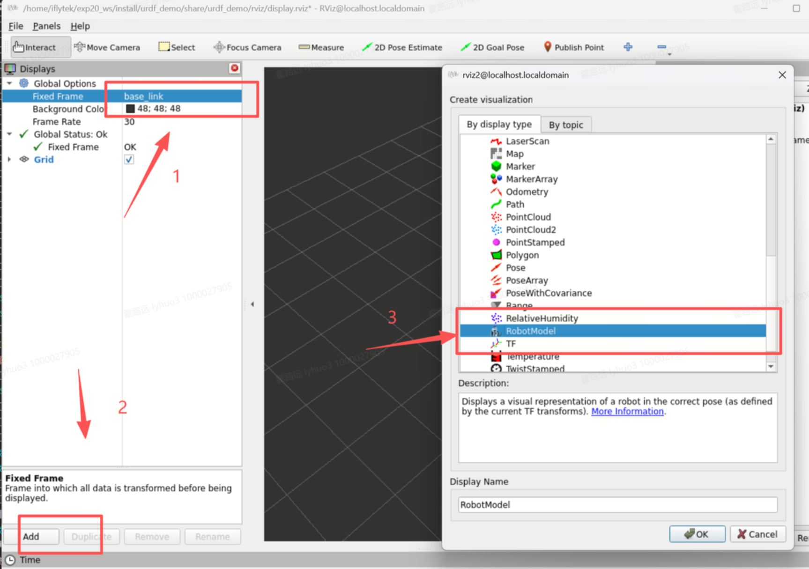

- 左驱动轮和右驱动轮为黑色圆柱体，分别位于底盘两侧

  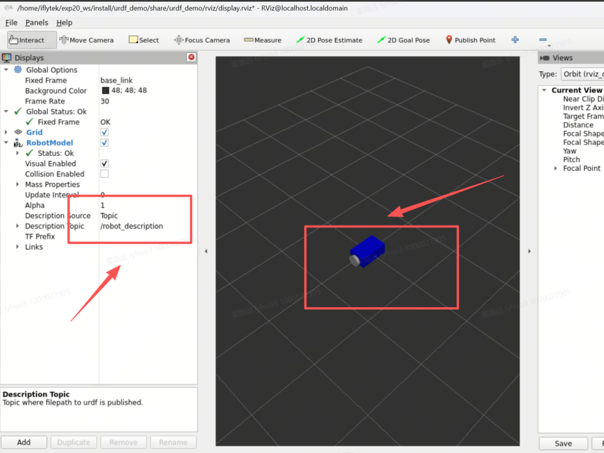

- 前万向轮为白色小球，位于底盘前方下方

- 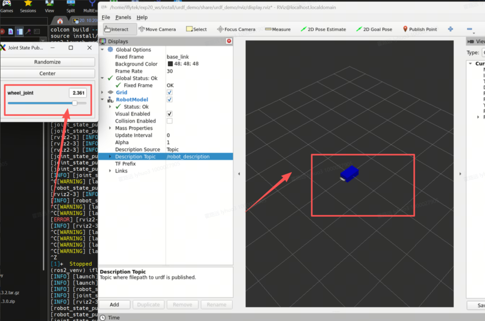

- 拖动关节滑块时，车轮绕 Y 轴旋转


#### 步骤 4：使用 Xacro 宏语言进行参数化重构

**知识点讲解**：

**Xacro —— 是什么与为什么**

Xacro（XML Macros）是 URDF 的**宏扩展语言**。它解决了原始 URDF 的两个核心痛点：

1. **重复代码**：差分驱动机器人的左右轮除了 X 坐标符号不同，所有参数完全相同。原始 URDF 需要为每个轮子复制粘贴全部 XML 片段。Xacro 通过 `<xacro:macro>` 定义可复用组件，参数化调用来消除重复。
2. **魔法数字**：原始 URDF 中散落着大量硬编码数字（轮半径 0.05、底盘长 0.40...）。修改一个尺寸需要全局搜索替换。Xacro 通过 `<xacro:property>` 将参数集中管理，一个修改全局生效。
3. **数学表达式**：Xacro 支持 `${expression}` 数学表达式，可在 XML 内计算（如惯性矩阵公式 `m/12*(y²+z²)`），无需手动计算每个惯性值。

**Xacro 的核心语法**：

| 语法 | 说明 | 示例 |
|---|---|---|
| `<xacro:property name="x" value="y"/>` | 定义全局变量 | `wheel_radius = 0.05` |
| `<xacro:macro name="m" params="p1 p2">...</xacro:macro>` | 定义可复用宏 | `wheel_macro(parent x_reflect)` |
| `<xacro:m/>` 或 `<xacro:m p1="val"/>` | 调用宏 | `xacro:wheel_macro parent="chassis" x_reflect="-1"` |
| `${expression}` | 数学表达式 | `${wheel_radius * 2}` |
| `<xacro:include filename="..."/>` | 引入其他 xacro 文件 | 引入材料定义文件 |

**操作**：

```bash
创建 Xacro 版本 ~/exp20_ws/src/urdf_demo/urdf/diff_drive_robot.urdf.xacro
在终端直接输入
cat > ~/exp20_ws/src/urdf_demo/urdf/diff_drive_robot.urdf.xacro << 'XACROEOF'
<?xml version="1.0"?>
<!--
实验20：差分驱动机器人 URDF 模型（Xacro 参数化版本）
-->
<robot name="diff_drive_robot" xmlns:xacro="http://www.ros.org/wiki/xacro">

  <!-- ========== 参数集中管理 ========== -->
  <xacro:property name="chassis_length" value="0.40"/>
  <xacro:property name="chassis_width"  value="0.25"/>
  <xacro:property name="chassis_height" value="0.08"/>
  <xacro:property name="chassis_mass"   value="3.0"/>

  <xacro:property name="wheel_radius"   value="0.05"/>
  <xacro:property name="wheel_length"   value="0.03"/>
  <xacro:property name="wheel_mass"     value="0.2"/>

  <!-- 车轮 Y 轴偏移（轴距的一半） -->
  <xacro:property name="wheel_y_offset" value="${chassis_width/2 - 0.02}"/>
  <!-- 车轮 Z 轴偏移（使轮子接触地面） -->
  <xacro:property name="wheel_z_offset" value="${-chassis_height/2 + wheel_radius}"/>

  <!-- 万向轮半径 -->
  <xacro:property name="caster_radius"  value="0.025"/>

  <!-- ========== 宏：盒体的惯性矩阵计算 ========== -->
  <!-- 公式：Ixx = m/12 * (y²+z²), Iyy = m/12 * (x²+z²), Izz = m/12 * (x²+y²) -->
  <xacro:macro name="box_inertia" params="mass x y z">
    <inertial>
      <mass value="${mass}"/>
      <inertia ixx="${mass/12 * (y*y + z*z)}" ixy="0.0" ixz="0.0"
               iyy="${mass/12 * (x*x + z*z)}" iyz="0.0"
               izz="${mass/12 * (x*x + y*y)}"/>
    </inertial>
  </xacro:macro>

  <!-- ========== 宏：圆柱体的惯性矩阵计算 ========== -->
  <!-- Ixx = Iyy = m/12*(3*r² + h²), Izz = m/2 * r² -->
  <xacro:macro name="cylinder_inertia" params="mass radius length">
    <inertial>
      <mass value="${mass}"/>
      <inertia ixx="${mass/12 * (3*radius*radius + length*length)}" ixy="0.0" ixz="0.0"
               iyy="${mass/12 * (3*radius*radius + length*length)}" iyz="0.0"
               izz="${mass/2 * radius*radius}"/>
    </inertial>
  </xacro:macro>

  <!-- ========== 宏：可复用的车轮组件 ========== -->
  <!-- parent: 父 link 名称, x_reflect: X 轴反射因子 (1 或 -1) -->
  <xacro:macro name="wheel" params="name parent x_reflect">
    <link name="${name}">
      <visual>
        <geometry>
          <cylinder radius="${wheel_radius}" length="${wheel_length}"/>
        </geometry>
        <material name="black"/>
      </visual>
      <collision>
        <geometry>
          <cylinder radius="${wheel_radius}" length="${wheel_length}"/>
        </geometry>
      </collision>
      <xacro:cylinder_inertia mass="${wheel_mass}" radius="${wheel_radius}" length="${wheel_length}"/>
    </link>

    <joint name="${name}_joint" type="continuous">
      <origin xyz="0.0 ${x_reflect * wheel_y_offset} ${wheel_z_offset}" rpy="0.0 0.0 0.0"/>
      <parent link="${parent}"/>
      <child link="${name}"/>
      <axis xyz="0 1 0"/>
    </joint>
  </xacro:macro>

  <!-- ========== 材质定义 ========== -->
  <material name="black"><color rgba="0.2 0.2 0.2 1.0"/></material>
  <material name="blue"><color rgba="0.2 0.4 0.8 1.0"/></material>
  <material name="white"><color rgba="0.9 0.9 0.9 1.0"/></material>

  <!-- ========== 底盘 link ========== -->
  <link name="chassis">
    <visual>
      <geometry>
        <box size="${chassis_length} ${chassis_width} ${chassis_height}"/>
      </geometry>
      <material name="blue"/>
    </visual>
    <collision>
      <geometry>
        <box size="${chassis_length} ${chassis_width} ${chassis_height}"/>
      </geometry>
    </collision>
    <xacro:box_inertia mass="${chassis_mass}"
                       x="${chassis_length}" y="${chassis_width}" z="${chassis_height}"/>
  </link>

  <!-- ========== 万向轮 link ========== -->
  <link name="front_caster">
    <visual>
      <geometry>
        <sphere radius="${caster_radius}"/>
      </geometry>
      <material name="white"/>
    </visual>
    <collision>
      <geometry>
        <sphere radius="${caster_radius}"/>
      </geometry>
    </collision>
    <inertial>
      <mass value="0.05"/>
      <inertia ixx="0.00001" ixy="0.0" ixz="0.0"
               iyy="0.00001" iyz="0.0"
               izz="0.00001"/>
    </inertial>
  </link>

  <!-- ========== 关节 ========== -->
  <joint name="front_caster_joint" type="fixed">
    <origin xyz="${chassis_length/2 - 0.02} 0.0 ${-chassis_height/2 + caster_radius}" rpy="0.0 0.0 0.0"/>
    <parent link="chassis"/>
    <child link="front_caster"/>
  </joint>

  <!-- 使用宏创建左右驱动轮 -->
  <!-- x_reflect=1  → Y 轴正向（右轮），x_reflect=-1 → Y 轴负向（左轮） -->
  <xacro:wheel name="left_wheel"  parent="chassis" x_reflect="-1"/>
  <xacro:wheel name="right_wheel" parent="chassis" x_reflect="1"/>

</robot>
XACROEOF
```

**展开 Xacro 为标准 URDF**：

```bash
# 安装 xacro 工具

sudo apt install ros-humble-xacro -y

# 将 .xacro 展开为 .urdf（验证语法+生成标准文件）
```

xacro ~/exp20_ws/src/urdf_demo/urdf/diff_drive_robot.urdf.xacro > ~/exp20_ws/src/urdf_demo/urdf/diff_drive_robot_expanded.urdf

```bash
# 验证展开后的 URDF
```

check_urdf ~/exp20_ws/src/urdf_demo/urdf/diff_drive_robot_expanded.urdf

```bash
# 观察展开后的文件：左右轮的定义已被完整展开为独立的 link 和 joint
```

head -80 ~/exp20_ws/src/urdf_demo/urdf/diff_drive_robot_expanded.urdf

**关键对比**：Xacro 版本只有约 80 行（含宏定义），展开后的标准 URDF 约 150 行。在 4 轮或 6 轮机器人中，这种压缩比更高（4×→6×）。

**易错点**：

- ⚠️ **Xacro 宏调用时命名冲突**：如果宏内部定义的 link/joint 名称依赖参数拼接（如 `${name}_joint`），必须确保每次调用传入不同的 `name` 参数，否则会生成重复名称导致 URDF 解析失败。
- ⚠️ **Xacro 属性值计算中的类型问题**：`${chassis_width/2 - 0.02}` 在 Python 3 中是浮点除法（结果为 float），但如果使用 `${int(3/2)}`，注意 Xacro 使用 Python 表达式求值，`3/2` 在 Python 3 中结果是 1.5（float）。

---

#### 步骤 5：Rviz2 验证与调试

**知识点讲解**：

**Rviz2 中 RobotModel Display 的调试技巧**：

- `Visual Enabled` 控制外观是否渲染
- `Collision Enabled` 控制碰撞边界框是否显示（橙色线框）
- `Alpha` 透明度可帮助观察内部结构
- `TF Display` 同时开启，显示每个 link 的坐标轴（RGB→XYZ），帮助验证 `origin` 偏移是否正确

**常见 URDF 错误定位方法**：

| 工具 | 作用 | 命令 |
|---|---|---|
| `check_urdf` | 语法+结构验证 | `check_urdf model.urdf` |
| `urdf_to_graphiz` | 生成 link-joint 拓扑图 | `urdf_to_graphiz model.urdf` → PDF |
| Rviz2 RobotModel | 可视化验证外观 | 观察视觉形状、颜色、位置 |
| Rviz2 TF Display | 验证坐标系位置 | 观察坐标轴箭头的方向和长度 |

**操作**：

```bash
# 5.1 修改 Launch 文件使用 Xacro 版本（将 urdf_file 指向 .xacro）
# 或手动转换后使用：
xacro ~/exp20_ws/src/urdf_demo/urdf/diff_drive_robot.urdf.xacro \
  > ~/exp20_ws/src/urdf_demo/urdf/diff_drive_robot_expanded.urdf

# 5.2 生成 link-joint 拓扑图
sudo apt install liburdfdom-tools -y
urdf_to_graphiz ~/exp20_ws/src/urdf_demo/urdf/diff_drive_robot_expanded.urdf
# 生成 diff_drive_robot.pdf

# 5.3 在 Rviz2 中切换视觉/碰撞显示
# 在 Rviz2 左侧 Displays 面板中找到 RobotModel
# 勾选 Visual Enabled（灰色外观）
# 勾选 Collision Enabled（橙色线框）
# 观察两者是否对齐——如不对齐，说明 <visual><origin> 和 <collision><origin> 不一致
生成的diff_drive_robot.pdf

```

**调试常见问题**：

- 车轮不随滑块旋转 → joint type 设置错误（应为 continuous 而非 fixed）
- 车轮位置偏移 → joint `<origin>` 参数不对（注意 URDF 中是先 rpy 旋转再 xyz 平移）
- Rviz2 报 "No transform from [left_wheel] to [chassis]" → `robot_state_publisher` 未运行或 `/joint_states` 无数据

---

#### 步骤 6：实验收尾与总结（5 分钟）

1. 关闭 Rviz2 和 `joint_state_publisher_gui` 窗口
2. 按 `Ctrl+C` 终止 launch 进程
3. 保留 URDF 和 Xacro 文件供后续实验（Gazebo 仿真）使用

### 七、注意事项

| 类别 | 注意事项 |
|---|---|
| ⚠️ 坐标系 | URDF 中 `<origin>` 的顺序是先 RPY 旋转再 XYZ 平移——如果先平移再旋转，视觉效果完全不同。可在 Rviz2 中开启 TF Display 验证坐标系箭头的方向 |
| ⚠️ 惯性参数 | `<inertia>` 矩阵必须数学上正确（对称正定）。初学者建议先用近似公式计算，如长方体 `Ixx=m/12*(y²+z²)`，或使用 `https://amesweb.info/inertia/mass-moment-of-inertia-calculator.aspx` 在线工具 |
| ⚠️ joint 类型 | `continuous` 是无限制旋转（轮子），`revolute` 是有限制旋转（肘关节需同时定义 `<limit lower="..." upper="..."/>`）。两者不可混淆——给轮子设 revolute 会限制旋转角度 |
| ⚠️ Xacro 命名空间 | 所有 Xacro 标签必须声明命名空间 `xmlns:xacro="http://www.ros.org/wiki/xacro"`，否则 xacro 工具无法识别宏标签 |
| ⚠️ Rviz2 Fixed Frame | Fixed Frame 必须设置为 URDF 中存在的一个 link 名称（通常是根 link），否则 RobotModel Display 无法显示 |
| ⚠️ 文件路径 | 在 Launch 文件中读取 URDF 时，使用 `get_package_share_directory()` 获取包路径，避免硬编码绝对路径。ROS2 的 share 目录在 `install/<pkg>/share/<pkg>/`，而不是 `src/` |

### 八、实验总结

#### 8.1 完成成果

完成本实验后，你应当能够：

- ✅ 阐述 URDF 中 link 的 visual/collision/inertial 三重属性的独立作用与协同关系
- ✅ 编写包含底盘、驱动轮、万向轮的完整机器人 URDF 文件
- ✅ 使用 Xacro 宏语言进行参数化管理，通过数学表达式自动计算惯性矩阵
- ✅ 在 Rviz2 中加载并可视化验证 URDF 模型的几何形状与运动学结构
- ✅ 使用 `check_urdf` 和 `urdf_to_graphiz` 工具诊断 URDF 的语法与结构错误

#### 8.2 技能收获

| 技能 | 说明 |
|---|---|
| URDF 建模 | 掌握 link（几何/物理/惯性）和 joint（类型/原点/轴/限位）的完整 XML 语法 |
| Xacro 参数化 | 能用 `xacro:property`、`xacro:macro`、`xacro:include` 构建模块化、可复用的模型库 |
| Rviz2 验证 | 能通过 RobotModel Display + TF Display 在 3D 视图中验证模型的正确性 |
| 惯性计算 | 能根据几何体的形状和质量，使用公式计算正确的 `<inertia>` 矩阵 |
| 调试技能 | 能用 `check_urdf` 快速定位 XML 语法错误，用 `urdf_to_graphiz` 可视化拓扑结构 |

#### 8.3 常见问题与解答

| 问题 | 原因 | 解决方法 |
|---|---|---|
| `check_urdf` 报 "Error parsing XML" | XML 标签未闭合或拼写错误 | 检查所有 `<link>`/`</link>`、`<joint>`/`</joint>` 是否成对出现 |
| Rviz2 显示 "No transform from [...] to [chassis]" | `robot_state_publisher` 未运行或参数错误 | 确认 launch 文件启动了 `robot_state_publisher` 节点，且 `robot_description` 参数已设置 |
| 拖动滑块时轮子不动 | joint_state_publisher_gui 未连接 | 确认 launch 文件启动了 `joint_state_publisher_gui` 节点 |
| Xacro 展开报 "unknown macro name" | 宏名称拼写错误或未定义 | 检查 `<xacro:macro name="xxx">` 的定义位置与 `<xacro:xxx>` 的调用位置是否在同一个 `<robot>` 标签内 |
| Rviz2 中模型颜色不对 | 材质未正确定义或命名冲突 | 确保 `<material name="...">` 定义在 `<robot>` 下且在 link 定义之前；检查 RGBA 值是否在 [0,1] 范围内 |

### 九、实验报告要求

#### 9.1 报告内容

完成实验后，提交一份实验报告，包含以下内容：

1. **实验基本信息**：实验名称、实验日期、实验者姓名、实验平台信息
2. **实验过程记录**：截取关键步骤的结果截图（至少 5 张），包括：check_urdf 验证结果、xacro 展开前后的行数对比、Rviz2 RobotModel 显示效果、Rviz2 同时显示 visual 和 collision 的对比、关节滑块拖动时车轮旋转的截图
3. **原理分析**（不少于 300 字）：用自己的语言解释 URDF 的设计哲学——为什么 link 需要 visual/collision/inertial 三重属性分别定义，以及 Xacro 宏语言如何解决原始 URDF 的可维护性问题（至少举 2 个具体例子）
4. **思考题**（见下方）

#### 9.2 思考题

**思考题 1**：

你在步骤 2 中为底盘编写了 `<inertial>` 参数。假设底盘的形状不是长方体而是 L 形（由两个长方体拼接而成），其惯性矩阵如何计算？（提示：平行轴定理 I = I_cm + m*d²，其中 d 是部件质心到整体质心的距离。）

**思考题 2**：

在真实工程中，B2 实验箱的机械臂有 6 个旋转关节（6 DOF）。如果使用原始 URDF 为每个关节手动编写 link 和 joint，需要约 300 行代码。请描述如何使用 Xacro 宏语言将 6 关节机械臂的建模压缩到 50 行以内（给出宏设计思路，不需要完整代码）。你的设计应考虑：每个关节的尺寸参数化、关节类型的统一管理和关节限制的集中配置。

#### 9.3 评分标准

| 评分项 | 权重 | 评分标准 |
|---|---|---|
| 实验操作完整性 | 30% | 是否按要求完成 URDF 编写、Xacro 重构、Rviz2 验证、check_urdf 检查 |
| 截图与记录 | 15% | 截图是否清晰、完整（≥5 张），标注是否准确 |
| 原理分析 | 25% | 对 URDF 三重属性分离设计 + Xacro 可维护性的理解深度 |
| 思考题 1 | 15% | 平行轴定理应用是否正确，L 形底盘的惯性矩阵计算思路是否合理 |
| 思考题 2 | 15% | Xacro 宏设计方案的可扩展性与复用性评估 |

## 更新日志

| 版本 | 日期 | 更新内容 | 更新人 |
|---|---|---|---|
| v0.1 | 2026-08-10 | 初始生成实验1（ROS2简介） | LabGuideExperimentAgent |
| v0.2 | 2026-08-10 | 新增实验2（ROS2常用命令工具） | LabGuideExperimentAgent |