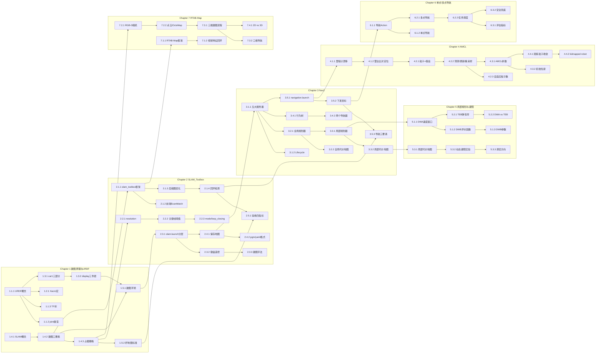

# 机器人SLAM与Nav应用开发 知识图谱

> 课程代码: EXP004
> 总学时: 48
> 实验数: 7
> 技术栈: SLAM / SLAM_Toolbox / Nav2 / AMCL / DWA / TEB / RTAB-Map / 激光雷达
> 硬件平台: 具身智能实验箱B2 / 具身智能机器人小车C1
> 生成日期: 2026-08-14

---

## 第1章 建图原理与URDF建模

> 对应实验 exp01（4h，验证性）— 用"人能看地图"的比喻建立 SLAM 感性认识；通过 URDF + RViz 看懂机器人"长什么样"、坐标系怎么连

### 1.1 URDF 机器人描述语言

#### 知识点 1.1.1
- **类型**: 概念
- **描述**: URDF 用 XML 描述机器人：`<link>`（连杆/身体部件）+ `<joint>`（关节/连接方式）
- **难度**: 记忆
- **前置依赖**: 无

#### 知识点 1.1.2
- **类型**: 原理
- **描述**: `<joint type>` 决定运动方式：fixed 固定、continuous 车轮连续转、revolute 舵机限位旋转
- **难度**: 理解
- **前置依赖**: 1.1.1

#### 知识点 1.1.3
- **类型**: 概念
- **描述**: TF 树由 URDF 自动生成，car1 根节点为 base_footprint，经 base_joint 连到 base_link
- **难度**: 理解
- **前置依赖**: 1.1.1

### 1.2 Xacro 宏扩展

#### 知识点 1.2.1
- **类型**: 概念
- **描述**: Xacro 是 URDF 的宏语言，用 `<xacro:macro>` 定义可复用的部件模板，避免重复代码
- **难度**: 记忆
- **前置依赖**: 1.1.1

### 1.3 car1 模型结构解析

#### 知识点 1.3.1
- **类型**: 概念
- **描述**: car1.urdf 三大部分：主体（base_footprint/base_link+4 麦轮）、机械臂（arm_link1~6）、爪子（gripper）
- **难度**: 理解
- **前置依赖**: 1.1.1

#### 知识点 1.3.2
- **类型**: 流程
- **描述**: `display.launch.py` 一键启动 joint_state_publisher_gui + robot_state_publisher + rviz2 三件套
- **难度**: 应用
- **前置依赖**: 1.3.1

### 1.4 SLAM 是什么

#### 知识点 1.4.1
- **类型**: 概念
- **描述**: SLAM（Simultaneous Localization and Mapping）= 同时定位与建图，"鸡生蛋蛋生鸡"问题
- **难度**: 记忆
- **前置依赖**: 无

#### 知识点 1.4.2
- **类型**: 原理
- **描述**: 建图三要素：感知（雷达 /scan）→ 定位（推测自己在哪）→ 构图（把墙写进地图），循环往复
- **难度**: 理解
- **前置依赖**: 1.4.1

#### 知识点 1.4.3
- **类型**: 概念
- **描述**: 占据栅格地图（OccupancyGrid）：0 空闲 / 100 占据 / -1 未知，一格一个小方块
- **难度**: 记忆
- **前置依赖**: 1.4.2

### 1.5 建图环境搭建与判断标准

#### 知识点 1.5.1
- **类型**: 流程
- **描述**: 建图环境 = 驱动层（bringup）+ 雷达（/scan）+ SLAM 算法 + RViz 显示
- **难度**: 应用
- **前置依赖**: 1.3.2, 1.4.2

#### 知识点 1.5.2
- **类型**: 概念
- **描述**: 好地图的标准：墙是单线、尺寸误差 <2%、直角 ≈90°、回到起点闭环误差小
- **难度**: 记忆
- **前置依赖**: 1.4.3

---

## 第2章 基于SLAM_Toolbox的二维激光建图

> 对应实验 exp02（4h，设计性）— 真正跑通"遥控小车逛一圈 → 得到一张地图"的全流程

### 2.1 slam_toolbox 框架

#### 知识点 2.1.1
- **类型**: 概念
- **描述**: slam_toolbox 是基于 Karto 的图优化 2D SLAM：前端 Scan Match + 位姿图 + 后端 Ceres 优化
- **难度**: 理解
- **前置依赖**: 1.4.2

#### 知识点 2.1.2
- **类型**: 原理
- **描述**: 前端相关性扫描匹配：在里程计预测位姿周围搜候选位姿，取与局部地图匹配得分最高的
- **难度**: 理解
- **前置依赖**: 2.1.1

#### 知识点 2.1.3
- **类型**: 原理
- **描述**: 后端图优化：节点=关键帧位姿，边=约束，用 Ceres/Levenberg-Marquardt 最小化残差消除漂移
- **难度**: 理解
- **前置依赖**: 2.1.1

#### 知识点 2.1.4
- **类型**: 流程
- **描述**: 回环检测：机器人回到已访问区域时识别出"这是我以前来过的地方"，一次大修正消除累积误差
- **难度**: 应用
- **前置依赖**: 2.1.3

### 2.2 关键配置参数

#### 知识点 2.2.1
- **类型**: 概念
- **描述**: `resolution: 0.05` 每格 5cm，越小越精细但地图越大、算力越高
- **难度**: 记忆
- **前置依赖**: 1.4.3

#### 知识点 2.2.2
- **类型**: 流程
- **描述**: 关键帧触发阈值 `minimum_travel_distance: 0.01` / `minimum_travel_heading: 0.02`，太小更新频繁、太大地图漏细节
- **难度**: 应用
- **前置依赖**: 2.2.1

#### 知识点 2.2.3
- **类型**: 流程
- **描述**: `mode: mapping` 建图模式；`do_loop_closing: true` 开启回环；`map_update_interval: 0.1` 地图刷新周期
- **难度**: 应用
- **前置依赖**: 2.2.2

### 2.3 启动与手动操控

#### 知识点 2.3.1
- **类型**: 流程
- **描述**: `slam.launch.py` 分层启动：bringup → 雷达 → [延迟 10s] slam_toolbox → RViz
- **难度**: 应用
- **前置依赖**: 1.5.1

#### 知识点 2.3.2
- **类型**: 流程
- **描述**: `slam_teleop.py` 键盘控制：w/s 前进后退 0.2m/s，a/d 旋转 0.5rad/s，空格停止
- **难度**: 应用
- **前置依赖**: 2.3.1

#### 知识点 2.3.3
- **类型**: 原理
- **描述**: 建图手法：慢速（角速度≤1rad/s）、走闭环路径、拐角减速，保证关键帧重叠
- **难度**: 应用
- **前置依赖**: 2.3.2

### 2.4 地图保存与加载

#### 知识点 2.4.1
- **类型**: 流程
- **描述**: `map_save.py` / `map_saver_cli -f map_01` 保存地图，产出 .pgm 位图 + .yaml 元数据
- **难度**: 应用
- **前置依赖**: 2.3.1

#### 知识点 2.4.2
- **类型**: 概念
- **描述**: .pgm 灰度图：255 空闲 / 0 占据 / 205 未知；.yaml 含 resolution/origin/occupied_thresh
- **难度**: 记忆
- **前置依赖**: 2.4.1

### 2.5 建图质量评估

#### 知识点 2.5.1
- **类型**: 流程
- **描述**: 验收四指标：墙厚 <0.1m、尺寸误差 <2%、直角 90°±2°、闭环位置 <0.1m 航向 <5°
- **难度**: 应用
- **前置依赖**: 1.5.2

---

## 第3章 基于Nav2的自主导航

> 对应实验 exp03（8h，综合性）— 让小车拿着地图自己找路走到目标点

### 3.1 Nav2 总体架构

#### 知识点 3.1.1
- **类型**: 概念
- **描述**: Nav2 五大服务器：planner（全局路径）、controller（局部跟踪）、behavior（行为）、bt_navigator（行为树大脑）、velocity_smoother（速度平滑）
- **难度**: 理解
- **前置依赖**: 2.4.1

#### 知识点 3.1.2
- **类型**: 原理
- **描述**: Lifecycle 生命周期管理：节点先 inactive 配置，再 activate 激活，统一由 lifecycle_manager 管理
- **难度**: 理解
- **前置依赖**: 3.1.1

### 3.2 全局路径规划

#### 知识点 3.2.1
- **类型**: 概念
- **描述**: 全局规划器在 map 坐标系从起点到终点找一条无碰撞路径，本项目用 ThetaStarPlanner
- **难度**: 理解
- **前置依赖**: 3.1.1

#### 知识点 3.2.2
- **类型**: 概念
- **描述**: 全局代价地图 global_costmap 三层：static 静态地图 + obstacle 动态障碍 + inflation 膨胀区（远离障碍）
- **难度**: 记忆
- **前置依赖**: 3.2.1

### 3.3 局部路径规划

#### 知识点 3.3.1
- **类型**: 概念
- **描述**: 局部规划器在 odom 坐标系跟踪全局路径，本项目用 DWB（Dynamic Window Based）FollowPath
- **难度**: 理解
- **前置依赖**: 3.2.1

#### 知识点 3.3.2
- **类型**: 概念
- **描述**: 局部代价地图 local_costmap 是跟随机器人的滚动窗口（3m×3m），实时感知身边障碍
- **难度**: 记忆
- **前置依赖**: 3.3.1

### 3.4 行为树导航

#### 知识点 3.4.1
- **类型**: 原理
- **描述**: bt_navigator 用行为树（XML）编排导航流程：规划→跟踪→到达判定→异常恢复
- **难度**: 理解
- **前置依赖**: 3.1.1

#### 知识点 3.4.2
- **类型**: 概念
- **描述**: NavigateToPose 与 NavigateThroughPoses 两个导航器对应单目标与多途经点
- **难度**: 记忆
- **前置依赖**: 3.4.1

### 3.5 导航启动与目标下达

#### 知识点 3.5.1
- **类型**: 流程
- **描述**: `navigation.launch.py map:=slam_map` 一键启动：bringup → 雷达 → localization → navigation → RViz
- **难度**: 应用
- **前置依赖**: 3.1.1

#### 知识点 3.5.2
- **类型**: 流程
- **描述**: RViz 工具栏 "Nav2 Goal" 点地图下发目标；或 `ros2 action send_goal` 命令行下发
- **难度**: 应用
- **前置依赖**: 3.5.1

#### 知识点 3.5.3
- **类型**: 原理
- **描述**: 导航成功三要素：地图质量好、定位准确（AMCL）、速度约束合理（velocity_smoother）
- **难度**: 分析
- **前置依赖**: 3.5.2

---

## 第4章 基于AMCL的自适应蒙特卡罗定位

> 对应实验 exp04（8h，综合性）— 解决"我在地图哪里"的问题，让导航前机器人知道自己在哪

### 4.1 定位问题

#### 知识点 4.1.1
- **类型**: 概念
- **描述**: 里程计会漂移（轮子打滑、累计误差），导航需要全局定位纠正"我在哪"
- **难度**: 记忆
- **前置依赖**: 2.4.1

#### 知识点 4.1.2
- **类型**: 原理
- **描述**: 定位原理：用雷达扫描与地图比对，"扫描与地图吻合的地方就是我的位置"
- **难度**: 理解
- **前置依赖**: 4.1.1

### 4.2 粒子滤波

#### 知识点 4.2.1
- **类型**: 概念
- **描述**: 粒子=对"我可能在哪"的假设，一大把粒子撒在地图上，代表位置的概率分布
- **难度**: 记忆
- **前置依赖**: 4.1.2

#### 知识点 4.2.2
- **类型**: 原理
- **描述**: 三步骤循环：预测（按里程计移动粒子）→ 更新（按雷达匹配给粒子打分）→ 重采样（淘汰低分粒子、复制高分粒子）
- **难度**: 理解
- **前置依赖**: 4.2.1

#### 知识点 4.2.3
- **类型**: 概念
- **描述**: 自适应粒子数：定位确定时自动减少粒子省算力，不确定时增多粒子加速收敛
- **难度**: 理解
- **前置依赖**: 4.2.2

### 4.3 AMCL 参数与配置

#### 知识点 4.3.1
- **类型**: 流程
- **描述**: 核心参数：min/max_particles 500/2000、alpha1-5 运动噪声、laser_model_type likelihood_field、update_min_a/d 0.15
- **难度**: 应用
- **前置依赖**: 4.2.2

#### 知识点 4.3.2
- **类型**: 概念
- **描述**: 初始位姿：`set_initial_pose: true` + `initial_pose: [0,0,0]`，或 RViz 用 "2D Pose Estimate" 手点
- **难度**: 记忆
- **前置依赖**: 4.3.1

### 4.4 定位验证与异常恢复

#### 知识点 4.4.1
- **类型**: 流程
- **描述**: RViz 观察粒子：收敛后聚成一团（绿箭头）即定位成功；粒子分散说明没定位上
- **难度**: 应用
- **前置依赖**: 4.3.2

#### 知识点 4.4.2
- **类型**: 原理
- **描述**: kidnapped robot 问题：机器人被"搬走"后位置假设全部失效，AMCL 会自动撒新粒子重新全局定位
- **难度**: 理解
- **前置依赖**: 4.4.1

---

## 第5章 局部路径规划与动态避障

> 对应实验 exp05（8h，综合性）— 让小车在行进中躲开突然出现的障碍物

### 5.1 动态窗口法 DWA/DWB

#### 知识点 5.1.1
- **类型**: 概念
- **描述**: DWA 思路：只考虑"当前能刹得住"的速度组合（速度窗口），在窗口内采样生成轨迹
- **难度**: 理解
- **前置依赖**: 3.3.1

#### 知识点 5.1.2
- **类型**: 原理
- **描述**: DWB 评价函数（critics）：PathDist 贴路径 / GoalDist 奔目标 / BaseObstacle 躲障碍 / RotateToGoal 转正，加权求和选最优
- **难度**: 理解
- **前置依赖**: 5.1.1

#### 知识点 5.1.3
- **类型**: 流程
- **描述**: 关键参数：vx_samples 20、vtheta_samples 40（采样数）、sim_time 1.5（模拟时长）、max_vel_x 0.3
- **难度**: 应用
- **前置依赖**: 5.1.2

### 5.2 TEB 时间弹性带

#### 知识点 5.2.1
- **类型**: 概念
- **描述**: TEB（Time Elastic Band）把路径看成"弹性带"，用图优化调整轨迹点与时间，天然支持时间最优与避障
- **难度**: 理解
- **前置依赖**: 5.1.1

#### 知识点 5.2.2
- **类型**: 原理
- **描述**: DWA vs TEB：DWA 快而糙（适合低算力），TEB 平滑可调时间（适合复杂约束）；本项目默认 DWB
- **难度**: 分析
- **前置依赖**: 5.2.1

### 5.3 局部代价地图与避障实验

#### 知识点 5.3.1
- **类型**: 流程
- **描述**: local_costmap 滚动窗口 + voxel_layer（激光点云体素）+ inflation 膨胀半径 0.18m
- **难度**: 应用
- **前置依赖**: 3.3.2

#### 知识点 5.3.2
- **类型**: 流程
- **描述**: 动态避障实验：路径上放箱子 → 观察局部规划器实时绕行 → 移开障碍恢复原路径
- **难度**: 应用
- **前置依赖**: 5.3.1

#### 知识点 5.3.3
- **类型**: 原理
- **描述**: 调优方向：绕不过→调大 inflation/critics 权重；抖→降速/降采样；贴障碍→调小膨胀
- **难度**: 分析
- **前置依赖**: 5.3.2

---

## 第6章 基于激光雷达的单点与多点导航避障

> 对应实验 exp06（8h，综合性）— 从"到 A 点"升级到"依次去 A→B→C 还不出事"

### 6.1 导航动作接口

#### 知识点 6.1.1
- **类型**: 概念
- **描述**: 导航用 ROS2 Action：`/navigate_to_pose` 单目标、`/navigate_through_poses` 多点途经
- **难度**: 记忆
- **前置依赖**: 3.5.2

#### 知识点 6.1.2
- **类型**: 流程
- **描述**: 单点导航：`ros2 action send_goal /navigate_to_pose nav2_msgs/action/NavigateToPose "{pose:...}"`
- **难度**: 应用
- **前置依赖**: 6.1.1

### 6.2 多点连续导航

#### 知识点 6.2.1
- **类型**: 流程
- **描述**: `navigate_through_poses` 一次下发多个途经点，机器人顺序经过并避开途中障碍
- **难度**: 应用
- **前置依赖**: 6.1.1

#### 知识点 6.2.2
- **类型**: 原理
- **描述**: 任务调度：目标点序列管理 + 到达判定（xy_goal_tolerance 0.1m）+ 失败重试
- **难度**: 分析
- **前置依赖**: 6.2.1

### 6.3 鲁棒性评估

#### 知识点 6.3.1
- **类型**: 流程
- **描述**: 评估指标：到达率、路径平滑度、避障响应时间、中途停车次数
- **难度**: 应用
- **前置依赖**: 6.2.2

#### 知识点 6.3.2
- **类型**: 原理
- **描述**: 安全兜底：进度检查（10s 没动算卡住）→ 行为服务器恢复（spin/backup/drive_on_heading）
- **难度**: 理解
- **前置依赖**: 6.2.2

---

## 第7章 基于RTAB-Map的三维视觉SLAM导航

> 对应实验 exp07（8h，综合性）— 从"平面地图"升级到"三维地图"，让机器人理解高低起伏

### 7.1 视觉SLAM与RTAB-Map

#### 知识点 7.1.1
- **类型**: 概念
- **描述**: RTAB-Map（Real-Time Appearance-Based Mapping）：基于外观实时建图的 RGB-D SLAM 框架
- **难度**: 记忆
- **前置依赖**: 2.1.1

#### 知识点 7.1.2
- **类型**: 原理
- **描述**: 视觉SLAM用相机图像特征（ORB 等）做定位与回环，RTAB-Map 用词袋模型做回环检测
- **难度**: 理解
- **前置依赖**: 7.1.1

### 7.2 深度相机与三维地图

#### 知识点 7.2.1
- **类型**: 概念
- **描述**: RGB-D 相机（HP60C）同时给彩色图和深度图，每个像素 (u,v) 都能算 3D 点 (x,y,z)
- **难度**: 记忆
- **前置依赖**: 1.4.3

#### 知识点 7.2.2
- **类型**: 概念
- **描述**: 点云地图：海量 3D 点；八叉树地图 OctoMap：把空间切成小方块（体素），可压缩可更新
- **难度**: 记忆
- **前置依赖**: 7.2.1

### 7.3 三维建图与导航流程

#### 知识点 7.3.1
- **类型**: 流程
- **描述**: 三维建图：启动相机 → 启动 RTAB-Map → 操控机器人走遍场景 → 保存三维地图/八叉树
- **难度**: 应用
- **前置依赖**: 7.2.2

#### 知识点 7.3.2
- **类型**: 流程
- **描述**: 三维导航：以 OctoMap 为代价地图输入，结合 Nav2 做三维环境下的路径规划
- **难度**: 应用
- **前置依赖**: 7.3.1

### 7.4 二维 vs 三维 SLAM 对比

#### 知识点 7.4.1
- **类型**: 原理
- **描述**: 二维快、省资源、地面平坦场景够用；三维信息全、能分层避障，但算力要求高
- **难度**: 分析
- **前置依赖**: 7.3.1

---

## 知识点统计

| 维度 | 数量 |
|------|------|
| 总章节数 | 7 |
| 总节数 | 27（1.1~1.5 / 2.1~2.5 / 3.1~3.5 / 4.1~4.4 / 5.1~5.3 / 6.1~6.3 / 7.1~7.4） |
| **知识点总数** | **65** |
| **类型分布** | |
| 概念类 | 26 |
| 原理类 | 18 |
| 流程类 | 21 |
| **难度分布** | |
| 记忆 | 16 |
| 理解 | 22 |
| 应用 | 22 |
| 分析 | 5 |
| **实验覆盖** | |
| exp01 | 1.1.1~1.5.2（11 个） |
| exp02 | 2.1.1~2.5.1（13 个） |
| exp03 | 3.1.1~3.5.3（11 个） |
| exp04 | 4.1.1~4.4.2（9 个） |
| exp05 | 5.1.1~5.3.3（8 个） |
| exp06 | 6.1.1~6.3.2（6 个） |
| exp07 | 7.1.1~7.4.1（7 个） |
| **知识点 ID 格式** | X.X.X（章.节.序号） |
| **实验-知识点映射覆盖率** | 100% |

---

## 知识点依赖关系图（Mermaid）

---

## 生成规则自检

### 源数据一致性（必须）
- [x] 已读取 course-spec.yaml
- [x] 覆盖 7 个实验项目（每个 ≥1 个知识点）
- [x] 覆盖技术栈：SLAM/SLAM_Toolbox/Nav2/AMCL/DWA/TEB/RTAB-Map/激光雷达
- [x] 总学时 48h = course-spec.total_hours

### 内容质量
- [x] 7 章，每章 3-5 节
- [x] 每节 1-3 个知识点，共 65 个
- [x] 流程类知识点包含步骤（2.3.2、3.5.2、4.4.1 等）
- [x] 知识点描述 ≤ 50 字
- [x] 依赖关系无循环

---

## 更新日志

| 版本 | 日期 | 变更 |
|------|------|------|
| v1.0 | 2026-08-14 | 初版生成（7 章 65 知识点，覆盖 car1 平台 SLAM→Nav 全链路） |
