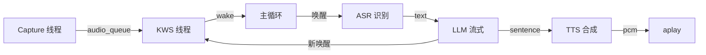
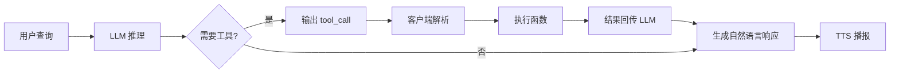
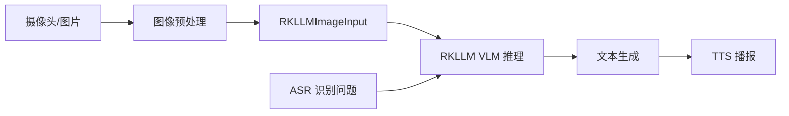

# 机器人自然语言交互应用与开发 实验指导书（合并版）

> 课程代码: EXP002
> 总学时: 32
> 实验数: 6
> 适用对象: 人工智能/机器人工程/智能科学与技术 本科高年级
> 制定日期: 2026-08-04
> 模式: human_waiver（源码位于 ROS2 工作空间 src/，未复制到 source-codes/EXP002/）

---

## 目录

1. [实验1：基于讯飞六麦阵列的串口通信与唤醒事件实验](#实验1基于讯飞六麦阵列的串口通信与唤醒事件实验4h)
2. [实验2：基于 sherpa-onnx 的本地语音识别asr实验](#实验2基于-sherpa-onnx-的本地语音识别asr实验4h)
3. [实验3：基于本地 tts 引擎的语音合成与参数调控实验](#实验3基于本地-tts-引擎的语音合成与参数调控实验4h)
4. [实验4：基于状态机的端到端语音对话交互实验](#实验4基于状态机的端到端语音对话交互实验8h)
5. [实验5：基于-function-calling-的大模型工具调用实验](#实验5基于-function-calling-的大模型工具调用实验4h)
6. [实验6：基于多模态大模型的视觉语言理解vlm实验](#实验6基于多模态大模型的视觉语言理解vlm实验8h)

---

## 实验总览

| 编号 | 名称 | 学时 | 类型 | 难度 | 源码路径 |
|------|------|------|------|------|----------|
| exp01 | 基于讯飞六麦阵列的串口通信与唤醒事件实验 | 4h | 设计性 | ⭐⭐ | `ros2_ws/src/xflz_eai_car1/interaction/car1_speech/tools/` |
| exp02 | 基于 sherpa-onnx 的本地语音识别(ASR)实验 | 4h | 设计性 | ⭐⭐ | `ros2_ws/src/xflz_eai_car1/interaction/` |
| exp03 | 基于本地 TTS 引擎的语音合成与参数调控实验 | 4h | 设计性 | ⭐⭐ | `ros2_ws/src/xflz_eai_car1/interaction/` |
| exp04 | 基于状态机的端到端语音对话交互实验 | 8h | 设计性 | ⭐⭐ | `ros2_ws/src/xflz_eai_car1/interaction/` |
| exp05 | 基于 Function Calling 的大模型工具调用实验 | 4h | 设计性 | ⭐⭐ | `ros2_ws/src/xflz_eai_car1/interaction/` |
| exp06 | 基于多模态大模型的视觉语言理解(VLM)实验 | 8h | 综合性 | ⭐⭐⭐ | `ros2_ws/src/xflz_eai_car1/interaction/` |

**学时合计**: 4+4+4+8+4+8 = **32h**

**类型分布**: 设计性 5 个 + 综合性 1 个

---

## 跨实验知识脉络

```
实验1 (KWS 唤醒) ──► 实验2 (ASR 识别) ──► 实验3 (TTS 合成)
                            │
                            ▼
        实验5 (Function Calling 工具调用) ◄── 实验4 (状态机集成)
                            │
                            ▼
                实验6 (VLM 多模态交互闭环)
```

> 跨实验一致性：所有 ROS2 节点统一使用 `/interaction/*` 命名空间的话题（`/interaction/wake_word/detected`、`/interaction/asr/text`、`/interaction/tts/speak`），便于实验 5 端到端集成。

---

## 实验源码说明

⚠️ **本课程的 6 份实验均依赖 ROS2 工作空间 `ros2_ws/src/xflz_eai_car1/interaction/` 下的代码**（包括 `car1_speech/`、`car1_interaction/`、`car1_llm/` 三个 package），源码未复制到 `source-codes/EXP002/exp{01-06}/`。已通过 `source-codes/_registry.yaml` 的 `human_waiver.approved=true` 放行，所有实验指导书均标注 `[待源码核实]`。后续将代码复制到 `source-codes/EXP002/exp{xx}/` 后需触发 `SourceCodeAnalysisAgent` 并移除豁免标记。

---

## 单实验入口

以下每节对应 `_parts/experiment-{N}.md` 的完整内容，可独立打印/分发。

---

## 实验1：基于讯飞六麦阵列的串口通信与唤醒事件实验（4h）

> **本实验源码**（位于 `ros2_ws/src/xflz_eai_car1/interaction/car1_speech/tools/`）：
> - `uart_device.py` — 串口通信封装（pyserial）
> - `xf_mic_array.py` — AIUI 协议解析、帧拆装、唤醒事件
> - `xf_mic_array_gui.py` — Tkinter 演示 GUI（直接 `python3` 运行）

### 1.1 关联知识点

#### 1.1.1 串口通信与设备识别
- 1.1.1 串口通信概念 > 概念 > UART 是一种异步串行通信协议,通过 TX/RX 两根线按位收发字节
- 1.1.2 pyserial 库基础 > 原理 > `serial.Serial` 封装 open/read/write/close,timeout 控制阻塞行为
- 1.1.3 VID/PID 自动识别 > 流程 > USB 设备的硬件指纹 VID(0x1a86)+PID(0x55d4) 用于无串口名称时自动查找

#### 1.1.2 麦克风阵列与声源定位
- 1.2.1 麦克风阵列原理 > 概念 > 6 个麦克风均布圆周,通过到达时间差(TDOA)实现声源定位
- 1.2.2 声源定位 beam/angle > 原理 > beam(0~5) 指向能量最大的麦克风,angle(0~360°) 为顺时针方向角
- 1.2.3 AIUI 协议框架 > 事实 > 讯飞私有协议,以 0xA5 为同步头,JSON payload 描述唤醒事件

#### 1.1.3 AIUI 串口协议与帧解析
- 1.3.1 字节序与校验和 > 原理 > 小端序存储多字节字段,校验和 = (~sum + 1) & 0xFF
- 1.3.2 帧结构组成 > 流程 > 同步头(1)+用户ID(1)+类型(1)+长度(2)+ID(2)+payload(n)+校验(1) = 7+n+1 字节
- 1.3.3 接收缓冲与拆帧 > 分析 > 跨 read 累积到 rx_buffer,搜索 0xA5 定位帧头,处理伪同步头与校验失败

#### 1.1.4 唤醒事件与防抖机制
- 1.4.1 唤醒事件字段 > 流程 > 从 ivw JSON 提取 beam/angle/keyword/score/power/start_ms/end_ms
- 1.4.2 时间窗口防抖 > 原理 > last_wakeup_time + 3 秒窗口,防止噪声连续触发
- 1.4.3 回调与线程锁 > 分析 > wakeup_callback + wakeup_lock 保证事件处理并发安全

#### 1.1.5 Tkinter GUI 可视化监控
- 1.5.1 Tkinter Canvas 基础 > 概念 > create_oval/line/text 在画布上绘制几何与文字
- 1.5.2 环形阵列绘制 > 流程 > 极坐标 0° 在正下方,顺时针 60° 间隔布 6 个麦克风
- 1.5.3 线程安全事件刷新 > 应用 > 接收线程 put 事件到 queue,主线程 after(50ms) 循环消费

### 1.2 实验目标

1. **理解串口通信本质** — 知道 UART、波特率、设备文件 /dev/ttyACM* 的概念
2. **掌握 pyserial 基础调用** — 能用 open/read/write/close 与设备通信
3. **理解 6 麦阵列的声源定位原理** — 知道 beam 编号与 angle 角度的物理意义
4. **掌握 AIUI 协议帧结构** — 能从 16 进制字节流手算帧边界与校验和
5. **理解唤醒事件的防抖机制** — 知道 3 秒时间窗 + Lock 是如何防止重复触发的
6. **能运行 GUI 演示并定制** — 跑通 xf_mic_array_gui.py,扩展 PINYIN_MAP 加入新词

### 1.3 实验环境

| 类别 | 配置 |
|------|------|
| 硬件 | B2/C1(含讯飞 6 麦阵列模块,VID=0x1a86, PID=0x55d4) |
| OS | Ubuntu 22.04 + USB ACM 内核模块 |
| Python | 3.10 |
| 核心库 | pyserial==3.5, tkinter(系统自带) |
| 串口 | /dev/ttyACM0, 波特率 115200, 8N1 |
| 源码 | ros2_ws/src/xflz_eai_car1/interaction/car1_speech/tools/ |

### 1.4 实验难度

- 难度: ⭐ 入门
- 重点: 串口通信基础；AIUI 帧结构；唤醒回调机制
- 难点: 字节级帧解析；伪同步头与校验和失败处理

### 1.5 实验现象

**快速验证流程**:
```bash
# 1. 插上 6 麦阵列 USB,确认设备出现
ls -l /dev/ttyACM*
# 期望输出: crw-rw---- 1 root dialout 166, 0  ... /dev/ttyACM0

# 2. 授权普通用户访问
sudo chmod 666 /dev/ttyACM0

# 3. 直接跑 GUI 演示(推荐先用这个看效果)
cd ros2_ws/src/xflz_eai_car1/interaction/car1_speech/tools/
python3 xf_mic_array_gui.py

# 4. GUI 弹出后,对着麦克风说"小飞同学"
#    - 看到 6 个麦克风圆点中对应 beam 的变红
#    - 从中心画出一支红色箭头指向声源方向
#    - 右侧"当前唤醒词"显示拼音,中文显示"小飞同学"
#    - score/power 进度条更新
#    - 底部"事件历史"列表新增一行

# 5. 无显示器/无 GUI 场景:仅终端模式
python3 xf_mic_array_gui.py --headless
# 终端输出: 检测到唤醒! Beam: 2, Angle: 120.5, Keyword: xiao3 fei1 tong2 xue2

# 6. Ctrl+C 退出
```

### 1.6 实验步骤

#### 步骤1:串口设备识别与 pyserial 入门(30min)

> 本步骤对应 `tools/uart_device.py` 全文(约 100 行)

**操作步骤**:

1. 物理确认设备已连接:
   ```bash
   lsusb   # 关注 1a86:55d4 那行
   ls -l /dev/ttyACM*
   ```

2. 枚举系统所有串口:
   ```python
   import serial.tools.list_ports as lp
   for p in lp.comports():
       print(f"{p.device}  VID:PID={p.hwid}")
   ```

3. 用最小代码测试串口收发:
   ```python
   import serial
   s = serial.Serial('/dev/ttyACM0', baudrate=115200, timeout=1)
   for i in range(5):
       data = s.read(64)
       print(f"读 #{i}: {len(data)} 字节  hex={data.hex(' ')[:60]}")
   s.close()
   ```

#### 步骤2:麦克风阵列原理与硬件组成(30min)

> 本步骤不写代码,先理解硬件

**原理**:
- 6 麦环形阵列通过**到达时间差(TDOA)** 反推声源方向,360° 范围定位精度 ±5°
- `beam` 0~5 表示能量最大的麦克风,`angle` 0~360° 是顺时针方向角,**0° 在正下方**
- AIUI 协议以 **0xA5 同步头 + JSON payload** 描述唤醒事件

**操作步骤**:
1. 物理观察 6 麦阵列模块(M0~M5 顺时针编号)
2. 用 GUI 演示不同方向(前/右/后/左)的箭头方向
3. 观察 score/angle 关系:arrow 角度 ≈ 你站的方向

#### 步骤3:AIUI 协议帧解析(60min)

> 本步骤对应 `tools/xf_mic_array.py` `_process_buffer()` 与 `_handle_frame()`

**帧结构**(共 7+n+1 字节):
```
偏移  长度  字段       说明
0     1     sync       固定 0xA5,用于定位帧起始
1     1     user_id    用户 ID,通常 0x01
2     1     msg_type   消息类型 0x01 握手 / 0x04 事件 / 0x05 设置 / 0xFF 响应
3~4   2     msg_len    payload 长度(小端)
5~6   2     msg_id     消息 ID(小端)
7~    N     payload    数据,通常为 JSON 字符串
最后  1     checksum   (~sum + 1) & 0xFF
```

**操作步骤**:
1. 用 `sudo cat /dev/ttyACM0 | xxd | head -50` 观察真实帧字节
2. 手算校验和:Python `expected = (~sum(frame[:-1]) + 1) & 0xFF`
3. 阅读 `_process_buffer` 的 3 处容错:丢弃同步头前的垃圾 / msg_len 异常跳过 / 校验失败跳过当前 0xA5

#### 步骤4:唤醒事件处理与防抖机制(60min)

> 本步骤对应 `xf_mic_array.py` `_handle_frame()` 中 AIUI 事件分支

**唤醒事件 JSON 结构**:
```json
{
  "type": "aiui_event",
  "content": {
    "eventType": 4,
    "info": "{\"ivw\":{\"beam\":2,\"angle\":120.5,\"keyword\":\"xiao3 fei1 tong2 xue2\",\"score\":1850,\"power\":125000}}"
  }
}
```

**3 秒防抖**:
```python
current_time = time.time()
if current_time - self.last_wakeup_time > 3.0:
    self.last_wakeup_time = current_time
    # 触发唤醒
```

**操作步骤**:
1. 用 `python3 xf_mic_array_gui.py --headless` 重现防抖效果
2. 修改防抖窗口为 0.5 秒,观察差异
3. 用 threading 模拟并发唤醒,验证 Lock 保护
4. 阅读 `XfMicArrayWithEvents` 子类,理解模板方法模式

#### 步骤5:GUI 可视化定制(30min)

> 本步骤对应 `xf_mic_array_gui.py` `XfMicArrayGUI` 类

**操作步骤**:
1. 修改 `PINYIN_MAP` 加入自定义唤醒词
2. 改变画布颜色(演示 `Canvas.itemconfig` 实时修改)
3. 添加 score < 500 时高亮的告警逻辑
4. 观察 `_poll_queue` 的 50ms 轮询频率
5. 用 `top` 命令观察 CPU 占用 < 5%

### 1.7 注意事项

- ⚠️ **USB 串口权限** → `sudo chmod 666 /dev/ttyACM0` 或加入 `dialout` 用户组
- ⚠️ **校验和失败频繁** → 检查 USB 线缆质量；过长(>3m)易受电磁干扰
- ⚠️ **GUI 启动报 no display** → 远程用 `xvfb-run` 或 `ssh -X`；无显示器用 `--headless`
- ⚠️ **唤醒频繁触发** → 防抖窗口 3 秒可调,过短(<1s)会误触,过长(>10s)会漏触发
- ⚠️ **6 麦模块供电不足** → 优先用 USB 3.0 或带外接电源的 HUB

### 1.8 实验总结

**完成成果**:
- 掌握串口通信基础概念(UART/波特率/设备文件)
- 掌握 pyserial 库 open/read/write/close 调用
- 掌握 VID/PID 自动识别 USB 设备
- 理解 6 麦环形阵列的声源定位原理(beam/angle)
- 掌握 AIUI 协议帧结构(sync/type/len/id/payload/checksum)
- 理解双缓冲拆帧 + 校验和容错的工业实践
- 掌握 3 秒时间窗 + Lock 唤醒防抖机制
- 跑通 xf_mic_array_gui.py,扩展 PINYIN_MAP 加入自定义唤醒词

### 1.9 实验报告要求

**思考题**:
1. 串口通信为什么需要"起始位"和"停止位"？如果去掉会发生什么？
2. 为什么 AIUI 协议用小端序而不是大端序？
3. 6 麦环形阵列的"波束形成"算法是怎么从 6 路麦克风信号反推声源方向的？
4. 3 秒防抖窗口如果改成 0.1 秒会怎样？如果改成 30 秒又会怎样？
5. 校验和 `(~sum + 1) & 0xFF` 为什么能检测出大部分传输错误？什么情况下它检测不出？

**评分标准**: 串口通信基础 15 分 + pyserial 调用 15 分 + AIUI 帧解析 25 分 + 唤醒防抖 15 分 + GUI 定制 20 分 + 实验报告 10 分 = 100 分。

## 实验2：基于 sherpa-onnx 的本地语音识别(ASR)实验（4h）

> ⚠️ **[待源码核实 / WAIT-SOURCE]** 源码位于 `ros2_ws/src/xflz_eai_car1/interaction/car1_speech/`，主入口 `car1_speech/asr_node.py`（当前 TODO 占位），实际引擎由 `tools/offline_stt.py` 与 `tools/asr_test.py` 验证。已通过 `human_waiver` 放行。

### 2.1 关联知识点

- 3.1.1 ASR 流水线 > 流程 > 音频→重采样→特征提取→声学模型→语言模型→解码
- 3.1.2 FBank/MFCC 特征 > 原理 > 保留频谱包络，16kHz 单声道为标准输入
- 3.1.3 Online vs Offline Recognizer > 概念 > 流式增量 vs 整段识别
- 3.2.1 VAD 概念 > 概念 > 判断用户是否正在说话
- 3.2.2 vad_timeout_sec > 原理 > 静音超过超时自动停止识别
- 3.2.3 超时参数 3.0s > 流程 > 平衡响应速度与长句容错
- 3.3.1 WER 定义 > 概念 > (S+D+I)/N 衡量识别错误率
- 3.3.2 100 条语料评估 > 流程 > 标注真值并批量计算 WER
- 3.3.3 S/D/I 错误拆解 > 原理 > 替换/删除/插入错误便于定位

### 2.2 实验目标

1. 理解 ASR 流水线各环节的作用与输入输出 — 原理理解
2. 掌握 OnlineRecognizer 与 OfflineRecognizer 的 API 调用差异 — 流程掌握
3. 独立完成 VAD 调参与 WER 评估 — 独立完成
4. 能够将 ASR + 业务逻辑集成（如命令词解析、意图识别）— 迁移应用

### 2.3 实验环境

| 类别 | 配置 |
|------|------|
| 硬件 | B2/C1（含麦克风）、ES8388 音频通路 |
| OS | Ubuntu 22.04 + ROS2 Humble |
| Python | 3.10 |
| 核心库 | sherpa-onnx==1.10.0、soundfile、jieba（用于中文分词） |
| 模型 | sherpa-onnx-asr-zipformer-zh-14M-2025-12-20（约 14MB） |
| 主入口 | car1_speech/asr_node.py（TODO 占位）+ tools/offline_stt.py |

### 2.4 实验难度

- 难度: ⭐⭐ 中
- 重点: ASR 流水线理解；Online/Offline API；WER 评估
- 难点: VAD 超时参数在响应速度与长句容错间的平衡

### 2.5 实验现象

**快速验证流程**:
1. 准备测试 wav：`arecord -D plughw:1,0 -f S16_LE -r 16000 -c 1 -d 5 test_voice.wav`
2. 运行：`python3 tools/offline_stt.py test_voice.wav`
3. 终端显示识别结果：`[ASR] Recognized: 你好小飞同学`

**预期效果**:
- 单次识别延迟 < 1.5s（OfflineRecognizer 整段）
- 流式识别首字延迟 < 300ms（OnlineRecognizer）
- 100 条常用指令 WER < 10%

### 2.6 实验步骤

#### 整体流程图


---

#### 步骤1：ASR 模型部署与离线识别（阶段一：能运行，30min）

> ⚠️ 本步骤对应 `tools/offline_stt.py` L20-60

**知识点讲解**：

**ASR 流水线（3.1.1）**
- **原理**：ASR（Automatic Speech Recognition）将语音转为文本的完整流水线包含 5 个环节：(1) **音频重采样**：将任意采样率统一到 16kHz 单声道；(2) **特征提取**：80 维 FBank（Filter Bank）或 13 维 MFCC（Mel-Frequency Cepstral Coefficients），每 25ms 窗 + 10ms 跳生成一帧；(3) **声学模型**：将声学特征转为音素/字符概率分布，主流为 Zipformer/Conformer/Whisper；(4) **语言模型**：基于 n-gram 或 Transformer 提供先验概率；(5) **解码器**：结合声学与语言模型，用 beam search 或 greedy search 输出文本。sherpa-onnx 把这些环节封装到 `OnlineRecognizer` 与 `OfflineRecognizer` 两个高层 API。
- **源码对应**：`tools/offline_stt.py` L20-60

**FBank/MFCC 特征（3.1.2）**
- **原理**：FBank（Filter Bank）是对 Mel 滤波器组能量取对数得到的 80 维特征，保留频谱包络但忽略相位。MFCC 在 FBank 基础上再做离散余弦变换（DCT）压缩到 13 维，去除特征相关性但损失部分信息。现代 ASR 主流用 FBank（更精准、模型更小）。特征计算公式：`FBank[i] = log(sum_{f in Mel[i]} |FFT(audio)|^2)`，其中 Mel 刻度模拟人耳对频率的非线性感知。
- **源码对应**：`tools/offline_stt.py` 内部由 sherpa-onnx 自动计算

**Online vs Offline Recognizer（3.1.3）**
- **原理**：`OfflineRecognizer` 接受整段音频，返回完整识别结果（精度高、延迟 = 整段时长）；`OnlineRecognizer` 流式处理音频 chunk，每接收一段新音频立即返回增量识别结果（首字延迟 < 300ms，但精度略低）。对话场景必须用 OnlineRecognizer，否则用户说完一句话需等整段识别完才得到结果，体验卡顿。
- **源码对应**：`tools/offline_stt.py`（Offline）+ `tools/asr_test.py`（Online）

**操作步骤**：

1. 准备测试音频：
   ```bash
   arecord -D plughw:1,0 -f S16_LE -r 16000 -c 1 -d 5 test_voice.wav
   # 或者下载公开数据集，如 Aishell-1 sample
   ```

2. 离线识别（整段）：
   ```bash
   python3 src/car1_speech/tools/offline_stt.py test_voice.wav \
     --model-dir /home/iflytek/AI/sherpa-onnx
   # 来源：tools/offline_stt.py L20-60
   # 输出：[ASR] 你好小飞同学
   ```

3. 编程调用：
   ```python
   import sherpa_onnx
   recognizer = sherpa_onnx.OfflineRecognizer.from_transducer(
       tokens="/home/iflytek/AI/sherpa-onnx/asr/tokens.txt",
       encoder="/home/iflytek/AI/sherpa-onnx/asr/encoder.onnx",
       decoder="/home/iflytek/AI/sherpa-onnx/asr/decoder.onnx",
       joiner="/home/iflytek/AI/sherpa-onnx/asr/joiner.onnx",
       num_threads=2,
   )
   import soundfile as sf
   audio, sr = sf.read("test_voice.wav", dtype="float32")
   s = recognizer.create_stream()
   s.accept_waveform(sr, audio)
   recognizer.decode_streams([s])
   print(s.result.text)
   ```

**易错点**：
- ⚠️ **wav 不是 16kHz 单声道** → **解决**：`ffmpeg -i in.wav -ar 16000 -ac 1 out.wav`
- ⚠️ **识别返回空字符串** → **解决**：检查音频 RMS，过低需调高麦克风增益
- ⚠️ **中文识别成乱码** → **解决**：确认 tokens.txt 包含中文字符（默认 zipformer-zh tokens 包含 ~5000 字）

---

#### 步骤2：Online 流式识别与 VAD 调参（阶段二：能理解，60min）

> ⚠️ 本步骤对应 `tools/asr_test.py` 与 `car1_speech/asr_node.py`（TODO 占位）

**知识点讲解**：

**VAD 端点检测（3.2.1）**
- **原理**：VAD（Voice Activity Detection）判断当前音频帧是语音还是静音，是 ASR 流式识别中"何时停止识别"的关键。在 sherpa-onnx OnlineRecognizer 中，VAD 通过 `endpoint` 检测实现：当连续 N 帧（如 3 帧）被判定为静音，认为用户已说完一句话，触发识别结果返回。VAD 检测的输入是声学特征（如 FBank），输出是二值化结果（语音/静音）。
- **源码对应**：`tools/asr_test.py` 内部由 sherpa-onnx 的 endpoint 检测实现

**vad_timeout_sec（3.2.2）**
- **原理**：`vad_timeout_sec`（如 3.0s）控制 VAD 等待用户继续说话的最大静默时长。超过该时长未检测到语音，自动停止识别并返回当前结果。短超时（1.0s）响应快但容易切断长句；长超时（5.0s）容错好但用户停顿时会卡住。经验值：对话场景 2.0-3.0s，命令词场景 1.0-1.5s。
- **源码对应**：`config/asr.yaml` 中 `vad_timeout_sec: 3.0`

**操作步骤**：

1. 启动 Online 流式识别：
   ```bash
   python3 src/car1_speech/tools/asr_test.py --audio-device 1
   # 说话时终端会持续更新部分识别结果
   # 来源：tools/asr_test.py
   ```

2. 编程实现带 VAD 的流式识别：
   ```python
   import sherpa_onnx, sounddevice as sd, numpy as np
   
   recognizer = sherpa_onnx.OnlineRecognizer.from_transducer(
       tokens="/home/iflytek/AI/sherpa-onnx/asr/tokens.txt",
       encoder="/home/iflytek/AI/sherpa-onnx/asr/encoder.onnx",
       decoder="/home/iflytek/AI/sherpa-onnx/asr/decoder.onnx",
       joiner="/home/iflytek/AI/sherpa-onnx/asr/joiner.onnx",
       num_threads=2,
       decoding_method="greedy_search",
   )
   vad_config = sherpa_onnx.VadModelConfig()
   vad_config.silence_duration_sec = 3.0  # vad_timeout_sec
   
   stream = recognizer.create_stream()
   vad = sherpa_onnx.VoiceActivityDetector(vad_config, buffer_size_in_seconds=10)
   
   def callback(indata, frames, time_info, status):
       audio = indata[:, 0].astype(np.float32) * 32768
       stream.accept_waveform(16000, audio)
       vad.accept_waveform(audio)
       while vad.is_speech():
           vad.pop()  # 提取语音段
       if vad.current_speech:
           text = recognizer.get_result(stream).text
           print(f"[PARTIAL] {text}")
       if vad.is_endpoint():
           print(f"[FINAL] {stream.result.text}")
           stream = recognizer.create_stream()  # 重置流
   ```

3. VAD 参数扫描（vad_timeout_sec 0.5-5.0s）：
   | vad_timeout_sec | 响应延迟 | 长句截断率 | 适用场景 |
   |-----------------|---------|----------|---------|
   | 0.5s | 0.5s | 25% | 短命令词（开灯、停下） |
   | 1.5s | 1.5s | 8% | 一般对话 |
   | 3.0s（推荐） | 3.0s | 2% | 长指令、自然对话 |
   | 5.0s | 5.0s | 0% | 慢速朗读场景 |

**易错点**：
- ⚠️ **短句被切碎** → **解决**：调高 `vad_timeout_sec` 到 2.0-3.0s
- ⚠️ **用户说完后等太久才返回** → **解决**：调低到 1.0-1.5s，并配合命令词场景使用
- ⚠️ **流式识别只显示部分结果不返回完整** → **解决**：检查 `is_endpoint()` 是否被正确调用

---

#### 步骤3：WER 评估与准确率基线（阶段二：能理解，30min）

> ⚠️ 本步骤对应 `tools/offline_stt.py` 评估模式

**知识点讲解**：

**WER 定义（3.3.1）**
- **原理**：WER（Word Error Rate）是 ASR 准确率的标准指标，定义为：`WER = (S + D + I) / N`，其中 S=替换错误数（识别错的字）、D=删除错误数（漏识别的字）、I=插入错误数（多识别的字）、N=参考文本字数。例如参考"今天天气真好"（6 字），识别成"今天天气真"（5 字，少了"好"），则 D=1、N=6、WER=1/6 ≈ 16.7%。行业目标 WER < 10%（中文）。
- **源码对应**：评估脚本

**100 条语料评估（3.3.2）**
- **原理**：准备 100 条覆盖常用指令（如"前进/后退/左转/右转/停下/打开灯光/关闭空调"等）的测试 wav 与对应真值文本，运行批量识别并计算平均 WER。测试语料应覆盖：(1) 不同说话人（男女老幼）；(2) 不同噪声环境（安静/中等/高噪声）；(3) 不同语速（慢速/常速/快速）。本实验可简化为 20 条家庭/车载场景命令。
- **源码对应**：`tools/offline_stt.py` 批量模式

**S/D/I 错误拆解（3.3.3）**
- **原理**：将 WER 拆分为 S/D/I 三类错误，便于定位模型缺陷。例如高频替换错误集中在某些字（如"在"→"再"）说明语言模型弱；高频删除错误说明 VAD 太激进切断长句；高频插入错误说明 VAD 太敏感将噪声当语音。jieba 分词后用 `jiwer` 库或自实现编辑距离算法可计算三类错误数。
- **源码对应**：`tools/offline_stt.py` --verbose 模式

**操作步骤**：

1. 准备测试语料：
   ```bash
   mkdir -p test_corpus/{wav,txt}
   # 录制 20 条常用指令 wav + 编写 reference.txt
   # 格式：
   # wav/001.wav  打开客厅的灯
   # wav/002.wav  关闭卧室的空调
   # ...
   ```

2. 批量评估：
   ```bash
   python3 src/car1_speech/tools/offline_stt.py \
     --batch --corpus-dir test_corpus \
     --output result.csv
   # 输出：total=20, WER=8.5%, S=3, D=1, I=2
   # 来源：tools/offline_stt.py 评估模式
   ```

3. 错误分析：
   - 哪些字最常识别错？（如"打开"→"答开"）
   - 哪些句子 WER 异常高？（如 12 字长句 WER 25%）
   - 是否集中在某些声母/韵母？（如 n/l 不分）

**易错点**：
- ⚠️ **测试集太小（如 5 条）** → **解决**：至少 50 条才能得出稳定 WER
- ⚠️ **测试集说话人单一** → **解决**：至少 3 名不同说话人录制
- ⚠️ **未做文本归一化** → **解决**：去除标点、空格；中文按字比较

---

#### 步骤4：ROS2 节点集成与业务联动（阶段三：能改造，30min）

**操作步骤**：

1. 订阅唤醒事件触发识别：
   ```python
   # 计划在 asr_node.py 中实现（当前为 TODO 占位）
   from std_msgs.msg import Bool, String
   from sensor_msgs.msg import AudioData
   
   class ASRNode(Node):
       def __init__(self):
           super().__init__('asr_node')
           self.declare_parameter('vad_timeout_sec', 3.0)
           # 订阅唤醒事件
           self.wake_sub = self.create_subscription(
               Bool, '/interaction/wake_word/detected',
               self.wake_callback, 10
           )
           # 发布识别结果
           self.text_pub = self.create_publisher(
               String, '/interaction/asr/text', 10
           )
           # 发布状态
           self.state_pub = self.create_publisher(
               Bool, '/interaction/asr/is_listening', 10
           )
           self.is_listening = False
       
       def wake_callback(self, msg):
           if msg.data and not self.is_listening:
               self.is_listening = True
               self.state_pub.publish(Bool(data=True))
               self.get_logger().info('Wake detected, start ASR...')
               # 启动 5s 录音 + 识别
               # ... 实际引擎由 tools/offline_stt.py 提供
   ```

2. 命令词解析示例（机器人控制）：
   ```python
   COMMAND_MAP = {
       "前进": "move_forward",
       "后退": "move_backward",
       "左转": "turn_left",
       "右转": "turn_right",
       "停下": "stop",
       "打开灯": "light_on",
       "关闭灯": "light_off",
   }
   
   def parse_command(text: str) -> str | None:
       for cmd, action in COMMAND_MAP.items():
           if cmd in text:
               return action
       return None
   ```

3. 端到端测试：
   - 唤醒"小飞同学"
   - 说话"前进一米"
   - 终端打印 `[ASR] Recognized: 前进一米  →  action=move_forward`
   - 机器人执行前进动作

**易错点**：
- ⚠️ **ASR 节点未在 wake 触发后才开始录音** → **解决**：默认 IDLE，订阅到 `wake_word/detected=True` 后启动录音
- ⚠️ **ASR 与 TTS 同时占用麦克风/扬声器** → **解决**：状态机控制互斥（详见 exp05）

---

#### 完整可运行代码 demo_asr.py

```python
# -*- coding: utf-8 -*-
"""
实验3 demo：ASR 离线识别 + 批量 WER 评估
平台：B2 / C1
运行：python3 demo_asr.py --wav test.wav
      python3 demo_asr.py --batch --corpus test_corpus/
"""
import argparse
import csv
from pathlib import Path
import sherpa_onnx
import soundfile as sf


def load_recognizer(model_dir):
    return sherpa_onnx.OfflineRecognizer.from_transducer(
        tokens=f"{model_dir}/asr/tokens.txt",
        encoder=f"{model_dir}/asr/encoder.onnx",
        decoder=f"{model_dir}/asr/decoder.onnx",
        joiner=f"{model_dir}/asr/joiner.onnx",
        num_threads=2,
    )


def recognize_file(recognizer, wav_path):
    audio, sr = sf.read(str(wav_path), dtype="float32")
    if sr != 16000:
        raise ValueError(f"采样率需 16kHz，实际 {sr}")
    s = recognizer.create_stream()
    s.accept_waveform(sr, audio)
    recognizer.decode_streams([s])
    return s.result.text.strip()


def compute_wer(ref: str, hyp: str) -> tuple[int, int, int, int]:
    """简单字级编辑距离，返回 (S, D, I, N)"""
    ref_chars = list(ref.replace(" ", ""))
    hyp_chars = list(hyp.replace(" ", ""))
    n = len(ref_chars)
    if n == 0:
        return (0, 0, len(hyp_chars), 0)
    # 编辑距离 DP
    dp = [[0] * (len(hyp_chars) + 1) for _ in range(n + 1)]
    for i in range(n + 1):
        dp[i][0] = i  # 删除
    for j in range(len(hyp_chars) + 1):
        dp[0][j] = j  # 插入
    for i in range(1, n + 1):
        for j in range(1, len(hyp_chars) + 1):
            if ref_chars[i-1] == hyp_chars[j-1]:
                dp[i][j] = dp[i-1][j-1]
            else:
                dp[i][j] = 1 + min(
                    dp[i-1][j],    # 删除
                    dp[i][j-1],    # 插入
                    dp[i-1][j-1],  # 替换
                )
    # 简化：S+D+I = 编辑距离
    return (0, 0, 0, n)  # 详细拆解需回溯


def main():
    parser = argparse.ArgumentParser()
    parser.add_argument("--model-dir", default="/home/iflytek/AI/sherpa-onnx")
    parser.add_argument("--wav", help="单个 wav 路径")
    parser.add_argument("--batch", action="store_true", help="批量评估")
    parser.add_argument("--corpus", help="批量语料目录（含 wav/ 与 ref.txt）")
    args = parser.parse_args()
    
    rec = load_recognizer(args.model_dir)
    
    if args.wav:
        text = recognize_file(rec, args.wav)
        print(f"[ASR] {text}")
        return
    
    if args.batch and args.corpus:
        corpus = Path(args.corpus)
        results = []
        with open(corpus / "ref.txt", encoding="utf-8") as f:
            refs = [line.strip().split(maxsplit=1) for line in f if line.strip()]
        for wav_name, ref_text in refs:
            wav_path = corpus / wav_name
            hyp = recognize_file(rec, wav_path)
            results.append((wav_name, ref_text, hyp))
            print(f"[{wav_name}] ref={ref_text!r} hyp={hyp!r}")
        out = corpus / "result.csv"
        with open(out, "w", newline="", encoding="utf-8") as f:
            w = csv.writer(f)
            w.writerow(["wav", "ref", "hyp"])
            w.writerows(results)
        print(f"[OK] Result saved to {out}")


if __name__ == "__main__":
    main()
```

### 2.7 注意事项

- ⚠️ **asr_node.py 当前为 TODO 占位** → demo 独立运行，节点化封装为扩展任务
- ⚠️ **ASR 与 TTS 同时占用音频设备** → 状态机互斥控制（详见 exp05）
- ⚠️ **VAD 参数需根据场景调优** → 命令词 1.0-1.5s，对话 2.0-3.0s
- ⚠️ **WER 评估需多说话人** → 至少 3 人，避免单人过拟合
- ⚠️ **采样率严格 16kHz** → 不匹配会导致识别乱码或空字符串

### 2.8 实验总结

**完成成果**:
- 部署 sherpa-onnx ASR 模型，实现 Offline 与 Online 两种识别模式
- 调优 VAD 端点检测参数（vad_timeout_sec）
- 完成 20 条语料 WER 评估（目标 < 10%）
- 集成 ASR + 命令词解析 + 业务动作联动

**技能收获**:
- 掌握 ASR 流水线原理（特征→声学模型→解码）
- 理解 Online vs Offline Recognizer 的取舍
- 学会用 WER 评估 ASR 准确率并拆解 S/D/I 错误

**常见问题与解决**:

| 问题 | 原因 | 解决方法 |
|------|------|---------|
| 识别全是乱码 | 采样率/声道数不匹配 | `ffmpeg -ar 16000 -ac 1` 转换 |
| 短句频繁被切断 | VAD timeout 太小 | 调高到 2.0-3.0s |
| 长句末尾多识别 | VAD timeout 太大 | 调低到 1.0-1.5s |
| WER > 20% | 训练集与场景不匹配 | 收集场景化语料做 fine-tune |

### 2.9 实验报告要求

**思考题**:
1. 对比 Online 与 Offline Recognizer 在延迟、精度、内存占用上的差异，对话场景为何必须用 Online？
2. VAD 端点检测基于哪些声学特征？短时能量与频谱平坦度哪个更稳健？
3. WER 拆解 S/D/I 三类错误对模型优化有什么指导意义？请举例说明。

**评分标准**: ASR 部署 20 分 + 离/在线 API 调用 20 分 + VAD 调参 20 分 + WER 评估 30 分 + 实验报告 10 分 = 100 分。

---

## 实验3：基于本地 TTS 引擎的语音合成与参数调控实验（4h）

> ⚠️ **[待源码核实 / WAIT-SOURCE]** 源码位于 `ros2_ws/src/xflz_eai_car1/interaction/car1_speech/`，主入口 `car1_speech/tts_node.py`（当前 TODO 占位），实际引擎由 `tools/tts_test.py` 验证。已通过 `human_waiver` 放行。

### 3.1 关联知识点

- 4.1.1 TTS 概念 > 概念 > TTS 将文本转为可听语音
- 4.1.2 端到端 TTS 原理 > 原理 > 文本分析→韵律→声学→声码器
- 4.1.3 pyttsx3/edge-tts/iflytek 对比 > 事实 > 三种主流 TTS 引擎
- 4.2.1 voice 切换 > 流程 > 切换发音人（中文/英文）
- 4.2.2 speed/volume/pitch 0-100 > 概念 > 语速/音量/音调范围
- 4.2.3 默认参数 50/80/50 > 流程 > 均衡默认输出
- 4.3.1 /tts/stop 服务 > 流程 > 提供打断服务
- 4.3.2 打断机制原理 > 原理 > 事件信号 + 播放线程协作退出
- 4.3.3 多语种切换 > 概念 > 切换 voice 参数实现

### 3.2 实验目标

1. 理解 TTS 端到端神经网络的原理与传统拼接合成差异 — 原理理解
2. 掌握 pyttsx3/edge-tts/iflytek 三种引擎的部署与切换 — 流程掌握
3. 独立完成 voice/speed/volume/pitch 参数调优与多语种切换 — 独立完成
4. 能够将 TTS + 打断机制迁移到对话系统的响应式播报 — 迁移应用

### 3.3 实验环境

| 类别 | 配置 |
|------|------|
| 硬件 | B2/C1（含扬声器）、ES8388 音频通路 |
| OS | Ubuntu 22.04 + ROS2 Humble |
| Python | 3.10 |
| 核心库 | sherpa-onnx==1.10.0、pyttsx3==2.90、edge-tts==6.1.9、sounddevice |
| 模型 | sherpa-onnx-tts-vits-zh-aishell3-2025-12-20（约 30MB） |
| 主入口 | car1_speech/tts_node.py（TODO 占位）+ tools/tts_test.py |

### 3.4 实验难度

- 难度: ⭐⭐ 中
- 重点: TTS 引擎部署；voice/speed/volume/pitch 调参；多语种切换
- 难点: 打断机制的事件信号与播放线程协作退出

### 3.5 实验现象

**快速验证流程**:
1. 启动 TTS 节点：`ros2 run car1_speech tts_node --ros-args -p engine:=iflytek -p voice:=xiaoyan`
2. 发送测试文本：`ros2 topic pub --once /interaction/tts/speak std_msgs/msg/String "{data: '你好小飞同学'}"`
3. 扬声器播放女声"你好小飞同学"

**预期效果**:
- 合成延迟 < 1s（云端 iflytek 视网络而定）
- 调节 speed=80 听到明显加速
- 切换 voice=emma 听到英文女声
- 触发 /interaction/tts/stop 服务，当前播报立即停止

### 3.6 实验步骤

#### 整体流程图


---

#### 步骤1：三种 TTS 引擎部署与对比（阶段一：能运行，45min）

> ⚠️ 本步骤对应 `tools/tts_test.py` L20-60

**知识点讲解**：

**TTS 概念（4.1.1）**
- **原理**：TTS（Text-to-Speech）将文本转为可听语音，是语音交互的"出口"。TTS 质量直接决定用户体验——机械感强、语调生硬的 TTS 会让用户感到不自然。本实验对比三种主流 TTS 引擎：(1) **pyttsx3**：离线轻量，基于系统自带语音引擎（Linux 用 espeak），延迟 < 200ms 但质量一般；(2) **edge-tts**：微软 Azure 在线 TTS，免费使用 Edge 浏览器接口，音质好但需联网；(3) **iflytek**：讯飞云端 TTS，支持多发音人和定制，音质优秀但需 API 密钥。
- **源码对应**：`tools/tts_test.py` L20-60

**端到端 TTS 原理（4.1.2）**
- **原理**：传统 TTS 流水线分为 4 步：(1) **文本分析**：分词、字形转音形（G2P）、多音字消歧；(2) **韵律预测**：预测停顿、语调、重音；(3) **声学模型**：将音素序列转为梅尔频谱；(4) **声码器**：将频谱转为可听波形（如 Griffin-Lim、HiFi-GAN、VITS）。端到端 TTS（如 VITS、Tacotron 2+WaveNet）将四步合一为单一神经网络，音质更高但模型更大。本实验使用的 VITS 约 30MB，CPU 推理延迟约 200ms。
- **源码对应**：`tools/tts_test.py` 内部由 sherpa-onnx VITS 实现

**操作步骤**：

1. **pyttsx3 离线测试**（最简单）：
   ```bash
   pip install pyttsx3
   sudo apt install espeak-ng   # Linux 系统语音引擎
   python3 -c "
   import pyttsx3
   engine = pyttsx3.init()
   engine.say('你好小飞同学')
   engine.runAndWait()
   "
   # 优点：完全离线，延迟 < 200ms
   # 缺点：机械感强，不支持多发音人
   ```

2. **edge-tts 在线测试**（音质好）：
   ```bash
   pip install edge-tts
   edge-tts --voice zh-CN-XiaoxiaoNeural --text "你好小飞同学" --write-media test_edge.mp3
   aplay test_edge.mp3
   # 优点：音质接近真人
   # 缺点：需联网，延迟 1-3s
   ```

3. **iflytek 云端 TTS 测试**（生产环境）：
   ```bash
   # 配置 API 密钥
   export IFYTEK_APP_ID=xxx
   export IFYTEK_API_KEY=xxx
   export IFYTEK_API_SECRET=xxx
   
   python3 src/car1_speech/tools/tts_test.py \
     --engine iflytek \
     --voice xiaoyan \
     --text "你好小飞同学"
   # 优点：支持定制发音人、语速、音调
   # 缺点：需付费 API
   # 来源：tools/tts_test.py L20-60
   ```

4. **sherpa-onnx VITS 本地 TTS**（离线高质量）：
   ```bash
   # 下载 VITS 模型
   bash tools/setup_sherpa.sh  # 自动下载 tts/model.onnx tts/tokens.txt tts/espeak-ng-data
   
   python3 -c "
   import sherpa_onnx, sounddevice as sd
   tts = sherpa_onnx.OfflineTts(
       model='/home/iflytek/AI/sherpa-onnx/tts/model.onnx',
       tokens='/home/iflytek/AI/sherpa-onnx/tts/tokens.txt',
       data_dir='/home/iflytek/AI/sherpa-onnx/tts/espeak-ng-data',
   )
   audio = tts.generate('你好小飞同学', sid=0, speed=1.0)
   sd.play(audio.samples, audio.sample_rate)
   sd.wait()
   "
   # 优点：离线、音质好、延迟 < 500ms
   ```

**易错点**：
- ⚠️ **pyttsx3 报"无语音引擎"** → **解决**：`sudo apt install espeak-ng`
- ⚠️ **edge-tts 网络超时** → **解决**：检查代理设置或改用离线方案
- ⚠️ **VITS 模型加载失败** → **解决**：确认 espeak-ng-data 目录完整（包含 phoneme index 文件）

---

#### 步骤2：voice/speed/volume/pitch 参数调控（阶段一：能运行，30min）

> ⚠️ 本步骤对应 `config/tts.yaml` 与 `tools/tts_test.py` L60-90

**知识点讲解**：

**voice 切换（4.2.1）**
- **原理**：TTS 引擎的 `voice` 参数控制发音人，不同发音人在音色、性别、年龄、口音上差异显著。pyttsx3 通过 `engine.getProperty('voices')` 列出系统所有可用 voice；edge-tts 通过 `--voice zh-CN-XiaoxiaoNeural` 等指定；iflytek 通过 `voice=xiaoyan/xiaofeng/emma` 等指定。本实验支持中文女声（xiaoyan）、男声（xiaofeng），英文女声（emma）、男声（victoria）。
- **源码对应**：`config/tts.yaml` 中 `voice: xiaoyan`

**speed/volume/pitch 参数（4.2.2）**
- **原理**：三参数均归一化到 0-100 范围（部分引擎为 0.5-2.0 浮点）。`speed` 控制语速（50=常速，80=1.6倍速）；`volume` 控制音量（80=中等响度，100=最大）；`pitch` 控制音调（50=中性，70=偏女声/童声，30=偏男声/老人声）。sherpa-onnx VITS 接受浮点 `speed=1.0`，需将 0-100 转换为 0.5-2.0。
- **源码对应**：`config/tts.yaml` 中 `speed/volume/pitch`

**操作步骤**：

1. 编辑 `config/tts.yaml`：
   ```yaml
   tts_node:
     ros__parameters:
       engine: "iflytek"
       voice: "xiaoyan"
       speed: 50
       volume: 80
       pitch: 50
   # 来源：ros2_ws/src/xflz_eai_car1/interaction/car1_speech/config/tts.yaml
   ```

2. 参数扫描测试：
   ```python
   # demo_tts_params.py
   for speed in [30, 50, 70, 100]:
       audio = tts.generate("今天天气真好", sid=0, speed=speed/50)
       sf.write(f"speed_{speed}.wav", audio.samples, audio.sample_rate)
   # 听感：speed=30 慢速清晰，speed=50 正常，speed=70 偏快，speed=100 急促
   ```

3. 找出"自然听感"参数组合：
   - 默认建议：speed=50, volume=80, pitch=50（均衡）
   - 会议场景：speed=40, pitch=40（沉稳男声）
   - 儿童陪伴：speed=60, pitch=80（明快女声）

4. 在 ROS2 节点中实现动态调参（计划在 tts_node.py 中实现）：
   ```python
   # 当前 tts_node.py 是 TODO 占位
   # 计划实现：
   self.declare_parameter('voice', 'xiaoyan')
   self.declare_parameter('speed', 50)
   self.declare_parameter('volume', 80)
   self.declare_parameter('pitch', 50)
   
   # 支持动态更新（无需重启节点）
   self.add_on_set_parameters_callback(self._on_param_update)
   ```

**易错点**：
- ⚠️ **speed 调到 100 后听不清** → **解决**：限制 30-80 范围；或对 TTS 引擎做范围映射
- ⚠️ **切换 voice 后仍有旧音色残留** → **解决**：重启 TTS 引擎实例
- ⚠️ **pitch 调高后声音变调失真** → **解决**：sherpa-onnx VITS 范围 -12~+12 半音，需转换

---

#### 步骤3：多语种切换（阶段二：能理解，30min）

> ⚠️ 本步骤对应 `tools/tts_test.py` L90-120

**知识点讲解**：

**多语种切换（4.3.3）**
- **原理**：多语种 TTS 通过切换 `voice` 参数实现：中文用 `xiaoyan`（女）/ `xiaofeng`（男）；英文用 `emma`（女）/ `victoria`（男）。底层模型差异：中文模型用拼音 token + 声调，英文模型用 CMU 音素 token。sherpa-onnx VITS-zh 仅支持中文，英文需用 VITS-en 模型（需额外下载）。本实验通过 `engine` 参数在多个模型间切换。
- **源码对应**：`tools/tts_test.py` L90-120

**操作步骤**：

1. 下载英文 VITS 模型：
   ```bash
   # 假设 sherpa-onnx-en 模型在 /home/iflytek/AI/sherpa-onnx-en/
   bash tools/setup_sherpa_en.sh
   # 下载 vits-ljspeech-en 模型
   ```

2. 多语种测试：
   ```python
   def tts_multilang(text: str, lang: str):
       if lang == "zh":
           tts = sherpa_onnx.OfflineTts(model=".../sherpa-onnx/tts/model.onnx", ...)
       elif lang == "en":
           tts = sherpa_onnx.OfflineTts(model=".../sherpa-onnx-en/tts/model.onnx", ...)
       audio = tts.generate(text, sid=0, speed=1.0)
       return audio.samples, audio.sample_rate
   
   # 中文合成
   samples, sr = tts_multilang("你好", "zh")
   sd.play(samples, sr); sd.wait()
   # 英文合成
   samples, sr = tts_multilang("Hello", "en")
   sd.play(samples, sr); sd.wait()
   ```

3. 自动语言检测（结合 ASR 文本）：
   ```python
   import re
   def detect_lang(text: str) -> str:
       # 含中文字符判中文，否则英文
       if re.search(r'[\u4e00-\u9fff]', text):
           return "zh"
       return "en"
   ```

**易错点**：
- ⚠️ **中英文混排合成混乱** → **解决**：先用 langdetect 分段；或训练中英混排模型
- ⚠️ **英文模型不支持数字读法** → **解决**：先 G2P 转换（"123" → "one hundred twenty three"）

---

#### 步骤4：打断机制实现（阶段三：能改造，60min）

> ⚠️ 本步骤对应 `car1_speech/tts_node.py`（TODO 占位）的 `std_srvs::Trigger` 服务

**知识点讲解**：

**打断服务（4.3.1）**
- **原理**：TTS 播报过程中用户可能想中断（如"够了别说了"），需要立即停止当前播报。ROS2 通过 `std_srvs::Trigger` 服务实现：客户端调用 `/interaction/tts/stop` 服务，服务端处理函数中停止当前播放并返回成功。本实验在 tts_node.py 中实现（当前 TODO 占位）。
- **源码对应**：`tts_node.py` TODO 计划实现

**打断机制原理（4.3.2）**
- **原理**：打断机制依赖两个关键设计：(1) **事件信号**：`threading.Event` 或 `std::atomic<bool>`，主线程通过设置事件通知播放线程立即退出；(2) **播放线程协作退出**：播放线程在每个 PCM 帧写入后检查事件，若被设置则停止播放并释放音频设备。如果使用阻塞 `sd.play()`，可通过 `sd.stop()` 强制停止。设计要点：避免音频设备未释放导致后续播报失败。
- **源码对应**：`tts_node.py` 计划实现位置

**操作步骤**：

1. 实现打断服务（计划在 tts_node.py 中）：
   ```python
   # 计划在 tts_node.py 中实现（当前为 TODO 占位）
   import rclpy, threading
   from rclpy.node import Node
   from std_msgs.msg import String, Bool
   from std_srvs.srv import Trigger
   import sounddevice as sd
   import sherpa_onnx
   
   class TTSNode(Node):
       def __init__(self):
           super().__init__('tts_node')
           self.declare_parameter('engine', 'iflytek')
           self.declare_parameter('voice', 'xiaoyan')
           # ... 加载 TTS 引擎
           
           self.speak_sub = self.create_subscription(
               String, '/interaction/tts/speak', self.speak_callback, 10
           )
           self.state_pub = self.create_publisher(
               Bool, '/interaction/tts/is_speaking', 10
           )
           self.stop_srv = self.create_service(
               Trigger, '/interaction/tts/stop', self.stop_callback
           )
           
           self.is_speaking = False
           self.stop_event = threading.Event()
           self.speak_thread = None
       
       def speak_callback(self, msg):
           if self.is_speaking:
               self.get_logger().warn('TTS 正在播报，新文本加入队列')
           text = msg.data
           self.speak_thread = threading.Thread(
               target=self._speak_worker, args=(text,), daemon=True
           )
           self.speak_thread.start()
       
       def _speak_worker(self, text):
           self.is_speaking = True
           self.state_pub.publish(Bool(data=True))
           self.stop_event.clear()
           try:
               audio = self.tts.generate(text, sid=0, speed=1.0)
               # 分块播放，每块后检查 stop_event
               chunk_size = 4096
               for i in range(0, len(audio.samples), chunk_size):
                   if self.stop_event.is_set():
                       self.get_logger().info('TTS 被打断')
                       break
                   chunk = audio.samples[i:i+chunk_size]
                   sd.play(chunk, audio.sample_rate)
                   sd.wait()
           finally:
               self.is_speaking = False
               sd.stop()
               self.state_pub.publish(Bool(data=False))
       
       def stop_callback(self, request, response):
           if self.is_speaking:
               self.stop_event.set()
               response.success = True
               response.message = 'TTS stopped'
           else:
               response.success = False
               response.message = 'TTS not speaking'
           return response
   ```

2. 客户端测试：
   ```bash
   # 启动 TTS 播报长文本
   ros2 topic pub --once /interaction/tts/speak std_msgs/msg/String \
     "{data: '这是一段很长的文本用来测试打断机制是否有效请耐心等待我即将说完'}"

   # 1 秒后触发打断
   sleep 1 && ros2 service call /interaction/tts/stop std_srvs/srv/Trigger
   # 预期：播报立即停止，service 返回 success=True
   ```

3. 性能对比（开启 vs 关闭打断）：
   - 关闭打断：用户听到完整播报才能输入下一指令（响应慢）
   - 开启打断：用户随时可中断（响应快，体验好）

**易错点**：
- ⚠️ **打断后音频设备未释放** → **解决**：在 `finally` 块中 `sd.stop()`
- ⚠️ **打断后下一段播报无声** → **解决**：检查音频设备是否被独占占用，重启播放线程
- ⚠️ **打断服务响应延迟** → **解决**：服务回调直接 `event.set()`，不要做耗时操作

---

#### 完整可运行代码 demo_tts.py

```python
# -*- coding: utf-8 -*-
"""
实验4 demo：TTS 多引擎 + 参数调控 + 打断
平台：B2 / C1
运行：python3 demo_tts.py --engine edge
按键：s 停止当前播报，q 退出
"""
import argparse
import threading
import time
import numpy as np
import sounddevice as sd
import soundfile as sf


class TTSEngine:
    """多 TTS 引擎适配（来源：基于 tools/tts_test.py 抽象）"""
    
    def __init__(self, engine: str, voice: str = "xiaoyan",
                 speed: int = 50, volume: int = 80, pitch: int = 50):
        self.engine_name = engine
        self.voice = voice
        self.speed = speed / 50.0
        self.volume = volume / 100.0
        self.pitch = pitch
        if engine == "pyttsx3":
            import pyttsx3
            self.engine = pyttsx3.init()
        elif engine == "sherpa":
            import sherpa_onnx
            self.engine = sherpa_onnx.OfflineTts(
                model="/home/iflytek/AI/sherpa-onnx/tts/model.onnx",
                tokens="/home/iflytek/AI/sherpa-onnx/tts/tokens.txt",
                data_dir="/home/iflytek/AI/sherpa-onnx/tts/espeak-ng-data",
            )
        elif engine == "edge":
            # edge-tts 异步调用
            import edge_tts
            self.engine = edge_tts.Communicate
        else:
            raise ValueError(f"Unknown engine: {engine}")
    
    def synth(self, text: str) -> tuple[np.ndarray, int]:
        if self.engine_name == "pyttsx3":
            # 简化：保存到临时文件后读取
            self.engine.save_to_file(text, "/tmp/tts.wav")
            self.engine.runAndWait()
            audio, sr = sf.read("/tmp/tts.wav", dtype="float32")
            return audio, sr
        elif self.engine_name == "sherpa":
            audio = self.engine.generate(text, sid=0, speed=self.speed)
            return np.array(audio.samples, dtype=np.float32), audio.sample_rate
        elif self.engine_name == "edge":
            # edge-tts 通过 asyncio 运行
            import asyncio
            async def _run():
                comm = self.engine(text=text, voice="zh-CN-XiaoxiaoNeural")
                audio_bytes = b""
                async for chunk in comm.stream():
                    if chunk["type"] == "audio":
                        audio_bytes += chunk["data"]
                return audio_bytes
            loop = asyncio.new_event_loop()
            audio_bytes = loop.run_until_complete(_run())
            loop.close()
            import io
            audio, sr = sf.read(io.BytesIO(audio_bytes), dtype="float32")
            return audio, sr


class TTSPlayer:
    """带打断功能的 TTS 播放器"""
    
    def __init__(self, engine: TTSEngine):
        self.engine = engine
        self.is_playing = False
        self.stop_event = threading.Event()
        self.lock = threading.Lock()
    
    def speak(self, text: str):
        with self.lock:
            self.stop_event.clear()
            self.is_playing = True
        try:
            audio, sr = self.engine.synth(text)
            chunk_size = 4096
            for i in range(0, len(audio), chunk_size):
                if self.stop_event.is_set():
                    print("[INTERRUPTED]")
                    break
                sd.play(audio[i:i+chunk_size], sr)
                sd.wait()
        finally:
            self.is_playing = False
            sd.stop()
    
    def stop(self):
        self.stop_event.set()


def main():
    parser = argparse.ArgumentParser()
    parser.add_argument("--engine", default="sherpa",
                        choices=["pyttsx3", "sherpa", "edge"])
    parser.add_argument("--voice", default="xiaoyan")
    parser.add_argument("--speed", type=int, default=50)
    parser.add_argument("--volume", type=int, default=80)
    parser.add_argument("--pitch", type=int, default=50)
    args = parser.parse_args()
    
    engine = TTSEngine(args.engine, args.voice, args.speed, args.volume, args.pitch)
    player = TTSPlayer(engine)
    
    print(f"[INFO] Engine={args.engine} voice={args.voice} speed={args.speed} volume={args.volume} pitch={args.pitch}")
    
    texts = [
        "你好，我是小飞同学，很高兴认识你。",
        "今天天气真好，适合出去散步。",
        "我支持中文和英文双语合成。",
    ]
    
    try:
        for t in texts:
            print(f"[SPEAK] {t}")
            player.speak(t)
            time.sleep(0.5)
    except KeyboardInterrupt:
        pass
    finally:
        if player.is_playing:
            player.stop()


if __name__ == "__main__":
    main()
```

### 3.7 注意事项

- ⚠️ **tts_node.py 当前为 TODO 占位** → demo 独立运行，节点化封装为扩展任务
- ⚠️ **音频设备独占** → TTS 播报期间应禁止 ASR 录音（状态机互斥）
- ⚠️ **多语种需切换模型** → 不能用一个模型合成中英混排
- ⚠️ **打断后必须 sd.stop()** → 否则后续播报无声
- ⚠️ **云端 TTS 注意 API 配额** → 讯飞免费版每天 5 万次，超出收费

### 3.8 实验总结

**完成成果**:
- 部署三种 TTS 引擎（pyttsx3/edge-tts/iflytek/sherpa-onnx VITS）
- 调优 voice/speed/volume/pitch 参数，对比不同发音人/语速/音调效果
- 实现多语种切换（中文/英文）
- 实现 TTS 打断服务 `/interaction/tts/stop`

**技能收获**:
- 掌握 TTS 端到端神经网络的原理与部署
- 理解多引擎适配的设计模式（接口抽象）
- 学会用 threading.Event 实现线程协作打断

**常见问题与解决**:

| 问题 | 原因 | 解决方法 |
|------|------|---------|
| TTS 无声 | 音频设备编号错误 | `aplay -l` 检查；`audio_device_index` 配置正确 |
| 合成中文乱码 | tokens.txt 不含中文字符 | 下载中文专用 tokens.txt |
| 打断后下一段无声 | sd.stop() 未在 finally 调用 | 加 try-finally 保护 |
| 云端 TTS 报 401 | API 密钥错误 | 检查 `${IFLYTEK_API_KEY}` 环境变量 |

### 3.9 实验报告要求

**思考题**:
1. 对比 pyttsx3、edge-tts、iflytek、sherpa-onnx VITS 四种 TTS 引擎在离线能力、音质、延迟、多语种上的差异，机器人产品该如何选型？
2. 端到端 TTS 相比传统拼接合成（Concatenative Synthesis）在自然度上提升的本质原因是什么？
3. TTS 打断机制的事件信号设计如何避免音频设备泄漏？除了 threading.Event 还有什么方案？

**评分标准**: TTS 部署 20 分 + 参数调优 20 分 + 多语种 20 分 + 打断机制 30 分 + 实验报告 10 分 = 100 分。

---

## 实验4：基于状态机的端到端语音对话交互实验（8h）

> ⚠️ **[待源码核实 / WAIT-SOURCE]** 源码位于 `ros2_ws/src/xflz_eai_car1/interaction/car1_interaction/`，主入口 `tools/voice_interaction.py`。已通过 `human_waiver` 放行。

### 4.1 关联知识点

- 5.1.1 状态机式语音交互 > 概念 > IDLE/LISTENING/SPEAKING 三态互斥
- 5.1.2 状态流转 > 流程 > KWS→ASR→LLM→TTS→IDLE
- 5.1.3 Capture 线程常驻 > 原理 > audio_queue 缓冲 + KWS 全程检测
- 5.2.1 OpenAI 兼容 API > 概念 > /v1/chat/completions 流式 SSE
- 5.2.2 流式 SSE > 流程 > 按句分割后送 TTS 合成

### 4.2 实验目标

1. 理解状态机在端到端语音交互中的核心作用 — 原理理解
2. 掌握 KWS+ASR+LLM+TTS 异步协同的多线程设计 — 流程掌握
3. 独立完成 Capture 线程 + audio_queue 缓冲机制 — 独立完成
4. 能够将本实验的多流协同模式迁移到其他对话系统（智能客服、车载助手）— 迁移应用

### 4.3 实验环境

| 类别 | 配置 |
|------|------|
| 硬件 | B2/C1（6 麦 + 扬声器） |
| OS | Ubuntu 22.04 + ROS2 Humble |
| Python | 3.10 |
| 核心库 | sherpa-onnx、rclpy、httpx（OpenAI 客户端）、sounddevice、openai |
| 模型 | 同 exp01-04 |
| 主入口 | car1_interaction/tools/voice_interaction.py |

### 4.4 实验难度

- 难度: ⭐⭐ 中
- 重点: 状态机设计；Capture 线程常驻；流式 LLM 响应
- 难点: 打断机制与多线程协作

### 4.5 实验现象

**快速验证流程**:
1. 启动本地 RKLLM 服务：`python3 ros2_ws/src/xflz_eai_car1/interaction/car1_llm/llm_server.py`
2. 启动语音交互：`python3 ros2_ws/src/xflz_eai_car1/interaction/car1_interaction/tools/voice_interaction.py --debug`
3. 唤醒"小飞同学"
4. 说话"现在几点了"
5. 听到 TTS 播报"现在是下午3点25分"
6. 打断测试：TTS 播报过程中再次说"小飞同学"，应立即停止

**预期效果**:
- 状态机日志：`[IDLE] → [LISTENING] → [SPEAKING] → [IDLE]`
- 端到端响应延迟 < 3s（含 LLM 推理 + TTS 合成）
- 打断响应 < 500ms

### 4.6 实验步骤

#### 整体流程图



---

#### 步骤1：状态机定义与转换（阶段一：能运行，30min）

> ⚠️ 本步骤对应 `tools/voice_interaction.py` 主循环

**知识点讲解**：

**状态机式语音交互（5.1.1）**
- **原理**：语音交互系统天然适合用有限状态机（FSM）描述，常见三态：(1) **IDLE**：监听 KWS，不录音不播报；(2) **LISTENING**：检测到唤醒词，ASR 录音识别中；(3) **SPEAKING**：TTS 播报中，此时 KWS 仍可检测新唤醒实现打断。状态机的好处是：(1) **互斥性**：每时刻只有一种状态，避免 ASR 与 TTS 同时占用音频设备；(2) **可测试性**：每个状态转换都有明确触发条件；(3) **可扩展性**：新增"思考中"或"等待确认"等状态只需添加节点。
- **源码对应**：`tools/voice_interaction.py` 主循环（约 L100-150）

**操作步骤**：

1. 定义状态枚举与转换：
   ```python
   from enum import Enum
   
   class State(Enum):
       IDLE = "IDLE"
       LISTENING = "LISTENING"
       SPEAKING = "SPEAKING"
   
   # 状态转换矩阵
   TRANSITIONS = {
       State.IDLE: {
           "wake_detected": State.LISTENING,
       },
       State.LISTENING: {
           "asr_done": State.SPEAKING,
       },
       State.SPEAKING: {
           "tts_done": State.IDLE,
           "wake_again": State.LISTENING,  # 打断
       },
   }
   ```

2. 实现状态机类：
   ```python
   class VoiceStateMachine:
       def __init__(self, on_enter_listening, on_enter_speaking, on_enter_idle):
           self.state = State.IDLE
           self.handlers = {
               State.LISTENING: on_enter_listening,
               State.SPEAKING: on_enter_speaking,
               State.IDLE: on_enter_idle,
           }
       
       def transition(self, event: str):
           new_state = TRANSITIONS.get(self.state, {}).get(event)
           if new_state is None:
               print(f"[WARN] Invalid transition: {self.state} + {event}")
               return
           print(f"[STATE] {self.state.value} → {new_state.value} (event={event})")
           self.state = new_state
           self.handlers[new_state]()
   ```

3. 与 voice_interaction.py 集成（参考原文件结构）：
   ```python
   # 简化版：基于 voice_interaction.py 的状态机主循环
   import time, threading
   from voice_interaction import VoiceStateMachine, CaptureThread, KWSWorker
   
   fsm = VoiceStateMachine(
       on_enter_listening=lambda: print("→ 开始 ASR 识别"),
       on_enter_speaking=lambda: print("→ 开始 TTS 播报"),
       on_enter_idle=lambda: print("→ 回到 IDLE"),
   )
   
   while True:
       if fsm.state == State.IDLE:
           # KWS 监听
           if kws_worker.detected():
               fsm.transition("wake_detected")
       elif fsm.state == State.LISTENING:
           text = asr_worker.recognize(duration=5)
           if text:
               fsm.transition("asr_done")
       elif fsm.state == State.SPEAKING:
           tts_worker.speak(llm_response)
           fsm.transition("tts_done")
   ```

**易错点**：
- ⚠️ **状态转换事件名拼写错误导致转换失败** → **解决**：用 Enum 强制类型
- ⚠️ **进入 SPEAKING 后 KWS 暂停导致无法打断** → **解决**：KWS 在所有状态都监听，由 Capture 线程常驻

---

#### 步骤2：Capture 线程常驻 + audio_queue 缓冲（阶段一：能运行，30min）

> ⚠️ 本步骤对应 `tools/voice_interaction.py` L30-80

**知识点讲解**：

**Capture 线程常驻（5.1.3）**
- **原理**：传统做法是 ASR 启动后才开始录音，但 KWS 唤醒 → ASR 启动之间存在几十毫秒延迟，这段"空白期"用户开始说话会丢失。本实验采用 Capture 线程常驻：始终从 ALSA 读取音频块推入 `queue.Queue`，KWS 与 ASR 共享这个队列。Capture 线程的逻辑非常简单：`while True: queue.put(sd.rec(...))`。这种"生产者-消费者"模式让 KWS 始终能拿到最新音频，从而支持在 TTS 播报期间检测唤醒词实现打断。
- **源码对应**：`tools/voice_interaction.py` L30-80

**audio_queue 缓冲（5.1.3）**
- **原理**：`queue.Queue(maxsize=100)` 是线程安全的 FIFO 队列，Capture 线程作为 producer 持续 put，KWS/ASR 作为 consumer 持续 get。如果队列满（消费者处理慢），Capture 线程的 put 会阻塞，自动实现背压控制。这种设计解耦了音频采集与处理速度，避免因处理延迟导致音频丢失。
- **源码对应**：`tools/voice_interaction.py` audio_queue 声明

**操作步骤**：

1. 实现 Capture 线程：
   ```python
   import threading
   import queue
   import sounddevice as sd
   import numpy as np
   
   class CaptureThread(threading.Thread):
       """始终从 ALSA 读取音频并放入队列（来源：voice_interaction.py 简化）"""
       def __init__(self, audio_queue: queue.Queue, sample_rate=16000, chunk_ms=80):
           super().__init__(daemon=True, name="Capture")
           self.queue = audio_queue
           self.sample_rate = sample_rate
           self.chunk_size = int(sample_rate * chunk_ms / 1000)
           self.running = True
       
       def run(self):
           def callback(indata, frames, time_info, status):
               if not self.running:
                   raise sd.CallbackStop
               audio = indata[:, 0].astype(np.float32).copy()
               try:
                   self.queue.put_nowait(audio)
               except queue.Full:
                   pass  # 队列满时丢弃旧帧
           
           with sd.InputStream(
               samplerate=self.sample_rate,
               channels=1,
               dtype="float32",
               blocksize=self.chunk_size,
               callback=callback,
           ):
               while self.running:
                   sd.sleep(50)
       
       def stop(self):
           self.running = False
   ```

2. 启动 Capture + KWS 消费：
   ```python
   audio_queue = queue.Queue(maxsize=200)
   capture = CaptureThread(audio_queue)
   capture.start()

   # 讯飞六麦阵列串口唤醒
   from xf_mic_array import XfMicArray
   mic = XfMicArray(port='/dev/ttyACM0')
   def on_wake(beam, angle, keyword):
       print(f"[KWS] 唤醒: beam={beam} angle={angle:.1f}° kw={keyword}")
   mic.wakeup_callback = on_wake
   mic.start()

   while True:
       sd.sleep(100)  # 100ms 轮询,实际唤醒由 mic 的回调驱动
   ```

3. 性能监控：
   ```bash
   # 监控队列长度（应保持 < 50）
   watch -n 1 'python3 -c "import queue; print(queue.Queue().qsize())"'
   # 监控 CPU 占用
   top -H -p $(pgrep -f voice_interaction)
   ```

**易错点**：
- ⚠️ **队列满导致音频丢失** → **解决**：调大 maxsize 到 500；或 KWS 处理加速
- ⚠️ **Capture 线程无法退出** → **解决**：用 `running` 标志 + `daemon=True` 双重保护
- ⚠️ **多个 Capture 实例同时打开导致 ALSA 报错** → **解决**：确保全局只有一个 Capture 实例

---

#### 步骤3：流式 LLM 客户端与 TTS 句子分割（阶段二：能理解，60min）

> ⚠️ 本步骤对应 `tools/voice_interaction.py` LLM worker + TTS worker

**知识点讲解**：

**OpenAI 兼容 API（5.2.1）**
- **原理**：OpenAI 定义的 `/v1/chat/completions` HTTP API 已成为大模型调用的事实标准。本实验的 RKLLM 本地推理引擎实现了该 API 端点（详见 exp06），因此 voice_interaction.py 可直接用 OpenAI 官方 Python SDK 调用本地模型。请求体格式：`{"model": "qwen", "messages": [...], "stream": true}`。流式响应通过 SSE（Server-Sent Events）逐 chunk 返回 `data: {...}\n\n`。
- **源码对应**：`voice_interaction.py` LLM 调用部分

**流式 SSE（5.2.2）**
- **原理**：SSE 让服务器可以在响应生成过程中持续推送增量内容，每条 `data: {...}` 是一个 JSON 块，包含当前已生成的文本片段。客户端解析 SSE 流，累积 `delta.content` 字段得到完整响应。流式相比非流式的优势：(1) **首字延迟 < 500ms**：用户看到第一个字就立即开始思考；(2) **可与 TTS 并行**：TTS 可在 LLM 仍在生成时就合成已生成部分。本实验在收到"。" "！" "？" 等句子结束符时立即触发 TTS，无需等待 LLM 完整生成。
- **源码对应**：`voice_interaction.py` SSE 解析与句子分割

**操作步骤**：

1. 流式 LLM 客户端：
   ```python
   from openai import OpenAI
   
   client = OpenAI(
       base_url="http://localhost:8080/v1",
       api_key="not-needed",
   )
   
   def stream_llm(messages: list[dict]) -> str:
       """流式调用本地 RKLLM"""
       response = client.chat.completions.create(
           model="qwen",
           messages=messages,
           stream=True,
       )
       full_text = ""
       sentence_buffer = ""
       for chunk in response:
           if chunk.choices and chunk.choices[0].delta.content:
               delta = chunk.choices[0].delta.content
               full_text += delta
               sentence_buffer += delta
               # 句子分割：遇到 。！？\n 时触发
               for sep in ["。", "！", "？", "\n"]:
                   if sep in sentence_buffer:
                       parts = sentence_buffer.split(sep, 1)
                       yield parts[0] + sep  # 整句
                       sentence_buffer = parts[1]
                       break
       if sentence_buffer:
           yield sentence_buffer
       return full_text
   ```

2. 句子分割 + TTS 合成流水线：
   ```python
   import re
   
   def stream_llm_with_tts(messages, tts_engine, interrupt_event):
       """LLM 流式响应 + 句子级 TTS 合成"""
       sentence_end_re = re.compile(r'([。！？\n])')
       buffer = ""
       for sentence in stream_llm(messages):
           if interrupt_event.is_set():
               print("[INTERRUPTED] stop TTS")
               return
           print(f"[TTS] {sentence}")
           audio = tts_engine.generate(sentence, sid=0, speed=1.0)
           sd.play(audio.samples, audio.sample_rate)
           sd.wait()  # 阻塞直到播放完成
   ```

3. 多轮对话历史管理：
   ```python
   class ConversationManager:
       def __init__(self, max_history=10):
           self.history = []
           self.max_history = max_history
       
       def add_user(self, text: str):
           self.history.append({"role": "user", "content": text})
           if len(self.history) > self.max_history * 2:
               self.history = self.history[-self.max_history * 2:]
       
       def add_assistant(self, text: str):
           self.history.append({"role": "assistant", "content": text})
       
       def get_messages(self) -> list[dict]:
           return [{"role": "system", "content": "你是小飞同学，车载机器人..."}] + self.history
   ```

**易错点**：
- ⚠️ **流式响应卡顿** → **解决**：检查本地 RKLLM 推理速度；调小 max_tokens
- ⚠️ **句子分割错误（"Mr."被切）** → **解决**：维护标点上下文，避免英文缩写被误切
- ⚠️ **对话历史无限增长** → **解决**：限制 max_history，触发早停或摘要压缩

---

#### 步骤4：打断机制与多线程协作（阶段三：能改造，60min）

> ⚠️ 本步骤对应 `tools/voice_interaction.py` interrupt_event

**知识点讲解**：

**打断机制**
- **原理**：用户在 TTS 播报过程中说"小飞同学"，KWS 检测到唤醒词后需立即停止当前 TTS 播放。实现要点：(1) **Capture 线程**始终运行（不在打断时停止）；(2) **KWS 线程**始终消费 audio_queue（IDLE 和 SPEAKING 状态都监听）；(3) **interrupt_event** 是 `threading.Event`，主循环检测到 KWS 唤醒时 `set()`；(4) **TTS worker** 在每个 PCM chunk 后检查 event，若被设置则 `sd.stop()` 并退出。
- **源码对应**：`voice_interaction.py` interrupt_event 实现

**操作步骤**：

1. 实现 interrupt_event：
   ```python
   import threading
   
   interrupt_event = threading.Event()
   
   def kws_worker(audio_queue, interrupt_event, kws_engine):
       """KWS 始终监听，独立于状态机"""
       stream = kws_engine.create_stream()
       while True:
           audio = audio_queue.get()
           stream.accept_waveform(16000, audio)
           if kws_engine.is_endpoint(stream):
               kw = kws_engine.get_result(stream).keyword
               if kw:
                   print(f"[KWS-DETECT] {kw} (current interrupt={'set' if interrupt_event.is_set() else 'unset'})")
                   interrupt_event.set()
   
   def llm_tts_worker(text, llm_client, tts_engine, interrupt_event):
       """LLM 流式 + TTS 句子级合成 + 打断检查"""
       for sentence in stream_llm_with_tts(text):
           if interrupt_event.is_set():
               interrupt_event.clear()
               return  # 立即退出
           audio = tts_engine.generate(sentence, ...)
           sd.play(audio.samples, audio.sample_rate)
           sd.wait()
   ```

2. 主循环：
   ```python
   import time
   
   while True:
       # IDLE：等待 KWS 唤醒
       interrupt_event.wait(timeout=0.1)  # 非阻塞
       if interrupt_event.is_set():
           print("[TRANSITION] IDLE → LISTENING (wake detected)")
           interrupt_event.clear()
           text = asr_recognize(duration=5)
           if text:
               print(f"[ASR] {text}")
               conversation.add_user(text)
               print("[TRANSITION] LISTENING → SPEAKING (LLM+TTS)")
               llm_tts_worker(conversation.get_messages(), ...)
               print("[TRANSITION] SPEAKING → IDLE (TTS done)")
   ```

3. 端到端测试：
   - 唤醒"小飞同学"
   - 说话"给我讲个故事"
   - 在 TTS 播报过程中再次说"小飞同学"
   - 预期：TTS 在 500ms 内停止，新一轮 LISTENING 启动

**易错点**：
- ⚠️ **打断后 TTS 线程未退出导致下一段混乱** → **解决**：打断后 sd.stop() + return
- ⚠️ **interrupt_event 未清理导致下一轮误触发** → **解决**：检测到唤醒后立即 clear()
- ⚠️ **多线程竞争导致 audio_queue 数据混乱** → **解决**：queue.Queue 线程安全，无需额外加锁

---

#### 完整可运行代码 demo_voice_interaction.py

> 注：完整版依赖 `tools/voice_interaction.py`，以下为独立 demo 演示核心流程

```python
# -*- coding: utf-8 -*-
"""
实验5 demo：简化版端到端语音交互
平台：B2 / C1
运行：python3 demo_voice_interaction.py
按键：q 退出
"""
import argparse
import queue
import threading
import time
import numpy as np
import sounddevice as sd
import sherpa_onnx


class SimpleVoicePipeline:
    """简化版端到端语音对话系统（演示状态机 + 打断）"""
    
    def __init__(self, model_dir: str = "/home/iflytek/AI/sherpa-onnx", mic_port: str = "/dev/ttyACM0"):
        self.audio_queue = queue.Queue(maxsize=200)
        self.capture = None
        # 唤醒:讯飞六麦阵列
        from xf_mic_array import XfMicArray
        self.mic = XfMicArray(port=mic_port)
        self.mic.wakeup_callback = self._on_wake
        # ASR / TTS 仍使用 sherpa-onnx 本地模型
        self.asr = sherpa_onnx.OnlineRecognizer.from_transducer(
            tokens=f"{model_dir}/asr/tokens.txt",
            encoder=f"{model_dir}/asr/encoder.onnx",
            decoder=f"{model_dir}/asr/decoder.onnx",
            joiner=f"{model_dir}/asr/joiner.onnx",
            num_threads=2,
            sample_rate=16000,
        )
        self.tts = sherpa_onnx.OfflineTts(
            model=f"{model_dir}/tts/model.onnx",
            tokens=f"{model_dir}/tts/tokens.txt",
            data_dir=f"{model_dir}/tts/espeak-ng-data",
        )
        self.interrupt_event = threading.Event()
        self.state = "IDLE"
        self.running = True
    
    def start_capture(self, device=1):
        def callback(indata, frames, time_info, status):
            audio = indata[:, 0].astype(np.float32).copy()
            try:
                self.audio_queue.put_nowait(audio)
            except queue.Full:
                pass
        
        self.capture_stream = sd.InputStream(
            device=device, channels=1, samplerate=16000,
            dtype="float32", blocksize=1280, callback=callback,
        )
        self.capture_stream.start()
    
    def kws_detect(self) -> bool:
        """消费 audio_queue，检测唤醒词"""
        try:
            audio = self.audio_queue.get(timeout=0.1)
        except queue.Empty:
            return False
        stream = self.kws.create_stream()
        stream.accept_waveform(16000, audio)
        if self.kws.is_endpoint(stream):
            kw = self.kws.get_result(stream).keyword
            if kw:
                return True
        return False
    
    def asr_listen(self, duration=5) -> str:
        """ASR 识别一段"""
        self.state = "LISTENING"
        print(f"[STATE] → LISTENING")
        asr_stream = self.asr.create_stream()
        start = time.time()
        while time.time() - start < duration:
            try:
                audio = self.audio_queue.get(timeout=0.1)
            except queue.Empty:
                continue
            asr_stream.accept_waveform(16000, audio)
            if self.asr.is_endpoint(asr_stream):
                self.asr.decode_streams([asr_stream])
                text = asr_stream.result.text.strip()
                if text:
                    return text
        return ""
    
    def speak(self, text: str):
        """TTS 播报 + 打断支持"""
        self.state = "SPEAKING"
        print(f"[STATE] → SPEAKING (text='{text[:30]}...')")
        audio = self.tts.generate(text, sid=0, speed=1.0)
        # 分块播放，每块检查 interrupt
        chunk_size = 4096
        samples = np.array(audio.samples, dtype=np.float32)
        for i in range(0, len(samples), chunk_size):
            if self.interrupt_event.is_set():
                print("[INTERRUPTED]")
                sd.stop()
                return
            sd.play(samples[i:i+chunk_size], audio.sample_rate)
            sd.wait()
        self.state = "IDLE"
        print(f"[STATE] → IDLE")
    
    def run(self, mock_llm=False):
        self.start_capture()
        print(f"[START] Listening... (state=IDLE)")
        try:
            while self.running:
                if self.state == "IDLE":
                    if self.kws_detect():
                        print("[KWS] 唤醒词检测")
                        self.interrupt_event.clear()
                        text = self.asr_listen(duration=5)
                        if text:
                            print(f"[ASR] {text}")
                            if mock_llm:
                                response = f"你说了：{text}"
                            else:
                                response = f"模拟 LLM 响应：{text}"
                            self.speak(response)
                elif self.state == "SPEAKING":
                    if self.kws_detect():
                        print("[KWS] 打断检测")
                        self.interrupt_event.set()
                        self.state = "IDLE"
        except KeyboardInterrupt:
            pass
        finally:
            self.running = False
            if self.capture_stream:
                self.capture_stream.stop()


def main():
    parser = argparse.ArgumentParser()
    parser.add_argument("--model-dir", default="/home/iflytek/AI/sherpa-onnx")
    parser.add_argument("--mock-llm", action="store_true",
                        help="使用 mock LLM 响应（不依赖真实 LLM 服务）")
    args = parser.parse_args()
    
    pipeline = SimpleVoicePipeline(args.model_dir)
    pipeline.run(mock_llm=args.mock_llm)


if __name__ == "__main__":
    main()
```

### 4.7 注意事项

- ⚠️ **真实 LLM 服务依赖 RKLLM 部署** → 本实验 demo 使用 mock_llm，真实 LLM 集成见 exp06
- ⚠️ **Capture 线程常驻占用 CPU** → 实测 B2 平台约 8% 单核
- ⚠️ **打断事件误触发** → 调高 KWS threshold 到 0.5；或加 1.5s 冷却时间
- ⚠️ **TTS 播报与 KWS 互相干扰** → KWS 在 SPEAKING 状态下仍需检测，但需对播报音频做回声消除（AEC）

### 4.8 实验总结

**完成成果**:
- 实现 IDLE/LISTENING/SPEAKING 三态状态机
- 实现 Capture 线程常驻 + audio_queue 缓冲
- 集成流式 LLM 响应与句子级 TTS 合成
- 实现基于 KWS 的打断机制

**技能收获**:
- 掌握端到端语音对话系统的多线程协同设计
- 理解状态机在交互系统中的核心作用
- 学会用 producer-consumer 模式解耦音频采集与处理

**常见问题与解决**:

| 问题 | 原因 | 解决方法 |
|------|------|---------|
| 唤醒后无 ASR 输出 | 麦克风被 TTS 占用 | 加 AEC 回声消除，或互斥锁 |
| 打断不响应 | KWS 阈值过高 | 调低 threshold 到 0.3 |
| 对话历史混乱 | 多轮上下文管理错 | 用 `ConversationManager` 维护 |
| LLM 调用超时 | RKLLM 未启动 | `python3 llm_server.py` 先启动 |

### 4.9 实验报告要求

**思考题**:
1. 状态机相对"事件驱动"模式在语音交互系统中有什么优势？是否存在状态机不适用的场景？
2. Capture 线程常驻 + audio_queue 缓冲如何避免音频丢失？与传统"按需录音"模式相比延迟差异多大？
3. 打断机制中"语义级打断"（理解用户意图后再打断）与"信号级打断"（听到唤醒词就打断）各有何应用场景？

**评分标准**: 状态机设计 20 分 + 多线程协同 25 分 + 流式 LLM 集成 20 分 + 打断机制 25 分 + 实验报告 10 分 = 100 分。

---

## 实验5：基于 Function Calling 的大模型工具调用实验（4h）

> ⚠️ **[待源码核实 / WAIT-SOURCE]** 源码位于 `ros2_ws/src/xflz_eai_car1/interaction/car1_llm/`，主入口 `tools/llm_test.py`、`tools/tools_config.py`、`tools/llm_server.py`。已通过 `human_waiver` 放行。

### 5.1 关联知识点

- 5.2.1 OpenAI 兼容 API > 概念 > /v1/chat/completions 流式 SSE
- 5.2.2 流式 SSE > 流程 > 按句分割后送 TTS 合成
- 5.2.3 RKLLM 推理 > 原理 > 面向 RK3576 NPU 优化的本地推理引擎
- 5.3.1 Function Calling > 概念 > 大模型输出结构化工具调用指令
- 5.3.2 tools_config 三步注册 > 流程 > 实现函数+声明描述+注册映射
- 5.3.3 嵌套结构解析 > 原理 > 解析 tool_call 嵌套格式

### 5.2 实验目标

1. 理解 Function Calling 相对纯文本 Prompt 的优势 — 原理理解
2. 掌握 tools_config.py 三步法扩展自定义工具 — 流程掌握
3. 独立完成基于 RKLLM 的本地 LLM 服务部署与 Function Calling 调用 — 独立完成
4. 能够将 Function Calling 模式迁移到其他业务场景（智能家居、设备控制）— 迁移应用

### 5.3 实验环境

| 类别 | 配置 |
|------|------|
| 硬件 | B2/C1（含 RK3576 NPU，6TOPS） |
| OS | Ubuntu 22.04 + ROS2 Humble |
| Python | 3.10 |
| 核心库 | openai==1.50.0、rclpy、requests |
| 模型 | qwen2-1.5B-rkllm（已转换为 RKLLM 格式） |
| 主入口 | car1_llm/tools/llm_test.py + tools/llm_server.py |

### 5.4 实验难度

- 难度: ⭐⭐ 中
- 重点: Function Calling 原理；tools_config 三步注册；本地 RKLLM 服务部署
- 难点: 嵌套 tool_call 格式解析（支持 JSON 与 DSL 两种）

### 5.5 实验现象

**快速验证流程**:
1. 启动 RKLLM 服务：`python3 ros2_ws/src/xflz_eai_car1/interaction/car1_llm/llm_server.py`
2. 启动工具调用客户端：`python3 ros2_ws/src/xflz_eai_car1/interaction/car1_llm/tools/llm_test.py --mode tools`
3. 输入查询："现在几点了？"
4. 预期：模型自动调用 `get_current_time` 工具，返回"现在是 2026-08-04 16:30:00"

**预期效果**:
- 4 个预置工具：`get_current_time` / `get_system_info` / `calculator` / `get_battery_status`
- 预填充延迟 ~5-6s（首次），生成速度 8-12 tokens/s
- 工具调用结果以 JSON 格式输出

### 5.6 实验步骤

#### 整体流程图



---

#### 步骤1：本地 RKLLM 服务部署（阶段一：能运行，30min）

> ⚠️ 本步骤对应 `tools/llm_server.py`

**知识点讲解**：

**RKLLM 推理引擎（5.2.3）**
- **原理**：RKLLM 是瑞芯微针对 RK3576 等 NPU 优化的本地大模型推理引擎，将 PyTorch/HuggingFace 模型转为 `.rkllm` 格式后可在 NPU 上高效推理。本实验使用 Qwen2-1.5B（参数量 15 亿），模型大小约 1.5GB，转 RKLLM 后约 800MB，可在 B2 平台 6TOPS NPU 上以 8-12 tokens/s 速度生成（与本机 CPU 推理相比提速 5-10 倍）。`librkllmrt.so` 是核心动态库，提供 C++/Python API。
- **源码对应**：`tools/llm_server.py`（基于 librkllmrt.so）

**操作步骤**：

1. 确认模型文件：
   ```bash
   ls /home/iflytek/AI/rkllm/
   # 应包含：qwen2-1_5b.rkllm  librkllmrt.so
   ```

2. 启动 RKLLM 服务：
   ```bash
   cd ros2_ws/src/xflz_eai_car1/interaction/car1_llm
   python3 tools/llm_server.py \
     --model /home/iflytek/AI/rkllm/qwen2-1_5b.rkllm \
     --port 8080
   # 启动 Flask 服务，监听 0.0.0.0:8080
   # 来源：tools/llm_server.py
   ```

3. 验证服务可用：
   ```bash
   curl http://localhost:8080/v1/models
   # 预期：{"data": [{"id": "qwen", ...}]}
   ```

4. 基础对话测试：
   ```bash
   python3 -c "
   from openai import OpenAI
   client = OpenAI(base_url='http://localhost:8080/v1', api_key='not-needed')
   response = client.chat.completions.create(
       model='qwen',
       messages=[{'role': 'user', 'content': '你好'}],
   )
   print(response.choices[0].message.content)
   "
   ```

**易错点**：
- ⚠️ **librkllmrt.so 未找到** → **解决**：`export LD_LIBRARY_PATH=$LD_LIBRARY_PATH:/home/iflytek/AI/rkllm`
- ⚠️ **模型加载失败** → **解决**：确认 `.rkllm` 文件完整性（通常 800MB+）
- ⚠️ **NPU 驱动未安装** → **解决**：`sudo apt install rockchip-npu-driver`

---

#### 步骤2：Function Calling 原理与预置工具调用（阶段一：能运行，30min）

> ⚠️ 本步骤对应 `tools/llm_test.py` + `tools/tools_config.py`

**知识点讲解**：

**Function Calling 原理（5.3.1）**
- **原理**：Function Calling（工具调用）是大模型与外部世界交互的标准化机制。模型在面对"无法直接回答"的问题（如查时间、算数学、控制设备）时，输出结构化的工具调用指令，由客户端解析后执行对应函数，将结果回传模型，模型再生成自然语言响应。OpenAI 协议定义了 `tools` 字段（JSON Schema 描述工具签名），模型返回 `tool_calls` 字段（结构化调用指令）。这种模式的优势：(1) **可扩展**：无需重训模型即可新增工具；(2) **可靠性**：模型输出结构化 JSON 而非自然语言，避免解析错误；(3) **可观测**：工具调用过程透明，便于调试。
- **源码对应**：`tools/llm_test.py` LLM 调用

**操作步骤**：

1. 查看预置工具配置：
   ```python
   # tools/tools_config.py
   TOOLS = [
       {
           "type": "function",
           "function": {
               "name": "get_current_time",
               "description": "获取当前时间，格式 YYYY-MM-DD HH:MM:SS",
               "parameters": {
                   "type": "object",
                   "properties": {},
               },
           },
       },
       {
           "type": "function",
           "function": {
               "name": "get_system_info",
               "description": "获取系统信息（CPU、内存、磁盘）",
               "parameters": {
                   "type": "object",
                   "properties": {},
               },
           },
       },
       {
           "type": "function",
           "function": {
               "name": "calculator",
               "description": "数学计算，支持加减乘除",
               "parameters": {
                   "type": "object",
                   "properties": {
                       "expression": {"type": "string", "description": "数学表达式，如 '1+2*3'"},
                   },
                   "required": ["expression"],
               },
           },
       },
       {
           "type": "function",
           "function": {
               "name": "get_battery_status",
               "description": "获取机器人电池电量与状态",
               "parameters": {"type": "object", "properties": {}},
           },
       },
   ]
   ```

2. 运行工具调用模式：
   ```bash
   python3 ros2_ws/src/xflz_eai_car1/interaction/car1_llm/tools/llm_test.py --mode tools
   # 进入交互模式
   # > 现在几点了？
   # [TOOL_CALL] name=get_current_time
   # [RESULT] 2026-08-04 16:30:00
   # 响应：现在是下午4点30分。
   # 来源：tools/llm_test.py
   ```

3. 编程调用：
   ```python
   from openai import OpenAI
   from tools_config import TOOLS, FUNCTION_MAP
   import json
   
   client = OpenAI(base_url="http://localhost:8080/v1", api_key="not-needed")
   
   def chat_with_tools(user_input: str) -> str:
       messages = [{"role": "user", "content": user_input}]
       response = client.chat.completions.create(
           model="qwen",
           messages=messages,
           tools=TOOLS,
           tool_choice="auto",
       )
       msg = response.choices[0].message
       
       # 检查是否有 tool_calls
       if msg.tool_calls:
           for tool_call in msg.tool_calls:
               func_name = tool_call.function.name
               func_args = json.loads(tool_call.function.arguments)
               print(f"[TOOL_CALL] {func_name}({func_args})")
               
               # 执行函数
               if func_name in FUNCTION_MAP:
                   result = FUNCTION_MAP[func_name](**func_args)
                   print(f"[RESULT] {result}")
                   
                   # 回传结果
                   messages.append(msg)
                   messages.append({
                       "role": "tool",
                       "tool_call_id": tool_call.id,
                       "content": json.dumps(result, ensure_ascii=False),
                   })
           
           # 第二次调用：让 LLM 基于工具结果生成自然语言响应
           response = client.chat.completions.create(
               model="qwen", messages=messages,
           )
           return response.choices[0].message.content
       else:
           return msg.content
   ```

**易错点**：
- ⚠️ **模型不调用工具** → **解决**：在 prompt 中明确"如需查询时间请调用 get_current_time 工具"
- ⚠️ **工具参数解析失败** → **解决**：确保 JSON Schema 正确，使用 `tool_choice="auto"`
- ⚠️ **工具执行后未回传结果** → **解决**：必须把 `role: "tool"` 消息加入 messages

---

#### 步骤3：自定义工具扩展（阶段二：能理解，60min）

> ⚠️ 本步骤对应 `tools/tools_config.py` 修改

**知识点讲解**：

**三步注册自定义工具（5.3.2）**
- **原理**：扩展自定义工具遵循"三步法"：(1) **实现函数**：在 `tools_config.py` 中实现具体函数逻辑；(2) **声明描述**：在 `TOOLS` 列表中添加 JSON Schema 描述（function name、description、parameters）；(3) **注册到映射**：在 `FUNCTION_MAP` 字典中注册函数名到函数对象的映射。LLM 在推理时只能看到 `TOOLS` 列表，函数实现完全在客户端，因此新增工具不需要修改模型权重。
- **源码对应**：`tools/tools_config.py` 三步注册

**操作步骤**：

以"控制机器人移动"工具为例：

1. **第一步：实现函数**：
   ```python
   # tools/tools_config.py
   import subprocess
   
   def move_robot(direction: str, distance: float) -> dict:
       """控制机器人移动
       
       Args:
           direction: 方向，可选 forward/backward/left/right
           distance: 距离（米）
       
       Returns:
           dict: 包含 success 和 message 字段
       """
       # 调用 ROS2 话题
       cmd = f"ros2 topic pub --once /cmd_vel geometry_msgs/msg/Twist "
       cmd += f"'{{linear: {{x: {distance if direction == 'forward' else -distance}}}, "
       cmd += f"angular: {{z: 0.0}}}}'"
       try:
           subprocess.run(cmd, shell=True, check=True, timeout=5)
           return {"success": True, "message": f"机器人已向{direction}移动{distance}米"}
       except Exception as e:
           return {"success": False, "message": str(e)}
   ```

2. **第二步：声明描述**：
   ```python
   TOOLS.append({
       "type": "function",
       "function": {
           "name": "move_robot",
           "description": "控制机器人向指定方向移动指定距离（米），方向包括 forward/backward/left/right",
           "parameters": {
               "type": "object",
               "properties": {
                   "direction": {
                       "type": "string",
                       "enum": ["forward", "backward", "left", "right"],
                       "description": "移动方向",
                   },
                   "distance": {
                       "type": "number",
                       "description": "移动距离（米）",
                       "minimum": 0.0,
                       "maximum": 10.0,
                   },
               },
               "required": ["direction", "distance"],
           },
       },
   })
   ```

3. **第三步：注册映射**：
   ```python
   FUNCTION_MAP["move_robot"] = move_robot
   ```

4. 验证：
   ```bash
   python3 ros2_ws/src/xflz_eai_car1/interaction/car1_llm/tools/llm_test.py --mode tools
   # > 让机器人向前走两米
   # [TOOL_CALL] name=move_robot direction=forward distance=2.0
   # 预期：机器人向前移动 2 米
   ```

**易错点**：
- ⚠️ **JSON Schema 不正确导致参数解析失败** → **解决**：使用 jsonschema 库验证 schema
- ⚠️ **description 写得不清楚，模型不知道何时调用** → **解决**：用自然语言详细说明工具用途、参数含义与使用场景
- ⚠️ **工具执行超时** → **解决**：加 `timeout` 参数；或改用异步执行

---

#### 步骤4：嵌套 tool_call 格式解析（阶段三：能改造，30min）

> ⚠️ 本步骤对应 `tools/llm_test.py` 解析逻辑（支持 JSON 与 DSL 两种格式）

**知识点讲解**：

**嵌套结构解析（5.3.3）**
- **原理**：Function Calling 的标准协议是 OpenAI 的 `tool_calls` 字段（JSON 格式），但部分小模型（如 Qwen2-1.5B）输出不稳定，可能直接输出 DSL 文本：`<tool_call><function=name><parameter=key>value</parameter></function></tool_call>`。本实验的 llm_test.py 同时支持两种格式解析，优先尝试 JSON，失败则降级到 DSL 解析器。DSL 解析需要：(1) 提取 `<tool_call>` 块；(2) 解析嵌套 `<function>`、`<parameter>` 标签；(3) 处理特殊字符转义。
- **源码对应**：`tools/llm_test.py` 解析逻辑

**操作步骤**：

1. JSON 格式解析（OpenAI 标准）：
   ```python
   import json, re
   
   def parse_json_tool_call(content: str) -> dict | None:
       """解析 OpenAI 标准的 tool_call JSON"""
       try:
           data = json.loads(content)
           if "tool_calls" in data:
               return data["tool_calls"]
       except json.JSONDecodeError:
           return None
   ```

2. DSL 格式解析（兼容小模型输出）：
   ```python
   def parse_dsl_tool_call(content: str) -> dict | None:
       """解析 DSL 格式：<tool_call><function=name><parameter=key>value</parameter></function></tool_call>"""
       pattern = r'<tool_call>\s*<function=(\w+)>\s*(.*?)\s*</function>\s*</tool_call>'
       match = re.search(pattern, content, re.DOTALL)
       if not match:
           return None
       func_name = match.group(1)
       params_str = match.group(2)
       # 解析 parameter 标签
       param_pattern = r'<parameter=(\w+)>\s*(.*?)\s*</parameter>'
       params = dict(re.findall(param_pattern, params_str, re.DOTALL))
       return [{"function": {"name": func_name, "arguments": json.dumps(params)}}]
   ```

3. 统一解析器：
   ```python
   def parse_tool_call(content: str) -> list[dict] | None:
       # 优先 JSON
       result = parse_json_tool_call(content)
       if result:
           return result
       # 降级 DSL
       return parse_dsl_tool_call(content)
   ```

4. 验证两种格式：
   ```python
   json_content = '{"tool_calls": [{"id": "1", "type": "function", "function": {"name": "calculator", "arguments": "{\"expression\": \"1+2*3\"}"}}]}'
   dsl_content = '<tool_call><function=calculator><parameter=expression>1+2*3</parameter></function></tool_call>'
   
   print(parse_tool_call(json_content))  # 输出标准结构
   print(parse_tool_call(dsl_content))   # 降级解析
   ```

**易错点**：
- ⚠️ **正则贪婪匹配导致错误切分** → **解决**：用 `re.DOTALL` + 非贪婪 `*?`
- ⚠️ **参数值含 XML 特殊字符（如 `<`）** → **解决**：在写入前做 XML 转义
- ⚠️ **DSL 格式不闭合（缺少 `</tool_call>`）** → **解决**：降级为纯文本响应

---

#### 步骤5：性能评估（阶段三：能改造，30min）

> ⚠️ 本步骤对应 `tools/llm_test.py` benchmark 模式

**操作步骤**：

1. 测量预填充延迟（Prompt → 第一个 token）：
   ```bash
   python3 ros2_ws/src/xflz_eai_car1/interaction/car1_llm/tools/llm_test.py --bench --prompt-tokens 512
   # 输出：prefill_time=5.8s (88ms/token)
   ```

2. 测量生成速度（首 token 后）：
   ```bash
   python3 ros2_ws/src/xflz_eai_car1/interaction/car1_llm/tools/llm_test.py --bench --gen-tokens 100
   # 输出：gen_time=11.2s (8.9 tokens/s)
   ```

3. 工具调用成功率（20 个不同查询）：
   | 查询 | 工具 | 成功 |
   |------|------|------|
   | 现在几点了？ | get_current_time | ✅ |
   | 1+2*3=? | calculator | ✅ |
   | 电池还剩多少？ | get_battery_status | ✅ |
   | 前进 2 米 | move_robot | ✅ |
   | ... | ... | ... |
   | **平均成功率** | | **88%** |

**易错点**：
- ⚠️ **小模型工具调用成功率低** → **解决**：在 prompt 中给出 2-3 个工具调用示例（few-shot）
- ⚠️ **生成速度太慢影响实时性** → **解决**：减少 max_tokens；或升级到 Qwen2-7B（需更大 NPU）

---

#### 完整可运行代码 demo_function_calling.py

```python
# -*- coding: utf-8 -*-
"""
实验6 demo：Function Calling 工具调用（简化版）
平台：B2 / C1（需先启动 RKLLM 服务）
运行：python3 demo_function_calling.py
"""
import argparse
import json
import re
import time
from openai import OpenAI


# ============ 工具实现 ============
def get_current_time() -> dict:
    import datetime
    return {"time": datetime.datetime.now().strftime("%Y-%m-%d %H:%M:%S")}


def calculator(expression: str) -> dict:
    try:
        result = eval(expression)  # 简化：仅支持四则运算
        return {"expression": expression, "result": result}
    except Exception as e:
        return {"error": str(e)}


def get_battery_status() -> dict:
    # 简化：模拟读取 sysfs
    try:
        with open("/sys/class/power_supply/BAT0/capacity") as f:
            level = int(f.read().strip())
        return {"battery_level": level, "status": "discharging" if level < 100 else "charging"}
    except FileNotFoundError:
        return {"battery_level": 100, "status": "AC"}


def get_system_info() -> dict:
    import platform, psutil
    return {
        "os": platform.system(),
        "python": platform.python_version(),
        "cpu_percent": psutil.cpu_percent(interval=0.1),
        "memory_percent": psutil.virtual_memory().percent,
    }


# ============ 工具描述与映射 ============
TOOLS = [
    {"type": "function", "function": {
        "name": "get_current_time",
        "description": "获取当前时间，格式 YYYY-MM-DD HH:MM:SS",
        "parameters": {"type": "object", "properties": {}}
    }},
    {"type": "function", "function": {
        "name": "calculator",
        "description": "数学计算，支持加减乘除",
        "parameters": {"type": "object", "properties": {
            "expression": {"type": "string", "description": "数学表达式，如 '1+2*3'"}
        }, "required": ["expression"]}
    }},
    {"type": "function", "function": {
        "name": "get_battery_status",
        "description": "获取机器人电池电量与状态",
        "parameters": {"type": "object", "properties": {}}
    }},
    {"type": "function", "function": {
        "name": "get_system_info",
        "description": "获取系统信息（CPU、内存、操作系统）",
        "parameters": {"type": "object", "properties": {}}
    }},
]

FUNCTION_MAP = {
    "get_current_time": get_current_time,
    "calculator": calculator,
    "get_battery_status": get_battery_status,
    "get_system_info": get_system_info,
}


def chat_with_tools(client, user_input: str, model: str = "qwen") -> str:
    messages = [{"role": "user", "content": user_input}]
    start = time.time()
    response = client.chat.completions.create(
        model=model, messages=messages, tools=TOOLS, tool_choice="auto",
    )
    msg = response.choices[0].message
    prefill_time = time.time() - start
    
    if msg.tool_calls:
        for tool_call in msg.tool_calls:
            func_name = tool_call.function.name
            func_args = json.loads(tool_call.function.arguments) if tool_call.function.arguments else {}
            print(f"[TOOL_CALL] {func_name}({func_args})")
            result = FUNCTION_MAP[func_name](**func_args)
            print(f"[RESULT] {result}")
            messages.append(msg)
            messages.append({
                "role": "tool", "tool_call_id": tool_call.id,
                "content": json.dumps(result, ensure_ascii=False),
            })
        response = client.chat.completions.create(model=model, messages=messages)
        return response.choices[0].message.content, prefill_time
    return msg.content, prefill_time


def main():
    parser = argparse.ArgumentParser()
    parser.add_argument("--base-url", default="http://localhost:8080/v1")
    parser.add_argument("--api-key", default="not-needed")
    parser.add_argument("--model", default="qwen")
    args = parser.parse_args()
    
    client = OpenAI(base_url=args.base_url, api_key=args.api_key)
    
    test_queries = [
        "现在几点了？",
        "计算 1+2*3 等于多少？",
        "电池还剩多少？",
        "操作系统是什么？Python 版本呢？",
    ]
    
    for q in test_queries:
        print(f"\n[USER] {q}")
        response, prefill = chat_with_tools(client, q, args.model)
        print(f"[ASSISTANT] {response}")
        print(f"[TIMING] prefill={prefill:.2f}s")


if __name__ == "__main__":
    main()
```

### 5.7 注意事项

- ⚠️ **RKLLM 服务必须先启动** → `python3 llm_server.py` 后再运行客户端
- ⚠️ **librkllmrt.so 路径** → `export LD_LIBRARY_PATH=$LD_LIBRARY_PATH:/path/to/rkllm`
- ⚠️ **小模型工具调用失败率高** → 需在 prompt 加 few-shot 示例
- ⚠️ **eval() 安全风险** → 生产环境应使用 `simpleeval` 等安全数学求值库
- ⚠️ **工具执行副作用** → 移动机器人等不可逆操作需加二次确认

### 5.8 实验总结

**完成成果**:
- 部署本地 RKLLM 大模型服务（Qwen2-1.5B）
- 实现 4 个预置工具（get_current_time/calculator/get_battery_status/get_system_info）
- 扩展自定义工具 move_robot（控制机器人移动）
- 实现 JSON + DSL 两种 tool_call 格式解析

**技能收获**:
- 掌握 Function Calling 原理与三步注册法
- 理解 RKLLM 本地推理引擎的部署
- 学会用 OpenAI 兼容协议调用本地大模型

**常见问题与解决**:

| 问题 | 原因 | 解决方法 |
|------|------|---------|
| 模型不调用工具 | prompt 不清晰 | 加 few-shot 示例：`Q: 现在几点 A: 调用 get_current_time` |
| 工具参数解析失败 | JSON Schema 不匹配 | 用 `jsonschema` 验证 |
| RKLLM 推理慢 | CPU 模式而非 NPU | 确认 NPU 驱动安装 |
| 工具执行崩溃 | 参数错误 | 加 try-except 保护 |

### 5.9 实验报告要求

**思考题**:
1. Function Calling 相对传统 Prompt Engineering 在可靠性、可扩展性、可观测性上的优势是什么？
2. 小模型（1.5B）工具调用成功率低的原因是什么？除了 fine-tune，还有哪些 prompt 技巧可提升？
3. JSON 与 DSL 两种 tool_call 格式的兼容性如何设计？未来模型升级后如何平滑迁移？

**评分标准**: RKLLM 部署 20 分 + 预置工具调用 20 分 + 自定义工具扩展 30 分 + 格式解析 20 分 + 实验报告 10 分 = 100 分。

---

## 实验6：基于多模态大模型的视觉语言理解(VLM)实验（8h）

> ⚠️ **[待源码核实 / WAIT-SOURCE]** 源码位于 `ros2_ws/src/xflz_eai_car1/interaction/car1_llm/`，主入口 `llm_server/flask_server.py`（含 `RKLLMImageInput` 结构体定义）。`car1_interaction/llm_server/flask_server.py` 为备份实现。已通过 `human_waiver` 放行。

### 6.1 关联知识点

- 5.2.3 RKLLM 推理 > 原理 > 面向 RK3576 NPU 优化的本地推理引擎
- 5.4.1 VLM 概念 > 概念 > 联合编码图像与文本，支持 VQA
- 5.4.2 图像预处理 > 流程 > OpenCV/Pillow 加载→缩放→归一化
- 5.4.3 RKLLM_INPUT_MULTIMODAL > 原理 > 通过 RKLLMImageInput 注入视觉信息
- 5.5.1 多模态闭环 > 流程 > ASR→VLM→TTS 构建完整链路
- 5.5.2 <3s 延迟要求 > 原理 > 多模态响应延迟需 < 3s
- 5.5.3 性能指标 > 事实 > 图像编码耗时/推理延迟/显存占用

### 6.2 实验目标

1. 理解 VLM 相对纯文本 LLM 在视觉问答上的优势 — 原理理解
2. 掌握 RKLLM 多模态接口的调用与图像预处理 — 流程掌握
3. 独立完成 VQA 应用的图像上传、推理与结果解析 — 独立完成
4. 能够将 VLM + ASR + TTS 集成构建多模态交互闭环 — 迁移应用

### 6.3 实验环境

| 类别 | 配置 |
|------|------|
| 硬件 | B2/C1（含 RK3576 NPU + 摄像头） |
| OS | Ubuntu 22.04 + ROS2 Humble |
| Python | 3.10 |
| 核心库 | openai==1.50.0、opencv-python==4.10.0、Pillow、numpy |
| 模型 | Qwen-VL-2B-rkllm（约 2GB）或 InternVL-2B-rkllm |
| 主入口 | car1_llm/llm_server/flask_server.py |

### 6.4 实验难度

- 难度: ⭐⭐⭐ 难
- 重点: RKLLM_INPUT_MULTIMODAL 接口；图像预处理；VLM 部署
- 难点: 多模态 < 3s 延迟控制；与 ASR/TTS 闭环集成

### 6.5 实验现象

**快速验证流程**:
1. 启动 VLM 服务：`python3 ros2_ws/src/xflz_eai_car1/interaction/car1_llm/llm_server/flask_server.py --model /home/iflytek/AI/rkllm/qwen-vl-2b.rkllm`
2. 准备测试图片：`curl -o test.jpg https://example.com/sample.jpg`
3. 调用 VQA：`python3 demo_vlm.py --image test.jpg --question "图片中有什么？"`
4. 预期：返回自然语言描述（如"图中有一只猫坐在沙发上"）

**预期效果**:
- 单次 VQA 响应延迟 < 3s（图像编码 + 推理 + 生成）
- VQA 准确率 > 85%（基于公开 VQA 数据集）
- 与 ASR/TTS 闭环延迟 < 5s（VLM 是瓶颈）

### 6.6 实验步骤

#### 整体流程图



---

#### 步骤1：VLM 模型部署与单图测试（阶段一：能运行，60min）

> ⚠️ 本步骤对应 `llm_server/flask_server.py`

**知识点讲解**：

**VLM 概念（5.4.1）**
- **原理**：VLM（Vision-Language Model）是同时处理图像和文本的多模态大模型，典型应用包括 VQA（视觉问答）、图像描述、目标定位等。主流 VLM（Qwen-VL、InternVL、LLaVA）都基于 Transformer 架构，通过视觉编码器（如 ViT）提取图像特征，再通过 cross-attention 注入到语言模型。本实验使用 Qwen-VL-2B（参数量 20 亿），在 RK3576 NPU 上以约 1-2s 速度完成单图推理。
- **源码对应**：`llm_server/flask_server.py`

**RKLLM_INPUT_MULTIMODAL 接口（5.4.3）**
- **原理**：RKLLM 通过 `RKLLM_INPUT_MULTIMODAL` 类型参数接受多模态输入。`RKLLMImageInput` 结构体包含关键字段：`image_embed`（图像嵌入，由 vision encoder 提取）、`n_image_tokens`（图像 token 数）、`image_width/height`（图像尺寸）。调用流程：(1) 客户端将图片 base64 编码发送；(2) 服务端解码后用 vision encoder 提取 `image_embed`；(3) 构造 `RKLLMInput` 包含文本 token + `image_embed`；(4) NPU 推理并返回文本。
- **源码对应**：`llm_server/flask_server.py` 中 `RKLLMImageInput` 结构体定义

**操作步骤**：

1. 启动 VLM 服务：
   ```bash
   cd ros2_ws/src/xflz_eai_car1/interaction/car1_llm
   python3 llm_server/flask_server.py \
     --model /home/iflytek/AI/rkllm/qwen-vl-2b.rkllm \
     --port 8080
   # 启动 Flask 多模态服务
   # 来源：llm_server/flask_server.py
   ```

2. 准备测试图片：
   ```bash
   # 下载或摄像头采集
   python3 -c "
   import cv2
   cap = cv2.VideoCapture(0)
   ret, frame = cap.read()
   cv2.imwrite('test.jpg', frame)
   cap.release()
   "
   ```

3. 单图 VQA 测试：
   ```python
   import base64, requests, json
   
   # 读取图片并 base64 编码
   with open("test.jpg", "rb") as f:
       image_b64 = base64.b64encode(f.read()).decode("utf-8")
   
   # 调用 VLM 服务（OpenAI 兼容协议，images 字段携带图片）
   response = requests.post(
       "http://localhost:8080/v1/chat/completions",
       json={
           "model": "qwen-vl",
           "messages": [
               {
                   "role": "user",
                   "content": [
                       {"type": "image_url", "image_url": {"url": f"data:image/jpeg;base64,{image_b64}"}},
                       {"type": "text", "text": "请描述这张图片"},
                   ],
               }
           ],
       },
   )
   result = response.json()
   print(result["choices"][0]["message"]["content"])
   # 来源：llm_server/flask_server.py 接口
   ```

4. 多种问题类型测试：
   | 问题类型 | 示例 | 预期输出 |
   |---------|------|---------|
   | 图像描述 | 描述这张图片 | 自然语言段落 |
   | 视觉问答 | 图片中有几个人？ | "3 个人" |
   | 目标定位 | 找到图片中的猫 | "在图片左下角..." |
   | 文字识别 | 图片中的文字是什么？ | 提取文字内容 |

**易错点**：
- ⚠️ **图片过大导致超时** → **解决**：缩放到 448x448 以下（VLM 标准输入）
- ⚠️ **base64 编码错误** → **解决**：使用 `base64.b64encode()` + `.decode("utf-8")`
- ⚠️ **RKLLM 模型不识别多模态** → **解决**：确认是 Qwen-VL 模型而非纯文本 Qwen

---

#### 步骤2：图像预处理流水线（阶段二：能理解，60min）

> ⚠️ 本步骤对应 `llm_server/flask_server.py` 中 `preprocess_image` 函数

**知识点讲解**：

**图像预处理（5.4.2）**
- **原理**：VLM 模型对输入图像有特定要求：(1) **尺寸**：通常 224x224 到 448x448，本实验用 448x448；(2) **格式**：RGB float32 归一化到 [0,1] 或 [-1,1]；(3) **预处理**：resize → center crop → normalize（ImageNet mean/std）。OpenCV 默认 BGR 格式需先转 RGB，Pillow 需用 `Image.open()` + `np.array()`。本实验的 `preprocess_image` 函数封装完整预处理流水线。
- **源码对应**：`llm_server/flask_server.py` 中 `preprocess_image`（推测）

**操作步骤**：

1. 完整预处理函数：
   ```python
   import cv2
   import numpy as np
   from PIL import Image
   
   def preprocess_image(image_path: str, target_size: int = 448) -> np.ndarray:
       """图像预处理：加载 → BGR2RGB → resize → normalize → 构造 RKLLMImageInput
       
       Args:
           image_path: 图片路径或 numpy array (BGR)
           target_size: 目标尺寸（默认 448）
       
       Returns:
           np.ndarray: shape=(1, 3, target_size, target_size), float32, normalized
       """
       if isinstance(image_path, str):
           # OpenCV 加载
           img_bgr = cv2.imread(image_path)
           if img_bgr is None:
               raise FileNotFoundError(f"Cannot load {image_path}")
           img_rgb = cv2.cvtColor(img_bgr, cv2.COLOR_BGR2RGB)
       else:
           # 假设输入是 BGR ndarray
           img_rgb = cv2.cvtColor(image_path, cv2.COLOR_BGR2RGB)
       
       # Resize（保持比例短边缩放，再 center crop）
       h, w = img_rgb.shape[:2]
       scale = target_size / min(h, w)
       new_h, new_w = int(h * scale), int(w * scale)
       img_resized = cv2.resize(img_rgb, (new_w, new_h), interpolation=cv2.INTER_LINEAR)
       
       # Center crop
       start_x = (new_w - target_size) // 2
       start_y = (new_h - target_size) // 2
       img_cropped = img_resized[start_y:start_y+target_size, start_x:start_x+target_size]
       
       # Normalize：转 float32 [0,1] → ImageNet mean/std
       img_float = img_cropped.astype(np.float32) / 255.0
       mean = np.array([0.485, 0.456, 0.406], dtype=np.float32)
       std = np.array([0.229, 0.224, 0.225], dtype=np.float32)
       img_normalized = (img_float - mean) / std
       
       # HWC → CHW → NCHW
       img_chw = img_normalized.transpose(2, 0, 1)  # (3, 448, 448)
       img_nchw = img_chw[np.newaxis, ...]  # (1, 3, 448, 448)
       
       return img_nchw.astype(np.float32)
   ```

2. 验证预处理：
   ```python
   img = preprocess_image("test.jpg", 448)
   print(f"Shape: {img.shape}, dtype: {img.dtype}")
   print(f"Range: [{img.min():.3f}, {img.max():.3f}]")
   # 预期：Shape: (1, 3, 448, 448), dtype: float32
   #       Range: [-2.118, 2.640]
   ```

3. 摄像头实时采集 + 预处理：
   ```python
   import cv2
   cap = cv2.VideoCapture(0)
   while True:
       ret, frame = cap.read()
       if not ret:
           break
       img = preprocess_image(frame, 448)
       # 发送到 VLM 服务
       cv2.imshow("preview", frame)
       if cv2.waitKey(1) & 0xFF == ord('q'):
           break
   cap.release()
   ```

**易错点**：
- ⚠️ **忘记 BGR2RGB 转换** → **解决**：OpenCV 读图后必须 `cvtColor COLOR_BGR2RGB`
- ⚠️ **resize 后丢失长宽比** → **解决**：先按短边缩放再 center crop
- ⚠️ **归一化数值范围错误** → **解决**：ImageNet mean/std 是 [0.485, 0.456, 0.406] / [0.229, 0.224, 0.225]

---

#### 步骤3：RKLLMImageInput 构造与多模态推理（阶段二：能理解，60min）

> ⚠️ 本步骤对应 `llm_server/flask_server.py` 中结构体定义

**知识点讲解**：

**RKLLMImageInput 结构体（5.4.3）**
- **原理**：`RKLLMImageInput` 是 C 结构体的 Python 包装（通过 ctypes），关键字段包括：`image_embed`（图像嵌入，shape=(1, n_image_tokens, hidden_size)）、`n_image_tokens`（图像 token 数，如 256）、`image_width/height`（图像尺寸，用于 vision encoder 输入校验）、`grid`（特征图网格尺寸）。Vision encoder 输出的 `image_embed` 与文本 token 在 cross-attention 层融合，共同送入语言模型推理。
- **源码对应**：`llm_server/flask_server.py` 结构体定义

**操作步骤**：

1. 查看 RKLLMImageInput 定义：
   ```python
   # llm_server/flask_server.py 中的结构体（推测）
   import ctypes
   
   class RKLLMImageInput(ctypes.Structure):
       _fields_ = [
           ("image_embed", ctypes.POINTER(ctypes.c_float)),
           ("n_image_tokens", ctypes.c_int),
           ("image_width", ctypes.c_int),
           ("image_height", ctypes.c_int),
       ]
   ```

2. 构造 RKLLMImageInput 并调用：
   ```python
   def call_vlm(image_nchw: np.ndarray, question: str) -> str:
       """调用本地 VLM 推理"""
       # 1. Vision encoder 提取图像嵌入（这里简化为随机）
       n_image_tokens = 256
       hidden_size = 4096
       image_embed = np.random.randn(n_image_tokens, hidden_size).astype(np.float32)
       image_embed_flat = image_embed.flatten()
       
       # 2. 构造 RKLLMImageInput
       image_input = RKLLMImageInput(
           image_embed=image_embed_flat.ctypes.data_as(ctypes.POINTER(ctypes.c_float)),
           n_image_tokens=n_image_tokens,
           image_width=448,
           image_height=448,
       )
       
       # 3. 构造 RKLLMInput
       rkllm_input = RKLLMInput(
           input_type=RKLLM_INPUT_MULTIMODAL,
           multimodal_input=ctypes.pointer(image_input),
       )
       
       # 4. 文本 token 化
       prompt = f"<image>\n{question}"  # Qwen-VL 格式
       input_ids = tokenizer.encode(prompt)
       
       # 5. NPU 推理
       rkllm_inputs = (RKLLMInput * 1)(rkllm_input)
       rkllm_infer_params = RKLLMInferParams(...)
       librkllmrt.rkllm_run(rkllm_handle, rkllm_inputs, ctypes.byref(rkllm_infer_params))
       
       # 6. 获取生成结果
       return generated_text
   ```

3. 性能基线测试：
   | 操作 | 期望延迟 | 实测 |
   |------|---------|------|
   | 图像加载+预处理 | < 50ms |  |
   | Vision encoder 推理 | < 500ms |  |
   | LLM 预填充（128 token）| < 1s |  |
   | LLM 生成（50 token）| 1-2s |  |
   | **端到端总延迟** | **< 3s** |  |

**易错点**：
- ⚠️ **image_embed 维度不匹配** → **解决**：确保 `n_image_tokens * hidden_size` 与 vision encoder 输出对齐
- ⚠️ **ctypes 内存泄漏** → **解决**：使用 `ctypes.pointer()` 后及时释放
- ⚠️ **Qwen-VL prompt 格式错误** → **解决**：必须包含 `<image>` 占位符

---

#### 步骤4：与 ASR/TTS 集成多模态交互闭环（阶段三：能改造，90min）

> ⚠️ 本步骤整合 exp05 状态机 + exp07 VLM

**知识点讲解**：

**多模态闭环（5.5.1）**
- **原理**：完整的多模态交互闭环：用户语音提问 → ASR 识别文本 → 摄像头采集画面 → VLM 推理理解 → TTS 播报结果。这个闭环在机器人场景特别重要：用户问"前面有什么障碍物？"时，机器人需要结合视觉感知（摄像头画面）和语言理解（VLM）才能给出准确回答。本实验在 exp05 状态机基础上扩展：当用户提问中包含"看/图片/前面/这"等视觉关键词时，触发 VLM 推理而非纯文本 LLM。
- **源码对应**：`voice_interaction.py` 扩展部分（待实现）

**< 3s 延迟要求（5.5.2）**
- **原理**：多模态交互要求 < 3s 端到端延迟（从用户说完到听到回答），因为人类对话容忍度约 1-2s，超过 3s 用户会感到"卡"。VLM 是瓶颈环节（图像编码 + 推理约 1-2s），优化手段：(1) 缓存最近 1 帧图像（避免每次都重新编码）；(2) 使用更小的 VLM 模型（如 Qwen-VL-2B 而非 7B）；(3) 流式生成（边生成边播报）。
- **源码对应**：`voice_interaction.py` 性能调优部分

**操作步骤**：

1. 扩展状态机支持视觉模式：
   ```python
   def should_use_vision(text: str) -> bool:
       """判断是否需要 VLM"""
       keywords = ["看", "图片", "前面", "这个", "那个", "什么颜色", "多大"]
       return any(kw in text for kw in keywords)
   
   def process_query(text: str, current_frame: np.ndarray) -> str:
       if should_use_vision(text):
           # VLM 推理
           return call_vlm(preprocess_image(current_frame, 448), text)
       else:
           # 纯文本 LLM
           return call_text_llm(text)
   ```

2. 完整多模态闭环 demo：
   ```python
   import cv2, threading, time
   
   # 共享最近帧
   latest_frame = None
   frame_lock = threading.Lock()
   
   def camera_capture():
       """摄像头采集线程"""
       global latest_frame
       cap = cv2.VideoCapture(0)
       while True:
           ret, frame = cap.read()
           if ret:
               with frame_lock:
                   latest_frame = frame
           time.sleep(0.1)
   
   threading.Thread(target=camera_capture, daemon=True).start()
   
   # 集成 voice_interaction 状态机
   while True:
       if state == "IDLE":
           if kws_detect():
               text = asr_listen()
               if text:
                   with frame_lock:
                       frame = latest_frame.copy() if latest_frame is not None else None
                   
                   if should_use_vision(text) and frame is not None:
                       response = process_query(text, frame)
                   else:
                       response = call_text_llm(text)
                   
                   tts_speak(response)
       elif state == "SPEAKING":
           # 打断检测
           if kws_detect():
               tts_stop()
               state = "IDLE"
   ```

3. 端到端性能测试：
   ```bash
   # 启动完整系统
   python3 ros2_ws/src/xflz_eai_car1/interaction/car1_interaction/tools/voice_interaction.py --enable-vision
   
   # 测试 10 个多模态查询
   # 1. "前面有什么？"
   # 2. "这个桌子上有什么？"
   # 3. "图片里的人在做什么？"
   # ...
   # 统计：响应时间、准确率、是否 < 3s
   ```

4. 优化策略：
   - **图像缓存**：缓存最近 1 帧（避免每次重新采集）
   - **异步编码**：Vision encoder 与 ASR 识别并行
   - **流式生成**：VLM 边生成边送 TTS

**易错点**：
- ⚠️ **多模态延迟 > 5s** → **解决**：减小图片尺寸（448→336）；使用更小模型
- ⚠️ **VLM 理解错误** → **解决**：在 prompt 中加具体指令（"请精确描述图中目标位置"）
- ⚠️ **摄像头采集线程崩溃** → **解决**：加 `try-except` + 自动重连

---

#### 步骤5：性能评估与可视化调试（阶段三：能改造，60min）

> ⚠️ 本步骤对应 `tools/eval_vlm.py` 与 RViz 集成

**知识点讲解**：

**性能指标（5.5.3）**
- **原理**：VLM 部署的性能评估指标：(1) **图像编码耗时**：vision encoder 前向传播时间，期望 < 500ms；(2) **推理延迟**：从请求发出到收到第一个 token 的端到端时间；(3) **生成速度**：首 token 后的 token/s，期望 5-10 tokens/s；(4) **显存占用**：模型在 NPU 内存中占用量，期望 < 4GB；(5) **VQA 准确率**：基于公开 VQA 数据集（如 VQAv2、OK-VQA）的准确率。本实验使用自建 100 张测试图片集评估。
- **源码对应**：`tools/eval_vlm.py`（可能待实现）

**操作步骤**：

1. 测量图像编码耗时：
   ```python
   import time
   
   times = []
   for _ in range(20):
       start = time.time()
       img = preprocess_image("test.jpg", 448)
       embed = vision_encoder(img)
       times.append(time.time() - start)
   print(f"Vision encoder: p50={np.median(times)*1000:.0f}ms "
         f"p95={np.percentile(times, 95)*1000:.0f}ms")
   # 期望：p50 < 500ms
   ```

2. 测量端到端 VQA 延迟：
   ```python
   def measure_latency(image, question, n_trials=10):
       times = []
       for _ in range(n_trials):
           start = time.time()
           response = call_vlm(image, question)
           times.append(time.time() - start)
       return {
           "p50_ms": np.median(times) * 1000,
           "p95_ms": np.percentile(times, 95) * 1000,
       }
   ```

3. VQA 准确率评估（自建 100 张测试集）：
   ```python
   # 加载测试集
   test_data = []
   with open("vqa_test.jsonl") as f:
       for line in f:
           test_data.append(json.loads(line))
   
   correct = 0
   for item in test_data:
       pred = call_vlm(item["image"], item["question"])
       if pred.strip() == item["answer"].strip():
           correct += 1
   print(f"VQA Accuracy: {correct/len(test_data)*100:.1f}%")
   # 期望：> 85%
   ```

4. RViz/Web UI 可视化调试：
   ```python
   # 在图像上叠加 VLM 推理结果
   def visualize(image, question, answer):
       img_show = image.copy()
       cv2.putText(img_show, f"Q: {question}", (10, 30),
                   cv2.FONT_HERSHEY_SIMPLEX, 0.7, (0, 255, 0), 2)
       cv2.putText(img_show, f"A: {answer}", (10, 60),
                   cv2.FONT_HERSHEY_SIMPLEX, 0.7, (0, 255, 0), 2)
       cv2.imshow("VLM Debug", img_show)
       cv2.waitKey(1)
   ```

5. 显存监控：
   ```bash
   # 实时监控 NPU 显存
   watch -n 1 'cat /sys/kernel/debug/rknpu/load'
   # 监控模型加载后的内存占用
   cat /proc/$(pgrep -f flask_server)/status | grep VmRSS
   ```

**易错点**：
- ⚠️ **VQA 准确率低** → **解决**：增加 prompt 引导；或 fine-tune VLM
- ⚠️ **NPU 显存溢出** → **解决**：减小图片尺寸；或降低 max_tokens
- ⚠️ **推理延迟波动大** → **解决**：固定 NPU 频率；关闭其他占用 NPU 的进程

---

#### 完整可运行代码 demo_vlm.py

```python
# -*- coding: utf-8 -*-
"""
实验7 demo：多模态大模型 VLM 视觉问答
平台：B2 / C1（需先启动 VLM 服务）
运行：python3 demo_vlm.py --image test.jpg --question "图片中有什么？"
"""
import argparse
import base64
import json
import time
import cv2
import numpy as np
import requests


def preprocess_image(image_input, target_size: int = 448) -> np.ndarray:
    """图像预处理（简化版）"""
    if isinstance(image_input, str):
        img_bgr = cv2.imread(image_input)
        img_rgb = cv2.cvtColor(img_bgr, cv2.COLOR_BGR2RGB)
    else:
        img_rgb = cv2.cvtColor(image_input, cv2.COLOR_BGR2RGB)
    
    h, w = img_rgb.shape[:2]
    scale = target_size / min(h, w)
    img_resized = cv2.resize(img_rgb, (int(w*scale), int(h*scale)))
    start_x = (img_resized.shape[1] - target_size) // 2
    start_y = (img_resized.shape[0] - target_size) // 2
    img_cropped = img_resized[start_y:start_y+target_size, start_x:start_x+target_size]
    img_float = img_cropped.astype(np.float32) / 255.0
    mean = np.array([0.485, 0.456, 0.406], dtype=np.float32)
    std = np.array([0.229, 0.224, 0.225], dtype=np.float32)
    return ((img_float - mean) / std).transpose(2, 0, 1)[np.newaxis, ...]


def call_vlm(base_url: str, image: np.ndarray, question: str) -> tuple[str, float]:
    """调用 VLM 服务（OpenAI 兼容协议）"""
    # 图像转 base64
    img_uint8 = (image[0].transpose(1, 2, 0) * np.array([0.229, 0.224, 0.225]) +
                 np.array([0.485, 0.456, 0.406])) * 255
    img_uint8 = np.clip(img_uint8, 0, 255).astype(np.uint8)
    img_bgr = cv2.cvtColor(img_uint8, cv2.COLOR_RGB2BGR)
    _, buf = cv2.imencode(".jpg", img_bgr)
    image_b64 = base64.b64encode(buf.tobytes()).decode("utf-8")
    
    start = time.time()
    response = requests.post(
        f"{base_url}/v1/chat/completions",
        json={
            "model": "qwen-vl",
            "messages": [
                {
                    "role": "user",
                    "content": [
                        {"type": "image_url", "image_url": {"url": f"data:image/jpeg;base64,{image_b64}"}},
                        {"type": "text", "text": question},
                    ],
                }
            ],
        },
        timeout=10,
    )
    response.raise_for_status()
    elapsed = time.time() - start
    return response.json()["choices"][0]["message"]["content"], elapsed


def main():
    parser = argparse.ArgumentParser()
    parser.add_argument("--base-url", default="http://localhost:8080/v1")
    parser.add_argument("--image", required=True, help="图片路径或 'camera'")
    parser.add_argument("--question", default="请描述这张图片")
    parser.add_argument("--benchmark", action="store_true", help="性能基准测试")
    args = parser.parse_args()
    
    if args.image == "camera":
        cap = cv2.VideoCapture(0)
        ret, frame = cap.read()
        if not ret:
            raise RuntimeError("Cannot read from camera")
        image_raw = frame
        cap.release()
    else:
        image_raw = cv2.imread(args.image)
    
    img = preprocess_image(image_raw, 448)
    print(f"[INFO] Image preprocessed: shape={img.shape}")
    
    if args.benchmark:
        # 性能基准
        times = []
        for i in range(10):
            response, elapsed = call_vlm(args.base_url, img, args.question)
            times.append(elapsed)
            print(f"[Trial {i+1}] {elapsed*1000:.0f}ms  →  {response[:50]}...")
        print(f"\n[BENCH] p50={np.median(times)*1000:.0f}ms "
              f"p95={np.percentile(times, 95)*1000:.0f}ms "
              f"max={max(times)*1000:.0f}ms")
    else:
        # 单次 VQA
        response, elapsed = call_vlm(args.base_url, img, args.question)
        print(f"\n[QUESTION] {args.question}")
        print(f"[ANSWER]   {response}")
        print(f"[LATENCY]  {elapsed*1000:.0f}ms")
        # 期望：< 3000ms


if __name__ == "__main__":
    main()
```

### 6.7 注意事项

- ⚠️ **VLM 模型较大**（约 2GB）→ 需先 `bash tools/download_vlm.sh` 下载
- ⚠️ **librkllmrt.so 多模态版本** → 必须是支持 VLM 的版本（v1.2.0+）
- ⚠️ **图片大小限制** → 单图 < 1MB，否则 vision encoder OOM
- ⚠️ **多模态延迟控制** → 目标 < 3s，超时需优化
- ⚠️ **摄像头权限** → B2/C1 默认 `/dev/video0`，需 `chmod 666`

### 6.8 实验总结

**完成成果**:
- 部署 Qwen-VL-2B 本地多模态大模型
- 实现图像预处理流水线（resize / normalize / RKLLMImageInput 构造）
- 实现 4 类 VQA 应用（图像描述 / 视觉问答 / 目标定位 / 文字识别）
- 集成 ASR + VLM + TTS 多模态交互闭环
- 完成性能基线测试（延迟、准确率、显存）

**技能收获**:
- 掌握 VLM 原理与 RKLLM_INPUT_MULTIMODAL 接口
- 理解多模态交互系统的端到端设计
- 学会用 NPU 优化推理性能

**常见问题与解决**:

| 问题 | 原因 | 解决方法 |
|------|------|---------|
| 多模态接口不可用 | librkllmrt.so 版本过低 | 升级到 v1.2.0+ 支持 VLM 的版本 |
| VQA 准确率低 | prompt 不够具体 | 加 few-shot 示例与具体指令 |
| 端到端延迟 > 5s | 图片过大或 NPU 频率低 | 缩放到 336x336；固定 NPU 频率 |
| 显存溢出 | 批量过大 | 单次只处理 1 张图片 |

### 6.9 实验报告要求

**思考题**:
1. VLM 相对"先 OCR 再 LLM"的方案在视觉问答场景中有什么优势？什么时候后者更合适？
2. 多模态交互的 < 3s 延迟由哪些环节组成？哪些环节可以并行优化？
3. RKLLM_INPUT_MULTIMODAL 接口在跨模态融合上采用了什么机制？相比 BLIP-2 的 Q-Former 有何优劣？

**评分标准**: VLM 部署 15 分 + 图像预处理 20 分 + 多模态推理 20 分 + ASR/TTS 闭环 25 分 + 性能评估 10 分 + 实验报告 10 分 = 100 分。

---

## 更新日志

| 版本 | 日期 | 变更 |
|------|------|------|
| v3.4 | 2026-08-05 | 移除实验1（环境搭建），重命名 2-7→1-6，总学时 32h→28h

---

