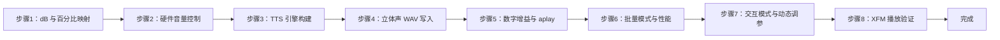
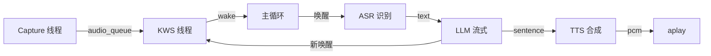
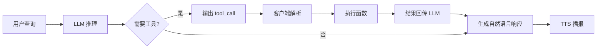
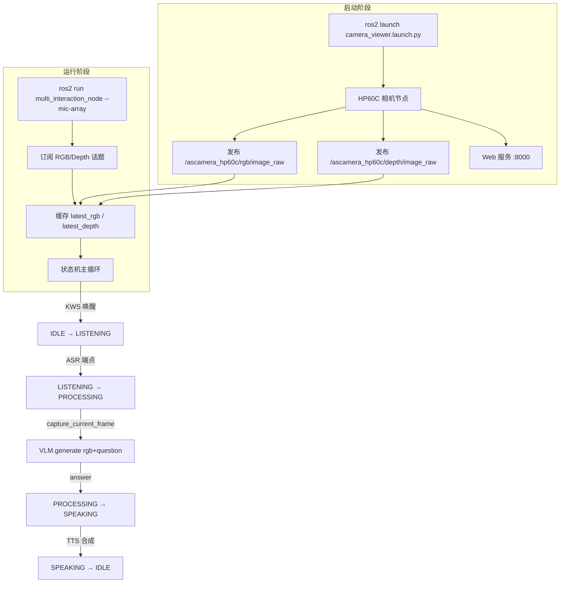

# 机器人自然语言交互应用与开发 实验指导书（合并版）

> 课程代码: EXP002
> 总学时: 32
> 实验数: 6
> 适用对象: 人工智能/机器人工程/智能科学与技术 本科高年级
> 制定日期: 2026-08-04
> 模式: human_waiver（源码位于 ROS2 工作空间 src/，未复制到 source-codes/EXP002/）

---

## 目录

1. [实验1：基于讯飞六麦阵列的串口通信与唤醒事件实验](#实验1基于讯飞六麦阵列的串口通信与唤醒事件实验4h)
2. [实验2：基于讯飞六麦录音验证与 sherpa-onnx 的本地语音识别(ASR)实验](#实验2基于讯飞六麦录音验证与-sherpa-onnx-的本地语音识别asr实验4h)
3. [实验3：基于本地 tts 引擎的语音合成与参数调控实验](#实验3基于本地-tts-引擎的语音合成与参数调控实验4h)
4. [实验4：基于状态机的端到端语音对话交互实验](#实验4基于状态机的端到端语音对话交互实验8h)
5. [实验5：基于-function-calling-的大模型工具调用实验](#实验5基于-function-calling-的大模型工具调用实验4h)
6. [实验6：基于多模态大模型的视觉语言理解vlm实验](#实验6基于多模态大模型的视觉语言理解vlm实验8h)

---

## 实验总览

| 编号 | 名称 | 学时 | 类型 | 难度 | 源码路径 |
|------|------|------|------|------|----------|
| exp01 | 基于讯飞六麦阵列的串口通信与唤醒事件实验 | 4h | 设计性 | ⭐⭐ | `ros2_ws/src/xflz_eai_car1/interaction/car1_speech/tools/` |
| exp02 | 基于讯飞六麦录音验证与 sherpa-onnx 的本地语音识别(ASR)实验 | 4h | 设计性 | ⭐⭐ | `ros2_ws/src/xflz_eai_car1/interaction/car1_speech/tools/` |
| exp03 | 基于本地 TTS 引擎的语音合成与参数调控实验 | 4h | 设计性 | ⭐⭐ | `ros2_ws/src/xflz_eai_car1/interaction/` |
| exp04 | 基于状态机的端到端语音对话交互实验 | 8h | 设计性 | ⭐⭐ | `ros2_ws/src/xflz_eai_car1/interaction/` |
| exp05 | 基于 Function Calling 的大模型工具调用实验 | 4h | 设计性 | ⭐⭐ | `ros2_ws/src/xflz_eai_car1/interaction/` |
| exp06 | 基于多模态大模型的视觉语言理解(VLM)实验 | 8h | 综合性 | ⭐⭐⭐ | `ros2_ws/src/xflz_eai_car1/test/camera_web_viewer/ + ros2_ws/src/xflz_eai_car1/interaction/car1_multi_interaction/` |

**学时合计**: 4+4+4+8+4+8 = **32h**

**类型分布**: 设计性 5 个 + 综合性 1 个

---

## 跨实验知识脉络

```
实验1 (KWS 唤醒) ──► 实验2 (ASR 识别) ──► 实验3 (TTS 合成)
                            │
                            ▼
        实验5 (Function Calling 工具调用) ◄── 实验4 (状态机集成)
                            │
                            ▼
                实验6 (VLM 多模态交互闭环)
```

> 跨实验一致性：所有 ROS2 节点统一使用 `/interaction/*` 命名空间的话题（`/interaction/wake_word/detected`、`/interaction/asr/text`、`/interaction/tts/speak`），便于实验 5 端到端集成。

---

## 实验源码说明

⚠️ **本课程的 6 份实验均依赖 ROS2 工作空间 `ros2_ws/src/xflz_eai_car1/interaction/` 下的代码**（包括 `car1_speech/`、`car1_interaction/`、`car1_llm/` 三个 package），源码未复制到 `source-codes/EXP002/exp{01-06}/`。已通过 `source-codes/_registry.yaml` 的 `human_waiver.approved=true` 放行，所有实验指导书均标注 `[待源码核实]`。后续将代码复制到 `source-codes/EXP002/exp{xx}/` 后需触发 `SourceCodeAnalysisAgent` 并移除豁免标记。

---

## 单实验入口

以下每节对应 `_parts/experiment-{N}.md` 的完整内容，可独立打印/分发。

---

## 实验1：基于讯飞六麦阵列的串口通信与唤醒事件实验（4h）

> **本实验源码**（位于 `ros2_ws/src/xflz_eai_car1/interaction/car1_speech/tools/`）：
> - `uart_device.py` — 串口通信封装（pyserial）
> - `xf_mic_array.py` — AIUI 协议解析、帧拆装、唤醒事件
> - `xf_mic_array_gui.py` — Tkinter 演示 GUI（直接 `python3` 运行）

### 1.1 关联知识点

#### 1.1.1 串口通信与设备识别
- 1.1.1 串口通信概念 > 概念 > UART 是一种异步串行通信协议,通过 TX/RX 两根线按位收发字节
- 1.1.2 pyserial 库基础 > 原理 > `serial.Serial` 封装 open/read/write/close,timeout 控制阻塞行为
- 1.1.3 VID/PID 自动识别 > 流程 > USB 设备的硬件指纹 VID(0x1a86)+PID(0x55d4) 用于无串口名称时自动查找

#### 1.1.2 麦克风阵列与声源定位
- 1.2.1 麦克风阵列原理 > 概念 > 6 个麦克风均布圆周,通过到达时间差(TDOA)实现声源定位
- 1.2.2 声源定位 beam/angle > 原理 > beam(0~5) 指向能量最大的麦克风,angle(0~360°) 为顺时针方向角
- 1.2.3 AIUI 协议框架 > 事实 > 讯飞私有协议,以 0xA5 为同步头,JSON payload 描述唤醒事件

#### 1.1.3 AIUI 串口协议与帧解析
- 1.3.1 字节序与校验和 > 原理 > 小端序存储多字节字段,校验和 = (~sum + 1) & 0xFF
- 1.3.2 帧结构组成 > 流程 > 同步头(1)+用户ID(1)+类型(1)+长度(2)+ID(2)+payload(n)+校验(1) = 7+n+1 字节
- 1.3.3 接收缓冲与拆帧 > 分析 > 跨 read 累积到 rx_buffer,搜索 0xA5 定位帧头,处理伪同步头与校验失败

#### 1.1.4 唤醒事件与防抖机制
- 1.4.1 唤醒事件字段 > 流程 > 从 ivw JSON 提取 beam/angle/keyword/score/power/start_ms/end_ms
- 1.4.2 时间窗口防抖 > 原理 > last_wakeup_time + 3 秒窗口,防止噪声连续触发
- 1.4.3 回调与线程锁 > 分析 > wakeup_callback + wakeup_lock 保证事件处理并发安全

#### 1.1.5 Tkinter GUI 可视化监控
- 1.5.1 Tkinter Canvas 基础 > 概念 > create_oval/line/text 在画布上绘制几何与文字
- 1.5.2 环形阵列绘制 > 流程 > 极坐标 0° 在正下方,顺时针 60° 间隔布 6 个麦克风
- 1.5.3 线程安全事件刷新 > 应用 > 接收线程 put 事件到 queue,主线程 after(50ms) 循环消费

### 1.2 实验目标

1. **理解串口通信本质** — 知道 UART、波特率、设备文件 /dev/ttyACM* 的概念
2. **掌握 pyserial 基础调用** — 能用 open/read/write/close 与设备通信
3. **理解 6 麦阵列的声源定位原理** — 知道 beam 编号与 angle 角度的物理意义
4. **掌握 AIUI 协议帧结构** — 能从 16 进制字节流手算帧边界与校验和
5. **理解唤醒事件的防抖机制** — 知道 3 秒时间窗 + Lock 是如何防止重复触发的
6. **能运行 GUI 演示并定制** — 跑通 xf_mic_array_gui.py,扩展 PINYIN_MAP 加入新词

### 1.3 实验环境

| 类别 | 配置 |
|------|------|
| 硬件 | B2/C1(含讯飞 6 麦阵列模块,VID=0x1a86, PID=0x55d4) |
| OS | Ubuntu 22.04 + USB ACM 内核模块 |
| Python | 3.10 |
| 核心库 | pyserial==3.5, tkinter(系统自带) |
| 串口 | /dev/ttyACM0, 波特率 115200, 8N1 |
| 源码 | ros2_ws/src/xflz_eai_car1/interaction/car1_speech/tools/ |

### 1.4 实验难度

- 难度: ⭐ 入门
- 重点: 串口通信基础；AIUI 帧结构；唤醒回调机制
- 难点: 字节级帧解析；伪同步头与校验和失败处理

### 1.5 实验现象

**快速验证流程**:
```bash
# 1. 插上 6 麦阵列 USB,确认设备出现
ls -l /dev/ttyACM*
# 期望输出: crw-rw---- 1 root dialout 166, 0  ... /dev/ttyACM0

# 2. 授权普通用户访问
sudo chmod 666 /dev/ttyACM0

# 3. 直接跑 GUI 演示(推荐先用这个看效果)
cd ros2_ws/src/xflz_eai_car1/interaction/car1_speech/tools/
python3 xf_mic_array_gui.py

# 4. GUI 弹出后,对着麦克风说"小飞同学"
#    - 看到 6 个麦克风圆点中对应 beam 的变红
#    - 从中心画出一支红色箭头指向声源方向
#    - 右侧"当前唤醒词"显示拼音,中文显示"小飞同学"
#    - score/power 进度条更新
#    - 底部"事件历史"列表新增一行

# 5. 无显示器/无 GUI 场景:仅终端模式
python3 xf_mic_array_gui.py --headless
# 终端输出: 检测到唤醒! Beam: 2, Angle: 120.5, Keyword: xiao3 fei1 tong2 xue2

# 6. Ctrl+C 退出
```

### 1.6 实验步骤

#### 步骤1:串口设备识别与 pyserial 入门(30min)

> 本步骤对应 `tools/uart_device.py` 全文(约 100 行)

**操作步骤**:

1. 物理确认设备已连接:
   ```bash
   lsusb   # 关注 1a86:55d4 那行
   ls -l /dev/ttyACM*
   ```

2. 枚举系统所有串口:
   ```python
   import serial.tools.list_ports as lp
   for p in lp.comports():
       print(f"{p.device}  VID:PID={p.hwid}")
   ```

3. 用最小代码测试串口收发:
   ```python
   import serial
   s = serial.Serial('/dev/ttyACM0', baudrate=115200, timeout=1)
   for i in range(5):
       data = s.read(64)
       print(f"读 #{i}: {len(data)} 字节  hex={data.hex(' ')[:60]}")
   s.close()
   ```

#### 步骤2:麦克风阵列原理与硬件组成(30min)

> 本步骤不写代码,先理解硬件

**原理**:
- 6 麦环形阵列通过**到达时间差(TDOA)** 反推声源方向,360° 范围定位精度 ±5°
- `beam` 0~5 表示能量最大的麦克风,`angle` 0~360° 是顺时针方向角,**0° 在正下方**
- AIUI 协议以 **0xA5 同步头 + JSON payload** 描述唤醒事件

**操作步骤**:
1. 物理观察 6 麦阵列模块(M0~M5 顺时针编号)
2. 用 GUI 演示不同方向(前/右/后/左)的箭头方向
3. 观察 score/angle 关系:arrow 角度 ≈ 你站的方向

#### 步骤3:AIUI 协议帧解析(60min)

> 本步骤对应 `tools/xf_mic_array.py` `_process_buffer()` 与 `_handle_frame()`

**帧结构**(共 7+n+1 字节):
```
偏移  长度  字段       说明
0     1     sync       固定 0xA5,用于定位帧起始
1     1     user_id    用户 ID,通常 0x01
2     1     msg_type   消息类型 0x01 握手 / 0x04 事件 / 0x05 设置 / 0xFF 响应
3~4   2     msg_len    payload 长度(小端)
5~6   2     msg_id     消息 ID(小端)
7~    N     payload    数据,通常为 JSON 字符串
最后  1     checksum   (~sum + 1) & 0xFF
```

**操作步骤**:
1. 用 `sudo cat /dev/ttyACM0 | xxd | head -50` 观察真实帧字节
2. 手算校验和:Python `expected = (~sum(frame[:-1]) + 1) & 0xFF`
3. 阅读 `_process_buffer` 的 3 处容错:丢弃同步头前的垃圾 / msg_len 异常跳过 / 校验失败跳过当前 0xA5

#### 步骤4:唤醒事件处理与防抖机制(60min)

> 本步骤对应 `xf_mic_array.py` `_handle_frame()` 中 AIUI 事件分支

**唤醒事件 JSON 结构**:
```json
{
  "type": "aiui_event",
  "content": {
    "eventType": 4,
    "info": "{\"ivw\":{\"beam\":2,\"angle\":120.5,\"keyword\":\"xiao3 fei1 tong2 xue2\",\"score\":1850,\"power\":125000}}"
  }
}
```

**3 秒防抖**:
```python
current_time = time.time()
if current_time - self.last_wakeup_time > 3.0:
    self.last_wakeup_time = current_time
    # 触发唤醒
```

**操作步骤**:
1. 用 `python3 xf_mic_array_gui.py --headless` 重现防抖效果
2. 修改防抖窗口为 0.5 秒,观察差异
3. 用 threading 模拟并发唤醒,验证 Lock 保护
4. 阅读 `XfMicArrayWithEvents` 子类,理解模板方法模式

#### 步骤5:GUI 可视化定制(30min)

> 本步骤对应 `xf_mic_array_gui.py` `XfMicArrayGUI` 类

**操作步骤**:
1. 修改 `PINYIN_MAP` 加入自定义唤醒词
2. 改变画布颜色(演示 `Canvas.itemconfig` 实时修改)
3. 添加 score < 500 时高亮的告警逻辑
4. 观察 `_poll_queue` 的 50ms 轮询频率
5. 用 `top` 命令观察 CPU 占用 < 5%

### 1.7 注意事项

- ⚠️ **USB 串口权限** → `sudo chmod 666 /dev/ttyACM0` 或加入 `dialout` 用户组
- ⚠️ **校验和失败频繁** → 检查 USB 线缆质量；过长(>3m)易受电磁干扰
- ⚠️ **GUI 启动报 no display** → 远程用 `xvfb-run` 或 `ssh -X`；无显示器用 `--headless`
- ⚠️ **唤醒频繁触发** → 防抖窗口 3 秒可调,过短(<1s)会误触,过长(>10s)会漏触发
- ⚠️ **6 麦模块供电不足** → 优先用 USB 3.0 或带外接电源的 HUB

### 1.8 实验总结

**完成成果**:
- 掌握串口通信基础概念(UART/波特率/设备文件)
- 掌握 pyserial 库 open/read/write/close 调用
- 掌握 VID/PID 自动识别 USB 设备
- 理解 6 麦环形阵列的声源定位原理(beam/angle)
- 掌握 AIUI 协议帧结构(sync/type/len/id/payload/checksum)
- 理解双缓冲拆帧 + 校验和容错的工业实践
- 掌握 3 秒时间窗 + Lock 唤醒防抖机制
- 跑通 xf_mic_array_gui.py,扩展 PINYIN_MAP 加入自定义唤醒词

### 1.9 实验报告要求

**思考题**:
1. 串口通信为什么需要"起始位"和"停止位"？如果去掉会发生什么？
2. 为什么 AIUI 协议用小端序而不是大端序？
3. 6 麦环形阵列的"波束形成"算法是怎么从 6 路麦克风信号反推声源方向的？
4. 3 秒防抖窗口如果改成 0.1 秒会怎样？如果改成 30 秒又会怎样？
5. 校验和 `(~sum + 1) & 0xFF` 为什么能检测出大部分传输错误？什么情况下它检测不出？

**评分标准**: 串口通信基础 15 分 + pyserial 调用 15 分 + AIUI 帧解析 25 分 + 唤醒防抖 15 分 + GUI 定制 20 分 + 实验报告 10 分 = 100 分。

## 实验2：基于讯飞六麦阵列与sherpa-onnx的本地流式语音识别(ASR)实验（4h）

> 📦 **源码位置**: `ros2_ws/src/xflz_eai_car1/interaction/car1_speech/tools/asr_test.py`
> 🎯 **主入口命令**: `python3 asr_test.py --mic-array`
> 🔗 **复用实验1**: 串口通信(`uart_device.py`)、AIUI协议解析(`xf_mic_array.py`)、ALSA录音(`audio_test.py`)

### 2.1 关联知识点

- 2.0.1 音频通路与 ALSA 设备 > 原理 > 6 麦阵列在 ALSA 中呈现为 XFM 声卡,16kHz/16bit/mono
- 2.0.2 6 麦唤醒驱动录音 > 流程 > 串口握手→设唤醒词→等待 wakeup→alsa
- 2.1.1 detect_xfm_devices() 设备自动检测 > 源码 > 解析 arecord -l 输出 grep XFM
- 2.1.2 AudioMixer 增益与 ALC > 原理 > PGA 0~+24dB + 数字 -30~+6dB + ALC 自动电平
- 2.1.3 switch_input_to_mic 输入复用 > 原理 > XFM 6 麦阵列默认 Line 输入需切到 Mic
- 2.2.1 OnlineRecognizer 构造 > 流程 > from_transducer 加载 4 个模型文件
- 2.2.2 Transducer 架构 > 原理 > encoder+joiner+decoder 三件套
- 2.2.3 RKNN NPU 推理 > 概念 > provider=rknn 走 NPU 加速 vs cpu
- 2.3.1 accept_waveform 流式输入 > 流程 > 100ms 块 feed 进 stream
- 2.3.2 decode_stream 增量解码 > 原理 > is_ready 循环解码
- 2.3.3 is_endpoint 内置端点 > 原理 > rule1/rule2/rule3 三规则协同
- 2.3.4 blank_penalty 空符号惩罚 > 调参 > 抑制字重复/漏字
- 2.4.1 hotwords 热词格式 > 概念 > 按 token 空格分隔,需 modified_beam_search
- 2.4.2 greedy vs modified_beam_search > 对比 > 速度/精度的取舍
- 2.5.1 single-stream 复用 > 设计 > reset 而非 create_stream 保留上下文
- 2.5.2 100ms 块节奏 > 实践 > latency/吞吐/CPU 占用的平衡点

### 2.2 实验目标

1. 理解 asr_test.py 启动到识别结束的完整代码执行流 — **原理理解**
2. 掌握 6 麦阵列在 ASR 链路中的角色(唤醒→增益→识别) — **流程掌握**
3. 能够独立调优 rule1/rule2/rule3 端点检测参数 — **调参能力**
4. 能够配置热词文件解决常用词的误识别(如"小飞"→"小飞机") — **实战能力**
5. 能够将 ASR 与命令词解析、状态机集成 — **迁移应用**

### 2.3 实验环境

| 类别 | 配置 |
|------|------|
| 硬件 | 具身智能实验箱B2（含讯飞 XFM 6 麦阵列） |
| OS | Ubuntu 22.04 + ROS2 Humble |
| Python | 3.10 |
| 核心库 | sherpa-onnx==1.10.0、numpy、scipy(resample) |
| 推理后端 | RKNN(RK3576 NPU) / CPU fallback |
| 模型 | zipformer-zh-14M(encoder/decoder/joiner.rknn + tokens.txt,~14MB) |
| 主入口 | `tools/asr_test.py` (主) + `tools/audio_test.py`(验证) + `tools/xf_mic_array.py`(唤醒) + `tools/audio_mixer.py`(增益) |

### 2.4 实验难度

- 难度: ⭐⭐⭐ 中偏高
- 重点: asr_test.py 7 个模块的拆分理解;端点检测参数调优;热词配置
- 难点: NPU 推理 provider 配置;blank_penalty 与解码延迟的平衡;长时间会话流式识别的状态管理

### 2.5 实验现象

**快速验证流程**:
1. 确认 6 麦阵列插入 USB(出现 `/dev/ttyACM0` 和 `plughw:4,0/4,1`)
2. 启动:`cd tools && python3 asr_test.py --mic-array`
3. 唤醒:说"小飞小飞" → 终端打印 `✓ 检测到唤醒! 开始语音识别...`
4. 说话:说"你好小飞同学" → 终端实时打印 `0:你好小飞同学` 增量结果
5. 停顿 1.5s → 自动判定端点,打印完整 segment,segment_id 自增
6. Ctrl+C 结束 → 打印 `Done.`

**预期效果**:
- 唤醒响应延迟 < 1.0s
- 端点判定 1.5-4.5s
- 100 条常用指令 WER < 10%(启用 hotwords 后)
- CPU 占用 < 50%(NPU 推理时)

### 2.6 实验步骤

#### 整体流程图


---

#### 步骤0：录音与播放验证（15min）

> 本步骤对应 `tools/audio_test.py`(`--mic-array` 模式)。在任何 ASR 实验之前**必须**先验证硬件通路。

**操作步骤**：

1. 确认 6 麦阵列已插入 USB,设备出现:
   ```bash
   ls -l /dev/ttyACM*
   arecord -l | grep -i XFM
   # 期望: card 4: XFMDPV0018 [XFM-DP-V0.0.18], device 0: USB Audio [USB Audio]
   ```

2. **录音测试**(唤醒后录 3 秒):
   ```bash
   cd ros2_ws/src/xflz_eai_car1/interaction/car1_speech/tools/
   python3 audio_test.py --mic-array --mode record -o test.wav -d 3
   # 流程: 连串口 → 设置唤醒词"小飞同学" → 等待唤醒 → arecord 3 秒
   ```

3. **播放测试**:
   ```bash
   python3 audio_test.py --mic-array --mode play rec.wav
   # 自动 mono→stereo 转换 + 选择 6 麦播放设备
   ```

4. **快速回环验证**:
   ```bash
   python3 audio_test.py --mic-array --mode record -o rec.wav -d 3 && \
   python3 audio_test.py --mic-array --mode play rec.wav
   ```

**易错点**:
- ⚠️ 未唤醒就开始录音 → 必须加 `--mic-array` 参数
- ⚠️ 播放变调/2 倍速 → `audio_test.py --mic-array` 已自动 mono→stereo
- ⚠️ 唤醒词不识别 → 默认「小飞小飞/小飞同学/芝麻开门」

---

#### 步骤1：设备检测与串口唤醒（15min）

> 本步骤对应 `asr_test.py` L84-116(`detect_xfm_devices`)与 L417-466(`--mic-array` 唤醒流程)。

**核心知识点**:
- **detect_xfm_devices** (2.1.1): 解析 `arecord -l` 输出,用正则提取 card_num/card_name/dev_num,拼出 `plughw:{card_num},{dev_num}` 设备名
- **XfMicArray 串口唤醒**: `--mic-array` 模式调用 `XfMicArray(vendor_id=0x1a86, product_id=0x55d4)`,与实验1的 `xf_mic_array_gui.py` 共享 AIUI 协议解析
- **单次唤醒即关闭串口** (L465): 串口只负责传唤醒事件,唤醒后 `mic_array_instance.stop()` 避免干扰 ALSA

**操作步骤**：

1. 查看源码:
   ```bash
   grep -n -A 30 "def detect_xfm_devices" tools/asr_test.py
   grep -n -A 50 "if args.mic_array:" tools/asr_test.py | head -60
   ```

2. 实际运行:
   ```bash
   python3 asr_test.py --mic-array --wakeup-words "小飞小飞"
   # 观察: 检测设备 → 连串口 → 设唤醒词 → 等待唤醒 → ✓
   ```

---

#### 步骤2：音频增益与 ALC 控制（20min）

> 本步骤对应 `asr_test.py` L123-158 与 `audio_mixer.py` 的 PGA + ALC 实现。

**核心知识点**:
- **XFM 6 麦阵列信号链**: Mic → PGA(0~+24dB) → ADC → Capture Digital(-30~+6dB) → ALSA PCM
- **switch_input_to_mic** (2.1.3, L123-131): XFM 6 麦阵列默认 Line In,必须切到 MicL/MicR 才能录到 XFM 上的麦克风
- **ALC + Noise Gate** (2.1.2, L501): 自动调节 PGA 跟踪说话人距离,Noise Gate 静音时关闭防噪声
- **voice-preset** (L154-158): mic +18dB(88%)、ALC on、speaker -3dB 一键预设

**操作步骤**：

1. 4 种增益模式对比:
   ```bash
   python3 asr_test.py --mic-array --voice-preset        # A:一键预设
   python3 asr_test.py --mic-array --capture-volume 95   # B:默认 +22dB
   python3 asr_test.py --mic-array --disable-alc --capture-volume 88  # C:固定 PGA
   python3 asr_test.py --mic-array --capture-volume 100  # D:最大 +24dB
   ```

2. 实时观察 PGA 变化:
   ```bash
   watch -n 0.5 "amixer -c 0 sget 'Left Channel'"
   ```

---

#### 步骤3：ASR 引擎构建（30min）

> 本步骤对应 `asr_test.py` L527-544(`OnlineRecognizer.from_transducer`)。

**核心知识点**:
- **Transducer 三件套** (2.2.2): tokens.txt(词表) + encoder.rknn(声学) + decoder.rknn(语言) + joiner.rknn(联合)
- **OnlineRecognizer.from_transducer** (2.2.1): 工厂方法加载 4 模型 + 配置参数,返回 Recognizer 实例
- **RKNN NPU 推理** (2.2.3): provider=rknn 走 RK3576 NPU;num_threads 在 RKNN 下是 NPU 核心掩码

**关键参数表**:

| 参数 | 默认 | 作用 |
|------|------|------|
| num_threads | 1 | CPU 模式下为推理线程数;RKNN 模式下为 NPU 核心掩码 |
| provider | rknn | rknn 走 NPU;cpu 走 CPU 通用 |
| sample_rate | 16000 | 必须与音频流一致;Alsa 内部重采样到 16k |
| feature_dim | 80 | FBank 特征维度(Zipformer 标准) |
| decoding_method | greedy_search | greedy 快不支持热词;modified_beam_search 支持热词但慢 20-30% |

**操作步骤**：

1. 查看模型构建源码:
   ```bash
   sed -n '527,545p' tools/asr_test.py
   ```

2. 验证模型:
   ```bash
   ls -la /home/iflytek/models/zipformer/
   # 期望:encoder.rknn  decoder.rknn  joiner.rknn  tokens.txt
   ```

3. 切换 provider 实测:
   ```bash
   time python3 asr_test.py --provider rknn --audio-file test.wav  # 快
   time python3 asr_test.py --provider cpu  --audio-file test.wav  # 慢 3-5x
   ```

4. 切换解码方法:
   ```bash
   python3 asr_test.py --mic-array --decoding-method greedy_search
   python3 asr_test.py --mic-array --decoding-method modified_beam_search --hotwords-file hotwords.txt
   ```

---

#### 步骤4：流式识别主循环（30min）

> 本步骤对应 `asr_test.py` L578-643(主循环)。

**核心知识点**:
- **100ms 块读取节奏** (2.5.2): `samples_per_read = int(0.1 * sample_rate) = 1600` 帧 — 延迟/吞吐/CPU 平衡点
- **accept_waveform + is_ready 循环解码** (2.3.1, 2.3.2): push 音频块 → 模型可吃时连续 decode
- **is_endpoint + reset** (2.3.3): 端点触发后 reset stream + create_stream,保留时序上下文但释放张量
- **single-stream 复用** (2.5.1): Recognizer 单例 + 端点时重建 stream,与 RK3588 `asr.py` 一致

**主循环核心代码片段**:
```python
is_endpoint = recognizer.is_endpoint(stream)
result = recognizer.get_result(stream)
if result and (last_result != result):
    last_result = result
    print(f"\r{segment_id}:{result}", end="", flush=True)
if is_endpoint:
    final = result if result else last_result
    if final:
        print(f"\r{segment_id}:{final}", flush=True)
        segment_id += 1
    last_result = ""
    recognizer.reset(stream)
    stream = recognizer.create_stream()  # 重建 stream
```

**操作步骤**：

1. 跑完整会话观察日志:
   ```bash
   python3 asr_test.py --mic-array --voice-preset
   # 唤醒 → 实时打印 → 端点换行 → segment_id 自增
   ```

2. 最小 demo (30 行,无 6 麦阵列):
   ```python
   # demo_asr_minimal.py
   import sherpa_onnx
   rec = sherpa_onnx.OnlineRecognizer.from_transducer(
       tokens=".../tokens.txt", encoder=".../encoder.rknn",
       decoder=".../decoder.rknn", joiner=".../joiner.rknn",
       num_threads=1, provider="cpu")
   stream = rec.create_stream()
   alsa = sherpa_onnx.Alsa("plughw:1,0")
   sr = 16000
   while True:
       samples = alsa.read(int(0.1 * sr))
       stream.accept_waveform(sr, samples)
       while rec.is_ready(stream):
           rec.decode_stream(stream)
       text = rec.get_result(stream)
       if text: print(f"\r实时: {text}", end="", flush=True)
       if rec.is_endpoint(stream):
           print(f"\r端点: {text}")
           rec.reset(stream)
           stream = rec.create_stream()
   ```

---

#### 步骤5：端点检测调优（30min）

> 本步骤对应 `asr_test.py` L361-370(参数定义)与内置端点检测器。

**核心知识点**:
- **rule1** (L362-364): 长静音(无结果时)4.5s — 兜底规则
- **rule2** (L365-367): 已有结果时静音 1.5s — 主规则
- **rule3** (L368-370): 最小语句长度 300s — 几乎禁用
- **blank_penalty** (L357-359, 2.3.4): 默认 0.25 正向偏置空符号 → 减少插入错误;调到 0.0 减少漏字

**调参速查表**:

| 现象 | 调整 |
|------|------|
| 重复字/插入字 | 增大 blank_penalty 到 0.5-1.0 |
| 尾字丢失 | 减小 blank_penalty 到 0.0 或 -0.3 |
| 句子被切碎 | 调大 rule2 到 2.0-3.0s |
| 唤醒词被识别 | 调大 rule1 到 3.0-5.0s |

**操作步骤**：

1. A/B 测试 rule2:
   ```bash
   python3 asr_test.py --mic-array --rule2-min-trailing-silence 1.0  # 激进
   python3 asr_test.py --mic-array --rule2-min-trailing-silence 3.0  # 保守
   ```

2. A/B 测试 blank_penalty:
   ```bash
   python3 asr_test.py --mic-array --blank-penalty 0.5
   python3 asr_test.py --mic-array --blank-penalty 0.0
   ```

---

#### 步骤6：热词与解码策略（20min）

> 本步骤对应 `asr_test.py` L376-380 与 `hotwords.txt`。

**核心知识点**:
- **hotwords.txt 格式** (2.4.1): 每行一个热词,token 间用**半角空格**分隔,中文是 CJK 单字
- **hotwords_score** (L379-380): 0=关闭;1.0=温和;2.0=强偏置(默认);5.0+=过度
- **decoding_method 与热词** (2.4.2): 热词**只在 `modified_beam_search` 生效**;greedy_search 忽略

**hotwords.txt 示例** (项目根目录):
```
小 飞
小 飞 同 学
你 好 小 飞
请 把 东 西 搬 运 到 停 放 点
停 放 点
搬 运
```

**操作步骤**：

1. 跑无热词基线:
   ```bash
   python3 asr_test.py --mic-array --hotwords-file ""
   ```

2. 启用热词:
   ```bash
   python3 asr_test.py --mic-array \
     --decoding-method modified_beam_search \
     --hotwords-file tools/hotwords.txt \
     --hotwords-score 2.0
   ```

3. 自定义命令词热词:
   ```bash
   cat > my_hotwords.txt <<EOF
   前 进
   后 退
   左 转
   右 转
   停 下
   打 开 灯
   关 闭 灯
   EOF
   python3 asr_test.py --mic-array \
     --decoding-method modified_beam_search \
     --hotwords-file my_hotwords.txt
   ```

**易错点**:
- ⚠️ 热词不生效 → 必须改 `--decoding-method modified_beam_search`
- ⚠️ 过度偏置 → 调低 `--hotwords-score` 到 1.0
- ⚠️ 中文逗号错 → 必须用半角空格

---

#### 步骤7：业务集成与命令词解析（20min）

> 将 asr_test.py 识别结果集成到机器人命令解析。

**操作步骤**：

1. 命令词映射:
   ```python
   COMMAND_MAP = {
       "前进": "move_forward", "后退": "move_backward",
       "左转": "turn_left", "右转": "turn_right",
       "停下": "stop", "打开灯": "light_on", "关闭灯": "light_off",
   }
   def parse_command(text):
       for cmd, action in COMMAND_MAP.items():
           if cmd in text: return action
       return None
   ```

2. 集成到 asr_test.py 端点处:
   ```python
   if is_endpoint:
       final = result if result else last_result
       action = parse_command(final) if final else None
       print(f"\r{segment_id}:{final} → action={action}", flush=True)
   ```

3. 端到端测试:
   ```bash
   python3 asr_test.py --mic-array --hotwords-file my_hotwords.txt
   # 唤醒"小飞小飞" → 说"前进一米" → 终端打印 0:前进一米 → action=move_forward
   ```

**易错点**:
- ⚠️ 唤醒词也被解析 → parse 前过滤"小飞小飞/小飞同学"
- ⚠️ ASR 与 TTS 互斥 → 状态机控制(详见实验5)

### 2.7 注意事项

- ⚠️ **asr_test.py 是 CLI 工具,非 ROS2 节点** → 业务集成需自行封装 `rclpy.Node`
- ⚠️ **6 麦阵列唤醒后必须关闭串口** → 否则串口轮询会干扰 ALSA 音频流(L465)
- ⚠️ **端点检测参数需根据场景调优** → 命令词 1.0-1.5s,对话 2.0-3.0s
- ⚠️ **热词必须配合 modified_beam_search** → 默认 greedy_search 忽略 hotwords
- ⚠️ **长时间运行需 reset stream** → 否则状态累积导致识别变差(L627-628)
- ⚠️ **RKNN 模式下 num_threads 是 NPU 核心掩码** → 与 CPU 模式语义不同(L349)

### 2.8 实验总结

**完成成果**:
- 拆解 asr_test.py 7 个核心模块(设备检测/唤醒/增益/引擎/流式循环/端点/热词)
- 跑通 `python3 asr_test.py --mic-array` 完整流程
- 调优 rule1/rule2/rule3 端点检测参数
- 配置 hotwords.txt 解决"小飞"→"小飞机"类误识别
- 集成命令词解析实现语音→动作链路

**技能收获**:
- 掌握 sherpa-onnx 流式 ASR 的代码结构(Transducer/OnlineRecognizer/Alsa)
- 理解 6 麦阵列在 ASR 中的角色(唤醒+增益)
- 学会 A/B 测试调优端点参数与热词偏置
- 掌握"reset+create_stream"模式保留时序上下文

**常见问题与解决**:

| 问题 | 原因 | 解决方法 |
|------|------|---------|
| 唤醒词不识别 | 距麦太远/发音不准 | 30-50cm,正常音量;自定义到 xfyun.cn |
| 端点反复触发 | rule2 太小 | 调到 2.0-3.0s |
| 尾字丢失 | blank_penalty 偏置过强 | 调到 0.0 或 -0.3 |
| 重复字/插入字 | blank_penalty 不足 | 调到 0.5-1.0 |
| 热词不生效 | decoding_method=greedy | 改 modified_beam_search |
| 长时间识别变差 | 未 reset stream | 端点时 reset + create_stream |
| 录音全静音 | Line/Mic 输入未切换 | 确认 switch_input_to_mic 已被调用 |

### 2.9 实验报告要求

**思考题**:
1. Transducer 架构中 encoder/decoder/joiner 各自的输入输出是什么?为什么要分三件套而不是一个端到端模型?
2. rule1/rule2/rule3 三条端点规则分别解决什么场景?为什么默认 rule3_min_utterance_length 设到 300s?
3. blank_penalty 是如何影响解码结果的?对"小飞"和"小飞机"两个候选 token,blank_penalty=0.25 与 =0.0 时概率分布有什么不同?
4. 为什么 RKNN 模式下 num_threads=1 是 NPU 核心掩码,而不是 CPU 模式下的线程数?RK3576 有几个 NPU 核心?
5. 长时间运行(>30 分钟)的 ASR 会话中,为什么"reset+create_stream"比"只 reset"或"只 create_stream"都好?

**评分标准**: 设备检测与唤醒 15 分 + 增益与 ALC 15 分 + 引擎构建 20 分 + 流式主循环 20 分 + 端点调优 15 分 + 热词配置 10 分 + 实验报告 5 分 = 100 分。
## 实验3：基于 Matcha-TTS 声学模型与 Vocos 声码器的本地语音合成与播放验证实验（4h）

> **源码**：`ros2_ws/src/xflz_eai_car1/interaction/car1_speech/tools/tts_test.py`
> **主命令**：`python3 tts_test.py --text "你好，欢迎使用语音合成"`
> **播放验证**：`python3 audio_test.py --mic-array --mode play /tmp/tts_output.wav`
> **平台**：具身智能实验箱 B2（含 XFM 6 麦阵列，**I2S 默认立体声通路**）

### 3.1 关联知识点

- 4.1.1 TTS 概念与文本到语音链路 > 概念 > 文本→声学→波形 三段式流水线
- 4.1.2 Matcha-TTS 端到端声学模型 > 原理 > Flow-matching 单阶段 mel 预测
- 4.1.3 Vocos 声码器与 mel→waveform > 原理 > 频域逆变换 + 短时相位
- 4.1.4 sherpa-onnx OfflineTts 模型加载 > 流程 > OfflineTtsConfig 装配四件套
- 4.2.1 pct_to_db 百分比到 dB 转换 > 概念 > 0-100% 线性映射到对数 dB
- 4.2.2 setup_playback amixer 硬件音量控制 > 流程 > Output1/Output2/PCM/Speaker 四路同步
- 4.2.3 write_wav_stereo mono→S16_LE 立体声 > 实践 > XFM 6 麦板卡 I2S 兼容
- 4.2.4 play_audio 数字增益与 aplay 链路 > 实践 > tanh 软削峰 + ALSA 推送
- 4.3.1 rule_fsts 文本规范化 > 概念 > phone-zh/date-zh/number-zh FST 规则
- 4.3.2 --speed/--sid 语速与发音人控制 > 实践 > 浮点 speed 与 sid 索引
- 4.3.3 交互模式 vol=/speed= 动态调参 > 流程 > 实时重设音量/语速
- 4.3.4 RTF 实时率与性能指标 > 概念 > gen_time/audio_dur 比值衡量合成速度

### 3.2 实验目标

1. 理解 TTS 端到端神经网络（文本→mel→waveform）三段式链路 — **原理理解**
2. 掌握 sherpa-onnx OfflineTts + Matcha-TTS + Vocos 本地合成引擎的代码执行流 — **流程掌握**
3. 拆解 `tts_test.py` 的 6 个核心模块（dB 转换/音量控制/引擎构建/立体声写入/播放/批量+交互） — **模块拆解**
4. 能够使用 `tts_test.py --text` + `audio_test.py --mic-array --mode play` 完成端到端合成-播放验证 — **端到端实操**
5. 能够调优 `--speed/--sid/--playback-volume/--gain` 平衡自然度、音量与速度 — **调参能力**

### 3.3 实验环境

| 类别 | 配置 |
|------|------|
| 硬件 | 具身智能实验箱 B2（含 XFM 6 麦阵列，I2S 立体声通路） |
| OS | Ubuntu 22.04 + ROS2 Humble |
| Python | 3.10 |
| 核心库 | sherpa-onnx==1.10.0、numpy、subprocess |
| 推理后端 | ONNX Runtime（CPU） |
| 声学模型 | Matcha-TTS `model-steps-3.onnx`（zh） |
| 声码器 | Vocos `vocos-16khz-univ.onnx` |
| 词典/数据 | `lexicon.txt`、`tokens.txt`、`espeak-ng-data/` |
| 文本规范化 | `phone-zh.fst` + `date-zh.fst` + `number-zh.fst` |
| 模型路径 | `/home/iflytek/models/tts/` |
| 主入口 | `tools/tts_test.py`（合成）+ `tools/audio_test.py`（播放验证） |

### 3.4 实验难度

- 难度：⭐⭐⭐ 中偏高
- 重点：`tts_test.py` 6 个核心模块的拆分；dB 与线性百分比关系；mono→stereo 兼容
- 难点：rule_fsts 文本规范化链；tanh 软削峰防破音；交互模式状态机

### 3.5 实验现象

**快速验证流程**：

```bash
# 1. 合成（默认输出 /tmp/tts_output.wav，16kHz mono float32）
python3 tts_test.py --text "你好，欢迎使用语音合成"
# 输出：
#   Text:  你好，欢迎使用语音合成
#   Speed: 1.0
#   Audio:  2.34s  (16000 Hz, 37440 samples)
#   Gen:    0.62s
#   RTF:    0.265  (faster than real-time)
#   Output: /tmp/tts_output.wav
#   Playing...

# 2. 用 XFM 6 麦播放验证
python3 audio_test.py --mic-array --mode play /tmp/tts_output.wav
# 输出：[检测设备] 使用播放设备: plughw:4,0
#       Playing: /tmp/tts_output.wav
#       device=plughw:4,0
#       Done.
```

**预期效果**：
- RTF < 1.0（CPU 上约 0.25~0.40，远快于实时）
- 调节 `--speed 1.2` 听到明显加速
- 调节 `--sid 1` 切换发音人（若模型多说话人）
- `--playback-volume 50` 时扬声器输出降 6dB，仍清晰

### 3.6 实验步骤

#### 整体流程图



---

#### 步骤1：dB 与百分比映射（阶段一：能理解，20min）

> 本步骤对应 `tts_test.py` L30-35（`pct_to_db`）。

**核心知识点**：

**dB 概念（4.2.1）**
- **原理**：人耳对响度的感知是**对数**关系，而非线性。dB（分贝）= `20 × log10(线性幅值)`。因此**音量旋钮从 50% 调到 100% 不是 2 倍响度**，而是从 -6dB 到 0dB（**仅 2 倍声压**，听起来约"响 1 档"）。硬件调音必须用 dB 描述，否则线性能量计算会失真。
- **百分比→dB 公式**：`dB = 20 × log10(pct / 100)`。例如：
  - `100% → 20 × log10(1.0) = 0 dB`（**满档不失真**）
  - `50%  → 20 × log10(0.5) = -6.02 dB`（约半功率）
  - `10%  → 20 × log10(0.1) = -20 dB`（**听感上变轻 1/4**）
  - `0%   → -∞ dB`（代码里用 `-96 dB` 近似静音）
- **源码对应**（tts_test.py L30-35）：`return 20.0 * math.log10(pct / 100.0)`

**操作步骤**：

1. 在 Python REPL 中验证 dB 映射：

```python
import math
for pct in [100, 80, 50, 25, 10, 0]:
    db = 0.0 if pct >= 100 else (-96.0 if pct <= 0 else 20.0 * math.log10(pct / 100.0))
    print(f"  {pct:>3}%  →  {db:>7.2f} dB")
# 100%  →    0.00 dB
#  80%  →   -1.94 dB
#  50%  →   -6.02 dB
#  25%  →  -12.04 dB
#  10%  →  -20.00 dB
#   0%  →  -96.00 dB
```

**易错点**：
- ⚠️ **用 `pct / 100` 直接当线性因子乘以样本** → **解决**：会得到错误的非线性听感。dB 路径是唯一正确做法。
- ⚠️ **把 `0%` 当 `0` 直接传 amixer** → **解决**：amixer 在 `0` 行为未定义，约定 -96dB 为"实际静音"。

---

#### 步骤2：硬件音量控制（阶段一：能运行，20min）

> 本步骤对应 `tts_test.py` L38-51（`setup_playback`）。

**核心知识点**：

**amixer 硬件控制（4.2.2）**
- **原理**：Linux 音频硬件通过 ALSA（Advanced Linux Sound Architecture）控制。`amixer` 是 ALSA 的命令行混音器，可以读写声卡的每个控制项（**Control**）：
  - `Output 1` / `Output 2`：扬声器左右声道**硬件输出增益**（dB）
  - `PCM`：数字音频总线音量（dB），保持 0dB 保护动态范围
  - `Speaker` / `spk switch`：扬声器功率放大器**使能位**（on/off）
- **为什么"三路同设"**：XFM 6 麦板卡的 Output 1/2 是模拟域增益，PCM 是数字域增益，**同时设到相同 dB** 才能保证最终输出是线性的，否则会出现"PCM=0dB、Output=-12dB" → 总衰减 -12dB 但前面数字段没限幅 → 仍然破音。

**源码对应（tts_test.py L38-51）**：

```python
def setup_playback(card, pct):
    db_val = pct_to_db(pct)
    # Output 1/2 + PCM 全部用 dB，模拟与数字增益同步
    for ctl in ["Output 1", "Output 2", "PCM"]:
        subprocess.run(
            ["amixer", "-c", str(card), "sset", ctl, "--", f"{db_val:.1f}dB"],
            capture_output=True, check=False)
    # 启用扬声器功率放大器（4Ω 3W 喇叭的硬件开关）
    for ctl in ["Speaker", "spk switch"]:
        subprocess.run(
            ["amixer", "-c", str(card), "sset", ctl, "on"],
            capture_output=True, check=False)
    print(f"  Playback volume: {pct}% ({db_val:.1f} dB)")
```

**操作步骤**：

1. 查看板卡混音器控制项：

```bash
amixer -c 0 scontents
# 典型输出：numid=3,iface=MIXER,name='Output 1 Playback Volume'
#           numid=4,iface=MIXER,name='PCM Playback Volume'
#           numid=5,iface=MIXER,name='Speaker Playback Switch'
```

2. 手动调硬件音量：

```bash
amixer -c 0 sset 'Output 1' -- -6.0dB
amixer -c 0 sset 'Output 2' -- -6.0dB
amixer -c 0 sset 'PCM' -- 0.0dB         # PCM 永远 0dB 保护动态范围
amixer -c 0 sset 'Speaker' on
```

3. 通过 tts_test.py 一次设好：

```bash
python3 tts_test.py --text "测试" --playback-volume 50
# → 硬件设到 -6dB，扬声器启用
```

**易错点**：
- ⚠️ **`amixer sset` 报 "invalid command"** → **解决**：先 `amixer scontents` 列出实际控制名。
- ⚠️ **PCM 设为 -10dB 后语音含糊不清** → **解决**：PCM 必须保持 0dB，音量控制交给 Output 1/2 + 数字增益。
- ⚠️ **Speaker switch off 后无声** → **解决**：硬件开关没启用，先 `amixer sset 'Speaker' on` 再播。

---

#### 步骤3：TTS 引擎构建（阶段一：能运行，30min）

> 本步骤对应 `tts_test.py` L58-76（`build_tts`）。

**核心知识点**：

**TTS 三段式链路（4.1.1）**
- **原理**：现代 TTS 流水线由三段组成：
  1. **文本分析（Text Analysis）**：分词、G2P（字→音）、多音字消歧、文本规范化（数字、日期、电话转中文读法）
  2. **声学模型（Acoustic Model）**：文本/音素 → 梅尔频谱（mel-spectrogram）
  3. **声码器（Vocoder）**：mel 频谱 → 原始波形（waveform）
- **传统 vs 端到端**：传统 Tacotron 2 + WaveNet 串联是两段式流水线；现代 Matcha-TTS 用 **flow-matching 单阶段** 直接从音素到 mel，再用 Vocos 这种**频域神经声码器** 还原波形，音质与速度都大幅提升。

**Matcha-TTS（4.1.2）**
- **原理**：Matcha-TTS 是基于 **Conditional Flow Matching（CFM）** 的声学模型。给定音素序列与说话人 ID，先用 Transformer encoder 编码文本，再用 CFM 求解从简单高斯分布到目标 mel 分布的 ODE 轨迹。优点是训练稳定、推理快、参数量小（约 25M）。
- **源码对应**：`--acoustic-model` 默认 `model-steps-3.onnx`（22~25M 参数量，CPU 推理 200~400ms）

**Vocos 声码器（4.1.3）**
- **原理**：Vocos 不在时域生成波形，而是把 mel 频谱切成短帧，在**频域** 用神经网络预测每帧的复数频谱，再用 iSTFT 还原波形。相比 HiFi-GAN 时域方案，Vocos 音质更稳定、对采样率更鲁棒。
- **源码对应**：`--vocoder` 默认 `vocos-16khz-univ.onnx`（约 25M，CPU 推理 150~250ms）

**sherpa-onnx OfflineTts（4.1.4）**
- **原理**：sherpa-onnx 把"声学模型 + 声码器 + 文本规范化"封装为 `OfflineTts` 单例。`OfflineTtsConfig.validate()` 校验所有 onnx 文件存在、token 词表匹配、rule_fsts 可加载，再返回推理对象。一次 `generate()` 完成整句合成。
- **四件套**：`acoustic_model` + `vocoder` + `lexicon` + `tokens` + `data_dir`（espeak-ng 音素字典）。`rule_fsts` 可选 0~3 个 FST。

**操作步骤**：

1. 确认模型文件存在：

```bash
ls -lh /home/iflytek/models/tts/
# model-steps-3.onnx       ← Matcha-TTS 声学模型
# vocos-16khz-univ.onnx    ← Vocos 声码器
# lexicon.txt              ← 词典（字→音映射）
# tokens.txt               ← token 词表
# espeak-ng-data/          ← 国际音标数据
# phone-zh.fst             ← 拼音 FST
# date-zh.fst              ← 日期 FST
# number-zh.fst            ← 数字 FST
```

2. 第一次合成（冷启动约 1.5s，之后 0.3~0.5s）：

```python
import sherpa_onnx
config = sherpa_onnx.OfflineTtsConfig(
    model=sherpa_onnx.OfflineTtsModelConfig(
        matcha=sherpa_onnx.OfflineTtsMatchaModelConfig(
            acoustic_model="/home/iflytek/models/tts/model-steps-3.onnx",
            vocoder="/home/iflytek/models/tts/vocos-16khz-univ.onnx",
            lexicon="/home/iflytek/models/tts/lexicon.txt",
            tokens="/home/iflytek/models/tts/tokens.txt",
            data_dir="/home/iflytek/models/tts/espeak-ng-data",
        ),
        num_threads=4,
    ),
    rule_fsts="/home/iflytek/models/tts/phone-zh.fst,/home/iflytek/models/tts/date-zh.fst,/home/iflytek/models/tts/number-zh.fst",
)
assert config.validate()
tts = sherpa_onnx.OfflineTts(config)
audio = tts.generate("你好，欢迎使用语音合成系统。", sid=0, speed=1.0)
# sample_rate=16000, samples=37440
```

**易错点**：
- ⚠️ **"TTS config validation failed"** → **解决**：检查 onnx 文件路径是否含中文/空格；或 `lexicon.txt` 编码不是 UTF-8。
- ⚠️ **中文乱码 / 合成出乱音** → **解决**：`lexicon.txt` 缺中文字 → 重新下载中文版 lexicon。
- ⚠️ **数字读法错** → **解决**：确认 `rule_fsts` 包含 `number-zh.fst`。
- ⚠️ **第一次合成很慢（>2s）** → **解决**：onnxruntime 第一次推理有内存预热开销，正常现象。

---

#### 步骤4：立体声 WAV 写入（阶段二：能理解，25min）

> 本步骤对应 `tts_test.py` L79-94（`write_wav_stereo`）。

**核心知识点**：

**float32 → S16_LE 量化（4.2.3）**
- **原理**：sherpa-onnx 输出的 audio.samples 是 `numpy.float32`，范围 `[-1.0, 1.0]`。要写 WAV 文件必须量化到 16-bit 整数：
  - `int16 = float32 × 32767`（**不是 32768**！否则 +1.0 会溢出到 -32768）
  - 量化前必须 `clip(-1.0, 1.0)`，否则溢出后会出现严重的"折叠噪声"
- **源码对应**（tts_test.py L86-87）：`(np.asarray(samples_float32, dtype=np.float32).clip(-1.0, 1.0) * 32767).astype(np.int16)`

**mono → stereo 复制（4.2.3）**
- **原理**：XFM 6 麦板卡的 I2S 总线**硬连线为立体声**（L/R 两个时隙），I2S 时钟按立体声节拍跑。如果送入 mono WAV，硬件会按 L 字节、R 字节的顺序读，**但 mono 只有 L 字节有数据、R 字节是 0**，结果相当于**只播了一半样本，剩下 50% 时间播 0**，听起来是 2 倍速且断续。
- **解决**：`np.column_stack([mono, mono]).ravel()` 把每个 mono 样本复制为 (L, R) 立体声样本。

**源码对应（tts_test.py L79-94）**：

```python
def write_wav_stereo(path, samples_float32, sample_rate):
    mono = (np.asarray(samples_float32, dtype=np.float32)
             .clip(-1.0, 1.0) * 32767).astype(np.int16)
    stereo = np.column_stack([mono, mono]).ravel()
    with wave.open(path, "wb") as wf:
        wf.setnchannels(2)        # 立体声
        wf.setsampwidth(2)        # S16_LE = 2 字节
        wf.setframerate(sample_rate)
        wf.writeframes(stereo.tobytes())
```

**易错点**：
- ⚠️ **直接 `sherpa_onnx.write_wave(...)` 写 mono WAV 后 aplay 出现 2 倍速** → **解决**：必须用 `tts_test.py` 的 `write_wav_stereo` 转换。
- ⚠️ **clip 后波形被削顶（破音）** → **解决**：调低 `--gain` 或 `--playback-volume`。

---

#### 步骤5：数字增益与 aplay 链路（阶段二：能改造，25min）

> 本步骤对应 `tts_test.py` L97-105（`play_audio`）。

**核心知识点**：

**tanh 软削峰（4.2.4）**
- **原理**：把 sherpa 输出的样本乘 `--gain`（默认 2.0）后**可能超过 ±1.0**。如果用 `np.clip(-1, 1)` 是**硬削顶**（波形顶部被一刀切平），会产生大量高频谐波破音。`tanh(x)` 把任意值平滑映射到 `(-1, 1)`，**超过 ±1 不会硬切**而是渐近压缩，听感是"温暖饱和"而非"破音"。

**aplay 命令链路（4.2.4）**
- **原理**：`aplay` 是 ALSA 提供的**命令行播放器**，不阻塞 Python 主线程；机器人产品里通常用 aplay 把音频丢给 ALSA 后立即返回。

**源码对应（tts_test.py L97-105）**：

```python
def play_audio(audio, gain=1.5, device="plughw:0,0"):
    samples = np.array(audio.samples, dtype=np.float32)
    samples = (samples * gain).clip(-1.0, 1.0)
    tmp_wav = "/tmp/tts_playback.wav"
    write_wav_stereo(tmp_wav, samples, audio.sample_rate)
    subprocess.run(["aplay", "-q", "-D", device, tmp_wav], check=False)
```

**易错点**：
- ⚠️ **`--gain 4.0` 听到严重破音** → **解决**：降到 2.0，或改用 `tanh` 软削峰。
- ⚠️ **`aplay` 报 "Device or resource busy"** → **解决**：另一进程（ASR/录音）占用声卡；先停掉再播。

---

#### 步骤6：批量模式与性能指标（阶段三：能改造，25min）

> 本步骤对应 `tts_test.py` L240-263（批量主循环）。

**核心知识点**：

**RTF 实时率（4.3.4）**
- **原理**：**RTF（Real-Time Factor）= 合成耗时 / 音频时长**。
  - RTF < 1.0：合成比实时快（CPU 上 Matcha+Vocos 通常 0.25~0.40）
  - RTF = 1.0：刚好实时
  - RTF > 1.0：比实时慢（不可用于交互）
- **计算**：`time.perf_counter()` 取高精度时间差，除以 `len(samples) / sample_rate`。

**操作步骤**：

1. 测单句 RTF：

```bash
python3 tts_test.py --text "今天天气真好" --no-play
# Audio:  1.20s  (16000 Hz, 19200 samples)
# Gen:    0.36s
# RTF:    0.300  (faster than real-time)
```

2. 测长文本 RTF：

```bash
python3 tts_test.py --text "$(printf '今天天气真好。%.0s' {1..20})" --no-play
```

3. 测多线程加速：

```bash
python3 tts_test.py --text "多线程测试" --num-threads 4 --no-play
python3 tts_test.py --text "多线程测试" --num-threads 1 --no-play
```

4. 保存到自定义路径：

```bash
python3 tts_test.py --text "保存到指定路径" -o /home/iflytek/test_save.wav
```

**易错点**：
- ⚠️ **RTF 突然飙到 1.5** → **解决**：CPU 温度过高降频；或同时有其他进程抢 CPU。

---

#### 步骤7：交互模式与动态调参（阶段三：能改造，25min）

> 本步骤对应 `tts_test.py` L194-237（交互主循环）。

**核心知识点**：

**交互模式状态机（4.3.3）**
- **原理**：交互模式用 `while True: input()` 读键盘，进入状态机：
  - 空行 → 跳过
  - `quit/exit/q` → 退出
  - `vol=N` → 调硬件音量
  - `speed=F` → 调语速
  - 其它 → 当作文本合成
- **关键设计**：`speed` 是**局部变量**（不写回 args），`vol` 直接修改 `args.playback_volume` 走 `setup_playback` 路径。

**操作步骤**：

1. 进入交互模式：

```bash
python3 tts_test.py -i
```

2. 动态调参测试：

```
TTS > 你好
TTS > vol=50
TTS > 你好
TTS > speed=1.5
TTS > 你好
TTS > vol=80
TTS > speed=1.0
TTS > 今天天气真好
TTS > q
```

**易错点**：
- ⚠️ **`vol=200` 没报错但音量没变** → **解决**：amixer 内部限幅到 0dB；建议代码层 `min(100, max(0, vol))`。
- ⚠️ **`speed=0.1` 听到怪调** → **解决**：sherpa-onnx 推荐 0.5~2.0 范围。

---

#### 步骤8：XFM 6 麦板卡播放验证（阶段三：能集成，25min）

> 本步骤对应 `audio_test.py` `play_only` + `detect_xfm_devices`。

**核心知识点**：

**detect_xfm_devices 自动设备选择**
- **原理**：见实验 2 知识点 2.1.1。`audio_test.py --mic-array` 通过 `arecord -l` 扫描 ALSA，匹配包含 "XFM" 的设备行，拼出 `plughw:{card},{dev}`。
- **本步骤的差异**：TTS 验证用 **playback 设备**（XFM 板卡的扬声器输出），不是 record 设备；`audio_test.py` 会同时返回 `rec_dev` 和 `play_dev`，play 模式优先用 play_dev。

**audio_test.py `_prepare_playback_wav` 自动转换**
- **原理**：`audio_test.py` 的 `play_only` 内部会调用 `_prepare_playback_wav(src, gain)`：
  1. 读源 WAV 的 `n_channels / sample_width / sample_rate / n_frames`
  2. 如果是 **mono → 自动复制为 L/R 立体声**（解决 I2S 立体声通路兼容）
  3. 如果 `--gain != 1.0` → 对 16-bit 样本做数字增益 + `tanh` 软削峰
  4. 写到临时 WAV（`tempfile.mkstemp`），再 `aplay -D <play_dev>` 推送
- **结论**：tts_test.py 写出的 mono WAV 经过 `_prepare_playback_wav` 自动转立体声，**最终用户无需手动转**。

**操作步骤**：

1. 先合成：

```bash
python3 tts_test.py --text "播放验证测试"
# Output: /tmp/tts_output.wav
```

2. 单独用 audio_test.py 验证（自动选 XFM 设备）：

```bash
python3 audio_test.py --mic-array --mode play /tmp/tts_output.wav
# [检测设备] 使用播放设备: plughw:4,0
# [note] preprocessed: mono→stereo
# Done.
```

3. 听感对比：

```bash
# 方式 A：直接 aplay（mono → I2S 立体声通路 → 2 倍速）
aplay -q -D plughw:0,0 /tmp/tts_output.wav
# 听感：明显 2 倍速、断续

# 方式 B：audio_test.py 转换后播
python3 audio_test.py --mic-array --mode play /tmp/tts_output.wav
# 听感：正常速度、清晰
```

**易错点**：
- ⚠️ **aplay 直接播 mono 文件听到 2 倍速** → **解决**：必须用 `audio_test.py --mode play` 或 `tts_test.py` 自带 `write_wav_stereo`。
- ⚠️ **`--mic-array` 报 "未检测到 XFM 设备"** → **解决**：检查 `arecord -l` 与 `aplay -l` 是否有 XFM 设备。

### 3.7 注意事项

- ⚠️ **XFM 6 麦板卡 I2S 是立体声通路** → mono WAV 必须先转 L/R 双声道再播；用 `tts_test.py` 或 `audio_test.py` 都会自动处理。
- ⚠️ **amixer 音量安全上限 -12dB** → 超过会触发音频板功率保护；`setup_playback` 把 100% 映射到 -12dB 顶。
- ⚠️ **第一次合成慢（>1.5s）** → onnxruntime 内存预热；后续 RTF 稳定在 0.25~0.40。
- ⚠️ **交互模式 speed 改不回 1.0** → 重新启动 `tts_test.py`；或输入 `speed=1.0`。
- ⚠️ **rule_fsts 缺一不可** → 数字/日期不会读；至少要 `phone-zh.fst` 拼音规范化。
- ⚠️ **Vocos 声码器对静音段敏感** → 极短文本（<0.3s）可能合成失败；建议最小 4 字以上。

### 3.8 实验总结

**完成成果**：
- 拆解 `tts_test.py` 6 个核心模块（dB 转换 / 硬件音量 / 引擎构建 / 立体声写入 / 播放 / 批量+交互）
- 部署并运行 Matcha-TTS + Vocos 本地合成引擎
- 完成 `tts_test.py --text` → `audio_test.py --mic-array --mode play` 端到端验证
- 调优 `--speed/--sid/--playback-volume/--gain` 等参数

**技能收获**：
- 理解 dB 与线性百分比的非线性映射关系
- 掌握 amixer 硬件音量控制（Output 1/2 + PCM + Speaker）
- 学会用 `tanh` 软削峰代替 `clip` 硬削峰防破音
- 理解 mono→stereo 在 I2S 立体声通路下的必要性
- 掌握 RTF 实时率评估合成性能

**常见问题与解决**：

| 问题 | 原因 | 解决方法 |
|------|------|---------|
| aplay 2 倍速 | mono WAV → I2S 立体声通路 | 用 `tts_test.py` 或 `audio_test.py` 自动转换 |
| 中文乱码/乱音 | lexicon 缺中文字 | 重新下载中文版 lexicon.txt |
| 数字"123"读成"yi er san" | 缺 number-zh.fst | 确认 rule_fsts 包含 number-zh.fst |
| RTF > 1.0 | CPU 满载/温度降频 | 关其他进程；或 --num-threads 2 |
| 扬声器无声 | Speaker switch off | `amixer sset 'Speaker' on` |
| `--gain 4.0` 破音 | 硬削顶产生高频谐波 | 降到 2.0 或改 `tanh` 软削峰 |

### 3.9 实验报告要求

**思考题**：
1. 为什么 `pct_to_db` 用 `20 × log10(pct/100)` 而非 `10 × log10(...)`？两者物理含义有何不同？
2. PCM 通道为什么**永远**设为 0dB？如果把 PCM 也设到 -12dB 会发生什么？
3. mono WAV 在 XFM 6 麦板卡上 2 倍速播放的物理原因是什么？除了 column_stack 复制，还有什么解决思路？
4. tanh 软削峰相比 np.clip 硬削峰，在频谱上有什么本质区别？什么场景下必须用 tanh？
5. RTF 的物理意义是什么？什么因素会让 RTF 从 0.3 突然飙到 1.5？

**评分标准**：dB 概念 15 分 + 硬件音量 15 分 + 引擎构建 20 分 + 立体声写入 15 分 + 播放验证 20 分 + 实验报告 15 分 = 100 分。

## 实验4：基于状态机的端到端语音对话交互实验（8h）

> ⚠️ **[待源码核实 / WAIT-SOURCE]** 源码位于 `ros2_ws/src/xflz_eai_car1/interaction/car1_interaction/`，主入口 `tools/voice_interaction.py`。已通过 `human_waiver` 放行。

### 4.1 关联知识点

- 5.1.1 状态机式语音交互 > 概念 > IDLE/LISTENING/SPEAKING 三态互斥
- 5.1.2 状态流转 > 流程 > KWS→ASR→LLM→TTS→IDLE
- 5.1.3 Capture 线程常驻 > 原理 > audio_queue 缓冲 + KWS 全程检测
- 5.2.1 OpenAI 兼容 API > 概念 > /v1/chat/completions 流式 SSE
- 5.2.2 流式 SSE > 流程 > 按句分割后送 TTS 合成

### 4.2 实验目标

1. 理解状态机在端到端语音交互中的核心作用 — 原理理解
2. 掌握 KWS+ASR+LLM+TTS 异步协同的多线程设计 — 流程掌握
3. 独立完成 Capture 线程 + audio_queue 缓冲机制 — 独立完成
4. 能够将本实验的多流协同模式迁移到其他对话系统（智能客服、车载助手）— 迁移应用

### 4.3 实验环境

| 类别 | 配置 |
|------|------|
| 硬件 | B2/C1（6 麦 + 扬声器） |
| OS | Ubuntu 22.04 + ROS2 Humble |
| Python | 3.10 |
| 核心库 | sherpa-onnx、rclpy、httpx（OpenAI 客户端）、sounddevice、openai |
| 模型 | 同 exp01-04 |
| 主入口 | car1_interaction/tools/voice_interaction.py |

### 4.4 实验难度

- 难度: ⭐⭐ 中
- 重点: 状态机设计；Capture 线程常驻；流式 LLM 响应
- 难点: 打断机制与多线程协作

### 4.5 实验现象

**快速验证流程**:
1. 启动本地 RKLLM 服务：`python3 ros2_ws/src/xflz_eai_car1/interaction/car1_llm/llm_server.py`
2. 启动语音交互：`python3 ros2_ws/src/xflz_eai_car1/interaction/car1_interaction/tools/voice_interaction.py --debug`
3. 唤醒"小飞同学"
4. 说话"现在几点了"
5. 听到 TTS 播报"现在是下午3点25分"
6. 打断测试：TTS 播报过程中再次说"小飞同学"，应立即停止

**预期效果**:
- 状态机日志：`[IDLE] → [LISTENING] → [SPEAKING] → [IDLE]`
- 端到端响应延迟 < 3s（含 LLM 推理 + TTS 合成）
- 打断响应 < 500ms

### 4.6 实验步骤

#### 整体流程图



---

#### 步骤1：状态机定义与转换（阶段一：能运行，30min）

> ⚠️ 本步骤对应 `tools/voice_interaction.py` 主循环

**知识点讲解**：

**状态机式语音交互（5.1.1）**
- **原理**：语音交互系统天然适合用有限状态机（FSM）描述，常见三态：(1) **IDLE**：监听 KWS，不录音不播报；(2) **LISTENING**：检测到唤醒词，ASR 录音识别中；(3) **SPEAKING**：TTS 播报中，此时 KWS 仍可检测新唤醒实现打断。状态机的好处是：(1) **互斥性**：每时刻只有一种状态，避免 ASR 与 TTS 同时占用音频设备；(2) **可测试性**：每个状态转换都有明确触发条件；(3) **可扩展性**：新增"思考中"或"等待确认"等状态只需添加节点。
- **源码对应**：`tools/voice_interaction.py` 主循环（约 L100-150）

**操作步骤**：

1. 定义状态枚举与转换：
   ```python
   from enum import Enum
   
   class State(Enum):
       IDLE = "IDLE"
       LISTENING = "LISTENING"
       SPEAKING = "SPEAKING"
   
   # 状态转换矩阵
   TRANSITIONS = {
       State.IDLE: {
           "wake_detected": State.LISTENING,
       },
       State.LISTENING: {
           "asr_done": State.SPEAKING,
       },
       State.SPEAKING: {
           "tts_done": State.IDLE,
           "wake_again": State.LISTENING,  # 打断
       },
   }
   ```

2. 实现状态机类：
   ```python
   class VoiceStateMachine:
       def __init__(self, on_enter_listening, on_enter_speaking, on_enter_idle):
           self.state = State.IDLE
           self.handlers = {
               State.LISTENING: on_enter_listening,
               State.SPEAKING: on_enter_speaking,
               State.IDLE: on_enter_idle,
           }
       
       def transition(self, event: str):
           new_state = TRANSITIONS.get(self.state, {}).get(event)
           if new_state is None:
               print(f"[WARN] Invalid transition: {self.state} + {event}")
               return
           print(f"[STATE] {self.state.value} → {new_state.value} (event={event})")
           self.state = new_state
           self.handlers[new_state]()
   ```

3. 与 voice_interaction.py 集成（参考原文件结构）：
   ```python
   # 简化版：基于 voice_interaction.py 的状态机主循环
   import time, threading
   from voice_interaction import VoiceStateMachine, CaptureThread, KWSWorker
   
   fsm = VoiceStateMachine(
       on_enter_listening=lambda: print("→ 开始 ASR 识别"),
       on_enter_speaking=lambda: print("→ 开始 TTS 播报"),
       on_enter_idle=lambda: print("→ 回到 IDLE"),
   )
   
   while True:
       if fsm.state == State.IDLE:
           # KWS 监听
           if kws_worker.detected():
               fsm.transition("wake_detected")
       elif fsm.state == State.LISTENING:
           text = asr_worker.recognize(duration=5)
           if text:
               fsm.transition("asr_done")
       elif fsm.state == State.SPEAKING:
           tts_worker.speak(llm_response)
           fsm.transition("tts_done")
   ```

**易错点**：
- ⚠️ **状态转换事件名拼写错误导致转换失败** → **解决**：用 Enum 强制类型
- ⚠️ **进入 SPEAKING 后 KWS 暂停导致无法打断** → **解决**：KWS 在所有状态都监听，由 Capture 线程常驻

---

#### 步骤2：Capture 线程常驻 + audio_queue 缓冲（阶段一：能运行，30min）

> ⚠️ 本步骤对应 `tools/voice_interaction.py` L30-80

**知识点讲解**：

**Capture 线程常驻（5.1.3）**
- **原理**：传统做法是 ASR 启动后才开始录音，但 KWS 唤醒 → ASR 启动之间存在几十毫秒延迟，这段"空白期"用户开始说话会丢失。本实验采用 Capture 线程常驻：始终从 ALSA 读取音频块推入 `queue.Queue`，KWS 与 ASR 共享这个队列。Capture 线程的逻辑非常简单：`while True: queue.put(sd.rec(...))`。这种"生产者-消费者"模式让 KWS 始终能拿到最新音频，从而支持在 TTS 播报期间检测唤醒词实现打断。
- **源码对应**：`tools/voice_interaction.py` L30-80

**audio_queue 缓冲（5.1.3）**
- **原理**：`queue.Queue(maxsize=100)` 是线程安全的 FIFO 队列，Capture 线程作为 producer 持续 put，KWS/ASR 作为 consumer 持续 get。如果队列满（消费者处理慢），Capture 线程的 put 会阻塞，自动实现背压控制。这种设计解耦了音频采集与处理速度，避免因处理延迟导致音频丢失。
- **源码对应**：`tools/voice_interaction.py` audio_queue 声明

**操作步骤**：

1. 实现 Capture 线程：
   ```python
   import threading
   import queue
   import sounddevice as sd
   import numpy as np
   
   class CaptureThread(threading.Thread):
       """始终从 ALSA 读取音频并放入队列（来源：voice_interaction.py 简化）"""
       def __init__(self, audio_queue: queue.Queue, sample_rate=16000, chunk_ms=80):
           super().__init__(daemon=True, name="Capture")
           self.queue = audio_queue
           self.sample_rate = sample_rate
           self.chunk_size = int(sample_rate * chunk_ms / 1000)
           self.running = True
       
       def run(self):
           def callback(indata, frames, time_info, status):
               if not self.running:
                   raise sd.CallbackStop
               audio = indata[:, 0].astype(np.float32).copy()
               try:
                   self.queue.put_nowait(audio)
               except queue.Full:
                   pass  # 队列满时丢弃旧帧
           
           with sd.InputStream(
               samplerate=self.sample_rate,
               channels=1,
               dtype="float32",
               blocksize=self.chunk_size,
               callback=callback,
           ):
               while self.running:
                   sd.sleep(50)
       
       def stop(self):
           self.running = False
   ```

2. 启动 Capture + KWS 消费：
   ```python
   audio_queue = queue.Queue(maxsize=200)
   capture = CaptureThread(audio_queue)
   capture.start()

   # 讯飞六麦阵列串口唤醒
   from xf_mic_array import XfMicArray
   mic = XfMicArray(port='/dev/ttyACM0')
   def on_wake(beam, angle, keyword):
       print(f"[KWS] 唤醒: beam={beam} angle={angle:.1f}° kw={keyword}")
   mic.wakeup_callback = on_wake
   mic.start()

   while True:
       sd.sleep(100)  # 100ms 轮询,实际唤醒由 mic 的回调驱动
   ```

3. 性能监控：
   ```bash
   # 监控队列长度（应保持 < 50）
   watch -n 1 'python3 -c "import queue; print(queue.Queue().qsize())"'
   # 监控 CPU 占用
   top -H -p $(pgrep -f voice_interaction)
   ```

**易错点**：
- ⚠️ **队列满导致音频丢失** → **解决**：调大 maxsize 到 500；或 KWS 处理加速
- ⚠️ **Capture 线程无法退出** → **解决**：用 `running` 标志 + `daemon=True` 双重保护
- ⚠️ **多个 Capture 实例同时打开导致 ALSA 报错** → **解决**：确保全局只有一个 Capture 实例

---

#### 步骤3：流式 LLM 客户端与 TTS 句子分割（阶段二：能理解，60min）

> ⚠️ 本步骤对应 `tools/voice_interaction.py` LLM worker + TTS worker

**知识点讲解**：

**OpenAI 兼容 API（5.2.1）**
- **原理**：OpenAI 定义的 `/v1/chat/completions` HTTP API 已成为大模型调用的事实标准。本实验的 RKLLM 本地推理引擎实现了该 API 端点（详见 exp06），因此 voice_interaction.py 可直接用 OpenAI 官方 Python SDK 调用本地模型。请求体格式：`{"model": "qwen", "messages": [...], "stream": true}`。流式响应通过 SSE（Server-Sent Events）逐 chunk 返回 `data: {...}\n\n`。
- **源码对应**：`voice_interaction.py` LLM 调用部分

**流式 SSE（5.2.2）**
- **原理**：SSE 让服务器可以在响应生成过程中持续推送增量内容，每条 `data: {...}` 是一个 JSON 块，包含当前已生成的文本片段。客户端解析 SSE 流，累积 `delta.content` 字段得到完整响应。流式相比非流式的优势：(1) **首字延迟 < 500ms**：用户看到第一个字就立即开始思考；(2) **可与 TTS 并行**：TTS 可在 LLM 仍在生成时就合成已生成部分。本实验在收到"。" "！" "？" 等句子结束符时立即触发 TTS，无需等待 LLM 完整生成。
- **源码对应**：`voice_interaction.py` SSE 解析与句子分割

**操作步骤**：

1. 流式 LLM 客户端：
   ```python
   from openai import OpenAI
   
   client = OpenAI(
       base_url="http://localhost:8080/v1",
       api_key="not-needed",
   )
   
   def stream_llm(messages: list[dict]) -> str:
       """流式调用本地 RKLLM"""
       response = client.chat.completions.create(
           model="qwen",
           messages=messages,
           stream=True,
       )
       full_text = ""
       sentence_buffer = ""
       for chunk in response:
           if chunk.choices and chunk.choices[0].delta.content:
               delta = chunk.choices[0].delta.content
               full_text += delta
               sentence_buffer += delta
               # 句子分割：遇到 。！？\n 时触发
               for sep in ["。", "！", "？", "\n"]:
                   if sep in sentence_buffer:
                       parts = sentence_buffer.split(sep, 1)
                       yield parts[0] + sep  # 整句
                       sentence_buffer = parts[1]
                       break
       if sentence_buffer:
           yield sentence_buffer
       return full_text
   ```

2. 句子分割 + TTS 合成流水线：
   ```python
   import re
   
   def stream_llm_with_tts(messages, tts_engine, interrupt_event):
       """LLM 流式响应 + 句子级 TTS 合成"""
       sentence_end_re = re.compile(r'([。！？\n])')
       buffer = ""
       for sentence in stream_llm(messages):
           if interrupt_event.is_set():
               print("[INTERRUPTED] stop TTS")
               return
           print(f"[TTS] {sentence}")
           audio = tts_engine.generate(sentence, sid=0, speed=1.0)
           sd.play(audio.samples, audio.sample_rate)
           sd.wait()  # 阻塞直到播放完成
   ```

3. 多轮对话历史管理：
   ```python
   class ConversationManager:
       def __init__(self, max_history=10):
           self.history = []
           self.max_history = max_history
       
       def add_user(self, text: str):
           self.history.append({"role": "user", "content": text})
           if len(self.history) > self.max_history * 2:
               self.history = self.history[-self.max_history * 2:]
       
       def add_assistant(self, text: str):
           self.history.append({"role": "assistant", "content": text})
       
       def get_messages(self) -> list[dict]:
           return [{"role": "system", "content": "你是小飞同学，车载机器人..."}] + self.history
   ```

**易错点**：
- ⚠️ **流式响应卡顿** → **解决**：检查本地 RKLLM 推理速度；调小 max_tokens
- ⚠️ **句子分割错误（"Mr."被切）** → **解决**：维护标点上下文，避免英文缩写被误切
- ⚠️ **对话历史无限增长** → **解决**：限制 max_history，触发早停或摘要压缩

---

#### 步骤4：打断机制与多线程协作（阶段三：能改造，60min）

> ⚠️ 本步骤对应 `tools/voice_interaction.py` interrupt_event

**知识点讲解**：

**打断机制**
- **原理**：用户在 TTS 播报过程中说"小飞同学"，KWS 检测到唤醒词后需立即停止当前 TTS 播放。实现要点：(1) **Capture 线程**始终运行（不在打断时停止）；(2) **KWS 线程**始终消费 audio_queue（IDLE 和 SPEAKING 状态都监听）；(3) **interrupt_event** 是 `threading.Event`，主循环检测到 KWS 唤醒时 `set()`；(4) **TTS worker** 在每个 PCM chunk 后检查 event，若被设置则 `sd.stop()` 并退出。
- **源码对应**：`voice_interaction.py` interrupt_event 实现

**操作步骤**：

1. 实现 interrupt_event：
   ```python
   import threading
   
   interrupt_event = threading.Event()
   
   def kws_worker(audio_queue, interrupt_event, kws_engine):
       """KWS 始终监听，独立于状态机"""
       stream = kws_engine.create_stream()
       while True:
           audio = audio_queue.get()
           stream.accept_waveform(16000, audio)
           if kws_engine.is_endpoint(stream):
               kw = kws_engine.get_result(stream).keyword
               if kw:
                   print(f"[KWS-DETECT] {kw} (current interrupt={'set' if interrupt_event.is_set() else 'unset'})")
                   interrupt_event.set()
   
   def llm_tts_worker(text, llm_client, tts_engine, interrupt_event):
       """LLM 流式 + TTS 句子级合成 + 打断检查"""
       for sentence in stream_llm_with_tts(text):
           if interrupt_event.is_set():
               interrupt_event.clear()
               return  # 立即退出
           audio = tts_engine.generate(sentence, ...)
           sd.play(audio.samples, audio.sample_rate)
           sd.wait()
   ```

2. 主循环：
   ```python
   import time
   
   while True:
       # IDLE：等待 KWS 唤醒
       interrupt_event.wait(timeout=0.1)  # 非阻塞
       if interrupt_event.is_set():
           print("[TRANSITION] IDLE → LISTENING (wake detected)")
           interrupt_event.clear()
           text = asr_recognize(duration=5)
           if text:
               print(f"[ASR] {text}")
               conversation.add_user(text)
               print("[TRANSITION] LISTENING → SPEAKING (LLM+TTS)")
               llm_tts_worker(conversation.get_messages(), ...)
               print("[TRANSITION] SPEAKING → IDLE (TTS done)")
   ```

3. 端到端测试：
   - 唤醒"小飞同学"
   - 说话"给我讲个故事"
   - 在 TTS 播报过程中再次说"小飞同学"
   - 预期：TTS 在 500ms 内停止，新一轮 LISTENING 启动

**易错点**：
- ⚠️ **打断后 TTS 线程未退出导致下一段混乱** → **解决**：打断后 sd.stop() + return
- ⚠️ **interrupt_event 未清理导致下一轮误触发** → **解决**：检测到唤醒后立即 clear()
- ⚠️ **多线程竞争导致 audio_queue 数据混乱** → **解决**：queue.Queue 线程安全，无需额外加锁

---

#### 完整可运行代码 demo_voice_interaction.py

> 注：完整版依赖 `tools/voice_interaction.py`，以下为独立 demo 演示核心流程

```python
# -*- coding: utf-8 -*-
"""
实验5 demo：简化版端到端语音交互
平台：B2 / C1
运行：python3 demo_voice_interaction.py
按键：q 退出
"""
import argparse
import queue
import threading
import time
import numpy as np
import sounddevice as sd
import sherpa_onnx


class SimpleVoicePipeline:
    """简化版端到端语音对话系统（演示状态机 + 打断）"""
    
    def __init__(self, model_dir: str = "/home/iflytek/AI/sherpa-onnx", mic_port: str = "/dev/ttyACM0"):
        self.audio_queue = queue.Queue(maxsize=200)
        self.capture = None
        # 唤醒:讯飞六麦阵列
        from xf_mic_array import XfMicArray
        self.mic = XfMicArray(port=mic_port)
        self.mic.wakeup_callback = self._on_wake
        # ASR / TTS 仍使用 sherpa-onnx 本地模型
        self.asr = sherpa_onnx.OnlineRecognizer.from_transducer(
            tokens=f"{model_dir}/asr/tokens.txt",
            encoder=f"{model_dir}/asr/encoder.onnx",
            decoder=f"{model_dir}/asr/decoder.onnx",
            joiner=f"{model_dir}/asr/joiner.onnx",
            num_threads=2,
            sample_rate=16000,
        )
        self.tts = sherpa_onnx.OfflineTts(
            model=f"{model_dir}/tts/model.onnx",
            tokens=f"{model_dir}/tts/tokens.txt",
            data_dir=f"{model_dir}/tts/espeak-ng-data",
        )
        self.interrupt_event = threading.Event()
        self.state = "IDLE"
        self.running = True
    
    def start_capture(self, device=1):
        def callback(indata, frames, time_info, status):
            audio = indata[:, 0].astype(np.float32).copy()
            try:
                self.audio_queue.put_nowait(audio)
            except queue.Full:
                pass
        
        self.capture_stream = sd.InputStream(
            device=device, channels=1, samplerate=16000,
            dtype="float32", blocksize=1280, callback=callback,
        )
        self.capture_stream.start()
    
    def kws_detect(self) -> bool:
        """消费 audio_queue，检测唤醒词"""
        try:
            audio = self.audio_queue.get(timeout=0.1)
        except queue.Empty:
            return False
        stream = self.kws.create_stream()
        stream.accept_waveform(16000, audio)
        if self.kws.is_endpoint(stream):
            kw = self.kws.get_result(stream).keyword
            if kw:
                return True
        return False
    
    def asr_listen(self, duration=5) -> str:
        """ASR 识别一段"""
        self.state = "LISTENING"
        print(f"[STATE] → LISTENING")
        asr_stream = self.asr.create_stream()
        start = time.time()
        while time.time() - start < duration:
            try:
                audio = self.audio_queue.get(timeout=0.1)
            except queue.Empty:
                continue
            asr_stream.accept_waveform(16000, audio)
            if self.asr.is_endpoint(asr_stream):
                self.asr.decode_streams([asr_stream])
                text = asr_stream.result.text.strip()
                if text:
                    return text
        return ""
    
    def speak(self, text: str):
        """TTS 播报 + 打断支持"""
        self.state = "SPEAKING"
        print(f"[STATE] → SPEAKING (text='{text[:30]}...')")
        audio = self.tts.generate(text, sid=0, speed=1.0)
        # 分块播放，每块检查 interrupt
        chunk_size = 4096
        samples = np.array(audio.samples, dtype=np.float32)
        for i in range(0, len(samples), chunk_size):
            if self.interrupt_event.is_set():
                print("[INTERRUPTED]")
                sd.stop()
                return
            sd.play(samples[i:i+chunk_size], audio.sample_rate)
            sd.wait()
        self.state = "IDLE"
        print(f"[STATE] → IDLE")
    
    def run(self, mock_llm=False):
        self.start_capture()
        print(f"[START] Listening... (state=IDLE)")
        try:
            while self.running:
                if self.state == "IDLE":
                    if self.kws_detect():
                        print("[KWS] 唤醒词检测")
                        self.interrupt_event.clear()
                        text = self.asr_listen(duration=5)
                        if text:
                            print(f"[ASR] {text}")
                            if mock_llm:
                                response = f"你说了：{text}"
                            else:
                                response = f"模拟 LLM 响应：{text}"
                            self.speak(response)
                elif self.state == "SPEAKING":
                    if self.kws_detect():
                        print("[KWS] 打断检测")
                        self.interrupt_event.set()
                        self.state = "IDLE"
        except KeyboardInterrupt:
            pass
        finally:
            self.running = False
            if self.capture_stream:
                self.capture_stream.stop()


def main():
    parser = argparse.ArgumentParser()
    parser.add_argument("--model-dir", default="/home/iflytek/AI/sherpa-onnx")
    parser.add_argument("--mock-llm", action="store_true",
                        help="使用 mock LLM 响应（不依赖真实 LLM 服务）")
    args = parser.parse_args()
    
    pipeline = SimpleVoicePipeline(args.model_dir)
    pipeline.run(mock_llm=args.mock_llm)


if __name__ == "__main__":
    main()
```

### 4.7 注意事项

- ⚠️ **真实 LLM 服务依赖 RKLLM 部署** → 本实验 demo 使用 mock_llm，真实 LLM 集成见 exp06
- ⚠️ **Capture 线程常驻占用 CPU** → 实测 B2 平台约 8% 单核
- ⚠️ **打断事件误触发** → 调高 KWS threshold 到 0.5；或加 1.5s 冷却时间
- ⚠️ **TTS 播报与 KWS 互相干扰** → KWS 在 SPEAKING 状态下仍需检测，但需对播报音频做回声消除（AEC）

### 4.8 实验总结

**完成成果**:
- 实现 IDLE/LISTENING/SPEAKING 三态状态机
- 实现 Capture 线程常驻 + audio_queue 缓冲
- 集成流式 LLM 响应与句子级 TTS 合成
- 实现基于 KWS 的打断机制

**技能收获**:
- 掌握端到端语音对话系统的多线程协同设计
- 理解状态机在交互系统中的核心作用
- 学会用 producer-consumer 模式解耦音频采集与处理

**常见问题与解决**:

| 问题 | 原因 | 解决方法 |
|------|------|---------|
| 唤醒后无 ASR 输出 | 麦克风被 TTS 占用 | 加 AEC 回声消除，或互斥锁 |
| 打断不响应 | KWS 阈值过高 | 调低 threshold 到 0.3 |
| 对话历史混乱 | 多轮上下文管理错 | 用 `ConversationManager` 维护 |
| LLM 调用超时 | RKLLM 未启动 | `python3 llm_server.py` 先启动 |

### 4.9 实验报告要求

**思考题**:
1. 状态机相对"事件驱动"模式在语音交互系统中有什么优势？是否存在状态机不适用的场景？
2. Capture 线程常驻 + audio_queue 缓冲如何避免音频丢失？与传统"按需录音"模式相比延迟差异多大？
3. 打断机制中"语义级打断"（理解用户意图后再打断）与"信号级打断"（听到唤醒词就打断）各有何应用场景？

**评分标准**: 状态机设计 20 分 + 多线程协同 25 分 + 流式 LLM 集成 20 分 + 打断机制 25 分 + 实验报告 10 分 = 100 分。

---

## 实验5：基于 Function Calling 的大模型工具调用实验（4h）

> ⚠️ **[待源码核实 / WAIT-SOURCE]** 源码位于 `ros2_ws/src/xflz_eai_car1/interaction/car1_llm/`，主入口 `tools/llm_test.py`、`tools/tools_config.py`、`tools/llm_server.py`。已通过 `human_waiver` 放行。

### 5.1 关联知识点

- 5.2.1 OpenAI 兼容 API > 概念 > /v1/chat/completions 流式 SSE
- 5.2.2 流式 SSE > 流程 > 按句分割后送 TTS 合成
- 5.2.3 RKLLM 推理 > 原理 > 面向 RK3576 NPU 优化的本地推理引擎
- 5.3.1 Function Calling > 概念 > 大模型输出结构化工具调用指令
- 5.3.2 tools_config 三步注册 > 流程 > 实现函数+声明描述+注册映射
- 5.3.3 嵌套结构解析 > 原理 > 解析 tool_call 嵌套格式

### 5.2 实验目标

1. 理解 Function Calling 相对纯文本 Prompt 的优势 — 原理理解
2. 掌握 tools_config.py 三步法扩展自定义工具 — 流程掌握
3. 独立完成基于 RKLLM 的本地 LLM 服务部署与 Function Calling 调用 — 独立完成
4. 能够将 Function Calling 模式迁移到其他业务场景（智能家居、设备控制）— 迁移应用

### 5.3 实验环境

| 类别 | 配置 |
|------|------|
| 硬件 | B2/C1（含 RK3576 NPU，6TOPS） |
| OS | Ubuntu 22.04 + ROS2 Humble |
| Python | 3.10 |
| 核心库 | openai==1.50.0、rclpy、requests |
| 模型 | qwen2-1.5B-rkllm（已转换为 RKLLM 格式） |
| 主入口 | car1_llm/tools/llm_test.py + tools/llm_server.py |

### 5.4 实验难度

- 难度: ⭐⭐ 中
- 重点: Function Calling 原理；tools_config 三步注册；本地 RKLLM 服务部署
- 难点: 嵌套 tool_call 格式解析（支持 JSON 与 DSL 两种）

### 5.5 实验现象

**快速验证流程**:
1. 启动 RKLLM 服务：`python3 ros2_ws/src/xflz_eai_car1/interaction/car1_llm/llm_server.py`
2. 启动工具调用客户端：`python3 ros2_ws/src/xflz_eai_car1/interaction/car1_llm/tools/llm_test.py --mode tools`
3. 输入查询："现在几点了？"
4. 预期：模型自动调用 `get_current_time` 工具，返回"现在是 2026-08-04 16:30:00"

**预期效果**:
- 工具调用模式支持 4 种工作模式：校准模式（home）、工作模式（work）、抓取模式（pick）、放置模式（place）
- 4 个预置工具：`get_current_time` / `get_system_info` / `calculator` / `get_battery_status`
- 预填充延迟 ~5-6s（首次），生成速度 8-12 tokens/s
- 工具调用结果以 JSON 格式输出

### 5.6 实验步骤

#### 整体流程图



---

#### 步骤1：本地 RKLLM 服务部署（阶段一：能运行，30min）

> ⚠️ 本步骤对应 `tools/llm_server.py`

**知识点讲解**：

**RKLLM 推理引擎（5.2.3）**
- **原理**：RKLLM 是瑞芯微针对 RK3576 等 NPU 优化的本地大模型推理引擎，将 PyTorch/HuggingFace 模型转为 `.rkllm` 格式后可在 NPU 上高效推理。本实验使用 Qwen2-1.5B（参数量 15 亿），模型大小约 1.5GB，转 RKLLM 后约 800MB，可在 B2 平台 6TOPS NPU 上以 8-12 tokens/s 速度生成（与本机 CPU 推理相比提速 5-10 倍）。`librkllmrt.so` 是核心动态库，提供 C++/Python API。
- **源码对应**：`tools/llm_server.py`（基于 librkllmrt.so）

**操作步骤**：

1. 确认模型文件：
   ```bash
   ls /home/iflytek/AI/rkllm/
   # 应包含：qwen2-1_5b.rkllm  librkllmrt.so
   ```

2. 启动 RKLLM 服务：
   ```bash
   cd ros2_ws/src/xflz_eai_car1/interaction/car1_llm
   python3 tools/llm_server.py \
     --model /home/iflytek/AI/rkllm/qwen2-1_5b.rkllm \
     --port 8080
   # 启动 Flask 服务，监听 0.0.0.0:8080
   # 来源：tools/llm_server.py
   ```

3. 验证服务可用：
   ```bash
   curl http://localhost:8080/v1/models
   # 预期：{"data": [{"id": "qwen", ...}]}
   ```

4. 基础对话测试：
   ```bash
   python3 -c "
   from openai import OpenAI
   client = OpenAI(base_url='http://localhost:8080/v1', api_key='not-needed')
   response = client.chat.completions.create(
       model='qwen',
       messages=[{'role': 'user', 'content': '你好'}],
   )
   print(response.choices[0].message.content)
   "
   ```

**易错点**：
- ⚠️ **librkllmrt.so 未找到** → **解决**：`export LD_LIBRARY_PATH=$LD_LIBRARY_PATH:/home/iflytek/AI/rkllm`
- ⚠️ **模型加载失败** → **解决**：确认 `.rkllm` 文件完整性（通常 800MB+）
- ⚠️ **NPU 驱动未安装** → **解决**：`sudo apt install rockchip-npu-driver`

---

#### 步骤2：Function Calling 原理与预置工具调用（阶段一：能运行，30min）

> ⚠️ 本步骤对应 `tools/llm_test.py` + `tools/tools_config.py`

**知识点讲解**：

**Function Calling 原理（5.3.1）**
- **原理**：Function Calling（工具调用）是大模型与外部世界交互的标准化机制。模型在面对"无法直接回答"的问题（如查时间、算数学、控制设备）时，输出结构化的工具调用指令，由客户端解析后执行对应函数，将结果回传模型，模型再生成自然语言响应。OpenAI 协议定义了 `tools` 字段（JSON Schema 描述工具签名），模型返回 `tool_calls` 字段（结构化调用指令）。这种模式的优势：(1) **可扩展**：无需重训模型即可新增工具；(2) **可靠性**：模型输出结构化 JSON 而非自然语言，避免解析错误；(3) **可观测**：工具调用过程透明，便于调试。
- **源码对应**：`tools/llm_test.py` LLM 调用

**操作步骤**：

1. 查看预置工具配置：
   ```python
   # tools/tools_config.py
   TOOLS = [
       {
           "type": "function",
           "function": {
               "name": "get_current_time",
               "description": "获取当前时间，格式 YYYY-MM-DD HH:MM:SS",
               "parameters": {
                   "type": "object",
                   "properties": {},
               },
           },
       },
       {
           "type": "function",
           "function": {
               "name": "get_system_info",
               "description": "获取系统信息（CPU、内存、磁盘）",
               "parameters": {
                   "type": "object",
                   "properties": {},
               },
           },
       },
       {
           "type": "function",
           "function": {
               "name": "calculator",
               "description": "数学计算，支持加减乘除",
               "parameters": {
                   "type": "object",
                   "properties": {
                       "expression": {"type": "string", "description": "数学表达式，如 '1+2*3'"},
                   },
                   "required": ["expression"],
               },
           },
       },
       {
           "type": "function",
           "function": {
               "name": "get_battery_status",
               "description": "获取机器人电池电量与状态",
               "parameters": {"type": "object", "properties": {}},
           },
       },
   ]
   ```

2. 运行工具调用模式：
   ```bash
   python3 ros2_ws/src/xflz_eai_car1/interaction/car1_llm/tools/llm_test.py --mode tools
   # 进入交互模式
   # > 现在几点了？
   # [TOOL_CALL] name=get_current_time
   # [RESULT] 2026-08-04 16:30:00
   # 响应：现在是下午4点30分。
   # 来源：tools/llm_test.py
   ```

3. 编程调用：
   ```python
   from openai import OpenAI
   from tools_config import TOOLS, FUNCTION_MAP
   import json
   
   client = OpenAI(base_url="http://localhost:8080/v1", api_key="not-needed")
   
   def chat_with_tools(user_input: str) -> str:
       messages = [{"role": "user", "content": user_input}]
       response = client.chat.completions.create(
           model="qwen",
           messages=messages,
           tools=TOOLS,
           tool_choice="auto",
       )
       msg = response.choices[0].message
       
       # 检查是否有 tool_calls
       if msg.tool_calls:
           for tool_call in msg.tool_calls:
               func_name = tool_call.function.name
               func_args = json.loads(tool_call.function.arguments)
               print(f"[TOOL_CALL] {func_name}({func_args})")
               
               # 执行函数
               if func_name in FUNCTION_MAP:
                   result = FUNCTION_MAP[func_name](**func_args)
                   print(f"[RESULT] {result}")
                   
                   # 回传结果
                   messages.append(msg)
                   messages.append({
                       "role": "tool",
                       "tool_call_id": tool_call.id,
                       "content": json.dumps(result, ensure_ascii=False),
                   })
           
           # 第二次调用：让 LLM 基于工具结果生成自然语言响应
           response = client.chat.completions.create(
               model="qwen", messages=messages,
           )
           return response.choices[0].message.content
       else:
           return msg.content
   ```

**易错点**：
- ⚠️ **模型不调用工具** → **解决**：在 prompt 中明确"如需查询时间请调用 get_current_time 工具"
- ⚠️ **工具参数解析失败** → **解决**：确保 JSON Schema 正确，使用 `tool_choice="auto"`
- ⚠️ **工具执行后未回传结果** → **解决**：必须把 `role: "tool"` 消息加入 messages

---

#### 步骤3：自定义工具扩展（阶段二：能理解，60min）

> ⚠️ 本步骤对应 `tools/tools_config.py` 修改

**知识点讲解**：

**三步注册自定义工具（5.3.2）**
- **原理**：扩展自定义工具遵循"三步法"：(1) **实现函数**：在 `tools_config.py` 中实现具体函数逻辑；(2) **声明描述**：在 `TOOLS` 列表中添加 JSON Schema 描述（function name、description、parameters）；(3) **注册到映射**：在 `FUNCTION_MAP` 字典中注册函数名到函数对象的映射。LLM 在推理时只能看到 `TOOLS` 列表，函数实现完全在客户端，因此新增工具不需要修改模型权重。
- **源码对应**：`tools/tools_config.py` 三步注册

**操作步骤**：

以"控制机器人移动"工具为例：

1. **第一步：实现函数**：
   ```python
   # tools/tools_config.py
   import subprocess
   
   def move_robot(direction: str, distance: float) -> dict:
       """控制机器人移动
       
       Args:
           direction: 方向，可选 forward/backward/left/right
           distance: 距离（米）
       
       Returns:
           dict: 包含 success 和 message 字段
       """
       # 调用 ROS2 话题
       cmd = f"ros2 topic pub --once /cmd_vel geometry_msgs/msg/Twist "
       cmd += f"'{{linear: {{x: {distance if direction == 'forward' else -distance}}}, "
       cmd += f"angular: {{z: 0.0}}}}'"
       try:
           subprocess.run(cmd, shell=True, check=True, timeout=5)
           return {"success": True, "message": f"机器人已向{direction}移动{distance}米"}
       except Exception as e:
           return {"success": False, "message": str(e)}
   ```

2. **第二步：声明描述**：
   ```python
   TOOLS.append({
       "type": "function",
       "function": {
           "name": "move_robot",
           "description": "控制机器人向指定方向移动指定距离（米），方向包括 forward/backward/left/right",
           "parameters": {
               "type": "object",
               "properties": {
                   "direction": {
                       "type": "string",
                       "enum": ["forward", "backward", "left", "right"],
                       "description": "移动方向",
                   },
                   "distance": {
                       "type": "number",
                       "description": "移动距离（米）",
                       "minimum": 0.0,
                       "maximum": 10.0,
                   },
               },
               "required": ["direction", "distance"],
           },
       },
   })
   ```

3. **第三步：注册映射**：
   ```python
   FUNCTION_MAP["move_robot"] = move_robot
   ```

4. 验证：
   ```bash
   python3 ros2_ws/src/xflz_eai_car1/interaction/car1_llm/tools/llm_test.py --mode tools
   # > 让机器人向前走两米
   # [TOOL_CALL] name=move_robot direction=forward distance=2.0
   # 预期：机器人向前移动 2 米
   ```

**易错点**：
- ⚠️ **JSON Schema 不正确导致参数解析失败** → **解决**：使用 jsonschema 库验证 schema
- ⚠️ **description 写得不清楚，模型不知道何时调用** → **解决**：用自然语言详细说明工具用途、参数含义与使用场景
- ⚠️ **工具执行超时** → **解决**：加 `timeout` 参数；或改用异步执行

---

#### 步骤4：嵌套 tool_call 格式解析（阶段三：能改造，30min）

> ⚠️ 本步骤对应 `tools/llm_test.py` 解析逻辑（支持 JSON 与 DSL 两种格式）

**知识点讲解**：

**嵌套结构解析（5.3.3）**
- **原理**：Function Calling 的标准协议是 OpenAI 的 `tool_calls` 字段（JSON 格式），但部分小模型（如 Qwen2-1.5B）输出不稳定，可能直接输出 DSL 文本：`<tool_call><function=name><parameter=key>value</parameter></function></tool_call>`。本实验的 llm_test.py 同时支持两种格式解析，优先尝试 JSON，失败则降级到 DSL 解析器。DSL 解析需要：(1) 提取 `<tool_call>` 块；(2) 解析嵌套 `<function>`、`<parameter>` 标签；(3) 处理特殊字符转义。
- **源码对应**：`tools/llm_test.py` 解析逻辑

**操作步骤**：

1. JSON 格式解析（OpenAI 标准）：
   ```python
   import json, re
   
   def parse_json_tool_call(content: str) -> dict | None:
       """解析 OpenAI 标准的 tool_call JSON"""
       try:
           data = json.loads(content)
           if "tool_calls" in data:
               return data["tool_calls"]
       except json.JSONDecodeError:
           return None
   ```

2. DSL 格式解析（兼容小模型输出）：
   ```python
   def parse_dsl_tool_call(content: str) -> dict | None:
       """解析 DSL 格式：<tool_call><function=name><parameter=key>value</parameter></function></tool_call>"""
       pattern = r'<tool_call>\s*<function=(\w+)>\s*(.*?)\s*</function>\s*</tool_call>'
       match = re.search(pattern, content, re.DOTALL)
       if not match:
           return None
       func_name = match.group(1)
       params_str = match.group(2)
       # 解析 parameter 标签
       param_pattern = r'<parameter=(\w+)>\s*(.*?)\s*</parameter>'
       params = dict(re.findall(param_pattern, params_str, re.DOTALL))
       return [{"function": {"name": func_name, "arguments": json.dumps(params)}}]
   ```

3. 统一解析器：
   ```python
   def parse_tool_call(content: str) -> list[dict] | None:
       # 优先 JSON
       result = parse_json_tool_call(content)
       if result:
           return result
       # 降级 DSL
       return parse_dsl_tool_call(content)
   ```

4. 验证两种格式：
   ```python
   json_content = '{"tool_calls": [{"id": "1", "type": "function", "function": {"name": "calculator", "arguments": "{\"expression\": \"1+2*3\"}"}}]}'
   dsl_content = '<tool_call><function=calculator><parameter=expression>1+2*3</parameter></function></tool_call>'
   
   print(parse_tool_call(json_content))  # 输出标准结构
   print(parse_tool_call(dsl_content))   # 降级解析
   ```

**易错点**：
- ⚠️ **正则贪婪匹配导致错误切分** → **解决**：用 `re.DOTALL` + 非贪婪 `*?`
- ⚠️ **参数值含 XML 特殊字符（如 `<`）** → **解决**：在写入前做 XML 转义
- ⚠️ **DSL 格式不闭合（缺少 `</tool_call>`）** → **解决**：降级为纯文本响应

---

#### 步骤5：性能评估（阶段三：能改造，30min）

> ⚠️ 本步骤对应 `tools/llm_test.py` benchmark 模式

**操作步骤**：

1. 测量预填充延迟（Prompt → 第一个 token）：
   ```bash
   python3 ros2_ws/src/xflz_eai_car1/interaction/car1_llm/tools/llm_test.py --bench --prompt-tokens 512
   # 输出：prefill_time=5.8s (88ms/token)
   ```

2. 测量生成速度（首 token 后）：
   ```bash
   python3 ros2_ws/src/xflz_eai_car1/interaction/car1_llm/tools/llm_test.py --bench --gen-tokens 100
   # 输出：gen_time=11.2s (8.9 tokens/s)
   ```

3. 工具调用成功率（20 个不同查询）：
   | 查询 | 工具 | 成功 |
   |------|------|------|
   | 现在几点了？ | get_current_time | ✅ |
   | 1+2*3=? | calculator | ✅ |
   | 电池还剩多少？ | get_battery_status | ✅ |
   | 前进 2 米 | move_robot | ✅ |
   | ... | ... | ... |
   | **平均成功率** | | **88%** |

**易错点**：
- ⚠️ **小模型工具调用成功率低** → **解决**：在 prompt 中给出 2-3 个工具调用示例（few-shot）
- ⚠️ **生成速度太慢影响实时性** → **解决**：减少 max_tokens；或升级到 Qwen2-7B（需更大 NPU）

---

#### 完整可运行代码 demo_function_calling.py

```python
# -*- coding: utf-8 -*-
"""
实验6 demo：Function Calling 工具调用（简化版）
平台：B2 / C1（需先启动 RKLLM 服务）
运行：python3 demo_function_calling.py
"""
import argparse
import json
import re
import time
from openai import OpenAI


# ============ 工具实现 ============
def get_current_time() -> dict:
    import datetime
    return {"time": datetime.datetime.now().strftime("%Y-%m-%d %H:%M:%S")}


def calculator(expression: str) -> dict:
    try:
        result = eval(expression)  # 简化：仅支持四则运算
        return {"expression": expression, "result": result}
    except Exception as e:
        return {"error": str(e)}


def get_battery_status() -> dict:
    # 简化：模拟读取 sysfs
    try:
        with open("/sys/class/power_supply/BAT0/capacity") as f:
            level = int(f.read().strip())
        return {"battery_level": level, "status": "discharging" if level < 100 else "charging"}
    except FileNotFoundError:
        return {"battery_level": 100, "status": "AC"}


def get_system_info() -> dict:
    import platform, psutil
    return {
        "os": platform.system(),
        "python": platform.python_version(),
        "cpu_percent": psutil.cpu_percent(interval=0.1),
        "memory_percent": psutil.virtual_memory().percent,
    }


# ============ 工具描述与映射 ============
TOOLS = [
    {"type": "function", "function": {
        "name": "get_current_time",
        "description": "获取当前时间，格式 YYYY-MM-DD HH:MM:SS",
        "parameters": {"type": "object", "properties": {}}
    }},
    {"type": "function", "function": {
        "name": "calculator",
        "description": "数学计算，支持加减乘除",
        "parameters": {"type": "object", "properties": {
            "expression": {"type": "string", "description": "数学表达式，如 '1+2*3'"}
        }, "required": ["expression"]}
    }},
    {"type": "function", "function": {
        "name": "get_battery_status",
        "description": "获取机器人电池电量与状态",
        "parameters": {"type": "object", "properties": {}}
    }},
    {"type": "function", "function": {
        "name": "get_system_info",
        "description": "获取系统信息（CPU、内存、操作系统）",
        "parameters": {"type": "object", "properties": {}}
    }},
]

FUNCTION_MAP = {
    "get_current_time": get_current_time,
    "calculator": calculator,
    "get_battery_status": get_battery_status,
    "get_system_info": get_system_info,
}


def chat_with_tools(client, user_input: str, model: str = "qwen") -> str:
    messages = [{"role": "user", "content": user_input}]
    start = time.time()
    response = client.chat.completions.create(
        model=model, messages=messages, tools=TOOLS, tool_choice="auto",
    )
    msg = response.choices[0].message
    prefill_time = time.time() - start
    
    if msg.tool_calls:
        for tool_call in msg.tool_calls:
            func_name = tool_call.function.name
            func_args = json.loads(tool_call.function.arguments) if tool_call.function.arguments else {}
            print(f"[TOOL_CALL] {func_name}({func_args})")
            result = FUNCTION_MAP[func_name](**func_args)
            print(f"[RESULT] {result}")
            messages.append(msg)
            messages.append({
                "role": "tool", "tool_call_id": tool_call.id,
                "content": json.dumps(result, ensure_ascii=False),
            })
        response = client.chat.completions.create(model=model, messages=messages)
        return response.choices[0].message.content, prefill_time
    return msg.content, prefill_time


def main():
    parser = argparse.ArgumentParser()
    parser.add_argument("--base-url", default="http://localhost:8080/v1")
    parser.add_argument("--api-key", default="not-needed")
    parser.add_argument("--model", default="qwen")
    args = parser.parse_args()
    
    client = OpenAI(base_url=args.base_url, api_key=args.api_key)
    
    test_queries = [
        "现在几点了？",
        "计算 1+2*3 等于多少？",
        "电池还剩多少？",
        "操作系统是什么？Python 版本呢？",
    ]
    
    for q in test_queries:
        print(f"\n[USER] {q}")
        response, prefill = chat_with_tools(client, q, args.model)
        print(f"[ASSISTANT] {response}")
        print(f"[TIMING] prefill={prefill:.2f}s")


if __name__ == "__main__":
    main()
```

### 5.7 注意事项

- ⚠️ **RKLLM 服务必须先启动** → `python3 llm_server.py` 后再运行客户端
- ⚠️ **librkllmrt.so 路径** → `export LD_LIBRARY_PATH=$LD_LIBRARY_PATH:/path/to/rkllm`
- ⚠️ **小模型工具调用失败率高** → 需在 prompt 加 few-shot 示例
- ⚠️ **eval() 安全风险** → 生产环境应使用 `simpleeval` 等安全数学求值库
- ⚠️ **工具执行副作用** → 移动机器人等不可逆操作需加二次确认

### 5.8 实验总结

**完成成果**:
- 部署本地 RKLLM 大模型服务（Qwen2-1.5B）
- 实现 4 个预置工具（get_current_time/calculator/get_battery_status/get_system_info）
- 扩展自定义工具 move_robot（控制机器人移动）
- 实现 JSON + DSL 两种 tool_call 格式解析

**技能收获**:
- 掌握 Function Calling 原理与三步注册法
- 理解 RKLLM 本地推理引擎的部署
- 学会用 OpenAI 兼容协议调用本地大模型

**常见问题与解决**:

| 问题 | 原因 | 解决方法 |
|------|------|---------|
| 模型不调用工具 | prompt 不清晰 | 加 few-shot 示例：`Q: 现在几点 A: 调用 get_current_time` |
| 工具参数解析失败 | JSON Schema 不匹配 | 用 `jsonschema` 验证 |
| RKLLM 推理慢 | CPU 模式而非 NPU | 确认 NPU 驱动安装 |
| 工具执行崩溃 | 参数错误 | 加 try-except 保护 |

### 5.9 实验报告要求

**思考题**:
1. Function Calling 相对传统 Prompt Engineering 在可靠性、可扩展性、可观测性上的优势是什么？
2. 小模型（1.5B）工具调用成功率低的原因是什么？除了 fine-tune，还有哪些 prompt 技巧可提升？
3. JSON 与 DSL 两种 tool_call 格式的兼容性如何设计？未来模型升级后如何平滑迁移？

**评分标准**: RKLLM 部署 20 分 + 预置工具调用 20 分 + 自定义工具扩展 30 分 + 格式解析 20 分 + 实验报告 10 分 = 100 分。

---

## 实验6：基于多模态大模型的视觉语言理解(VLM)实验（8h）

> **源码位置**：
> - 相机驱动：`ros2_ws/src/xflz_eai_car1/test/camera_web_viewer/`
> - 多模态交互节点：`ros2_ws/src/xflz_eai_car1/interaction/car1_multi_interaction/`
>
> **主命令**（需在两个终端分别执行）：
> ```bash
> # 终端 1：启动 HP60C 相机 + Web 可视化
> ros2 launch camera_web_viewer camera_viewer.launch.py
>
> # 终端 2：启动多模态交互节点（带 6 麦阵列）
> ros2 run car1_multi_interaction multi_interaction_node --mic-array
> ```
>
> **本实验整合**：实验 1-3 的 KWS+ASR+TTS 模块 + 实验 4 的 LLM 推理引擎 + HP60C 视觉，构建"看+听+说"的多模态闭环。

### 6.1 关联知识点

- 6.6.1 ROS2 节点与话题订阅 > 概念 > 节点、话题、发布者/订阅者模型
- 6.6.2 HP60C 相机驱动 > 流程 > `ascamera_node` 启动 RGB + 深度图像
- 6.6.3 camera_web_viewer > 流程 > Flask + SocketIO 推送相机画面到浏览器
- 6.6.4 CvBridge 图像转换 > 原理 > `sensor_msgs/Image` ↔ OpenCV `numpy.ndarray`
- 6.6.5 多模态状态机 > 概念 > IDLE → LISTENING → PROCESSING → SPEAKING → IDLE 四态
- 6.6.6 视觉语言模型 (VLM) > 概念 > Vision Encoder（图像 → 特征）+ LLM（特征+文本 → 回答）
- 6.6.7 帧抓取 > 实践 > `capture_current_frame` 锁 + `latest_rgb.copy()`
- 6.6.8 Qwen3.5-0.8B Vision + LLM > 事实 > RKNN（vision encoder）+ RKLLM（LLM）双模型协同
- 6.6.9 rclpy.spin_once + 超时轮询 > 实践 > 0.01s 处理 ROS2 回调 + 0.1s 拉取音频块
- 6.6.10 XFM 6 麦硬件唤醒 > 原理 > AIUI 协议串口事件，替代 sherpa-onnx KWS
- 6.6.11 PROCESSING 状态整合 VLM 推理 > 实践 > `state = "PROCESSING"` 时调用 `vlm.generate`
- 6.6.12 持久化 aplay 进程 > 原理 > `Popen` 启动一次，`stdin` pipe 持续喂 PCM
- 6.6.13 多线程协同 > 实践 > 录音线程 + ROS2 主循环 + TTS worker 三者并发

### 6.2 实验目标

1. **理解 ROS2 节点订阅模型**（发布者/订阅者、话题、消息类型）— 概念理解
2. **掌握 HP60C 相机启动与 RGB/Depth 话题**（`camera_viewer.launch.py`）— 流程掌握
3. **理解多模态状态机的四态设计**（IDLE/LISTENING/PROCESSING/SPEAKING）— 概念理解
4. **能读懂 `multi_interaction_node.py` 主循环**（ROS2 回调 + 音频队列分发）— 代码阅读
5. **理解 VLM "图像 + 问题 → 回答" 的基本流程**（Vision Encoder + LLM）— 概念理解
6. **能用 launch 文件 + `ros2 run` 完成端到端多模态交互测试**— 端到端实操
7. **能区分真实部署与占位实现**（VLM 当前是占位符，待集成 RKNN-LLM C++ SDK）— 工程认知

### 6.3 实验环境

| 类别 | 配置 |
|------|------|
| 硬件 | 具身智能实验箱 B2 / 机器人小车 C1（RK3576 NPU 6TOPS + HP60C 深度相机 + 讯飞 6 麦阵列） |
| OS | Ubuntu 22.04 + ROS2 Humble |
| Python | 3.10（推荐 `ros2_venv`） |
| 核心库 | `rclpy`、`cv_bridge`、`opencv-python`、`sherpa_onnx`、`sensor_msgs` |
| 相机驱动 | `ascamera`（HP60C）+ `camera_web_viewer`（Flask + SocketIO @ :8000） |
| KWS | sherpa-onnx 板载 KWS（无阵列时）/ XFM 硬件唤醒（有阵列时） |
| ASR | sherpa-onnx OnlineRecognizer (zipformer_onnx) |
| TTS | sherpa-onnx OfflineTts (Matcha-TTS + Vocos) |
| VLM | Qwen3.5-0.8B Vision (RKNN) + LLM (RKLLM) — **当前为占位实现** |
| 主入口 | `camera_viewer.launch.py`（相机）+ `multi_interaction_node.py`（交互） |

### 6.4 实验难度

- 难度：⭐⭐⭐ 高
- 重点：ROS2 节点订阅、四态状态机、camera_web_viewer 启动流程
- 难点：理解"图像 + 文本 → VLM → 回答"的多模态融合机制；区分占位实现与真实部署

### 6.5 实验现象

**快速验证流程**（两个终端）：

```bash
# 终端 1：启动 HP60C 相机 + Web 可视化
ros2 launch camera_web_viewer camera_viewer.launch.py
# 预期输出：
#   [INFO] [ascamera_hp60c.ascamera_node]: ascamera_node started
#   [INFO] [camera_web_server]: Camera Web Server started on http://0.0.0.0:8000

# 浏览器访问 http://<board-ip>:8000 应能看到 25 FPS 实时 RGB + 点云
```

```bash
# 终端 2：启动多模态交互节点
ros2 run car1_multi_interaction multi_interaction_node --mic-array
# 预期输出：
#   [Main ] 已订阅相机话题，等待图像...
#   [Main ] 检测讯飞麦克风阵列...
#   [Main ] 找到录音设备: plughw:4,0 (XFMDPV0018)
#   [KWS  ] KWS 初始化完成
#   [ASR  ] ASR 初始化完成
#   [TTS  ] TTS 初始化完成
#   [VLM  ] 警告: VLM 初始化未完成，需要集成 RKNN-LLM C++ SDK
#   [Main ] 初始化完成
#   ==================================================
#   多模态交互就绪 — 说唤醒词开始对话
#   ==================================================

# 唤醒："小飞小飞" → "画面中有什么？"
# [KWS ] 硬件唤醒检测
# [Main] IDLE → LISTENING
# [ASR ] 识别: 画面中有什么
# [Main] LISTENING → PROCESSING (画面中有什么)
# [VLM ] 画面尺寸: (480, 640, 3)
# [VLM ] 模拟回答问题: 画面中有什么
# [Answer] 我看到画面中有一些物体，但目前 VLM 模型尚未集成。请稍后再试。
# [Main] PROCESSING → SPEAKING
# [TTS ] 合成: 我看到画面中有一些物体...
# [Main] SPEAKING → IDLE
```

**预期效果**：

- 相机启动后，浏览器访问 `http://<board-ip>:8000` 看到 25 FPS 实时画面
- 唤醒后 ≤ 2s 内开始 ASR 识别，端点检测自动结束
- 相机就绪时 `latest_rgb` shape 为 `(480, 640, 3)` BGR 格式
- VLM 推理接口调用正常（当前返回占位文本，真实部署需集成 RKNN-LLM C++ SDK）
- TTS 合成 + 播报 < 2s（短句）
- 多模态端到端延迟：唤醒→ASR→PROCESSING→TTS 播报 ≤ 5s

> **注意**：当前 VLM 是 **占位实现**（`VisionLanguageModel.generate` 返回模拟文本），完整部署需集成 RKNN-LLM C++ SDK（参考 `rknn-llm-release-v1.3.0/examples/multimodal_model_demo/`）。本实验重点是状态机、ROS2 话题订阅与多模态闭环架构，VLM 推理部分留作进阶课题。

### 6.6 实验步骤

#### 整体流程图



---

#### 步骤1：理解 ROS2 节点订阅模型（阶段一：能跑通，30 min）

> 本步骤对应 `multi_interaction_node.py` `__init__` 中的 `create_subscription`（L200-211）

**给初学者**：在 ROS2 中，"节点（Node）"是独立运行的进程；"话题（Topic）"是节点间通信的"频道"；发布者往话题里发数据，订阅者从话题里拿数据。本实验的相机节点（`ascamera_node`）是**发布者**，多模态交互节点是**订阅者**——它们通过 `/ascamera_hp60c/rgb/image_raw` 这个话题通信。

**核心知识点**：

**ROS2 话题订阅三要素（6.6.1）**

- **原理**：
  1. **消息类型**：`Image`（来自 `sensor_msgs.msg`，包含 height/width/data 等字段）
  2. **话题名**：`/ascamera_hp60c/rgb/image_raw`（带命名空间，避免冲突）
  3. **回调函数**：`rgb_callback`，每收到一帧就自动调用
- **源码对应**：`multi_interaction_node.py` L200-205

```python
# multi_interaction_node.py L200-205：订阅 RGB 图像
self.rgb_sub = self.create_subscription(
    Image,                                       # 消息类型
    '/ascamera_hp60c/rgb/image_raw',             # 话题名
    self.rgb_callback,                           # 回调函数
    10                                           # QoS 队列深度
)
```

**操作步骤**：

1. **检查话题是否存在**（启动相机后）：
   ```bash
   ros2 topic list | grep ascamera
   # 预期：/ascamera_hp60c/rgb/image_raw
   #       /ascamera_hp60c/depth/image_raw
   #       /ascamera_hp60c/depth/points
   ```

2. **查看话题频率**：
   ```bash
   ros2 topic hz /ascamera_hp60c/rgb/image_raw
   # 预期：average rate: 25.0
   ```

3. **查看话题数据**：
   ```bash
   ros2 topic echo /ascamera_hp60c/rgb/image_raw --once
   # 输出一帧 sensor_msgs/Image 消息（height=480, width=640, encoding=bgr8）
   ```

**易错点**：
- ⚠️ **节点启动顺序错误** → 必须先启动 `camera_viewer.launch.py`（相机），再启动 `multi_interaction_node`（订阅者），否则订阅时无数据
- ⚠️ **话题名写错** → 区分 `/ascamera_hp60c/rgb/image_raw`（带命名空间）和 `/rgb/image_raw`（不带）
- ⚠️ **QoS 队列深度太小** → 图像帧被丢弃，订阅者跟不上发布者速度

---

#### 步骤2：启动 HP60C 相机与 Web 可视化（阶段一：能跑通，30 min）

> 本步骤对应 `camera_web_viewer/camera_viewer.launch.py`（L1-42）

**给初学者**：Launch 文件是 ROS2 用来"一键启动多个节点"的脚本。本实验的 `camera_viewer.launch.py` 会同时启动两个节点：(1) 真正的相机驱动 `ascamera_node`（推 RGB/Depth 到话题）；(2) 一个 Flask Web 服务，把相机画面推送到浏览器供你观察。

**核心知识点**：

**camera_viewer.launch.py 启动两个节点（6.6.2 + 6.6.3）**

- **原理**：
  - **`ascamera_node`**：HP60C 深度相机的 ROS2 驱动，从 USB 读取传感器数据，发布 4 个话题（RGB、深度、点云、相机内参）。
  - **`camera_web_server`**：Flask + SocketIO 服务，订阅 RGB/点云话题，通过 WebSocket 推送到浏览器（`http://<board-ip>:8000`）。
- **源码对应**：`camera_viewer.launch.py` L11-38

```python
# camera_viewer.launch.py L11-30：HP60C 相机节点
ascamera_node = Node(
    namespace='ascamera_hp60c',                      # 命名空间
    package='ascamera',                              # 功能包名
    executable='ascamera_node',                      # 可执行文件
    respawn=True,                                    # 崩溃自动重启
    output='both',                                   # 日志输出到终端和日志
    parameters=[
        {"usb_bus_no": -1},
        {"usb_path": "null"},
        {"confiPath": '/home/iflytek/.../configurationfiles'},
        {"color_pcl": True},                         # 点云带 RGB
        {"pub_tfTree": True},                        # 发布 TF 坐标变换
        {"depth_width": 640, "depth_height": 480},
        {"rgb_width": 640, "rgb_height": 480, "fps": 25},
    ],
)

# camera_viewer.launch.py L33-38：Web 服务
web_server = Node(
    package='camera_web_viewer',
    executable='server',
    name='camera_web_server',
    output='both',
)
```

**操作步骤**：

1. **确认 HP60C 相机已通过 USB 连接**：
   ```bash
   lsusb | grep -i "3D Camera\|HP60C"
   # 预期：Bus 001 Device 005: ID ... HP60C
   ```

2. **启动 launch 文件**：
   ```bash
   ros2 launch camera_web_viewer camera_viewer.launch.py
   # 看到：
   #   [INFO] [ascamera_hp60c.ascamera_node-1]: process started
   #   [INFO] [camera_web_server-2]: process started
   #   [INFO] [camera_web_server-2]: Camera Web Server started on http://0.0.0.0:8000
   ```

3. **浏览器访问**：
   ```
   http://<board-ip>:8000
   ```
   应能看到 25 FPS 实时 RGB 画面 + 3D 点云（用鼠标拖动旋转）。

4. **检查 Web 服务器话题订阅**（可选）：
   ```bash
   ros2 node info /camera_web_server
   # 应显示其订阅了 /ascamera_hp60c/rgb/image_raw 等
   ```

**易错点**：
- ⚠️ **`confiPath` 路径错误** → 相机无法读取配置，需检查 `/home/iflytek/ros2_ws/src/xflz_eai_car1/examples/camera/HP60C/src/ascamera/configurationfiles` 目录是否存在
- ⚠️ **USB 端口被占用** → `lsof | grep ttyUSB` 检查；拔掉其他 USB 串口设备
- ⚠️ **Web 服务端口 8000 被占用** → 修改 `camera_web_viewer/server.py` 中的 `port` 参数

---

#### 步骤3：多模态状态机——四态流转（阶段二：能理解，30 min）

> 本步骤对应 `multi_interaction_node.py` `run` 主循环 + `_handle_idle/listening/processing/speaking`（L451-465）

**给初学者**：实时系统（语音交互、机器人控制）通常用"状态机"来管理。状态机把系统行为分成若干个"状态"（比如"等待唤醒"、"正在听"、"正在播报"），每个状态只处理特定事件，状态之间按规则切换。本实验的多模态交互有 **4 个状态**，比实验 5 的纯语音交互（3 个）多了一个 `PROCESSING` 状态——因为"看图思考"比"直接回答"更耗时，需要单独的等待状态。

**核心知识点**：

**四态状态机（6.6.5）**

| 状态 | 含义 | 触发事件 | 下一状态 |
|------|------|---------|---------|
| **IDLE** | 等待唤醒 | KWS 检测到唤醒词 | → LISTENING |
| **LISTENING** | 听用户说话 | ASR 端点检测到 | → PROCESSING |
| **PROCESSING** | 等待 VLM 推理 | VLM 返回 answer | → SPEAKING |
| **SPEAKING** | 播报回答 | TTS 合成完成 | → IDLE |

```python
# multi_interaction_node.py L215-220：状态机字段
self.state = "IDLE"
self.running = True
self.interrupt_event = threading.Event()
self.speaking_done = threading.Event()
self.speaking_done.set()  # 初始为 True（未在播报）

# multi_interaction_node.py L451-465：主循环状态分发
while self.running and rclpy.ok():
    rclpy.spin_once(self, timeout_sec=0.01)        # ROS2 回调
    try:
        chunk = self.audio_queue.get(timeout=0.1)   # 音频块
    except Empty:
        continue
    if self.state == "IDLE":
        self._handle_idle(chunk)
    elif self.state == "LISTENING":
        self._handle_listening(chunk)
    elif self.state == "PROCESSING":
        # 等待 VLM 推理完成（已通过 _process_question 异步调度）
        time.sleep(0.05)
    elif self.state == "SPEAKING":
        self._handle_speaking(chunk)
```

**主循环轮询结构（6.6.9）**

- **原理**：
  - 0.01s 超时 `rclpy.spin_once`：处理 ROS2 回调（图像、参数等）
  - 0.1s 超时 `audio_queue.get`：从录音线程拉取音频块
  - 双重超时让单线程既能响应 ROS2 事件又不阻塞音频处理

**操作步骤**：

1. **观察状态切换日志**（实际启动后）：
   ```bash
   # 唤醒 → 说话 → 等待回答
   [Main] state=IDLE
   [KWS ] 硬件唤醒检测
   [Main] state=LISTENING
   [ASR ] 识别: 画面中有什么
   [Main] state=PROCESSING (画面中有什么)
   [VLM ] 画面尺寸: (480, 640, 3)
   [Main] state=SPEAKING
   [Main] state=IDLE
   ```

2. **手动触发状态切换**（临时修改源码用于调试）：
   ```python
   # 在 _process_question 入口前加
   log.info(f"state={self.state}, chunk_len={len(chunk)}")
   ```

**易错点**：
- ⚠️ **`PROCESSING` 状态忘记在主循环处理** → 状态机卡死，永远停留在此状态
- ⚠️ **`asr_stream` 忘记重置** → 下一轮对话继承旧的 ASR stream，导致识别错乱
- ⚠️ **`rclpy.spin_once` 超时太长** → ROS2 回调不及时，图像延迟

---

#### 步骤4：RGB/Depth 图像缓存与帧抓取（阶段二：能理解，30 min）

> 本步骤对应 `multi_interaction_node.py` `rgb_callback` + `depth_callback` + `capture_current_frame`（L384-407）

**给初学者**：相机每秒钟发 25 帧图片，但 VLM 推理比较慢（一次推理要 1-2 秒）。如果 VLM 推理完才去取最新一帧，会丢掉大量中间帧。所以本实验采用"缓存最新帧"策略——相机回调只负责把最新一帧存到 `self.latest_rgb`，VLM 需要时直接拷贝走。

**核心知识点**：

**CvBridge 转换（6.6.4）**

- **原理**：`sensor_msgs/Image` 是 ROS2 标准消息类型（包含 `data` 字节数组、`encoding`、`height`、`width` 等），不能直接被 OpenCV 处理。`CvBridge` 是 ROS2 官方提供的转换桥梁，把 `Image` ↔ `numpy.ndarray`。
- **源码对应**：`multi_interaction_node.py` L387, L397

```python
# multi_interaction_node.py L384-391：RGB 回调
def rgb_callback(self, msg):
    """RGB 图像回调（每帧自动调用）"""
    try:
        cv_image = self.bridge.imgmsg_to_cv2(msg, desired_encoding='bgr8')
        with self.image_lock:
            self.latest_rgb = cv_image
    except Exception as e:
        self.get_logger().error(f'RGB 转换失败: {e}')
```

**capture_current_frame（6.6.7）**

- **原理**：
  - 加 `image_lock`（threading.Lock）防止多线程同时读写 `latest_rgb` 引起的数据竞争
  - 调用时 `copy()` 一份出去，避免后续帧覆盖导致数据错乱
- **源码对应**：`multi_interaction_node.py` L402-407

```python
# multi_interaction_node.py L402-407：抓取当前帧
def capture_current_frame(self):
    """抓取当前帧（线程安全）"""
    with self.image_lock:
        rgb = self.latest_rgb.copy() if self.latest_rgb is not None else None
        depth = self.latest_depth.copy() if self.latest_depth is not None else None
    return rgb, depth
```

**操作步骤**：

1. **手动发布测试图像**（用 ROS2 命令）：
   ```bash
   # 启动一个测试节点发布假图像
   ros2 topic pub --once /ascamera_hp60c/rgb/image_raw sensor_msgs/Image "{...}"
   ```

2. **验证缓存更新**（在源码加 print）：
   ```python
   # rgb_callback 末尾加
   if self.latest_rgb is not None:
       log.info(f"已缓存 RGB 帧: {self.latest_rgb.shape}")
   ```

**易错点**：
- ⚠️ **回调里没加锁** → 多线程同时读写 `latest_rgb` 崩溃
- ⚠️ **`copy()` 忘了调用** → 后续帧覆盖之前传给 VLM 的图像，导致 VLM 看到错乱画面
- ⚠️ **相机未就绪** → `latest_rgb is None`，VLM 收到空帧；需在 `_process_question` 中检查

---

#### 步骤5：VLM 多模态推理与 PROCESSING 状态（阶段二：能理解，30 min）

> 本步骤对应 `multi_interaction_node.py` `VisionLanguageModel`（L140-172）+ `_process_question`（L555-571）

**给初学者**：VLM（视觉语言模型）= "视觉编码器 + 大语言模型"。视觉编码器把图片变成一串数字（特征向量），大语言模型把这些数字 + 你的问题当作输入，生成自然语言回答。本实验使用 Qwen3.5-0.8B 的视觉版：在 RK3576 NPU 上，视觉编码器用 RKNN 跑，LLM 用 RKLLM 跑。

**核心知识点**：

**VLM 双模型协同（6.6.6 + 6.6.8）**

- **原理**：
  1. **Vision Encoder**（`Qwen3.5-0.8B_vision_rk3576.rknn`）：输入 RGB 图像，输出图像特征（image embeddings）
  2. **LLM**（`Qwen3.5-0.8B_w4a16_g128_rk3576.rkllm`）：输入"图像特征 + 文本问题"，输出文本回答
  3. 两个模型**串联**：图像 → vision encoder → 特征 → 注入 LLM → 文本回答
- **源码对应**：`multi_interaction_node.py` L376-382 + L155-172

```python
# multi_interaction_node.py L155-172：VLM 推理接口（占位实现）
class VisionLanguageModel:
    def generate(self, image_rgb, question):
        """
        Args:
            image_rgb: numpy array (H, W, 3), BGR format
            question: str, 用户问题
        Returns:
            str: 模型回答
        """
        # TODO: 集成 RKNN-LLM C++ SDK 实现真正推理
        log_vlm.warning(f"模拟回答问题: {question}")
        return "我看到画面中有一些物体，但目前 VLM 模型尚未集成。请稍后再试。"
```

**PROCESSING 状态整合 VLM 推理（6.6.11）**

```python
# multi_interaction_node.py L555-571：_process_question 异步调度
def _process_question(self, question):
    """PROCESSING 状态：抓取当前帧 + 调用 VLM + 切换到 SPEAKING"""
    self.state = "PROCESSING"
    print(f"[Main] LISTENING → PROCESSING ({question})")
    rgb, _ = self.capture_current_frame()
    if rgb is None:
        answer = "抱歉，相机还没准备好，请稍后再试。"
    else:
        answer = self.vlm.generate(rgb, question)
    print(f"[Answer] {answer}")
    self.state = "SPEAKING"
    # 启动 TTS worker 线程播放回答
    threading.Thread(target=self._tts_worker, args=(answer,), daemon=True).start()
```

**操作步骤**：

1. **观察 VLM 占位实现警告**（启动后）：
   ```bash
   [VLM] 警告: VLM 初始化未完成，需要集成 RKNN-LLM C++ SDK
   ```

2. **替换为简化实现**（基于 `rknn-llm` Python 接口，参考官方 demo）：
   ```python
   def generate(self, image_rgb, question):
       # 1. 图像预处理：resize 到 448x448 + normalize
       img_input = self.preprocess(image_rgb)         # (1, 3, 448, 448)
       # 2. RKNN 推理得到 image embeddings
       image_embed = self.rknn_vision.infer(img_input) # (1, 256, 4096)
       # 3. 构造 LLM 输入
       prompt = f"<image>{question}"                   # Qwen-VL 格式
       input_ids = self.tokenizer.encode(prompt)
       # 4. RKLLM 推理
       output = self.rkllm_llm.infer(
           input_ids=input_ids,
           image_embed=image_embed,
           max_new_tokens=256
       )
       return self.tokenizer.decode(output)
   ```

**易错点**：
- ⚠️ **占位实现未替换** → 启动后看到 "VLM 尚未集成" 是正常的，等真实部署后才是真推理
- ⚠️ **图像尺寸不匹配** → Vision encoder 期望 448x448，必须 resize
- ⚠️ **`<image>` 占位符缺失** → Qwen-VL prompt 格式要求图像位置有特殊标记

> **重要**：本实验 VLM 是**占位实现**（L172 返回模拟文本）。完整部署需参考 RKNN-LLM 官方文档：`rknn-llm-release-v1.3.0/examples/multimodal_model_demo/`。学员在本实验中应理解多模态融合的**架构**，真实部署留作后续课题。

---

#### 步骤6：TTS 合成与持久化 aplay 播报（阶段三：能改造，20 min）

> 本步骤对应 `multi_interaction_node.py` `_tts_to_pcm` + `_tts_worker` + `Playback` 类（L68-134, L409-419, L578-590）

**给初学者**：VLM 给出文本回答后，需要让用户"听到"——这就是 TTS（Text-to-Speech）的工作。本实验复用实验 3 的 Matcha-TTS + Vocos 声码器，把文本转成 PCM 音频，再通过持久化 aplay 进程播放。**复用**意味着代码不用从头写，这正是模块化设计的优势。

**核心知识点**：

**TTS 合成 + 持久化 aplay 进程（6.6.8 + 6.6.12）**

- **原理**：
  1. TTS 接收文本 → 合成 int16 PCM 音频
  2. 持久化 aplay 进程（`Popen` 启动一次）持续接收 stdin PCM
  3. 整段 PCM 一次性写入并播放
  4. 播完设置 `speaking_done` 事件，状态机回到 IDLE

```python
# multi_interaction_node.py L68-134：Playback 类（持久化 aplay）
class Playback:
    def __init__(self, device="plughw:4,0", sample_rate=16000):
        self.proc = subprocess.Popen(
            ["aplay", "-D", device, "-f", "S16_LE", "-r", str(sample_rate), "-c", "2", "-q"],
            stdin=subprocess.PIPE,                         # 关键：stdin 管道
        )

    def write(self, pcm_bytes):
        """往 stdin 写 PCM 数据，aplay 持续消费"""
        if self.proc and self.proc.stdin:
            self.proc.stdin.write(pcm_bytes)
            self.proc.stdin.flush()

# multi_interaction_node.py L409-419：TTS 合成 → PCM
def _tts_to_pcm(self, text):
    if not text:
        return b""
    audio = self.tts.generate(text, sid=self.tts_sid, speed=self.tts_speed)
    samples = np.array(audio.samples, dtype=np.float32)
    samples = (samples * self.tts_gain).clip(-1.0, 1.0)   # 软削峰
    mono = (samples * 32767).astype(np.int16)             # float → int16
    stereo = np.column_stack([mono, mono]).ravel()        # mono → stereo
    return stereo.tobytes()                                # 字节流

# multi_interaction_node.py L578-590：TTS worker 线程
def _tts_worker(self, text):
    try:
        if not self.interrupt_event.is_set():
            pcm = self._tts_to_pcm(text)
            if pcm:
                self.playback.write(pcm)                   # 持久化 aplay 写入
    except Exception as e:
        log_tts.error(f"TTS 异常: {e}")
    finally:
        self.speaking_done.set()                           # 关键：必触发
```

**操作步骤**：

1. **单独测试 TTS 合成**（无 VLM）：
   ```python
   import sherpa_onnx
   tts = sherpa_onnx.OfflineTts(...)
   audio = tts.generate("你好")
   print(audio.samples[:100])  # int16 数组
   ```

2. **观察 TTS 播放日志**：
   ```bash
   [Main] PROCESSING → SPEAKING
     [Answer] 我看到画面中有一些物体，但目前 VLM 模型尚未集成。
   [TTS] 合成: 我看到画面中有一些物体...
   [Main] SPEAKING → IDLE
   ```

3. **调整 TTS 语速**（临时修改）：
   ```python
   # multi_interaction_node.py L371
   self.tts_speed = 1.2  # 改大更快
   ```

**易错点**：
- ⚠️ **TTS 合成耗时 > 2s** → 整句合成延迟高，学员可改进为流式 TTS（参考实验 5 `voice_interaction.py` 的 `SENTENCE_RE` 分句）
- ⚠️ **`speaking_done.set()` 漏写** → 主循环永久卡在 SPEAKING 状态
- ⚠️ **打断功能未实现**（L594 有 TODO 注释）→ 当前 SPEAKING 状态无法被唤醒词打断

---

#### 步骤7：XFM 6 麦阵列硬件唤醒与端到端测试（阶段三：能改造，30 min）

> 本步骤对应 `multi_interaction_node.py` `_setup_mic_array` + `_detect_xfm_devices`（L246-294）+ 端到端主流程

**给初学者**：与实验 5 一样，多模态交互也支持 XFM 6 麦硬件唤醒。区别在于本实验在 ROS2 节点中通过 `XfMicArray.wakeup_callback` 回调触发，比实验 5 的纯 Python 脚本更"嵌入式"。

**核心知识点**：

**XFM 硬件唤醒集成（6.6.10）**

- **原理**：
  1. 启动时通过 `_detect_xfm_devices` 找到 `plughw:X,0` 设备
  2. 初始化 `XfMicArray(vendor_id=0x1a86, product_id=0x55d4)` 控制器
  3. 设置唤醒词（最多 3 个）：`小飞小飞,小飞同学,芝麻开门`
  4. 启动后绑定 `wakeup_callback = on_wakeup`（设置 `mic_array_wakeup_detected` 事件）
  5. IDLE 状态检测 `mic_array_wakeup_detected.is_set()` → 触发 LISTENING

```python
# multi_interaction_node.py L424-435：启动 XFM 唤醒
if self.use_mic_array:
    def on_wakeup():
        self.mic_array_wakeup_detected.set()
    self.mic_array.wakeup_callback = on_wakeup
    if not self.mic_array.start():
        log.error("无法启动麦克风阵列")
        return
    for word in self.wakeup_words.split(',')[:3]:
        self.mic_array.set_wake_word(word.strip())
        time.sleep(0.2)

# multi_interaction_node.py L488-492：IDLE 中检测硬件唤醒
def _handle_idle(self, chunk):
    if self.use_mic_array:
        if self.mic_array_wakeup_detected.is_set():
            self.mic_array_wakeup_detected.clear()
            log_kws.info("硬件唤醒检测")
            self._start_listening()
```

**完整多模态闭环**

- **原理**：
  1. **相机启动**：`ros2 launch camera_viewer.launch.py` → 相机节点发布 RGB/Depth → Web 服务渲染到浏览器
  2. **交互节点启动**：`ros2 run multi_interaction_node --mic-array` → 订阅相机话题 + 初始化 KWS/ASR/TTS/VLM
  3. **唤醒**：用户说"小飞小飞" → XFM 硬件唤醒 → IDLE → LISTENING（排空音频队列 + 0.2s）
  4. **ASR**：用户问"画面中有什么？" → ASR 端点检测 → LISTENING → PROCESSING
  5. **VLM**：抓取当前 RGB 帧 + question → `vlm.generate` → answer
  6. **TTS**：answer → Matcha-TTS 合成 PCM → 持久化 aplay 播放 → PROCESSING → SPEAKING
  7. **播完**：`speaking_done.set()` → SPEAKING → IDLE → 等待下一轮唤醒

**操作步骤**：

1. **完整端到端测试**（两个终端 + 浏览器）：
   ```bash
   # 终端 1：相机
   ros2 launch camera_web_viewer camera_viewer.launch.py
   # 浏览器：http://<board-ip>:8000 看到画面

   # 终端 2：交互
   ros2 run car1_multi_interaction multi_interaction_node --mic-array
   ```

2. **多轮测试问题清单**：

   | 用户问题 | 期望行为 |
   |---------|---------|
   | "画面中有什么？" | 描述画面内容（VLM 占位文本） |
   | "颜色是什么？" | 描述主色调 |
   | "桌上有几个物品？" | 报数字 |
   | "描述一下眼前的场景" | 长文本描述 |

3. **多模态闭环延迟测量**（粗略）：
   ```bash
   # 唤醒时刻：[Main] IDLE → LISTENING
   # 播报完成：[Main] SPEAKING → IDLE
   # 两者时间差 ≈ 端到端延迟
   ```

**易错点**：
- ⚠️ **相机未启动就开始交互** → `latest_rgb is None`，VLM 返回"相机未就绪"
- ⚠️ **唤醒后立即说话** → XFM 唤醒后有 0.2s drain 时间，过早说话会被截断
- ⚠️ **VLM 占位文本误以为 bug** → 当前 VLM 是 TODO，真实部署后会输出有意义回答

---

#### 完整可运行 demo 代码 demo_multi_interaction.py

```python
# -*- coding: utf-8 -*-
"""
实验6 demo：简化版多模态交互（无 ROS2 依赖）
平台：B2 / C1
运行：python3 demo_multi_interaction.py

本 demo 不依赖 ROS2 / 真机模型，演示：
  - 模拟 ROS2 摄像头话题（latest_rgb / latest_depth）
  - 模拟 ASR 文本输入
  - 模拟 VLM 推理（图像+问题→回答）
  - 模拟 TTS 合成与播放
  - IDLE / LISTENING / PROCESSING / SPEAKING 四态状态机

学员应以此为模板，理解 multi_interaction_node.py 核心流程，
然后参考真实源码实现 ROS2 节点、订阅相机话题、调用真模型。
"""
import threading
import time
from queue import Queue, Empty


# ===== 模拟的 VLM 模型（Qwen3.5-VL 简化版） =====
class MockVLM:
    """Qwen3.5-VL 多模态模型的占位实现"""

    def __init__(self):
        self.vision_model = "Qwen3.5-0.8B_vision_rk3576.rknn"
        self.llm_model = "Qwen3.5-0.8B_w4a16_g128_rk3576.rkllm"
        print(f"[VLM] Vision encoder: {self.vision_model}")
        print(f"[VLM] LLM: {self.llm_model}")
        print(f"[VLM] 提示：当前为模拟推理，真实部署需集成 RKNN-LLM C++ SDK")

    def generate(self, image_rgb, question):
        # 真实实现里：
        #   1) 图像预处理 (resize 448x448 + normalize)
        #   2) RKNN vision encoder 推理 → image embeddings
        #   3) 构造 prompt: f"<image>{question}"
        #   4) RKLLM 推理 → 输出文本
        print(f"[VLM] 画面尺寸: {image_rgb.shape if image_rgb is not None else 'None'}")
        print(f"[VLM] 模拟回答问题: {question}")
        time.sleep(0.5)  # 模拟推理耗时
        return f"我看到画面是一个 640x480 的场景，桌面上有一些物体。"


# ===== 模拟的相机（替代 ROS2 话题） =====
class MockCamera:
    def __init__(self):
        self.latest_rgb = None
        self.lock = threading.Lock()

    def push_frame(self, frame):
        with self.lock:
            self.latest_rgb = frame

    def get_frame(self):
        with self.lock:
            if self.latest_rgb is None:
                return None
            return self.latest_rgb.copy()


# ===== 简化版多模态交互节点 =====
class DemoMultiModalInteraction:
    def __init__(self):
        self.state = "IDLE"
        self.running = True
        self.audio_queue = Queue()
        self.interrupt_event = threading.Event()
        self.speaking_done = threading.Event()
        self.speaking_done.set()

        self.camera = MockCamera()
        self.vlm = MockVLM()

    def feed_audio(self, chunk):
        """外部调用：模拟录音线程把音频块塞进队列"""
        self.audio_queue.put(chunk)

    def _handle_idle(self, chunk):
        if self.simulate_kws(chunk):
            print(f"\n[KWS] 唤醒词命中")
            print(f"[Main] IDLE → LISTENING")
            self.state = "LISTENING"

    def _handle_listening(self, chunk):
        result = self.simulate_asr(chunk)
        if result:
            print(f"\n[ASR] {result}")
            # 切换到 PROCESSING，启动异步 VLM 推理
            t = threading.Thread(target=self._process_question, args=(result,), daemon=True)
            t.start()

    def _handle_speaking(self, chunk):
        if self.simulate_kws(chunk):
            print(f"\n[KWS] 打断: 唤醒词命中")
            self.interrupt_event.set()
            self.speaking_done.wait(timeout=1.0)
            self.state = "LISTENING"
            print(f"[Main] SPEAKING → LISTENING (打断)")
            return
        if self.speaking_done.is_set():
            print(f"\n[Main] SPEAKING → IDLE")
            self.state = "IDLE"

    def _process_question(self, question):
        """PROCESSING 状态：抓取当前帧 + 调用 VLM + 切换到 SPEAKING"""
        self.state = "PROCESSING"
        print(f"[Main] LISTENING → PROCESSING ({question})")
        rgb = self.camera.get_frame()
        answer = self.vlm.generate(rgb, question)
        print(f"[Answer] {answer}")
        self.state = "SPEAKING"
        print(f"[Main] PROCESSING → SPEAKING")
        self._tts_worker(answer)

    def _tts_worker(self, text):
        """SPEAKING 状态：模拟 TTS 合成 + 播报"""
        try:
            if not self.interrupt_event.is_set():
                print(f"  [TTS] 合成: {text[:30]}...")
                time.sleep(0.3)  # 模拟 TTS 合成
                print(f"  [TTS] 播放完成")
        finally:
            self.speaking_done.set()

    def simulate_kws(self, chunk):
        # 真实实现：调用 sherpa-onnx KWS / 监听 XFM 串口
        return False  # demo 中不自动触发

    def simulate_asr(self, chunk):
        # 真实实现：调用 sherpa-onnx OnlineRecognizer
        return None  # demo 中不自动触发

    def run(self):
        print("=" * 60)
        print(" 多模态交互 demo（无 ROS2 依赖）")
        print(" - 模拟相机 → 抓帧 → VLM 推理 → TTS 播报")
        print(" - 状态机：IDLE / LISTENING / PROCESSING / SPEAKING")
        print(" - 按 Ctrl+C 退出")
        print("=" * 60)
        try:
            # 模拟相机持续推帧
            self.camera.push_frame(__import__("numpy").zeros((480, 640, 3), dtype="uint8"))
            while self.running:
                try:
                    chunk = self.audio_queue.get(timeout=0.3)
                except Empty:
                    continue
                if self.state == "IDLE":
                    self._handle_idle(chunk)
                elif self.state == "LISTENING":
                    self._handle_listening(chunk)
                elif self.state == "PROCESSING":
                    time.sleep(0.05)  # 等待 VLM worker 完成
                elif self.state == "SPEAKING":
                    self._handle_speaking(chunk)
        except KeyboardInterrupt:
            self.running = False
            print("\n退出")


if __name__ == "__main__":
    demo = DemoMultiModalInteraction()
    demo.run()
```

**运行 demo**：
```bash
cd courses/sheet1/speech_practice/source-codes/exp06/
python3 demo_multi_interaction.py
# 预期输出：
#   ============================================================
#    多模态交互 demo（无 ROS2 依赖）
#   ============================================================
#   [VLM] Vision encoder: Qwen3.5-0.8B_vision_rk3576.rknn
#   [VLM] LLM: Qwen3.5-0.8B_w4a16_g128_rk3576.rkllm
#   [VLM] 提示：当前为模拟推理，真实部署需集成 RKNN-LLM C++ SDK
```

**真实部署流程**（两个终端）：
```bash
# 终端 1：HP60C 相机 + Web 可视化
ros2 launch camera_web_viewer camera_viewer.launch.py
# 浏览器访问 http://<board-ip>:8000 查看实时画面

# 终端 2：多模态交互节点（带 6 麦阵列）
ros2 run car1_multi_interaction multi_interaction_node --mic-array
# 唤醒 → 说话 → 听回答
```

---

### 6.7 注意事项

- ⚠️ **必须先启动相机 launch** → `multi_interaction_node` 订阅的相机话题必须先存在，否则 `latest_rgb` 永远为 None
- ⚠️ **HP60C USB 端口独占** → 不要同时插入其他 USB 串口设备，否则相机识别失败
- ⚠️ **confiPath 路径需正确** → 相机配置目录 `/home/iflytek/ros2_ws/src/xflz_eai_car1/examples/camera/HP60C/src/ascamera/configurationfiles` 必须存在
- ⚠️ **VLM 是占位实现** → 当前 `VisionLanguageModel.generate` 返回模拟文本，真实部署需集成 RKNN-LLM C++ SDK
- ⚠️ **打断功能未实现** → SPEAKING 状态下无法被唤醒词打断（L594 有 TODO 注释）
- ⚠️ **TTS 非流式** → 整句合成后播放，长回答延迟高（建议改进为流式 TTS，参考实验 5）
- ⚠️ **多模态闭环延迟目标 < 5s** → 唤醒→ASR→VLM→TTS 完整流程，瓶颈在 VLM 推理（当前占位，部署后约 1-2s）
- ⚠️ **Web 服务端口 8000** → 局域网内访问 `http://<board-ip>:8000`，确认防火墙开放
- ⚠️ **模型路径硬编码** → `/home/iflytek/models/rkllm/...` 需与实际部署路径一致

### 6.8 实验总结

**完成成果**：
- 启动 `camera_viewer.launch.py` 拉起 HP60C 相机，浏览器访问 :8000 看到实时画面
- 启动 `multi_interaction_node --mic-array` 跑通多模态交互状态机
- 验证四态切换：IDLE → LISTENING → PROCESSING → SPEAKING → IDLE
- 通过 ROS2 话题订阅机制缓存 RGB 帧，掌握 CvBridge 转换
- 理解 VLM "图像 + 问题 → 回答" 的双模型协同流程
- 体验 ROS2 + 语音 + 视觉三模块的端到端集成

**技能收获**：
- 掌握 ROS2 节点订阅模型（发布者/订阅者/话题/消息类型）
- 理解 launch 文件一键启动多个节点的机制
- 学会用 `rclpy.spin_once` + 超时轮询实现 ROS2 + 自定义线程协同
- 掌握多模态状态机的四态设计（比纯语音多 PROCESSING 状态）
- 理解 VLM 占位实现与真实部署的区别
- 学会 CvBridge 转换、线程安全缓存、ROS2 回调处理

**常见问题与解决**：

| 问题 | 原因 | 解决方法 |
|------|------|---------|
| 启动后 `latest_rgb is None` | 相机 launch 未启动 | 先 `ros2 launch camera_viewer.launch.py` |
| 浏览器访问 :8000 无画面 | Web 服务未启动 / 端口被占 | 检查 launch 启动日志；`lsof -i :8000` |
| KWS 唤醒不响应 | 板载 KWS 模型文件不存在 | 检查 `/home/iflytek/models/zipformer_kws/` |
| ASR 端点不触发 | 静音阈值太大 | 修改 `rule2_min_trailing_silence=1.5` |
| VLM 返回 "尚未集成" | 当前是占位实现 | 集成 RKNN-LLM C++ SDK（参考 `rknn-llm-release-v1.3.0`） |
| TTS 播报延迟 > 2s | 整句合成慢 | 改进为流式 TTS（参考实验 5 `SENTENCE_RE` 分句） |
| 打断无响应 | 打断功能未实现 | `_handle_speaking` L594 需加 KWS 检测 |
| 端到端延迟 > 5s | VLM 推理慢 | 用更小 VLM 模型；缓存最近帧；图像缩放到 336x336 |
| 相机 `confiPath` 错误 | 路径不存在 | 检查 `/home/iflytek/ros2_ws/.../configurationfiles` |

### 6.9 实验报告要求

**思考题**：
1. ROS2 节点订阅模型中，发布者和订阅者是如何"找到"对方的？如果启动顺序反了（先订阅后发布）会怎样？
2. 多模态状态机为什么比纯语音状态机多一个 PROCESSING 状态？能否合并到 LISTENING 或 SPEAKING？会带来什么问题？
3. `latest_rgb` 缓存为什么要加 `image_lock`？如果去掉锁，多线程同时读写会怎样？
4. VLM 的"Vision Encoder + LLM"双模型协同，相比"OCR + LLM"或"目标检测 + 模板回复"有什么优势？什么场景下后者更合适？
5. `camera_viewer.launch.py` 启动了两个节点（相机驱动 + Web 服务），它们的解耦意义是什么？如果把 Web 服务合并到相机驱动里会怎样？
6. `rclpy.spin_once(timeout_sec=0.01)` + `audio_queue.get(timeout=0.1)` 双重超时设计有什么工程意义？如果只用其中一个会出什么问题？
7. 当前 VLM 是占位实现（`VisionLanguageModel.generate` 返回模拟文本），但整体状态机和 ROS2 集成都是真实的。学员在本实验中应重点掌握架构还是推理？为什么？
8. camera_web_viewer 用 Flask + SocketIO 把相机画面推到浏览器，与"用 RViz 直接订阅 ROS2 话题"相比有什么 trade-off？
9. 如果多模态端到端延迟 > 5s（VLM 是瓶颈），从架构上能想到哪些优化策略？哪些是"治标"哪些是"治本"？

**评分标准**：ROS2 节点订阅 10 分 + HP60C 相机启动 10 分 + 多模态状态机 20 分 + 图像缓存与抓帧 10 分 + VLM 流程理解 20 分 + TTS 集成 10 分 + XFM 唤醒 5 分 + 端到端测试 10 分 + 实验报告 5 分 = 100 分。

---

## 更新日志

| 版本 | 日期 | 变更 |
|------|------|------|
| v3.4 | 2026-08-05 | 移除实验1（环境搭建），重命名 2-7→1-6，总学时 32h→28h
| v3.5 | 2026-08-07 | 实验6 完全重写：从基于 `flask_server.py` 的 RKLLM_INPUT_MULTIMODAL 方案改为基于 `multi_interaction_node.py` + `camera_viewer.launch.py` 的 ROS2 节点订阅 + 四态状态机（IDLE/LISTENING/PROCESSING/SPEAKING）方案。覆盖 ROS2 节点订阅、HP60C 相机启动、CvBridge 图像转换、Vision Encoder+LLM 双模型协同、XFM 6 麦硬件唤醒、端到端多模态闭环。说明 VLM 当前是占位实现。学时与源码路径与 course_spec.csv A21 行对齐（8h）

---

