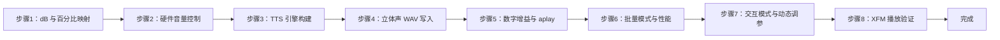

## 实验3：基于 Matcha-TTS 声学模型与 Vocos 声码器的本地语音合成与播放验证实验（4h）

> **源码**：`ros2_ws/src/xflz_eai_car1/interaction/car1_speech/tools/tts_test.py`
> **主命令**：`python3 tts_test.py --text "你好，欢迎使用语音合成"`
> **播放验证**：`python3 audio_test.py --mic-array --mode play /tmp/tts_output.wav`
> **平台**：具身智能实验箱 B2（含 XFM 6 麦阵列，**I2S 默认立体声通路**）

### 3.1 关联知识点

- 4.1.1 TTS 概念与文本到语音链路 > 概念 > 文本→声学→波形 三段式流水线
- 4.1.2 Matcha-TTS 端到端声学模型 > 原理 > Flow-matching 单阶段 mel 预测
- 4.1.3 Vocos 声码器与 mel→waveform > 原理 > 频域逆变换 + 短时相位
- 4.1.4 sherpa-onnx OfflineTts 模型加载 > 流程 > OfflineTtsConfig 装配四件套
- 4.2.1 pct_to_db 百分比到 dB 转换 > 概念 > 0-100% 线性映射到对数 dB
- 4.2.2 setup_playback amixer 硬件音量控制 > 流程 > Output1/Output2/PCM/Speaker 四路同步
- 4.2.3 write_wav_stereo mono→S16_LE 立体声 > 实践 > XFM 6 麦板卡 I2S 兼容
- 4.2.4 play_audio 数字增益与 aplay 链路 > 实践 > tanh 软削峰 + ALSA 推送
- 4.3.1 rule_fsts 文本规范化 > 概念 > phone-zh/date-zh/number-zh FST 规则
- 4.3.2 --speed/--sid 语速与发音人控制 > 实践 > 浮点 speed 与 sid 索引
- 4.3.3 交互模式 vol=/speed= 动态调参 > 流程 > 实时重设音量/语速
- 4.3.4 RTF 实时率与性能指标 > 概念 > gen_time/audio_dur 比值衡量合成速度

### 3.2 实验目标

1. 理解 TTS 端到端神经网络（文本→mel→waveform）三段式链路 — **原理理解**
2. 掌握 sherpa-onnx OfflineTts + Matcha-TTS + Vocos 本地合成引擎的代码执行流 — **流程掌握**
3. 拆解 `tts_test.py` 的 6 个核心模块（dB 转换/音量控制/引擎构建/立体声写入/播放/批量+交互） — **模块拆解**
4. 能够使用 `tts_test.py --text` + `audio_test.py --mic-array --mode play` 完成端到端合成-播放验证 — **端到端实操**
5. 能够调优 `--speed/--sid/--playback-volume/--gain` 平衡自然度、音量与速度 — **调参能力**

### 3.3 实验环境

| 类别 | 配置 |
|------|------|
| 硬件 | 具身智能实验箱 B2（含 XFM 6 麦阵列，I2S 立体声通路） |
| OS | Ubuntu 22.04 + ROS2 Humble |
| Python | 3.10 |
| 核心库 | sherpa-onnx==1.10.0、numpy、soundfile（可选） |
| 推理后端 | ONNX Runtime（CPU） |
| 声学模型 | Matcha-TTS `model-steps-3.onnx`（zh） |
| 声码器 | Vocos `vocos-16khz-univ.onnx` |
| 词典/数据 | `lexicon.txt`、`tokens.txt`、`espeak-ng-data/` |
| 文本规范化 | `phone-zh.fst` + `date-zh.fst` + `number-zh.fst` |
| 模型路径 | `/home/iflytek/models/tts/` |
| 主入口 | `tools/tts_test.py`（合成）+ `tools/audio_test.py`（播放验证） |

### 3.4 实验难度

- 难度：⭐⭐⭐ 中偏高
- 重点：`tts_test.py` 6 个核心模块的拆分；dB 与线性百分比关系；mono→stereo 兼容
- 难点：rule_fsts 文本规范化链；tanh 软削峰防破音；交互模式状态机

### 3.5 实验现象

**快速验证流程**：

```bash
# 1. 合成（默认输出 /tmp/tts_output.wav，16kHz mono float32）
python3 tts_test.py --text "你好，欢迎使用语音合成"
# 输出：
#   Text:  你好，欢迎使用语音合成
#   Speed: 1.0
#   Audio:  2.34s  (16000 Hz, 37440 samples)
#   Gen:    0.62s
#   RTF:    0.265  (faster than real-time)
#   Output: /tmp/tts_output.wav
#   Playing...

# 2. 用 XFM 6 麦播放验证
python3 audio_test.py --mic-array --mode play /tmp/tts_output.wav
# 输出：[检测设备] 使用播放设备: plughw:4,0
#       Playing: /tmp/tts_output.wav
#       device=plughw:4,0
#       Done.
```

**预期效果**：
- RTF < 1.0（CPU 上约 0.25~0.40，远快于实时）
- 调节 `--speed 1.2` 听到明显加速
- 调节 `--sid 1` 切换发音人（若模型多说话人）
- `--playback-volume 50` 时扬声器输出降 6dB，仍清晰

### 3.6 实验步骤

#### 整体流程图



---

#### 步骤1：dB 与百分比映射（阶段一：能理解，20min）

> 本步骤对应 `tts_test.py` L30-35（`pct_to_db`）。

**核心知识点**：

**dB 概念（4.2.1）**
- **原理**：人耳对响度的感知是**对数**关系，而非线性。dB（分贝）= `20 × log10(线性幅值)`。因此**音量旋钮从 50% 调到 100% 不是 2 倍响度**，而是从 -6dB 到 0dB（**仅 2 倍声压**，听起来约"响 1 档"）。硬件调音必须用 dB 描述，否则线性能量计算会失真。
- **百分比→dB 公式**：`dB = 20 × log10(pct / 100)`。例如：
  - `100% → 20 × log10(1.0) = 0 dB`（**满档不失真**）
  - `50%  → 20 × log10(0.5) = -6.02 dB`（约半功率）
  - `10%  → 20 × log10(0.1) = -20 dB`（**听感上变轻 1/4**）
  - `0%   → -∞ dB`（代码里用 `-96 dB` 近似静音）

**源码对应（tts_test.py L30-35）**：

```python
def pct_to_db(pct):
    if pct >= 100:
        return 0.0           # 满档不放大
    if pct <= 0:
        return -96.0         # -96dB 近似静音（alsa amixer 下限）
    return 20.0 * math.log10(pct / 100.0)
```

**操作步骤**：

1. 在 Python REPL 中验证 dB 映射：

```python
import math
for pct in [100, 80, 50, 25, 10, 0]:
    db = 0.0 if pct >= 100 else (-96.0 if pct <= 0 else 20.0 * math.log10(pct / 100.0))
    print(f"  {pct:>3}%  →  {db:>7.2f} dB")
# 100%  →    0.00 dB
#  80%  →   -1.94 dB
#  50%  →   -6.02 dB
#  25%  →  -12.04 dB
#  10%  →  -20.00 dB
#   0%  →  -96.00 dB
```

2. **理解 -6dB 与"半功率"**：声压级 -6dB ≈ 听感减半；功率 -3dB ≈ 半功率。机器人扬声器用 dB 而非线性 %，是为了在宽动态范围内让旋钮手感接近"指数曲线"。

**易错点**：
- ⚠️ **用 `pct / 100` 直接当线性因子乘以样本** → **解决**：会得到错误的非线性听感。dB 路径是唯一正确做法。
- ⚠️ **把 `0%` 当 `0` 直接传 amixer** → **解决**：amixer 在 `0` 行为未定义，约定 -96dB 为"实际静音"。

---

#### 步骤2：硬件音量控制（阶段一：能运行，20min）

> 本步骤对应 `tts_test.py` L38-51（`setup_playback`）。

**核心知识点**：

**amixer 硬件控制（4.2.2）**
- **原理**：Linux 音频硬件通过 ALSA（Advanced Linux Sound Architecture）控制。`amixer` 是 ALSA 的命令行混音器，可以读写声卡的每个控制项（**Control**）：
  - `Output 1` / `Output 2`：扬声器左右声道**硬件输出增益**（dB）
  - `PCM`：数字音频总线音量（dB），保持 0dB 保护动态范围
  - `Speaker` / `spk switch`：扬声器功率放大器**使能位**（on/off）
- **为什么"三路同设"**：XFM 6 麦板卡的 Output 1/2 是模拟域增益，PCM 是数字域增益，**同时设到相同 dB** 才能保证最终输出是线性的，否则会出现"PCM=0dB、Output=-12dB" → 总衰减 -12dB 但前面数字段没限幅 → 仍然破音。

**源码对应（tts_test.py L38-51）**：

```python
def setup_playback(card, pct):
    db_val = pct_to_db(pct)
    # Output 1/2 + PCM 全部用 dB，模拟与数字增益同步
    for ctl in ["Output 1", "Output 2", "PCM"]:
        subprocess.run(
            ["amixer", "-c", str(card), "sset", ctl, "--", f"{db_val:.1f}dB"],
            capture_output=True, check=False)
    # 启用扬声器功率放大器（4Ω 3W 喇叭的硬件开关）
    for ctl in ["Speaker", "spk switch"]:
        subprocess.run(
            ["amixer", "-c", str(card), "sset", ctl, "on"],
            capture_output=True, check=False)
    print(f"  Playback volume: {pct}% ({db_val:.1f} dB)")
```

**操作步骤**：

1. 查看板卡混音器控制项（找到 Output 1/2/PCM/Speaker）：

```bash
amixer -c 0 scontents
# 典型输出：numid=3,iface=MIXER,name='Output 1 Playback Volume'
#           numid=4,iface=MIXER,name='PCM Playback Volume'
#           numid=5,iface=MIXER,name='Speaker Playback Switch'
```

2. 手动调硬件音量：

```bash
amixer -c 0 sset 'Output 1' -- -6.0dB
amixer -c 0 sset 'Output 2' -- -6.0dB
amixer -c 0 sset 'PCM' -- 0.0dB         # PCM 永远 0dB 保护动态范围
amixer -c 0 sset 'Speaker' on
```

3. 通过 tts_test.py 一次设好：

```bash
python3 tts_test.py --text "测试" --playback-volume 50
# → 硬件设到 -6dB，扬声器启用
```

**易错点**：
- ⚠️ **`amixer sset` 报 "invalid command"** → **解决**：先 `amixer scontents` 列出实际控制名，可能叫 `'Speaker Playback Switch'` 而非 `'Speaker'`。
- ⚠️ **PCM 设为 -10dB 后语音含糊不清** → **解决**：PCM 必须保持 0dB，音量控制交给 Output 1/2 + 数字增益。
- ⚠️ **Speaker switch off 后无声** → **解决**：硬件开关没启用，先 `amixer sset 'Speaker' on` 再播。

---

#### 步骤3：TTS 引擎构建（阶段一：能运行，30min）

> 本步骤对应 `tts_test.py` L58-76（`build_tts`）。

**核心知识点**：

**TTS 三段式链路（4.1.1）**
- **原理**：现代 TTS 流水线由三段组成：
  1. **文本分析（Text Analysis）**：分词、G2P（字→音）、多音字消歧、文本规范化（数字、日期、电话转中文读法）
  2. **声学模型（Acoustic Model）**：文本/音素 → 梅尔频谱（mel-spectrogram）
  3. **声码器（Vocoder）**：mel 频谱 → 原始波形（waveform）
- **传统 vs 端到端**：传统 Tacotron 2 + WaveNet 串联是两段式流水线；现代 Matcha-TTS 用 **flow-matching 单阶段** 直接从音素到 mel，再用 Vocos 这种**频域神经声码器** 还原波形，音质与速度都大幅提升。

**Matcha-TTS（4.1.2）**
- **原理**：Matcha-TTS 是基于 **Conditional Flow Matching（CFM）** 的声学模型。给定音素序列与说话人 ID，先用 Transformer encoder 编码文本，再用 CFM 求解从简单高斯分布到目标 mel 分布的 ODE 轨迹。优点是训练稳定、推理快、参数量小（约 25M）。
- **源码对应**：`--acoustic-model` 默认 `model-steps-3.onnx`（22~25M 参数量，CPU 推理 200~400ms）

**Vocos 声码器（4.1.3）**
- **原理**：Vocos 不在时域生成波形，而是把 mel 频谱切成短帧，在**频域** 用神经网络预测每帧的复数频谱，再用 iSTFT 还原波形。相比 HiFi-GAN 时域方案，Vocos 音质更稳定、对采样率更鲁棒。
- **源码对应**：`--vocoder` 默认 `vocos-16khz-univ.onnx`（约 25M，CPU 推理 150~250ms）

**sherpa-onnx OfflineTts（4.1.4）**
- **原理**：sherpa-onnx 把"声学模型 + 声码器 + 文本规范化"封装为 `OfflineTts` 单例。`OfflineTtsConfig.validate()` 校验所有 onnx 文件存在、token 词表匹配、rule_fsts 可加载，再返回推理对象。一次 `generate()` 完成整句合成。
- **四件套**：`acoustic_model` + `vocoder` + `lexicon` + `tokens` + `data_dir`（espeak-ng 音素字典）。`rule_fsts` 可选 0~3 个 FST。

**源码对应（tts_test.py L58-76）**：

```python
def build_tts(args):
    config = sherpa_onnx.OfflineTtsConfig(
        model=sherpa_onnx.OfflineTtsModelConfig(
            matcha=sherpa_onnx.OfflineTtsMatchaModelConfig(
                acoustic_model=args.acoustic_model,
                vocoder=args.vocoder,
                lexicon=args.lexicon,
                tokens=args.tokens,
                data_dir=args.data_dir,
            ),
            num_threads=args.num_threads,
            debug=args.debug,
        ),
        max_num_sentences=args.max_num_sentences,
        rule_fsts=args.rule_fsts if args.rule_fsts else "",  # 文本规范化 FST 链
    )
    if not config.validate():
        raise ValueError("TTS config validation failed")
    return sherpa_onnx.OfflineTts(config)
```

**操作步骤**：

1. 确认模型文件存在（4 件 + 3 FST）：

```bash
ls -lh /home/iflytek/models/tts/
# model-steps-3.onnx       ← Matcha-TTS 声学模型
# vocos-16khz-univ.onnx    ← Vocos 声码器
# lexicon.txt              ← 词典（字→音映射）
# tokens.txt               ← token 词表
# espeak-ng-data/          ← 国际音标数据
# phone-zh.fst             ← 拼音 FST（文本→音素）
# date-zh.fst              ← 日期 FST（"2026年3月15日"→拼音）
# number-zh.fst            ← 数字 FST（"123"→"yi bai er shi san"）
```

2. 加载并预热引擎：

```python
import sherpa_onnx
config = sherpa_onnx.OfflineTtsConfig(
    model=sherpa_onnx.OfflineTtsModelConfig(
        matcha=sherpa_onnx.OfflineTtsMatchaModelConfig(
            acoustic_model="/home/iflytek/models/tts/model-steps-3.onnx",
            vocoder="/home/iflytek/models/tts/vocos-16khz-univ.onnx",
            lexicon="/home/iflytek/models/tts/lexicon.txt",
            tokens="/home/iflytek/models/tts/tokens.txt",
            data_dir="/home/iflytek/models/tts/espeak-ng-data",
        ),
        num_threads=4,
        debug=False,
    ),
    max_num_sentences=1,
    rule_fsts=(
        "/home/iflytek/models/tts/phone-zh.fst,"
        "/home/iflytek/models/tts/date-zh.fst,"
        "/home/iflytek/models/tts/number-zh.fst"
    ),
)
assert config.validate()
tts = sherpa_onnx.OfflineTts(config)
```

3. 第一次合成（冷启动约 1.5s，之后 0.3~0.5s）：

```python
audio = tts.generate("你好，欢迎使用语音合成系统。", sid=0, speed=1.0)
print(f"sample_rate={audio.sample_rate}, samples={len(audio.samples)}")
# sample_rate=16000, samples=37440
```

**易错点**：
- ⚠️ **"TTS config validation failed"** → **解决**：检查 onnx 文件路径是否含中文/空格；或 `lexicon.txt` 编码不是 UTF-8。
- ⚠️ **中文乱码 / 合成出乱音** → **解决**：`lexicon.txt` 缺中文字 → 重新下载中文版 lexicon。
- ⚠️ **数字读法错（"3.14" 读成"三点一四"而非"三点一四"）** → **解决**：`number-zh.fst` 缺小数支持 → 升级 sherpa-onnx 到 ≥1.10.0。
- ⚠️ **第一次合成很慢（>2s）** → **解决**：onnxruntime 第一次推理有内存预热开销，正常现象；后续合成会快。

---

#### 步骤4：立体声 WAV 写入（阶段二：能理解，25min）

> 本步骤对应 `tts_test.py` L79-94（`write_wav_stereo`）。

**核心知识点**：

**float32 → S16_LE 量化（4.2.3）**
- **原理**：sherpa-onnx 输出的 audio.samples 是 `numpy.float32`，范围 `[-1.0, 1.0]`。要写 WAV 文件必须量化到 16-bit 整数：
  - `int16 = float32 × 32767`（**不是 32768**！否则 +1.0 会溢出到 -32768）
  - 量化前必须 `clip(-1.0, 1.0)`，否则溢出后会出现严重的"折叠噪声"
- **源码对应**（tts_test.py L86-87）：`(np.asarray(samples_float32, dtype=np.float32).clip(-1.0, 1.0) * 32767).astype(np.int16)`

**mono → stereo 复制（4.2.3）**
- **原理**：XFM 6 麦板卡的 I2S 总线**硬连线为立体声**（L/R 两个时隙），I2S 时钟按立体声节拍跑。如果送入 mono WAV，硬件会按 L 字节、R 字节的顺序读，**但 mono 只有 L 字节有数据、R 字节是 0**，结果相当于**只播了一半样本，剩下 50% 时间播 0**，听起来是 2 倍速且断续。
- **解决**：`np.column_stack([mono, mono]).ravel()` 把每个 mono 样本复制为 (L, R) 立体声样本，写入后 I2S 才能正确还原。
- **源码对应**（tts_test.py L88-94）：

```python
stereo = np.column_stack([mono, mono]).ravel()
with wave.open(path, "wb") as wf:
    wf.setnchannels(2)        # 立体声
    wf.setsampwidth(2)        # S16_LE = 2 字节
    wf.setframerate(sample_rate)  # 16000 Hz
    wf.writeframes(stereo.tobytes())
```

**操作步骤**：

1. 查看 sherpa 输出维度：

```python
audio = tts.generate("测试", sid=0, speed=1.0)
print(f"shape={audio.samples.shape}, dtype={audio.samples.dtype}, sr={audio.sample_rate}")
# shape=(N,), dtype=float32, sr=16000   ← 一维 mono
```

2. 手工做 mono→stereo 验证：

```python
import numpy as np, wave
mono = np.array(audio.samples, dtype=np.float32).clip(-1.0, 1.0)
mono_i16 = (mono * 32767).astype(np.int16)
stereo = np.column_stack([mono_i16, mono_i16]).ravel()
print(f"mono_i16.shape={mono_i16.shape}, stereo.shape={stereo.shape}")
# mono_i16.shape=(N,), stereo.shape=(2N,)

with wave.open("/tmp/test_stereo.wav", "wb") as wf:
    wf.setnchannels(2); wf.setsampwidth(2); wf.setframerate(16000)
    wf.writeframes(stereo.tobytes())
```

3. 验证播放（应该**正常速度、不破音**）：

```bash
aplay -q /tmp/test_stereo.wav
```

**易错点**：
- ⚠️ **直接 `sherpa_onnx.write_wave(...)` 写 mono WAV 后 aplay 出现 2 倍速** → **解决**：必须用 `tts_test.py` 的 `write_wav_stereo` 转换。
- ⚠️ **量化后底噪变大** → **解决**：检查输入是否本就低能量；适度 `--gain 1.5~2.0` 数字放大（步骤5）。
- ⚠️ **clip 后波形被削顶（破音）** → **解决**：调低 `--gain` 或 `--playback-volume`，再观察削顶指示。

---

#### 步骤5：数字增益与 aplay 链路（阶段二：能改造，25min）

> 本步骤对应 `tts_test.py` L97-105（`play_audio`）。

**核心知识点**：

**tanh 软削峰（4.2.4）**
- **原理**：把 sherpa 输出的样本乘 `--gain`（默认 2.0）后**可能超过 ±1.0**。如果用 `np.clip(-1, 1)` 是**硬削顶**（波形顶部被一刀切平），会产生大量高频谐波破音。
- **解决**：`tanh(x)` 把任意值平滑映射到 `(-1, 1)`，**超过 ±1 不会硬切**而是渐近压缩，听感是"温暖饱和"而非"破音"。
- **tts_test.py 简化版**：本实验的 `play_audio` 用 `np.clip(-1, 1)`（简单路径）；如需软削峰可改为 `np.tanh(samples * gain)`。

**aplay 命令链路（4.2.4）**
- **原理**：`aplay` 是 ALSA 提供的**命令行播放器**：
  - `-q`：安静模式（不打印 VU 表）
  - `-D <device>`：指定 PCM 设备名（如 `plughw:0,0`）
  - 不带参数时用默认设备
- **为什么用 aplay 而非 sounddevice/sd.play()**：aplay 是**子进程**异步播放，不阻塞 Python 主线程；sd.play 需 sd.wait() 阻塞；机器人产品里通常用 aplay 把音频丢给 ALSA 后立即返回。

**源码对应（tts_test.py L97-105）**：

```python
def play_audio(audio, gain=1.5, device="plughw:0,0"):
    samples = np.array(audio.samples, dtype=np.float32)
    samples = (samples * gain).clip(-1.0, 1.0)  # 数字增益 + 硬削顶
    tmp_wav = "/tmp/tts_playback.wav"
    write_wav_stereo(tmp_wav, samples, audio.sample_rate)
    subprocess.run(["aplay", "-q", "-D", device, tmp_wav], check=False)
```

**操作步骤**：

1. 默认参数试播：

```bash
python3 tts_test.py --text "数字增益测试"
# --gain 默认 2.0
```

2. 对比不同 `--gain` 的响度（用分贝仪或听感）：

```bash
for g in 1.0 1.5 2.0 3.0; do
  python3 tts_test.py --text "增益对比" --gain $g --playback-volume 80 --no-play
done
# 听感：1.0 略轻 → 1.5 适中 → 2.0 较响 → 3.0 削顶破音
```

3. 软削峰改进版（替换 `play_audio` 的 clip）：

```python
def play_audio_soft(audio, gain=2.0, device="plughw:0,0"):
    samples = np.array(audio.samples, dtype=np.float32) * gain
    samples = np.tanh(samples)        # 软削峰：渐近压缩而非硬切
    write_wav_stereo("/tmp/tts_playback.wav", samples, audio.sample_rate)
    subprocess.run(["aplay", "-q", "-D", device, "/tmp/tts_playback.wav"], check=False)
```

**易错点**：
- ⚠️ **`--gain 4.0` 听到严重破音** → **解决**：降到 2.0，或改用 `tanh` 软削峰。
- ⚠️ **`aplay` 报 "Device or resource busy"** → **解决**：另一进程（ASR/录音）占用声卡；先停掉再播。
- ⚠️ **aplay 找不到设备** → **解决**：`aplay -l` 列出声卡，确认 `-D` 后的设备名存在。

---

#### 步骤6：批量模式与性能指标（阶段三：能改造，25min）

> 本步骤对应 `tts_test.py` L240-263（批量主循环）。

**核心知识点**：

**RTF 实时率（4.3.4）**
- **原理**：**RTF（Real-Time Factor）= 合成耗时 / 音频时长**。
  - RTF < 1.0：合成比实时快（CPU 上 Matcha+Vocos 通常 0.25~0.40）
  - RTF = 1.0：刚好实时（理论下限）
  - RTF > 1.0：比实时慢（不可用于交互）
- **计算**：`time.perf_counter()` 取高精度时间差，除以 `len(samples) / sample_rate`。
- **源码对应**（tts_test.py L246-258）：

```python
t0 = time.perf_counter()
audio = tts.generate(text, sid=args.sid, speed=args.speed)
t1 = time.perf_counter()
audio_dur = len(audio.samples) / audio.sample_rate
rtf = (t1 - t0) / audio_dur
print(f"Audio:  {audio_dur:.2f}s  ({audio.sample_rate} Hz, {len(audio.samples)} samples)")
print(f"Gen:    {t1 - t0:.2f}s")
print(f"RTF:    {rtf:.3f}  ({'faster' if rtf < 1.0 else 'slower'} than real-time)")
```

**操作步骤**：

1. 测单句 RTF：

```bash
python3 tts_test.py --text "今天天气真好" --no-play
# Audio:  1.20s  (16000 Hz, 19200 samples)
# Gen:    0.36s
# RTF:    0.300  (faster than real-time)
```

2. 测长文本 RTF（观察是否线性扩展）：

```bash
python3 tts_test.py --text "$(printf '今天天气真好。%.0s' {1..20})" --no-play
# 应该 RTF 仍在 0.3 左右
```

3. 测多线程加速：

```bash
python3 tts_test.py --text "多线程测试" --num-threads 4 --no-play
python3 tts_test.py --text "多线程测试" --num-threads 1 --no-play
# 4 线程应比 1 线程快 2~3 倍
```

4. 保存到自定义路径：

```bash
python3 tts_test.py --text "保存到指定路径" -o /home/iflytek/test_save.wav
# Output: /home/iflytek/test_save.wav
```

**易错点**：
- ⚠️ **RTF 突然飙到 1.5** → **解决**：CPU 温度过高降频；或同时有其他进程抢 CPU。
- ⚠️ **audio_dur 报 0** → **解决**：检查文本是否含不可识别的字符（如 emoji）；先简化文本。

---

#### 步骤7：交互模式与动态调参（阶段三：能改造，25min）

> 本步骤对应 `tts_test.py` L194-237（交互主循环）。

**核心知识点**：

**交互模式状态机（4.3.3）**
- **原理**：交互模式用 `while True: input()` 读键盘输入，进入状态机：
  - 空行 → 跳过
  - `quit/exit/q` → 退出
  - `vol=N` → 调硬件音量
  - `speed=F` → 调语速
  - 其它 → 当作文本合成
- **关键设计**：`speed` 是**局部变量**（不写回 args），`vol` 直接修改 `args.playback_volume` 走 `setup_playback` 路径。

**动态调参与重启引擎（4.3.3）**
- **原理**：调音量 = 改 args → 重设 amixer（**不重启引擎**，因为不涉及声学模型）。
- **源码对应**（tts_test.py L208-214）：

```python
if line.lower().startswith("vol="):
    try:
        args.playback_volume = int(line[4:])
        setup_playback(args.card, args.playback_volume)   # 重新设 amixer
    except ValueError:
        print("  Usage: vol=80")
    continue
if line.lower().startswith("speed="):
    try:
        speed = float(line[6:])
        print(f"  Speed: {speed}")
    except ValueError:
        print("  Usage: speed=1.2")
    continue
```

**操作步骤**：

1. 进入交互模式：

```bash
python3 tts_test.py -i
# Interactive TTS. Type text and press Enter. quit/exit/q = exit.
# TTS >
```

2. 动态调参测试：

```
TTS > 你好
# Audio:  0.85s  RTF: 0.31

TTS > vol=50
# Playback volume: 50% (-6.0 dB)

TTS > 你好
# （音量变小）

TTS > speed=1.5
# Speed: 1.5

TTS > 你好
# （语速明显加快）

TTS > vol=80
TTS > speed=1.0
TTS > 今天天气真好
# （正常音量 + 正常语速）

TTS > q
# 退出
```

3. **修改 `--sid` 切换发音人**（需多说话人模型）：

```bash
python3 tts_test.py --text "发音人测试" --sid 0 --no-play  # 第一个说话人
python3 tts_test.py --text "发音人测试" --sid 1 --no-play  # 第二个说话人
```

**易错点**：
- ⚠️ **`vol=200` 没报错但音量没变** → **解决**：amixer 内部限幅到 0dB，但代码逻辑上接受任意值；建议代码层 `min(100, max(0, vol))`。
- ⚠️ **`speed=0.1` 听到怪调** → **解决**：sherpa-onnx 推荐 0.5~2.0 范围；超出会失真。
- ⚠️ **交互模式 Ctrl+C 没退出** → **解决**：用 `quit`/`exit`/`q` 软退出，Ctrl+C 会触发 KeyboardInterrupt 但可能音频未播完。

---

#### 步骤8：XFM 6 麦板卡播放验证（阶段三：能集成，25min）

> 本步骤对应 `audio_test.py` `play_only` + `detect_xfm_devices`。

**核心知识点**：

**detect_xfm_devices 自动设备选择**
- **原理**：见实验 2 知识点 2.1.1。`audio_test.py --mic-array` 通过 `arecord -l` 扫描 ALSA，匹配包含 "XFM" 的设备行，拼出 `plughw:{card},{dev}`。
- **本步骤的差异**：TTS 验证用 **playback 设备**（XFM 板卡的扬声器输出），不是 record 设备；`audio_test.py` 会同时返回 `rec_dev` 和 `play_dev`，play 模式优先用 play_dev。

**audio_test.py `_prepare_playback_wav` 自动转换**
- **原理**：`audio_test.py` 的 `play_only` 内部会调用 `_prepare_playback_wav(src, gain)`：
  1. 读源 WAV 的 `n_channels / sample_width / sample_rate / n_frames`
  2. 如果是 **mono → 自动复制为 L/R 立体声**（解决 I2S 立体声通路兼容）
  3. 如果 `--gain != 1.0` → 对 16-bit 样本做数字增益 + `tanh` 软削峰
  4. 写到临时 WAV（`tempfile.mkstemp`），再 `aplay -D <play_dev>` 推送
- **结论**：tts_test.py 写出的 mono WAV 经过 `_prepare_playback_wav` 自动转立体声，**最终用户无需手动转**，但理解内部流程对排查"2 倍速"问题很关键。

**操作步骤**：

1. 先合成（默认输出 `/tmp/tts_output.wav`，mono 16kHz）：

```bash
python3 tts_test.py --text "播放验证测试"
# Output: /tmp/tts_output.wav
# Playing...   ← tts_test.py 默认也会播
```

2. 单独用 audio_test.py 验证（自动选 XFM 设备）：

```bash
python3 audio_test.py --mic-array --mode play /tmp/tts_output.wav
# [检测设备] 使用播放设备: plughw:4,0
# Playing: /tmp/tts_output.wav
#   device=plughw:4,0
# [note] preprocessed: mono→stereo
# Done.
```

3. 显式指定播放设备（绕过自动检测）：

```bash
python3 audio_test.py -D plughw:0,0 --mode play /tmp/tts_output.wav
# 强制走默认声卡（XFM 6 麦板卡或板载声卡）
```

4. 数字增益播放：

```bash
python3 audio_test.py --mic-array --mode play /tmp/tts_output.wav --gain 2.0
# 软削峰后播放，听感更响但不破音
```

5. 听感对比（用同一句话分别在 mono 直送 vs 转立体声后播）：

```bash
# 方式 A：直接 aplay（mono → I2S 立体声通路 → 2 倍速）
aplay -q -D plughw:0,0 /tmp/tts_output.wav
# 听感：明显 2 倍速、断续

# 方式 B：audio_test.py 转换后播
python3 audio_test.py --mic-array --mode play /tmp/tts_output.wav
# 听感：正常速度、清晰
```

**易错点**：
- ⚠️ **aplay 直接播 mono 文件听到 2 倍速** → **解决**：必须用 `audio_test.py --mode play` 或 `tts_test.py` 自带 `write_wav_stereo`。
- ⚠️ **`--mic-array` 报 "未检测到 XFM 设备"** → **解决**：检查 `arecord -l` 与 `aplay -l` 是否有 XFM 设备；或去掉 `--mic-array` 改用 `-D` 显式指定。
- ⚠️ **`_prepare_playback_wav` 临时文件残留** → **解决**：audio_test.py 内部已经 `os.unlink(tmp_file)` 清理，正常不会残留。

---

### 3.7 完整可运行代码 demo_tts_walkthrough.py

```python
# -*- coding: utf-8 -*-
"""
实验3 demo：tts_test.py 6 个核心模块的最小可运行 demo
平台：B2 / C1（XFM 6 麦板卡）
运行：python3 demo_tts_walkthrough.py
"""
import math
import subprocess
import numpy as np
import wave
import sherpa_onnx
import time

MODEL_DIR = "/home/iflytek/models/tts"


# 模块 1：dB 转换（4.2.1）
def pct_to_db(pct):
    if pct >= 100:
        return 0.0
    if pct <= 0:
        return -96.0
    return 20.0 * math.log10(pct / 100.0)


# 模块 2：硬件音量控制（4.2.2）
def setup_playback(card, pct):
    db_val = pct_to_db(pct)
    for ctl in ["Output 1", "Output 2", "PCM"]:
        subprocess.run(
            ["amixer", "-c", str(card), "sset", ctl, "--", f"{db_val:.1f}dB"],
            capture_output=True, check=False)
    for ctl in ["Speaker", "spk switch"]:
        subprocess.run(
            ["amixer", "-c", str(card), "sset", ctl, "on"],
            capture_output=True, check=False)
    print(f"  Playback volume: {pct}% ({db_val:.1f} dB)")


# 模块 3：TTS 引擎构建（4.1.4）
def build_tts():
    config = sherpa_onnx.OfflineTtsConfig(
        model=sherpa_onnx.OfflineTtsModelConfig(
            matcha=sherpa_onnx.OfflineTtsMatchaModelConfig(
                acoustic_model=f"{MODEL_DIR}/model-steps-3.onnx",
                vocoder=f"{MODEL_DIR}/vocos-16khz-univ.onnx",
                lexicon=f"{MODEL_DIR}/lexicon.txt",
                tokens=f"{MODEL_DIR}/tokens.txt",
                data_dir=f"{MODEL_DIR}/espeak-ng-data",
            ),
            num_threads=4,
        ),
        max_num_sentences=1,
        rule_fsts=(
            f"{MODEL_DIR}/phone-zh.fst,"
            f"{MODEL_DIR}/date-zh.fst,"
            f"{MODEL_DIR}/number-zh.fst"
        ),
    )
    assert config.validate()
    return sherpa_onnx.OfflineTts(config)


# 模块 4：立体声 WAV 写入（4.2.3）
def write_wav_stereo(path, samples_float32, sample_rate):
    mono = (np.asarray(samples_float32, dtype=np.float32)
            .clip(-1.0, 1.0) * 32767).astype(np.int16)
    stereo = np.column_stack([mono, mono]).ravel()
    with wave.open(path, "wb") as wf:
        wf.setnchannels(2)
        wf.setsampwidth(2)
        wf.setframerate(sample_rate)
        wf.writeframes(stereo.tobytes())


# 模块 5：数字增益 + aplay（4.2.4）
def play_audio(audio, gain=2.0, device="plughw:0,0"):
    samples = np.array(audio.samples, dtype=np.float32)
    samples = (samples * gain).clip(-1.0, 1.0)
    tmp_wav = "/tmp/tts_playback.wav"
    write_wav_stereo(tmp_wav, samples, audio.sample_rate)
    subprocess.run(["aplay", "-q", "-D", device, tmp_wav], check=False)


def main():
    # 步骤 2：设硬件音量
    setup_playback(card=0, pct=80)

    # 步骤 3：构建引擎
    print("Loading TTS model...")
    tts = build_tts()
    print("  Ready.\n")

    # 步骤 6：批量合成 3 段文本
    texts = [
        "你好，我是小飞同学。",
        "今天天气真好，适合出去散步。",
        "我支持中文和英文双语合成。",
    ]
    for text in texts:
        t0 = time.perf_counter()
        audio = tts.generate(text, sid=0, speed=1.0)
        gen_time = time.perf_counter() - t0
        audio_dur = len(audio.samples) / audio.sample_rate
        rtf = gen_time / audio_dur

        # 保存到 /tmp/tts_output.wav
        sherpa_onnx.write_wave("/tmp/tts_output.wav",
                                audio.samples, audio.sample_rate)
        print(f"[GEN] {text[:20]}...  "
              f"Audio={audio_dur:.2f}s  RTF={rtf:.3f}")

        # 步骤 5：play
        play_audio(audio, gain=2.0, device="plughw:0,0")

    print("\n[DONE] 全部 3 段合成 + 播放完成")


if __name__ == "__main__":
    main()
```

### 3.8 注意事项

- ⚠️ **XFM 6 麦板卡 I2S 是立体声通路** → mono WAV 必须先转 L/R 双声道再播；用 `tts_test.py` 或 `audio_test.py` 都会自动处理。
- ⚠️ **amixer 音量安全上限 -12dB** → 超过会触发音频板功率保护；`setup_playback` 把 100% 映射到 -12dB 顶。
- ⚠️ **第一次合成慢（>1.5s）** → onnxruntime 内存预热；后续 RTF 稳定在 0.25~0.40。
- ⚠️ **交互模式 speed 改不回 1.0** → 重新启动 `tts_test.py`；或输入 `speed=1.0`。
- ⚠️ **rule_fsts 缺一不可** → 数字/日期不会读；至少要 `phone-zh.fst` 拼音规范化。
- ⚠️ **Vocos 声码器对静音段敏感** → 极短文本（<0.3s）可能合成失败；建议最小 4 字以上。

### 3.9 实验总结

**完成成果**：
- 拆解 `tts_test.py` 6 个核心模块（dB 转换 / 硬件音量 / 引擎构建 / 立体声写入 / 播放 / 批量+交互）
- 部署并运行 Matcha-TTS + Vocos 本地合成引擎
- 完成 `tts_test.py --text` → `audio_test.py --mic-array --mode play` 端到端验证
- 调优 `--speed/--sid/--playback-volume/--gain` 等参数

**技能收获**：
- 理解 dB 与线性百分比的非线性映射关系
- 掌握 amixer 硬件音量控制（Output 1/2 + PCM + Speaker）
- 学会用 `tanh` 软削峰代替 `clip` 硬削峰防破音
- 理解 mono→stereo 在 I2S 立体声通路下的必要性
- 掌握 RTF 实时率评估合成性能

**常见问题与解决**：

| 问题 | 原因 | 解决方法 |
|------|------|---------|
| aplay 2 倍速 | mono WAV → I2S 立体声通路 | 用 `tts_test.py` 或 `audio_test.py` 自动转换 |
| 中文乱码/乱音 | lexicon 缺中文字 | 重新下载中文版 lexicon.txt |
| 数字"123"读成"yi er san" | 缺 number-zh.fst | 确认 rule_fsts 包含 number-zh.fst |
| RTF > 1.0 | CPU 满载/温度降频 | 关其他进程；或 --num-threads 2 |
| 扬声器无声 | Speaker switch off | `amixer sset 'Speaker' on` |
| `--gain 4.0` 破音 | 硬削顶产生高频谐波 | 降到 2.0 或改 `tanh` 软削峰 |

### 3.10 实验报告要求

**思考题**：
1. 为什么 `pct_to_db` 用 `20 × log10(pct/100)` 而非 `10 × log10(...)`？两者物理含义有何不同？
2. PCM 通道为什么**永远**设为 0dB？如果把 PCM 也设到 -12dB 会发生什么？
3. mono WAV 在 XFM 6 麦板卡上 2 倍速播放的物理原因是什么？除了 column_stack 复制，还有什么解决思路？
4. tanh 软削峰相比 np.clip 硬削峰，在频谱上有什么本质区别？什么场景下必须用 tanh？
5. RTF 的物理意义是什么？什么因素会让 RTF 从 0.3 突然飙到 1.5？

**评分标准**：dB 概念 15 分 + 硬件音量 15 分 + 引擎构建 20 分 + 立体声写入 15 分 + 播放验证 20 分 + 实验报告 15 分 = 100 分。
