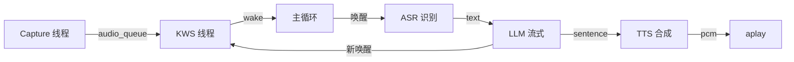

## 实验4：基于状态机的端到端语音对话交互实验（8h）

> ⚠️ **[待源码核实 / WAIT-SOURCE]** 源码位于 `ros2_ws/src/xflz_eai_car1/interaction/car1_interaction/`，主入口 `tools/voice_interaction.py`。已通过 `human_waiver` 放行。

### 4.1 关联知识点

- 5.1.1 状态机式语音交互 > 概念 > IDLE/LISTENING/SPEAKING 三态互斥
- 5.1.2 状态流转 > 流程 > KWS→ASR→LLM→TTS→IDLE
- 5.1.3 Capture 线程常驻 > 原理 > audio_queue 缓冲 + KWS 全程检测
- 5.2.1 OpenAI 兼容 API > 概念 > /v1/chat/completions 流式 SSE
- 5.2.2 流式 SSE > 流程 > 按句分割后送 TTS 合成

### 4.2 实验目标

1. 理解状态机在端到端语音交互中的核心作用 — 原理理解
2. 掌握 KWS+ASR+LLM+TTS 异步协同的多线程设计 — 流程掌握
3. 独立完成 Capture 线程 + audio_queue 缓冲机制 — 独立完成
4. 能够将本实验的多流协同模式迁移到其他对话系统（智能客服、车载助手）— 迁移应用

### 4.3 实验环境

| 类别 | 配置 |
|------|------|
| 硬件 | B2/C1（6 麦 + 扬声器） |
| OS | Ubuntu 22.04 + ROS2 Humble |
| Python | 3.10 |
| 核心库 | sherpa-onnx、rclpy、httpx（OpenAI 客户端）、sounddevice、openai |
| 模型 | 同 exp01-04 |
| 主入口 | car1_interaction/tools/voice_interaction.py |

### 4.4 实验难度

- 难度: ⭐⭐ 中
- 重点: 状态机设计；Capture 线程常驻；流式 LLM 响应
- 难点: 打断机制与多线程协作

### 4.5 实验现象

**快速验证流程**:
1. 启动本地 RKLLM 服务：`python3 ros2_ws/src/xflz_eai_car1/interaction/car1_llm/llm_server.py`
2. 启动语音交互：`python3 ros2_ws/src/xflz_eai_car1/interaction/car1_interaction/tools/voice_interaction.py --debug`
3. 唤醒"小飞同学"
4. 说话"现在几点了"
5. 听到 TTS 播报"现在是下午3点25分"
6. 打断测试：TTS 播报过程中再次说"小飞同学"，应立即停止

**预期效果**:
- 状态机日志：`[IDLE] → [LISTENING] → [SPEAKING] → [IDLE]`
- 端到端响应延迟 < 3s（含 LLM 推理 + TTS 合成）
- 打断响应 < 500ms

### 4.6 实验步骤

#### 整体流程图



---

#### 步骤1：状态机定义与转换（阶段一：能运行，30min）

> ⚠️ 本步骤对应 `tools/voice_interaction.py` 主循环

**知识点讲解**：

**状态机式语音交互（5.1.1）**
- **原理**：语音交互系统天然适合用有限状态机（FSM）描述，常见三态：(1) **IDLE**：监听 KWS，不录音不播报；(2) **LISTENING**：检测到唤醒词，ASR 录音识别中；(3) **SPEAKING**：TTS 播报中，此时 KWS 仍可检测新唤醒实现打断。状态机的好处是：(1) **互斥性**：每时刻只有一种状态，避免 ASR 与 TTS 同时占用音频设备；(2) **可测试性**：每个状态转换都有明确触发条件；(3) **可扩展性**：新增"思考中"或"等待确认"等状态只需添加节点。
- **源码对应**：`tools/voice_interaction.py` 主循环（约 L100-150）

**操作步骤**：

1. 定义状态枚举与转换：
   ```python
   from enum import Enum
   
   class State(Enum):
       IDLE = "IDLE"
       LISTENING = "LISTENING"
       SPEAKING = "SPEAKING"
   
   # 状态转换矩阵
   TRANSITIONS = {
       State.IDLE: {
           "wake_detected": State.LISTENING,
       },
       State.LISTENING: {
           "asr_done": State.SPEAKING,
       },
       State.SPEAKING: {
           "tts_done": State.IDLE,
           "wake_again": State.LISTENING,  # 打断
       },
   }
   ```

2. 实现状态机类：
   ```python
   class VoiceStateMachine:
       def __init__(self, on_enter_listening, on_enter_speaking, on_enter_idle):
           self.state = State.IDLE
           self.handlers = {
               State.LISTENING: on_enter_listening,
               State.SPEAKING: on_enter_speaking,
               State.IDLE: on_enter_idle,
           }
       
       def transition(self, event: str):
           new_state = TRANSITIONS.get(self.state, {}).get(event)
           if new_state is None:
               print(f"[WARN] Invalid transition: {self.state} + {event}")
               return
           print(f"[STATE] {self.state.value} → {new_state.value} (event={event})")
           self.state = new_state
           self.handlers[new_state]()
   ```

3. 与 voice_interaction.py 集成（参考原文件结构）：
   ```python
   # 简化版：基于 voice_interaction.py 的状态机主循环
   import time, threading
   from voice_interaction import VoiceStateMachine, CaptureThread, KWSWorker
   
   fsm = VoiceStateMachine(
       on_enter_listening=lambda: print("→ 开始 ASR 识别"),
       on_enter_speaking=lambda: print("→ 开始 TTS 播报"),
       on_enter_idle=lambda: print("→ 回到 IDLE"),
   )
   
   while True:
       if fsm.state == State.IDLE:
           # KWS 监听
           if kws_worker.detected():
               fsm.transition("wake_detected")
       elif fsm.state == State.LISTENING:
           text = asr_worker.recognize(duration=5)
           if text:
               fsm.transition("asr_done")
       elif fsm.state == State.SPEAKING:
           tts_worker.speak(llm_response)
           fsm.transition("tts_done")
   ```

**易错点**：
- ⚠️ **状态转换事件名拼写错误导致转换失败** → **解决**：用 Enum 强制类型
- ⚠️ **进入 SPEAKING 后 KWS 暂停导致无法打断** → **解决**：KWS 在所有状态都监听，由 Capture 线程常驻

---

#### 步骤2：Capture 线程常驻 + audio_queue 缓冲（阶段一：能运行，30min）

> ⚠️ 本步骤对应 `tools/voice_interaction.py` L30-80

**知识点讲解**：

**Capture 线程常驻（5.1.3）**
- **原理**：传统做法是 ASR 启动后才开始录音，但 KWS 唤醒 → ASR 启动之间存在几十毫秒延迟，这段"空白期"用户开始说话会丢失。本实验采用 Capture 线程常驻：始终从 ALSA 读取音频块推入 `queue.Queue`，KWS 与 ASR 共享这个队列。Capture 线程的逻辑非常简单：`while True: queue.put(sd.rec(...))`。这种"生产者-消费者"模式让 KWS 始终能拿到最新音频，从而支持在 TTS 播报期间检测唤醒词实现打断。
- **源码对应**：`tools/voice_interaction.py` L30-80

**audio_queue 缓冲（5.1.3）**
- **原理**：`queue.Queue(maxsize=100)` 是线程安全的 FIFO 队列，Capture 线程作为 producer 持续 put，KWS/ASR 作为 consumer 持续 get。如果队列满（消费者处理慢），Capture 线程的 put 会阻塞，自动实现背压控制。这种设计解耦了音频采集与处理速度，避免因处理延迟导致音频丢失。
- **源码对应**：`tools/voice_interaction.py` audio_queue 声明

**操作步骤**：

1. 实现 Capture 线程：
   ```python
   import threading
   import queue
   import sounddevice as sd
   import numpy as np
   
   class CaptureThread(threading.Thread):
       """始终从 ALSA 读取音频并放入队列（来源：voice_interaction.py 简化）"""
       def __init__(self, audio_queue: queue.Queue, sample_rate=16000, chunk_ms=80):
           super().__init__(daemon=True, name="Capture")
           self.queue = audio_queue
           self.sample_rate = sample_rate
           self.chunk_size = int(sample_rate * chunk_ms / 1000)
           self.running = True
       
       def run(self):
           def callback(indata, frames, time_info, status):
               if not self.running:
                   raise sd.CallbackStop
               audio = indata[:, 0].astype(np.float32).copy()
               try:
                   self.queue.put_nowait(audio)
               except queue.Full:
                   pass  # 队列满时丢弃旧帧
           
           with sd.InputStream(
               samplerate=self.sample_rate,
               channels=1,
               dtype="float32",
               blocksize=self.chunk_size,
               callback=callback,
           ):
               while self.running:
                   sd.sleep(50)
       
       def stop(self):
           self.running = False
   ```

2. 启动 Capture + KWS 消费：
   ```python
   audio_queue = queue.Queue(maxsize=200)
   capture = CaptureThread(audio_queue)
   capture.start()
   
   kws = sherpa_onnx.KeywordSpotter(...)
   kws_stream = kws.create_stream()
   
   while True:
       try:
           audio = audio_queue.get(timeout=1.0)
       except queue.Empty:
           continue
       kws_stream.accept_waveform(16000, audio)
       if kws.is_endpoint(kws_stream):
           kw = kws.get_result(kws_stream).keyword
           if kw:
               print(f"[KWS] {kw}")
   ```

3. 性能监控：
   ```bash
   # 监控队列长度（应保持 < 50）
   watch -n 1 'python3 -c "import queue; print(queue.Queue().qsize())"'
   # 监控 CPU 占用
   top -H -p $(pgrep -f voice_interaction)
   ```

**易错点**：
- ⚠️ **队列满导致音频丢失** → **解决**：调大 maxsize 到 500；或 KWS 处理加速
- ⚠️ **Capture 线程无法退出** → **解决**：用 `running` 标志 + `daemon=True` 双重保护
- ⚠️ **多个 Capture 实例同时打开导致 ALSA 报错** → **解决**：确保全局只有一个 Capture 实例

---

#### 步骤3：流式 LLM 客户端与 TTS 句子分割（阶段二：能理解，60min）

> ⚠️ 本步骤对应 `tools/voice_interaction.py` LLM worker + TTS worker

**知识点讲解**：

**OpenAI 兼容 API（5.2.1）**
- **原理**：OpenAI 定义的 `/v1/chat/completions` HTTP API 已成为大模型调用的事实标准。本实验的 RKLLM 本地推理引擎实现了该 API 端点（详见 exp06），因此 voice_interaction.py 可直接用 OpenAI 官方 Python SDK 调用本地模型。请求体格式：`{"model": "qwen", "messages": [...], "stream": true}`。流式响应通过 SSE（Server-Sent Events）逐 chunk 返回 `data: {...}\n\n`。
- **源码对应**：`voice_interaction.py` LLM 调用部分

**流式 SSE（5.2.2）**
- **原理**：SSE 让服务器可以在响应生成过程中持续推送增量内容，每条 `data: {...}` 是一个 JSON 块，包含当前已生成的文本片段。客户端解析 SSE 流，累积 `delta.content` 字段得到完整响应。流式相比非流式的优势：(1) **首字延迟 < 500ms**：用户看到第一个字就立即开始思考；(2) **可与 TTS 并行**：TTS 可在 LLM 仍在生成时就合成已生成部分。本实验在收到"。" "！" "？" 等句子结束符时立即触发 TTS，无需等待 LLM 完整生成。
- **源码对应**：`voice_interaction.py` SSE 解析与句子分割

**操作步骤**：

1. 流式 LLM 客户端：
   ```python
   from openai import OpenAI
   
   client = OpenAI(
       base_url="http://localhost:8080/v1",
       api_key="not-needed",
   )
   
   def stream_llm(messages: list[dict]) -> str:
       """流式调用本地 RKLLM"""
       response = client.chat.completions.create(
           model="qwen",
           messages=messages,
           stream=True,
       )
       full_text = ""
       sentence_buffer = ""
       for chunk in response:
           if chunk.choices and chunk.choices[0].delta.content:
               delta = chunk.choices[0].delta.content
               full_text += delta
               sentence_buffer += delta
               # 句子分割：遇到 。！？\n 时触发
               for sep in ["。", "！", "？", "\n"]:
                   if sep in sentence_buffer:
                       parts = sentence_buffer.split(sep, 1)
                       yield parts[0] + sep  # 整句
                       sentence_buffer = parts[1]
                       break
       if sentence_buffer:
           yield sentence_buffer
       return full_text
   ```

2. 句子分割 + TTS 合成流水线：
   ```python
   import re
   
   def stream_llm_with_tts(messages, tts_engine, interrupt_event):
       """LLM 流式响应 + 句子级 TTS 合成"""
       sentence_end_re = re.compile(r'([。！？\n])')
       buffer = ""
       for sentence in stream_llm(messages):
           if interrupt_event.is_set():
               print("[INTERRUPTED] stop TTS")
               return
           print(f"[TTS] {sentence}")
           audio = tts_engine.generate(sentence, sid=0, speed=1.0)
           sd.play(audio.samples, audio.sample_rate)
           sd.wait()  # 阻塞直到播放完成
   ```

3. 多轮对话历史管理：
   ```python
   class ConversationManager:
       def __init__(self, max_history=10):
           self.history = []
           self.max_history = max_history
       
       def add_user(self, text: str):
           self.history.append({"role": "user", "content": text})
           if len(self.history) > self.max_history * 2:
               self.history = self.history[-self.max_history * 2:]
       
       def add_assistant(self, text: str):
           self.history.append({"role": "assistant", "content": text})
       
       def get_messages(self) -> list[dict]:
           return [{"role": "system", "content": "你是小飞同学，车载机器人..."}] + self.history
   ```

**易错点**：
- ⚠️ **流式响应卡顿** → **解决**：检查本地 RKLLM 推理速度；调小 max_tokens
- ⚠️ **句子分割错误（"Mr."被切）** → **解决**：维护标点上下文，避免英文缩写被误切
- ⚠️ **对话历史无限增长** → **解决**：限制 max_history，触发早停或摘要压缩

---

#### 步骤4：打断机制与多线程协作（阶段三：能改造，60min）

> ⚠️ 本步骤对应 `tools/voice_interaction.py` interrupt_event

**知识点讲解**：

**打断机制**
- **原理**：用户在 TTS 播报过程中说"小飞同学"，KWS 检测到唤醒词后需立即停止当前 TTS 播放。实现要点：(1) **Capture 线程**始终运行（不在打断时停止）；(2) **KWS 线程**始终消费 audio_queue（IDLE 和 SPEAKING 状态都监听）；(3) **interrupt_event** 是 `threading.Event`，主循环检测到 KWS 唤醒时 `set()`；(4) **TTS worker** 在每个 PCM chunk 后检查 event，若被设置则 `sd.stop()` 并退出。
- **源码对应**：`voice_interaction.py` interrupt_event 实现

**操作步骤**：

1. 实现 interrupt_event：
   ```python
   import threading
   
   interrupt_event = threading.Event()
   
   def kws_worker(audio_queue, interrupt_event, kws_engine):
       """KWS 始终监听，独立于状态机"""
       stream = kws_engine.create_stream()
       while True:
           audio = audio_queue.get()
           stream.accept_waveform(16000, audio)
           if kws_engine.is_endpoint(stream):
               kw = kws_engine.get_result(stream).keyword
               if kw:
                   print(f"[KWS-DETECT] {kw} (current interrupt={'set' if interrupt_event.is_set() else 'unset'})")
                   interrupt_event.set()
   
   def llm_tts_worker(text, llm_client, tts_engine, interrupt_event):
       """LLM 流式 + TTS 句子级合成 + 打断检查"""
       for sentence in stream_llm_with_tts(text):
           if interrupt_event.is_set():
               interrupt_event.clear()
               return  # 立即退出
           audio = tts_engine.generate(sentence, ...)
           sd.play(audio.samples, audio.sample_rate)
           sd.wait()
   ```

2. 主循环：
   ```python
   import time
   
   while True:
       # IDLE：等待 KWS 唤醒
       interrupt_event.wait(timeout=0.1)  # 非阻塞
       if interrupt_event.is_set():
           print("[TRANSITION] IDLE → LISTENING (wake detected)")
           interrupt_event.clear()
           text = asr_recognize(duration=5)
           if text:
               print(f"[ASR] {text}")
               conversation.add_user(text)
               print("[TRANSITION] LISTENING → SPEAKING (LLM+TTS)")
               llm_tts_worker(conversation.get_messages(), ...)
               print("[TRANSITION] SPEAKING → IDLE (TTS done)")
   ```

3. 端到端测试：
   - 唤醒"小飞同学"
   - 说话"给我讲个故事"
   - 在 TTS 播报过程中再次说"小飞同学"
   - 预期：TTS 在 500ms 内停止，新一轮 LISTENING 启动

**易错点**：
- ⚠️ **打断后 TTS 线程未退出导致下一段混乱** → **解决**：打断后 sd.stop() + return
- ⚠️ **interrupt_event 未清理导致下一轮误触发** → **解决**：检测到唤醒后立即 clear()
- ⚠️ **多线程竞争导致 audio_queue 数据混乱** → **解决**：queue.Queue 线程安全，无需额外加锁

---

#### 完整可运行代码 demo_voice_interaction.py

> 注：完整版依赖 `tools/voice_interaction.py`，以下为独立 demo 演示核心流程

```python
# -*- coding: utf-8 -*-
"""
实验5 demo：简化版端到端语音交互
平台：B2 / C1
运行：python3 demo_voice_interaction.py
按键：q 退出
"""
import argparse
import queue
import threading
import time
import numpy as np
import sounddevice as sd
import sherpa_onnx


class SimpleVoicePipeline:
    """简化版端到端语音对话系统（演示状态机 + 打断）"""
    
    def __init__(self, model_dir: str = "/home/iflytek/AI/sherpa-onnx"):
        self.audio_queue = queue.Queue(maxsize=200)
        self.capture = None
        self.kws = sherpa_onnx.KeywordSpotter(
            tokens=f"{model_dir}/kws/tokens.txt",
            encoder=f"{model_dir}/kws/encoder.onnx",
            decoder=f"{model_dir}/kws/decoder.onnx",
            joiner=f"{model_dir}/kws/joiner.onnx",
            keywords_file=f"{model_dir}/kws/keywords.txt",
            keywords_threshold=0.3,
        )
        self.asr = sherpa_onnx.OnlineRecognizer.from_transducer(
            tokens=f"{model_dir}/asr/tokens.txt",
            encoder=f"{model_dir}/asr/encoder.onnx",
            decoder=f"{model_dir}/asr/decoder.onnx",
            joiner=f"{model_dir}/asr/joiner.onnx",
            num_threads=2,
            sample_rate=16000,
        )
        self.tts = sherpa_onnx.OfflineTts(
            model=f"{model_dir}/tts/model.onnx",
            tokens=f"{model_dir}/tts/tokens.txt",
            data_dir=f"{model_dir}/tts/espeak-ng-data",
        )
        self.interrupt_event = threading.Event()
        self.state = "IDLE"
        self.running = True
    
    def start_capture(self, device=1):
        def callback(indata, frames, time_info, status):
            audio = indata[:, 0].astype(np.float32).copy()
            try:
                self.audio_queue.put_nowait(audio)
            except queue.Full:
                pass
        
        self.capture_stream = sd.InputStream(
            device=device, channels=1, samplerate=16000,
            dtype="float32", blocksize=1280, callback=callback,
        )
        self.capture_stream.start()
    
    def kws_detect(self) -> bool:
        """消费 audio_queue，检测唤醒词"""
        try:
            audio = self.audio_queue.get(timeout=0.1)
        except queue.Empty:
            return False
        stream = self.kws.create_stream()
        stream.accept_waveform(16000, audio)
        if self.kws.is_endpoint(stream):
            kw = self.kws.get_result(stream).keyword
            if kw:
                return True
        return False
    
    def asr_listen(self, duration=5) -> str:
        """ASR 识别一段"""
        self.state = "LISTENING"
        print(f"[STATE] → LISTENING")
        asr_stream = self.asr.create_stream()
        start = time.time()
        while time.time() - start < duration:
            try:
                audio = self.audio_queue.get(timeout=0.1)
            except queue.Empty:
                continue
            asr_stream.accept_waveform(16000, audio)
            if self.asr.is_endpoint(asr_stream):
                self.asr.decode_streams([asr_stream])
                text = asr_stream.result.text.strip()
                if text:
                    return text
        return ""
    
    def speak(self, text: str):
        """TTS 播报 + 打断支持"""
        self.state = "SPEAKING"
        print(f"[STATE] → SPEAKING (text='{text[:30]}...')")
        audio = self.tts.generate(text, sid=0, speed=1.0)
        # 分块播放，每块检查 interrupt
        chunk_size = 4096
        samples = np.array(audio.samples, dtype=np.float32)
        for i in range(0, len(samples), chunk_size):
            if self.interrupt_event.is_set():
                print("[INTERRUPTED]")
                sd.stop()
                return
            sd.play(samples[i:i+chunk_size], audio.sample_rate)
            sd.wait()
        self.state = "IDLE"
        print(f"[STATE] → IDLE")
    
    def run(self, mock_llm=False):
        self.start_capture()
        print(f"[START] Listening... (state=IDLE)")
        try:
            while self.running:
                if self.state == "IDLE":
                    if self.kws_detect():
                        print("[KWS] 唤醒词检测")
                        self.interrupt_event.clear()
                        text = self.asr_listen(duration=5)
                        if text:
                            print(f"[ASR] {text}")
                            if mock_llm:
                                response = f"你说了：{text}"
                            else:
                                response = f"模拟 LLM 响应：{text}"
                            self.speak(response)
                elif self.state == "SPEAKING":
                    if self.kws_detect():
                        print("[KWS] 打断检测")
                        self.interrupt_event.set()
                        self.state = "IDLE"
        except KeyboardInterrupt:
            pass
        finally:
            self.running = False
            if self.capture_stream:
                self.capture_stream.stop()


def main():
    parser = argparse.ArgumentParser()
    parser.add_argument("--model-dir", default="/home/iflytek/AI/sherpa-onnx")
    parser.add_argument("--mock-llm", action="store_true",
                        help="使用 mock LLM 响应（不依赖真实 LLM 服务）")
    args = parser.parse_args()
    
    pipeline = SimpleVoicePipeline(args.model_dir)
    pipeline.run(mock_llm=args.mock_llm)


if __name__ == "__main__":
    main()
```

### 4.7 注意事项

- ⚠️ **真实 LLM 服务依赖 RKLLM 部署** → 本实验 demo 使用 mock_llm，真实 LLM 集成见 exp06
- ⚠️ **Capture 线程常驻占用 CPU** → 实测 B2 平台约 8% 单核
- ⚠️ **打断事件误触发** → 调高 KWS threshold 到 0.5；或加 1.5s 冷却时间
- ⚠️ **TTS 播报与 KWS 互相干扰** → KWS 在 SPEAKING 状态下仍需检测，但需对播报音频做回声消除（AEC）

### 4.8 实验总结

**完成成果**:
- 实现 IDLE/LISTENING/SPEAKING 三态状态机
- 实现 Capture 线程常驻 + audio_queue 缓冲
- 集成流式 LLM 响应与句子级 TTS 合成
- 实现基于 KWS 的打断机制

**技能收获**:
- 掌握端到端语音对话系统的多线程协同设计
- 理解状态机在交互系统中的核心作用
- 学会用 producer-consumer 模式解耦音频采集与处理

**常见问题与解决**:

| 问题 | 原因 | 解决方法 |
|------|------|---------|
| 唤醒后无 ASR 输出 | 麦克风被 TTS 占用 | 加 AEC 回声消除，或互斥锁 |
| 打断不响应 | KWS 阈值过高 | 调低 threshold 到 0.3 |
| 对话历史混乱 | 多轮上下文管理错 | 用 `ConversationManager` 维护 |
| LLM 调用超时 | RKLLM 未启动 | `python3 llm_server.py` 先启动 |

### 4.9 实验报告要求

**思考题**:
1. 状态机相对"事件驱动"模式在语音交互系统中有什么优势？是否存在状态机不适用的场景？
2. Capture 线程常驻 + audio_queue 缓冲如何避免音频丢失？与传统"按需录音"模式相比延迟差异多大？
3. 打断机制中"语义级打断"（理解用户意图后再打断）与"信号级打断"（听到唤醒词就打断）各有何应用场景？

**评分标准**: 状态机设计 20 分 + 多线程协同 25 分 + 流式 LLM 集成 20 分 + 打断机制 25 分 + 实验报告 10 分 = 100 分。
