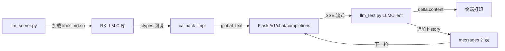

## 实验4：基于大模型的端到端对话交互实验（8h）

> **源码**：`ros2_ws/src/xflz_eai_car1/interaction/car1_llm/tools/`
> **主命令**：`python3 llm_server.py`（启动 RKLLM HTTP 服务） + `python3 llm_test.py`（客户端交互）
> **平台**：具身智能实验箱 B2（含 RK3576 NPU 6TOPS，本地推理 Qwen3.5-0.8B w4a16）
> **覆盖范围**：本实验同时包含**一般文本对话**（步骤 1-7，约 4h）与 **Function Call 基础入门**（步骤 9-10，约 4h）；Function Call 深度展开（工具注册、解析器、循环调用）见实验 5

### 4.1 关联知识点

- 5.2.1 RKLLM 推理引擎 > 概念 > 面向 RK3576 NPU 优化的本地大模型推理
- 5.2.2 OpenAI 兼容 API > 概念 > /v1/chat/completions HTTP+SSE 流式协议
- 5.2.3 librkllmrt.so 运行时 > 流程 > C 动态库 ctypes 加载与 C→Python 回调
- 5.2.4 W4A16 量化 > 概念 > 权重量化 4bit + 激活 16bit，平衡精度与体积
- 5.3.1 LLMClient 类设计 > 流程 > Session 复用 + HTTPAdapter 重试 + stream 迭代器
- 5.3.2 流式 SSE 解析 > 原理 > `data: {...}` 行分隔 + delta.content 累积
- 5.3.3 sampling 参数 > 实践 > temperature/top_p/repeat_penalty/max_tokens 调参
- 5.4.1 多轮对话历史 > 流程 > messages 列表追加 + 上下文窗口管理
- 5.4.2 OpenAI 消息角色 > 概念 > system/user/assistant 三角色 + 模板拼装
- 5.4.3 RKLLM `--fix-freq` > 原理 > NPU/CPU/GPU/DDR 锁频到最大
- 5.5.1 Function Call 概念 > 概念 > 大模型输出结构化工具调用指令
- 5.5.2 tools 参数 > 流程 > 在请求体中声明工具 JSON Schema
- 5.5.3 tool_calls 返回 > 原理 > 模型输出 `<tool_call>` 块携带函数名+参数
- 5.5.4 tool 消息回传 > 流程 > 客户端执行工具 → 追加 `role: tool` 消息 → 二次请求

### 4.2 实验目标

1. 理解 RKLLM 本地推理引擎的工作原理与 W4A16 量化策略 — **原理理解**
2. 掌握 `llm_server.py` 启动 OpenAI 兼容 HTTP API 的完整流程 — **流程掌握**
3. 拆解 `llm_test.py` 的 LLMClient 类、流式 SSE 解析、CLI 交互模式 — **模块拆解**
4. 能够用 `llm_test.py` 完成多轮对话 + 单次查询 + 调参验证 — **端到端实操**
5. 理解 Function Call 的工作原理与 OpenAI 协议中的 `tools` 字段 — **原理理解**
6. 能够在请求中声明工具 JSON Schema 并解析模型输出的 `tool_call` 指令 — **流程掌握**
7. 能够将 Function Call 集成到一般对话流程中（计算器、时间查询等）— **集成实操**
8. 能够将该 OpenAI 兼容接口迁移到其他业务（Function Calling、Agent）— **迁移应用**

### 4.3 实验环境

| 类别 | 配置 |
|------|------|
| 硬件 | 具身智能实验箱 B2（RK3576 NPU 6TOPS） |
| OS | Ubuntu 22.04 + ROS2 Humble |
| Python | 3.10（推荐 `ros2_venv`，与 llm_server.py 一致） |
| 核心库 | requests==2.31.0、flask==3.0.0、ctypes（标准库） |
| 模型 | Qwen3.5-0.8B w4a16 g128（路径 `/home/iflytek/models/rkllm/Qwen3.5-0.8B_w4a16_g128_rk3576.rkllm`） |
| 运行时 | `/usr/lib/librkllmrt.so`（板载 RKLLM 运行时） |
| 推理后端 | RKLLM 1.6.x（via librkllmrt.so + ctypes） |
| 主入口 | `llm_server.py`（服务）+ `llm_test.py`（客户端） |

### 4.4 实验难度

- 难度：⭐⭐⭐ 中偏高
- 重点：`llm_server.py` 启动链路、`llm_test.py` LLMClient 设计、OpenAI SSE 解析
- 难点：librkllmrt.so 软链 + fake sudo 拦截 + W4A16 量化对精度的影响

### 4.5 实验现象

**快速验证流程**：

```bash
# 终端 1：启动 RKLLM 服务（监听 0.0.0.0:8080）
cd ros2_ws/src/xflz_eai_car1/interaction/car1_llm/tools/
python3 llm_server.py
# 输出：
#   ============================================================
#   RKLLM Server
#   ============================================================
#   Model:    Qwen3.5-0.8B_w4a16_g128_rk3576.rkllm
#   Platform: rk3576
#   Fix freq: no (use --fix-freq to lock clocks)
#   API:      http://0.0.0.0:8080/v1/chat/completions
#   ============================================================
#   =========init....===========
#   rkllm init success!
#   Model name: Qwen3.5-0.8B_w4a16_g128_rk3576

# 终端 2：启动客户端交互
python3 llm_test.py
# 输出：
#   ============================================================
#     RKLLM Chat  |  Qwen3.5-0.8B_w4a16_g128_rk3576
#     Server: http://127.0.0.1:8080
#   ============================================================
#   You > 你好
#   AI  > 你好！我是 Qwen，一个由阿里云训练的大型语言模型...
```

**预期效果**：
- 首字延迟 < 500ms（流式 SSE）
- 端到端响应延迟 < 3s
- 多轮上下文正常，Q/A 历史会作为 `messages` 列表传给后端

### 4.6 实验步骤

#### 整体流程图



---

#### 步骤1：RKLLM 运行时与软链（阶段一：能跑通，30min）

> 本步骤对应 `llm_server.py` `lib_src / lib_dst` 软链逻辑（`llm_server.py` L96-107）。

**核心知识点**：

**librkllmrt.so 运行时（5.2.3）**
- **原理**：RKLLM 是 Rockchip 官方提供的 C/C++ 推理库，封装了 NPU 算子调用、模型加载、张量分配等。Python 侧通过 `ctypes.CDLL('lib/librkllmrt.so')` 加载 C 动态库，将 `rkllm_init` / `rkllm_run` / `rkllm_destroy` 等 C 接口映射为 Python 可调用函数。
- **源码对应**：`llm_server.py` L96-107

```python
# llm_server.py L96-107：软链 librkllmrt.so
lib_dir = os.path.join(server_dir, "lib")
os.makedirs(lib_dir, exist_ok=True)
lib_src = "/usr/lib/librkllmrt.so"
lib_dst = os.path.join(lib_dir, "librkllmrt.so")
if not os.path.exists(lib_dst):
    if os.path.exists(lib_src):
        os.symlink(lib_src, lib_dst)  # 软链：lib_dst -> lib_src
        print(f"  Linked: {lib_dst} -> {lib_src}")
    else:
        print(f"Error: {lib_src} not found. Install the RKLLM runtime first.")
        sys.exit(1)
```

**操作步骤**：

1. 确认板载 `/usr/lib/librkllmrt.so` 存在：
   ```bash
   ls -l /usr/lib/librkllmrt.so
   # 应输出 -rwxr-xr-x 1 root root ... librkllmrt.so
   ```

2. 检查 `tools/../llm_server/lib/` 目录软链状态：
   ```bash
   cd ros2_ws/src/xflz_eai_car1/interaction/car1_llm
   ls -l llm_server/lib/
   # 期望：librkllmrt.so -> /usr/lib/librkllmrt.so
   ```

3. 启动 `llm_server.py` 触发自动软链（如果软链已存在则跳过）：
   ```bash
   cd tools/
   python3 llm_server.py
   # 首次运行会输出：Linked: .../lib/librkllmrt.so -> /usr/lib/librkllmrt.so
   ```

**易错点**：
- ⚠️ **找不到 `/usr/lib/librkllmrt.so`** → 板载 RKLLM 运行时未安装，需要安装 Rockchip 官方 RKLLM Runtime 包
- ⚠️ **软链循环或权限问题** → 用 `ls -l` 检查软链是否断裂；权限不足时用 sudo

---

#### 步骤2：llm_server.py 启动参数与 fake sudo（阶段一：能跑通，30min）

> 本步骤对应 `llm_server.py` `run_fix_freq` 与 fake_sudo 实现（`llm_server.py` L33-49, L120-127）。

**核心知识点**：

**fake sudo 拦截（5.3.1）**
- **原理**：`flask_server.py` 中硬编码了 `subprocess.run("sudo bash fix_freq_*.sh", ...)`，每次启动都会请求 sudo 密码。`llm_server.py` 用 `tempfile.mkdtemp()` 创建一个临时目录，在里面放一个名为 `sudo` 的脚本（`exit 0`），再把这个目录 prepend 到 `PATH`。这样当 `flask_server.py` 调用 `sudo` 时实际执行的是 fake sudo，不会真的弹密码框。
- **源码对应**：`llm_server.py` L120-127

```python
# llm_server.py L120-127：fake sudo 拦截
fake_sudo_dir = tempfile.mkdtemp(prefix="llm_server_")
fake_sudo = os.path.join(fake_sudo_dir, "sudo")
with open(fake_sudo, "w") as f:
    f.write("#!/bin/bash\n")
    f.write("# Fake sudo — flaks_server.py hardcodes sudo; we provide a no-op.\n")
    f.write("exit 0\n")
os.chmod(fake_sudo, 0o755)

env = os.environ.copy()
env["PATH"] = f"{fake_sudo_dir}:{env.get('PATH', '')}"  # prepend 到 PATH
```

**操作步骤**：

1. 查看启动参数说明：
   ```bash
   python3 llm_server.py --help
   # --model         RKLLM 模型路径（默认 Qwen3.5-0.8B w4a16）
   # --platform      rk3588 / rk3576 / rv1126b / rk3562
   # --fix-freq      锁定 NPU/CPU/GPU/DDR 到最大频率（需要 sudo，会调用真实 sudo）
   # --lora-model    可选 LoRA 适配器路径
   # --prompt-cache  可选 prompt cache 路径
   ```

2. 启动服务（默认参数）：
   ```bash
   python3 llm_server.py
   ```

3. 启动服务 + 锁频（需要 sudo，会真实提示输入密码）：
   ```bash
   python3 llm_server.py --fix-freq
   ```

4. 验证服务就绪：
   ```bash
   curl http://127.0.0.1:8080/v1/models
   # 期望：{"object":"list","data":[{"id":"Qwen3.5-0.8B_w4a16_g128_rk3576",...}]}
   ```

**易错点**：
- ⚠️ **fake sudo 启动后子进程没继承 PATH** → `llm_server.py` 用 `env=env` 显式传递环境变量
- ⚠️ **`--fix-freq` 在没 root 权限时静默失败** → 服务仍可启动，但频率没锁，性能可能下降
- ⚠️ **模型文件路径错误** → 服务立刻退出，提示 `model file not found`

---

#### 步骤3：LLMClient 类与 OpenAI 兼容请求（阶段一：能跑通，45min）

> 本步骤对应 `llm_test.py` `LLMClient` 类（`llm_test.py` L34-119）。

**核心知识点**：

**OpenAI 兼容 API（5.2.2）**
- **原理**：OpenAI 定义的 `/v1/chat/completions` 已成为大模型调用的事实标准。请求体为 `{"model": "...", "messages": [...], "temperature": ..., "stream": bool}`，响应是 JSON 或 SSE 流。本实验的 `RKLLM Server` 实现了该 API 端点，所以 `llm_test.py` 可以直接用 HTTP 调用。
- **源码对应**：`llm_test.py` `_build_request`（L50-66）

**LLMClient 类设计（5.3.1）**
- **原理**：`LLMClient` 用 `requests.Session` 复用连接（HTTP keep-alive），挂载 `HTTPAdapter(max_retries=3)` 自动重试。`keep_alive=False` 避免长连接被服务端 NAT 断开。这种设计对低延迟的对话交互非常关键。
- **源码对应**：`llm_test.py` `__init__`（L37-43）

```python
# llm_test.py L34-43
class LLMClient:
    """Minimal OpenAI-compatible client for RKLLM Server."""

    def __init__(self, base_url="http://127.0.0.1:8080", timeout=120):
        self.base_url = base_url.rstrip("/")
        self.timeout = timeout
        self.session = requests.Session()
        self.session.keep_alive = False  # 避免 NAT 断开
        adapter = requests.adapters.HTTPAdapter(max_retries=3)
        self.session.mount("http://", adapter)  # 自动重试
```

```python
# llm_test.py L50-66：请求体构造
def _build_request(self, messages, temperature, top_p, top_k, max_tokens,
                    repeat_penalty, enable_thinking, tools):
    data = {
        "model": "rkllm",
        "messages": messages,
        "temperature": temperature,
        "top_p": top_p,
        "top_k": top_k,
        "max_tokens": max_tokens,
        "repeat_penalty": repeat_penalty,
        "frequency_penalty": 0.0,
        "presence_penalty": 0.0,
        "enable_thinking": enable_thinking,
    }
    if tools is not None:
        data["tools"] = tools  # Function Calling 模式
    return data
```

**操作步骤**：

1. 启动客户端测试连通性：
   ```bash
   python3 llm_test.py --prompt "你好"
   # 期望：模型回复中文问候语
   ```

2. 验证 `/v1/models` 列表端点：
   ```python
   from llm_test import LLMClient
   client = LLMClient()
   print(client.list_models())
   # 期望：{'object': 'list', 'data': [{'id': 'Qwen3.5-0.8B_...', ...}]}
   ```

3. 自定义 `server_url` 远程调用：
   ```bash
   # 板 A 启动 llm_server，板 B 通过 IP 调用
   python3 llm_test.py --server http://192.168.1.100:8080 --prompt "你好"
   ```

**易错点**：
- ⚠️ **`/v1/models` 404** → 板载 RKLLM 服务的 Flask 路由没启动；检查 `llm_server.py` 日志
- ⚠️ **超时（120s 仍未响应）** → 模型太大或 NPU 频率未锁，推理慢；调小 `max_tokens`

---

#### 步骤4：流式 SSE 与非流式 chat_once（阶段二：能理解，45min）

> 本步骤对应 `llm_test.py` `chat` 与 `chat_once` 方法（`llm_test.py` L68-119）。

**核心知识点**：

**流式 SSE 协议（5.3.2）**
- **原理**：SSE（Server-Sent Events）让服务器可以在响应生成过程中持续推送增量内容。每条消息格式为 `data: {json}\n\n`，最后一条是 `data: [DONE]\n\n`。客户端用 `iter_lines()` 按行解析，提取 `delta.content` 累积为完整响应。流式相比非流式的优势：(1) **首字延迟 < 500ms**；(2) **可与 TTS 并行**；(3) **降低客户端内存**。
- **源码对应**：`llm_test.py` `chat` 方法（L68-96）

**chat vs chat_once**
- **原理**：`chat()` 是生成器（`yield`），流式输出 token；`chat_once()` 是普通函数（`return`），一次性返回完整响应。Python 中**带 `yield` 的函数永远是生成器**——`return` 会被 generator protocol 吞掉。所以需要两个方法。
- **源码对应**：`llm_test.py` L68-119

```python
# llm_test.py L68-96：流式 chat
def chat(self, messages, ...):
    data = self._build_request(...)
    data["stream"] = True
    resp = self.session.post(..., stream=True, timeout=self.timeout)
    for line in resp.iter_lines(decode_unicode=True):
        if line.startswith("data: ") and line[6:].strip() != "[DONE]":
            chunk = json.loads(line[6:])
            delta = chunk["choices"][0].get("delta", {})
            content = delta.get("content", "")
            if content:
                yield content  # 生成器
```

```python
# llm_test.py L98-119：非流式 chat_once
def chat_once(self, messages, ...):
    data = self._build_request(...)
    data["stream"] = False
    resp = self.session.post(..., stream=False, timeout=self.timeout)
    return resp.json()  # 完整 dict
```

**操作步骤**：

1. 流式调用（默认）：
   ```bash
   python3 llm_test.py --prompt "用一句话介绍RK3576"
   # 终端会逐 token 打印
   ```

2. 非流式调用（`--no-stream`）：
   ```bash
   python3 llm_test.py --prompt "用一句话介绍RK3576" --no-stream
   # 等待完整响应后一次性输出
   ```

3. Python 内嵌调用流式：
   ```python
   from llm_test import LLMClient
   client = LLMClient()
   for chunk in client.chat([{"role": "user", "content": "你好"}]):
       print(chunk, end="", flush=True)
   print()
   ```

4. Python 内嵌调用非流式：
   ```python
   resp = client.chat_once([{"role": "user", "content": "你好"}])
   print(resp["choices"][0]["message"]["content"])
   ```

**易错点**：
- ⚠️ **流式 `chat()` 误用 `return`** → 变成空生成器（return 会被吞），改用 `chat_once()`
- ⚠️ **`iter_lines()` 卡住** → 服务端 SSE 不规范或代理缓冲；用 `X-Accel-Buffering: no` 头
- ⚠️ **JSON 解析失败** → 跳过空行/非 `data: ` 开头的行

---

#### 步骤5：CLI 交互模式与多轮对话历史（阶段二：能理解，45min）

> 本步骤对应 `llm_test.py` `main` 交互循环（`llm_test.py` L266-349）。

**核心知识点**：

**多轮对话历史（5.4.1）**
- **原理**：OpenAI 协议是无状态的——服务端不保存历史。客户端需要维护 `messages` 列表，每轮追加 `user` 和 `assistant` 消息。RKLLM 的 `max_context_len=4096` 决定了历史最大长度，超过会截断。
- **源码对应**：`llm_test.py` L301, L339

**OpenAI 消息角色（5.4.2）**
- **原理**：OpenAI 定义三种角色：`system`（系统提示，定义人设/规则）、`user`（用户输入）、`assistant`（模型回复）。`system` 一般只在第一轮设置，后续不需要重复发送。`messages` 列表按时间顺序排列。
- **源码对应**：`llm_test.py` 交互循环

```python
# llm_test.py L280-340：交互式主循环
messages = []  # 累积历史
try:
    while True:
        user_input = input("You > ").strip()
        if not user_input: continue
        if user_input.lower() in ("exit", "quit", "q"): break
        if user_input.lower() == "clear":
            messages.clear()  # 清空历史
            print("  [history cleared]")
            continue

        messages.append({"role": "user", "content": user_input})  # 追加 user

        print("AI  > ", end="", flush=True)
        full_response = ""
        for chunk in client.chat(messages, ...):
            print(chunk, end="", flush=True)
            full_response += chunk
        print()
        messages.append({"role": "assistant", "content": full_response})  # 追加 assistant
```

**操作步骤**：

1. 启动交互模式（默认行为）：
   ```bash
   python3 llm_test.py
   ```

2. 多轮对话测试：
   ```
   You > 我叫小明
   AI  > 你好，小明！很高兴认识你。
   You > 我刚才说我叫什么？
   AI  > 你刚才说你叫小明。
   ```

3. 测试内置命令：
   ```
   You > clear    # 清空历史
   You > tools    # 列出可用工具（仅 --mode tools 时）
   You > exit     # 退出（等价于 quit / q）
   ```

4. 单次查询模式：
   ```bash
   python3 llm_test.py --prompt "你好"
   # 等价于在交互模式输入 "你好" 后立即 exit
   ```

**易错点**：
- ⚠️ **多轮上下文丢失** → 检查 `messages.append` 是否在循环中正确执行
- ⚠️ **历史无限增长触发上下文超限** → RKLLM 默认 `max_context_len=4096`，应限制历史长度（如保留最近 10 轮）
- ⚠️ **清空历史后忘记重发 system prompt** → 重新 `messages.insert(0, {...})`

---

#### 步骤6：采样参数调优（阶段三：能改造，60min）

> 本步骤对应 `llm_test.py` `--temperature/--top-p/--max-tokens/--repeat-penalty` 参数（`llm_test.py` L204-207）。

**核心知识点**：

**sampling 参数（5.3.3）**
- **原理**：4 个核心采样参数决定模型生成风格：
  1. `temperature` (0.0~2.0)：控制随机性。0.0 = 贪心（确定性），1.0 = 标准，>1.0 = 更随机
  2. `top_p` (0.0~1.0)：核采样阈值。0.9 = 只从概率累积 90% 的 token 中采样
  3. `max_tokens` (1~4096)：最大生成 token 数
  4. `repeat_penalty` (1.0~2.0)：重复惩罚，>1.0 抑制重复
- **源码对应**：`llm_test.py` argparse L204-207

```python
# llm_test.py L204-207：默认参数
parser.add_argument("--temperature", type=float, default=0.8)
parser.add_argument("--top-p", type=float, default=0.9)
parser.add_argument("--max-tokens", type=int, default=4096)
parser.add_argument("--repeat-penalty", type=float, default=1.1)
```

**操作步骤**：

1. **温度对比实验**：
   ```bash
   # 低温（确定性，事实性任务）
   python3 llm_test.py --prompt "1+1=?" --temperature 0.1 --no-stream
   # 高温（创造性，故事生成）
   python3 llm_test.py --prompt "写一首关于机器人的诗" --temperature 1.5 --no-stream
   ```

2. **重复惩罚实验**（避免"卡死循环"）：
   ```bash
   # 默认 1.1
   python3 llm_test.py --prompt "请重复'你好'100次" --repeat-penalty 1.1
   # 关闭惩罚（观察重复）
   python3 llm_test.py --prompt "请重复'你好'100次" --repeat-penalty 1.0
   # 强惩罚（强烈抑制重复）
   python3 llm_test.py --prompt "请重复'你好'100次" --repeat-penalty 1.5
   ```

3. **最大长度限制**（防止单次生成过长）：
   ```bash
   python3 llm_test.py --prompt "详细介绍Python" --max-tokens 100
   python3 llm_test.py --prompt "详细介绍Python" --max-tokens 1000
   ```

4. **思考模式**（Qwen3.5 支持）：
   ```bash
   python3 llm_test.py --prompt "求解方程 x^2+2x+1=0" --enable-thinking
   # 期望：模型先输出 <think>...</think> 思考过程，再给答案
   ```

**易错点**：
- ⚠️ **temperature=0 完全贪心可能输出截断或异常** → 设 0.1~0.3 更稳
- ⚠️ **max_tokens 太小导致截断** → 流式模式下 `is_truncated` 标志会丢弃
- ⚠️ **repeat_penalty > 1.5 反而让生成变奇怪** → 保持 1.0~1.2 区间

---

#### 步骤7：端到端多轮对话测试（阶段三：能改造，60min）

> 本步骤对应 `llm_test.py` 交互模式全流程

**操作步骤**：

1. **场景一：闲聊 + 上下文记忆**：
   ```
   You > 我是一名Python开发者
   AI  > 好的，Python 开发者！你平常用 Python 做哪方面的工作呢？
   You > 我刚才说我是做什么的？
   AI  > 你说你是一名 Python 开发者。
   You > 我对装饰器不太懂，能给我讲讲吗？
   AI  > 当然可以。装饰器（decorator）是 Python 中一个非常强大的特性...
   ```

2. **场景二：长文本生成 + 截断测试**：
   ```bash
   python3 llm_test.py --prompt "请写一篇2000字的关于边缘计算发展趋势的论文" --max-tokens 3000
   # 观察是否能完整生成，还是达到 max_tokens 被截断
   ```

3. **场景三：远程服务调用**：
   ```bash
   # 假设板 A 启动了服务，板 B 通过 IP 调用
   python3 llm_test.py --server http://192.168.1.100:8080 --prompt "你好"
   ```

4. **场景四：超时与重试**：
   ```python
   from llm_test import LLMClient
   client = LLMClient(timeout=10)  # 10s 超时
   try:
       for chunk in client.chat([{"role": "user", "content": "..."}], max_tokens=8192):
           print(chunk, end="", flush=True)
   except Exception as e:
       print(f"Error: {e}")  # 捕获超时，HTTPAdapter 重试 3 次后抛出
   ```

**易错点**：
- ⚠️ **多轮历史太长导致 RKLLM 报 OOM** → 限制 messages 长度（如保留最近 20 条）
- ⚠️ **远程服务 IP 写错** → `requests.exceptions.ConnectionError`，检查 `lsof -i :8080` 服务是否在监听
- ⚠️ **同时多个 client 抢服务端锁** → RKLLM 服务端是单线程（`threaded=False`），要排队

---

#### 步骤8：接入系统提示词（system_prompt）（阶段三：能改造，30min）

> 本步骤对应 OpenAI 协议 system 角色

**核心知识点**：
- **原理**：`system` 角色定义模型人设、规则、风格。如"你是一个 Python 专家"会让模型倾向于用 Python 风格回复。RKLLM 通过 `rkllm_set_chat_template` 在服务端预注册 system prompt，客户端传 `messages[0]={role: "system", content: "..."}` 即可。
- **源码对应**：`llm_test.py` 交互循环 + 客户端 `messages.insert(0, ...)`

**操作步骤**：

1. 在交互模式中插入 system 提示：
   ```python
   # 修改 llm_test.py 或在脚本中嵌入
   from llm_test import LLMClient
   client = LLMClient()
   messages = [
       {"role": "system", "content": "你是一个简洁的助手，回答控制在50字以内。"},
       {"role": "user", "content": "介绍下机器学习"},
   ]
   for chunk in client.chat(messages):
       print(chunk, end="", flush=True)
   ```

2. 测试不同人设的回复风格：
   ```
   system: "你是一个严谨的学术助手"
   user: "什么是过拟合？"
   → 期望：学术化、专业术语丰富

   system: "你是一个5岁小孩，用最简单的话回答"
   user: "什么是过拟合？"
   → 期望：通俗、举例、生活化
   ```

**易错点**：
- ⚠️ **system 放在 messages 最后** → 协议不识别（必须放最前）
- ⚠️ **system 内容超长** → RKLLM max_context_len=4096 会挤占 user/assistant 空间

---

#### 步骤9：Function Call 入门 — `tools` 参数声明（阶段三：能改造，60min）

> 本步骤对应 OpenAI 协议 `tools` 字段（`llm_test.py` `_build_request` L64-65）

**核心知识点**：

**Function Call 概念（5.5.1）**
- **原理**：Function Call 让大模型不再只是"输出文字"，而是能输出"调用哪个函数 + 传什么参数"。客户端收到指令后执行对应函数，再把结果以 `role: tool` 的消息追加到 `messages` 中，让模型基于工具结果生成最终回答。这种"模型决策 → 客户端执行 → 结果回传"的循环，是 Agent / 工具调用 / RAG 的基础。
- **典型应用**：计算器、时间查询、数据库查询、设备控制、API 调用。

**tools 参数（5.5.2）**
- **原理**：在 OpenAI 请求体中通过 `tools` 字段声明可用工具。每个工具是一个 JSON 对象，包含三部分：
  1. `type: "function"` — 固定值
  2. `function.name` — 函数名（必须与客户端注册的一致）
  3. `function.description` — 函数描述（模型据此判断是否调用）
  4. `function.parameters` — JSON Schema，定义参数类型与必填项
- **源码对应**：`llm_test.py` `_build_request` L64-65

```python
# llm_test.py L64-65：在请求体中追加 tools
if tools is not None:
    data["tools"] = tools
```

**最小可运行示例**：

```python
# 定义工具 schema
TOOLS = [
    {
        "type": "function",
        "function": {
            "name": "get_current_time",
            "description": "获取当前时间",
            "parameters": {
                "type": "object",
                "properties": {},
                "required": [],
            },
        },
    },
    {
        "type": "function",
        "function": {
            "name": "calculator",
            "description": "执行数学计算",
            "parameters": {
                "type": "object",
                "properties": {
                    "expression": {
                        "type": "string",
                        "description": "数学表达式，如 1+2*3",
                    },
                },
                "required": ["expression"],
            },
        },
    },
]

# 发送请求（带 tools）
from llm_test import LLMClient
client = LLMClient()
resp = client.chat_once(
    [{"role": "user", "content": "现在几点了？"}],
    tools=TOOLS,
    max_tokens=200,
)
print(resp["choices"][0]["message"])
# 期望输出：
# {
#   'role': 'assistant',
#   'content': None,
#   'tool_calls': [{
#     'id': 'call_xxx',
#     'type': 'function',
#     'function': {'name': 'get_current_time', 'arguments': '{}'}
#   }]
# }
```

**操作步骤**：

1. 准备一份 `tools` 列表（JSON Schema 格式）：
   ```python
   # tools.json
   tools = [
       {
           "type": "function",
           "function": {
               "name": "get_current_time",
               "description": "获取当前时间",
               "parameters": {"type": "object", "properties": {}}
           }
       },
       {
           "type": "function",
           "function": {
               "name": "calculator",
               "description": "执行数学运算",
               "parameters": {
                   "type": "object",
                   "properties": {
                       "expression": {"type": "string", "description": "数学表达式"}
                   },
                   "required": ["expression"]
               }
           }
       }
   ]
   ```

2. 发送带 tools 的请求并打印响应：
   ```bash
   # 在交互模式下用 --mode tools 启动（详见 exp5）
   python3 llm_test.py --mode tools --prompt "现在几点了？"
   # 期望：模型输出 tool_call 指令，客户端执行函数并打印结果
   ```

3. 在 Python 内嵌中观察原始响应：
   ```python
   import json
   resp = client.chat_once(
       [{"role": "user", "content": "计算 123 * 456"}],
       tools=tools, max_tokens=200,
   )
   msg = resp["choices"][0]["message"]
   print("content:", msg.get("content"))
   print("tool_calls:", json.dumps(msg.get("tool_calls"), ensure_ascii=False, indent=2))
   ```

**易错点**：
- ⚠️ **tools 描述太详细导致 prefill 延迟增加** → 每个 description 控制在 1 行中文
- ⚠️ **模型没调用工具** → 描述太模糊或用户问题太开放；让用户问题更具体（如"用 calculator 计算 1+1"）
- ⚠️ **参数解析失败** → 检查 JSON Schema 拼写；RKLLM 0.8B 偶发会输出非标准 JSON，需容错

---

#### 步骤10：Function Call 集成 — 工具执行与结果回传（阶段三：能改造，60min）

> 本步骤对应 `llm_test.py` `run_with_tools` 流程（L126-161），详细工具注册与解析器实现见 exp5

**核心知识点**：

**tool_calls 返回（5.5.3）**
- **原理**：当模型决定调用工具时，响应 `choices[0].message.content` 为 `None`，取而代之的是 `tool_calls` 列表。每个元素包含 `id`、`type="function"`、`function.name`、`function.arguments`（字符串化的 JSON）。
- **源码对应**：`llm_test.py` L143 `resp["choices"][0]["message"]["content"]`

**tool 消息回传（5.5.4）**
- **原理**：客户端解析 `tool_calls` → 执行对应函数 → 把结果以 `role: tool` 消息追加到 `messages` → 再次调用 `/v1/chat/completions` → 模型基于工具结果生成自然语言回复。完整循环：
  1. user: "1+1=?"
  2. assistant: `tool_calls=[{name: "calculator", args: {"expression": "1+1"}}]`
  3. tool: `{"result": 2}`
  4. assistant: "1+1 等于 2。"
- **源码对应**：`llm_test.py` `execute_tool_calls`（L107-121）→ `run_with_tools`（L126-161）

```python
# llm_test.py L107-121：工具执行与消息构造
def execute_tool_calls(tool_calls):
    normalized = []
    tool_msgs = []
    for tc in tool_calls:
        fn = tc.get("function", tc)
        name = fn.get("name", "")
        args = fn.get("arguments", {})
        result = FUNCTION_MAP[name](**args) if name in FUNCTION_MAP else {"error": f"Unknown: {name}"}
        normalized.append({
            "id": f"call_{name}",
            "type": "function",
            "function": {"name": name, "arguments": json.dumps(args, ensure_ascii=False)},
        })
        tool_msgs.append({"role": "tool", "name": name, "content": json.dumps(result, ensure_ascii=False)})
    return assistant_msg, tool_msgs
```

**最小可运行示例**：

```python
# 客户端：解析 + 执行 + 回传
FUNCTION_MAP = {
    "get_current_time": lambda: {"datetime": "2026-08-05 14:30:00"},
    "calculator": lambda expression: {"result": eval(expression)},
}

def run_with_tools(client, messages, tools, max_iter=3):
    """单轮工具调用：模型 → 工具 → 模型"""
    for _ in range(max_iter):
        resp = client.chat_once(messages, tools=tools, max_tokens=512)
        msg = resp["choices"][0]["message"]
        if not msg.get("tool_calls"):
            return msg.get("content", "")
        # 执行工具
        for tc in msg["tool_calls"]:
            fn = tc["function"]
            args = json.loads(fn["arguments"])
            result = FUNCTION_MAP[fn["name"]](**args)
            # 追加 assistant + tool 消息
            messages.append(msg)
            messages.append({"role": "tool", "name": fn["name"], "content": json.dumps(result, ensure_ascii=False)})
    return "[max iterations reached]"

# 使用
messages = [{"role": "user", "content": "1+1=?"}]
print(run_with_tools(client, messages, tools=tools))
# 期望输出: "1+1 等于 2。" 之类
```

**操作步骤**：

1. 准备工具注册表（FUNCTION_MAP）：
   ```python
   FUNCTION_MAP = {
       "get_current_time": lambda: {"datetime": "2026-08-05 14:30:00"},
       "calculator": lambda expression: {"result": eval(expression, {"__builtins__": {}}, {})},
   }
   ```

2. 启动 `--mode tools` 交互模式：
   ```bash
   python3 llm_test.py --mode tools
   # 终端会显示：
   #   Function calling 模式 — 模型可以调用工具函数
   #   可用工具: get_current_time, get_system_info, calculator, get_battery_status
   ```

3. 测试工具调用：
   ```
   You > 1+1 等于几？
   AI  > [输出 tool_call，调用 calculator("1+1")]
        2
   
   You > 现在几点了？
   AI  > [输出 tool_call，调用 get_current_time()]
        {"datetime": "2026-08-05 14:30:00", "date": "2026-08-05", "time": "14:30:00", "weekday": "Wednesday"}
   ```

4. 工具调用失败的容错：
   ```
   You > 调用一个不存在的工具
   AI  > [tool_call: unknown_tool] → execute_tool_calls 返回 {"error": "Unknown: unknown_tool"}
        模型收到错误后向用户回复"抱歉，我无法调用该工具"
   ```

**易错点**：
- ⚠️ **JSON 解析失败**（模型输出非标准 JSON）→ 用 try/except 包装 `json.loads`，失败时降级为正则提取函数名
- ⚠️ **工具执行异常**（如 `eval` 报错）→ 在 FUNCTION_MAP 中加 try/except，返回 `{"error": str(e)}`
- ⚠️ **tool 消息缺 name 字段** → RKLLM 服务会拒收；确保 `{"role": "tool", "name": fn_name, "content": ...}`
- ⚠️ **循环死锁** → 设 `max_iter=3` 兜底；超过则强制返回

**Function Call 进阶（衔接 exp5）**：
- 完整工具注册：`tools_config.py` 中维护 `TOOLS` + `FUNCTION_MAP`，新增工具只需追加两处
- 嵌套解析器：`parse_tool_calls` 支持 JSON 与 DSL 两种格式（兼容小模型非标准输出）
- 多工具并行：模型一次返回多个 `tool_calls`，客户端并行执行

---

#### 完整可运行代码 demo_llm_chat.py

> 注：完整版依赖 `llm_server.py`，以下为独立 demo 演示客户端调用流程

```python
# -*- coding: utf-8 -*-
"""
实验4 demo：简化版 LLM 端到端对话
平台：B2 / C1
依赖：llm_server.py 已启动
运行：python3 demo_llm_chat.py
"""
import requests
import json


class SimpleLLMClient:
    """最小化 OpenAI 兼容客户端（演示核心流程）"""

    def __init__(self, base_url="http://127.0.0.1:8080"):
        self.base_url = base_url.rstrip("/")

    def chat_stream(self, messages, **kwargs):
        """流式调用"""
        data = {
            "model": "rkllm",
            "messages": messages,
            "stream": True,
            "temperature": kwargs.get("temperature", 0.8),
            "top_p": kwargs.get("top_p", 0.9),
            "max_tokens": kwargs.get("max_tokens", 1024),
            "repeat_penalty": kwargs.get("repeat_penalty", 1.1),
        }
        resp = requests.post(
            f"{self.base_url}/v1/chat/completions",
            json=data, stream=True, timeout=120,
        )
        for line in resp.iter_lines(decode_unicode=True):
            if line.startswith("data: ") and line[6:].strip() != "[DONE]":
                chunk = json.loads(line[6:])
                content = chunk["choices"][0].get("delta", {}).get("content", "")
                if content:
                    yield content

    def chat_once(self, messages, **kwargs):
        """非流式调用"""
        data = {
            "model": "rkllm",
            "messages": messages,
            "stream": False,
            "temperature": kwargs.get("temperature", 0.8),
            "max_tokens": kwargs.get("max_tokens", 1024),
        }
        resp = requests.post(
            f"{self.base_url}/v1/chat/completions",
            json=data, timeout=120,
        )
        return resp.json()["choices"][0]["message"]["content"]


def main():
    client = SimpleLLMClient()
    messages = [
        {"role": "system", "content": "你是一个简洁的助手。"},
    ]

    # 演示 1：单次查询
    print("=== 单次查询 ===")
    resp = client.chat_once(
        messages + [{"role": "user", "content": "你好"}],
        max_tokens=100,
    )
    print(f"AI: {resp}\n")

    # 演示 2：多轮流式
    print("=== 多轮流式 ===")
    messages.append({"role": "user", "content": "介绍下RK3576"})
    print("AI: ", end="", flush=True)
    full = ""
    for chunk in client.chat_stream(messages):
        print(chunk, end="", flush=True)
        full += chunk
    print()
    messages.append({"role": "assistant", "content": full})

    # 演示 3：上下文记忆
    messages.append({"role": "user", "content": "它和RK3588比有什么区别？"})
    print("AI: ", end="", flush=True)
    for chunk in client.chat_stream(messages):
        print(chunk, end="", flush=True)
    print()


if __name__ == "__main__":
    main()
```

#### 完整可运行代码 demo_llm_tools.py（Function Call 入门）

> 注：完整版依赖 `llm_server.py` + `tools_config.py`（详见 exp5），以下为独立 demo 演示单轮工具调用

```python
# -*- coding: utf-8 -*-
"""
实验4 Function Call 入门 demo：单轮工具调用
平台：B2 / C1
依赖：llm_server.py 已启动
运行：python3 demo_llm_tools.py "现在几点了？" / python3 demo_llm_tools.py "计算 123*456"
"""
import json
import sys
import datetime

from llm_test import LLMClient

# 1. 工具 schema（OpenAI 协议格式）
TOOLS = [
    {
        "type": "function",
        "function": {
            "name": "get_current_time",
            "description": "获取当前时间",
            "parameters": {"type": "object", "properties": {}},
        },
    },
    {
        "type": "function",
        "function": {
            "name": "calculator",
            "description": "执行数学运算",
            "parameters": {
                "type": "object",
                "properties": {
                    "expression": {"type": "string", "description": "数学表达式"},
                },
                "required": ["expression"],
            },
        },
    },
]

# 2. 工具实现
FUNCTION_MAP = {
    "get_current_time": lambda: {
        "datetime": datetime.datetime.now().strftime("%Y-%m-%d %H:%M:%S"),
    },
    "calculator": lambda expression: {
        "result": eval(expression, {"__builtins__": {}}, {}),
    },
}


def run_with_tools(client, messages, max_iter=3):
    """单轮工具调用：模型 → 工具 → 模型"""
    for i in range(max_iter):
        resp = client.chat_once(
            messages, tools=TOOLS, max_tokens=512,
            temperature=0.3, repeat_penalty=1.1,
        )
        msg = resp["choices"][0]["message"]
        if not msg.get("tool_calls"):
            return msg.get("content", "")
        # 遍历每个 tool_call
        for tc in msg["tool_calls"]:
            fn = tc["function"]
            args = json.loads(fn["arguments"]) if isinstance(fn["arguments"], str) else fn["arguments"]
            result = FUNCTION_MAP[fn["name"]](**args)
            print(f"  [tool_call] {fn['name']}({args}) -> {result}")
            messages.append(msg)
            messages.append({
                "role": "tool", "name": fn["name"],
                "content": json.dumps(result, ensure_ascii=False),
            })
    return "[max iterations reached]"


def main():
    question = sys.argv[1] if len(sys.argv) > 1 else "现在几点了？"
    client = LLMClient()
    messages = [{"role": "user", "content": question}]
    print(f"You > {question}")
    print("AI > ", end="", flush=True)
    answer = run_with_tools(client, messages)
    print(answer)


if __name__ == "__main__":
    main()
```

### 4.7 注意事项

- ⚠️ **必须先启动 `llm_server.py`，再启动 `llm_test.py`** → 客户端会立即检测 `list_models()` 是否连通，连不上直接报错退出
- ⚠️ **RKLLM 服务是单线程** → 不能并发多请求，否则会触发 503 错误
- ⚠️ **librkllmrt.so 版本要与 RKLLM 工具链匹配** → 1.6.x 对应 rkllm-toolkit 1.6.x
- ⚠️ **Qwen3.5-0.8B 是 W4A16 量化** → 与全精度相比精度略降，但体积 0.8GB，NPU 推理可达 ~30 token/s
- ⚠️ **`--fix-freq` 需要 sudo** → 板子没开 root 时无法锁频，性能会差
- ⚠️ **Function Call 描述要简短** → 0.8B 小模型对长 description 敏感，每条 1 行中文
- ⚠️ **Function Call 解析需容错** → 0.8B 偶发输出非标准 JSON，应保留 try/except + DSL 降级
- ⚠️ **Function Call 进阶（多工具、嵌套、循环）见 exp5** → 本实验只覆盖入门

### 4.8 实验总结

**完成成果**：
- 启动 RKLLM HTTP 服务并验证 `/v1/models` 端点
- 拆解 `llm_server.py` 启动链路（软链、fake sudo、参数解析）
- 拆解 `llm_test.py` LLMClient、流式 SSE、CLI 交互三大模块
- 完成 6+ 轮多轮对话 + 单次查询 + 调参验证
- **Function Call 入门**：声明 `tools` 字段、解析 `tool_calls`、构造 `role: tool` 消息回传
- **Function Call 集成**：完整跑通 `1+1=?` → `calculator("1+1")` → `{"result": 2}` → "1+1 等于 2" 闭环

**技能收获**：
- 掌握 OpenAI 兼容 API 的请求/响应结构
- 理解 RKLLM 量化推理引擎的工作原理
- 学会用 Python `ctypes` 加载 C 库、用 `requests` 实现 SSE 流式解析
- 掌握多轮对话历史的客户端维护策略
- **理解 Function Call 的"模型决策 → 客户端执行 → 结果回传"循环**
- **掌握 OpenAI 协议中 `tools` / `tool_calls` / `role: tool` 三件套**

**常见问题与解决**：

| 问题 | 原因 | 解决方法 |
|------|------|---------|
| `Cannot connect to server` | `llm_server.py` 未启动 | 先运行 `python3 llm_server.py` |
| `model file not found` | 模型路径错误 | 检查 `--model` 参数或默认路径 |
| 流式响应卡顿 | 网络缓冲或代理 | 关闭代理；用 `X-Accel-Buffering: no` |
| 多轮历史混乱 | `messages.append` 错位 | 在循环末尾同步追加 user/assistant |
| NPU 推理慢 | 频率未锁 | 用 `python3 llm_server.py --fix-freq` |
| `flask_server.py` 报 sudo 错 | 缺 fake sudo | 确认 `llm_server.py` 已自动创建 |
| **模型不调用工具** | **description 太模糊** | **用动词开头，如"执行数学计算"** |
| **tool_calls 解析失败** | **0.8B 偶发非标准 JSON** | **加 try/except，失败时降级到正则提取** |
| **工具执行异常** | **FUNCTION_MAP 中函数崩** | **加 try/except，返回 `{"error": str(e)}`** |
| **tool 消息被服务端拒收** | **缺 name 字段** | **确保 `{"role": "tool", "name": fn_name, ...}`** |

### 4.9 实验报告要求

**思考题**：
1. OpenAI 兼容 API 相对自定义 RPC 在大模型调用中有什么优势？为什么 RKLLM 选择实现该协议而不是自定义协议？
2. W4A16 量化相对 FP16 在精度上损失多少？为什么 NPU 推理适合 W4A16 而 CPU 推理更适合 FP16？
3. 流式 SSE 相对非流式响应在前端用户体验上有什么改进？试估算"首字延迟"对交互流畅度的影响。
4. `llm_test.py` 的 `messages` 列表为什么在客户端维护而不是服务端？这对 Function Calling 有什么影响？
5. **Function Call 的"模型决策 → 客户端执行 → 结果回传"循环相比纯文本 Prompt Engineering 在鲁棒性、可解释性、可扩展性上有什么优势？**
6. **如果 0.8B 模型经常输出非标准 JSON，应该如何设计容错解析器（提示：双格式 JSON+DSL）？这种设计在 Function Call 中有什么应用价值？**

**评分标准**：RKLLM 服务部署 15 分 + LLMClient 设计 15 分 + 流式 SSE 解析 15 分 + 多轮对话测试 15 分 + 调参与 system prompt 10 分 + **Function Call tools 声明 10 分 + tool_calls 解析与回传 10 分 + Function Call 集成闭环 10 分** = 100 分。
