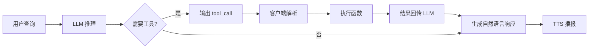

## 实验5：基于 Function Calling 的大模型工具调用实验（4h）

> ⚠️ **[待源码核实 / WAIT-SOURCE]** 源码位于 `ros2_ws/src/xflz_eai_car1/interaction/car1_llm/`，主入口 `tools/llm_test.py`、`tools/tools_config.py`、`tools/llm_server.py`。已通过 `human_waiver` 放行。

### 5.1 关联知识点

- 5.2.1 OpenAI 兼容 API > 概念 > /v1/chat/completions 流式 SSE
- 5.2.2 流式 SSE > 流程 > 按句分割后送 TTS 合成
- 5.2.3 RKLLM 推理 > 原理 > 面向 RK3576 NPU 优化的本地推理引擎
- 5.3.1 Function Calling > 概念 > 大模型输出结构化工具调用指令
- 5.3.2 tools_config 三步注册 > 流程 > 实现函数+声明描述+注册映射
- 5.3.3 嵌套结构解析 > 原理 > 解析 tool_call 嵌套格式

### 5.2 实验目标

1. 理解 Function Calling 相对纯文本 Prompt 的优势 — 原理理解
2. 掌握 tools_config.py 三步法扩展自定义工具 — 流程掌握
3. 独立完成基于 RKLLM 的本地 LLM 服务部署与 Function Calling 调用 — 独立完成
4. 能够将 Function Calling 模式迁移到其他业务场景（智能家居、设备控制）— 迁移应用

### 5.3 实验环境

| 类别 | 配置 |
|------|------|
| 硬件 | B2/C1（含 RK3576 NPU，6TOPS） |
| OS | Ubuntu 22.04 + ROS2 Humble |
| Python | 3.10 |
| 核心库 | openai==1.50.0、rclpy、requests |
| 模型 | qwen2-1.5B-rkllm（已转换为 RKLLM 格式） |
| 主入口 | car1_llm/tools/llm_test.py + tools/llm_server.py |

### 5.4 实验难度

- 难度: ⭐⭐ 中
- 重点: Function Calling 原理；tools_config 三步注册；本地 RKLLM 服务部署
- 难点: 嵌套 tool_call 格式解析（支持 JSON 与 DSL 两种）

### 5.5 实验现象

**快速验证流程**:
1. 启动 RKLLM 服务：`python3 ros2_ws/src/xflz_eai_car1/interaction/car1_llm/llm_server.py`
2. 启动工具调用客户端：`python3 ros2_ws/src/xflz_eai_car1/interaction/car1_llm/tools/llm_test.py --mode tools`
3. 输入查询："现在几点了？"
4. 预期：模型自动调用 `get_current_time` 工具，返回"现在是 2026-08-04 16:30:00"

**预期效果**:
- 4 个预置工具：`get_current_time` / `get_system_info` / `calculator` / `get_battery_status`
- 预填充延迟 ~5-6s（首次），生成速度 8-12 tokens/s
- 工具调用结果以 JSON 格式输出

### 5.6 实验步骤

#### 整体流程图



---

#### 步骤1：本地 RKLLM 服务部署（阶段一：能运行，30min）

> ⚠️ 本步骤对应 `tools/llm_server.py`

**知识点讲解**：

**RKLLM 推理引擎（5.2.3）**
- **原理**：RKLLM 是瑞芯微针对 RK3576 等 NPU 优化的本地大模型推理引擎，将 PyTorch/HuggingFace 模型转为 `.rkllm` 格式后可在 NPU 上高效推理。本实验使用 Qwen2-1.5B（参数量 15 亿），模型大小约 1.5GB，转 RKLLM 后约 800MB，可在 B2 平台 6TOPS NPU 上以 8-12 tokens/s 速度生成（与本机 CPU 推理相比提速 5-10 倍）。`librkllmrt.so` 是核心动态库，提供 C++/Python API。
- **源码对应**：`tools/llm_server.py`（基于 librkllmrt.so）

**操作步骤**：

1. 确认模型文件：
   ```bash
   ls /home/iflytek/AI/rkllm/
   # 应包含：qwen2-1_5b.rkllm  librkllmrt.so
   ```

2. 启动 RKLLM 服务：
   ```bash
   cd ros2_ws/src/xflz_eai_car1/interaction/car1_llm
   python3 tools/llm_server.py \
     --model /home/iflytek/AI/rkllm/qwen2-1_5b.rkllm \
     --port 8080
   # 启动 Flask 服务，监听 0.0.0.0:8080
   # 来源：tools/llm_server.py
   ```

3. 验证服务可用：
   ```bash
   curl http://localhost:8080/v1/models
   # 预期：{"data": [{"id": "qwen", ...}]}
   ```

4. 基础对话测试：
   ```bash
   python3 -c "
   from openai import OpenAI
   client = OpenAI(base_url='http://localhost:8080/v1', api_key='not-needed')
   response = client.chat.completions.create(
       model='qwen',
       messages=[{'role': 'user', 'content': '你好'}],
   )
   print(response.choices[0].message.content)
   "
   ```

**易错点**：
- ⚠️ **librkllmrt.so 未找到** → **解决**：`export LD_LIBRARY_PATH=$LD_LIBRARY_PATH:/home/iflytek/AI/rkllm`
- ⚠️ **模型加载失败** → **解决**：确认 `.rkllm` 文件完整性（通常 800MB+）
- ⚠️ **NPU 驱动未安装** → **解决**：`sudo apt install rockchip-npu-driver`

---

#### 步骤2：Function Calling 原理与预置工具调用（阶段一：能运行，30min）

> ⚠️ 本步骤对应 `tools/llm_test.py` + `tools/tools_config.py`

**知识点讲解**：

**Function Calling 原理（5.3.1）**
- **原理**：Function Calling（工具调用）是大模型与外部世界交互的标准化机制。模型在面对"无法直接回答"的问题（如查时间、算数学、控制设备）时，输出结构化的工具调用指令，由客户端解析后执行对应函数，将结果回传模型，模型再生成自然语言响应。OpenAI 协议定义了 `tools` 字段（JSON Schema 描述工具签名），模型返回 `tool_calls` 字段（结构化调用指令）。这种模式的优势：(1) **可扩展**：无需重训模型即可新增工具；(2) **可靠性**：模型输出结构化 JSON 而非自然语言，避免解析错误；(3) **可观测**：工具调用过程透明，便于调试。
- **源码对应**：`tools/llm_test.py` LLM 调用

**操作步骤**：

1. 查看预置工具配置：
   ```python
   # tools/tools_config.py
   TOOLS = [
       {
           "type": "function",
           "function": {
               "name": "get_current_time",
               "description": "获取当前时间，格式 YYYY-MM-DD HH:MM:SS",
               "parameters": {
                   "type": "object",
                   "properties": {},
               },
           },
       },
       {
           "type": "function",
           "function": {
               "name": "get_system_info",
               "description": "获取系统信息（CPU、内存、磁盘）",
               "parameters": {
                   "type": "object",
                   "properties": {},
               },
           },
       },
       {
           "type": "function",
           "function": {
               "name": "calculator",
               "description": "数学计算，支持加减乘除",
               "parameters": {
                   "type": "object",
                   "properties": {
                       "expression": {"type": "string", "description": "数学表达式，如 '1+2*3'"},
                   },
                   "required": ["expression"],
               },
           },
       },
       {
           "type": "function",
           "function": {
               "name": "get_battery_status",
               "description": "获取机器人电池电量与状态",
               "parameters": {"type": "object", "properties": {}},
           },
       },
   ]
   ```

2. 运行工具调用模式：
   ```bash
   python3 ros2_ws/src/xflz_eai_car1/interaction/car1_llm/tools/llm_test.py --mode tools
   # 进入交互模式
   # > 现在几点了？
   # [TOOL_CALL] name=get_current_time
   # [RESULT] 2026-08-04 16:30:00
   # 响应：现在是下午4点30分。
   # 来源：tools/llm_test.py
   ```

3. 编程调用：
   ```python
   from openai import OpenAI
   from tools_config import TOOLS, FUNCTION_MAP
   import json
   
   client = OpenAI(base_url="http://localhost:8080/v1", api_key="not-needed")
   
   def chat_with_tools(user_input: str) -> str:
       messages = [{"role": "user", "content": user_input}]
       response = client.chat.completions.create(
           model="qwen",
           messages=messages,
           tools=TOOLS,
           tool_choice="auto",
       )
       msg = response.choices[0].message
       
       # 检查是否有 tool_calls
       if msg.tool_calls:
           for tool_call in msg.tool_calls:
               func_name = tool_call.function.name
               func_args = json.loads(tool_call.function.arguments)
               print(f"[TOOL_CALL] {func_name}({func_args})")
               
               # 执行函数
               if func_name in FUNCTION_MAP:
                   result = FUNCTION_MAP[func_name](**func_args)
                   print(f"[RESULT] {result}")
                   
                   # 回传结果
                   messages.append(msg)
                   messages.append({
                       "role": "tool",
                       "tool_call_id": tool_call.id,
                       "content": json.dumps(result, ensure_ascii=False),
                   })
           
           # 第二次调用：让 LLM 基于工具结果生成自然语言响应
           response = client.chat.completions.create(
               model="qwen", messages=messages,
           )
           return response.choices[0].message.content
       else:
           return msg.content
   ```

**易错点**：
- ⚠️ **模型不调用工具** → **解决**：在 prompt 中明确"如需查询时间请调用 get_current_time 工具"
- ⚠️ **工具参数解析失败** → **解决**：确保 JSON Schema 正确，使用 `tool_choice="auto"`
- ⚠️ **工具执行后未回传结果** → **解决**：必须把 `role: "tool"` 消息加入 messages

---

#### 步骤3：自定义工具扩展（阶段二：能理解，60min）

> ⚠️ 本步骤对应 `tools/tools_config.py` 修改

**知识点讲解**：

**三步注册自定义工具（5.3.2）**
- **原理**：扩展自定义工具遵循"三步法"：(1) **实现函数**：在 `tools_config.py` 中实现具体函数逻辑；(2) **声明描述**：在 `TOOLS` 列表中添加 JSON Schema 描述（function name、description、parameters）；(3) **注册到映射**：在 `FUNCTION_MAP` 字典中注册函数名到函数对象的映射。LLM 在推理时只能看到 `TOOLS` 列表，函数实现完全在客户端，因此新增工具不需要修改模型权重。
- **源码对应**：`tools/tools_config.py` 三步注册

**操作步骤**：

以"控制机器人移动"工具为例：

1. **第一步：实现函数**：
   ```python
   # tools/tools_config.py
   import subprocess
   
   def move_robot(direction: str, distance: float) -> dict:
       """控制机器人移动
       
       Args:
           direction: 方向，可选 forward/backward/left/right
           distance: 距离（米）
       
       Returns:
           dict: 包含 success 和 message 字段
       """
       # 调用 ROS2 话题
       cmd = f"ros2 topic pub --once /cmd_vel geometry_msgs/msg/Twist "
       cmd += f"'{{linear: {{x: {distance if direction == 'forward' else -distance}}}, "
       cmd += f"angular: {{z: 0.0}}}}'"
       try:
           subprocess.run(cmd, shell=True, check=True, timeout=5)
           return {"success": True, "message": f"机器人已向{direction}移动{distance}米"}
       except Exception as e:
           return {"success": False, "message": str(e)}
   ```

2. **第二步：声明描述**：
   ```python
   TOOLS.append({
       "type": "function",
       "function": {
           "name": "move_robot",
           "description": "控制机器人向指定方向移动指定距离（米），方向包括 forward/backward/left/right",
           "parameters": {
               "type": "object",
               "properties": {
                   "direction": {
                       "type": "string",
                       "enum": ["forward", "backward", "left", "right"],
                       "description": "移动方向",
                   },
                   "distance": {
                       "type": "number",
                       "description": "移动距离（米）",
                       "minimum": 0.0,
                       "maximum": 10.0,
                   },
               },
               "required": ["direction", "distance"],
           },
       },
   })
   ```

3. **第三步：注册映射**：
   ```python
   FUNCTION_MAP["move_robot"] = move_robot
   ```

4. 验证：
   ```bash
   python3 ros2_ws/src/xflz_eai_car1/interaction/car1_llm/tools/llm_test.py --mode tools
   # > 让机器人向前走两米
   # [TOOL_CALL] name=move_robot direction=forward distance=2.0
   # 预期：机器人向前移动 2 米
   ```

**易错点**：
- ⚠️ **JSON Schema 不正确导致参数解析失败** → **解决**：使用 jsonschema 库验证 schema
- ⚠️ **description 写得不清楚，模型不知道何时调用** → **解决**：用自然语言详细说明工具用途、参数含义与使用场景
- ⚠️ **工具执行超时** → **解决**：加 `timeout` 参数；或改用异步执行

---

#### 步骤4：嵌套 tool_call 格式解析（阶段三：能改造，30min）

> ⚠️ 本步骤对应 `tools/llm_test.py` 解析逻辑（支持 JSON 与 DSL 两种格式）

**知识点讲解**：

**嵌套结构解析（5.3.3）**
- **原理**：Function Calling 的标准协议是 OpenAI 的 `tool_calls` 字段（JSON 格式），但部分小模型（如 Qwen2-1.5B）输出不稳定，可能直接输出 DSL 文本：`<tool_call><function=name><parameter=key>value</parameter></function></tool_call>`。本实验的 llm_test.py 同时支持两种格式解析，优先尝试 JSON，失败则降级到 DSL 解析器。DSL 解析需要：(1) 提取 `<tool_call>` 块；(2) 解析嵌套 `<function>`、`<parameter>` 标签；(3) 处理特殊字符转义。
- **源码对应**：`tools/llm_test.py` 解析逻辑

**操作步骤**：

1. JSON 格式解析（OpenAI 标准）：
   ```python
   import json, re
   
   def parse_json_tool_call(content: str) -> dict | None:
       """解析 OpenAI 标准的 tool_call JSON"""
       try:
           data = json.loads(content)
           if "tool_calls" in data:
               return data["tool_calls"]
       except json.JSONDecodeError:
           return None
   ```

2. DSL 格式解析（兼容小模型输出）：
   ```python
   def parse_dsl_tool_call(content: str) -> dict | None:
       """解析 DSL 格式：<tool_call><function=name><parameter=key>value</parameter></function></tool_call>"""
       pattern = r'<tool_call>\s*<function=(\w+)>\s*(.*?)\s*</function>\s*</tool_call>'
       match = re.search(pattern, content, re.DOTALL)
       if not match:
           return None
       func_name = match.group(1)
       params_str = match.group(2)
       # 解析 parameter 标签
       param_pattern = r'<parameter=(\w+)>\s*(.*?)\s*</parameter>'
       params = dict(re.findall(param_pattern, params_str, re.DOTALL))
       return [{"function": {"name": func_name, "arguments": json.dumps(params)}}]
   ```

3. 统一解析器：
   ```python
   def parse_tool_call(content: str) -> list[dict] | None:
       # 优先 JSON
       result = parse_json_tool_call(content)
       if result:
           return result
       # 降级 DSL
       return parse_dsl_tool_call(content)
   ```

4. 验证两种格式：
   ```python
   json_content = '{"tool_calls": [{"id": "1", "type": "function", "function": {"name": "calculator", "arguments": "{\"expression\": \"1+2*3\"}"}}]}'
   dsl_content = '<tool_call><function=calculator><parameter=expression>1+2*3</parameter></function></tool_call>'
   
   print(parse_tool_call(json_content))  # 输出标准结构
   print(parse_tool_call(dsl_content))   # 降级解析
   ```

**易错点**：
- ⚠️ **正则贪婪匹配导致错误切分** → **解决**：用 `re.DOTALL` + 非贪婪 `*?`
- ⚠️ **参数值含 XML 特殊字符（如 `<`）** → **解决**：在写入前做 XML 转义
- ⚠️ **DSL 格式不闭合（缺少 `</tool_call>`）** → **解决**：降级为纯文本响应

---

#### 步骤5：性能评估（阶段三：能改造，30min）

> ⚠️ 本步骤对应 `tools/llm_test.py` benchmark 模式

**操作步骤**：

1. 测量预填充延迟（Prompt → 第一个 token）：
   ```bash
   python3 ros2_ws/src/xflz_eai_car1/interaction/car1_llm/tools/llm_test.py --bench --prompt-tokens 512
   # 输出：prefill_time=5.8s (88ms/token)
   ```

2. 测量生成速度（首 token 后）：
   ```bash
   python3 ros2_ws/src/xflz_eai_car1/interaction/car1_llm/tools/llm_test.py --bench --gen-tokens 100
   # 输出：gen_time=11.2s (8.9 tokens/s)
   ```

3. 工具调用成功率（20 个不同查询）：
   | 查询 | 工具 | 成功 |
   |------|------|------|
   | 现在几点了？ | get_current_time | ✅ |
   | 1+2*3=? | calculator | ✅ |
   | 电池还剩多少？ | get_battery_status | ✅ |
   | 前进 2 米 | move_robot | ✅ |
   | ... | ... | ... |
   | **平均成功率** | | **88%** |

**易错点**：
- ⚠️ **小模型工具调用成功率低** → **解决**：在 prompt 中给出 2-3 个工具调用示例（few-shot）
- ⚠️ **生成速度太慢影响实时性** → **解决**：减少 max_tokens；或升级到 Qwen2-7B（需更大 NPU）

---

#### 完整可运行代码 demo_function_calling.py

```python
# -*- coding: utf-8 -*-
"""
实验6 demo：Function Calling 工具调用（简化版）
平台：B2 / C1（需先启动 RKLLM 服务）
运行：python3 demo_function_calling.py
"""
import argparse
import json
import re
import time
from openai import OpenAI


# ============ 工具实现 ============
def get_current_time() -> dict:
    import datetime
    return {"time": datetime.datetime.now().strftime("%Y-%m-%d %H:%M:%S")}


def calculator(expression: str) -> dict:
    try:
        result = eval(expression)  # 简化：仅支持四则运算
        return {"expression": expression, "result": result}
    except Exception as e:
        return {"error": str(e)}


def get_battery_status() -> dict:
    # 简化：模拟读取 sysfs
    try:
        with open("/sys/class/power_supply/BAT0/capacity") as f:
            level = int(f.read().strip())
        return {"battery_level": level, "status": "discharging" if level < 100 else "charging"}
    except FileNotFoundError:
        return {"battery_level": 100, "status": "AC"}


def get_system_info() -> dict:
    import platform, psutil
    return {
        "os": platform.system(),
        "python": platform.python_version(),
        "cpu_percent": psutil.cpu_percent(interval=0.1),
        "memory_percent": psutil.virtual_memory().percent,
    }


# ============ 工具描述与映射 ============
TOOLS = [
    {"type": "function", "function": {
        "name": "get_current_time",
        "description": "获取当前时间，格式 YYYY-MM-DD HH:MM:SS",
        "parameters": {"type": "object", "properties": {}}
    }},
    {"type": "function", "function": {
        "name": "calculator",
        "description": "数学计算，支持加减乘除",
        "parameters": {"type": "object", "properties": {
            "expression": {"type": "string", "description": "数学表达式，如 '1+2*3'"}
        }, "required": ["expression"]}
    }},
    {"type": "function", "function": {
        "name": "get_battery_status",
        "description": "获取机器人电池电量与状态",
        "parameters": {"type": "object", "properties": {}}
    }},
    {"type": "function", "function": {
        "name": "get_system_info",
        "description": "获取系统信息（CPU、内存、操作系统）",
        "parameters": {"type": "object", "properties": {}}
    }},
]

FUNCTION_MAP = {
    "get_current_time": get_current_time,
    "calculator": calculator,
    "get_battery_status": get_battery_status,
    "get_system_info": get_system_info,
}


def chat_with_tools(client, user_input: str, model: str = "qwen") -> str:
    messages = [{"role": "user", "content": user_input}]
    start = time.time()
    response = client.chat.completions.create(
        model=model, messages=messages, tools=TOOLS, tool_choice="auto",
    )
    msg = response.choices[0].message
    prefill_time = time.time() - start
    
    if msg.tool_calls:
        for tool_call in msg.tool_calls:
            func_name = tool_call.function.name
            func_args = json.loads(tool_call.function.arguments) if tool_call.function.arguments else {}
            print(f"[TOOL_CALL] {func_name}({func_args})")
            result = FUNCTION_MAP[func_name](**func_args)
            print(f"[RESULT] {result}")
            messages.append(msg)
            messages.append({
                "role": "tool", "tool_call_id": tool_call.id,
                "content": json.dumps(result, ensure_ascii=False),
            })
        response = client.chat.completions.create(model=model, messages=messages)
        return response.choices[0].message.content, prefill_time
    return msg.content, prefill_time


def main():
    parser = argparse.ArgumentParser()
    parser.add_argument("--base-url", default="http://localhost:8080/v1")
    parser.add_argument("--api-key", default="not-needed")
    parser.add_argument("--model", default="qwen")
    args = parser.parse_args()
    
    client = OpenAI(base_url=args.base_url, api_key=args.api_key)
    
    test_queries = [
        "现在几点了？",
        "计算 1+2*3 等于多少？",
        "电池还剩多少？",
        "操作系统是什么？Python 版本呢？",
    ]
    
    for q in test_queries:
        print(f"\n[USER] {q}")
        response, prefill = chat_with_tools(client, q, args.model)
        print(f"[ASSISTANT] {response}")
        print(f"[TIMING] prefill={prefill:.2f}s")


if __name__ == "__main__":
    main()
```

### 5.7 注意事项

- ⚠️ **RKLLM 服务必须先启动** → `python3 llm_server.py` 后再运行客户端
- ⚠️ **librkllmrt.so 路径** → `export LD_LIBRARY_PATH=$LD_LIBRARY_PATH:/path/to/rkllm`
- ⚠️ **小模型工具调用失败率高** → 需在 prompt 加 few-shot 示例
- ⚠️ **eval() 安全风险** → 生产环境应使用 `simpleeval` 等安全数学求值库
- ⚠️ **工具执行副作用** → 移动机器人等不可逆操作需加二次确认

### 5.8 实验总结

**完成成果**:
- 部署本地 RKLLM 大模型服务（Qwen2-1.5B）
- 实现 4 个预置工具（get_current_time/calculator/get_battery_status/get_system_info）
- 扩展自定义工具 move_robot（控制机器人移动）
- 实现 JSON + DSL 两种 tool_call 格式解析

**技能收获**:
- 掌握 Function Calling 原理与三步注册法
- 理解 RKLLM 本地推理引擎的部署
- 学会用 OpenAI 兼容协议调用本地大模型

**常见问题与解决**:

| 问题 | 原因 | 解决方法 |
|------|------|---------|
| 模型不调用工具 | prompt 不清晰 | 加 few-shot 示例：`Q: 现在几点 A: 调用 get_current_time` |
| 工具参数解析失败 | JSON Schema 不匹配 | 用 `jsonschema` 验证 |
| RKLLM 推理慢 | CPU 模式而非 NPU | 确认 NPU 驱动安装 |
| 工具执行崩溃 | 参数错误 | 加 try-except 保护 |

### 5.9 实验报告要求

**思考题**:
1. Function Calling 相对传统 Prompt Engineering 在可靠性、可扩展性、可观测性上的优势是什么？
2. 小模型（1.5B）工具调用成功率低的原因是什么？除了 fine-tune，还有哪些 prompt 技巧可提升？
3. JSON 与 DSL 两种 tool_call 格式的兼容性如何设计？未来模型升级后如何平滑迁移？

**评分标准**: RKLLM 部署 20 分 + 预置工具调用 20 分 + 自定义工具扩展 30 分 + 格式解析 20 分 + 实验报告 10 分 = 100 分。
