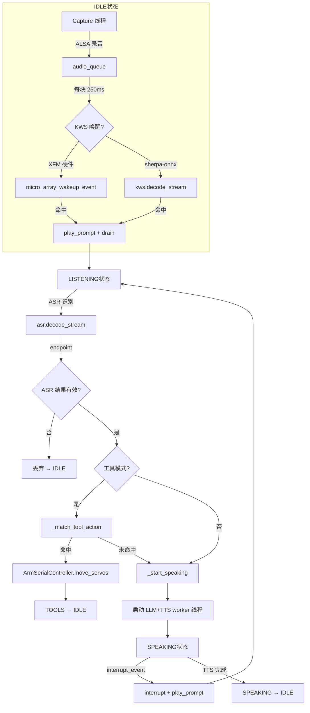

## 实验5：大模型端到端实时语音交互与工具调用实验（8h）

> **源码**：`ros2_ws/src/xflz_eai_car1/interaction/car1_interaction/tools/`
> **主命令**：
> - `python3 voice_interaction.py --mic-array`（一般语音对话：唤醒→识别→LLM→TTS 全链路）
> - `python voice_tools_interaction.py --mic-array`（工具调用模式：语音控制机械臂）
> **平台**：具身智能实验箱 B2（含 RK3576 NPU 6TOPS）
> **覆盖范围**：本实验整合实验 1-4 全部模块（KWS+ASR+TTS+LLM），并通过 `voice_tools_interaction.py` 实现语音→关键词/LLM 混合决策→机械臂串口控制

### 5.1 关联知识点

- 6.1.1 语音交互状态机 > 流程 > IDLE/LISTENING/SPEAKING 三态流转
- 6.1.2 XFM 6 麦硬件唤醒 > 原理 > 通过串口协议接收 AIUI 唤醒事件，替代 sherpa-onnx KWS
- 6.1.3 Capture 线程常驻 > 流程 > ALSA 录音线程 + queue.Queue 解耦采集与状态处理
- 6.1.4 提示音 + 双轮 drain > 原理 > 防提示音回声污染 ASR 输入
- 6.2.1 RKLLM 启动器 > 流程 > librkllmrt.so 软链 + fake sudo 拦截 + 端口冲突自动清理
- 6.2.2 OpenAI 兼容 /v1/chat/completions > 原理 > 流式 SSE + `data: {...}` 行解析
- 6.2.3 stall_timeout 防卡死 > 实践 > 30s 无新 token 自动放弃，避免状态机永久阻塞
- 6.3.1 LLM 按句分割 (SENTENCE_RE) > 实践 > 句号/逗号/问号/感叹号分句后立即送 TTS
- 6.3.2 TTS 软削峰 tanh > 原理 > `np.tanh(samples * gain)` 防硬削峰导致的谐波失真
- 6.3.3 持久化 aplay 进程 > 实践 > stdin pipe 持续喂 PCM，避免每句起新进程
- 6.3.4 ASR 端点检测 > 实践 > rule1/rule2/rule3 三规则 + SileroVAD 双方案
- 6.3.5 ASR 黑名单过滤 > 流程 > vivo/oppo/hello 等常见噪声词直接丢弃
- 6.4.1 action.yaml 模式加载 > 流程 > 从同目录 yaml 加载 work/home/pick/place 四模式
- 6.4.2 串口协议 0xAA 0x55 > 原理 > 帧头 + Func + Len + Data + CRC8
- 6.4.3 机械臂 5 关节 + 夹爪 > 实践 > 500~2500 PWM 范围，<struct <BH>> 打包舵机位置
- 6.4.4 关键词三步匹配 > 流程 > 英文精确匹配 → 核心字匹配 → 中文描述兜底
- 6.4.5 ASR 误识别纠正 > 实践 > 攻坚→工作、爪取→抓取、准模式→校准模式
- 6.5.1 打断检测 > 流程 > SPEAKING 状态下重新触发 KWS 即打断
- 6.5.2 interrupt_event + speaking_done > 原理 > 双重 Event 保证线程安全的状态切换
- 6.5.3 LLM 输出先于 TTS 完成 > 流程 > `tools_prompt` 模式跳过 TTS，节省时间

### 5.2 实验目标

1. 理解实时语音交互的 IDLE/LISTENING/SPEAKING 状态机设计 — **原理理解**
2. 掌握讯飞 XFM 6 麦硬件唤醒与板载 KWS 两种方案 — **方案对比**
3. 能够整合 KWS+ASR+LLM+TTS 全链路模块并实现端到端对话 — **集成实操**
4. 理解 LLM 流式响应 + TTS 按句分割的协同设计 — **原理理解**
5. 掌握流式播放（persistent aplay stdin pipe）的工程实现 — **工程实操**
6. 理解回声污染与提示音双轮 drain 的解决思路 — **工程实操**
7. 掌握打断检测与 interrupt_event 信号机制 — **原理理解**
8. 能够用 `voice_interaction.py --mic-array` 完成端到端对话 — **端到端实操**
9. 能够用 `voice_tools_interaction.py --mic-array` 完成语音控制机械臂 — **工具调用实操**
10. 理解 action.yaml 模式加载、串口协议、关键词三步匹配 — **迁移应用**

### 5.3 实验环境

| 类别 | 配置 |
|------|------|
| 硬件 | 具身智能实验箱 B2（RK3576 NPU 6TOPS + 讯飞 6 麦阵列 + 机械臂串口） |
| OS | Ubuntu 22.04 + ROS2 Humble |
| Python | 3.10（推荐 `ros2_venv`） |
| 核心库 | sherpa_onnx（KWS/ASR/TTS）、requests（LLM HTTP）、pyserial（机械臂）、pyyaml（配置/工具） |
| KWS | sherpa-onnx 板载模型（无阵列时）/ XFM 硬件唤醒（有阵列时） |
| ASR | sherpa-onnx OnlineRecognizer (Transducer) |
| TTS | sherpa-onnx OfflineTts (Matcha-TTS + Vocos) |
| LLM | RKLLM Qwen3.5-0.8B w4a16 g128（HTTP OpenAI 兼容 API） |
| 串口 | /dev/ttyUSB0 @ 1M baud（机械臂控制） |
| 主入口 | `voice_interaction.py`（一般对话）+ `voice_tools_interaction.py`（工具调用） |

### 5.4 实验难度

- 难度：⭐⭐⭐ 高
- 重点：状态机设计、XFM 硬件唤醒、流式 LLM+TTS 协同、关键词三步匹配
- 难点：回声污染处理、interrupt_event 线程安全、ASR 误识别纠正

### 5.5 实验现象

**快速验证流程（一般对话）**：

```bash
# 终端 1：启动 RKLLM 服务（如果用 auto_start_llm=False 可省略）
python3 llm_server.py

# 终端 2：启动语音交互（带 6 麦阵列）
cd ros2_ws/src/xflz_eai_car1/interaction/car1_interaction/tools/
python3 voice_interaction.py --mic-array
# 输出：
#   [Main] 检测讯飞麦克风阵列设备...
#   [Main] 找到录音设备: plughw:4,0 (XFMDPV0018)
#   [Main] 找到播放设备: plughw:4,0 (USB Audio Device)
#   [Main] 使用麦克风阵列: 录音=plughw:4,0, 播放=plughw:4,0
#   [KWS] 设置唤醒词: 小飞小飞, 小飞同学, 你好小飞
#   [LLM] 启动 LLM: Qwen3.5-0.8B_w4a16_g128_rk3576.rkllm (端口 8080)
#   [LLM] LLM 服务就绪
#   [TTS] speed=1.0 gain=2.0
#   ==================================================
#   就绪 — 说唤醒词开始对话, Ctrl+C 退出
#   ==================================================

# 唤醒："小飞小飞"
# [KWS] 唤醒: 小飞小飞
# （播放提示音 "我在"）
# [Main] IDLE → LISTENING
# 说话："今天北京天气怎么样？"
# [ASR] 今天北京天气怎么样？
# [ASR] 今天北京天气怎么样？
# （ASR 端点检测到，自动结束）
# [LLM]  我没有实时查询天气的能力...
# （TTS 流式合成并播放）
# [Main] SPEAKING → IDLE
```

**快速验证流程（工具调用模式）**：

```bash
# 终端 1：同上
# 终端 2：启动工具调用模式
cd ros2_ws/src/xflz_eai_car1/interaction/car1_interaction/tools/
python voice_tools_interaction.py --mic-array
# 输出（带 4 个机械臂模式）：
#   [Main] 已加载 4 个机械臂模式: ['home', 'pick', 'place', 'work']
#   [Main] 机械臂串口已打开: /dev/ttyUSB0 @ 1000000
#   ...

# 唤醒："小飞小飞"
# 说话："请把机械臂放到工作位置"
# [ASR] 请把机械臂放到工作位置
# [Main] 关键词匹配: work   # 核心字"工"命中
# [TOOLS] 执行模式: work servos=[(0, 1500), (1, 1500), ...] duration=2.0s
# （机械臂移动到工作位姿）
# [Main] TOOLS → IDLE
```

**预期效果**：
- 工具调用模式支持 4 种工作模式：校准模式（home）、工作模式（work）、抓取模式（pick）、放置模式（place）
- 端到端响应延迟 < 3s（含 LLM 推理 + TTS 合成）
- KWS 唤醒词命中准确率 > 95%（XFM 硬件）
- ASR 端点检测自动结束，5s 内未说话超时返回 IDLE
- 工具调用模式从说话到机械臂执行 < 1s（关键词命中路径）
- 打断响应延迟 < 500ms（SPEAKING 状态重新唤醒）

### 5.6 实验步骤

#### 整体流程图



---

#### 步骤1：讯飞 6 麦阵列设备自动检测（阶段一：能跑通，30min）

> 本步骤对应 `voice_interaction.py` `detect_xfm_devices`（L81-130）

**核心知识点**：

**detect_xfm_devices（6.1.2）**
- **原理**：通过 `arecord -l` 列出所有 ALSA 录音设备，正则匹配含 "XFM" 的行（讯飞麦克风阵列的设备名约定为 `XFMDPV0018`），从中提取 `card N: 名称 [名称], device M` 模式，构造 `plughw:N,M` 设备字符串。播放设备同样通过 `aplay -l` 自动匹配 "USB Audio Device"。这样无需手动配置 `--capture-device` 和 `--playback-device`。
- **源码对应**：`voice_interaction.py` L81-130

```python
# voice_interaction.py L81-130：XFM 设备检测
def detect_xfm_devices():
    """Auto-detect XunFei XFM-DP mic array devices."""
    rec_device = None
    result = subprocess.run(["arecord", "-l"], capture_output=True, text=True, check=False)
    for line in result.stdout.split('\n'):
        if 'XFM' in line.upper():
            # 解析: card 4: XFMDPV0018 [XFM-DP-V0.0.18], device 0: USB Audio [USB Audio]
            match = re.search(r'card\s+(\d+):\s+\S+\s+\[([^\]]+)\].*device\s+(\d+)', line)
            if match:
                card_num, _, dev_num = match.group(1), match.group(2), match.group(3)
                rec_device = f"plughw:{card_num},{dev_num}"
                log.info(f"找到录音设备: {rec_device}")
                break
    # ...播放设备检测类似
    return rec_device, play_device, card_name
```

**操作步骤**：

1. 确认 6 麦阵列已插入 USB：
   ```bash
   lsusb | grep -i 1a86
   # Bus 001 Device 005: ID 1a86:55d4 QinHeng Electronics
   ```

2. 查看系统识别的音频设备：
   ```bash
   arecord -l
   # **** List of CAPTURE Hardware Devices ****
   # card 4: XFMDPV0018 [XFM-DP-V0.0.18], device 0: USB Audio [USB Audio]
   ```

3. 测试 `--mic-array` 自动检测：
   ```bash
   python3 voice_interaction.py --mic-array --debug
   # 期望看到：
   # [Main] 找到录音设备: plughw:4,0 (XFMDPV0018)
   # [Main] 找到播放设备: plughw:4,0 (USB Audio Device)
   ```

4. 不使用 `--mic-array` 时使用 config.yaml 的默认设备：
   ```bash
   python3 voice_interaction.py
   # 此时走 sherpa-onnx KWS，使用 config.yaml 的 capture_device / playback_device
   ```

**易错点**：
- ⚠️ **未插 6 麦却用 `--mic-array`** → `RuntimeError: 未找到 XFM 麦克风阵列设备`
- ⚠️ **ALSA 权限不足** → 用户需在 `audio` 组：`sudo usermod -aG audio $USER`
- ⚠️ **`arecord` 命令未安装** → `apt install alsa-utils`

---

#### 步骤2：状态机初始化与 KWS 切换（阶段一：能跑通，30min）

> 本步骤对应 `voice_interaction.py` `VoiceInteraction.__init__` 中的设备选择与 KWS 初始化分支（L349-417）

**核心知识点**：

**状态机三态（6.1.1）**
- **原理**：实时语音交互系统的核心是一个三态有限状态机：
  - **IDLE**：等待唤醒词（KWS 在所有音频上运行）
  - **LISTENING**：播放提示音后开始 ASR 识别
  - **SPEAKING**：LLM 流式生成 + TTS 流式合成并播放
- **源码对应**：`voice_interaction.py` `state` 字段 + `_handle_idle/listening/speaking`

**XFM 硬件唤醒 vs sherpa-onnx KWS（6.1.3）**
- **原理**：两种 KWS 方案：
  1. **XFM 硬件唤醒**（`--mic-array` 模式）：通过串口接收讯飞 6 麦 AIUI 协议的 `ivw` 事件，零 CPU 占用
  2. **sherpa-onnx KWS**（板载麦克风模式）：使用 Transducer 模型实时检测，CPU 占用 < 5%
- **源码对应**：`voice_interaction.py` L412-417
  ```python
  if not self.use_mic_array:
      self._init_kws()  # 使用 sherpa-onnx
  else:
      self.kws = None
      self.kws_stream = None  # 使用 XFM 硬件唤醒
  ```

**操作步骤**：

1. 查看 config.yaml 默认设备：
   ```bash
   cat ros2_ws/src/xflz_eai_car1/interaction/car1_interaction/tools/config.yaml
   # audio:
   #   sample_rate: 16000
   #   chunk_size: 4000
   #   capture_device: "plughw:0,0"
   #   playback_device: "plughw:0,0"
   ```

2. 不带 6 麦启动（使用板载 KWS）：
   ```bash
   python3 voice_interaction.py
   # [KWS] 唤醒词: 你好米娅 @你好米娅
   # [KWS] 唤醒词: 小爱同学 @小爱同学
   ```

3. 带 6 麦启动（使用 XFM 硬件唤醒）：
   ```bash
   python3 voice_interaction.py --mic-array
   # [KWS] 使用默认唤醒词: 小飞小飞, 小飞同学, 你好小飞
   ```

4. 自定义唤醒词：
   ```bash
   python3 voice_interaction.py --mic-array --wakeup-words "嗨嗨,小助手"
   # [KWS] 设置唤醒词: 嗨嗨,小助手
   ```

**易错点**：
- ⚠️ **板载 KWS 模型文件不存在** → 检查 `kws.model_dir` 配置
- ⚠️ **XFM 默认唤醒词已被讯飞锁定** → 需用讯飞工具配置；命令行只支持软件层重设
- ⚠️ **`--wakeup-words` 拼写错误** → 该参数仅在 XFM 模式生效

---

#### 步骤3：提示音 + 双轮 drain 防回声污染（阶段二：能理解，45min）

> 本步骤对应 `voice_interaction.py` `_play_prompt_then_start_asr`（L845-898）

**核心知识点**：

**回声污染问题**
- **原理**：播放唤醒提示音（如"我在"）后，麦克风会捕获：(1) 提示音直接回声；(2) 房间混响；(3) ALSA 输出缓冲区残留。这些都会被 ASR 误识别为用户输入，导致误触发。

**双轮 drain 解决方案（6.1.4）**
- **原理**：
  1. 写入提示音 PCM 到 aplay pipe（非阻塞）
  2. 等待 `提示音时长 + 0.8s`（含 ALSA 缓冲 + 房间混响）
  3. 第一轮 drain：丢弃播放期间累积的音频
  4. `sleep(0.2)`：让 capture 线程灌入可能漏掉的尾部回声
  5. 第二轮 drain：最终清理
  6. 创建 fresh ASR stream
- **源码对应**：`voice_interaction.py` L858-893

```python
# voice_interaction.py L858-893：双轮 drain
def _play_prompt_then_start_asr(self):
    if self._prompt_pcm:
        prompt_dur = len(self._prompt_pcm) / (2 * 2 * self.sample_rate)
        self.playback.write(self._prompt_pcm)
        wait_time = prompt_dur + 0.8  # 提示音 + ALSA 缓冲 + 房间混响
        time.sleep(wait_time)
    
    # 第一轮 drain
    while True:
        try: self.audio_queue.get_nowait()
        except Empty: break
    
    time.sleep(0.2)  # 让 capture 线程灌入可能漏掉的尾部回声
    
    # 第二轮 drain
    while True:
        try: self.audio_queue.get_nowait()
        except Empty: break
    
    self.asr_stream = self.recognizer.create_stream()  # fresh ASR
    self.state = "LISTENING"
```

**操作步骤**：

1. 观察提示音日志（启用 `--debug`）：
   ```bash
   python3 voice_interaction.py --mic-array --debug
   # [Main] 播放提示音 (0.67s, 42880 bytes)
   # [Main] 排空音频队列: 第1轮 3 帧, 第2轮 1 帧
   # [Main] IDLE → LISTENING
   ```

2. 替换提示音：
   ```bash
   # 替换 kws.wav 为自己的提示音（16kHz 单声道 WAV）
   cp my_prompt.wav ros2_ws/.../interaction/resources/kws.wav
   ```

3. 调整回声容忍时间（实验性）：
   ```python
   # voice_interaction.py L867：可修改 wait_time
   wait_time = prompt_dur + 0.8  # 改大到 1.5s 更保守
   ```

**易错点**：
- ⚠️ **kws.wav 采样率不匹配** → 加载时会重采样到 16kHz，可能失真
- ⚠️ **提示音太长** → 增加响应延迟，建议 < 1s
- ⚠️ **drain 期间错过用户说"小飞小飞"** → 正常，用户需要等提示音结束

---

#### 步骤4：ASR 识别与端点检测（阶段二：能理解，45min）

> 本步骤对应 `voice_interaction.py` `_init_asr` + `_handle_listening`（L511-545 + L900-933）

**核心知识点**：

**Transducer 端点检测（6.3.4）**
- **原理**：sherpa-onnx 的 `OnlineRecognizer` 内置三规则端点检测：
  - **rule1_min_trailing_silence**：长静音后结束（默认 4.5s）
  - **rule2_min_trailing_silence**：短静音后结束（默认 1.5s）
  - **rule3_min_utterance_length**：最短语音长度（默认 300 帧）
- **源码对应**：`voice_interaction.py` L533-537

**ASR 黑名单过滤（6.3.5）**
- **原理**：实验中发现某些情况下 ASR 会输出 "VIVO"、"HELLO"、"OK" 等噪声词（来自房间噪声或提示音尾部回声）。`_ASR_BLACKLIST` 维护一个黑名单集合，直接丢弃这些识别结果。
- **源码对应**：`voice_interaction.py` L746-782

**SileroVAD 备选方案**
- **原理**：`voice_tools_interaction.py` 使用 SileroVAD 替代内置端点检测（更鲁棒）：
  - 语音后连续静音 ≥ 1.5s → 结束
  - 无语音时等待 ≤ 8s → 超时放弃
- **源码对应**：`voice_tools_interaction.py` L789-806, L1180-1230

**操作步骤**：

1. 调整内置端点检测阈值（config.yaml）：
   ```yaml
   asr:
     rule1_silence: 4.5  # 长静音
     rule2_silence: 1.5  # 短静音
     rule3_min_utt: 300  # 最短语音长度
   ```

2. 测试 ASR 实时输出（启用 `--debug`）：
   ```bash
   python3 voice_interaction.py --mic-array --debug
   # 唤醒后说话：
   # [ASR] 今天
   # [ASR] 今天北京
   # [ASR] 今天北京天气
   # [ASR] 今天北京天气怎么样
   # （端点检测触发）
   ```

3. 触发黑名单测试：
   ```bash
   # 唤醒后只说"Hi"
   # 期望：[ASR] HI
   #       [ASR] 结果无效丢弃: "HI" → IDLE
   ```

**易错点**：
- ⚠️ **rule2 设太小** → 容易被切碎；建议 1.0~2.0s
- ⚠️ **rule1 设太大** → 用户停顿稍长就等 4.5s
- ⚠️ **ASR 模型未编译 RKNN** → 首次使用 CPU provider，速度较慢

---

#### 步骤5：流式 LLM 响应与按句分割 TTS（阶段三：能改造，60min）

> 本步骤对应 `voice_interaction.py` `_llm_tts_worker`（L1011-1065）

**核心知识点**：

**SENTENCE_RE 句子分割（6.3.1）**
- **原理**：LLM 流式输出按 token 累积到 buffer，每当遇到句子终止符（。！？；，、\n）就立即切出当前句子送 TTS。这种"细粒度分句"策略大幅降低首字延迟，用户听到的是"边生成边合成边播放"的体验。
- **源码对应**：`voice_interaction.py` L328-330, L1040-1053
  ```python
  SENTENCE_RE = re.compile(r'([。！？；，、\n]|[.?!,](?=\s|$))')
  # 流式输出累积
  while True:
      m = self.SENTENCE_RE.search(buffer)
      if not m: break
      sentence = buffer[:m.end()].strip()
      buffer = buffer[m.end():]
      pcm = self._tts_to_pcm(sentence)
      if pcm: self.playback.write(pcm)
  ```

**TTS 软削峰（6.3.2）**
- **原理**：`tts_gain > 1.0` 时用 `np.tanh(samples * gain)` 做软削峰，避免硬削峰导致的谐波失真。`tanh` 把波形压缩到 (-1, 1) 范围。
- **源码对应**：`voice_interaction.py` L730-734

**持久化 aplay 进程（6.3.3）**
- **原理**：传统做法每句 TTS 完都要 `aplay file.wav` 启新进程，开销大。本实验用 persistent aplay 进程：启动时 `Popen(["aplay", "-t", "raw", "-f", "S16_LE", "-c", "2", "-r", "16000", "-D", device, "-q", "-"], stdin=PIPE)`，每句 TTS 的 PCM 直接 `proc.stdin.write(bytes)`。进程复用，无启动开销。
- **源码对应**：`voice_interaction.py` L137-244

**操作步骤**：

1. 观察 LLM 流式输出：
   ```bash
   python3 voice_interaction.py --mic-array
   # 唤醒后问："详细介绍下RK3576"
   # [ASR] 详细介绍下RK3576
   # [LLM]  RK3576 是...
   # （边流式生成边 TTS 边播放，能听到逐句输出）
   ```

2. 调整 TTS 增益（config.yaml）：
   ```yaml
   tts:
     speed: 1.0
     gain: 2.0   # 软削峰模式下 > 1.0 也安全
   ```

3. 调整句子分割粒度（更激进可减少延迟，但可能被切碎）：
   ```python
   # voice_interaction.py L328-330
   SENTENCE_RE = re.compile(r'([。！？；，、\n]|[.?!,](?=\s|$))')
   # 改为只切句号/问号/感叹号（更保守）：
   # SENTENCE_RE = re.compile(r'([。！？\n]|[.?!](?=\s|$))')
   ```

4. 验证 persistent aplay：
   ```bash
   # 启动后用 ps 查看 aplay 进程
   ps aux | grep aplay
   # /usr/bin/aplay -t raw -f S16_LE -c 2 -r 16000 -D plughw:4,0 -q -
   ```

**易错点**：
- ⚠️ **句子切太细** → TTS 合成次数多，可能出现"我在..."→"我今天..." 的奇怪断句
- ⚠️ **句子切太粗** → 用户等待 LLM 完整生成，体验差
- ⚠️ **persistent aplay 进程崩溃** → 自动 `_reopen()` 重启，PCM 数据丢失但流程不中断

---

#### 步骤6：打断检测与 interrupt_event 机制（阶段三：能改造，45min）

> 本步骤对应 `voice_interaction.py` `_handle_speaking` + interrupt_event 流程（L935-981, L987-1009）

**核心知识点**：

**打断检测原理（6.5.1）**
- **原理**：SPEAKING 状态下，KWS 仍在运行。一旦检测到唤醒词（XFM 硬件或 sherpa-onnx），立即：
  1. 设置 `interrupt_event`（LLM+TTS worker 线程感知后会停止）
  2. `playback.interrupt()`（杀掉当前 aplay 进程并重开）
  3. `_play_prompt_then_start_asr()`（播放新提示音 + drain + 新 ASR stream）
- **源码对应**：`voice_interaction.py` L935-981

**interrupt_event + speaking_done 双重 Event（6.5.2）**
- **原理**：两个 Event 协作：
  - `interrupt_event`：主循环设置，worker 线程轮询（`if self.interrupt_event.is_set(): break`）
  - `speaking_done`：worker 线程设置，主循环等待（`if self.speaking_done.is_set(): state = "IDLE"`）
  - worker 的 `finally` 块必须 `speaking_done.set()`，否则主循环永久阻塞
- **源码对应**：`voice_interaction.py` L1062-1065

**操作步骤**：

1. 测试打断功能：
   ```bash
   python3 voice_interaction.py --mic-array
   # 唤醒 → 问"详细介绍下深度学习" → TTS 长回答中
   # 再次说"小飞小飞" → 立即打断
   # 期望：[KWS] 打断: 小飞小飞
   #       [Main] SPEAKING → LISTENING (打断)
   ```

2. 观察 interrupt 链路：
   ```bash
   # 启用 --debug 后看 LLM worker 内部状态
   python3 voice_interaction.py --mic-array --debug
   # [LLM]  深度学习是... （被打断）
   # [LLM]  （print 一次换行）
   # [Main] SPEAKING → LISTENING (打断)
   ```

3. 验证 speaking_done 必触发（看 `_llm_tts_worker` 注释）：
   ```python
   # voice_interaction.py L1011-1016 注释：
   # MUST always set speaking_done in finally block — otherwise the main
   # loop will get stuck in SPEAKING state forever.
   ```

**易错点**：
- ⚠️ **打断检测延迟** → XFM 硬件唤醒 < 100ms；sherpa-onnx KWS 约 200~500ms
- ⚠️ **打断后未 drain** → `_drain_audio_queue()` 在 SPEAKING→IDLE 时调用，否则 TTS 尾音触发 KWS 误识别
- ⚠️ **interrupt_event 没在 finally 清** → 下一轮对话继承"已打断"状态，LLM 直接退出

---

#### 步骤7：工具调用模式 — action.yaml 加载与机械臂控制（阶段三：能改造，90min）

> 本步骤对应 `voice_tools_interaction.py` `_load_tools` + `ArmSerialController` + `_match_tool_action`（L543-677, L311-387, L1299-1313）

**核心知识点**：

**action.yaml 模式加载（6.4.1）**
- **原理**：机械臂的可用动作（如 work/home/pick/place）从同目录 `action.yaml` 加载，每个动作包含 servos 字典（舵机 ID → PWM 值）和 duration（运动时长）。
- **action.yaml 示例**：
  ```yaml
  actions:
    - name: home
      description: 校准模式
      servos: {0: 1500, 1: 1500, 2: 1500, 3: 1500, 4: 1500, 5: 1500}
      duration: 2.0
    - name: pick
      description: 抓取模式
      servos: {0: 1200, 1: 1800, 2: 1500, 3: 1500, 4: 2000, 5: 2200}
      duration: 2.0
    - name: place
      description: 放置模式
      servos: {0: 1800, 1: 1200, 2: 1500, 3: 1500, 4: 2000, 5: 1500}
      duration: 2.0
    - name: work
      description: 工作模式
      servos: {0: 1500, 1: 1500, 2: 2000, 3: 1500, 4: 1500, 5: 2200}
      duration: 2.0
  ```

**串口协议 0xAA 0x55 + CRC8（6.4.2）**
- **原理**：机械臂串口协议帧结构：
  - 帧头：`0xAA 0x55`（2 字节）
  - Func：功能码（1 字节），0x05 = 位置指令
  - Len：Data 长度（1 字节）
  - Data：`[0x01, duration_lo, duration_hi, count, servo_id, pwm_lo, pwm_hi, ...]`
  - CRC8：从 Func 到 Data 的校验和（1 字节，查表法）
- **源码对应**：`voice_tools_interaction.py` L340-385

```python
# voice_tools_interaction.py L366-387：位置指令
def _send(self, func, data):
    buf = [0xAA, 0x55, func, len(data)] + data
    checksum = self._crc8(bytes(buf[2:]))  # 从 Func 开始算
    buf.append(checksum)
    self.ser.write(bytes(buf))

def move_servos(self, positions, duration=2.0):
    """positions: [(servo_id, pwm), ...]，pwm 500~2500"""
    duration_ms = int(duration * 1000)
    clamped = [(sid, max(500, min(2500, int(pwm)))) for sid, pwm in positions]
    data = [0x01, duration_ms & 0xFF, (duration_ms >> 8) & 0xFF, len(clamped)]
    for sid, pwm in clamped:
        data.extend(struct.pack("<BH", sid, pwm))  # 小端：servo_id(1) + pwm(2)
    self._send(0x05, data)
```

**关键词三步匹配（6.4.4）**
- **原理**：`voice_tools_interaction.py` 优先在 ASR 文本上做关键词匹配，绕过 LLM，最可靠：
  1. **英文精确匹配**：cand 字符串等于 `work` / `home` / `pick` / `place` 之一
  2. **核心字匹配**：含 `抓→pick`、`放→place`、`校/准→home`、`工/攻/公→work`
  3. **中文完整描述匹配**：检查 `action.yaml` 中的 description 字段是否在 buffer_text 中
  4. **ASR 误识别纠正**：攻坚→工作、爪取→抓取、准模式→校准模式
- **源码对应**：`voice_tools_interaction.py` L604-677

**ASR 误识别纠正（6.4.5）**
- **原理**：实际场景中 ASR 经常把"工作"识别成"攻坚"或"公交"。"放直"识别成"放置"。`fuzzy_map` 字典维护常见的错误→正确映射，匹配成功后查 `action.yaml` 找对应模式。
- **源码对应**：`voice_tools_interaction.py` L640-677

**操作步骤**：

1. 创建/编辑 `action.yaml`（与 `voice_tools_interaction.py` 同目录）：
   ```bash
   cd ros2_ws/src/xflz_eai_car1/interaction/car1_interaction/tools/
   cat > action.yaml << 'EOF'
   actions:
     - name: home
       description: 校准模式
       servos: {0: 1500, 1: 1500, 2: 1500, 3: 1500, 4: 1500, 5: 1500}
       duration: 2.0
     - name: pick
       description: 抓取模式
       servos: {0: 1200, 1: 1800, 2: 1500, 3: 1500, 4: 2000, 5: 2200}
       duration: 2.0
     - name: place
       description: 放置模式
       servos: {0: 1800, 1: 1200, 2: 1500, 3: 1500, 4: 2000, 5: 1500}
       duration: 2.0
     - name: work
       description: 工作模式
       servos: {0: 1500, 1: 1500, 2: 2000, 3: 1500, 4: 1500, 5: 2200}
       duration: 2.0
   EOF
   ```

2. 启动工具调用模式：
   ```bash
   python voice_tools_interaction.py --mic-array
   # [Main] 已加载 4 个机械臂模式: ['home', 'pick', 'place', 'work']
   # [Main] 机械臂串口已打开: /dev/ttyUSB0 @ 1000000
   ```

3. 语音触发（关键词路径）：
   ```bash
   # 唤醒后说"小飞小飞"
   # 然后说"机械臂请抓取"
   # 期望：[TOOLS] 关键词匹配: pick （核心字"抓"命中）
   #       [TOOLS] 执行模式: pick servos=[...] duration=2.0s
   ```

4. 语音触发（LLM 路径，未匹配关键词时）：
   ```bash
   # 唤醒后说"请把机械臂放到工作位姿"
   # 期望：[LLM]  work
   #       [TOOLS] 关键词匹配: work （LLM 输出 "work"）
   #       [TOOLS] 执行模式: work ...
   ```

5. 测试 ASR 误识别纠正：
   ```bash
   # 说"机械臂攻坚"（ASR 误识别）
   # 期望：[TOOLS] 关键词匹配: work （fuzzy_map: 攻坚→工作）
   ```

**易错点**：
- ⚠️ **action.yaml 路径错误** → `tools_action_file` 默认 `tools/action.yaml`，需与脚本同目录
- ⚠️ **串口未插入或权限不足** → `ArmSerialController.open()` 返回 False，工具模式不可用
- ⚠️ **PWM 超出 500~2500** → `max(500, min(2500, int(pwm)))` 自动夹紧
- ⚠️ **未配置 `system_prompt`** → LLM 输出随机，无法触发工具模式（需在 config_tools.yaml 中配置）

---

#### 步骤8：混合决策 — 关键词优先 + LLM 兜底（阶段三：能改造，45min）

> 本步骤对应 `voice_tools_interaction.py` `_start_speaking` 中的双路径决策（L1299-1313）

**核心知识点**：

**双路径决策（6.4.1 + 6.5.3）**
- **原理**：`voice_tools_interaction.py` 采用"关键词优先，LLM 兜底"的双路径策略：
  - **路径 1（关键词匹配）**：直接在 ASR 输出上做三步匹配。命中则立即执行机械臂，跳过 LLM，节省 1~3s 延迟。
  - **路径 2（LLM 分类）**：未匹配时走 LLM 流式分类（仅生成 work/home/pick/place 之一或 "none"），命中则执行机械臂。`tools_prompt` 模式下跳过 TTS，节省合成时间。
- **源码对应**：`voice_tools_interaction.py` L1299-1406

```python
# voice_tools_interaction.py L1304-1313：双路径
def _start_speaking(self, user_text):
    # 1) 先尝试从 ASR 文本直接匹配（绕过 LLM，最可靠）
    matched = self._match_tool_action(user_text)
    if matched:
        log.info(f"LISTENING → TOOLS ({user_text})")
        self._execute_tool_action(matched)
        self.state = "IDLE"
        return
    # 2) 未匹配 → 走 LLM 分类
    # ...（LLM 短输出 + 关键词检测 + 跳过 TTS）
```

**操作步骤**：

1. 验证关键词路径（快速）：
   ```bash
   # 唤醒后说"机械臂抓取"
   # 期望：< 1s 机械臂执行 pick 模式
   ```

2. 验证 LLM 路径（兜底）：
   ```bash
   # 唤醒后说"把机械臂调整到工作姿态"
   # 期望：LLM 输出 "work" → 机械臂执行
   ```

3. 验证 "none" 模式（不执行任何动作）：
   ```bash
   # 唤醒后说"今天天气怎么样？"
   # 期望：LLM 输出 "none" → 不执行任何动作，直接 IDLE
   ```

4. 调整 LLM 输出限制（config_tools.yaml）：
   ```yaml
   llm:
     system_prompt: "你是一个机械臂指令分类器，只输出 work/home/pick/place/none 之一"
     max_tokens: 6       # 限制为短输出
     temperature: 0.0    # 确定性最高
   ```

**易错点**：
- ⚠️ **关键词误匹配** → 比如说"今天学习 python"，"工"字可能被误匹配为 work。需在 `fuzzy_map` 中加更多排除规则
- ⚠️ **LLM 输出格式不稳定** → 0.8B 小模型偶发输出多余文字，需在 `_match_tool_action` 中更严格正则

---

#### 步骤9：流式 LLM 服务启动与 stall_timeout 防护（阶段三：能改造，30min）

> 本步骤对应 `voice_interaction.py` `_start_llm_server` + LLMClient.chat_stream（L589-702, L261-315）

**核心知识点**：

**RKLLM 启动器（6.2.1）**
- **原理**：`voice_interaction.py` 在需要时自动启动 RKLLM 服务：
  1. 检查端口是否被占用（`socket.connect_ex`）
  2. 若被占用，先 `GET /v1/models` 验证是否已有 LLM 服务
  3. 若是真 LLM 服务，复用；若是其他进程，`lsof -ti :port | xargs kill -9` 清理
  4. 建立 `librkllmrt.so` 软链到 server_dir/lib/
  5. 创建 fake sudo 防 `flask_server.py` 弹密码
  6. `subprocess.Popen` 启动 `flask_server.py`，环境变量传递 `FLASK_RUN_PORT`
  7. 等待 `/v1/models` 返回 200 后才继续（最长 120s）
- **源码对应**：`voice_interaction.py` L589-702

**stall_timeout 防卡死（6.2.3）**
- **原理**：LLM 服务端偶发卡死（模型崩溃、NPU 驱动挂掉等）时，客户端的 `iter_lines` 会一直阻塞。`stall_timeout=30s` 监测连续 30s 没收到新 token 就主动放弃本次请求，避免状态机永久阻塞。
- **源码对应**：`voice_interaction.py` L289-298

```python
# voice_interaction.py L289-298：stall_timeout
last_token_time = time.time()
for line in resp.iter_lines(decode_unicode=True):
    if interrupt_event and interrupt_event.is_set():
        break
    if time.time() - last_token_time > stall_timeout:
        raise TimeoutError(f"LLM 流式响应停滞 >{stall_timeout}s，放弃本次请求")
    # ...解析 chunk
    if content:
        last_token_time = time.time()  # 收到 token 就重置计时器
        yield content
```

**操作步骤**：

1. 外部 LLM 服务连接（不自动启动）：
   ```bash
   python3 voice_interaction.py --no-server
   # [LLM] server=http://127.0.0.1:8080
   # 需提前在另一终端启动：
   # python3 llm_server.py --platform rk3576
   ```

2. 端口冲突自动清理：
   ```bash
   # 先用一个非 LLM 进程占用 8080
   python3 -c "import socket; s = socket.socket(); s.bind(('127.0.0.1', 8080)); s.listen(); import time; time.sleep(60)"
   # 然后启动 voice_interaction，会自动清理冲突
   python3 voice_interaction.py --mic-array
   # [LLM] 端口 8080 已被占用...
   # [LLM] 外部 LLM 服务不可用
   # [LLM] 自动清理端口 8080 上的冲突进程...
   # [LLM] 清理完成，继续启动
   ```

3. 观察 RKLLM 启动日志：
   ```bash
   python3 voice_interaction.py --mic-array --debug
   # [LLM] 启动 LLM: Qwen3.5-0.8B_w4a16_g128_rk3576.rkllm (端口 8080)
   # [LLM] LLM 服务就绪
   ```

**易错点**：
- ⚠️ **Librkllmrt.so 不存在** → 启动失败，检查 `/usr/lib/librkllmrt.so`
- ⚠️ **模型路径错误** → `model file not found`，需修改 config.yaml 中 `llm_server.model`
- ⚠️ **端口被无关进程占用且 lsof 失败** → `auto_kill_conflict: false` 配置下手动清理

---

#### 完整可运行代码与 README

完整 demo 代码与 README 已发布在 `courses/sheet1/speech_practice/source-codes/exp05/`：

| 文件 | 说明 |
|------|------|
| [README.md](file:///e:/Source/xflz_eai_car1/course_generate_agent/courses/sheet1/speech_practice/source-codes/exp05/README.md) | 源码对照表（实验步骤↔代码行号）、9 道思考题、4 模式 action.yaml 详解、串口协议 0xAA 0x55 帧结构、关键词三步匹配算法 |
| [demo_voice_interaction.py](file:///e:/Source/xflz_eai_car1/course_generate_agent/courses/sheet1/speech_practice/source-codes/exp05/demo_voice_interaction.py) | 简化版状态机 demo（不依赖 KWS/ASR/TTS 真实模型），用模拟函数演示 IDLE/LISTENING/SPEAKING 三态流转、双轮 drain、interrupt_event + speaking_done 协作 |
| [voice_interaction.py](file:///e:/Source/xflz_eai_car1/course_generate_agent/courses/sheet1/speech_practice/source-codes/exp05/voice_interaction.py) | 一般对话主入口（与 ROS2 仓库一致） |
| [voice_tools_interaction.py](file:///e:/Source/xflz_eai_car1/course_generate_agent/courses/sheet1/speech_practice/source-codes/exp05/voice_tools_interaction.py) | 工具调用模式主入口（与 ROS2 仓库一致） |
| [action.yaml](file:///e:/Source/xflz_eai_car1/course_generate_agent/courses/sheet1/speech_practice/source-codes/exp05/action.yaml) | work/home/pick/place 四模式舵机 PWM 配置 |
| [config.yaml](file:///e:/Source/xflz_eai_car1/course_generate_agent/courses/sheet1/speech_practice/source-codes/exp05/config.yaml) | 一般对话配置（音频/KWS/ASR/TTS/LLM 路径） |
| [config_tools.yaml](file:///e:/Source/xflz_eai_car1/course_generate_agent/courses/sheet1/speech_practice/source-codes/exp05/config_tools.yaml) | 工具模式配置（system_prompt、串口参数） |
| [audio_utils.py](file:///e:/Source/xflz_eai_car1/course_generate_agent/courses/sheet1/speech_practice/source-codes/exp05/audio_utils.py) | amixer 麦克风增益/扬声器音量工具 |
| [xf_mic_array.py](file:///e:/Source/xflz_eai_car1/course_generate_agent/courses/sheet1/speech_practice/source-codes/exp05/xf_mic_array.py) | 讯飞 6 麦阵列 AIUI 协议驱动 |

**运行 demo（不依赖真实 KWS/ASR/TTS）**：
```bash
cd courses/sheet1/speech_practice/source-codes/exp05/
python3 demo_voice_interaction.py
# ============================================================
#  简化版语音交互状态机 demo
#  - 模拟唤醒 → ASR → LLM → TTS 流程
#  - SPEAKING 中再次唤醒会触发 interrupt
#  - 按 Ctrl+C 退出
# ============================================================
#
# [KWS] 唤醒词命中
#   [PROMPT] 播放提示音 0.67s
#   [DRAIN] 第1轮清空 3 帧
#   [DRAIN] 第2轮清空 1 帧
# [Main] IDLE → LISTENING
# [ASR] 用户问题 #1：介绍下 RK3576
# [Main] LISTENING → SPEAKING
#   [TTS] 合成: '你好！'
#   [TTS] 合成: '我是基于 RK3576 的语音助手。'
#   ...
# [Main] SPEAKING → IDLE
```

### 5.7 注意事项

- ⚠️ **必须先用 XFM 设备或板载麦克风** → 设备不可用时启动直接报错
- ⚠️ **librkllmrt.so 必须存在** → `/usr/lib/librkllmrt.so` 板载 RKLLM 运行时
- ⚠️ **LLM 服务自动启动有 120s 超时** → 模型加载较慢，耐心等待
- ⚠️ **KWS 唤醒词和 ASR 识别是两个独立过程** → XFM 唤醒后立刻播放提示音，drain 期间 ASR 不启动
- ⚠️ **persistent aplay 进程崩溃会自动重启** → 但 PCM 数据丢失，偶发吞音
- ⚠️ **打断响应延迟与 KWS 实现相关** → XFM 硬件 < 100ms；sherpa-onnx KWS 约 200~500ms
- ⚠️ **工具调用模式需配置 config_tools.yaml 中的 system_prompt** → 否则 LLM 不会输出 work/home/pick/place
- ⚠️ **action.yaml 必须与脚本同目录** → 否则 `_load_tools` 失败，工具模式不可用
- ⚠️ **机械臂串口默认 /dev/ttyUSB0 @ 1M baud** → 实际硬件可能不同，需修改 `ArmSerialController.__init__` 参数

### 5.8 实验总结

**完成成果**：
- 启动 `voice_interaction.py --mic-array` 完成唤醒→识别→LLM→TTS 全链路端到端对话
- 启动 `voice_tools_interaction.py --mic-array` 完成语音控制机械臂 4 个模式（work/home/pick/place）
- 验证 XFM 6 麦硬件唤醒 + 提示音 + 双轮 drain + 端点检测 + 流式 LLM+TTS + 打断检测全流程
- 理解 action.yaml 模式加载、串口协议 0xAA 0x55、关键词三步匹配 + ASR 误识别纠正

**技能收获**：
- 掌握 IDLE/LISTENING/SPEAKING 三态状态机的设计与线程安全
- 理解 XFM 硬件唤醒 vs sherpa-onnx KWS 的工程取舍
- 学会 persistent aplay 进程 + stdin pipe 实现流式播放
- 掌握按句分割 LLM 流式输出 + TTS 协同的"边生成边合成边播放"模式
- 理解 interrupt_event + speaking_done 双重 Event 协作机制
- 掌握 action.yaml 驱动的工具注册 + 串口协议 + 关键词匹配

**常见问题与解决**：

| 问题 | 原因 | 解决方法 |
|------|------|---------|
| `Cannot connect to server` | LLM 服务未启动 | 自动启动等待 120s；或用 `--no-server` 外部启动 |
| `model file not found` | 模型路径错误 | 检查 `config.yaml` 中 `llm_server.model` |
| KWS 唤醒不响应 | 唤醒词不在词表 | 检查 `kws.keywords_file` 或 XFM 默认词 |
| ASR 误触发 KWS | 提示音回声污染 | 双轮 drain + 调大 `wait_time` |
| 打断无响应 | interrupt_event 未传 worker | 检查 `_llm_tts_worker` 参数列表 |
| 机械臂不动 | 串口未开/权限 | `chmod 666 /dev/ttyUSB0`；检查 `ArmSerialController.open()` |
| 工具模式 LLM 乱输出 | system_prompt 未配置 | 在 `config_tools.yaml` 中加 system_prompt |
| 关键词误匹配 | 模糊匹配过宽 | 在 `fuzzy_map` 中加排除规则或调整优先级 |
| 端到端延迟 > 5s | 图片/网络/模型加载 | 启用 `--fix-freq` 锁频；优化 action.yaml duration |

### 5.9 实验报告要求

**思考题**：
1. IDLE/LISTENING/SPEAKING 三态状态机相比无状态的事件驱动有什么优势？为什么语音交互必须用有限状态机？
2. 提示音双轮 drain 的"drain 1 → sleep 0.2s → drain 2"为什么要 sleep？直接连续 drain 两次会怎样？
3. LLM 流式输出 + TTS 按句分割相比"等 LLM 完整生成再 TTS"在前端体验上有什么改进？试估算首字延迟差异。
4. interrupt_event + speaking_done 双重 Event 为什么缺一不可？如果只用 interrupt_event 会出现什么竞态？
5. 工具调用模式为什么优先在 ASR 文本上做关键词匹配，而不是直接走 LLM？这种"双路径"策略的工程意义是什么？
6. 串口协议 0xAA 0x55 + CRC8 与 XFM AIUI 协议（0xA5 帧头）有什么异同？为什么机械臂用更简单的协议？
7. XFM 6 麦硬件唤醒相比 sherpa-onnx 软件 KWS 在 CPU 占用、唤醒延迟、可配置性上有什么 trade-off？

**评分标准**：状态机设计 15 分 + KWS 切换（XFM/板载）10 分 + 回声处理（双轮 drain）10 分 + ASR 端点检测 10 分 + 流式 LLM+TTS 协同 15 分 + 打断检测 10 分 + action.yaml 模式加载 10 分 + 串口协议 + 关键词匹配 15 分 + 端到端测试 5 分 = 100 分。

---

## 更新日志

| 版本 | 日期 | 变更 |
|------|------|------|
| v1.0 | 2026-08-05 | 初版生成（基于 _registry.yaml human_waiver 模式） |
| v1.1 | 2026-08-06 | 重写：基于 `voice_interaction.py` + `voice_tools_interaction.py` 实际源码，移除 VITS/Function Calling 残留，添加 XFM 硬件唤醒、action.yaml、串口协议 0xAA 0x55、关键词三步匹配等内容 |
| v1.2 | 2026-08-06 | 完善 source-codes/exp05/：补充 action.yaml / config.yaml / config_tools.yaml / audio_utils.py / xf_mic_array.py，新增 demo_voice_interaction.py 简化状态机 demo，新增 README.md 源码对照说明（含 4 模式、串口协议、关键词三步匹配、9 道思考题） |
