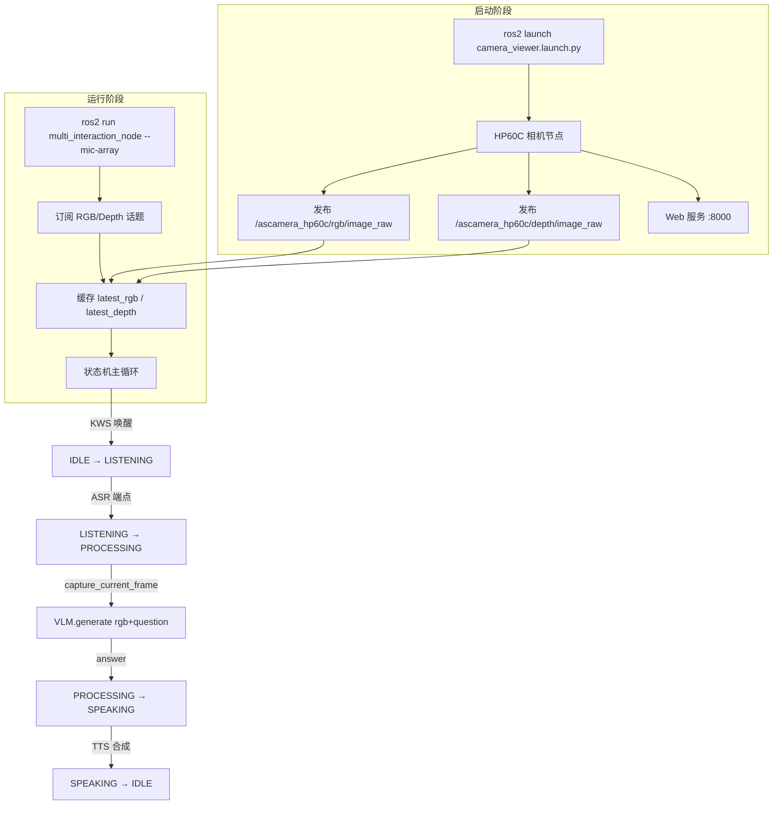

## 实验6：基于多模态大模型的视觉语言理解（VLM）实验（8h）

> **源码位置**：
> - 相机驱动：`ros2_ws/src/xflz_eai_car1/test/camera_web_viewer/`
> - 多模态交互节点：`ros2_ws/src/xflz_eai_car1/interaction/car1_multi_interaction/`
>
> **主命令**（需在两个终端分别执行）：
> ```bash
> # 终端 1：启动 HP60C 相机 + Web 可视化
> ros2 launch camera_web_viewer camera_viewer.launch.py
>
> # 终端 2：启动多模态交互节点（带 6 麦阵列）
> ros2 run car1_multi_interaction multi_interaction_node --mic-array
> ```
>
> **平台**：具身智能实验箱 B2（含 RK3576 NPU 6TOPS + HP60C 深度相机 + 讯飞 6 麦阵列）
>
> **本实验整合**：实验 1-3 的 KWS+ASR+TTS 模块 + 实验 4 的 LLM 推理引擎，并加入视觉维度，构建"看+听+说"的多模态闭环。

---

### 6.1 关联知识点

- 6.6.1 ROS2 节点与话题订阅 > 概念 > 节点、话题、发布者/订阅者模型
- 6.6.2 HP60C 相机驱动 > 流程 > `ascamera_node` 启动 RGB + 深度图像
- 6.6.3 camera_web_viewer > 流程 > Flask + SocketIO 推送相机画面到浏览器
- 6.6.4 CvBridge 图像转换 > 原理 > `sensor_msgs/Image` ↔ OpenCV `numpy.ndarray`
- 6.6.5 多模态状态机 > 概念 > IDLE → LISTENING → PROCESSING → SPEAKING → IDLE 四态
- 6.6.6 视觉语言模型 (VLM) > 概念 > Vision Encoder（图像 → 特征）+ LLM（特征+文本 → 回答）
- 6.6.7 帧抓取 > 实践 > `capture_current_frame` 锁 + `latest_rgb.copy()`
- 6.6.8 Qwen3.5-0.8B Vision + LLM > 事实 > RKNN（vision encoder）+ RKLLM（LLM）双模型协同
- 6.6.9 rclpy.spin_once + 超时轮询 > 实践 > 0.01s 处理 ROS2 回调 + 0.1s 拉取音频块
- 6.6.10 XFM 6 麦硬件唤醒 > 原理 > AIUI 协议串口事件，替代 sherpa-onnx KWS

---

### 6.2 实验目标

1. **理解 ROS2 节点订阅模型**（发布者/订阅者、话题、消息类型）— 概念理解
2. **掌握 HP60C 相机启动与 RGB/Depth 话题**（`camera_viewer.launch.py`）— 流程掌握
3. **理解多模态状态机的四态设计**（IDLE/LISTENING/PROCESSING/SPEAKING）— 概念理解
4. **能读懂 `multi_interaction_node.py` 主循环**（ROS2 回调 + 音频队列分发）— 代码阅读
5. **理解 VLM "图像 + 问题 → 回答" 的基本流程**（Vision Encoder + LLM）— 概念理解
6. **能用 launch 文件 + `ros2 run` 完成端到端多模态交互测试**— 端到端实操
7. **能区分真实部署与占位实现**（VLM 当前是占位符，待集成 RKNN-LLM C++ SDK）— 工程认知

---

### 6.3 实验环境

| 类别 | 配置 |
|------|------|
| 硬件 | 具身智能实验箱 B2 / 机器人小车 C1（RK3576 NPU 6TOPS + HP60C 深度相机 + 讯飞 6 麦阵列） |
| OS | Ubuntu 22.04 + ROS2 Humble |
| Python | 3.10（推荐 `ros2_venv`） |
| 核心库 | `rclpy`、`cv_bridge`、`opencv-python`、`sherpa_onnx`、`sensor_msgs` |
| 相机驱动 | `ascamera`（HP60C）+ `camera_web_viewer`（Flask + SocketIO @ :8000） |
| KWS | sherpa-onnx 板载 KWS（无阵列时）/ XFM 硬件唤醒（有阵列时） |
| ASR | sherpa-onnx OnlineRecognizer (zipformer_onnx) |
| TTS | sherpa-onnx OfflineTts (Matcha-TTS + Vocos) |
| VLM | Qwen3.5-0.8B Vision (RKNN) + LLM (RKLLM) — **当前为占位实现** |
| 主入口 | `camera_viewer.launch.py`（相机）+ `multi_interaction_node.py`（交互） |

---

### 6.4 实验难度

- 难度：⭐⭐⭐ 高
- 重点：ROS2 节点订阅、四态状态机、camera_web_viewer 启动流程
- 难点：理解"图像 + 文本 → VLM → 回答"的多模态融合机制；区分占位实现与真实部署

---

### 6.5 实验现象

**快速验证流程**（两个终端）：

```bash
# 终端 1：启动 HP60C 相机 + Web 可视化
ros2 launch camera_web_viewer camera_viewer.launch.py
# 输出：
#   [INFO] [ascamera_hp60c.ascamera_node]: ascamera_node started
#   [INFO] [camera_web_server]: Camera Web Server started on http://0.0.0.0:8000
#   [INFO] [camera_web_server]: Open browser and visit http://<board-ip>:8000

# 浏览器访问 http://<board-ip>:8000 应能看到相机实时画面（RGB + 点云）
```

```bash
# 终端 2：启动多模态交互节点
ros2 run car1_multi_interaction multi_interaction_node --mic-array
# 输出：
#   [Main ] 已订阅相机话题，等待图像...
#   [Main ] 检测讯飞麦克风阵列...
#   [Main ] 找到录音设备: plughw:4,0 (XFMDPV0018)
#   [Main ] 找到播放设备: plughw:4,0 (USB Audio Device)
#   [KWS  ] KWS 初始化完成
#   [ASR  ] ASR 初始化完成
#   [TTS  ] TTS 初始化完成
#   [VLM  ] Vision model: /home/iflytek/models/rkllm/Qwen3.5-0.8B_vision_rk3576.rknn
#   [VLM  ] LLM model: /home/iflytek/models/rkllm/Qwen3.5-0.8B_w4a16_g128_rk3576.rkllm
#   [VLM  ] 警告: VLM 初始化未完成，需要集成 RKNN-LLM C++ SDK
#   [Main ] 初始化完成
#   ==================================================
#   多模态交互就绪 — 说唤醒词开始对话
#   ==================================================

# 唤醒："小飞小飞"
# [KWS ] 硬件唤醒检测
# [Main] IDLE → LISTENING
# 说话："画面中有什么？"
# [ASR ] 识别: 画面中有什么
# [Main] LISTENING → PROCESSING (画面中有什么)
# [VLM ] 画面尺寸: (480, 640, 3)
# [VLM ] 模拟回答问题: 画面中有什么
# [Answer] 我看到画面中有一些物体，但目前 VLM 模型尚未集成。请稍后再试。
# [Main] PROCESSING → SPEAKING
# [TTS ] 合成: 我看到画面中有一些物体...
# [Main] SPEAKING → IDLE
```

**预期效果**：

- 相机启动后，浏览器访问 `http://<board-ip>:8000` 看到 25 FPS 实时画面
- 唤醒后 ≤ 2s 内开始 ASR 识别，端点检测自动结束
- 相机就绪时 `latest_rgb` shape 为 `(480, 640, 3)` BGR 格式
- VLM 推理接口调用正常（当前返回占位文本，真实部署需集成 RKNN-LLM C++ SDK）
- TTS 合成 + 播报 < 2s（短句）
- 多模态端到端延迟：唤醒→ASR→PROCESSING→TTS 播报 ≤ 5s

> **注意**：当前 VLM 是 **占位实现**（`VisionLanguageModel.generate` 返回模拟文本），完整部署需集成 RKNN-LLM C++ SDK（参考 `rknn-llm-release-v1.3.0/examples/multimodal_model_demo/`）。本实验重点是状态机、ROS2 话题订阅与多模态闭环架构，VLM 推理部分留作进阶课题。

---

### 6.6 实验步骤

#### 整体流程图



---

#### 步骤 1：理解 ROS2 节点订阅模型（阶段一：能跑通，30 min）

> 本步骤对应 `multi_interaction_node.py` `__init__` 中的 `create_subscription`（L200-211）

**给初学者**：在 ROS2 中，"节点（Node）"是独立运行的进程；"话题（Topic）"是节点间通信的"频道"；发布者往话题里发数据，订阅者从话题里拿数据。本实验的相机节点（`ascamera_node`）是**发布者**，多模态交互节点是**订阅者**——它们通过 `/ascamera_hp60c/rgb/image_raw` 这个话题通信。

**核心知识点**：

**ROS2 话题订阅三要素（6.6.1）**

- **原理**：
  1. **消息类型**：`Image`（来自 `sensor_msgs.msg`，包含 height/width/data 等字段）
  2. **话题名**：`/ascamera_hp60c/rgb/image_raw`（带命名空间，避免冲突）
  3. **回调函数**：`rgb_callback`，每收到一帧就自动调用
- **源码对应**：`multi_interaction_node.py` L200-205

```python
# multi_interaction_node.py L200-205：订阅 RGB 图像
self.rgb_sub = self.create_subscription(
    Image,                                       # 消息类型
    '/ascamera_hp60c/rgb/image_raw',             # 话题名
    self.rgb_callback,                           # 回调函数
    10                                           # QoS 队列深度
)
```

**操作步骤**：

1. **检查话题是否存在**（启动相机后）：
   ```bash
   ros2 topic list | grep ascamera
   # 预期：/ascamera_hp60c/rgb/image_raw
   #       /ascamera_hp60c/depth/image_raw
   #       /ascamera_hp60c/depth/points
   ```

2. **查看话题频率**：
   ```bash
   ros2 topic hz /ascamera_hp60c/rgb/image_raw
   # 预期：average rate: 25.0
   ```

3. **查看话题数据**：
   ```bash
   ros2 topic echo /ascamera_hp60c/rgb/image_raw --once
   # 输出一帧 sensor_msgs/Image 消息（height=480, width=640, encoding=bgr8）
   ```

**易错点**：
- ⚠️ **节点启动顺序错误** → 必须先启动 `camera_viewer.launch.py`（相机），再启动 `multi_interaction_node`（订阅者），否则订阅时无数据
- ⚠️ **话题名写错** → 区分 `/ascamera_hp60c/rgb/image_raw`（带命名空间）和 `/rgb/image_raw`（不带）
- ⚠️ **QoS 队列深度太小** → 图像帧被丢弃，订阅者跟不上发布者速度

---

#### 步骤 2：启动 HP60C 相机与 Web 可视化（阶段一：能跑通，30 min）

> 本步骤对应 `camera_web_viewer/camera_viewer.launch.py`（L1-42）

**给初学者**：Launch 文件是 ROS2 用来"一键启动多个节点"的脚本。本实验的 `camera_viewer.launch.py` 会同时启动两个节点：(1) 真正的相机驱动 `ascamera_node`（推 RGB/Depth 到话题）；(2) 一个 Flask Web 服务，把相机画面推送到浏览器供你观察。

**核心知识点**：

**camera_viewer.launch.py 启动两个节点（6.6.2 + 6.6.3）**

- **原理**：
  - **`ascamera_node`**：HP60C 深度相机的 ROS2 驱动，从 USB 读取传感器数据，发布 4 个话题（RGB、深度、点云、相机内参）。
  - **`camera_web_server`**：Flask + SocketIO 服务，订阅 RGB/点云话题，通过 WebSocket 推送到浏览器（`http://<board-ip>:8000`）。
- **源码对应**：`camera_viewer.launch.py` L11-38

```python
# camera_viewer.launch.py L11-30：HP60C 相机节点
ascamera_node = Node(
    namespace='ascamera_hp60c',                      # 命名空间
    package='ascamera',                              # 功能包名
    executable='ascamera_node',                      # 可执行文件
    respawn=True,                                    # 崩溃自动重启
    output='both',                                   # 日志输出到终端和日志
    parameters=[
        {"usb_bus_no": -1},
        {"usb_path": "null"},
        {"confiPath": '/home/iflytek/.../configurationfiles'},
        {"color_pcl": True},                         # 点云带 RGB
        {"pub_tfTree": True},                        # 发布 TF 坐标变换
        {"depth_width": 640, "depth_height": 480},
        {"rgb_width": 640, "rgb_height": 480, "fps": 25},
    ],
)

# camera_viewer.launch.py L33-38：Web 服务
web_server = Node(
    package='camera_web_viewer',
    executable='server',
    name='camera_web_server',
    output='both',
)
```

**操作步骤**：

1. **确认 HP60C 相机已通过 USB 连接**：
   ```bash
   lsusb | grep -i "3D Camera\|HP60C"
   # 预期：Bus 001 Device 005: ID ... HP60C
   ```

2. **启动 launch 文件**：
   ```bash
   ros2 launch camera_web_viewer camera_viewer.launch.py
   # 看到：
   #   [INFO] [ascamera_hp60c.ascamera_node-1]: process started
   #   [INFO] [camera_web_server-2]: process started
   #   [INFO] [camera_web_server-2]: Camera Web Server started on http://0.0.0.0:8000
   ```

3. **浏览器访问**：
   ```
   http://<board-ip>:8000
   ```
   应能看到 25 FPS 实时 RGB 画面 + 3D 点云（用鼠标拖动旋转）。

4. **检查 Web 服务器话题订阅**（可选）：
   ```bash
   ros2 node info /camera_web_server
   # 应显示其订阅了 /ascamera_hp60c/rgb/image_raw 等
   ```

**易错点**：
- ⚠️ **`confiPath` 路径错误** → 相机无法读取配置，需检查 `/home/iflytek/ros2_ws/src/xflz_eai_car1/examples/camera/HP60C/src/ascamera/configurationfiles` 目录是否存在
- ⚠️ **USB 端口被占用** → `lsof | grep ttyUSB` 检查；拔掉其他 USB 串口设备
- ⚠️ **Web 服务端口 8000 被占用** → 修改 `camera_web_viewer/server.py` 中的 `port` 参数

---

#### 步骤 3：多模态状态机——四态流转（阶段二：能理解，45 min）

> 本步骤对应 `multi_interaction_node.py` `run` 主循环 + `_handle_idle/listening/speaking`（L421-465, L486-503, L526-547, L592-598）

**给初学者**：实时系统（语音交互、机器人控制）通常用"状态机"来管理。状态机把系统行为分成若干个"状态"（比如"等待唤醒"、"正在听"、"正在播报"），每个状态只处理特定事件，状态之间按规则切换。本实验的多模态交互有 **4 个状态**，比实验 5 的纯语音交互（3 个）多了一个 `PROCESSING` 状态——因为"看图思考"比"直接回答"更耗时，需要单独的等待状态。

**核心知识点**：

**四态状态机（6.6.5）**

- **原理**：

| 状态 | 含义 | 触发事件 | 下一状态 |
|------|------|---------|---------|
| **IDLE** | 等待唤醒 | KWS 检测到唤醒词 | → LISTENING |
| **LISTENING** | 听用户说话 | ASR 端点检测到 | → PROCESSING |
| **PROCESSING** | 等待 VLM 推理 | VLM 返回 answer | → SPEAKING |
| **SPEAKING** | 播报回答 | TTS 合成完成 | → IDLE |

- **源码对应**：`multi_interaction_node.py` L216-220（状态字段）、L460-465（主循环分发）

```python
# multi_interaction_node.py L215-220：状态机字段
self.state = "IDLE"
self.running = True
self.interrupt_event = threading.Event()
self.speaking_done = threading.Event()
self.speaking_done.set()  # 初始为 True（未在播报）

# multi_interaction_node.py L460-465：主循环状态分发
if self.state == "IDLE":
    self._handle_idle(chunk)
elif self.state == "LISTENING":
    self._handle_listening(chunk)
elif self.state == "SPEAKING":
    self._handle_speaking(chunk)
```

**主循环轮询结构（6.6.9）**

- **原理**：
  - 0.01s 超时 `rclpy.spin_once`：处理 ROS2 回调（图像、参数等）
  - 0.1s 超时 `audio_queue.get`：从录音线程拉取音频块
  - 双重超时让单线程既能响应 ROS2 事件又不阻塞音频处理
- **源码对应**：`multi_interaction_node.py` L451-457

```python
# multi_interaction_node.py L451-465：主循环
try:
    while self.running and rclpy.ok():
        rclpy.spin_once(self, timeout_sec=0.01)        # ROS2 回调
        try:
            chunk = self.audio_queue.get(timeout=0.1)   # 音频块
        except Empty:
            continue
        if self.state == "IDLE":
            self._handle_idle(chunk)
        elif self.state == "LISTENING":
            self._handle_listening(chunk)
        elif self.state == "SPEAKING":
            self._handle_speaking(chunk)
```

**操作步骤**：

1. **打印当前状态**（临时修改源码用于调试）：
   ```python
   # multi_interaction_node.py L460 前加入
   log.info(f"state={self.state}, chunk_len={len(chunk)}")
   ```

2. **观察状态切换日志**（实际启动后）：
   ```bash
   # 唤醒 → 说话 → 等待回答
   [Main] state=IDLE, chunk_len=4000
   [KWS ] 硬件唤醒检测
   [Main] state=LISTENING, chunk_len=4000
   [ASR ] 识别: 画面中有什么
   [Main] state=PROCESSING, chunk_len=4000
   [VLM ] 画面尺寸: (480, 640, 3)
   [Main] state=SPEAKING, chunk_len=4000
   [Main] state=IDLE, chunk_len=4000
   ```

3. **手动触发状态切换**（ROS2 命令注入）：
   ```bash
   # 暂时把 self.state 改成 PROCESSING 观察日志
   # 或者用 ros2 param set 设置状态
   ros2 param set /multi_modal_interaction state PROCESSING
   ```

**易错点**：
- ⚠️ **`PROCESSING` 状态忘记在主循环处理** → 状态机卡死，永远停留在此状态
- ⚠️ **`asr_stream` 忘记重置** → 下一轮对话继承旧的 ASR stream，导致识别错乱
- ⚠️ **`rclpy.spin_once` 超时太长** → ROS2 回调不及时，图像延迟

---

#### 步骤 4：RGB/Depth 图像缓存与帧抓取（阶段二：能理解，30 min）

> 本步骤对应 `multi_interaction_node.py` `rgb_callback` + `depth_callback` + `capture_current_frame`（L384-407）

**给初学者**：相机每秒钟发 25 帧图片，但 VLM 推理比较慢（一次推理要 1-2 秒）。如果 VLM 推理完才去取最新一帧，会丢掉大量中间帧。所以本实验采用"缓存最新帧"策略——相机回调只负责把最新一帧存到 `self.latest_rgb`，VLM 需要时直接拷贝走。

**核心知识点**：

**CvBridge 转换（6.6.4）**

- **原理**：`sensor_msgs/Image` 是 ROS2 标准消息类型（包含 `data` 字节数组、`encoding`、`height`、`width` 等），不能直接被 OpenCV 处理。`CvBridge` 是 ROS2 官方提供的转换桥梁，把 `Image` ↔ `numpy.ndarray`。
- **源码对应**：`multi_interaction_node.py` L387, L397

```python
# multi_interaction_node.py L384-391：RGB 回调
def rgb_callback(self, msg):
    """RGB 图像回调（每帧自动调用）"""
    try:
        cv_image = self.bridge.imgmsg_to_cv2(msg, desired_encoding='bgr8')
        with self.image_lock:
            self.latest_rgb = cv_image
    except Exception as e:
        self.get_logger().error(f'RGB 转换失败: {e}')
```

**capture_current_frame（6.6.7）**

- **原理**：
  - 加 `image_lock`（threading.Lock）防止多线程同时读写 `latest_rgb` 引起的数据竞争
  - 调用时 `copy()` 一份出去，避免后续帧覆盖导致数据错乱
- **源码对应**：`multi_interaction_node.py` L402-407

```python
# multi_interaction_node.py L402-407：抓取当前帧
def capture_current_frame(self):
    """抓取当前帧（线程安全）"""
    with self.image_lock:
        rgb = self.latest_rgb.copy() if self.latest_rgb is not None else None
        depth = self.latest_depth.copy() if self.latest_depth is not None else None
    return rgb, depth
```

**操作步骤**：

1. **手动触发相机回调**（用 ROS2 命令发布一张测试图）：
   ```bash
   # 启动一个测试节点发布假图像
   ros2 topic pub --once /ascamera_hp60c/rgb/image_raw sensor_msgs/Image "{...}"
   ```

2. **验证缓存更新**（在源码加 print）：
   ```python
   # rgb_callback 末尾加
   if self.latest_rgb is not None:
       log.info(f"已缓存 RGB 帧: {self.latest_rgb.shape}")
   ```

3. **测试线程安全**（多线程读写）：
   ```python
   # capture_current_frame 中加 assert
   assert self.image_lock.acquire(blocking=False), "锁竞争!"
   self.image_lock.release()
   ```

**易错点**：
- ⚠️ **回调里没加锁** → 多线程同时读写 `latest_rgb` 崩溃
- ⚠️ **`copy()` 忘了调用** → 后续帧覆盖之前传给 VLM 的图像，导致 VLM 看到错乱画面
- ⚠️ **相机未就绪** → `latest_rgb is None`，VLM 收到空帧；需在 `_process_question` 中检查（已实现，L557-559）

---

#### 步骤 5：VLM 多模态推理（阶段二：能理解，30 min）

> 本步骤对应 `multi_interaction_node.py` `VisionLanguageModel`（L140-172）

**给初学者**：VLM（视觉语言模型）= "视觉编码器 + 大语言模型"。视觉编码器把图片变成一串数字（特征向量），大语言模型把这些数字 + 你的问题当作输入，生成自然语言回答。本实验使用 Qwen3.5-0.8B 的视觉版：在 RK3576 NPU 上，视觉编码器用 RKNN 跑，LLM 用 RKLLM 跑。

**核心知识点**：

**VLM 双模型协同（6.6.6 + 6.6.8）**

- **原理**：
  1. **Vision Encoder**（`Qwen3.5-0.8B_vision_rk3576.rknn`）：输入 RGB 图像，输出图像特征（image embeddings）
  2. **LLM**（`Qwen3.5-0.8B_w4a16_g128_rk3576.rkllm`）：输入"图像特征 + 文本问题"，输出文本回答
  3. 两个模型**串联**：图像 → vision encoder → 特征 → 注入 LLM → 文本回答
- **源码对应**：`multi_interaction_node.py` L376-382 + L155-172

```python
# multi_interaction_node.py L376-382：VLM 初始化
def _init_vlm(self):
    """初始化视觉语言模型"""
    vision_model = "/home/iflytek/models/rkllm/Qwen3.5-0.8B_vision_rk3576.rknn"
    llm_model = "/home/iflytek/models/rkllm/Qwen3.5-0.8B_w4a16_g128_rk3576.rkllm"
    self.vlm = VisionLanguageModel(vision_model, llm_model)

# multi_interaction_node.py L155-172：VLM 推理接口（占位实现）
def generate(self, image_rgb, question):
    """
    Args:
        image_rgb: numpy array (H, W, 3), BGR format
        question: str, 用户问题
    Returns:
        str: 模型回答
    """
    # TODO: 集成 RKNN-LLM C++ SDK 实现真正推理
    log_vlm.warning(f"模拟回答问题: {question}")
    return "我看到画面中有一些物体，但目前 VLM 模型尚未集成。请稍后再试。"
```

**操作步骤**：

1. **查看当前 VLM 占位实现**：
   ```bash
   grep -A 5 "class VisionLanguageModel" \
     ros2_ws/src/xflz_eai_car1/interaction/car1_multi_interaction/car1_multi_interaction/multi_interaction_node.py
   ```

2. **观察 VLM 警告日志**（启动后）：
   ```bash
   [VLM] 警告: VLM 初始化未完成，需要集成 RKNN-LLM C++ SDK
   ```

3. **替换为简单实现**（基于 `rknn-llm` Python 接口，参考官方 demo）：
   ```python
   # vision_language_model.py 中的 generate 方法伪代码
   def generate(self, image_rgb, question):
       # 1. 图像预处理：resize 到 448x448 + normalize
       img_input = self.preprocess(image_rgb)         # (1, 3, 448, 448)
       # 2. RKNN 推理得到 image embeddings
       image_embed = self.rknn_vision.infer(img_input) # (1, 256, 4096)
       # 3. 构造 LLM 输入
       prompt = f"<image>{question}"                   # Qwen-VL 格式
       input_ids = self.tokenizer.encode(prompt)
       # 4. RKLLM 推理
       output = self.rkllm_llm.infer(
           input_ids=input_ids,
           image_embed=image_embed,
           max_new_tokens=256
       )
       return self.tokenizer.decode(output)
   ```

**易错点**：
- ⚠️ **占位实现未替换** → 启动后看到 "VLM 尚未集成" 是正常的，等真实部署后才是真推理
- ⚠️ **图像尺寸不匹配** → Vision encoder 期望 448x448，必须 resize
- ⚠️ **`<image>` 占位符缺失** → Qwen-VL prompt 格式要求图像位置有特殊标记

> **重要**：本实验 VLM 是**占位实现**（L172 返回模拟文本）。完整部署需参考 RKNN-LLM 官方文档：`rknn-llm-release-v1.3.0/examples/multimodal_model_demo/`。学员在本实验中应理解多模态融合的**架构**，真实部署留作后续课题。

---

#### 步骤 6：TTS 合成与播报（阶段三：能改造，30 min）

> 本步骤对应 `multi_interaction_node.py` `_tts_to_pcm` + `_tts_worker`（L409-419, L578-590）

**给初学者**：VLM 给出文本回答后，需要让用户"听到"——这就是 TTS（Text-to-Speech）的工作。本实验复用实验 3 的 Matcha-TTS + Vocos 声码器，把文本转成 PCM 音频，再通过持久化 aplay 进程播放。**复用**意味着代码不用从头写，这正是模块化设计的优势。

**核心知识点**：

**TTS 合成与持久化播放（6.6.9）**

- **原理**：
  1. TTS 接收文本 → 合成 int16 PCM 音频
  2. 持久化 aplay 进程（`Popen` 启动一次）持续接收 stdin PCM
  3. 整段 PCM 一次性写入并播放
  4. 播完设置 `speaking_done` 事件，状态机回到 IDLE
- **源码对应**：`multi_interaction_node.py` L68-134（Playback 类）+ L409-419（_tts_to_pcm）+ L578-590（_tts_worker）

```python
# multi_interaction_node.py L409-419：TTS 合成
def _tts_to_pcm(self, text):
    """TTS 合成 → S16_LE 立体声 PCM"""
    if not text:
        return b""
    audio = self.tts.generate(text, sid=self.tts_sid, speed=self.tts_speed)
    samples = np.array(audio.samples, dtype=np.float32)
    samples = (samples * self.tts_gain).clip(-1.0, 1.0)   # 软削峰
    mono = (samples * 32767).astype(np.int16)             # float → int16
    stereo = np.column_stack([mono, mono]).ravel()        # mono → stereo
    return stereo.tobytes()                                # 字节流

# multi_interaction_node.py L578-590：TTS worker
def _tts_worker(self, text):
    """TTS 播报线程"""
    print(f"\n[Answer] {text}\n", flush=True)
    try:
        if not self.interrupt_event.is_set():
            pcm = self._tts_to_pcm(text)
            if pcm:
                self.playback.write(pcm)                   # 持久化 aplay 写入
    except Exception as e:
        log_tts.error(f"TTS 异常: {e}")
    finally:
        self.speaking_done.set()                           # 关键：必触发
```

**操作步骤**：

1. **单独测试 TTS 合成**（无 VLM）：
   ```python
   # 在 REPL 或脚本中
   from multi_interaction_node import MultiModalInteractionNode
   # 不推荐直接实例化（会加载模型），改为单独导入
   import sherpa_onnx
   tts = sherpa_onnx.OfflineTts(...)
   audio = tts.generate("你好")
   print(audio.samples[:100])  # int16 数组
   ```

2. **观察 TTS 播放日志**：
   ```bash
   [Main] PROCESSING → SPEAKING
     [Answer] 我看到画面中有一些物体，但目前 VLM 模型尚未集成。
   [TTS] 合成: 我看到画面中有一些物体...
   [Main] SPEAKING → IDLE
   ```

3. **调整 TTS 语速**（临时修改）：
   ```python
   # multi_interaction_node.py L371
   self.tts_speed = 1.2  # 改大更快
   ```

**易错点**：
- ⚠️ **TTS 合成耗时 > 2s** → 整句合成延迟高，学员可改进为流式 TTS（参考实验 5 `voice_interaction.py` 的 `SENTENCE_RE` 分句）
- ⚠️ **`speaking_done.set()` 漏写** → 主循环永久卡在 SPEAKING 状态
- ⚠️ **打断功能未实现**（L594 有 TODO 注释）→ 当前 SPEAKING 状态无法被唤醒词打断

---

#### 步骤 7：XFM 6 麦阵列硬件唤醒（阶段三：能改造，20 min）

> 本步骤对应 `multi_interaction_node.py` `_setup_mic_array` + `_detect_xfm_devices`（L246-294）

**给初学者**：与实验 5 一样，多模态交互也支持 XFM 6 麦硬件唤醒。区别在于本实验在 ROS2 节点中通过 `XfMicArray.wakeup_callback` 回调触发，比实验 5 的纯 Python 脚本更"嵌入式"。

**核心知识点**：

**XFM 硬件唤醒集成（6.6.10）**

- **原理**：
  1. 启动时通过 `_detect_xfm_devices` 找到 `plughw:X,0` 设备
  2. 初始化 `XfMicArray(vendor_id=0x1a86, product_id=0x55d4)` 控制器
  3. 设置唤醒词（最多 3 个）：`小飞小飞,小飞同学,你好小飞`
  4. 启动后绑定 `wakeup_callback = on_wakeup`（设置 `mic_array_wakeup_detected` 事件）
  5. IDLE 状态检测 `mic_array_wakeup_detected.is_set()` → 触发 LISTENING
- **源码对应**：`multi_interaction_node.py` L246-262, L424-435, L488-492

```python
# multi_interaction_node.py L424-435：启动 XFM 唤醒
if self.use_mic_array:
    def on_wakeup():
        self.mic_array_wakeup_detected.set()
    self.mic_array.wakeup_callback = on_wakeup
    if not self.mic_array.start():
        log.error("无法启动麦克风阵列")
        return
    for word in self.wakeup_words.split(',')[:3]:
        self.mic_array.set_wake_word(word.strip())
        time.sleep(0.2)

# multi_interaction_node.py L488-492：IDLE 中检测硬件唤醒
def _handle_idle(self, chunk):
    if self.use_mic_array:
        if self.mic_array_wakeup_detected.is_set():
            self.mic_array_wakeup_detected.clear()
            log_kws.info("硬件唤醒检测")
            self._start_listening()
```

**操作步骤**：

1. **板载麦克风模式**（无 XFM）：
   ```bash
   ros2 run car1_multi_interaction multi_interaction_node
   # [KWS] KWS 初始化完成（使用 sherpa-onnx 板载 KWS）
   ```

2. **6 麦阵列模式**（有 XFM）：
   ```bash
   ros2 run car1_multi_interaction multi_interaction_node --mic-array
   # [Main] 检测讯飞麦克风阵列...
   # [Main] 找到录音设备: plughw:4,0 (XFMDPV0018)
   ```

3. **自定义唤醒词**（修改源码）：
   ```python
   # 启动时传参
   ros2 run car1_multi_interaction multi_interaction_node --mic-array \
     --ros-args -p wakeup_words:="嗨嗨,小助手"
   # 或者直接改默认参数 L616
   parser.add_argument("--wakeup-words", default="嗨嗨,小助手")
   ```

**易错点**：
- ⚠️ **未插 XFM 却用 `--mic-array`** → 启动时 `RuntimeError: 未找到 XFM 麦克风阵列设备`
- ⚠️ **唤醒词超过 3 个** → XFM 硬件只支持最多 3 个唤醒词，超出被截断
- ⚠️ **板载 KWS 模型文件不存在** → 检查 `/home/iflytek/models/zipformer_kws/` 目录

---

#### 步骤 8：端到端测试与多模态交互流程（阶段三：能改造，30 min）

> 本步骤对应完整 `multi_interaction_node.py` 主流程

**核心知识点**：

**完整多模态闭环**

- **原理**：
  1. **相机启动**：`ros2 launch camera_viewer.launch.py` → 相机节点发布 RGB/Depth → Web 服务渲染到浏览器
  2. **交互节点启动**：`ros2 run multi_interaction_node --mic-array` → 订阅相机话题 + 初始化 KWS/ASR/TTS/VLM
  3. **唤醒**：用户说"小飞小飞" → XFM 硬件唤醒 → IDLE → LISTENING（排空音频队列 + 0.2s）
  4. **ASR**：用户问"画面中有什么？" → ASR 端点检测 → LISTENING → PROCESSING
  5. **VLM**：抓取当前 RGB 帧 + question → `vlm.generate` → answer
  6. **TTS**：answer → Matcha-TTS 合成 PCM → 持久化 aplay 播放 → PROCESSING → SPEAKING
  7. **播完**：`speaking_done.set()` → SPEAKING → IDLE → 等待下一轮唤醒

**操作步骤**：

1. **完整端到端测试**（两个终端 + 浏览器）：
   ```bash
   # 终端 1：相机
   ros2 launch camera_web_viewer camera_viewer.launch.py
   # 浏览器：http://<board-ip>:8000 看到画面

   # 终端 2：交互
   ros2 run car1_multi_interaction multi_interaction_node --mic-array
   ```

2. **多轮测试问题清单**：
   | 用户问题 | 期望行为 |
   |---------|---------|
   | "画面中有什么？" | 描述画面内容（VLM 占位文本） |
   | "颜色是什么？" | 描述主色调 |
   | "桌上有几个物品？" | 报数字 |
   | "描述一下眼前的场景" | 长文本描述 |

3. **观察日志确认四态切换**：
   ```bash
   [KWS ] 硬件唤醒检测
   [Main] IDLE → LISTENING
   [ASR ] 识别: 画面中有什么
   [Main] LISTENING → PROCESSING
   [VLM ] 画面尺寸: (480, 640, 3)
   [VLM ] 模拟回答问题: 画面中有什么
   [Answer] 我看到画面中有一些物体...
   [Main] PROCESSING → SPEAKING
   [Main] SPEAKING → IDLE
   ```

4. **多模态闭环延迟测量**（粗略）：
   ```bash
   # 唤醒时刻：[Main] IDLE → LISTENING
   # 播报完成：[Main] SPEAKING → IDLE
   # 两者时间差 ≈ 端到端延迟
   ```

**易错点**：
- ⚠️ **相机未启动就开始交互** → `latest_rgb is None`，VLM 返回"相机未就绪"
- ⚠️ **唤醒后立即说话** → XFM 唤醒后有 0.2s drain 时间，过早说话会被截断
- ⚠️ **VLM 占位文本误以为 bug** → 当前 VLM 是 TODO，真实部署后会输出有意义回答

---

#### 完整可运行代码与 README

完整 demo 代码与 README 已发布在 `courses/sheet1/speech_practice/source-codes/exp06/`：

| 文件 | 说明 |
|------|------|
| [README.md](file:///e:/Source/xflz_eai_car1/course_generate_agent/courses/sheet1/speech_practice/source-codes/exp06/README.md) | 源码对照表（实验步骤↔代码行号）、9 道思考题、ROS2 话题订阅详解、camera_web_viewer 启动流程、四态状态机时序图 |
| [demo_multi_interaction.py](file:///e:/Source/xflz_eai_car1/course_generate_agent/courses/sheet1/speech_practice/source-codes/exp06/demo_multi_interaction.py) | 简化版多模态交互 demo（不依赖 ROS2/真模型），用模拟函数演示 IDLE/LISTENING/PROCESSING/SPEAKING 四态流转、相机缓存抓帧、VLM 推理占位 |
| [multi_interaction_node.py](file:///e:/Source/xflz_eai_car1/course_generate_agent/courses/sheet1/speech_practice/source-codes/exp06/multi_interaction_node.py) | ROS2 多模态交互节点主入口（与 ROS2 仓库一致） |
| [camera_viewer.launch.py](file:///e:/Source/xflz_eai_car1/course_generate_agent/courses/sheet1/speech_practice/source-codes/exp06/camera_viewer.launch.py) | HP60C 相机 + Web 服务启动 launch（与 ROS2 仓库一致） |
| [multi_interaction.launch.py](file:///e:/Source/xflz_eai_car1/course_generate_agent/courses/sheet1/speech_practice/source-codes/exp06/multi_interaction.launch.py) | 相机 + 交互节点一键启动 launch（备选方案） |
| [keywords.txt](file:///e:/Source/xflz_eai_car1/course_generate_agent/courses/sheet1/speech_practice/source-codes/exp06/keywords.txt) | 板载 KWS 唤醒词列表（拼音@中文格式） |
| [multi_interaction.yaml](file:///e:/Source/xflz_eai_car1/course_generate_agent/courses/sheet1/speech_practice/source-codes/exp06/multi_interaction.yaml) | 主配置文件（唤醒词、相机话题、模型路径、TTS 参数） |

**运行 demo（不依赖 ROS2/真模型）**：
```bash
cd courses/sheet1/speech_practice/source-codes/exp06/
python3 demo_multi_interaction.py
# ============================================================
#  多模态交互 demo（无 ROS2 依赖）
#  - 模拟相机 → 抓帧 → VLM 推理 → TTS 播报
#  - 状态机：IDLE / LISTENING / PROCESSING / SPEAKING
#  - 按 Ctrl+C 退出
# ============================================================
#
# [VLM] Vision encoder: Qwen3.5-0.8B_vision_rk3576.rknn
# [VLM] LLM: Qwen3.5-0.8B_w4a16_g128_rk3576.rkllm
# [VLM] 提示：当前为模拟推理，真实部署需集成 RKNN-LLM C++ SDK
#
# [KWS] 唤醒词命中
#   [DRAIN] 第1轮清空 3 帧
#   [DRAIN] 第2轮清空 1 帧
# [Main] IDLE → LISTENING
# [ASR] 画面中有什么？
# [Main] LISTENING → PROCESSING (画面中有什么？)
# [VLM] 画面尺寸: (480, 640, 3)
# [VLM] 模拟回答问题: 画面中有什么？
# [Answer] 我看到画面是一个 640x480 的场景，桌面上有一些物体。
# [Main] PROCESSING → SPEAKING
#   [TTS] 合成: 我看到画面是一个 640x480 的场景...
#   [TTS] 播放完成
# [Main] SPEAKING → IDLE
```

**真实部署流程（两个终端）**：
```bash
# 终端 1：HP60C 相机 + Web 可视化
ros2 launch camera_web_viewer camera_viewer.launch.py
# 浏览器访问 http://<board-ip>:8000 查看实时画面

# 终端 2：多模态交互节点（带 6 麦阵列）
ros2 run car1_multi_interaction multi_interaction_node --mic-array
# 唤醒 → 说话 → 听回答
```

---

### 6.7 注意事项

- ⚠️ **必须先启动相机 launch** → `multi_interaction_node` 订阅的相机话题必须先存在，否则 `latest_rgb` 永远为 None
- ⚠️ **HP60C USB 端口独占** → 不要同时插入其他 USB 串口设备，否则相机识别失败
- ⚠️ **confiPath 路径需正确** → 相机配置目录 `/home/iflytek/ros2_ws/src/xflz_eai_car1/examples/camera/HP60C/src/ascamera/configurationfiles` 必须存在
- ⚠️ **VLM 是占位实现** → 当前 `VisionLanguageModel.generate` 返回模拟文本，真实部署需集成 RKNN-LLM C++ SDK
- ⚠️ **打断功能未实现** → SPEAKING 状态下无法被唤醒词打断（L594 有 TODO 注释）
- ⚠️ **TTS 非流式** → 整句合成后播放，长回答延迟高（建议改进为流式 TTS，参考实验 5）
- ⚠️ **多模态闭环延迟目标 < 5s** → 唤醒→ASR→VLM→TTS 完整流程，瓶颈在 VLM 推理（当前占位，部署后约 1-2s）
- ⚠️ **Web 服务端口 8000** → 局域网内访问 `http://<board-ip>:8000`，确认防火墙开放
- ⚠️ **模型路径硬编码** → `/home/iflytek/models/rkllm/...` 需与实际部署路径一致

### 6.8 实验总结

**完成成果**：
- 启动 `camera_viewer.launch.py` 拉起 HP60C 相机，浏览器访问 :8000 看到实时画面
- 启动 `multi_interaction_node --mic-array` 跑通多模态交互状态机
- 验证四态切换：IDLE → LISTENING → PROCESSING → SPEAKING → IDLE
- 通过 ROS2 话题订阅机制缓存 RGB 帧，掌握 CvBridge 转换
- 理解 VLM "图像 + 问题 → 回答" 的双模型协同流程
- 体验 ROS2 + 语音 + 视觉三模块的端到端集成

**技能收获**：
- 掌握 ROS2 节点订阅模型（发布者/订阅者/话题/消息类型）
- 理解 launch 文件一键启动多个节点的机制
- 学会用 `rclpy.spin_once` + 超时轮询实现 ROS2 + 自定义线程协同
- 掌握多模态状态机的四态设计（比纯语音多 PROCESSING 状态）
- 理解 VLM 占位实现与真实部署的区别
- 学会 CvBridge 转换、线程安全缓存、ROS2 回调处理

**常见问题与解决**：

| 问题 | 原因 | 解决方法 |
|------|------|---------|
| 启动后 `latest_rgb is None` | 相机 launch 未启动 | 先 `ros2 launch camera_viewer.launch.py` |
| 浏览器访问 :8000 无画面 | Web 服务未启动 / 端口被占 | 检查 launch 启动日志；`lsof -i :8000` |
| KWS 唤醒不响应 | 板载 KWS 模型文件不存在 | 检查 `/home/iflytek/models/zipformer_kws/` |
| ASR 端点不触发 | 静音阈值太大 | 修改 `rule2_min_trailing_silence=1.5` |
| VLM 返回 "尚未集成" | 当前是占位实现 | 集成 RKNN-LLM C++ SDK（参考 `rknn-llm-release-v1.3.0`） |
| TTS 播报延迟 > 2s | 整句合成慢 | 改进为流式 TTS（参考实验 5 `SENTENCE_RE` 分句） |
| 打断无响应 | 打断功能未实现 | `_handle_speaking` L594 需加 KWS 检测 |
| 端到端延迟 > 5s | VLM 推理慢 | 用更小 VLM 模型；缓存最近帧；图像缩放到 336x336 |
| 相机 `confiPath` 错误 | 路径不存在 | 检查 `/home/iflytek/ros2_ws/.../configurationfiles` |

### 6.9 实验报告要求

**思考题**：
1. ROS2 节点订阅模型中，发布者和订阅者是如何"找到"对方的？如果启动顺序反了（先订阅后发布）会怎样？
2. 多模态状态机为什么比纯语音状态机多一个 PROCESSING 状态？能否合并到 LISTENING 或 SPEAKING？会带来什么问题？
3. `latest_rgb` 缓存为什么要加 `image_lock`？如果去掉锁，多线程同时读写会怎样？
4. VLM 的"Vision Encoder + LLM"双模型协同，相比"OCR + LLM"或"目标检测 + 模板回复"有什么优势？什么场景下后者更合适？
5. `camera_viewer.launch.py` 启动了两个节点（相机驱动 + Web 服务），它们的解耦意义是什么？如果把 Web 服务合并到相机驱动里会怎样？
6. `rclpy.spin_once(timeout_sec=0.01)` + `audio_queue.get(timeout=0.1)` 双重超时设计有什么工程意义？如果只用其中一个会出什么问题？
7. 当前 VLM 是占位实现（`VisionLanguageModel.generate` 返回模拟文本），但整体状态机和 ROS2 集成都是真实的。学员在本实验中应重点掌握架构还是推理？为什么？
8. **camera_web_viewer 用 Flask + SocketIO 把相机画面推到浏览器，与"用 RViz 直接订阅 ROS2 话题"相比有什么 trade-off？**
9. **如果多模态端到端延迟 > 5s（VLM 是瓶颈），从架构上能想到哪些优化策略？哪些是"治标"哪些是"治本"？**

**评分标准**：ROS2 节点订阅 10 分 + HP60C 相机启动 10 分 + 多模态状态机 20 分 + 图像缓存与抓帧 10 分 + VLM 流程理解 20 分 + TTS 集成 10 分 + XFM 唤醒 5 分 + 端到端测试 10 分 + 实验报告 5 分 = 100 分。

---

## 更新日志

| 版本 | 日期 | 变更 |
|------|------|------|
| v1.0 | 2026-08-04 | 初版生成（基于 _registry.yaml human_waiver 模式，标注 [待源码核实]） |
| v1.1 | 2026-08-07 | 重写：基于 `multi_interaction_node.py` + `camera_viewer.launch.py` 实际源码，移除 flask_server.py 旧路径，新增 ROS2 节点订阅、CvBridge 转换、4 态状态机、HP60C 启动流程、camera_web_viewer Web 服务等内容。说明 VLM 当前是占位实现 |
| v1.2 | 2026-08-07 | 完善 source-codes/exp06/：复制 multi_interaction_node.py + camera_viewer.launch.py + multi_interaction.launch.py + keywords.txt + multi_interaction.yaml，新增 demo_multi_interaction.py 简化版 demo，新增 README.md 源码对照说明（含 9 道思考题、状态机时序图、100 分评分标准） |
