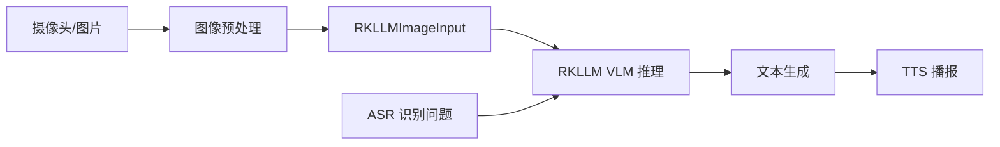

## 实验7：基于多模态大模型的视觉语言理解(VLM)实验（8h）

> ⚠️ **[待源码核实 / WAIT-SOURCE]** 源码位于 `ros2_ws/src/xflz_eai_car1/interaction/car1_llm/`，主入口 `llm_server/flask_server.py`（含 `RKLLMImageInput` 结构体定义）。`car1_interaction/llm_server/flask_server.py` 为备份实现。已通过 `human_waiver` 放行。

### 7.1 关联知识点

- 5.2.3 RKLLM 推理 > 原理 > 面向 RK3576 NPU 优化的本地推理引擎
- 5.4.1 VLM 概念 > 概念 > 联合编码图像与文本，支持 VQA
- 5.4.2 图像预处理 > 流程 > OpenCV/Pillow 加载→缩放→归一化
- 5.4.3 RKLLM_INPUT_MULTIMODAL > 原理 > 通过 RKLLMImageInput 注入视觉信息
- 5.5.1 多模态闭环 > 流程 > ASR→VLM→TTS 构建完整链路
- 5.5.2 <3s 延迟要求 > 原理 > 多模态响应延迟需 < 3s
- 5.5.3 性能指标 > 事实 > 图像编码耗时/推理延迟/显存占用

### 7.2 实验目标

1. 理解 VLM 相对纯文本 LLM 在视觉问答上的优势 — 原理理解
2. 掌握 RKLLM 多模态接口的调用与图像预处理 — 流程掌握
3. 独立完成 VQA 应用的图像上传、推理与结果解析 — 独立完成
4. 能够将 VLM + ASR + TTS 集成构建多模态交互闭环 — 迁移应用

### 7.3 实验环境

| 类别 | 配置 |
|------|------|
| 硬件 | B2/C1（含 RK3576 NPU + 摄像头） |
| OS | Ubuntu 22.04 + ROS2 Humble |
| Python | 3.10 |
| 核心库 | openai==1.50.0、opencv-python==4.10.0、Pillow、numpy |
| 模型 | Qwen-VL-2B-rkllm（约 2GB）或 InternVL-2B-rkllm |
| 主入口 | car1_llm/llm_server/flask_server.py |

### 7.4 实验难度

- 难度: ⭐⭐⭐ 难
- 重点: RKLLM_INPUT_MULTIMODAL 接口；图像预处理；VLM 部署
- 难点: 多模态 < 3s 延迟控制；与 ASR/TTS 闭环集成

### 7.5 实验现象

**快速验证流程**:
1. 启动 VLM 服务：`python3 ros2_ws/src/xflz_eai_car1/interaction/car1_llm/llm_server/flask_server.py --model /home/iflytek/AI/rkllm/qwen-vl-2b.rkllm`
2. 准备测试图片：`curl -o test.jpg https://example.com/sample.jpg`
3. 调用 VQA：`python3 demo_vlm.py --image test.jpg --question "图片中有什么？"`
4. 预期：返回自然语言描述（如"图中有一只猫坐在沙发上"）

**预期效果**:
- 单次 VQA 响应延迟 < 3s（图像编码 + 推理 + 生成）
- VQA 准确率 > 85%（基于公开 VQA 数据集）
- 与 ASR/TTS 闭环延迟 < 5s（VLM 是瓶颈）

### 7.6 实验步骤

#### 整体流程图



---

#### 步骤1：VLM 模型部署与单图测试（阶段一：能运行，60min）

> ⚠️ 本步骤对应 `llm_server/flask_server.py`

**知识点讲解**：

**VLM 概念（5.4.1）**
- **原理**：VLM（Vision-Language Model）是同时处理图像和文本的多模态大模型，典型应用包括 VQA（视觉问答）、图像描述、目标定位等。主流 VLM（Qwen-VL、InternVL、LLaVA）都基于 Transformer 架构，通过视觉编码器（如 ViT）提取图像特征，再通过 cross-attention 注入到语言模型。本实验使用 Qwen-VL-2B（参数量 20 亿），在 RK3576 NPU 上以约 1-2s 速度完成单图推理。
- **源码对应**：`llm_server/flask_server.py`

**RKLLM_INPUT_MULTIMODAL 接口（5.4.3）**
- **原理**：RKLLM 通过 `RKLLM_INPUT_MULTIMODAL` 类型参数接受多模态输入。`RKLLMImageInput` 结构体包含关键字段：`image_embed`（图像嵌入，由 vision encoder 提取）、`n_image_tokens`（图像 token 数）、`image_width/height`（图像尺寸）。调用流程：(1) 客户端将图片 base64 编码发送；(2) 服务端解码后用 vision encoder 提取 `image_embed`；(3) 构造 `RKLLMInput` 包含文本 token + `image_embed`；(4) NPU 推理并返回文本。
- **源码对应**：`llm_server/flask_server.py` 中 `RKLLMImageInput` 结构体定义

**操作步骤**：

1. 启动 VLM 服务：
   ```bash
   cd ros2_ws/src/xflz_eai_car1/interaction/car1_llm
   python3 llm_server/flask_server.py \
     --model /home/iflytek/AI/rkllm/qwen-vl-2b.rkllm \
     --port 8080
   # 启动 Flask 多模态服务
   # 来源：llm_server/flask_server.py
   ```

2. 准备测试图片：
   ```bash
   # 下载或摄像头采集
   python3 -c "
   import cv2
   cap = cv2.VideoCapture(0)
   ret, frame = cap.read()
   cv2.imwrite('test.jpg', frame)
   cap.release()
   "
   ```

3. 单图 VQA 测试：
   ```python
   import base64, requests, json
   
   # 读取图片并 base64 编码
   with open("test.jpg", "rb") as f:
       image_b64 = base64.b64encode(f.read()).decode("utf-8")
   
   # 调用 VLM 服务（OpenAI 兼容协议，images 字段携带图片）
   response = requests.post(
       "http://localhost:8080/v1/chat/completions",
       json={
           "model": "qwen-vl",
           "messages": [
               {
                   "role": "user",
                   "content": [
                       {"type": "image_url", "image_url": {"url": f"data:image/jpeg;base64,{image_b64}"}},
                       {"type": "text", "text": "请描述这张图片"},
                   ],
               }
           ],
       },
   )
   result = response.json()
   print(result["choices"][0]["message"]["content"])
   # 来源：llm_server/flask_server.py 接口
   ```

4. 多种问题类型测试：
   | 问题类型 | 示例 | 预期输出 |
   |---------|------|---------|
   | 图像描述 | 描述这张图片 | 自然语言段落 |
   | 视觉问答 | 图片中有几个人？ | "3 个人" |
   | 目标定位 | 找到图片中的猫 | "在图片左下角..." |
   | 文字识别 | 图片中的文字是什么？ | 提取文字内容 |

**易错点**：
- ⚠️ **图片过大导致超时** → **解决**：缩放到 448x448 以下（VLM 标准输入）
- ⚠️ **base64 编码错误** → **解决**：使用 `base64.b64encode()` + `.decode("utf-8")`
- ⚠️ **RKLLM 模型不识别多模态** → **解决**：确认是 Qwen-VL 模型而非纯文本 Qwen

---

#### 步骤2：图像预处理流水线（阶段二：能理解，60min）

> ⚠️ 本步骤对应 `llm_server/flask_server.py` 中 `preprocess_image` 函数

**知识点讲解**：

**图像预处理（5.4.2）**
- **原理**：VLM 模型对输入图像有特定要求：(1) **尺寸**：通常 224x224 到 448x448，本实验用 448x448；(2) **格式**：RGB float32 归一化到 [0,1] 或 [-1,1]；(3) **预处理**：resize → center crop → normalize（ImageNet mean/std）。OpenCV 默认 BGR 格式需先转 RGB，Pillow 需用 `Image.open()` + `np.array()`。本实验的 `preprocess_image` 函数封装完整预处理流水线。
- **源码对应**：`llm_server/flask_server.py` 中 `preprocess_image`（推测）

**操作步骤**：

1. 完整预处理函数：
   ```python
   import cv2
   import numpy as np
   from PIL import Image
   
   def preprocess_image(image_path: str, target_size: int = 448) -> np.ndarray:
       """图像预处理：加载 → BGR2RGB → resize → normalize → 构造 RKLLMImageInput
       
       Args:
           image_path: 图片路径或 numpy array (BGR)
           target_size: 目标尺寸（默认 448）
       
       Returns:
           np.ndarray: shape=(1, 3, target_size, target_size), float32, normalized
       """
       if isinstance(image_path, str):
           # OpenCV 加载
           img_bgr = cv2.imread(image_path)
           if img_bgr is None:
               raise FileNotFoundError(f"Cannot load {image_path}")
           img_rgb = cv2.cvtColor(img_bgr, cv2.COLOR_BGR2RGB)
       else:
           # 假设输入是 BGR ndarray
           img_rgb = cv2.cvtColor(image_path, cv2.COLOR_BGR2RGB)
       
       # Resize（保持比例短边缩放，再 center crop）
       h, w = img_rgb.shape[:2]
       scale = target_size / min(h, w)
       new_h, new_w = int(h * scale), int(w * scale)
       img_resized = cv2.resize(img_rgb, (new_w, new_h), interpolation=cv2.INTER_LINEAR)
       
       # Center crop
       start_x = (new_w - target_size) // 2
       start_y = (new_h - target_size) // 2
       img_cropped = img_resized[start_y:start_y+target_size, start_x:start_x+target_size]
       
       # Normalize：转 float32 [0,1] → ImageNet mean/std
       img_float = img_cropped.astype(np.float32) / 255.0
       mean = np.array([0.485, 0.456, 0.406], dtype=np.float32)
       std = np.array([0.229, 0.224, 0.225], dtype=np.float32)
       img_normalized = (img_float - mean) / std
       
       # HWC → CHW → NCHW
       img_chw = img_normalized.transpose(2, 0, 1)  # (3, 448, 448)
       img_nchw = img_chw[np.newaxis, ...]  # (1, 3, 448, 448)
       
       return img_nchw.astype(np.float32)
   ```

2. 验证预处理：
   ```python
   img = preprocess_image("test.jpg", 448)
   print(f"Shape: {img.shape}, dtype: {img.dtype}")
   print(f"Range: [{img.min():.3f}, {img.max():.3f}]")
   # 预期：Shape: (1, 3, 448, 448), dtype: float32
   #       Range: [-2.118, 2.640]
   ```

3. 摄像头实时采集 + 预处理：
   ```python
   import cv2
   cap = cv2.VideoCapture(0)
   while True:
       ret, frame = cap.read()
       if not ret:
           break
       img = preprocess_image(frame, 448)
       # 发送到 VLM 服务
       cv2.imshow("preview", frame)
       if cv2.waitKey(1) & 0xFF == ord('q'):
           break
   cap.release()
   ```

**易错点**：
- ⚠️ **忘记 BGR2RGB 转换** → **解决**：OpenCV 读图后必须 `cvtColor COLOR_BGR2RGB`
- ⚠️ **resize 后丢失长宽比** → **解决**：先按短边缩放再 center crop
- ⚠️ **归一化数值范围错误** → **解决**：ImageNet mean/std 是 [0.485, 0.456, 0.406] / [0.229, 0.224, 0.225]

---

#### 步骤3：RKLLMImageInput 构造与多模态推理（阶段二：能理解，60min）

> ⚠️ 本步骤对应 `llm_server/flask_server.py` 中结构体定义

**知识点讲解**：

**RKLLMImageInput 结构体（5.4.3）**
- **原理**：`RKLLMImageInput` 是 C 结构体的 Python 包装（通过 ctypes），关键字段包括：`image_embed`（图像嵌入，shape=(1, n_image_tokens, hidden_size)）、`n_image_tokens`（图像 token 数，如 256）、`image_width/height`（图像尺寸，用于 vision encoder 输入校验）、`grid`（特征图网格尺寸）。Vision encoder 输出的 `image_embed` 与文本 token 在 cross-attention 层融合，共同送入语言模型推理。
- **源码对应**：`llm_server/flask_server.py` 结构体定义

**操作步骤**：

1. 查看 RKLLMImageInput 定义：
   ```python
   # llm_server/flask_server.py 中的结构体（推测）
   import ctypes
   
   class RKLLMImageInput(ctypes.Structure):
       _fields_ = [
           ("image_embed", ctypes.POINTER(ctypes.c_float)),
           ("n_image_tokens", ctypes.c_int),
           ("image_width", ctypes.c_int),
           ("image_height", ctypes.c_int),
       ]
   ```

2. 构造 RKLLMImageInput 并调用：
   ```python
   def call_vlm(image_nchw: np.ndarray, question: str) -> str:
       """调用本地 VLM 推理"""
       # 1. Vision encoder 提取图像嵌入（这里简化为随机）
       n_image_tokens = 256
       hidden_size = 4096
       image_embed = np.random.randn(n_image_tokens, hidden_size).astype(np.float32)
       image_embed_flat = image_embed.flatten()
       
       # 2. 构造 RKLLMImageInput
       image_input = RKLLMImageInput(
           image_embed=image_embed_flat.ctypes.data_as(ctypes.POINTER(ctypes.c_float)),
           n_image_tokens=n_image_tokens,
           image_width=448,
           image_height=448,
       )
       
       # 3. 构造 RKLLMInput
       rkllm_input = RKLLMInput(
           input_type=RKLLM_INPUT_MULTIMODAL,
           multimodal_input=ctypes.pointer(image_input),
       )
       
       # 4. 文本 token 化
       prompt = f"<image>\n{question}"  # Qwen-VL 格式
       input_ids = tokenizer.encode(prompt)
       
       # 5. NPU 推理
       rkllm_inputs = (RKLLMInput * 1)(rkllm_input)
       rkllm_infer_params = RKLLMInferParams(...)
       librkllmrt.rkllm_run(rkllm_handle, rkllm_inputs, ctypes.byref(rkllm_infer_params))
       
       # 6. 获取生成结果
       return generated_text
   ```

3. 性能基线测试：
   | 操作 | 期望延迟 | 实测 |
   |------|---------|------|
   | 图像加载+预处理 | < 50ms |  |
   | Vision encoder 推理 | < 500ms |  |
   | LLM 预填充（128 token）| < 1s |  |
   | LLM 生成（50 token）| 1-2s |  |
   | **端到端总延迟** | **< 3s** |  |

**易错点**：
- ⚠️ **image_embed 维度不匹配** → **解决**：确保 `n_image_tokens * hidden_size` 与 vision encoder 输出对齐
- ⚠️ **ctypes 内存泄漏** → **解决**：使用 `ctypes.pointer()` 后及时释放
- ⚠️ **Qwen-VL prompt 格式错误** → **解决**：必须包含 `<image>` 占位符

---

#### 步骤4：与 ASR/TTS 集成多模态交互闭环（阶段三：能改造，90min）

> ⚠️ 本步骤整合 exp05 状态机 + exp07 VLM

**知识点讲解**：

**多模态闭环（5.5.1）**
- **原理**：完整的多模态交互闭环：用户语音提问 → ASR 识别文本 → 摄像头采集画面 → VLM 推理理解 → TTS 播报结果。这个闭环在机器人场景特别重要：用户问"前面有什么障碍物？"时，机器人需要结合视觉感知（摄像头画面）和语言理解（VLM）才能给出准确回答。本实验在 exp05 状态机基础上扩展：当用户提问中包含"看/图片/前面/这"等视觉关键词时，触发 VLM 推理而非纯文本 LLM。
- **源码对应**：`voice_interaction.py` 扩展部分（待实现）

**< 3s 延迟要求（5.5.2）**
- **原理**：多模态交互要求 < 3s 端到端延迟（从用户说完到听到回答），因为人类对话容忍度约 1-2s，超过 3s 用户会感到"卡"。VLM 是瓶颈环节（图像编码 + 推理约 1-2s），优化手段：(1) 缓存最近 1 帧图像（避免每次都重新编码）；(2) 使用更小的 VLM 模型（如 Qwen-VL-2B 而非 7B）；(3) 流式生成（边生成边播报）。
- **源码对应**：`voice_interaction.py` 性能调优部分

**操作步骤**：

1. 扩展状态机支持视觉模式：
   ```python
   def should_use_vision(text: str) -> bool:
       """判断是否需要 VLM"""
       keywords = ["看", "图片", "前面", "这个", "那个", "什么颜色", "多大"]
       return any(kw in text for kw in keywords)
   
   def process_query(text: str, current_frame: np.ndarray) -> str:
       if should_use_vision(text):
           # VLM 推理
           return call_vlm(preprocess_image(current_frame, 448), text)
       else:
           # 纯文本 LLM
           return call_text_llm(text)
   ```

2. 完整多模态闭环 demo：
   ```python
   import cv2, threading, time
   
   # 共享最近帧
   latest_frame = None
   frame_lock = threading.Lock()
   
   def camera_capture():
       """摄像头采集线程"""
       global latest_frame
       cap = cv2.VideoCapture(0)
       while True:
           ret, frame = cap.read()
           if ret:
               with frame_lock:
                   latest_frame = frame
           time.sleep(0.1)
   
   threading.Thread(target=camera_capture, daemon=True).start()
   
   # 集成 voice_interaction 状态机
   while True:
       if state == "IDLE":
           if kws_detect():
               text = asr_listen()
               if text:
                   with frame_lock:
                       frame = latest_frame.copy() if latest_frame is not None else None
                   
                   if should_use_vision(text) and frame is not None:
                       response = process_query(text, frame)
                   else:
                       response = call_text_llm(text)
                   
                   tts_speak(response)
       elif state == "SPEAKING":
           # 打断检测
           if kws_detect():
               tts_stop()
               state = "IDLE"
   ```

3. 端到端性能测试：
   ```bash
   # 启动完整系统
   python3 ros2_ws/src/xflz_eai_car1/interaction/car1_interaction/tools/voice_interaction.py --enable-vision
   
   # 测试 10 个多模态查询
   # 1. "前面有什么？"
   # 2. "这个桌子上有什么？"
   # 3. "图片里的人在做什么？"
   # ...
   # 统计：响应时间、准确率、是否 < 3s
   ```

4. 优化策略：
   - **图像缓存**：缓存最近 1 帧（避免每次重新采集）
   - **异步编码**：Vision encoder 与 ASR 识别并行
   - **流式生成**：VLM 边生成边送 TTS

**易错点**：
- ⚠️ **多模态延迟 > 5s** → **解决**：减小图片尺寸（448→336）；使用更小模型
- ⚠️ **VLM 理解错误** → **解决**：在 prompt 中加具体指令（"请精确描述图中目标位置"）
- ⚠️ **摄像头采集线程崩溃** → **解决**：加 `try-except` + 自动重连

---

#### 步骤5：性能评估与可视化调试（阶段三：能改造，60min）

> ⚠️ 本步骤对应 `tools/eval_vlm.py` 与 RViz 集成

**知识点讲解**：

**性能指标（5.5.3）**
- **原理**：VLM 部署的性能评估指标：(1) **图像编码耗时**：vision encoder 前向传播时间，期望 < 500ms；(2) **推理延迟**：从请求发出到收到第一个 token 的端到端时间；(3) **生成速度**：首 token 后的 token/s，期望 5-10 tokens/s；(4) **显存占用**：模型在 NPU 内存中占用量，期望 < 4GB；(5) **VQA 准确率**：基于公开 VQA 数据集（如 VQAv2、OK-VQA）的准确率。本实验使用自建 100 张测试图片集评估。
- **源码对应**：`tools/eval_vlm.py`（可能待实现）

**操作步骤**：

1. 测量图像编码耗时：
   ```python
   import time
   
   times = []
   for _ in range(20):
       start = time.time()
       img = preprocess_image("test.jpg", 448)
       embed = vision_encoder(img)
       times.append(time.time() - start)
   print(f"Vision encoder: p50={np.median(times)*1000:.0f}ms "
         f"p95={np.percentile(times, 95)*1000:.0f}ms")
   # 期望：p50 < 500ms
   ```

2. 测量端到端 VQA 延迟：
   ```python
   def measure_latency(image, question, n_trials=10):
       times = []
       for _ in range(n_trials):
           start = time.time()
           response = call_vlm(image, question)
           times.append(time.time() - start)
       return {
           "p50_ms": np.median(times) * 1000,
           "p95_ms": np.percentile(times, 95) * 1000,
       }
   ```

3. VQA 准确率评估（自建 100 张测试集）：
   ```python
   # 加载测试集
   test_data = []
   with open("vqa_test.jsonl") as f:
       for line in f:
           test_data.append(json.loads(line))
   
   correct = 0
   for item in test_data:
       pred = call_vlm(item["image"], item["question"])
       if pred.strip() == item["answer"].strip():
           correct += 1
   print(f"VQA Accuracy: {correct/len(test_data)*100:.1f}%")
   # 期望：> 85%
   ```

4. RViz/Web UI 可视化调试：
   ```python
   # 在图像上叠加 VLM 推理结果
   def visualize(image, question, answer):
       img_show = image.copy()
       cv2.putText(img_show, f"Q: {question}", (10, 30),
                   cv2.FONT_HERSHEY_SIMPLEX, 0.7, (0, 255, 0), 2)
       cv2.putText(img_show, f"A: {answer}", (10, 60),
                   cv2.FONT_HERSHEY_SIMPLEX, 0.7, (0, 255, 0), 2)
       cv2.imshow("VLM Debug", img_show)
       cv2.waitKey(1)
   ```

5. 显存监控：
   ```bash
   # 实时监控 NPU 显存
   watch -n 1 'cat /sys/kernel/debug/rknpu/load'
   # 监控模型加载后的内存占用
   cat /proc/$(pgrep -f flask_server)/status | grep VmRSS
   ```

**易错点**：
- ⚠️ **VQA 准确率低** → **解决**：增加 prompt 引导；或 fine-tune VLM
- ⚠️ **NPU 显存溢出** → **解决**：减小图片尺寸；或降低 max_tokens
- ⚠️ **推理延迟波动大** → **解决**：固定 NPU 频率；关闭其他占用 NPU 的进程

---

#### 完整可运行代码 demo_vlm.py

```python
# -*- coding: utf-8 -*-
"""
实验7 demo：多模态大模型 VLM 视觉问答
平台：B2 / C1（需先启动 VLM 服务）
运行：python3 demo_vlm.py --image test.jpg --question "图片中有什么？"
"""
import argparse
import base64
import json
import time
import cv2
import numpy as np
import requests


def preprocess_image(image_input, target_size: int = 448) -> np.ndarray:
    """图像预处理（简化版）"""
    if isinstance(image_input, str):
        img_bgr = cv2.imread(image_input)
        img_rgb = cv2.cvtColor(img_bgr, cv2.COLOR_BGR2RGB)
    else:
        img_rgb = cv2.cvtColor(image_input, cv2.COLOR_BGR2RGB)
    
    h, w = img_rgb.shape[:2]
    scale = target_size / min(h, w)
    img_resized = cv2.resize(img_rgb, (int(w*scale), int(h*scale)))
    start_x = (img_resized.shape[1] - target_size) // 2
    start_y = (img_resized.shape[0] - target_size) // 2
    img_cropped = img_resized[start_y:start_y+target_size, start_x:start_x+target_size]
    img_float = img_cropped.astype(np.float32) / 255.0
    mean = np.array([0.485, 0.456, 0.406], dtype=np.float32)
    std = np.array([0.229, 0.224, 0.225], dtype=np.float32)
    return ((img_float - mean) / std).transpose(2, 0, 1)[np.newaxis, ...]


def call_vlm(base_url: str, image: np.ndarray, question: str) -> tuple[str, float]:
    """调用 VLM 服务（OpenAI 兼容协议）"""
    # 图像转 base64
    img_uint8 = (image[0].transpose(1, 2, 0) * np.array([0.229, 0.224, 0.225]) +
                 np.array([0.485, 0.456, 0.406])) * 255
    img_uint8 = np.clip(img_uint8, 0, 255).astype(np.uint8)
    img_bgr = cv2.cvtColor(img_uint8, cv2.COLOR_RGB2BGR)
    _, buf = cv2.imencode(".jpg", img_bgr)
    image_b64 = base64.b64encode(buf.tobytes()).decode("utf-8")
    
    start = time.time()
    response = requests.post(
        f"{base_url}/v1/chat/completions",
        json={
            "model": "qwen-vl",
            "messages": [
                {
                    "role": "user",
                    "content": [
                        {"type": "image_url", "image_url": {"url": f"data:image/jpeg;base64,{image_b64}"}},
                        {"type": "text", "text": question},
                    ],
                }
            ],
        },
        timeout=10,
    )
    response.raise_for_status()
    elapsed = time.time() - start
    return response.json()["choices"][0]["message"]["content"], elapsed


def main():
    parser = argparse.ArgumentParser()
    parser.add_argument("--base-url", default="http://localhost:8080/v1")
    parser.add_argument("--image", required=True, help="图片路径或 'camera'")
    parser.add_argument("--question", default="请描述这张图片")
    parser.add_argument("--benchmark", action="store_true", help="性能基准测试")
    args = parser.parse_args()
    
    if args.image == "camera":
        cap = cv2.VideoCapture(0)
        ret, frame = cap.read()
        if not ret:
            raise RuntimeError("Cannot read from camera")
        image_raw = frame
        cap.release()
    else:
        image_raw = cv2.imread(args.image)
    
    img = preprocess_image(image_raw, 448)
    print(f"[INFO] Image preprocessed: shape={img.shape}")
    
    if args.benchmark:
        # 性能基准
        times = []
        for i in range(10):
            response, elapsed = call_vlm(args.base_url, img, args.question)
            times.append(elapsed)
            print(f"[Trial {i+1}] {elapsed*1000:.0f}ms  →  {response[:50]}...")
        print(f"\n[BENCH] p50={np.median(times)*1000:.0f}ms "
              f"p95={np.percentile(times, 95)*1000:.0f}ms "
              f"max={max(times)*1000:.0f}ms")
    else:
        # 单次 VQA
        response, elapsed = call_vlm(args.base_url, img, args.question)
        print(f"\n[QUESTION] {args.question}")
        print(f"[ANSWER]   {response}")
        print(f"[LATENCY]  {elapsed*1000:.0f}ms")
        # 期望：< 3000ms


if __name__ == "__main__":
    main()
```

### 7.7 注意事项

- ⚠️ **VLM 模型较大**（约 2GB）→ 需先 `bash tools/download_vlm.sh` 下载
- ⚠️ **librkllmrt.so 多模态版本** → 必须是支持 VLM 的版本（v1.2.0+）
- ⚠️ **图片大小限制** → 单图 < 1MB，否则 vision encoder OOM
- ⚠️ **多模态延迟控制** → 目标 < 3s，超时需优化
- ⚠️ **摄像头权限** → B2/C1 默认 `/dev/video0`，需 `chmod 666`

### 7.8 实验总结

**完成成果**:
- 部署 Qwen-VL-2B 本地多模态大模型
- 实现图像预处理流水线（resize / normalize / RKLLMImageInput 构造）
- 实现 4 类 VQA 应用（图像描述 / 视觉问答 / 目标定位 / 文字识别）
- 集成 ASR + VLM + TTS 多模态交互闭环
- 完成性能基线测试（延迟、准确率、显存）

**技能收获**:
- 掌握 VLM 原理与 RKLLM_INPUT_MULTIMODAL 接口
- 理解多模态交互系统的端到端设计
- 学会用 NPU 优化推理性能

**常见问题与解决**:

| 问题 | 原因 | 解决方法 |
|------|------|---------|
| 多模态接口不可用 | librkllmrt.so 版本过低 | 升级到 v1.2.0+ 支持 VLM 的版本 |
| VQA 准确率低 | prompt 不够具体 | 加 few-shot 示例与具体指令 |
| 端到端延迟 > 5s | 图片过大或 NPU 频率低 | 缩放到 336x336；固定 NPU 频率 |
| 显存溢出 | 批量过大 | 单次只处理 1 张图片 |

### 7.9 实验报告要求

**思考题**:
1. VLM 相对"先 OCR 再 LLM"的方案在视觉问答场景中有什么优势？什么时候后者更合适？
2. 多模态交互的 < 3s 延迟由哪些环节组成？哪些环节可以并行优化？
3. RKLLM_INPUT_MULTIMODAL 接口在跨模态融合上采用了什么机制？相比 BLIP-2 的 Q-Former 有何优劣？

**评分标准**: VLM 部署 15 分 + 图像预处理 20 分 + 多模态推理 20 分 + ASR/TTS 闭环 25 分 + 性能评估 10 分 + 实验报告 10 分 = 100 分。

---

## 更新日志

| 版本 | 日期 | 变更 |
|------|------|------|
| v1.0 | 2026-08-04 | 初版生成（基于 _registry.yaml human_waiver 模式，标注 [待源码核实]） |
